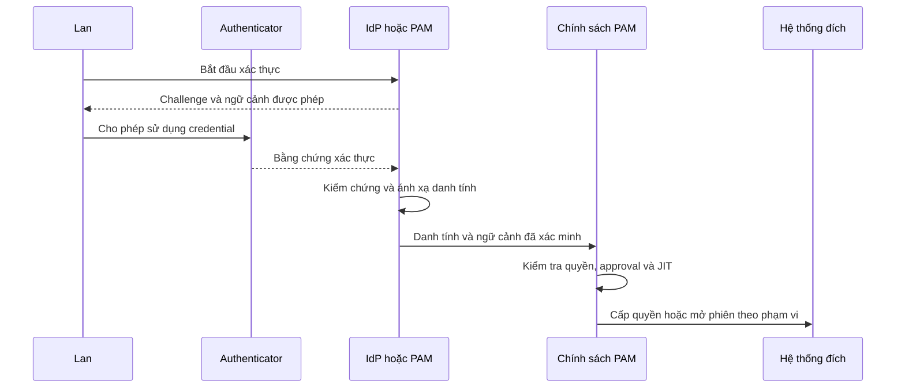

# Passwordless admin authentication

## Mục tiêu bài học

**Passwordless admin authentication** là xác thực người quản trị mà không yêu cầu họ nhập mật khẩu tài khoản vào luồng xác thực đó. Trong PAM, mục tiêu không chỉ là bỏ một ô nhập liệu mà là giảm rủi ro từ mật khẩu dùng lại, bị phishing, chia sẻ hoặc phải tiết lộ cho người vận hành.

Một thiết kế passwordless vẫn có private key, token, cookie và các bí mật khác cần bảo vệ. Nó cũng vẫn cần kiểm soát quyền, phê duyệt, JIT/JEA, vòng đời phiên và khả năng truy nguyên.

Sau bài học này, bạn có thể:

- Phân biệt passwordless, MFA, chống phishing và không lộ credential đích.
- Mô tả cách xác thực bằng khóa công khai cho một danh tính quản trị.
- So sánh khóa gắn thiết bị, credential đồng bộ và các cơ chế chứng thư.
- Thiết kế đăng ký, sử dụng, khôi phục và thu hồi authenticator.
- Kết nối xác thực passwordless với quyền PAM có phạm vi và thời hạn.
- Xây dựng tiêu chí kiểm chứng mà không đồng nhất đăng nhập thành công với quản trị an toàn.

## 1. Bỏ mật khẩu ở đâu?

Trong một hệ thống PAM, có nhiều chặng xác thực khác nhau:

1. Người dùng mở khóa máy trạm.
2. Người dùng đăng nhập PAM hoặc IdP.
3. PAM kiểm tra điều kiện trước thao tác nhạy cảm.
4. Broker xác thực tới hệ thống đích.
5. Hệ thống đích kiểm tra quyền cho hành động.

Bỏ mật khẩu ở chặng 2 không tự bỏ mật khẩu ở chặng 4. Người dùng có thể đăng nhập PAM bằng security key nhưng broker vẫn dùng một mật khẩu quản trị được lưu trong vault để kết nối với thiết bị cũ.

Ngược lại, PAM có thể đăng nhập bằng mật khẩu và MFA, rồi cấp chứng thư SSH ngắn hạn cho đích. Đường xác thực tới đích không dùng mật khẩu, nhưng đăng nhập PAM chưa phải passwordless.

Cần mô tả chính xác phạm vi:

| Cách gọi | Điều cần kiểm chứng |
|---|---|
| Passwordless vào PAM | Luồng xác thực PAM không dựa vào mật khẩu tài khoản của người dùng |
| Passwordless tới đích | Đích chấp nhận cơ chế không dùng mật khẩu như khóa hoặc chứng thư phù hợp |
| Không tiết lộ credential đích cho người dùng | Broker giữ credential và môi giới phiên; credential vẫn có thể tồn tại |
| Không còn password fallback | Không có đường mật khẩu thay thế ngoài chính sách trên phạm vi đã công bố |
| Không còn secret | Đây là một tuyên bố khác; passwordless không chứng minh điều này |

### Ví dụ xuyên suốt

Lan quản lý dịch vụ staging. Lan dùng một authenticator đã đăng ký để xác thực với IdP, rồi vào PAM bằng danh tính cá nhân.

Sau khi đủ điều kiện và có approval, Lan nhận quyền JIT 15 phút để vận hành một dịch vụ. Hệ thống có thể:

- Cấp chứng thư ngắn hạn cho một kết nối được phép.
- Dùng broker mở phiên mà không trả credential cho Lan.
- Liên kết danh tính tới vai trò tại ứng dụng đích.

Trong mọi trường hợp, quyền được thực thi vẫn phải là quyền hẹp đã duyệt. Việc dùng security key không cho Lan quyền quản trị toàn cụm.

## 2. Passwordless không tự đồng nghĩa với MFA hoặc chống phishing

**Passwordless** mô tả việc không dùng mật khẩu trong luồng được xét. **MFA** mô tả sự kết hợp các yếu tố xác thực độc lập theo thiết kế. **Chống phishing** liên quan đến khả năng ngăn bằng chứng bị dùng với bên giả mạo hoặc bị chuyển tiếp sang bên thật.

Những thuộc tính này có liên quan nhưng không đồng nhất.

| Cơ chế | Có thể không dùng mật khẩu? | Điểm cần đánh giá |
|---|---|---|
| Magic link qua email | Có | Quyền kiểm soát email và khả năng bị lừa hoặc chuyển tiếp liên kết |
| Mã dùng một lần | Có thể | Mã có thể bị nhập trên trang giả rồi chuyển tiếp |
| Push xác nhận | Có thể | Ngữ cảnh, mệt mỏi do thông báo và khả năng chấp thuận nhầm |
| WebAuthn/passkey được triển khai phù hợp | Có | Ràng buộc với relying party, xác minh người dùng và vòng đời credential |
| Chứng thư client hoặc smart card | Có | Sở hữu private key, xác minh người dùng, ánh xạ danh tính và thu hồi |
| Khóa SSH | Có | Bảo vệ private key, cấp quyền tại đích, thời hạn và quản lý agent |

Không chọn cơ chế cho quản trị chỉ vì nhãn “passwordless”. Hãy xác định những thuộc tính cần có và cách chứng minh chúng trong toàn bộ vòng đời.

### PIN cục bộ không phải mật khẩu gửi lên server

Một authenticator có thể dùng PIN hoặc sinh trắc học để cho phép sử dụng private key. Trong thiết kế xác thực khóa công khai phù hợp, server kiểm tra bằng chứng mật mã; PIN cục bộ không được gửi như mật khẩu tài khoản tới server.

Tuy vậy, không suy ra mọi thao tác chạm hoặc mở khóa đều là MFA. Cần biết authenticator đã kiểm tra sự hiện diện hay xác minh người dùng như thế nào, và ứng dụng có yêu cầu cũng như kiểm tra đúng thuộc tính đó không.

## 3. Mô hình xác thực bằng khóa công khai

Ý tưởng cốt lõi là server lưu public key hoặc thông tin tin cậy tương ứng, còn authenticator kiểm soát private key.

Một luồng khái niệm:

1. PAM hoặc IdP tạo challenge mới và gắn với phiên đăng nhập đang chờ.
2. Authenticator xác minh điều kiện sử dụng khóa, chẳng hạn xác minh người dùng nếu được yêu cầu.
3. Authenticator tạo bằng chứng mật mã cho challenge và ngữ cảnh giao thức.
4. Server kiểm tra bằng chứng, nguồn gốc, thời hạn và các thuộc tính bắt buộc.
5. Server ánh xạ credential tới danh tính đúng rồi tạo phiên.

Private key không được gửi lên server để đăng nhập. Tuy nhiên, việc khóa có thể được sao chép, đồng bộ hay xuất ra ngoài phụ thuộc loại authenticator và chính sách triển khai.



Nếu PAM dùng federation, IdP thực hiện phần xác thực khóa; PAM kiểm chứng kết quả federation. PAM không tự có bằng chứng về phương thức chỉ vì người dùng được chuyển hướng tới một IdP có hỗ trợ passkey.

## 4. WebAuthn, passkey và những kiểm tra quan trọng

WebAuthn là một cách thực hiện xác thực khóa công khai trong ngữ cảnh web. Passkey thường được dùng để chỉ credential có thể hỗ trợ trải nghiệm đăng nhập không mật khẩu; các triển khai có thể gắn với thiết bị hoặc được đồng bộ theo cơ chế của nhà cung cấp.

Các kiểm tra quan trọng ở phía relying party gồm:

- Challenge đúng với yêu cầu đang chờ và chưa hết hạn.
- Ngữ cảnh origin và relying party phù hợp cấu hình.
- Credential được phép và public key đúng.
- Chữ ký và dữ liệu được ký hợp lệ.
- Các cờ về hiện diện hoặc xác minh người dùng đáp ứng chính sách.
- Danh tính được ánh xạ đúng trước khi tạo hoặc nâng phiên.
- Kết quả không được dùng lại sai luồng.

Không xây một cơ chế “gửi một chuỗi để ký” rồi gọi là tương đương đầy đủ với WebAuthn. Cần dùng triển khai giao thức phù hợp và hiểu những kiểm tra mà server thực sự thực hiện.

### User presence và user verification

Sự hiện diện của người dùng có thể được thể hiện bằng thao tác chạm. Xác minh người dùng có thể cần PIN hoặc cơ chế cục bộ khác được authenticator hỗ trợ.

Một thao tác chạm đơn thuần không nhất thiết chứng minh ai đang dùng authenticator. Với tài khoản quản trị cần xác minh người dùng, chính sách phải yêu cầu và server phải kiểm tra kết quả tương ứng; không chỉ hiện lời nhắc ở frontend.

### Attestation không phải quyền quản trị

Attestation có thể hỗ trợ đánh giá nguồn gốc hoặc thuộc tính của authenticator theo cơ chế được triển khai. Nó không thay thế xác minh danh tính nhân sự, approval hoặc phân quyền.

Việc chấp nhận một loại authenticator cũng cần xem xét quyền riêng tư, khả năng quản lý và chính sách tổ chức. Không mặc định mọi luồng đều cần thu thập attestation hoặc một dữ liệu attestation bất kỳ đủ chứng minh mọi thuộc tính bảo mật.

### Không dùng bộ đếm như bằng chứng duy nhất

Khả năng và ngữ nghĩa bộ đếm chữ ký có thể khác giữa các loại credential, đặc biệt với cơ chế đồng bộ. Không thiết kế phát hiện sao chép chỉ dựa vào giả định mọi authenticator luôn có bộ đếm tăng đơn điệu như nhau.

Tín hiệu kỹ thuật cần được diễn giải theo loại credential và dữ liệu mà triển khai cung cấp. Một dấu hiệu bất thường có thể yêu cầu kiểm tra, nhưng không nên bị bỏ qua hoặc kết luận tùy tiện.

## 5. Credential gắn thiết bị và credential đồng bộ

| Thuộc tính cần xét | Credential gắn thiết bị | Credential đồng bộ |
|---|---|---|
| Phạm vi sử dụng khóa | Gắn với authenticator hoặc thiết bị theo thiết kế | Có thể sử dụng trên nhiều thiết bị qua cơ chế đồng bộ |
| Tính tiện dụng khi đổi máy | Cần kế hoạch chuyển hoặc authenticator dự phòng | Có thể thuận tiện hơn nếu phục hồi đồng bộ thành công |
| Rủi ro cần quản trị | Mất thiết bị, bảo vệ khóa, đăng ký dự phòng | Tài khoản đồng bộ, thiết bị được thêm và cơ chế khôi phục |
| Thuộc tính không được tự suy | Không phải mọi khóa gắn thiết bị đều có cùng bảo vệ phần cứng | Không phải mọi cơ chế đồng bộ có cùng mức bảo đảm |
| Căn cứ chấp nhận | Thuộc tính có thể kiểm chứng và chính sách tài khoản | Thuộc tính có thể kiểm chứng, quản lý và chuỗi khôi phục |

Với quản trị nhạy cảm, tổ chức cần quyết định những loại credential nào được chấp nhận cho từng hành động, thay vì dùng một nhãn passkey chung.

Một lựa chọn có thể tốt cho người dùng phổ thông nhưng không đáp ứng yêu cầu riêng về quyền kiểm soát khóa quản trị. Ngược lại, yêu cầu cứng nhắc mà không có dự phòng có thể đẩy người dùng sang đường khôi phục yếu hoặc chia sẻ thiết bị.

Đánh giá cả vòng đời: ai có thể thêm thiết bị, tài khoản nào phục hồi được credential, bằng chứng nào tồn tại và một thiết bị bị mất được loại khỏi phạm vi tin cậy bằng cách nào.

## 6. Passwordless tới hệ thống đích

### SSH với khóa hoặc chứng thư ngắn hạn

Một hệ thống có thể xác thực người dùng tại PAM rồi cấp chứng thư SSH có principal và thời hạn phù hợp. Đích phải tin đúng CA, kiểm tra nội dung chứng thư và chỉ cho ánh xạ vào tài khoản được phép.

Chứng thư không tự chứng minh người dùng đang sở hữu private key; luồng xác thực còn phải có bằng chứng sử dụng khóa tương ứng. Không coi file chứng thư công khai là secret tương đương private key, nhưng vẫn quản lý nó theo mục đích và tránh phát sai phạm vi.

JEA còn phụ thuộc cấu hình tài khoản, lệnh được phép, quyền sudo hoặc cơ chế thực thi tại đích. Chứng thư cho phép đăng nhập không tự giới hạn mọi lệnh sau đăng nhập.

Thời hạn chứng thư thường giới hạn khả năng bắt đầu xác thực mới, không tự đóng mọi kết nối SSH đã được mở. Cần cơ chế chấm dứt phiên và thu hồi phù hợp nếu yêu cầu vận hành cần điều đó.

Không mặc định agent forwarding an toàn vì private key không được sao chép trực tiếp. Một agent được sử dụng từ nơi không tin cậy có thể trở thành đường ký hoặc xác thực ngoài ý muốn, tùy cơ chế và cấu hình.

### Chứng thư client và smart card

Xác thực chứng thư client có thể chứng minh khả năng sử dụng private key tương ứng trong một ngữ cảnh giao thức. Cần thêm ánh xạ chứng thư tới chủ thể, kiểm tra chuỗi tin cậy, thời hạn và cơ chế thu hồi được áp dụng.

Nó không tự chứng minh một con người vừa hiện diện hoặc mọi lần dùng khóa đều được xác minh. Những thuộc tính đó phụ thuộc authenticator và chính sách sử dụng khóa.

### SSO và ticket trong môi trường doanh nghiệp

Một trải nghiệm SSO có thể cho phép quản trị mà không nhập lại mật khẩu. Tuy nhiên, ticket hoặc token vẫn có giá trị xác thực và cần được bảo vệ, giới hạn thời hạn, audience và quyền.

Không đánh giá passwordless chỉ qua số lần người dùng thấy hộp thoại mật khẩu. Cần xác định bằng chứng nào được dùng tại từng chặng và cơ chế cấp, làm mới, thu hồi của chúng.

### Đích cũ vẫn cần mật khẩu

Nếu thiết bị không hỗ trợ cơ chế khác, PAM có thể giữ mật khẩu trong vault, môi giới phiên và luân chuyển theo chính sách. Khi đó, người quản trị có thể có trải nghiệm không nhập hoặc xem mật khẩu đích.

Cần nói rõ mật khẩu vẫn tồn tại tại đích và broker. Không công bố “đã loại bỏ mọi mật khẩu” nếu chỉ bỏ việc tiết lộ cho người dùng.

## 7. Đăng ký authenticator là một thao tác đặc quyền

Nếu kẻ tấn công thêm được credential của họ vào tài khoản quản trị, các lần xác thực sau có thể hoàn toàn hợp lệ về mặt mật mã.

Vì vậy, đăng ký cần trả lời:

- Danh tính nào đang được đăng ký?
- Bằng chứng ban đầu có đủ để ràng buộc người đó với tài khoản không?
- Ai được thêm hoặc thay authenticator?
- Có cần thiết bị được quản lý hoặc loại khóa được cho phép không?
- Có thông báo và audit về thay đổi không?
- Một phiên bị đánh cắp có thể tự thêm credential mới không?

### Bootstrap lần đầu

Lần đăng ký đầu tiên có thể dùng một quy trình xác minh nhân sự và cấp phát được quản lý. Nếu có thông tin kích hoạt tạm thời, cần hạn sử dụng, phạm vi hẹp và giới hạn sử dụng theo thiết kế.

Không gửi một liên kết có thể chuyển tiếp rồi coi người mở liên kết chắc chắn là người quản trị cần được cấp credential. Phải xác định bằng chứng và kênh xác minh phù hợp.

### Thêm khóa dự phòng

Khóa dự phòng giảm nguy cơ mất truy cập, nhưng cũng là một phương tiện đăng nhập thật. Nó cần được đăng ký cho đúng người, bảo vệ độc lập và quản lý vòng đời như khóa chính.

Không dùng một security key chung cho cả nhóm để thay cho danh tính cá nhân. Việc nhiều người cùng biết PIN hoặc dùng một thiết bị chung làm giảm khả năng quy kết và thu hồi theo người.

### Thay đổi phải được phát hiện

Ghi nhận thêm, xóa, đổi tên hoặc thay đổi chính sách credential. Gửi thông báo phù hợp cho chủ tài khoản và bộ phận quản lý, nhưng không đưa thông tin nhạy cảm không cần thiết vào thông báo.

Nếu hành động đăng ký có mức tác động cao, có thể cần xác thực mới, approval hoặc sự kiểm tra độc lập theo chính sách. Không để cùng một phiên yếu vừa đăng nhập vừa tự nâng thành credential quản trị được tin cậy mạnh.

## 8. Khôi phục và mất authenticator

Độ mạnh thực tế của hệ thống không thể tách khỏi đường khôi phục. Một credential được bảo vệ tốt có thể bị vô hiệu hóa về mặt kiểm soát nếu helpdesk có thể thêm khóa mới chỉ dựa trên một cuộc gọi dễ giả mạo.

### Phân biệt các tình huống

| Tình huống | Điều cần xử lý |
|---|---|
| Người dùng quên PIN cục bộ | Xử lý theo khả năng authenticator, không mặc định có thể lấy lại private key |
| Mất một khóa nhưng còn khóa dự phòng | Xác thực bằng phương tiện còn hợp lệ, báo mất và thu hồi credential mất |
| Mất mọi phương tiện | Quy trình khôi phục có xác minh lại danh tính và kiểm soát cấp mới |
| Nghi tài khoản bị chiếm quyền | Ứng phó sự cố, thu hồi phiên và credential liên quan trước hoặc cùng với cấp lại |
| Thiết bị đồng bộ bị thêm trái phép | Xử lý cả hệ sinh thái đồng bộ và các phiên/grant đã phát sinh |

Khôi phục phải có căn cứ đủ mạnh cho tài khoản quản trị, có người chịu trách nhiệm và bằng chứng. Nếu có yêu cầu nhiều bên độc lập, phải kiểm tra độc lập thật sự, không chỉ hai lần bấm của cùng người.

### Recovery code và fallback

Recovery code là secret có giá trị. Nếu sử dụng, cần sinh và lưu theo cơ chế an toàn, giới hạn sử dụng, bảo vệ nơi lưu và thu hồi khi cần.

Không bật một mật khẩu dự phòng dễ dùng trên mọi endpoint rồi chỉ gọi nó là “emergency”. Các đường fallback phải nằm trong inventory, có điều kiện rõ ràng và được kiểm thử như luồng chính.

Một quy trình break-glass có thể cần tồn tại cho sự cố hạ tầng xác thực, nhưng phải tách khỏi fallback tự động: phạm vi nhỏ, thời hạn rõ, audit và hậu kiểm theo chính sách tổ chức.

## 9. Ràng buộc passwordless với IAM và PAM

Một quyết định cấp quyền quản trị cần kết hợp:

```text
Danh tính được xác thực
    + điều kiện phương thức và độ mới
    + eligibility của người xin
    + approval đúng phiên bản
    + tài sản và vai trò được phép
    + cửa sổ công việc và thời hạn JIT
    + khả năng thực thi tại đích
```

Không biến credential mạnh thành một vai trò quản trị thường trực không cần kiểm tra.

### Danh tính cá nhân và danh tính quản trị

Tổ chức có thể tách tài khoản sử dụng thông thường và tài khoản quản trị. Nếu tách, cần ánh xạ chúng tới cùng người có trách nhiệm mà vẫn giữ đúng ranh giới phiên và quyền.

Không cho phép tên hiển thị hoặc email tự khai quyết định tài khoản quản trị nào được sử dụng. Định danh, nguồn và mapping cần có thẩm quyền.

Với tài khoản đích dùng chung do broker quản lý, audit phải nối người xác thực → request → approval → phiên → tài khoản đích. Việc dùng passwordless ở đầu vào không tự làm log của tài khoản chung trở thành log danh tính cá nhân.

### Step-up cho hành động nhạy cảm

Một lần passwordless vào đầu ngày chưa chắc đáp ứng yêu cầu mở vault hoặc thay đổi chính sách vào cuối ngày. Xem xét độ mới, mức bảo đảm và phạm vi dùng lại.

Bằng chứng step-up cần gắn với đúng người, phiên và hành động theo thiết kế. Không dùng một cờ toàn cục để mở mọi quyền sau một lần xác thực.

## 10. Các giới hạn cần đưa vào mô hình đe dọa

### Phishing giảm nhưng session vẫn có thể bị đánh cắp

Một phương thức có ràng buộc với relying party có thể chống việc dùng credential trên site giả, nhưng session cookie hoặc token sau đăng nhập vẫn có thể bị lộ qua những đường khác.

Cần bảo vệ ứng dụng và endpoint: chống XSS/CSRF, bảo vệ cookie, thời hạn, kiểm soát phiên và thu hồi. Không coi cookie đã phát sau passwordless là vô hại.

### Máy quản trị bị xâm nhập

Mã độc có thể can thiệp thao tác, lấy dữ liệu được hiển thị hoặc lạm dụng phiên đã mở. Authenticator mạnh không tự làm máy trạm sạch.

Với quyền nhạy cảm, cần mô hình thiết bị quản trị và điều kiện truy cập phù hợp. Các thuộc tính đó phải được xác minh qua nguồn tin cậy, không qua checkbox do người dùng tự đánh dấu.

### Xác thực không chứng minh ý định cho mọi giao dịch

Người dùng chạm khóa để đăng nhập không có nghĩa đã xác nhận mọi thay đổi cấu hình phía sau. Ràng buộc xác thực với action ở server có ích, nhưng không tự đồng nghĩa authenticator đã hiển thị và ký toàn bộ nội dung nghiệp vụ.

Nếu yêu cầu xác nhận giao dịch cụ thể, cần thiết kế và bằng chứng tương ứng. Không gọi mọi lần sử dụng security key là phê chuẩn một thay đổi production.

### Tài khoản đồng bộ và khôi phục là phần của trust

Với credential đồng bộ, đánh giá việc thêm thiết bị và phục hồi tài khoản đồng bộ. Với credential gắn thiết bị, đánh giá cấp phát, mất thiết bị và dự phòng.

Không có loại credential nào miễn quản trị vòng đời. Mỗi mô hình chuyển một phần rủi ro sang những thành phần khác nhau.

## 11. Thu hồi phải đi qua nhiều lớp

Xóa public key hoặc credential khỏi tài khoản có thể ngăn các lần xác thực mới bằng credential đó. Nó không tự đóng mọi phiên PAM, token federation, kết nối đích hoặc grant JIT đã tồn tại.

Một quy trình khi mất khóa có thể gồm:

1. Xác định credential, người dùng và các phiên liên quan.
2. Chặn hoặc thu hồi credential tại nguồn xác thực.
3. Vô hiệu các phiên hoặc token liên quan theo khả năng của nền tảng.
4. Ngăn nhận thêm credential đích hoặc mở phiên mới.
5. Gỡ grant JIT và đóng phiên đích khi cần.
6. Đối soát và ghi phần chưa thu hồi được.
7. Cấp lại sau xác minh và kiểm tra dấu hiệu sử dụng trái phép.

Với chứng thư ngắn hạn, hạn chứng thư chỉ là một giới hạn của một lớp. Cần hiểu đích kiểm tra thu hồi khi nào và phiên đang chạy được xử lý ra sao.

Nếu thu hồi thất bại ở một thành phần, không ghi nhận “hoàn tất” chỉ vì tài khoản đã bị disable tại IdP. Cần trạng thái tồn đọng, cảnh báo và trách nhiệm xử lý.

## 12. Chính sách minh họa

```yaml
# Mô tả yêu cầu, không phải cấu hình có thể nạp trực tiếp.
identity:
  human_admin_identity: individual_and_traceable
  account_linking: authoritative_mapping
authentication:
  accepted_methods: organization_defined_public_key_methods
  user_verification: required_for_sensitive_admin_actions
  identity_provider_result: server_verified
  freshness: defined_per_action
enrollment:
  initial_identity_check: required
  add_authenticator: protected_sensitive_action
  backup_authenticator: individually_registered
  shared_team_authenticator: not_allowed
authorization:
  eligibility_check: required
  approval: according_to_asset_and_action_policy
  target_role: least_privilege
  grant: time_limited
recovery:
  verified_identity_and_authority: required
  silent_password_fallback: not_allowed
  emergency_access: separately_controlled
revocation:
  credential: required
  related_sessions_and_grants: evaluated_and_revoked_as_needed
audit:
  lifecycle_and_access_events: required
  private_keys_and_recovery_secrets_in_logs: forbidden
```

Mỗi dòng cần một thành phần thực thi và ca kiểm chứng. Chẳng hạn `user_verification` không được thực hiện chỉ bằng lời nhắc “hãy dùng PIN”; server phải nhận và kiểm tra bằng chứng phù hợp với phương thức.

`accepted_methods` cũng cần mapping cụ thể từ nguồn xác thực. Một nhãn do client gửi hoặc tên thiết bị do người dùng đặt không chứng minh loại credential đáp ứng chính sách.

## 13. Audit và dữ liệu cần bảo vệ

Nên ghi các sự kiện:

- Đăng ký, thay thế, vô hiệu và thu hồi credential.
- Thay đổi phương thức được chấp nhận và đường khôi phục.
- Xác thực thành công, thất bại hoặc không đạt điều kiện.
- Step-up và phạm vi hành động liên quan.
- Yêu cầu, approval, grant và phiên được tạo.
- Lần dùng fallback hoặc break-glass.
- Thu hồi chưa hoàn tất và kết quả đối soát.

```json
{
  "event_type": "pam.admin.authentication_accepted",
  "actor_reference": "principal-example-lan",
  "authentication_source": "idp-example-corporate",
  "method_context": "admin-public-key-accepted",
  "credential_reference": "credential-example-41",
  "user_verification_result": "accepted",
  "session_reference": "session-example-901",
  "policy_version": "admin-auth-example-v4",
  "result": "accepted"
}
```

Đây là schema minh họa; thông tin thực tế phụ thuộc nơi kiểm chứng phương thức. PAM dùng federation chỉ nên ghi những thuộc tính đã được xác minh qua tích hợp, không bịa chi tiết về authenticator.

Không ghi private key, PIN, recovery code, token nguyên vẹn hoặc dữ liệu sinh trắc học vào log. Credential ID hoặc metadata cũng có thể cần hạn chế truy cập dù không phải secret như private key.

Bảo vệ tính toàn vẹn log, phân quyền xem và có chính sách lưu phù hợp. Liên kết được sự kiện xác thực với quyền và phiên, nhưng không suy rằng một lần xác thực thành công chứng minh mọi thao tác nghiệp vụ đã được phê duyệt.

## 14. Lộ trình chuyển đổi có thể kiểm chứng

### Bước 1 — Kiểm kê đường truy cập

Liệt kê PAM, IdP, vault, console đích, API, SSH, tài khoản local và đường hỗ trợ. Ghi đường nào dùng mật khẩu, khóa, chứng thư hoặc token, và có fallback nào.

Nếu chỉ kiểm kê giao diện web, một endpoint API dùng mật khẩu cũ có thể tiếp tục là đường vào đặc quyền.

### Bước 2 — Chốt thuộc tính cần đạt

Xác định phương thức được chấp nhận cho từng loại quyền, điều kiện thiết bị, yêu cầu xác minh người dùng, độ mới và khả năng quản lý credential.

Định nghĩa rõ phạm vi tuyên bố passwordless: đầu vào PAM, tới đích hay cả hai.

### Bước 3 — Thử nghiệm enrollment và recovery trước

Đăng ký credential, thử mất khóa, dùng dự phòng, khôi phục và thu hồi. Đường này phải vận hành được trước khi loại bỏ phương thức cũ.

Không đánh giá thử nghiệm chỉ bằng việc một người đăng nhập thành công một lần.

### Bước 4 — Triển khai theo phạm vi

Bắt đầu với nhóm và tài sản phù hợp, theo dõi lỗi xác thực, trợ giúp và đường truy cập còn tồn tại. Mở rộng sau khi các thuộc tính cần thiết đã được kiểm chứng.

Chỉ loại bỏ fallback thuộc phạm vi được phép sau khi có khả năng khôi phục và emergency đã được kiểm tra. Không để một fallback rộng tồn tại vô thời hạn mà không có trách nhiệm quản lý.

### Bước 5 — Đối soát quyền và bằng chứng

Kiểm tra role, JIT, phiên và audit tại đích. Passwordless thành công nhưng cấp sai role vẫn là một triển khai PAM sai phạm vi.

Theo dõi thay đổi IdP, authenticator và cơ chế khôi phục vì chúng có thể làm thay đổi điều kiện tin cậy ban đầu.

## 15. Bài thực hành

Dùng môi trường lab, danh tính thử nghiệm và tài sản giả. Không dùng private key hoặc recovery code production để minh họa.

### Chuẩn bị

Tạo người quản trị A, người dùng B không đủ quyền và một tài sản staging. Chuẩn bị authenticator chính, phương tiện dự phòng được phép, một vai trò hẹp và một đường truy cập legacy giả lập dùng vault.

Ghi rõ nguồn xác thực, cơ chế passwordless, yêu cầu xác minh người dùng, mapping danh tính và thời hạn grant.

### Ca kiểm thử

| Ca | Thao tác | Kết quả mong đợi |
|---|---|---|
| Xác thực đúng | A dùng credential đã đăng ký | Nhận đúng danh tính và ngữ cảnh được kiểm chứng |
| Credential sai | B thử dùng credential của danh tính khác | Không được nối vào tài khoản A theo tên hoặc email tự khai |
| Không đạt yêu cầu | Dùng phương thức chưa đủ hoặc thiếu xác minh bắt buộc | Không được nhận quyền nhạy cảm |
| Challenge cũ | Dùng lại phản hồi của lần xác thực trước | Không tạo phiên mới trái phép |
| Ngữ cảnh sai | Dùng kết quả không thuộc relying party hoặc luồng hợp lệ | Bị từ chối ở điểm kiểm chứng |
| Thêm credential | Thử thêm khóa bằng phiên không đủ điều kiện | Không đăng ký được một đường xác thực mới |
| Dự phòng | Dùng phương tiện dự phòng đã quản lý | Vẫn đúng danh tính, chính sách và audit |
| Mất khóa | Thu hồi credential chính | Không xác thực mới bằng credential đó; đánh giá phiên/grant liên quan |
| Recovery | Thực hiện quy trình khôi phục lab | Có xác minh, thẩm quyền và bằng chứng, không fallback âm thầm |
| Không có approval | A xác thực mạnh nhưng chưa đủ phê chuẩn | Không cấp quyền tại đích |
| Least privilege | A nhận role vận hành hẹp | Không thực hiện được thao tác quản trị ngoài role |
| Legacy target | Broker dùng credential vault cho đích giả lập | Người dùng không nhận secret; báo cáo ghi đúng mật khẩu vẫn tồn tại |
| API thay thế | Gọi đường cũ hoặc endpoint trực tiếp | Không bỏ qua chính sách xác thực và quyền |
| Thu hồi phiên | Vô hiệu credential trong khi phiên đang mở | Hành vi theo chính sách, có kiểm chứng từng lớp và trạng thái tồn đọng |
| Audit | Xem sự kiện thành công, thất bại và khôi phục | Có tương quan; không chứa secret hoặc dữ liệu sinh trắc học |

Với ca thu hồi, tách kiểm tra xác thực mới, phiên PAM, token, grant và phiên đích. Với credential đồng bộ, kiểm tra những thiết bị và đường khôi phục thuộc mô hình lab.

Báo cáo cần nêu thuộc tính đã kiểm chứng và giới hạn. Không kết luận “không còn mật khẩu” chỉ vì người dùng không gõ mật khẩu trong một lần truy cập.

## 16. Câu hỏi tự kiểm tra

1. Vì sao magic link không tự có cùng thuộc tính chống phishing với một cơ chế ràng buộc relying party?
2. PIN dùng để mở khóa authenticator khác gì mật khẩu gửi tới server?
3. Vì sao đăng ký thêm authenticator cần được coi là thao tác nhạy cảm?
4. Xóa credential khỏi IdP đã đủ để kết thúc mọi quyền quản trị chưa?
5. Nếu PAM đăng nhập bằng passkey nhưng broker dùng mật khẩu vault, có thể tuyên bố điều gì?

### Gợi ý đối chiếu

1. Liên kết hoặc mã có thể bị chuyển tiếp và phụ thuộc an toàn của kênh nhận; phải đánh giá cơ chế cụ thể thay vì chỉ nhãn passwordless.
2. PIN cục bộ cho phép sử dụng khóa trong thiết kế tương ứng; server kiểm tra bằng chứng mật mã chứ không nhận PIN như mật khẩu tài khoản.
3. Người thêm được credential có thể tạo đường đăng nhập hợp lệ cho tương lai, nên phải kiểm tra danh tính, thẩm quyền và bằng chứng.
4. Chưa. Phiên, token, grant và kết nối tại đích có vòng đời riêng cần được thu hồi hoặc đối soát.
5. Có passwordless ở đầu vào PAM và có thể không tiết lộ credential đích cho người dùng; mật khẩu tại vault và đích vẫn tồn tại.

Passwordless admin authentication đạt mục tiêu khi loại bỏ được rủi ro mật khẩu trong phạm vi đã xác định mà vẫn giữ danh tính cá nhân, quyền hẹp, khôi phục có kiểm soát và thu hồi có thể kiểm chứng. Chất lượng triển khai được quyết định bởi toàn bộ vòng đời đó, không chỉ trải nghiệm đăng nhập.
