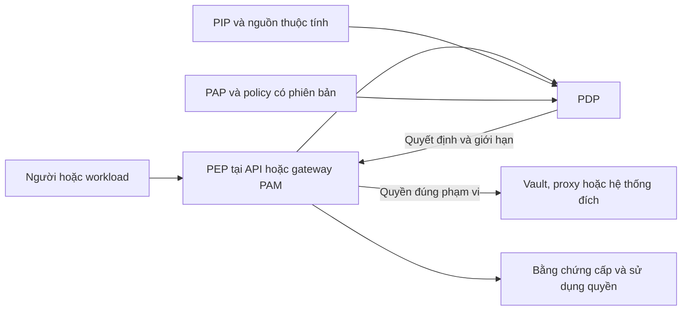

# ABAC cho PAM

## 1. ABAC giải quyết bài toán gì?

Attribute-Based Access Control (ABAC) là cách ra quyết định cấp quyền dựa trên thuộc tính của chủ thể, tài nguyên, hành động và ngữ cảnh liên quan. Thay vì chỉ hỏi người dùng có một role hay không, hệ thống đánh giá liệu những thuộc tính hiện tại có đáp ứng chính sách cho một thao tác cụ thể hay không. Cách hiểu này phù hợp với định nghĩa ABAC trong NIST SP 800-162. [Hướng dẫn ABAC của NIST](https://csrc.nist.gov/pubs/sp/800/162/upd2/final).

Trong quản lý truy cập đặc quyền (Privileged Access Management, PAM), ABAC có thể hỗ trợ các câu hỏi như:

- Người trực ca có được khởi động lại đúng dịch vụ mình phụ trách không?
- Quyền production có được kích hoạt trong cửa sổ change đã được phê duyệt không?
- Thiết bị và mức xác thực hiện tại có phù hợp với thao tác nhạy cảm không?
- Tài khoản nào được sử dụng, trên tài nguyên nào và trong bao lâu?

Sau bài học, người học có thể xây dựng tập thuộc tính có nguồn gốc rõ, mô tả policy theo công việc PAM, xác định nơi ra quyết định và nơi thực thi, đồng thời kiểm thử trường hợp thiếu dữ liệu, thay đổi thuộc tính và thu hồi quyền.

ABAC là mô hình cấp quyền. Nó không tự cung cấp MFA, vault, proxy phiên, phê duyệt công việc hoặc cơ chế thu hồi. Những thành phần đó cung cấp dữ liệu và thực thi các điều kiện mà policy cần.

## 2. Tình huống: role quá rộng cho một công việc ngắn

An thuộc đội vận hành payment và đang trực ca. Một change cho phép khởi động lại riêng dịch vụ payment-worker trên app-pay-01 trong cửa sổ bảo trì.

Nếu An có role quản trị toàn bộ production thường trực, quyền vượt xa nhu cầu của công việc. Nếu tổ chức tạo một role mới cho mọi tổ hợp người, máy, cửa sổ và loại tác vụ, danh mục role có thể trở nên khó quản lý.

Một thiết kế kết hợp có thể dùng role để xác định An được yêu cầu nhóm tác vụ vận hành, rồi dùng ABAC để kiểm tra phần việc cụ thể: đúng dịch vụ, đúng tài nguyên, đúng change, đúng thời gian, đúng thiết bị và đúng mức xác thực. Khi các điều kiện thỏa mãn, PAM cấp khả năng khởi động lại được giới hạn trong thời gian cần thiết.

Kết quả mong muốn là quyền đủ cho công việc đã được cho phép, không phải một phiên quản trị tổng quát chỉ kèm lời hứa rằng người dùng sẽ tự giữ giới hạn.

## 3. Bốn nhóm thuộc tính trong ngữ cảnh PAM

| Nhóm | Ví dụ thuộc tính | Nguồn có thể quản lý |
|---|---|---|
| Chủ thể, subject | Định danh, loại tài khoản, đội phụ trách, phân công trực ca | IdP, hệ thống nhân sự, lịch trực, danh mục workload |
| Tài nguyên, resource/object | Tenant, dịch vụ, môi trường, chủ sở hữu, mức nhạy cảm | Danh mục tài sản, cloud inventory, hệ thống quản lý dịch vụ |
| Hành động, action | Xem trạng thái, mở phiên, restart dịch vụ, lấy credential | API hoặc danh mục capability của PAM |
| Ngữ cảnh | Thời gian, yêu cầu công việc, thiết bị, mức xác thực, phê duyệt | Đồng hồ server, ITSM, dịch vụ thiết bị, IdP, workflow PAM |

Việc phân nhóm phục vụ mô hình hóa; schema thực tế có thể tổ chức khác. Điều quan trọng là xác định đúng ý nghĩa, nguồn và cách sử dụng từng thuộc tính.

Không đặt tên hành động quá chung như `admin` nếu cần phân biệt đọc trạng thái với thay đổi cấu hình. Hành động phải có cách ánh xạ tới khả năng thực tế tại đích; nếu tất cả đều dẫn tới cùng tài khoản `root` không giới hạn, độ chi tiết trong policy chưa trở thành độ chi tiết của quyền.

Với yêu cầu nhiều tài nguyên, mọi tài nguyên phải được đánh giá. Việc một máy thuộc đúng đội không chứng minh toàn bộ danh sách máy được gửi lên đều thuộc phạm vi cho phép.

## 4. ABAC và RBAC có thể phối hợp

RBAC xác định quyền theo vai trò; ABAC sử dụng thuộc tính và điều kiện để quyết định một yêu cầu cụ thể. Hai mô hình không nhất thiết loại trừ nhau.

Ví dụ:

```text
RBAC:
  Người có vai trò payment-operator được yêu cầu tác vụ vận hành payment.

ABAC:
  Chỉ cho phép service.restart khi người dùng đang được phân công,
  tài nguyên thuộc đúng dịch vụ và tenant, change hợp lệ,
  thời gian nằm trong cửa sổ được duyệt và các điều kiện bảo mật đạt yêu cầu.
```

Role cũng có thể là một thuộc tính trong policy. Tuy nhiên, nếu rule chỉ kiểm tra `role == admin` rồi cho phép mọi thứ, việc gọi nó là ABAC không tạo thêm giới hạn.

Trong triển khai AWS IAM, một cách áp dụng ABAC là đối chiếu tag của principal với tag của tài nguyên. Đây là ví dụ về sử dụng thuộc tính trong một nền tảng cụ thể, không có nghĩa mọi dịch vụ hoặc mọi sản phẩm PAM hỗ trợ cùng tập điều kiện. [Tài liệu AWS về ABAC](https://docs.aws.amazon.com/IAM/latest/UserGuide/introduction_attribute-based-access-control.html).

Khi chuyển từ RBAC sang mô hình kết hợp, nên giữ rõ mục đích của từng lớp: role xác định khả năng yêu cầu, ABAC thu hẹp lần sử dụng và cơ chế đích thực thi quyền cụ thể. Tránh tạo nhiều lớp cho phép độc lập mà một lớp có thể mở lại quyền lớp khác đang muốn giới hạn.

## 5. Chất lượng thuộc tính là một phần của ranh giới bảo mật

Một rule viết đúng vẫn có thể cấp sai quyền nếu thuộc tính sai, quá hạn hoặc do chính người yêu cầu tự điều khiển. Cần thiết kế việc quản trị thuộc tính cùng với thiết kế policy, không xem đó là công việc phụ sau khi viết rule.

NIST SP 800-205 tập trung vào các yếu tố cần xem xét khi triển khai thuộc tính trong hệ thống kiểm soát truy cập. Bài học áp dụng hướng tiếp cận đó bằng cách yêu cầu mỗi thuộc tính dùng trong PAM có định nghĩa, nguồn có thẩm quyền và cách xử lý khi không xác minh được. [Hướng dẫn NIST về thuộc tính cho kiểm soát truy cập](https://csrc.nist.gov/pubs/sp/800/205/final).

Một hợp đồng thuộc tính nên nêu:

- Tên và ý nghĩa: `resource.environment` có nghĩa gì trong tổ chức?
- Kiểu và miền giá trị: chỉ nhận `lab`, `staging`, `production` hay giá trị khác?
- Nguồn quản lý và ai có quyền sửa.
- Thời điểm quan sát, phiên bản và giới hạn độ mới.
- Hành vi khi thiếu, không hợp lệ, không thống nhất hoặc quá hạn.

Ví dụ, `on_call` không nên là cờ do người dùng chọn trên biểu mẫu. Nó cần đến từ lịch trực hoặc phân công được quản lý. `device_compliant` cũng phải có nguồn đáng tin và thời hạn, không phải header tự khai.

Phân biệt dữ liệu do người dùng cung cấp với dữ liệu đã được xác minh. Một mã ticket người dùng nhập là đầu vào để tra cứu; nó chưa phải kết quả rằng ticket đó đang cho phép công việc.

## 6. Ví dụ schema đầu vào đã được chuẩn hóa

Dữ liệu sau minh họa ngữ cảnh do phía hệ thống xây dựng sau khi xác thực và đối chiếu nguồn. Đây không phải payload mà client được phép tự quyết định toàn bộ giá trị:

```json
{
  "subject": {
    "id": "idp-lab:user-an",
    "type": "human",
    "status": "active",
    "roles": ["payment-operator"],
    "allowed_tenants": ["tenant-lab-a"],
    "on_call_services": ["payment"]
  },
  "action": "service.restart",
  "resources": [
    {
      "id": "asset-app-pay-01",
      "version": 12,
      "tenant": "tenant-lab-a",
      "service": "payment",
      "environment": "production"
    }
  ],
  "request": {
    "id": "PAM-LAB-902",
    "revision": 1,
    "service_name": "payment-worker",
    "requested_duration_minutes": 10
  },
  "context": {
    "change_reference": "CHG-LAB-082",
    "authentication_evidence_reference": "auth-lab-902",
    "device_evidence_reference": "device-check-lab-91",
    "approval_reference": "approval-lab-902"
  }
}
```

Các tham chiếu trong `context` phải được giải quyết thành dữ liệu có thể kiểm tra theo policy. Một chuỗi có tên `approval_reference` không chứng minh phê duyệt tồn tại, còn hiệu lực hoặc đúng revision yêu cầu.

Tenant, service và environment phải được tra từ danh mục tài nguyên bằng định danh đã chuẩn hóa. Không tin thuộc tính tài nguyên do client gửi khi client có thể sửa nó để làm điều kiện khớp.

Với schema này, còn cần thời gian server, phạm vi change và các kết quả xác minh. Chúng được lược bỏ để giữ ví dụ dễ đọc, không có nghĩa có thể bỏ khỏi quyết định khi policy cần chúng.

## 7. Các thành phần ra quyết định và thực thi

Một kiến trúc có thể tách các trách nhiệm:

| Thành phần | Trách nhiệm trong thiết kế PAM |
|---|---|
| Policy Administration Point, PAP | Quản trị, kiểm thử và phát hành policy |
| Policy Information Point, PIP | Cung cấp thuộc tính từ nguồn được quản lý |
| Policy Decision Point, PDP | Đánh giá yêu cầu và thuộc tính theo policy |
| Policy Enforcement Point, PEP | Chặn hoặc thực hiện thao tác theo kết quả và điều kiện bắt buộc |

PDP trả kết quả không đồng nghĩa đã cấp quyền ở đích. PEP phải kiểm tra kết quả thuộc đúng yêu cầu, còn hiệu lực và các nghĩa vụ kèm theo có thể thực hiện được.



Có thể triển khai các trách nhiệm trong cùng sản phẩm hoặc nhiều dịch vụ. Điều quan trọng là mọi đường truy cập cần kiểm soát đều có điểm thực thi. Một UI ẩn nút restart không phải ranh giới nếu API restart vẫn cho phép gọi trực tiếp.

## 8. Xây dựng policy theo một công việc cụ thể

Với ví dụ restart payment-worker, ý định chính sách có thể là:

```text
Cho phép yêu cầu service.restart khi:
  - chủ thể là người dùng active và có khả năng yêu cầu vận hành payment;
  - chủ thể đang được phân công cho dịch vụ payment;
  - mọi tài nguyên thuộc tenant được phép và dịch vụ payment;
  - change cho phép đúng tài nguyên, dịch vụ và hành động;
  - thời gian hiện tại nằm trong cửa sổ change;
  - phê duyệt đúng yêu cầu và revision, đáp ứng phân tách trách nhiệm;
  - thiết bị và bằng chứng xác thực đáp ứng điều kiện của thao tác;
  - thời lượng yêu cầu không vượt giới hạn cho phép;
  - lớp thực thi có thể giới hạn tác vụ và lưu bằng chứng bắt buộc.
```

Ví dụ quy định tối đa 10 phút là lựa chọn của lab, không phải chuẩn áp dụng chung. Nếu người dùng yêu cầu 30 phút, hệ thống cần từ chối, yêu cầu điều chỉnh hoặc đề xuất phạm vi mới theo workflow; không âm thầm thay đổi rồi giả định mọi bên đã chấp thuận.

Các điều kiện phải khớp cùng một yêu cầu. Không ghép một change hợp lệ của tài nguyên A với phê duyệt khác của tài nguyên B để cho phép tài nguyên C.

Cũng cần xác định những điều kiện cấm độc lập: tài khoản bị vô hiệu hóa, tài nguyên ngoài tenant hoặc chủ thể tự phê duyệt cho yêu cầu của chính mình khi policy cấm điều đó. Một rule cho phép tác vụ không nên vô tình ghi đè các ràng buộc này.

## 9. Mã giả đánh giá cho ví dụ PAM

Mã dưới đây biểu diễn logic nghiệp vụ, không phải cú pháp của một policy engine:

```text
function evaluateRestart(input, verifiedFacts):
    if not validSchema(input) or input.resources is empty:
        return DENY("invalid-request")

    if mandatoryFactsMissingInvalidOrStale(verifiedFacts):
        return INDETERMINATE("required-attributes-unverified")

    if input.subject.status != ACTIVE:
        return DENY("inactive-subject")

    if any resource is outside subject.allowedTenants:
        return DENY("tenant-boundary")

    if violatesSeparationOfDuties(input.request, verifiedFacts):
        return DENY("separation-of-duties")

    if input.action != SERVICE_RESTART:
        return NOT_APPLICABLE

    if not subjectEligibleForPaymentOperations(input.subject):
        return DENY("not-eligible")

    if not everyResourceMatchesAssignedService(input, verifiedFacts):
        return DENY("resource-scope-mismatch")

    if not changeCoversExactActionResourcesAndWindow(input, verifiedFacts):
        return DENY("change-scope-or-time-mismatch")

    if not approvalMatchesRequestRevision(input.request, verifiedFacts):
        return DENY("approval-not-satisfied")

    if not deviceAndAuthenticationMeetPolicy(input, verifiedFacts):
        return DENY("security-context-not-satisfied")

    if not durationWithinLimit(input.request):
        return DENY("duration-too-long")

    return PERMIT(
        exactResources = input.resources,
        exactService = input.request.serviceName,
        action = SERVICE_RESTART,
        maximumDuration = permittedDuration(input),
        obligations = [SCOPED_EXECUTION, DURABLE_AUDIT]
    )
```

`verifiedFacts` phải được tạo từ nguồn được tin cậy. Tên hàm không thay thế cách kiểm tra thực tế. Ví dụ, xác minh change cần đối chiếu phạm vi, trạng thái, cửa sổ và quan hệ với công việc; chỉ thấy mã change tồn tại là chưa đủ.

Kiểm tra danh sách rỗng là có ý nghĩa: một biểu thức “mọi phần tử đều hợp lệ” có thể trả đúng cho tập rỗng trong một số cách triển khai, nhưng điều đó không được biến thành quyền trên mọi tài nguyên.

Mã giả chưa định nghĩa cơ chế kết hợp với policy khác. Phần đó cần được thiết kế riêng, nhất là khi có policy theo tenant, tài nguyên, hành động và ngoại lệ.

## 10. Kết quả PDP, lỗi dữ liệu và kết hợp policy

Một hệ thống có thể phân biệt các kết quả sau:

| Kết quả | Ý nghĩa trong mô hình của bài | Cách PEP xử lý |
|---|---|---|
| `Permit` | Policy cho phép với phạm vi và điều kiện xác định | Chỉ thực hiện khi ràng buộc và nghĩa vụ bắt buộc được đáp ứng |
| `Deny` | Có điều kiện không cho phép | Không cấp quyền |
| `NotApplicable` | Policy này không áp dụng cho yêu cầu | Không tự suy ra đã được cho phép |
| `Indeterminate` | Không thể đánh giá đáng tin do lỗi hoặc thiếu dữ liệu | Không cấp quyền trong khi chưa xử lý |

Đây là mô hình kết quả phục vụ thiết kế; engine cụ thể có thể biểu diễn khác. Workflow PAM còn có thể có trạng thái chờ phê duyệt hoặc yêu cầu xác thực bổ sung. Những trạng thái đó không phải giấy phép tạm thời để thực hiện tác vụ.

Phải chọn cách kết hợp policy. Trong ví dụ của bài, điều kiện cấm bắt buộc có ưu tiên cao hơn rule cho phép; chỉ cấp khi có kết quả cho phép phù hợp và không vi phạm ràng buộc bắt buộc. Không mặc định rằng mọi engine hoặc mọi rule set đều có ngữ nghĩa này.

Thiếu thuộc tính không được tự đổi thành giá trị ít hạn chế nhất. Nếu `environment` bị thiếu, không mặc định là `lab`; nếu trạng thái tài khoản không xác minh được, không mặc định active. Kiểu dữ liệu sai cũng phải được xử lý: chuỗi `"false"` không nên được diễn giải như boolean hợp lệ theo một phép chuyển đổi dễ dãi.

## 11. Nghĩa vụ thực thi: kết quả cho phép chưa phải quyền thực tế

Một quyết định có thể yêu cầu các điều kiện như ghi nhật ký bền vững, giới hạn thời lượng, chỉ cho phép một tác vụ hoặc sử dụng đúng tài khoản đích. Nếu PEP không thực thi được điều kiện bắt buộc, không được coi quyết định là một lệnh cho phép vô điều kiện.

Với restart payment-worker, lớp thực thi có thể cung cấp tác vụ đã được giới hạn thay cho shell quản trị tổng quát. Cần kiểm tra đối số, đích và quyền của cơ chế thực hiện để tác vụ không biến thành cách chạy lệnh tùy ý.

Nếu PAM cấp credential của tài khoản có quyền rất rộng, nhưng policy chỉ cho phép restart một dịch vụ, cần chứng minh cơ chế nào ngăn sử dụng quyền rộng hơn. Văn bản policy không tự giảm quyền của tài khoản hệ điều hành.

Phạm vi ở các lớp cũng phải nhất quán. Quyền mở phiên tới app-pay-01, quyền đăng nhập tài khoản đích và quyền nâng quyền trong phiên là những kiểm tra khác nhau. ABAC tại cổng PAM không tự cấu hình chính sách tại máy đích nếu không có tích hợp thực thi tương ứng.

Đối với bằng chứng, xác định điều gì phải xảy ra trước cấp quyền và điều gì được hoàn tất sau đó. Nếu bắt buộc lưu bền vững mà thao tác ghi thất bại, không chỉ bỏ qua lỗi rồi vẫn thực hiện tác vụ.

## 12. Thuộc tính thay đổi giữa lúc quyết định và sử dụng

ABAC thường sử dụng dữ liệu động. Trong khoảng từ quyết định đến thực thi, người dùng có thể rời ca trực, tài nguyên đổi môi trường hoặc change bị hủy.

Cần liên kết quyết định với đúng chủ thể, yêu cầu và revision, tập tài nguyên đã giải quyết, hành động, phiên bản policy và thời hạn quyết định. Có thể lưu phiên bản thuộc tính hoặc tham chiếu snapshot để giải thích căn cứ; đồng thời kiểm tra lại những điều kiện cần còn đúng khi kích hoạt.

Không cho phép một quyết định dành cho một máy trở thành quyền trên một nhóm máy có thành viên thay đổi mà không đánh giá lại. Tương tự, nếu tên capability giữ nguyên nhưng nội dung quyền thay đổi, kết quả cũ không tự chứng minh phạm vi mới đã được cho phép.

Với phiên đang chạy, cần định nghĩa sự kiện nào sẽ dẫn đến thu hồi và thành phần nào thực hiện. Kết thúc ca trực không tự đóng mọi phiên trừ khi có cơ chế được triển khai cho mục tiêu đó.

Phân biệt thời hạn quyết định, thời hạn lease và vòng đời tiến trình ở đích. Một tác vụ nền có thể tiếp tục sau khi phiên đóng; nếu công việc yêu cầu xử lý cả tác vụ đó, cần chính sách và cơ chế tương ứng.

## 13. Cache và tính sẵn sàng của PDP

Cache có thể giảm độ trễ, nhưng kết quả cấp quyền chỉ có thể tái sử dụng trong phạm vi điều kiện đã được thiết kế. Cache theo một mình username là không đủ khi quyết định còn phụ thuộc tài nguyên, hành động, thiết bị, thời gian và policy.

Khóa cache và thời hạn cần xét các yếu tố có thể làm thay đổi kết quả: chủ thể, phạm vi, phiên bản policy, phiên bản quyền, ngữ cảnh xác thực và dữ liệu điều kiện liên quan. Không giữ một kết quả cho phép lâu hơn các giới hạn bắt buộc mà nó dựa vào.

Khi có thay đổi quan trọng, như vô hiệu hóa tài khoản hoặc thu hồi grant, cần biết hệ thống nào làm mất hiệu lực kết quả đã cache và độ trễ thực tế là bao lâu. Không tuyên bố thu hồi tức thì nếu node thực thi còn dùng bản cache cũ.

Nếu PDP hoặc nguồn thuộc tính lỗi, không tự chuyển sang cho phép mọi truy cập. Có thể có nhánh chờ, từ chối, quyết định cache còn hợp lệ trong phạm vi đã cho phép hoặc quy trình khẩn cấp riêng. Mỗi nhánh cần điều kiện và bằng chứng rõ ràng.

Với nhiều node, phải kiểm tra tính nhất quán của policy và dữ liệu. Hai node chạy hai phiên bản khác nhau có thể trả kết quả khác nhau cho cùng yêu cầu; đây là vấn đề vận hành cần quan sát và đối soát.

## 14. Quản trị quyền sửa thuộc tính và policy

Quyền sửa một thuộc tính dùng để cấp quyền có thể có tác động tương tự quyền sửa policy. Ví dụ, nếu người dùng tự đổi `resource.environment` từ production sang staging, các rule ít hạn chế cho staging có thể áp dụng sai.

Cần kiểm soát ai được sửa tenant, chủ sở hữu dịch vụ, phân loại dữ liệu, nhóm đủ điều kiện và trạng thái ngoại lệ. Ghi nhận thay đổi và đánh giá các grant bị ảnh hưởng, thay vì chỉ bảo vệ file policy.

Một quy trình phát hành policy có thể gồm chủ sở hữu, review, kiểm thử tập tình huống, phiên bản, thí điểm và phương án khôi phục. Người sửa policy không nên tự tạo ngoại lệ cho chính mình mà bỏ qua kiểm soát trách nhiệm được tổ chức yêu cầu.

Có thể chạy đánh giá shadow để so sánh quyết định dự kiến với luồng hiện tại trước khi bật thực thi. Tuy nhiên, shadow không chứng minh lớp đích đã giới hạn tác vụ hoặc thu hồi đúng; các phần này vẫn cần kiểm thử trong môi trường được cho phép.

Policy và thuộc tính cần tài liệu đủ để người khác hiểu vì sao một yêu cầu được phép. Quá nhiều rule chồng chéo với tên khó hiểu có thể khiến ABAC giảm khả năng giải thích thay vì tăng độ chính xác.

## 15. Bằng chứng phục vụ kiểm toán và điều tra

Một sự kiện quyết định nên liên kết được tới chủ thể, tài nguyên, hành động, thời điểm, phiên bản policy, các rule liên quan và mã lý do. Với thuộc tính quan trọng, lưu nguồn hoặc tham chiếu bằng chứng cần thiết để giải thích quyết định tại thời điểm đó.

Sau quyết định, cần nối được đến grant, tài khoản đích, phiên hoặc tác vụ thực tế và kết quả thu hồi. Ghi `Permit` trong PDP chưa chứng minh tác vụ đã chạy; ghi tác vụ thành công ở đích cũng cần đối chiếu xem đó có phải hành động đã được cho phép không.

Không lưu password, token đầy đủ hoặc private key vào nhật ký policy. Thuộc tính nhân sự, thiết bị và công việc cũng cần giới hạn quyền đọc và thời hạn lưu theo mục đích.

Các tín hiệu cần theo dõi gồm tăng lỗi thiếu thuộc tính, từ chối bất thường sau phát hành policy, quyền vẫn tồn tại sau thu hồi và sửa nhãn ngay trước khi kích hoạt quyền. Cũng cần theo dõi lỗi thu thập: không có log quyết định không tự đồng nghĩa không có hoạt động đặc quyền.

## 16. Bộ kiểm thử chấp nhận trong lab

Chuẩn bị tài khoản, tài nguyên và change giả lập được phép. Kiểm thử cả quyết định PDP và quyền thực tế tại PEP/đích.

| Tình huống | Kết quả mong đợi trong mô hình của bài |
|---|---|
| Đúng người trực ca, đúng change, đích và cửa sổ | Cho phép đúng tác vụ trong thời hạn |
| Role phù hợp nhưng tài nguyên thuộc tenant khác | Từ chối theo ranh giới tenant |
| Một máy đúng dịch vụ, một máy ngoài phạm vi | Không cho phép toàn bộ yêu cầu chỉ vì có một máy hợp lệ |
| Danh sách tài nguyên rỗng | Không biến thành wildcard hoặc phạm vi không giới hạn |
| Environment thiếu hoặc giá trị không hợp lệ | Không mặc định thành môi trường ít hạn chế |
| Client tự gửi cờ on-call hoặc compliant | Không coi đó là thuộc tính đã xác minh |
| Change tồn tại nhưng không cho phép restart | Không cấp quyền dựa riêng vào sự tồn tại của ticket |
| Người yêu cầu tự phê duyệt khi policy cấm | Từ chối theo phân tách trách nhiệm |
| Thêm tài nguyên sau khi đã có quyết định | Đánh giá lại revision mới |
| Capability đổi nội dung quyền sau quyết định | Không dùng quyết định cũ cho phạm vi mới ngoài kiểm soát |
| PEP không thực hiện được nghĩa vụ bắt buộc | Không cấp quyền vô điều kiện |
| Tài khoản bị vô hiệu hóa khi còn kết quả cache | Xử lý theo cam kết thu hồi đã kiểm chứng |
| PDP hoặc nguồn thuộc tính không phản hồi | Không tự động cấp quyền rộng hơn |
| Gọi API trực tiếp ngoài UI | Vẫn có kiểm tra cấp quyền tương ứng |
| Lease hết hạn khi phiên còn chạy | Hành vi thực tế khớp thiết kế vòng đời |

Kiểm tra ranh giới thời gian và thời lượng: ngay trước, đúng lúc và sau cửa sổ cho phép. Thống nhất cách xử lý mốc kết thúc và múi giờ trong hệ thống; không để client quyết định giờ hiện tại cho policy.

Mỗi ca cần lưu input đã chuẩn hóa, dữ liệu nguồn liên quan, quyết định, quyền thực tế và kết quả cuối. Các lần thử thiếu dữ liệu cũng cần có kỳ vọng rõ, không chỉ viết bộ thử cho các yêu cầu thuận lợi.

## 17. Bài thực hành thiết kế ABAC cho một tác vụ PAM

Chọn một tác vụ lab, chẳng hạn đọc trạng thái hoặc restart một dịch vụ. Xác định hành động và cơ chế thực thi đủ hẹp trước, sau đó chọn những thuộc tính thực sự cần để cấp quyền cho tác vụ đó.

Lập hợp đồng cho từng thuộc tính, viết policy có ranh giới tenant và phạm vi tài nguyên rõ ràng, rồi mô tả kết quả khi thiếu dữ liệu hoặc không khớp rule. Xác định cách kết hợp policy, nghĩa vụ thực thi, thời hạn và các điều kiện phải kiểm tra lại.

Cuối cùng, thực hiện các ca thử hợp lệ, vượt phạm vi, sửa thuộc tính và lỗi nguồn. Bản thiết kế đạt yêu cầu khi người đủ điều kiện chỉ nhận đúng quyền cần thiết, các thuộc tính được xác minh từ nguồn thích hợp và quyết định có thể nối đến hoạt động thực tế cùng việc thu hồi sau đó.
