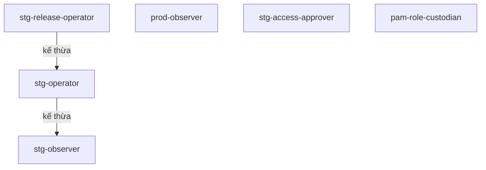

# Role hierarchy

## Mục tiêu bài học

**Role hierarchy** là quan hệ kế thừa giữa các vai trò trong mô hình phân quyền. Một vai trò có thể nhận các quyền của một hoặc nhiều vai trò khác, giúp giảm việc khai báo lặp và thể hiện quan hệ bao hàm quyền một cách có cấu trúc.

Trong Privileged Access Management (PAM), hierarchy cần được thiết kế cẩn thận vì một thay đổi nhỏ ở vai trò được kế thừa có thể mở rộng quyền của nhiều người, grant hoặc phiên. Hierarchy không chỉ phục vụ đặt tên; nó tham gia trực tiếp vào quyết định ai được làm gì trên tài sản nhạy cảm.

Sau bài học này, bạn có thể:

- Phân biệt kế thừa quyền với cơ cấu quản lý nhân sự và nhóm danh tính.
- Biểu diễn hierarchy bằng đồ thị không chu trình và tính quyền hiệu lực.
- Giữ nguyên phạm vi, điều kiện và giới hạn khi kế thừa.
- Kết hợp hierarchy với JIT/JEA và phân tách nhiệm vụ.
- Đánh giá tác động của sửa role, thêm cạnh và thu hồi quyền.
- Thiết kế các ca kiểm thử để phát hiện quyền gián tiếp ngoài dự kiến.

## 1. Vì sao cần role hierarchy?

Giả sử một hệ thống staging có ba nhóm nhu cầu:

- Quan sát trạng thái dịch vụ.
- Quan sát và khởi động lại dịch vụ.
- Quan sát, khởi động lại và triển khai bản phát hành.

Nếu khai báo từng quyền lặp lại trên cả ba vai trò, một thay đổi ở quyền quan sát phải được cập nhật nhiều nơi. Có thể bỏ sót một role hoặc tạo khác biệt không chủ ý.

Hierarchy cho phép định nghĩa:

- `stg-observer`: quyền quan sát cần thiết.
- `stg-operator`: kế thừa `stg-observer`, thêm quyền restart.
- `stg-release-operator`: kế thừa `stg-operator`, thêm quyền deploy.

Cách này giảm lặp khi quan hệ bao hàm thực sự phù hợp. Nó không phải lý do tạo một chuỗi “user → manager → admin → superadmin” cho mọi chức năng.

### Ví dụ xuyên suốt

Lan đủ điều kiện yêu cầu vai trò `stg-operator` cho dịch vụ `billing-stg`. Sau approval, PAM kích hoạt grant trong 15 phút.

Lan nhận quyền quan sát và restart đúng dịch vụ staging đó. Lan không nhận quyền deploy, không nhận quyền production và không trở thành approver chỉ vì đang có vai trò vận hành.

## 2. Vai trò cấp cao là cấp cao về quyền, không phải chức danh

Trong một hierarchy, vai trò “senior” thường bao hàm quyền của vai trò “junior”. Đây là quan hệ giữa **tập quyền**, không phải kết luận người có chức vụ cao hơn cần quyền truy cập rộng hơn.

Một trưởng nhóm có thể cần phê duyệt yêu cầu nhưng không cần đọc credential trong vault. Một kỹ sư chuyên trách có thể cần quyền vận hành hẹp mà quản lý của họ không có. Một auditor có thể xem bằng chứng nhưng không được sửa chính sách.

Không ánh xạ sơ đồ tổ chức thành hierarchy kỹ thuật một cách tự động.

| Khái niệm | Ý nghĩa | Không đồng nghĩa với |
|---|---|---|
| Nhóm directory | Tập danh tính theo nguồn quản lý | Một role có mọi quyền của nhóm khác |
| Quan hệ quản lý | Trách nhiệm nhân sự hoặc nghiệp vụ | Kế thừa quyền quản trị của nhân viên |
| Role hierarchy | Quan hệ kế thừa quyền theo chính sách | Cây tài sản hoặc chuỗi phê duyệt |
| Asset hierarchy | Quan hệ giữa tài sản hoặc phạm vi tài nguyên | Tự động kế thừa mọi role trên tài sản con |
| Approval workflow | Ai chấp nhận một yêu cầu | Người duyệt được trực tiếp dùng quyền đã duyệt |

Tên vai trò nên gợi rõ chức năng và phạm vi. Một tên chung như `admin-level-3` rất khó giúp người duyệt hiểu quyền thực tế.

## 3. Mô hình đồ thị và chiều kế thừa

Trong bài này, quy ước:

> `A → B` nghĩa là **A kế thừa quyền của B**.



Theo quy ước này, mũi tên đi từ vai trò có thêm quyền tới vai trò cung cấp quyền được kế thừa. Một công cụ khác có thể vẽ ngược; phải ghi chú chiều rõ ràng.

`prod-observer`, `stg-access-approver` và `pam-role-custodian` đứng riêng vì ví dụ không xác định quan hệ bao hàm với chuỗi vận hành staging.

### Hierarchy thường là một quan hệ thứ tự bộ phận

Không phải mọi cặp role đều so sánh được. Một role duyệt truy cập và một role đọc audit có thể khác chức năng mà không role nào là “cao hơn” role kia.

Đồ thị có thể hỗ trợ nhiều nhánh và nhiều cha theo khả năng hệ thống. Tuy nhiên, cần tránh chu trình:

```text
A kế thừa B
B kế thừa C
C kế thừa A
```

Chu trình làm mất ý nghĩa phân tầng và khiến phân tích, triển khai hoặc thu hồi khó đoán. Trong mô hình bài học, cấu hình phải từ chối cạnh tạo chu trình hoặc cạnh tự kế thừa.

## 4. Tính quyền hiệu lực

Gọi:

- `D(r)`: các quyền được khai báo trực tiếp trên role r.
- `I(r)`: các role mà r trực tiếp kế thừa.
- `E(r)`: quyền hiệu lực của r.

Với mô hình kế thừa quyền cho phép đơn giản:

```text
E(r) = D(r) ∪ E(role_1) ∪ E(role_2) ∪ ...
       với role_i thuộc I(r)
```

Đây là phép hợp các **permission hoàn chỉnh**, không phải trộn riêng danh sách hành động và danh sách tài sản.

### Một permission phải chứa đủ ngữ cảnh

Có thể biểu diễn một quyền ở mức khái niệm như:

```text
permission = (action, resource_scope, conditions)
```

Ví dụ:

```text
(service.read_status, billing-stg, điều kiện được áp dụng)
(service.restart, billing-stg, trong cửa sổ grant hợp lệ)
```

Không làm phép tính sai sau:

```text
Quyền A: restart trên staging
Quyền B: read trên production

Sai: actions = {restart, read}
     scopes  = {staging, production}
     => restart production
```

Kết quả đúng chỉ là hai permission ban đầu. Việc hợp tập quyền không tạo tích chéo giữa action và scope.

### Bảng quyền minh họa

| Vai trò | Quyền trực tiếp | Kế thừa | Quyền hiệu lực |
|---|---|---|---|
| stg-observer | Xem trạng thái staging trong phạm vi được định nghĩa | Không | Xem trạng thái |
| stg-operator | Restart staging trong phạm vi được định nghĩa | stg-observer | Xem trạng thái, restart |
| stg-release-operator | Deploy staging trong phạm vi được định nghĩa | stg-operator | Xem trạng thái, restart, deploy |
| prod-observer | Xem trạng thái production trong phạm vi được định nghĩa | Không | Xem trạng thái production |
| stg-access-approver | Duyệt loại yêu cầu staging được giao | Không | Duyệt yêu cầu, không vận hành dịch vụ |

Bảng cố ý không cho `stg-release-operator` kế thừa quyền production hoặc quyền approve.

## 5. Kế thừa không được làm rộng scope một cách ngầm định

Có hai kiểu thiết kế thường gặp.

### Role có scope cố định

`billing-stg-operator` chỉ chứa quyền trên `billing-stg`. Role kế thừa nó vẫn nhận quyền trên đúng scope đó.

Nếu tạo `prod-operator` rồi cho kế thừa role staging, điều này không tự biến quyền staging thành quyền production. Nếu nền tảng hỗ trợ tái gắn scope, đó là một cơ chế riêng phải được mô tả và kiểm thử rõ.

### Role mẫu được gắn scope khi tạo grant

Một hệ thống có thể định nghĩa mẫu `service-operator` rồi gắn với tài sản tại thời điểm cấp grant.

Khi đó, phải kiểm tra:

- Ai được chọn scope?
- Scope có nằm trong eligibility và approval không?
- Scope được ràng buộc cho toàn bộ permission kế thừa như thế nào?
- Có permission nào dùng wildcard hoặc tham chiếu tài sản ngoài scope không?
- Scope có thay đổi khi nhóm tài sản được cập nhật không?

Không để client tự thay `asset_id` rồi nhận cùng role trên bất kỳ đích nào. Cấu trúc hierarchy không bảo vệ được một bước cấp grant thiếu kiểm tra scope.

### Điều kiện phải có ngữ nghĩa rõ ràng

Một permission có thể yêu cầu grant còn hạn hoặc một ngữ cảnh xác thực phù hợp. Kế thừa permission đó phải giữ đúng điều kiện của nó theo mô hình được triển khai.

Tuy nhiên, nếu một role khác có quyền cho phép rộng hơn trên cùng hành động, điều kiện của permission thứ nhất không tự hạn chế permission thứ hai. Muốn mọi đường cấp quyền đều cần MFA hoặc nằm trong cửa sổ công việc, phải đặt điều kiện bắt buộc tại lớp chính sách và điểm thực thi thích hợp.

Không chỉ viết điều kiện trên một role con rồi giả định nó ràng buộc mọi quyền trực tiếp của role cha.

## 6. Quyền của người dùng không chỉ đến từ một role

Một người có thể nhận quyền qua:

- Gán role trực tiếp.
- Nhóm directory được ánh xạ.
- Role được kế thừa.
- Grant JIT đang hoạt động.
- Quyền trực tiếp tại hệ thống đích.
- Tài khoản dùng chung hoặc một đường truy cập khác.

Để trả lời “Lan có quyền restart production không?”, cần xem tổng thể nguồn quyền liên quan, không chỉ role đang hiển thị trên màn hình PAM.

### Role được phép xin khác role đang hoạt động

Trong PAM, nên phân biệt:

| Trạng thái | Ý nghĩa |
|---|---|
| Eligible | Người dùng được phép yêu cầu hoặc kích hoạt role theo điều kiện |
| Approved | Một yêu cầu đã được chấp thuận đúng phạm vi |
| Active | Grant hoặc role đã được kích hoạt và còn hiệu lực |
| Expired hoặc revoked | Grant đó không còn được phép sử dụng |

Membership của một nhóm có thể chỉ tạo eligibility. Không vì role đó kế thừa role khác mà tự kích hoạt mọi quyền cho người thuộc nhóm.

### Giới hạn active role không tự bảo vệ quyền đích rộng

Một người chỉ kích hoạt `stg-observer` trong PAM nhưng broker dùng tài khoản đích có quyền quản trị toàn hệ thống có thể nhận quyền ngoài dự kiến nếu không có lớp thực thi hiệu quả.

Hierarchy cần tương thích với mapping sang IAM đích, command broker hoặc cơ chế JEA. Danh sách quyền đẹp trong control plane chưa chứng minh data plane bị giới hạn đúng.

## 7. Phân tách nhiệm vụ phải xét cả quyền gián tiếp

Segregation of duties (SoD) có thể yêu cầu người xin không tự duyệt hoặc người sửa chính sách không tự xóa bằng chứng liên quan.

Nếu chỉ kiểm tra tên role trực tiếp, một role tổng hợp có thể lách ràng buộc:

```text
operations-lead
    kế thừa stg-operator
    kế thừa stg-access-approver
```

Người mang `operations-lead` có thể vừa thực hiện vừa phê duyệt nếu các kiểm tra khác không ngăn. Cần xét effective role closure hoặc năng lực thực tế theo chính sách.

### Static SoD và dynamic SoD

- **Static SoD:** không cho cùng một chủ thể được gán một số kết hợp role.
- **Dynamic SoD:** có thể được gán các role nhưng không được kích hoạt hoặc sử dụng chúng cùng nhau trong ngữ cảnh bị cấm.

Một quy tắc dynamic đơn giản “không active hai role cùng lúc” chưa chắc đủ cho workflow. Người xin có thể tắt role vận hành rồi bật role duyệt để tự chấp thuận yêu cầu của chính mình.

Vì vậy, quy tắc “requester khác approver” cần kiểm tra danh tính và quan hệ với request, không chỉ trạng thái role hiện tại.

### Độc lập không chỉ là hai tên role

Cùng một người thuộc hai nhóm approver không tạo thành hai người độc lập. Role hierarchy cũng không được biến một người thành hai chủ thể.

Nếu một bên được ủy quyền, hệ thống phải xét phạm vi và thời hạn ủy quyền cùng các xung đột phát sinh.

## 8. Tách role quản trị PAM khỏi role sử dụng tài sản

Những khả năng sau có thể có tác động gián tiếp rất lớn:

- Sửa permission của role.
- Thêm cạnh kế thừa.
- Sửa mapping nhóm.
- Thay đổi scope của asset group.
- Gán role cho người khác hoặc bản thân.
- Thay connector hoặc tài khoản đích.
- Thay chính sách approval và audit.

Một người không có quyền đọc secret nhưng có thể tự thêm quyền đó vào role của mình vẫn đang có một đường đặc quyền gián tiếp cần kiểm soát.

### Không tạo một role tổng hợp cho mọi trách nhiệm

Có thể tách các trách nhiệm như:

- Người thiết kế role.
- Người phê chuẩn thay đổi role.
- Người quản lý membership.
- Chủ tài sản xác nhận scope.
- Auditor đọc bằng chứng.
- Người vận hành hệ thống PAM.

Việc tách cụ thể phụ thuộc quy mô và khả năng nền tảng, nhưng phải đánh giá khả năng tự nâng quyền qua thay đổi cấu hình. Một tài khoản quản trị kỹ thuật rất rộng cần được quản lý như ngoại lệ có tác động cao, không phải role mặc định của mọi trưởng nhóm.

### Xem xét thay đổi trên đồ thị ứng viên

Trước khi lưu một role hoặc cạnh mới, cần tính tác động trên cấu hình sau thay đổi. Chỉ kiểm tra người sửa có quyền gọi API là chưa đủ nếu chính sách còn cấm tự nâng quyền hoặc tạo xung đột SoD.

Một thay đổi hợp lệ về cú pháp vẫn có thể không hợp lệ về chính sách.

## 9. Quy trình thay đổi hierarchy có kiểm soát

Một quy trình thực tế có thể gồm:

1. Mô tả nhu cầu nghiệp vụ và quyền tối thiểu.
2. Chốt permission, scope và điều kiện.
3. Chọn cạnh kế thừa theo quan hệ bao hàm thật.
4. Kiểm tra chu trình và cấu trúc.
5. Tính quyền trước–sau của những role bị ảnh hưởng.
6. Kiểm tra SoD và đường tự nâng quyền.
7. Xem tác động tới membership, eligibility, grant và phiên.
8. Phê chuẩn, phát hành phiên bản và kiểm chứng.
9. Theo dõi sai lệch và có phương án khôi phục cấu hình.

### Ví dụ tác động lan truyền

Giả sử `stg-observer` được kế thừa bởi `stg-operator`, rồi tiếp tục bởi `stg-release-operator`. Thêm quyền đọc log vào observer sẽ mở rộng cả ba role.

Nếu log chứa dữ liệu nhạy cảm hơn trạng thái dịch vụ, thay đổi này không thể coi là sửa mô tả nhỏ. Cần xem người đang có role kế thừa và scope thực tế.

Tác động cần báo cáo bằng permission hoàn chỉnh:

```text
Trước:
  service.read_status trên billing-stg

Sau:
  service.read_status trên billing-stg
  service.read_logs trên billing-stg
```

Không chỉ báo “thêm một permission” mà bỏ qua mức nhạy cảm và số chủ thể chịu ảnh hưởng.

### Gán JIT và thay đổi quyền trong lúc grant còn hiệu lực

Có ít nhất hai mô hình:

| Mô hình | Hành vi | Điều cần quản trị |
|---|---|---|
| Grant tham chiếu role hiện tại | Quyền có thể đổi khi role được sửa | Tránh mở rộng quyền vượt approval trong phiên đang chạy |
| Grant chốt phiên bản hoặc scope permission | Grant giữ nội dung đã cấp | Có cơ chế vô hiệu khi cần thu hồi hoặc chính sách thay đổi |

Không có một mặc định chung cho mọi nền tảng. Phải biết hệ thống dùng mô hình nào và kiểm thử khi role thay đổi.

Một approval cho vai trò hạn chế không nên âm thầm trở thành approval cho quyền mới nhạy cảm vừa được thêm vào role. Khi phạm vi thay đổi có ý nghĩa, cần cơ chế đánh giá lại hoặc bảo vệ grant theo phiên bản đã được chấp thuận.

## 10. Thu hồi trong hierarchy

Xóa một gán role trực tiếp chưa chắc gỡ quyền hiệu lực. Người dùng có thể vẫn nhận role đó qua nhóm, role cha hoặc một grant độc lập.

### Ví dụ còn đường kế thừa

```text
Lan được gán trực tiếp stg-observer.
Lan cũng có grant stg-operator.
stg-operator kế thừa stg-observer.
```

Gỡ gán trực tiếp `stg-observer` không làm Lan mất quyền quan sát đang đi qua `stg-operator`.

Muốn thu hồi một capability cụ thể, cần xác định những đường cấp quyền tạo ra capability đó và xử lý theo phạm vi có thẩm quyền. Không tự gỡ mọi quyền độc lập nếu chỉ được yêu cầu thu hồi một grant.

### Xóa một cạnh chưa chắc xóa mọi đường

Trong đồ thị nhiều nhánh, có thể có nhiều đường tới cùng role. Xóa một cạnh chỉ loại bỏ đường đó. Cần tính lại reachability và quyền hiệu lực sau thay đổi.

Quy trình thu hồi phải xem cả:

- Role assignment.
- Nhóm nguồn.
- Các cạnh kế thừa.
- Grant JIT và cache quyết định.
- Session PAM.
- Quyền và phiên tại đích.
- Credential hoặc token đã được phát.

### Hết hạn role không tự kết thúc mọi tác động

Một grant hết hạn không tự hoàn tác thay đổi cấu hình mà người dùng đã thực hiện. Nó cũng chưa chắc đóng kết nối đích hoặc vô hiệu token nếu hệ thống không có cơ chế đó.

Nếu role cho phép tạo quyền bền vững khác, cần đánh giá khả năng tồn tại sau grant. Đó là lý do phải giới hạn quyền sửa IAM và không coi TTL ngắn là đủ để làm mọi role an toàn.

## 11. Xung đột, explicit deny và cách kết hợp chính sách

Công thức phép hợp ở trên mô tả mô hình kế thừa các quyền cho phép đơn giản. Nền tảng thực tế có thể có explicit deny, permission boundary hoặc điều kiện toàn cục.

Cần xác định rõ:

- Deny có được kế thừa không?
- Deny thắng allow trong phạm vi nào?
- Permission boundary giới hạn những loại grant nào?
- Điều kiện bắt buộc được kiểm tra trước hay sau việc kết hợp quyền?
- Có nguồn quyền nào không chịu cùng cơ chế kết hợp không?

Không áp một quy tắc như “role cha luôn thắng” cho mọi hệ thống. Một tên role có thứ bậc cao hơn không phải thuật toán xử lý xung đột.

### Tránh dùng deny để sửa một hierarchy quá rộng

Có thể có nhu cầu deny hợp lệ, nhưng nếu mỗi role tổng hợp đều cần hàng chục ngoại lệ để không quá quyền, cấu trúc có thể đang phản ánh sai nhu cầu.

Xem lại scope và chức năng thay vì mặc định xây một role rất rộng rồi chặn từng phần. Kiểm chứng cả phép kết hợp với quyền ngoài PAM.

## 12. Pseudocode tính quyền và kiểm tra cấu trúc

```text
function effective_permissions(role, graph, stack, memo):
    if role in stack:
        reject_configuration("CYCLE_DETECTED")

    if role in memo:
        return memo[role]

    require role exists in graph

    stack.add(role)
    result = complete_direct_permissions(role)

    for inherited_role in graph.inherits(role):
        inherited = effective_permissions(inherited_role, graph, stack, memo)
        result = union_of_complete_permissions(result, inherited)

    stack.remove(role)
    memo[role] = result
    return result

function evaluate_candidate_change(candidate_graph):
    validate_role_and_permission_schema(candidate_graph)
    validate_references_and_no_cycles(candidate_graph)

    effective = calculate_all_effective_permissions(candidate_graph)
    require segregation_rules_pass(candidate_graph, effective)
    require scope_and_mandatory_conditions_are_preserved(candidate_graph)

    return compare_with_current_version(candidate_graph, effective)
```

Đây là logic khái niệm, không phải authorization engine hoàn chỉnh. Nó chưa mô tả deny, điều kiện động, context hoặc mọi cơ chế JIT.

Điểm quan trọng là hợp các permission hoàn chỉnh và kiểm tra toàn bộ đồ thị ứng viên. Với dữ liệu lớn, có thể tối ưu bằng topological order hoặc cache, nhưng phải có cơ chế invalidation đúng khi role hoặc cạnh thay đổi.

### Cache và phiên bản

Một kết quả quyền được cache cần liên kết với phiên bản role graph, assignment và các yếu tố ảnh hưởng quyết định theo thiết kế. Thay đổi hierarchy mà cache vẫn dùng vô hạn là một lỗi thực thi.

Nếu token mang danh sách role hoặc permission, cần xác định role được tính lại lúc nào, token hết hạn khi nào và có cơ chế thu hồi nào. Không coi việc sửa đồ thị trong cơ sở dữ liệu là đủ để mọi token đã phát thay đổi ngay.

## 13. Bằng chứng audit và giải thích quyết định

Khi một người được phép restart dịch vụ, hệ thống nên giải thích được đường quyền:

```text
Người dùng Lan
  -> grant JIT grant-example-41
  -> role stg-operator, phiên bản 6
  -> permission service.restart
  -> scope billing-stg
  -> approval request-example-82, phiên bản 2
  -> còn trong thời hạn và các điều kiện bắt buộc
```

Với quyền đọc trạng thái được kế thừa, có thể hiển thị thêm:

```text
stg-operator -> stg-observer -> service.read_status
```

Thông tin giải thích cần được phân quyền, vì đồ thị role và tài sản có thể nhạy cảm.

### Sự kiện thay đổi hierarchy

```json
{
  "event_type": "pam.role_hierarchy.changed",
  "change_reference": "role-change-example-29",
  "actor_reference": "principal-role-custodian",
  "previous_graph_version": "graph-example-v12",
  "new_graph_version": "graph-example-v13",
  "changed_role": "stg-operator",
  "operation": "add_inheritance",
  "inherited_role": "stg-observer",
  "impact_report_reference": "impact-example-29",
  "approval_reference": "approval-example-74",
  "result": "applied"
}
```

Đây là schema minh họa. Có thể lưu delta và tham chiếu tới bản cấu hình bất biến để tái dựng quyền tại thời điểm sự kiện.

Không lưu secret hoặc toàn bộ credential vào báo cáo quyền. Bảo vệ tính toàn vẹn audit và tách thẩm quyền sửa role khỏi thẩm quyền xóa dấu vết về chính thay đổi đó.

Báo cáo cần phân biệt quyền mô hình hóa trong PAM với quyền đã được kiểm chứng tại đích. Nếu mapping chưa được kiểm thử, không coi đồ thị là bằng chứng đầy đủ của least privilege.

## 14. Bài thực hành

Dùng môi trường lab với tài sản staging và production giả lập. Không dùng role quản trị production thật để thử hierarchy.

### Thiết kế

Tạo năm role theo ví dụ:

- `stg-observer`.
- `stg-operator`, kế thừa observer.
- `stg-release-operator`, kế thừa operator.
- `prod-observer`, đứng riêng.
- `stg-access-approver`, đứng riêng.

Tạo người dùng A đủ điều kiện xin operator, B làm approver và C có quyền quản lý cấu hình giới hạn. Xác định permission dưới dạng action, scope và điều kiện, không chỉ bằng tên role.

### Ca kiểm thử

| Ca | Thao tác | Kết quả mong đợi |
|---|---|---|
| Kế thừa trực tiếp | Kích hoạt stg-operator | Có quyền observer và restart staging đúng scope |
| Kế thừa bắc cầu | Kích hoạt stg-release-operator | Có tập quyền staging qua các đường đã định nghĩa |
| Không kế thừa ngược | Chỉ kích hoạt stg-observer | Không có restart hoặc deploy |
| Không mở rộng môi trường | Operator staging thử hành động production | Bị từ chối tại điểm thực thi |
| Không tạo tích chéo | Có restart staging và read production | Không có restart production |
| Không tự kích hoạt | A chỉ có eligibility, chưa có grant | Không dùng được quyền operator |
| Approval còn riêng | A có role vận hành nhưng không có quyền duyệt | Không tự duyệt request của mình |
| SoD gián tiếp | Tạo role tổng hợp gây xung đột | Bị phát hiện theo chính sách, kể cả qua nhiều cạnh |
| Chu trình | Thêm cạnh làm observer kế thừa release-operator | Cấu hình bị từ chối |
| Xóa một đường | Có hai đường kế thừa rồi xóa một đường | Quyền hiệu lực phản ánh đường còn lại |
| Gỡ gán trực tiếp | Người dùng vẫn có quyền qua role cha | Không báo sai rằng mọi quyền đã biến mất |
| Thay đổi role đang dùng | Thêm permission khi grant còn active | Hành vi đúng mô hình phiên bản và approval đã công bố |
| Cache cũ | Thay graph rồi gọi lại thao tác | Quyết định được cập nhật hoặc thu hồi theo giới hạn đã định nghĩa |
| Mapping đích | PAM chỉ cho role hẹp | Đích từ chối thao tác ngoài quyền, không chỉ ẩn nút |
| Audit | Truy một quyết định allow và một thay đổi graph | Có thể giải thích đường quyền và phiên bản liên quan |

Kiểm thử cả API trực tiếp hoặc broker phù hợp trong lab, không chỉ menu giao diện. Một nút bị ẩn không chứng minh authorization tại máy chủ đúng.

### Sản phẩm bài thực hành

Nộp đồ thị có ghi rõ chiều, bảng permission hoàn chỉnh, mapping assignment/eligibility và báo cáo quyền trước–sau cho một thay đổi.

Riêng thu hồi, ghi những đường còn cấp quyền và trạng thái tại PAM, cache, grant và đích. Khi một lớp chưa được kiểm chứng, nêu rõ giới hạn.

## 15. Sai lầm thường gặp

**Dùng hierarchy của chức danh để cấp quyền.** Chức vụ quản lý không chứng minh nhu cầu kỹ thuật. Thiết kế theo nhiệm vụ và phạm vi.

**Gộp role vận hành, phê duyệt và audit vào một role cao nhất.** Dễ phá SoD và tạo đường tự cấp hoặc tự che giấu. Tách trách nhiệm cần độc lập.

**Chỉ xem role trực tiếp.** Quyền nguy hiểm có thể đến qua nhiều cạnh hoặc nguồn assignment. Tính quyền hiệu lực và khả năng thực tế.

**Hợp riêng action và scope.** Cách làm này tạo ra quyền chưa từng được cấp. Giữ từng permission hoàn chỉnh.

**Sửa role mà không xem grant đang chạy.** Người đã được duyệt có thể nhận thêm quyền ngoài phạm vi cũ. Quản lý phiên bản và tác động.

**Xóa một assignment rồi tuyên bố đã thu hồi hết.** Người dùng có thể còn quyền qua nhóm hoặc role cha. Đối soát các đường cấp quyền.

**Cho rằng TTL ngắn làm role quản trị toàn quyền an toàn.** Một số thao tác để lại tác động bền vững hoặc tạo quyền mới. Giới hạn capability và thực thi tại đích vẫn cần thiết.

## 16. Câu hỏi tự kiểm tra

1. Vì sao hai role phê duyệt và vận hành không nhất thiết có quan hệ cao–thấp?
2. Nếu role A kế thừa B, thay đổi permission của B ảnh hưởng những ai?
3. Có restart staging và read production có tạo quyền restart production không?
4. Vì sao SoD cần xét role gián tiếp và danh tính người xin?
5. Gỡ một role trực tiếp có đủ để kết luận không còn capability tương ứng không?

### Gợi ý đối chiếu

1. Chúng biểu diễn trách nhiệm khác nhau và có thể cần độc lập, không phải quan hệ bao hàm.
2. Những role kế thừa B theo mọi đường và các assignment hoặc grant sử dụng chúng, tùy mô hình phiên bản.
3. Không. Quyền là các permission gắn action với scope và điều kiện; phép hợp không tạo tích chéo.
4. Role tổng hợp có thể mang cả hai năng lực; đổi active role cũng không làm người xin trở thành người độc lập.
5. Không. Cần kiểm tra các nguồn và đường cấp quyền còn lại cùng trạng thái thực thi tại đích.

Role hierarchy có ích khi thể hiện đúng quan hệ bao hàm quyền và giúp giải thích quyết định. Trong PAM, hierarchy chỉ đạt mục tiêu least privilege khi scope, điều kiện, phân tách nhiệm vụ, JIT/JEA và thu hồi được giữ đúng trên toàn bộ đường từ assignment tới hệ thống đích.
