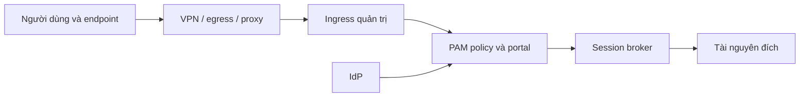

# Policy condition theo location

## 1. Location là điều kiện bổ sung, không phải danh tính

Policy condition theo location là điều kiện dùng thông tin vị trí hoặc đường mạng để tham gia quyết định truy cập. Trong PAM, điều kiện này có thể giới hạn việc kích hoạt grant production từ một đường vào quản trị đã xác định, yêu cầu xác thực bổ sung khi kết nối ngoài phạm vi dự kiến hoặc chặn một hành động khi không đủ dữ liệu vị trí cần thiết.

Ví dụ, kỹ sư đã có quyền chẩn đoán vẫn phải kết nối qua đường quản trị được phép trước khi mở phiên tới máy nhạy cảm. Việc request được duyệt không tự bỏ điều kiện mạng; ngược lại, đi qua mạng được phép không tự tạo quyền quản trị.

NIST SP 800-207 nêu rằng không có sự tin cậy ngầm chỉ dựa trên vị trí vật lý, vị trí mạng hoặc quyền sở hữu thiết bị. [NIST — Zero Trust Architecture](https://csrc.nist.gov/pubs/sp/800/207/final)

Trong thiết kế PAM, location nên trả lời một câu hỏi có phạm vi:

> Với hành động và tài nguyên này, tín hiệu vị trí nào phải có, nguồn nào được tin cậy và kết quả nào được phép?

Không nên đặt câu hỏi đơn giản thành “IP này có đáng tin không?” rồi dùng câu trả lời cho mọi người dùng, mọi thiết bị và mọi loại quyền.

Bài học thuộc chương Authorization, kết hợp điều kiện location với kiểm kê tài nguyên, least privilege, JIT/JEA, vault, giám sát phiên và bằng chứng. Các cấu hình dưới đây là mô hình tham khảo, không phải syntax của một sản phẩm cụ thể.

## 2. Có nhiều ý nghĩa khác nhau của location

| Loại location | Nó mô tả gì? | Điều không được suy ra |
|---|---|---|
| IP nguồn quan sát được | Điểm mạng mà một thành phần thấy request đến từ đó | Vị trí vật lý chính xác hoặc danh tính cá nhân |
| Named network location | Một tập dải mạng được quản trị đặt tên | Mọi thiết bị trong tập đều an toàn |
| Quốc gia/khu vực suy từ IP | Phân loại dựa trên dữ liệu địa chỉ mạng | Người dùng thật sự đang đứng ở khu vực đó |
| Vị trí từ thiết bị | Dữ liệu do cơ chế thiết bị cung cấp theo mô hình tin cậy | Client tự khai là đủ làm bằng chứng |
| Đường mạng riêng | Request đi qua endpoint, mạng hoặc kênh cụ thể | Đúng workload hoặc đúng người dùng |
| Vị trí tài nguyên | Region, site hoặc môi trường của tài nguyên | Vị trí hiện tại của bên gọi |

Microsoft Entra Conditional Access sử dụng tín hiệu mạng như IP công khai IPv4/IPv6, named location và phân loại quốc gia/khu vực; nguồn và cách dùng phụ thuộc cấu hình. [Microsoft — Conditional Access network assignment](https://learn.microsoft.com/en-us/entra/identity/conditional-access/concept-assignment-network)

Điểm thiết kế quan trọng là đặt tên đúng cho dữ liệu. Một field `location=office` không đủ nếu không biết nó có nghĩa là IP egress văn phòng, thiết bị được quản lý hay vị trí địa lý đã được kiểm tra.

### 2.1. Vị trí tài nguyên và vị trí người dùng không thay thế nhau

Một database ở region A có thể nhận request từ broker ở region B, trong khi kỹ sư ở nơi khác. Ba vị trí này cần được phân biệt trong policy và audit.

Một điều kiện giới hạn region mà API được gọi không tự xác nhận nơi người dùng đang ở. Tương tự, việc truy cập qua một gateway trong nước không chứng minh vị trí vật lý của người dùng hoặc vị trí mọi dữ liệu được xử lý.

Nếu có yêu cầu riêng về nơi dữ liệu được lưu hoặc xử lý, phải mô tả và kiểm tra bằng kiểm soát phù hợp. Không suy ra yêu cầu đó chỉ từ GeoIP của người đăng nhập.

### 2.2. Location quan sát được có thể thay đổi

Thiết bị có thể đổi Wi-Fi sang mạng di động, VPN có thể đổi egress, hạ tầng có thể failover và địa chỉ có thể được cấp lại. Một điều kiện tốt cần nói rõ thay đổi nào liên quan và lúc nào hệ thống đánh giá lại.

Không phải thay đổi IP nào cũng chứng minh xâm nhập. Tuy vậy, không nên giữ mãi một kết quả allow cũ nếu policy yêu cầu ngữ cảnh hiện tại.

## 3. Đặt mục tiêu theo hành động và rủi ro

Trước khi tạo danh sách IP, cần xác định đang bảo vệ hành động gì.

| Hành động PAM | Ví dụ về cách dùng location |
|---|---|
| Xem trạng thái request cá nhân | Có thể cho phép phạm vi rộng hơn với xác thực phù hợp |
| Kích hoạt grant production | Yêu cầu đường quản trị được phép cùng MFA và thiết bị |
| Đọc giá trị credential | Có thể cần điều kiện chặt hơn mở phiên qua broker |
| Sửa policy hoặc role mạnh | Xét ngữ cảnh quản trị, xác thực mới và thẩm quyền |
| Mở hoặc nối lại phiên | Kiểm tra nguồn quan sát ở điểm nhận kết nối tương ứng |
| Export recording | Xét phạm vi dữ liệu và đường nhận phù hợp |

Không cần mọi hành động có cùng điều kiện. Nhưng khác biệt phải là quyết định chính sách có chủ ý, không phải do một API bị quên kiểm tra.

Một mục tiêu rõ có thể là:

> Chỉ cho kích hoạt grant chẩn đoán production khi kết nối người dùng được quan sát qua một ingress quản trị đã phê duyệt, thiết bị đáp ứng điều kiện, xác thực đủ mới và grant còn hiệu lực.

Mục tiêu này không nói rằng ingress là bằng chứng duy nhất về người dùng. Nó cũng không nói hệ thống biết chính xác tọa độ vật lý của họ.

Đối với nhà cung cấp, có thể chuẩn bị một đường remote access riêng với danh tính cá nhân, sponsor, scope và thời hạn. Không mở cả một dải mạng đối tác rồi mặc định mọi người trong đó được sử dụng mọi tài khoản quản trị.

## 4. Xác định đúng điểm quan sát

### 4.1. Mỗi thành phần nhìn một nguồn khác nhau

Một đường truy cập điển hình:



Trong đường này:

- IdP có thể thấy nguồn của lần đăng nhập.
- Ingress thấy kết nối đi vào PAM.
- PAM backend có thể chỉ thấy peer là reverse proxy.
- Broker thấy nguồn kết nối người dùng theo giao thức triển khai.
- Tài nguyên đích thường thấy broker làm bên kết nối.

Do đó, “source IP” ở log đích có thể là IP broker, không phải IP endpoint của người dùng. Policy không nên coi hai dữ liệu đó tương đương.

Cần định nghĩa dữ liệu nào được dùng cho mỗi quyết định. Ví dụ, kiểm tra location người dùng lúc kích hoạt có thể dựa trên observation ở ingress, còn giới hạn broker tới tài nguyên dựa trên đường mạng riêng giữa broker và đích.

### 4.2. Context từ IdP có thể không còn là context hiện tại

Một kết quả xác thực có thể dựa trên SSO đã tồn tại. Nếu người dùng đổi mạng sau đăng nhập, location lúc xác thực và location lúc gọi PAM có thể khác nhau.

PAM cần biết thời điểm và nguồn của dữ liệu, không chỉ một giá trị country hoặc một nhãn “trusted”. Token mới được phát hành cũng không tự chứng minh location vừa được quan sát lại nếu hợp đồng tích hợp không bảo đảm điều đó.

Không dùng “vị trí gần nhất của người dùng” làm ngữ cảnh cho mọi phiên. Một người có thể có nhiều thiết bị và phiên đồng thời; observation cần gắn với đúng lần tương tác và đối tượng liên quan.

### 4.3. Request đi qua dịch vụ trung gian cần mô hình riêng

Một automation gọi vault hoặc một cloud service gọi API thay workload có thể không mang ngữ cảnh mạng của người khởi tạo. Chính sách dành cho người dùng tương tác không nên được áp dụng máy móc cho mọi service-to-service call.

Ví dụ, AWS nêu rằng `aws:SourceIp` không có khi request đi qua VPC endpoint; một số ngữ cảnh mạng cũng không được giữ nguyên trong lời gọi giữa dịch vụ. Phải dùng condition key phù hợp và xét tính sẵn có của key. [AWS — Global condition context keys](https://docs.aws.amazon.com/IAM/latest/UserGuide/reference_policies_condition-keys.html#condition-keys-sourceip)

Thiếu một key không tự là lý do bỏ mọi điều kiện cho dịch vụ. Cần có nhánh policy rõ cho đúng principal, đường gọi và loại bằng chứng mà nền tảng thực sự cung cấp.

## 5. Proxy header chỉ có giá trị trong một chuỗi tin cậy

Một backend sau proxy có thể nhận `Forwarded` hoặc `X-Forwarded-For`. Những header này có thể chứa thông tin client, nhưng không tự là bằng chứng xác thực.

RFC 7239 lưu ý rằng `Forwarded` có thể bị sửa bởi các node trên đường đi, gồm cả client; độ tin cậy cần xét proxy và bảo vệ kết nối giữa các thành phần. [IETF RFC 7239, mục 8.1](https://datatracker.ietf.org/doc/html/rfc7239#section-8.1)

Trong mô hình PAM, thiết kế ingress cần làm rõ:

1. Những proxy nào được phép gửi ngữ cảnh nguồn.
2. Backend xác minh peer hoặc đường kết nối proxy bằng cơ chế nào.
3. Header do client tự gửi bị loại bỏ, ghi đè hoặc xử lý ra sao tại trust boundary.
4. Chuỗi nhiều proxy được phân giải bằng quy tắc nào.
5. Request đi thẳng tới backend có được chấp nhận không.
6. Khi chuỗi không hợp lệ hoặc thiếu dữ liệu, policy xử lý thế nào.

Không đơn giản lấy phần tử đầu tiên của một danh sách header rồi coi đó là client thật. Cũng không nên đánh dấu mọi địa chỉ private là proxy tin cậy chỉ vì chúng cùng nằm trong mạng nội bộ.

Cần dùng cơ chế phân giải nguồn được cấu hình đúng với topology thực tế. Khi thêm load balancer, CDN, gateway hoặc đường failover, phải kiểm tra lại chuỗi quan sát thay vì giả định kết quả vẫn như trước.

### Ví dụ về trust boundary

Giả sử chỉ ingress quản trị E được phép cung cấp observation cho PAM backend. Khi nhận request từ peer không phải E, backend không dùng một header tự khai để tạo `source_location=approved_network`.

Khi peer là E và quan hệ tin cậy được xác minh, backend vẫn chỉ tin phần ngữ cảnh mà E có trách nhiệm xác lập. Việc E chuyển nguyên một header không được kiểm tra từ client không làm dữ liệu đó trở nên đáng tin.

Nếu truyền context giữa nhiều service, cần bảo vệ nguồn, tính toàn vẹn, mục đích và liên kết với giao dịch theo giao thức đã chọn. Một chuỗi JSON có trường `verified=true` không tự đáp ứng các yêu cầu đó.

## 6. IP, NAT, VPN và giới hạn của GeoIP

### 6.1. Một IP có thể đại diện cho nhiều chủ thể

Egress doanh nghiệp, VPN, NAT và proxy có thể làm nhiều người dùng xuất hiện dưới cùng một IP công khai. IP được phép không cho biết ai trong số họ có quyền quản trị.

Vì vậy, policy cần kết hợp với danh tính, quyền, thiết bị và grant. Audit cũng cần session/tunnel reference hoặc quan hệ phù hợp, không chỉ ghép mọi sự kiện cùng IP thành một người.

Một allowlist egress VPN thể hiện đường kết nối đã đi qua một điểm nhất định. Nó không tự chứng minh endpoint an toàn, người dùng còn làm việc cho tổ chức hoặc mọi phiên sau đó đều bị ghi.

### 6.2. VPN làm thay đổi ý nghĩa vị trí mạng

Một người ở xa có thể đi qua egress tại văn phòng. GeoIP khi đó có thể phản ánh egress chứ không phản ánh vị trí vật lý của người đó.

Nếu policy thực sự chỉ yêu cầu đường mạng quản trị, điều này có thể đúng với mục tiêu. Nếu policy đòi biết vị trí vật lý, dùng cùng tín hiệu IP rồi kết luận đã đáp ứng là sai ý nghĩa.

Không nên đặt tên một điều kiện là “người dùng đang ở trụ sở” khi thực tế nó chỉ kiểm tra IP egress trụ sở.

### 6.3. GeoIP là dữ liệu suy luận

Phân loại theo quốc gia hoặc khu vực phụ thuộc dữ liệu ánh xạ, thời điểm cập nhật và cách định tuyến. Địa chỉ mới, mạng di động, proxy hoặc thay đổi nhà cung cấp có thể tạo kết quả khác với dự kiến.

Thiết kế cần có trạng thái unknown và cách xử lý. Không tự biến unknown thành một quốc gia được phép; cũng không tự coi mọi sai khác là bằng chứng chắc chắn về xâm nhập.

Các tín hiệu như thay đổi khu vực nhanh hoặc phiên đồng thời ở nhiều nơi có thể hỗ trợ đánh giá. Chúng cần được đối chiếu với VPN, egress và ngữ cảnh người dùng trước khi kết luận.

### 6.4. Vị trí do thiết bị cung cấp cũng cần nguồn tin cậy

Dữ liệu tọa độ hoặc nhãn địa điểm từ một client cần có cơ chế thu thập, xác thực, độ mới và liên kết thiết bị phù hợp. Không dùng tọa độ tùy ý do ứng dụng gửi như một thuộc tính đã được xác minh.

Chỉ thu thập mức chi tiết phục vụ mục tiêu. Nếu policy chỉ cần biết đường vào đã được quản lý, việc lưu liên tục tọa độ chi tiết có thể không cần thiết.

## 7. Xử lý IPv4, IPv6 và danh sách mạng

Một môi trường có thể dùng cả IPv4 và IPv6. Chỉ cấu hình một họ địa chỉ có thể làm hành vi không nhất quán giữa các đường kết nối.

Trong thiết kế kỹ thuật cần:

- Phân tích địa chỉ bằng cơ chế hỗ trợ đúng định dạng.
- So khớp CIDR theo địa chỉ mạng, không bằng tiền tố chuỗi.
- Chuẩn hóa các biểu diễn tương đương theo quy tắc được chọn.
- Phân biệt địa chỉ với port hoặc cú pháp của header.
- Xử lý dữ liệu thiếu, không hợp lệ và các dạng địa chỉ được hỗ trợ.
- Kiểm tra cả đường kết nối trực tiếp và qua proxy.

Danh sách mạng minh họa:

```yaml
network_location_ref: approved-admin-ingress-v4
owner_ref: network-security-team
classification: administrative_egress
ranges:
  ipv4:
    - 198.51.100.0/24
    - 203.0.113.0/24
  ipv6:
    - 2001:db8:100::/48
lifecycle:
  review_required: true
  changes_require_authorization: true
```

Các dải trên chỉ dùng minh họa tài liệu, không phải mạng doanh nghiệp thật và không được sao chép để tạo allowlist production. Cấu trúc YAML cũng không phải cấu hình có thể áp dụng trực tiếp cho một sản phẩm.

Danh sách cần có owner, mục đích và vòng đời. Khi doanh nghiệp đổi ISP hoặc VPN egress, cần cập nhật cả đường chính, dự phòng và những đường không còn được sử dụng.

Một dải cũ không còn thuộc quyền kiểm soát có thể trở thành đường cấp điều kiện cho bên khác. “Đã từng là mạng văn phòng” không đủ để giữ mãi trong tập được phép.

## 8. Kết hợp location với quyền, MFA và grant

Một biểu thức ý nghĩa cho hành động kích hoạt có thể là:

```text
Cho phép activate_grant khi:
    subject đã xác thực phù hợp
    AND có quyền kích hoạt grant này
    AND grant thuộc đúng subject, tài nguyên và phạm vi
    AND grant còn hiệu lực
    AND location observation có nguồn được chấp nhận và đủ mới
    AND network location thuộc tập quản trị được phép
    AND thiết bị và mức xác thực đáp ứng yêu cầu
    AND broker/recording bắt buộc sẵn sàng
```

Đây là cách mô tả ý định. Khi triển khai, phải định nghĩa rõ thứ tự và cách kết hợp policy, explicit deny, ngoại lệ và hành vi khi thiếu thuộc tính. Không nên suy ra một engine có đúng ngữ nghĩa chỉ vì nhìn biểu thức tương tự.

### 8.1. Ba trạng thái cần phân biệt

| Kết quả location | Ví dụ | Cách xử lý theo mô hình |
|---|---|---|
| Known and allowed | Observation hợp lệ thuộc ingress đã quản trị | Tiếp tục kiểm tra các điều kiện khác |
| Known and not allowed | Observation hợp lệ nhưng ngoài tập cho hành động | Từ chối hoặc đi theo quy trình được quy định |
| Unknown/unusable | Thiếu nguồn, dữ liệu lỗi hoặc quá cũ | Chưa cho hành động cần điều kiện đó |

Unknown không nhất thiết phải khóa mọi chức năng. Hệ thống có thể vẫn cho xem hướng dẫn hoặc trạng thái request nếu policy cho phép. Nhưng không tự bỏ một điều kiện bắt buộc chỉ vì không thu thập được dữ liệu.

### 8.2. Step-up không thay cho mọi điều kiện mạng

Nếu yêu cầu là “phải đi qua ingress quản trị”, việc người dùng hoàn thành MFA bên ngoài ingress không tự đáp ứng yêu cầu đó.

Một policy khác có thể cho phép ngoài mạng được quản trị khi tăng mức xác thực và đáp ứng điều kiện bổ sung. Đó là một nhánh thiết kế riêng phải được phê duyệt, không phải fallback tự động của nhánh đầu.

Cũng không nên bỏ MFA chỉ vì IP thuộc allowlist. Một actor đang dùng một endpoint trong mạng đó vẫn cần chứng minh danh tính theo chính sách quản trị.

### 8.3. Tách policy cho các loại chủ thể

Một người dùng tương tác, một workload và broker có thể có nguồn location khác nhau. Policy cần xác định loại principal và đường thực thi từ bằng chứng có thẩm quyền, không từ nhãn client tự khai.

Đặc biệt, không cho mọi request mang nhãn “internal service” vượt điều kiện. Nhánh dịch vụ cần principal, quyền, tài nguyên và đường kết nối rõ.

## 9. Ví dụ: mở phiên qua ingress quản trị

### 9.1. Bối cảnh và mục tiêu

Kỹ sư trực ca cần đọc trạng thái dịch vụ và log vận hành trên một máy ứng dụng production. Grant chỉ cho profile chẩn đoán, không cho đọc password hoặc truyền file.

Tổ chức muốn người dùng đi qua ingress quản trị đã kiểm soát. Policy không tuyên bố biết vị trí vật lý của kỹ sư. Máy đích chỉ nhận kết nối từ broker theo thiết kế mạng.

Các điều kiện:

| Nội dung | Giá trị minh họa |
|---|---|
| Actor | Danh tính cá nhân được cấp grant |
| Tài nguyên | Máy ứng dụng A trong payments production |
| Network observation | Do ingress được tin cậy cung cấp |
| Network location | Thuộc tập administrative egress đang có hiệu lực |
| Thiết bị | Đáp ứng profile quản trị |
| Xác thực | Mức cần thiết và đủ mới khi kích hoạt |
| Grant | Kích hoạt từ 09:00 đến trước 09:10 |
| Phiên | Tối đa 20 phút, hạn tuyệt đối 09:30 |
| Bằng chứng | Recording và liên kết audit bắt buộc |

Các mốc cùng ngày và UTC+07:00; đây là thời hạn tùy chọn cho ví dụ.

### 9.2. Luồng hợp lệ

1. Kỹ sư đi qua đường quản trị đã được phép và xác thực.
2. Ingress xác định observation theo topology và trust configuration.
3. PAM kiểm tra nguồn, thời điểm observation và liên kết với đúng tương tác.
4. PAM phân giải grant và tài nguyên, kiểm tra quyền cùng các điều kiện.
5. Broker mở phiên đúng profile và sử dụng credential theo tích hợp vault.
6. Audit giữ reference từ actor, observation và quyết định tới grant/session.
7. Tài khoản hoặc cơ chế JEA ở đích giới hạn tác vụ chẩn đoán.

Giả sử phiên bắt đầu 09:05, deadline theo thời lượng là 09:25, trước hạn tuyệt đối 09:30. Việc location đạt yêu cầu không kéo dài deadline đó.

### 9.3. Dữ liệu quyết định minh họa

```yaml
authorization_context_ref: authz-remote-diagnostic-518
subject_ref: principal-oncall-17
grant_ref: grant-diagnostic-518
resource_ref: payments-app-prod-01
operation: open_brokered_session
location_context:
  observation_ref: ingress-observation-884
  observer_ref: approved-admin-ingress-01
  observed_at: "2026-11-26T09:04:58+07:00"
  meaning: network_source_at_pam_ingress
  network_location_ref: administrative-egress-v4
  classification: allowed
decision:
  policy_ref: production-session-location-v3
  result: allow
  obligations:
    - use_diagnostic_profile
    - use_approved_broker
    - require_recording
    - do_not_disclose_target_credential
```

Đây là mô tả trạng thái máy chủ, không phải một payload cho client tự điền. Trường `classification: allowed` chỉ có ý nghĩa nếu được tạo từ nguồn và quy trình xác minh thực tế.

### 9.4. Những nhánh cần xử lý rõ

| Tình huống | Kết quả theo mô hình |
|---|---|
| IP hợp lệ nhưng actor không có grant | Từ chối mở phiên |
| Grant đúng nhưng observation ngoài tập cho phép | Không cho kích hoạt theo nhánh thông thường |
| Client tự gửi header mang IP trong allowlist | Không dùng như observation đã xác minh |
| Backend chỉ thấy IP broker | Không gọi đó là vị trí endpoint của người dùng |
| IdP có location cũ nhưng ingress hiện tại khác | Xét nguồn và độ mới theo policy, không tự dùng kết quả cũ |
| Observation đạt nhưng recorder lỗi | Không tự mở phiên trực tiếp |
| Người dùng đổi tài nguyên ngoài grant | Từ chối dù location không đổi |

## 10. Đánh giá lại khi kết nối hoặc ngữ cảnh thay đổi

### 10.1. Kiểm tra lúc đăng nhập chưa bao phủ cả vòng đời

Policy có thể được đánh giá ở các điểm khác nhau:

- Đăng nhập hoặc nhận kết quả federation.
- Tạo request hoặc kích hoạt grant.
- Mở phiên, reconnect hoặc chuyển kênh.
- Đọc secret hoặc thực hiện hành động nhạy cảm tiếp theo.
- Nhận một sự kiện thay đổi rủi ro hoặc mạng.
- Đánh giá lại định kỳ nếu hạ tầng hỗ trợ.

Cần ghi rõ điểm nào thực sự được triển khai. Không nên gọi một điều kiện là “liên tục” nếu chỉ kiểm tra IP lúc login.

### 10.2. Chỉ hành động trên thay đổi quan sát được

Một người có thể đổi vị trí vật lý mà vẫn đi qua cùng một egress. Một phiên tồn tại cũng có thể không tạo sự kiện mạng mới mà PAM nhìn thấy.

Vì vậy, không hứa phát hiện mọi thay đổi ngoài đời chỉ từ source IP. Nếu mục tiêu cần một mức đánh giá lại cụ thể, phải có nguồn tín hiệu, kênh sự kiện, giới hạn độ cũ và khả năng thực thi phù hợp.

Nếu hệ thống quan sát reconnect từ nguồn không còn đáp ứng, có thể chặn reconnect hoặc yêu cầu luồng mới theo policy. Không tự đặt lại thời hạn grant hoặc bỏ xác thực để nối vào phiên cũ.

### 10.3. Chặn lần dùng mới và đóng phiên cũ là hai việc

Khi location không còn đáp ứng điều kiện, policy có thể yêu cầu ngăn hành động mới, đánh giá lại hoặc kết thúc phiên chịu ảnh hưởng. Phải xác định phạm vi và khả năng thực thi cho từng kênh.

Gửi lệnh đóng broker không chứng minh task nền trên đích đã dừng. Thu hồi grant không tự làm mật khẩu đã tiết lộ mất hiệu lực. Tùy mô hình, cần xử lý phiên, quyền tạm và credential riêng.

Giữ trạng thái “đã yêu cầu”, “đang chờ” và “đã xác nhận” khác nhau. Không báo mọi truy cập đã chấm dứt chỉ vì policy engine vừa quyết định deny.

## 11. Cache, thay policy và thay danh sách mạng

### 11.1. Không cache một kết quả allow quá rộng

Một kết quả cho subject S mở phiên tới máy A từ context C không nên được dùng để subject đó đọc secret của máy B hoặc dùng ở tenant khác.

Cache cần xét những dữ liệu có ý nghĩa đối với quyết định: subject, hành động, phạm vi, grant, ngữ cảnh quan sát, thời hạn và phiên bản chính sách phù hợp. Không dùng một bảng “IP này được phép” để thay mọi authorization.

Khi một điều kiện có hiệu lực ngắn hơn cache TTL, kết quả cache không được kéo dài điều kiện đó.

### 11.2. Thay named location có thể là thay đặc quyền

Thêm một dải vào tập mạng quản trị có thể mở điều kiện truy cập cho nhiều người và nhiều tài nguyên. Quyền sửa danh sách vì vậy cần được xem như khả năng ảnh hưởng tới hệ thống phân quyền.

Nên có owner, lý do, người thay đổi, phiên bản và phạm vi tác động. Những thay đổi nhạy cảm có thể cần kiểm soát nhiều người hoặc giới hạn JIT theo thiết kế tổ chức.

Không nên cho người có request đang chờ tự sửa named location để request của mình được chấp nhận.

### 11.3. Failover cần được diễn tập

Một gateway hoặc egress dự phòng có thể dùng địa chỉ khác. Nếu chưa được kiểm kê, policy có thể chặn người vận hành trong lúc sự cố.

Cách xử lý là chuẩn bị và kiểm tra đường dự phòng theo ranh giới được phép. Không giải quyết bằng cách thêm mọi mạng vào allowlist hoặc tắt điều kiện cho toàn bộ production.

Nếu rollback cấu hình, cần tránh khôi phục những dải đã bị thu hồi do mất kiểm soát. Bản cấu hình cũ không tự là trạng thái an toàn hiện tại.

## 12. Ngoại lệ, đi công tác và break-glass

Một người được phép làm việc từ xa hoặc đi công tác có thể cần quy trình cập nhật bối cảnh. Điều đó không nhất thiết yêu cầu thêm IP khách sạn hay mạng di động vào allowlist rộng dùng chung.

Có thể cung cấp đường quản trị từ xa đã kiểm soát, cấp ngoại lệ có thời hạn theo subject/phạm vi hoặc dùng một nhánh policy khác đáp ứng mục tiêu rủi ro. Những lựa chọn này phải nêu rõ nguồn tín hiệu và điều kiện thực thi.

Ngoại lệ nên có:

- Chủ thể, thiết bị và tài nguyên chịu ảnh hưởng.
- Hành động được phép và điều kiện còn bắt buộc.
- Lý do, người có thẩm quyền và thời hạn.
- Bằng chứng, cảnh báo và cách thu hồi.
- Cách xử lý khi hết hạn hoặc công việc kết thúc.

Không dùng lý do “urgent” do client tự khai để bỏ mọi ràng buộc location. Nếu có break-glass khi hạ tầng mạng hoặc IdP lỗi, cần một đường được chuẩn bị với danh tính, phạm vi, thời hạn và hậu kiểm riêng.

Một ngoại lệ location cũng không tự cho phép đọc secret, thay role hoặc bỏ recording. Mỗi khả năng vẫn cần quyền và điều kiện tương ứng.

## 13. Audit, điều tra và dữ liệu nhạy cảm

Một sự kiện quyết định nên giúp trả lời:

| Nhóm | Dữ liệu cần liên kết |
|---|---|
| Actor | Subject đã xác minh, device/session reference nếu có |
| Observation | Điểm quan sát, ý nghĩa nguồn, thời điểm và reference |
| Phân loại | Named location hoặc kết quả suy luận cùng phiên bản dữ liệu cần thiết |
| Quyền | Role/assignment, request, grant và tài nguyên |
| Quyết định | Policy version, kết quả, điều kiện đạt hoặc thiếu |
| Thực thi | Broker/session reference, nghĩa vụ và kết quả |
| Thay đổi | Sự kiện đổi ngữ cảnh, thu hồi và xác nhận |

Không chỉ lưu “location trusted=true”. Nhãn đó không cho biết trusted theo nguồn nào, lúc nào, cho hành động gì và danh sách mạng nào.

Đối với GeoIP hoặc tín hiệu rủi ro, audit nên phản ánh tính chất suy luận. Một log “country changed” không tự là kết luận người dùng đã di chuyển hoặc tài khoản bị chiếm.

Địa chỉ IP, chuỗi proxy và dữ liệu vị trí có thể nhạy cảm. Cần hạn chế chi tiết thu thập theo mục tiêu, quyền xem, export và thời gian lưu phù hợp với quy trình. Không tự ghi tọa độ chi tiết nếu quyết định chỉ cần phân loại đường mạng.

Không ghi token, cookie, mật khẩu hoặc private key vào log để “chứng minh nguồn”. Dùng reference của các sự kiện đã xác minh và bảo vệ kho bằng chứng.

Các dấu hiệu như nhiều lần bị chặn, đường ingress bất thường hoặc thay allowlist cần được đối chiếu với thay đổi mạng có kế hoạch, failover và người trực. Giám sát có ích khi nó giữ được ngữ cảnh, không chỉ cộng số lần deny.

## 14. Lỗi thường gặp và thực hành lab

| Lỗi | Vì sao không đủ? | Cách điều chỉnh |
|---|---|---|
| IP trong văn phòng nên bỏ MFA | Mạng không chứng minh danh tính | Kết hợp xác thực và quyền theo hành động |
| GeoIP là vị trí vật lý chính xác | Có proxy, VPN và dữ liệu suy luận | Ghi đúng ý nghĩa và giới hạn tín hiệu |
| Tin mọi X-Forwarded-For | Client hoặc hop không tin cậy có thể tác động | Thiết lập trust boundary và phân giải nguồn đúng |
| Chỉ cấu hình IPv4 | Hành vi khác trên IPv6 | Kiểm kê và kiểm tra cả hai đường |
| Backend thấy broker nên mọi người đều đúng location | Nhầm peer trung gian với endpoint | Tách observation theo từng đoạn |
| Unknown thì bỏ điều kiện | Mất kiểm soát khi dữ liệu thiếu | Định nghĩa hành vi cho hành động cần tín hiệu đó |
| Login đạt location nên giữ mãi | Ngữ cảnh có thể đổi hoặc hết độ mới | Xác định điểm đánh giá lại |
| MFA mới thay mọi điều kiện mạng | Xác thực không tạo đường mạng bắt buộc | Thiết kế nhánh policy có chủ ý |
| Thêm mạng dự phòng không cần review | Mở rộng điều kiện của nhiều quyền | Quản trị named location như thay đổi đặc quyền |
| Đã deny là mọi phiên đã dừng | Quyết định khác với kết quả thu hồi | Xác nhận từng lớp thực thi |

Để thực hành, dựng mô hình lab có một ingress được kiểm soát, PAM giả lập hoặc môi trường thử nghiệm và một tài nguyên không có dữ liệu production. Chọn một hành động cần location, chẳng hạn mở phiên chẩn đoán với grant có hạn.

Mô tả nguồn observation, quy tắc proxy trust, tập mạng được phép, điều kiện MFA/thiết bị và hành vi khi thiếu dữ liệu. Không cần triển khai chiến dịch giả mạo hoặc sửa cấu hình hệ thống thật để hoàn thành bài tập.

Kiểm tra các trường hợp: nguồn hợp lệ; source ngoài tập; header do client tự khai; IPv4/IPv6; peer proxy thay đổi; location ở IdP đã cũ; request đi qua broker; grant hết hạn; recorder không sẵn sàng và reconnect từ đường không đáp ứng.

Với mỗi trường hợp, ghi riêng kết quả phân loại location, quyết định authorization và kết quả thực thi. Đầu ra cần chứng minh tín hiệu vị trí giúp thu hẹp quyền theo ngữ cảnh mà không bị nhầm thành danh tính, bằng chứng thiết bị an toàn hoặc sự cho phép quản trị toàn bộ.
