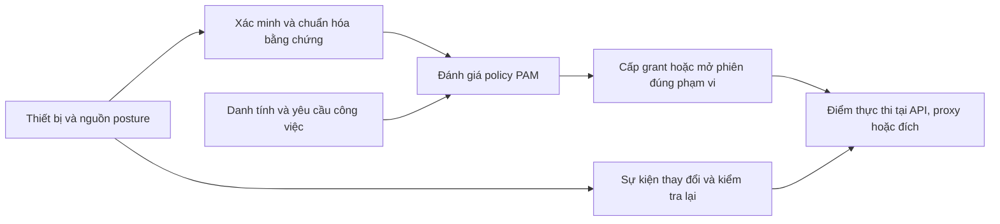

# Policy condition theo device posture

## 1. Device posture là đầu vào của quyết định cấp quyền

Device posture là tập thông tin về trạng thái của thiết bị tại một thời điểm, được dùng để đánh giá thiết bị có đáp ứng điều kiện bảo mật cho một công việc hay không. Trong quản lý truy cập đặc quyền (Privileged Access Management, PAM), các điều kiện này có thể áp dụng khi đăng nhập, kích hoạt quyền JIT, lấy credential hoặc mở phiên quản trị.

Ví dụ, tổ chức có thể chỉ cho phép khởi động lại dịch vụ production từ thiết bị thuộc quản lý, đáp ứng baseline bảo mật, có bằng chứng đủ mới và không mang trạng thái rủi ro bị cấm.

Device posture không thay thế xác thực người dùng hoặc quyết định quyền theo tài nguyên. Một máy đạt baseline không làm mọi người sử dụng máy đó trở thành quản trị viên. Ngược lại, một người đã hoàn thành MFA vẫn có thể đang sử dụng thiết bị không phù hợp cho tác vụ nhạy cảm.

NIST SP 800-207 nêu rằng không cấp niềm tin ngầm chỉ dựa trên vị trí mạng hoặc quyền sở hữu tài sản. Điều này nhắc người thiết kế PAM rằng “máy công ty” và “đang trong VPN” không đủ để đại diện toàn bộ yêu cầu thiết bị. [NIST về kiến trúc Zero Trust](https://csrc.nist.gov/pubs/sp/800/207/final).

Sau bài học, người học có thể chọn tín hiệu posture phù hợp, xác định nguồn đáng tin, viết điều kiện theo mức nhạy cảm của tác vụ và kiểm thử cách xử lý trạng thái không đạt, chưa rõ hoặc quá hạn.

## 2. Tình huống: thiết bị đã đăng ký nhưng chưa đủ điều kiện

An dùng laptop được cấp phát để yêu cầu quyền restart payment-worker trên một máy production. Thiết bị tồn tại trong danh mục quản lý, nhưng agent bảo vệ đã ngừng báo cáo từ trước ca trực. Một báo cáo cũ vẫn ghi trạng thái tốt.

Nếu PAM chỉ kiểm tra `managed = true`, yêu cầu có thể được cho phép dù tổ chức chưa biết trạng thái bảo vệ hiện tại. Nếu chỉ lấy bản ghi tốt gần nhất mà không xét độ mới, điều kiện “agent đang hoạt động” cũng chưa được chứng minh.

Một thiết kế đúng cần phân biệt: đã được quản lý, đã được đánh giá, kết quả đánh giá là gì, kết quả thuộc đúng thiết bị nào và còn đủ mới cho tác vụ hay không.

Sau khi thiết bị được khắc phục và có bằng chứng mới, PAM có thể đánh giá lại yêu cầu. Không cần gắn nhãn thiết bị vĩnh viễn không đáng tin chỉ vì một lần mất kết nối, nhưng cũng không nên cho quyền trong lúc bằng chứng bắt buộc còn thiếu.

## 3. Phân biệt các thuộc tính dễ bị gộp chung

| Thuộc tính | Điều nó có thể cho biết | Điều chưa thể suy ra |
|---|---|---|
| Registered | Thiết bị đã có danh tính trong hệ thống đăng ký | Hiện còn thuộc quản lý hoặc đáp ứng baseline |
| Managed | Thiết bị thuộc phạm vi quản lý được xác định | Mọi cấu hình đều đạt yêu cầu |
| Compliant | Thiết bị đáp ứng policy của nguồn đánh giá | Policy đó đủ nghiêm cho mọi tác vụ PAM |
| Risk state | Nguồn phát hiện đã đánh giá một mức rủi ro | Không có phát hiện đồng nghĩa chắc chắn không có xâm nhập |
| Fresh evidence | Bằng chứng nằm trong giới hạn độ mới | Mọi tín hiệu bên trong đều vừa được đo lại |
| Device-bound proof | Client chứng minh sử dụng khóa được liên kết | Thiết bị đang sạch mã độc hoặc người dùng có quyền với tài nguyên |

Trong Microsoft Intune, compliance được đánh giá theo các rule và điều kiện do tổ chức cấu hình; kết quả có thể được tích hợp với Microsoft Entra Conditional Access. Vì vậy, một cờ compliant cần được hiểu cùng policy và phạm vi đánh giá của nguồn, không phải một chứng nhận an toàn tuyệt đối. [Tài liệu về device compliance](https://learn.microsoft.com/en-us/intune/device-security/compliance/overview).

Đối với PAM, cần biết baseline nào tạo ra trạng thái compliant. Baseline cho thiết bị đọc tài liệu nội bộ chưa chắc đáp ứng yêu cầu của máy quản trị production.

## 4. Chọn tín hiệu theo rủi ro và khả năng quan sát

Không cần thu thập mọi thông tin của thiết bị. Chọn những tín hiệu liên quan đến rủi ro của công việc và có thể được đánh giá đáng tin trên nền tảng đang dùng.

| Nhóm tín hiệu | Ví dụ điều kiện | Điểm phải làm rõ |
|---|---|---|
| Quản lý tài sản | Thuộc nhóm máy quản trị được phép | Nguồn quản lý, chủ thể được dùng và trạng thái thu hồi |
| Hệ điều hành | Phiên bản được tổ chức hỗ trợ, đáp ứng baseline vá lỗi | Cách so sánh phiên bản và ý nghĩa của trạng thái đạt |
| Bảo vệ lưu trữ | Mã hóa ổ đĩa theo yêu cầu | Nguồn kiểm tra và nền tảng hỗ trợ |
| Bảo vệ khởi động | Đáp ứng yêu cầu khởi động an toàn nếu có | Cơ chế quan sát hoặc attestation phù hợp |
| Bảo vệ endpoint | Agent hoạt động và trạng thái rủi ro trong phạm vi cho phép | Có báo cáo đủ mới, lỗi agent được biểu diễn thế nào |
| Toàn vẹn nền tảng | Không có trạng thái bị cấm như root/jailbreak theo policy | Khả năng phát hiện thực tế trên từng nền tảng |
| Độ mới | Kết quả cần thiết chưa quá hạn | Thời điểm đo, thời điểm tổng hợp và giới hạn dùng lại |

Không so sánh số phiên bản hệ điều hành như chuỗi văn bản tùy ý. Cần chuẩn hóa theo nền tảng và quy tắc baseline. Cũng không dùng “đã cài antivirus” thay cho yêu cầu agent đang hoạt động, được cập nhật và có nguồn báo cáo đáng tin nếu công việc đòi hỏi những điều đó.

Một kiểm tra không được hỗ trợ phải có trạng thái rõ. Không biến `not supported` thành đạt yêu cầu chỉ để các nền tảng cùng xuất một cờ xanh. Có thể thiết kế profile riêng hoặc giới hạn loại tác vụ được phép trên nền tảng đó.

## 5. Nguồn dữ liệu và liên kết với đúng thiết bị

Nguồn posture có thể là MDM, EDR, dịch vụ đánh giá thiết bị hoặc một thành phần attestation. Mỗi nguồn cần có trách nhiệm và ranh giới tin cậy rõ ràng.

Không nhận `device_compliant: true` từ biểu mẫu hoặc header do client tự gửi như kết quả đã xác minh. PAM cần nhận thông tin qua tích hợp được bảo vệ hoặc truy vấn nguồn có thẩm quyền, rồi kiểm tra đúng ngữ cảnh.

Đặc biệt, phải liên kết posture với thiết bị đang thực hiện yêu cầu. Nếu client có thể gửi định danh của một máy khác đang đạt baseline, policy sẽ đánh giá đúng trạng thái nhưng sai đối tượng.

Danh tính thiết bị, bằng chứng xác thực và posture có thể do các thành phần khác nhau cung cấp. Thiết kế cần quy tắc ánh xạ giữa các định danh và cách xử lý trùng, thay máy, đăng ký lại hoặc chuyển chủ sở hữu. Hostname, IP và tên hiển thị chỉ nên là dữ liệu hỗ trợ khi chúng không có khả năng chứng minh quan hệ cần thiết.

Nếu có nhiều nguồn, xác định nguồn nào có thẩm quyền cho từng thuộc tính. Không chọn ngẫu nhiên bản ghi thuận lợi nhất khi MDM báo đạt còn EDR báo rủi ro cao. Cần policy giải quyết xung đột và lưu được căn cứ.

## 6. Hợp đồng bằng chứng và độ mới

Mỗi bằng chứng dùng để cấp quyền nên cho biết thiết bị, nguồn, baseline, kết quả và thời gian liên quan. Ví dụ sau là schema minh họa của một dịch vụ chuẩn hóa, không phải payload của sản phẩm cụ thể:

```json
{
  "evidence_id": "posture-lab-918",
  "device_id": "managed-device-17",
  "provider_id": "endpoint-posture-lab",
  "source_policy_version": "admin-device-baseline-v8",
  "observed_at": "2026-12-01T07:20:00Z",
  "received_at": "2026-12-01T07:20:12Z",
  "valid_until": "2026-12-01T07:25:00Z",
  "normalized_state": "PASS",
  "checks": {
    "managed": "PASS",
    "supported_os": "PASS",
    "disk_encryption": "PASS",
    "endpoint_protection": "PASS",
    "risk_requirement": "PASS"
  },
  "provenance_reference": "verified-provider-record-918"
}
```

Các giá trị thời gian chỉ là ví dụ. Giới hạn năm phút không phải yêu cầu chung cho mọi nguồn hoặc mọi tác vụ. Nguồn thực tế có thể không cung cấp đủ field trên; khi đó phải xác định cách tạo dữ liệu chuẩn hóa và mức bảo đảm còn lại.

Phân biệt thời điểm quan sát trạng thái với thời điểm nhận bản ghi. Nhận một bản ghi lúc 14:00 không có nghĩa trạng thái bên trong được đo lúc 14:00. Việc thiết bị vừa check-in cũng chưa chứng minh mọi phép kiểm tra đã được chạy lại.

Nếu các tín hiệu có thời điểm khác nhau, điều kiện cần xét độ mới của từng tín hiệu bắt buộc hoặc cách tổng hợp đã được định nghĩa. Không dùng timestamp mới của một trường không liên quan để làm mới toàn bộ posture.

PAM dùng thời gian server và quy tắc sai lệch đồng hồ được xác định. Bản ghi có thời điểm bất thường, quá hạn hoặc không xác minh được nguồn cần được xử lý rõ, thay vì kéo dài hiệu lực mặc định.

## 7. Thiết kế profile theo loại tác vụ PAM

Một điều kiện posture duy nhất cho mọi công việc thường quá rộng hoặc quá khó đáp ứng. Có thể tổ chức profile theo mức nhạy cảm và đường truy cập.

| Profile minh họa | Công việc | Ý định kiểm soát |
|---|---|---|
| Chẩn đoán lab | Đọc dữ liệu chẩn đoán không nhạy cảm đã được giới hạn | Đủ điều kiện thiết bị cho phạm vi lab; không mở rộng sang dữ liệu nhạy cảm |
| Vận hành production | Restart một dịch vụ theo change | Thiết bị quản trị được phép, baseline tương ứng và bằng chứng đủ mới |
| Quản trị nền tảng PAM | Sửa policy, cấu hình vault hoặc tích hợp xác thực | Profile chuyên biệt, xác thực và kiểm soát thay đổi tương xứng |

Bảng là ví dụ phân tích rủi ro, không phải công thức chung rằng đọc luôn ít rủi ro. Đọc credential hoặc dữ liệu nhạy cảm có thể cần yêu cầu rất cao.

Các profile nên chỉ rõ thuộc tính bắt buộc, độ mới, nguồn được chấp nhận, hành vi với trạng thái không rõ và điểm kiểm tra lại. Điều kiện thiết bị phải kết hợp với quyền chủ thể, phạm vi tài nguyên, MFA và phê duyệt nếu công việc yêu cầu.

Không viết điều kiện kiểu “thiết bị đạt posture **hoặc** người dùng là quản trị viên” khi ý định là quản trị viên cũng phải dùng thiết bị đạt yêu cầu. Tương tự, xác thực lại không tự sửa được một thiết bị đã có trạng thái bị cấm.

## 8. Biểu diễn PASS, FAIL và UNKNOWN

Một mô hình chuẩn hóa có thể dùng ba trạng thái:

| Trạng thái | Ý nghĩa | Tác động khi đây là điều kiện bắt buộc |
|---|---|---|
| `PASS` | Có bằng chứng hợp lệ đáp ứng yêu cầu cụ thể | Được tiếp tục đánh giá các điều kiện còn lại |
| `FAIL` | Có bằng chứng cho thấy không đáp ứng yêu cầu | Không cấp quyền theo nhánh yêu cầu điều kiện đó |
| `UNKNOWN` | Thiếu, quá hạn, lỗi hoặc không xác minh được | Chờ xác minh hoặc xử lý theo nhánh được thiết kế; chưa cấp quyền |

Tên và số trạng thái của nguồn có thể khác. Cần ánh xạ có chủ đích, đặc biệt với trạng thái đang khắc phục, chưa đánh giá, không áp dụng hoặc còn trong thời gian gia hạn.

Một nguồn có thể cho phép grace period đối với công việc thông thường. Điều đó không tự có nghĩa PAM chấp nhận cùng grace period cho mọi thao tác đặc quyền. Nếu tổ chức cho phép, phải mô tả rõ những tác vụ, phạm vi và thời gian được áp dụng.

Cũng cần kiểm tra cách hệ thống nguồn xử lý thiết bị không được gán policy. Không suy rằng cờ compliant luôn có nghĩa đã chạy đúng baseline quản trị mà PAM yêu cầu.

Trong profile production của ví dụ, yêu cầu tất cả kiểm tra bắt buộc đều `PASS` và đủ mới. Đây là lựa chọn của mô hình bài học; hệ thống thật phải diễn đạt lựa chọn đó thành policy có thể kiểm thử.

## 9. Mã giả đánh giá điều kiện thiết bị

Ví dụ dưới đây chỉ mô tả logic nghiệp vụ. Nó không thay bộ xác minh giao thức, bằng chứng thiết bị hoặc SDK của nhà cung cấp:

```text
function evaluatePostureCondition(request, trustedContext, policy):
    device = resolveVerifiedRequestDevice(trustedContext)
    if device is UNKNOWN:
        return WAIT_OR_DENY("device-unresolved")

    if device.status != ACTIVE:
        return DENY("device-not-active")

    if not subjectMayUseDevice(trustedContext.subject, device):
        return DENY("subject-device-not-allowed")

    evidence = getEvidenceFromAllowedProvider(device, policy)
    if not validProvenanceAndSchema(evidence):
        return WAIT_OR_DENY("unverified-posture-evidence")

    if evidence.deviceId != device.id:
        return DENY("device-evidence-mismatch")

    if not sourceBaselineAccepted(evidence, policy):
        return WAIT_OR_DENY("baseline-not-accepted")

    if not allRequiredObservationsFresh(evidence, serverTime(), policy):
        return WAIT_OR_DENY("posture-stale-or-time-invalid")

    if anyRequiredCheckIsFAIL(evidence, policy):
        return DENY("posture-requirement-failed")

    if anyRequiredCheckIsUNKNOWN(evidence, policy):
        return WAIT_OR_DENY("posture-incomplete")

    return CONDITION_SATISFIED(
        deviceReference = device.id,
        evidenceReference = evidence.id,
        posturePolicyVersion = policy.version,
        decisionExpiry = boundedExpiry(evidence, policy)
    )
```

`CONDITION_SATISFIED` không phải quyết định cho phép toàn bộ yêu cầu PAM. Hệ thống vẫn phải đánh giá hành động, tài nguyên, thời lượng, quyền người dùng, yêu cầu xác thực và workflow liên quan.

`WAIT_OR_DENY` cần trở thành trạng thái cụ thể theo chính sách triển khai. Trong khi chờ, không được kích hoạt quyền đang cần bằng chứng. Nếu muốn đi theo ngoại lệ, dùng một nhánh có thẩm quyền và điều kiện riêng, không đổi kết quả unknown thành pass.

Kiểm tra kiểu dữ liệu và miền giá trị ở đầu vào. Chuỗi `"false"`, giá trị trống hoặc trạng thái chưa biết không được phép trở thành boolean đúng do chuyển đổi kiểu dễ dãi.

## 10. Nơi áp dụng điều kiện và giới hạn của từng điểm



Điểm kiểm tra có thể là IdP, gateway PAM, API kích hoạt hoặc proxy phiên. Cần biết chính xác công việc nào được điểm đó bảo vệ.

Một ví dụ sản phẩm là dùng compliance của Intune trong Microsoft Entra Conditional Access để yêu cầu thiết bị compliant khi truy cập tài nguyên được policy bảo vệ. Điều này cần policy compliance và cấu hình phạm vi phù hợp; không tự làm mọi giao thức hoặc máy chủ ngoài đường tích hợp đều có kiểm tra tương đương. [Hướng dẫn yêu cầu device compliance](https://learn.microsoft.com/en-us/entra/identity/conditional-access/policy-all-users-device-compliance).

Nếu chỉ kiểm tra posture lúc đăng nhập buổi sáng, quyết định đó chưa chứng minh thiết bị còn đạt yêu cầu khi kích hoạt quyền nhạy cảm nhiều giờ sau. Phải xác định khi nào cần đánh giá lại và thời gian được dùng lại kết quả cũ.

Nếu vault giao một mật khẩu có thể dùng ngoài thiết bị, posture lúc checkout không tự ràng buộc mọi lần sử dụng mật khẩu sau đó. Cần thiết kế đường truy cập, vòng đời credential và điểm thực thi phù hợp với cam kết.

## 11. Thiết bị đổi trạng thái sau khi được cấp quyền

Tình trạng endpoint có thể thay đổi sau quyết định: agent ngừng hoạt động, thiết bị bị đánh dấu rủi ro, mất quản lý hoặc bị thu hồi. Chính sách cần nêu hành vi đối với cả hoạt động mới và hoạt động đang diễn ra.

Có thể phân biệt:

- Chặn yêu cầu hoặc grant mới.
- Chặn kích hoạt một quyết định đã duyệt nhưng chưa sử dụng.
- Ngừng cho phép thêm hoạt động trên phiên đang mở.
- Thu hồi token, lease hoặc phiên theo cơ chế hỗ trợ.
- Xử lý tác vụ đã chạy tại đích nếu có yêu cầu và khả năng tương ứng.

Không cam kết dừng tức thì mọi hoạt động nếu kiến trúc chỉ đánh giá khi cấp token. Phiên SSH, phiên ứng dụng và tiến trình nền có vòng đời khác nhau; đóng một lớp không tự chứng minh các lớp khác đã dừng.

Cần đo độ trễ từ lúc nguồn quan sát thay đổi đến lúc PAM nhận, đánh giá và thực thi. Nếu có khoảng kiểm tra định kỳ, chọn theo rủi ro và khả năng nguồn; không gọi đó là giám sát liên tục không có độ trễ.

Một snapshot giúp giải thích căn cứ lúc cấp quyền, nhưng không đóng băng trạng thái thực tế. Ngược lại, dữ liệu mới phải được đối chiếu đúng thiết bị và grant để tránh thu hồi nhầm.

## 12. Cache, gián đoạn nguồn và khắc phục

Cache có thể cần cho hiệu năng. Thời hạn dùng lại phải phù hợp với các quan sát bắt buộc, phiên bản baseline, trạng thái thu hồi và profile tác vụ. Không giữ kết quả đạt vô hạn chỉ vì nguồn mới đang lỗi.

Khi nguồn không phản hồi, không dùng giá trị mặc định “healthy”. Có thể chờ, retry có giới hạn, thông báo hướng khắc phục hoặc chuyển một nhánh ngoại lệ được cho phép. Phải phân biệt lỗi tích hợp với bằng chứng thiết bị thực sự không đạt.

Thiết kế đường khắc phục để người dùng cập nhật, đồng bộ hoặc liên hệ đúng đội hỗ trợ mà không cần được cấp trước quyền production. Hướng dẫn nên nêu lý do đủ để hành động, chẳng hạn bằng chứng quá hạn hoặc baseline chưa được gán; tránh phát tán chi tiết nhạy cảm về hệ thống phát hiện.

Không yêu cầu người dùng tự sửa bản ghi, tắt agent hay đổi nhãn thiết bị để vượt điều kiện. Nếu có lỗi mapping hoặc nguồn đánh giá sai, sửa tại thành phần có trách nhiệm và lưu bằng chứng thay đổi.

Với phiên đang chạy khi nguồn bị gián đoạn, cần quy tắc riêng. Chính sách có thể khác giữa một lần timeout ngắn và việc mất khả năng quan sát kéo dài, nhưng phải được định nghĩa và kiểm thử thay vì để mỗi node tự xử lý.

## 13. Ngoại lệ và đường truy cập đặc biệt

Ngoại lệ device posture cần xác định chủ thể, thiết bị hoặc loại đường truy cập, tác vụ, tài nguyên, thời hạn, người có thẩm quyền và điều kiện bù đắp. Một nhóm tên `posture-excluded` không có ngày xem lại dễ trở thành đường truy cập thường trực ngoài policy.

Không xem mọi ngoại lệ là cho phép toàn bộ công việc. Thiết bị đang chờ cập nhật có thể được phép vào kênh khắc phục nhưng không được lấy credential quản trị nhạy cảm.

Tài khoản khẩn cấp, workload và VDI cần mô hình riêng theo ranh giới tin cậy của chúng. Một workload không có laptop người dùng không nên bị ép giả lập cờ posture của người; thay vào đó, đánh giá danh tính và môi trường chạy phù hợp.

Trong VDI, phải xác định đang kiểm tra desktop ảo hay máy local kết nối vào. Nếu chính sách yêu cầu cả hai, cần nguồn và điểm thực thi cho cả hai. Không suy rằng trạng thái tốt của desktop ảo chứng minh máy vật lý của người dùng cũng đạt yêu cầu.

Mọi lần sử dụng ngoại lệ cần được ghi nhận và đối chiếu sau đó. Khi ngoại lệ hết hạn, kiểm tra cấu hình và quyền thực tế đã được đóng, không chỉ đóng hồ sơ công việc.

## 14. Quản trị baseline và quan sát hiệu lực policy

Baseline posture là cấu hình ảnh hưởng đến cấp quyền, nên quyền sửa baseline, nhóm gán policy và mapping trạng thái đều nhạy cảm. Một thay đổi làm nguồn đánh giá dễ đạt hơn có thể mở rộng truy cập dù rule PAM không đổi.

Quy trình thay đổi nên có chủ sở hữu, phiên bản, tập ca thử, đánh giá tác động và phương án khôi phục. Triển khai theo nhóm nhỏ giúp phát hiện nền tảng không được hỗ trợ hoặc dữ liệu chưa đủ trước khi ảnh hưởng toàn bộ quản trị viên.

Có thể chạy đánh giá shadow hoặc report-only để quan sát tác động dự kiến. Phải phân biệt kết quả đánh giá với thực thi thật; một rule ở chế độ quan sát chưa chặn thiết bị không đạt.

Sự kiện quyết định nên lưu chủ thể, thiết bị, thao tác, phạm vi, profile, phiên bản policy, tham chiếu posture, mốc thời gian và mã lý do. Sau đó liên kết tới grant, phiên và kết quả thu hồi. Không cần lưu toàn bộ dữ liệu endpoint hay thông tin nhạy cảm không phục vụ quyết định.

Theo dõi riêng tỷ lệ fail, unknown, stale và lỗi nguồn. Nếu gộp tất cả vào một số “bị chặn”, khó biết cần khắc phục thiết bị, sửa tích hợp hay điều chỉnh baseline. Việc rule đột nhiên không chặn ai cũng cần xem lại khả năng thu thập và phạm vi áp dụng.

## 15. Bộ kiểm thử chấp nhận trong lab

Chỉ dùng thiết bị, tài khoản và dữ liệu lab được phép. Có thể mô phỏng bằng chứng từ nguồn thử nghiệm để kiểm tra policy; không tắt bảo vệ endpoint production chỉ để tạo trạng thái thất bại.

| Tình huống | Kết quả mong đợi trong profile production của bài |
|---|---|
| Đúng thiết bị, baseline và mọi quan sát còn đủ mới | Điều kiện posture đạt; tiếp tục kiểm tra quyền khác |
| Client tự gửi cờ compliant | Không coi là bằng chứng đã xác minh |
| Bằng chứng thuộc một thiết bị khác | Từ chối do không khớp đối tượng |
| Thiết bị managed nhưng không có baseline phù hợp | Không tự suy ra đạt posture |
| Một kiểm tra bắt buộc là FAIL | Không cấp quyền theo profile yêu cầu kiểm tra đó |
| Một kiểm tra bắt buộc là UNKNOWN | Chờ hoặc từ chối theo policy, chưa cấp quyền |
| Bản ghi vừa nhận nhưng quan sát đã quá hạn | Không dùng thời điểm nhận để làm mới trạng thái |
| Nguồn MDM và EDR có kết quả mâu thuẫn | Xử lý theo quy tắc nguồn và xung đột đã định |
| Thuộc tính có kiểu sai hoặc giá trị không biết | Không diễn giải thành trạng thái đạt |
| Thiết bị không còn active sau khi quyết định được duyệt | Kiểm tra lại và xử lý trước kích hoạt theo policy |
| Posture chuyển xấu khi phiên đang mở | Thực thi đúng hành vi và độ trễ đã cam kết |
| Nguồn posture gián đoạn | Không mặc định healthy; thể hiện nhánh suy giảm rõ |
| Gọi CLI/API ngoài UI | Vẫn đáp ứng điều kiện trên đường được bảo vệ |
| Ngoại lệ hết hạn | Không tiếp tục dùng ngoại lệ để cấp quyền mới |
| Rule chỉ ở chế độ quan sát | Báo đúng chưa thực thi, không coi kết quả mô phỏng là đã chặn |

Kiểm thử cả ranh giới thời gian: ngay trước, đúng mốc và sau giới hạn độ mới. Với nhiều node, kiểm tra kết quả cache và sự kiện thu hồi có được áp dụng nhất quán trong giới hạn đã công bố hay không.

Đầu ra cần gồm dữ liệu nguồn, policy, quyết định, quyền thực tế và kết quả phiên. Một cờ compliant màu xanh trên dashboard không thay thế bằng chứng rằng điều kiện đã được áp dụng cho đúng lần truy cập.

## 16. Bài thực hành thiết kế một profile posture

Chọn một công việc PAM cụ thể, ví dụ restart dịch vụ lab giả lập production. Xác định các tín hiệu thiết bị cần thiết theo rủi ro, nguồn có thẩm quyền và cách liên kết tới thiết bị đang yêu cầu.

Viết hợp đồng độ mới, mapping PASS/FAIL/UNKNOWN, hành vi khi nguồn lỗi và các điều kiện kiểm tra lại. Kết hợp profile với danh tính người dùng, phạm vi quyền, MFA, phê duyệt và thời hạn JIT; không để posture trở thành một rule cho phép độc lập mở rộng mọi quyền.

Sau đó kiểm thử một trường hợp đạt, một trường hợp quá hạn, một trường hợp sai thiết bị và một lần thay đổi trạng thái khi đã có phiên. Bản thiết kế hoàn chỉnh phải giải thích được vì sao quyền được cấp, thiết bị nào được đánh giá, bằng chứng còn hợp lệ đến đâu và hệ thống xử lý thế nào khi các điều kiện không còn đúng.
