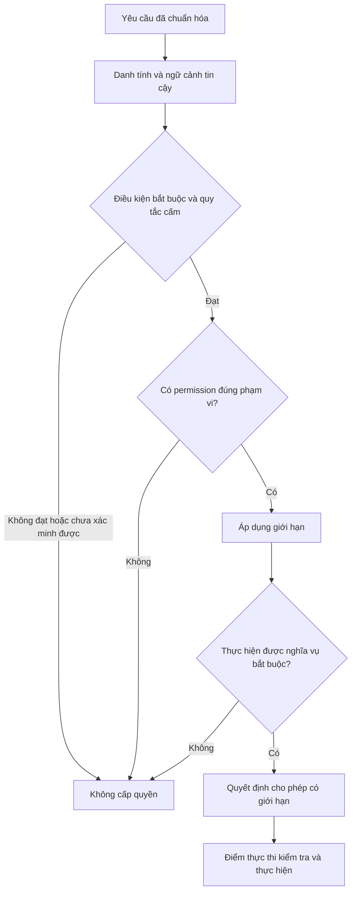

# Policy conflict

## Mục tiêu bài học

**Policy conflict** là tình huống những chính sách có liên quan tới một yêu cầu truy cập đưa ra kết quả hoặc yêu cầu không tương thích. Trong Privileged Access Management (PAM), xung đột có thể xuất hiện giữa role, điều kiện MFA, approval, cửa sổ bảo trì, quyền tại đích và các chính sách tổ chức.

Một câu trả lời như “deny luôn thắng” chỉ đúng khi đó là ngữ nghĩa đã được xác định cho tập chính sách đang xét. Các hệ thống có thể dùng thuật toán kết hợp khác nhau, và một quyết định allow ở PAM không tự thắng một quyết định deny tại hệ thống đích.

Sau bài học này, bạn có thể:

- Phân biệt xung đột thực sự với kết quả không áp dụng hoặc lỗi đánh giá.
- Giải thích các cách kết hợp chính sách và rủi ro của thứ tự ngầm định.
- Tách quyền cho phép, giới hạn bắt buộc và nghĩa vụ thực thi.
- Giải quyết phạm vi, thời hạn và ngoại lệ mà không tạo quyền ngoài ý định.
- Chẩn đoán xung đột qua nhiều điểm thực thi.
- Xây dựng bộ ca kiểm thử và bằng chứng cho một quyết định authorization.

## 1. Một yêu cầu có thể chịu nhiều chính sách

Giả sử Lan muốn restart dịch vụ `billing-stg`. Các quy tắc liên quan có thể là:

1. Nhóm vận hành staging được yêu cầu quyền restart.
2. Phiên phải đáp ứng yêu cầu MFA và độ mới.
3. Cần approval cho đúng dịch vụ và khoảng thời gian.
4. Dịch vụ đang nằm trong thời gian đóng băng thay đổi.
5. Grant vận hành không được dài hơn giới hạn của tài sản.
6. Phiên phải được ghi bằng chứng theo yêu cầu.
7. Hệ thống đích chỉ chấp nhận một vai trò cụ thể.

Nếu chỉ kiểm tra quy tắc 1, PAM có thể cấp quyền trái với điều kiện còn lại. Nếu chỉ đếm số quy tắc allow và deny rồi lấy đa số, kết quả không phản ánh mô hình kiểm soát.

Một thiết kế cần biết mỗi chính sách thuộc loại nào, áp dụng ở đâu và được kết hợp theo ngữ nghĩa gì.

### Ví dụ không phải xung đột

Một policy cho phép đọc trạng thái staging và policy khác cho phép restart staging không mâu thuẫn. Chúng cấp hai permission khác nhau.

Một policy cho phép restart staging và một policy từ chối restart production cũng không mâu thuẫn đối với cùng một tài sản nếu tài sản đã được xác định rõ.

Xung đột cần được phân tích trên một yêu cầu cụ thể gồm chủ thể, hành động, tài nguyên và ngữ cảnh. Hai câu chữ khác nhau không tự có nghĩa là hai policy đang tranh chấp cùng một quyết định.

## 2. Chuẩn hóa yêu cầu trước khi phân tích policy

Một yêu cầu khái niệm có thể là:

```yaml
# Dữ liệu minh họa, không phải cấu hình sản phẩm.
actor_reference: principal-example-lan
action: service.restart
resource_reference: billing-stg
tenant_reference: tenant-example-a
requested_duration_minutes: 15
approval_reference: approval-example-82
request_version: 3
```

Máy chủ bổ sung những dữ liệu có thẩm quyền như trạng thái tài khoản, nhãn tài sản, nhóm, thời gian hiện tại và bằng chứng xác thực.

Không coi các trường `environment: staging`, `mfa: true` hoặc `approved: true` do client gửi là kết luận tin cậy.

### Những khác biệt đầu vào có thể tạo xung đột giả

- Một policy nhìn hostname, policy khác nhìn asset ID nhưng hai giá trị không được ánh xạ đúng.
- Một hệ thống dùng giờ địa phương, hệ thống khác hiểu timestamp là UTC.
- Tài sản thuộc tenant A nhưng một truy vấn lấy nhầm membership tenant B.
- Hai engine dùng cách chuẩn hóa tên hoặc chữ hoa–thường khác nhau.
- Nhóm tài sản động đã thay đổi nhưng một thành phần còn dùng cache cũ.
- Thiếu thuộc tính bị chuyển thành chuỗi rỗng, rồi vô tình khớp một quy tắc khác.

Cần xác định schema, kiểu dữ liệu, nguồn và độ mới. Một quyết định không thể đáng tin nếu các policy không thực sự đang đánh giá cùng đối tượng.

## 3. Phân loại policy trước khi chọn cách kết hợp

| Loại | Vai trò trong quyết định | Ví dụ PAM |
|---|---|---|
| Quy tắc cấp quyền | Chỉ ra ai có thể thực hiện hành động trên scope nào | Role vận hành được restart dịch vụ staging |
| Điều kiện bắt buộc | Phải thỏa trước khi cấp quyền | Danh tính hoạt động, MFA phù hợp, approval còn hạn |
| Giới hạn | Thu hẹp một phạm vi đã có quyền | Grant tối đa 10 phút hoặc chỉ một tập tài sản |
| Quy tắc cấm | Loại trừ hành vi hoặc tình huống cụ thể | Không thay đổi trong change freeze trừ ngoại lệ được định nghĩa |
| Nghĩa vụ thực thi | Điều phải được thực hiện kèm quyết định | Ghi bằng chứng, giới hạn phiên, dùng broker được chỉ định |
| Hướng dẫn | Thông tin hỗ trợ nhưng không tự quyết định quyền | Gợi ý vai trò hẹp hơn cho người xin |

Không mô hình hóa mọi điều kiện thành một allow hoặc deny rời rạc rồi hy vọng thuật toán kết hợp tự hiểu ý định nghiệp vụ.

Ví dụ, “có MFA” thường là một điều kiện cần cho quyền quản trị, không phải một policy độc lập cấp mọi quyền cho bất kỳ người đã dùng MFA.

## 4. Các kết quả đánh giá cần phân biệt

Một engine có thể dùng những trạng thái tương đương sau:

| Kết quả | Ý nghĩa | Điều không được suy ra |
|---|---|---|
| Permit | Policy áp dụng và cho phép theo ngữ nghĩa của nó | Toàn bộ hệ thống đã cho phép thực thi |
| Deny | Policy áp dụng và không cho phép | Mọi loại lỗi đều là một từ chối có căn cứ nghiệp vụ |
| NotApplicable | Policy không áp dụng cho yêu cầu | Policy đó cho phép hoặc đã kiểm tra đủ điều kiện |
| Indeterminate | Không đánh giá được do dữ liệu, lỗi hoặc điều kiện chưa xác định | Có thể bỏ qua để tiếp tục cấp quyền |

Tên cụ thể phụ thuộc hệ thống. Điều quan trọng là không đổi NotApplicable hoặc Indeterminate thành Permit chỉ để có một kết quả nhị phân.

### Dữ liệu thiếu không phải một giá trị thuận lợi

Nếu chưa lấy được trạng thái thiết bị mà chính sách bắt buộc phải có, không coi đó là “thiết bị không bị đánh dấu xấu”.

Ngược lại, một policy không liên quan đến hành động hiện tại có thể hợp lệ là NotApplicable. Không cần từ chối mọi yêu cầu chỉ vì một policy ngoài phạm vi không áp dụng.

Cần định nghĩa rõ policy nào là bắt buộc cho lớp yêu cầu nào, và khi không xác minh được điều kiện đó thì hệ thống xử lý ra sao.

## 5. Những thuật toán kết hợp phổ biến

### Deny-overrides

Một thiết kế có thể quy định rằng một Deny áp dụng sẽ chặn Permit trong cùng tập policy. Đây thường là lựa chọn dễ giải thích cho các quy tắc cấm bắt buộc.

Tuy nhiên, vẫn phải định nghĩa cách xử lý lỗi, NotApplicable, policy lồng nhau và những nguồn quyền không nằm trong tập đó. Chỉ nói “deny thắng” chưa mô tả đầy đủ engine.

### Permit-overrides

Một Permit có thể đủ để kết quả cuối là Permit theo ngữ nghĩa đã chọn. Cơ chế này có thể phù hợp với những tập quyền cấp độc lập, nhưng nguy hiểm nếu vô tình đặt quy tắc cấm bắt buộc vào cùng phép kết hợp và cho phép bị vượt qua.

Không để một rule “thành viên nhóm vận hành” thắng điều kiện “tài khoản bị đình chỉ” chỉ vì cấu hình permit-overrides ở sai lớp.

### First-applicable hoặc thứ tự ưu tiên

Engine có thể lấy kết quả của quy tắc đầu tiên áp dụng. Khi đó, thứ tự là một phần của chính sách.

Thêm một rule allow rộng ở đầu có thể che một deny quan trọng ở sau. Cần kiểm tra quy tắc bị che khuất và bảo vệ thứ tự khỏi thay đổi ngoài kiểm soát.

### Quy tắc cụ thể hơn thắng

Một số hệ thống có cơ chế ưu tiên theo độ cụ thể hoặc mức ưu tiên được khai báo. Không mặc định mọi engine đều có cơ chế này.

“Rule tài sản cụ thể phải thắng rule toàn tổ chức” là một giả định nguy hiểm nếu mục tiêu của rule toàn tổ chức là giới hạn bắt buộc. Độ cụ thể không tự tạo thẩm quyền vượt chính sách.

### Cấp quyền cộng dồn và giới hạn riêng

Một mô hình có thể hợp các permission cho phép từ role rồi áp dụng những boundary và điều kiện bắt buộc. Đây là cách tách ý nghĩa thường dễ kiểm tra hơn việc coi tất cả là cùng loại rule.

Dù chọn cách nào, cần có tài liệu ngữ nghĩa và ca kiểm thử. Không lấy hành vi của một sản phẩm làm mặc định cho mọi hệ thống.

## 6. Mô hình kết hợp minh họa cho PAM

Một mô hình khái niệm có thể dùng thứ tự:

1. Kiểm tra danh tính và phạm vi yêu cầu.
2. Xác định các policy bắt buộc.
3. Từ chối nếu có điều cấm áp dụng hoặc không xác minh được điều kiện bắt buộc.
4. Tìm ít nhất một quyền cho phép đúng action và scope.
5. Áp dụng giới hạn scope, thời gian và điều kiện.
6. Xác nhận có thể thực hiện các nghĩa vụ bắt buộc.
7. Tạo quyết định có phiên bản để điểm thực thi sử dụng.



Đây là mô hình bài học, không phải mô tả bắt buộc của một sản phẩm. Nó cố ý tách điều kiện không thể bù trừ khỏi tập quyền cấp.

### Mặc định không cấp khi thiếu cơ sở

Nếu không có permission áp dụng, không cấp quyền. Việc không thấy deny không đồng nghĩa tồn tại allow.

Nếu không thể xác minh một điều kiện bắt buộc, chưa có cơ sở cấp quyền cho thao tác đó. Thông báo và audit cần phân biệt lỗi đánh giá với một yêu cầu đã được xác định là vi phạm chính sách.

## 7. Kết hợp scope mà không tạo quyền mới

Một permission phải giữ action, tài nguyên và điều kiện liên quan.

```text
Quyền A: restart trên staging
Quyền B: read trên production

Kết quả hợp quyền:
  restart trên staging
  read trên production
```

Không hợp riêng action và resource rồi tạo thêm restart production.

### Grant allow và boundary khác nhau

Nếu hai role độc lập cho phép đọc tập A và đọc tập B, tập quyền cho phép có thể là hợp A ∪ B theo mô hình đó.

Nếu một boundary bắt buộc giới hạn vào tập C, phạm vi cuối có thể là:

```text
phạm vi đọc được phép = (A ∪ B) ∩ C
```

Không dùng phép giao cho mọi allow một cách máy móc, cũng không dùng phép hợp cho mọi giới hạn. Phải biết mỗi tập biểu diễn quyền cấp hay giới hạn.

Nếu kết quả sau giới hạn là tập rỗng, không thực hiện hành động. Với yêu cầu nhiều tài sản, cần định nghĩa có cho phép từng phần hay yêu cầu cả lô; không âm thầm bỏ một phần rồi báo toàn bộ thành công.

### Phạm vi động cần được kiểm tra lại

Một asset group có thể thay đổi membership sau khi approval được ghi nhận. Nếu một máy production mới được thêm vào nhóm staging do lỗi nhãn, policy khớp theo nhãn có thể cấp sai quyền.

Cần kiểm soát nguồn nhãn, quyền sửa nhãn, cách chốt scope trong request và kiểm tra tại thời điểm thực thi. Một policy đúng cú pháp vẫn có thể dựa vào thuộc tính sai.

## 8. Kết hợp giới hạn thời gian

Giả sử Lan mở phiên lúc 10:12 với các giới hạn:

- Cửa sổ bảo trì kết thúc lúc 10:30.
- Approval chỉ có hiệu lực hoạt động tới 10:15.
- Chính sách tài sản cho grant tối đa 10 phút từ lúc bắt đầu.

Nếu cùng áp dụng như giới hạn bắt buộc cho grant này:

```text
hạn grant = min(10:30, 10:15, 10:22) = 10:15
```

Lan chỉ có tối đa ba phút cho grant, không phải 10 hoặc 15 phút mới tính lại từ đầu.

### Không gộp các thời hạn khác ý nghĩa

Idle timeout 5 phút và thời hạn tuyệt đối 15 phút không phải hai giá trị để lấy một giá trị rồi bỏ giá trị còn lại. Chúng kiểm soát hai điều khác nhau.

Tương tự:

- Hạn chờ approval.
- Hạn được dùng approval để bắt đầu.
- Cửa sổ công việc.
- TTL grant.
- TTL credential.
- Hạn phiên.

Cần áp dụng đúng loại thời hạn ở đúng bước. Dùng thời gian máy chủ và quy ước rõ ở ranh giới; chẳng hạn một grant có điều kiện `now < expires_at` không còn hiệu lực khi hai mốc bằng nhau.

Nếu hai cửa sổ bắt buộc không giao nhau, không có thời điểm thực thi hợp lệ. Không tự chọn cửa sổ thuận tiện hơn hoặc cộng thời gian từ hai policy.

## 9. Nghĩa vụ có thể làm một Permit không thực thi được

Một quyết định có thể cho phép với yêu cầu:

- Ghi bằng chứng phiên.
- Chỉ dùng broker cụ thể.
- Không cho lộ credential tới client.
- Giới hạn upload/download theo khả năng được thiết kế.
- Chấm dứt phiên khi hết grant.

Nếu điểm thực thi không hỗ trợ một nghĩa vụ bắt buộc, không được bỏ nghĩa vụ rồi tiếp tục coi quyết định là đủ điều kiện.

Ví dụ, policy cho phép phiên production chỉ khi có cơ chế ghi bằng chứng bắt buộc. Broker hiện tại không cung cấp khả năng đó. Cách xử lý là chọn đường thực thi hợp lệ hoặc không mở phiên theo policy hiện tại; không tự hạ yêu cầu ghi bằng chứng.

### Xung đột giữa nghĩa vụ

Hai policy có thể đòi:

- Dùng hai broker khác nhau cho cùng một phiên.
- Không truyền dữ liệu tới một vùng, trong khi tuyến được chọn chỉ đi qua vùng đó.
- Lưu một loại bằng chứng và đồng thời cấm thu thập chính loại dữ liệu đó.

Một số trường hợp có thể giải quyết bằng cơ chế đã được phê chuẩn như lọc dữ liệu hoặc chọn một tuyến tương thích. Nếu không có cách thỏa đồng thời, cần xem xét và sửa chính sách theo thẩm quyền trước khi cấp quyền.

Không coi một nghĩa vụ là tùy chọn chỉ vì khó thực hiện.

## 10. Xung đột qua nhiều lớp

```text
Directory / IdP
    -> eligibility và nhóm trong PAM
    -> approval và quyết định cấp grant
    -> vault hoặc session broker
    -> IAM và quyền ứng dụng tại đích
    -> kiểm tra thao tác cụ thể
```

Mỗi lớp có thể chặn truy cập. Một Permit ở đầu không bảo đảm các lớp sau cho phép.

### PAM allow nhưng đích deny

Ví dụ PAM đã duyệt role vận hành nhưng tài khoản đích chưa được gán quyền restart. Thao tác thất bại.

Cần kiểm tra mapping và trạng thái thực tế. Không khắc phục mặc định bằng cách gán quyền quản trị toàn đích. Quyền PAM hẹp cần được hiện thực hóa bằng quyền đích phù hợp.

### PAM deny nhưng đích vẫn allow qua đường khác

Nếu người dùng có credential thường trực và có thể kết nối trực tiếp, quyết định deny của PAM có thể không nằm trên đường truy cập đó.

Đây không chỉ là vấn đề thuật toán kết hợp trong PAM. Cần kiểm kê đường đi, hạn chế mạng nếu phù hợp, quản lý quyền thường trực và kiểm soát credential tại đích.

### Cấu hình giống tên nhưng khác ngữ nghĩa

Một role `operator` ở PAM và role `operator` tại ứng dụng có thể có quyền khác nhau. Không dùng tên giống nhau làm bằng chứng tương đương.

Cần mapping năng lực cụ thể và kiểm thử thao tác ngoài quyền, không chỉ kiểm thử thao tác được phép.

## 11. Ngoại lệ không phải một allow có ưu tiên tùy ý

Ngoại lệ cần có:

- Điều kiện được sử dụng.
- Tài sản, hành động và chủ thể cụ thể.
- Người có thẩm quyền phê chuẩn.
- Thời gian bắt đầu và hết hạn.
- Những giới hạn hoặc điều kiện bù đắp.
- Bằng chứng và hậu kiểm.

Không tạo một role `exception-admin` có quyền thắng mọi policy chỉ vì tên chứa chữ exception.

### Ngoại lệ phải được mô hình hóa ở đúng lớp

Nếu một policy bắt buộc không cho phép bị override, thêm một allow ở lớp thấp hơn không làm ngoại lệ có hiệu lực.

Nếu tổ chức cho phép ngoại lệ đối với change freeze, policy freeze cần mô tả đường ngoại lệ hợp lệ hoặc được thay đổi theo quy trình có thẩm quyền. Không giả định “rule cụ thể hơn” tự có quyền vượt cấm.

### Break-glass là luồng riêng có kiểm soát

Trong sự cố nghiêm trọng, có thể có luồng emergency đã thiết kế. Nó vẫn cần phạm vi, thời hạn, trách nhiệm, cảnh báo và bằng chứng.

Không biến lỗi IdP, policy engine hoặc audit thành điều kiện tự cấp quyền rộng. Tính khẩn cấp không tự chứng minh danh tính hoặc thẩm quyền.

## 12. Chẩn đoán một quyết định mâu thuẫn

Bắt đầu từ một request cụ thể thay vì sửa nhiều policy cùng lúc.

### Bước 1 — Xác định quyết định thực tế

Lấy request ID, chủ thể, action, resource ID, tenant, thời điểm và phiên bản. Phân biệt bị từ chối trước cấp, lỗi cấp quyền hay đích từ chối sau khi grant đã được tạo.

### Bước 2 — Kiểm tra dữ liệu có thẩm quyền

Xem nhóm, nhãn tài sản, approval, trạng thái tài khoản và độ mới của tín hiệu. Xác định dữ liệu đến từ nguồn nào và có cache không.

Không kết luận policy sai khi vấn đề là asset bị gắn nhãn hoặc mapping sai.

### Bước 3 — Liệt kê những policy thực sự áp dụng

Với mỗi policy, ghi:

- ID và phiên bản.
- Target hoặc điều kiện áp dụng.
- Kết quả đánh giá.
- Lý do hoặc dữ liệu thiếu.
- Thuật toán kết hợp ở lớp chứa nó.
- Giới hạn hoặc nghĩa vụ phát sinh.

Phân biệt rule có trong hệ thống với rule đã tham gia quyết định. Một deny nằm sau first-applicable có thể chưa từng được đánh giá.

### Bước 4 — Tái dựng kết quả kết hợp

Kiểm tra thứ tự, precedence, default và cách xử lý Indeterminate. Với giới hạn, xem phép giao và mốc thời gian. Với quyền, giữ nguyên permission hoàn chỉnh.

### Bước 5 — Đối chiếu điểm thực thi

Điểm thực thi đã dùng đúng decision và phiên bản chưa? Có kiểm tra lại trước cấp quyền không? Có đường API hoặc token cũ bỏ qua quyết định không?

### Bước 6 — Sửa nguyên nhân và kiểm thử hồi quy

Chọn thay đổi nhỏ có căn cứ: sửa input mapping, thu hẹp một rule, làm rõ boundary hoặc sửa thứ tự được thiết kế. Sau đó kiểm tra cả yêu cầu cần allow và các trường hợp bắt buộc deny.

Không giải quyết một lỗi truy cập bằng wildcard rộng khi chưa hiểu nguyên nhân.

## 13. Pseudocode kết hợp theo mô hình bài học

```text
function authorize(request):
    normalized = normalize_and_resolve_authoritative_resource(request)
    context = load_verified_context(normalized)
    bundle = load_applicable_policy_bundle(normalized)

    require bundle.is_valid_and_versioned

    mandatory = evaluate_mandatory_controls(bundle, normalized, context)
    if mandatory.has_applicable_deny:
        return DENY("MANDATORY_CONTROL_DENIED")

    if mandatory.has_required_indeterminate_or_missing_result:
        return NOT_AUTHORIZED("REQUIRED_CONTROL_UNVERIFIED")

    grants = evaluate_permission_grants(bundle, normalized, context)
    allowed = complete_permissions_matching_request(grants)

    if allowed.is_empty:
        return DENY("NO_APPLICABLE_PERMISSION")

    bounded = apply_mandatory_boundaries(allowed, bundle, context)
    if bounded.has_no_valid_scope_or_time:
        return DENY("EMPTY_EFFECTIVE_SCOPE")

    obligations = combine_required_obligations(bundle, bounded)
    if obligations.conflict_or_cannot_be_enforced:
        return NOT_AUTHORIZED("OBLIGATION_UNSATISFIED")

    return PERMIT(
        scope = bounded.scope,
        expiry = bounded.expiry,
        obligations = obligations,
        policy_version = bundle.version,
        request_binding = normalized.version_and_scope
    )
```

Đây không phải thuật toán chung của mọi engine. Nó minh họa việc phân loại policy và không chuyển dữ liệu chưa xác minh thành quyền.

Điểm thực thi cần kiểm chứng quyết định dành cho đúng chủ thể, action, scope và thời hạn. Một quyết định có chữ ký cũng không được dùng cho tài sản khác hoặc sau khi hết hạn.

### Tránh khoảng trống giữa quyết định và hành động

Sau authorization, approval có thể bị rút hoặc tài sản thay đổi trạng thái trước lúc cấp quyền. Cần có kiểm tra lại và cơ chế ràng buộc phiên bản phù hợp với mức rủi ro.

Không có một cờ allow trong trình duyệt nào giải quyết được vấn đề này. Với thao tác từ xa có kết quả chưa biết, dùng cơ chế đối soát và chống cấp trùng; đừng gửi lại vô hạn một lệnh có thể đã thực hiện.

## 14. Quản trị thay đổi và cache

Một policy mới có thể làm thay đổi những quyết định trước đây. Cần phiên bản hóa, kiểm thử và đánh giá tác động tới:

- Yêu cầu đang chờ.
- Approval đã có.
- Grant và phiên đang chạy.
- Token hoặc quyết định được cache.
- Mapping role và asset group.
- Ngoại lệ đang có hiệu lực.

Một rollback cấu hình không tự thu hồi quyền đã được cấp trong khoảng policy sai hoạt động. Cần đối soát các grant hoặc credential phát sinh và xử lý riêng.

### Shadow evaluation và kiểm tra trước phát hành

Có thể đánh giá một policy mới trên yêu cầu đại diện mà chưa dùng nó để cấp quyền. So sánh kết quả cũ–mới để tìm những mở rộng hoặc thu hẹp ngoài ý định.

Bộ ca cần có mẫu biên: thời điểm hết hạn, membership lồng nhau, dữ liệu thiếu, tài sản mới và ngoại lệ. Chỉ thử một tình huống happy path không phát hiện được xung đột.

### Cache phải có giới hạn rõ

Quyết định cache cần gắn với các phiên bản và yếu tố ảnh hưởng theo thiết kế. Khi thay policy, cần biết cache hết hiệu lực hoặc bị vô hiệu lúc nào.

Nếu không thể cập nhật ngay mọi điểm thực thi, công bố giới hạn độ trễ và có biện pháp phù hợp cho thu hồi khẩn cấp. Không tuyên bố policy mới có hiệu lực tức thì chỉ vì đã lưu cấu hình trung tâm.

## 15. Audit và giải thích quyết định

Một bản ghi quyết định có thể chứa:

```json
{
  "event_type": "pam.authorization.decision",
  "decision_reference": "decision-example-71",
  "request_reference": "request-example-204-v3",
  "actor_reference": "principal-example-lan",
  "action": "service.restart",
  "resource_reference": "billing-stg",
  "policy_bundle_version": "bundle-example-v9",
  "combining_model": "mandatory-gates-then-scoped-grants",
  "result": "deny",
  "reason_code": "CHANGE_FREEZE_ACTIVE",
  "matched_policy_references": [
    "policy-example-staging-operator-v3",
    "policy-example-change-freeze-v2"
  ],
  "context_snapshot_reference": "context-example-71"
}
```

Đây là dữ liệu minh họa. Có thể lưu tham chiếu tới bằng chứng thay vì toàn bộ thuộc tính hoặc ticket.

Thông báo cho người xin nên đủ để xử lý nhưng không làm lộ topology, nhóm đặc quyền, dữ liệu người khác hoặc chi tiết phát hiện bảo mật. Bản giải thích nội bộ cần phân quyền và bảo vệ tính toàn vẹn.

Không ghi secret, token hoặc credential vào trace policy. Bật debug ở production mà thu mọi request body có thể tạo thêm kho dữ liệu nhạy cảm.

Bằng chứng authorization cần nối tới tác vụ thực thi, grant và phiên nếu có. Permit không đồng nghĩa lệnh đã chạy; Deny ở PAM không chứng minh không có truy cập qua một đường khác.

## 16. Bài thực hành có kiểm chứng

Dùng môi trường lab với dịch vụ staging và production giả lập. Chuẩn bị người dùng A thuộc nhóm vận hành, một approval có scope cố định và broker thử nghiệm.

### Bộ policy bài tập

Tạo:

- Allow restart staging cho vai trò vận hành.
- Điều kiện xác thực và approval bắt buộc.
- Change freeze có hành vi cấm rõ.
- Giới hạn grant và cửa sổ công việc.
- Yêu cầu ghi bằng chứng.
- Mapping quyền tại đích.

Ghi rõ thuật toán kết hợp và cách xử lý dữ liệu thiếu trước khi chạy thử.

### Ca kiểm thử

| Ca | Thao tác | Kết quả mong đợi |
|---|---|---|
| Allow hợp lệ | Đủ điều kiện, đúng scope và không freeze | Grant đúng quyền, thời gian và nghĩa vụ |
| Không có permission | Bỏ mọi allow áp dụng | Không cấp quyền dù không có explicit deny |
| Allow và cấm | Có role nhưng freeze đang áp dụng | Bị chặn theo mô hình bắt buộc đã định nghĩa |
| Thiếu dữ liệu | Không lấy được một thuộc tính bắt buộc | Không tự biến thành Permit; lý do phản ánh chưa xác minh được |
| Policy không liên quan | Thêm rule cho action khác | Không gây quyết định sai cho action hiện tại |
| Thứ tự | Đổi vị trí rule trong tập first-applicable thử nghiệm | Kết quả thể hiện đúng ngữ nghĩa và thay đổi được phát hiện |
| Không tạo tích chéo | Restart staging và read production | Không có restart production |
| Boundary rỗng | Scope allow không giao scope bắt buộc | Không thực thi trên tài sản ngoài boundary |
| Hạn sớm nhất | Bắt đầu 10:12, approval kết thúc 10:15 | Grant không vượt 10:15 |
| Nghĩa vụ thiếu | Broker không hỗ trợ yêu cầu bắt buộc | Không mở phiên bằng cách bỏ nghĩa vụ |
| Ngoại lệ sai scope | Ngoại lệ cho tài sản khác | Không vượt cấm trên tài sản đang xét |
| Đích deny | PAM Permit nhưng đích chưa có role đúng | Ghi đúng lỗi mapping/thực thi, không nâng quyền rộng tùy tiện |
| Cache cũ | Thay policy trong khi decision được cache | Hành vi đúng cơ chế invalidation và độ trễ đã công bố |
| API trực tiếp | Bỏ qua giao diện và gọi endpoint nhạy cảm | Điểm thực thi vẫn kiểm tra policy |
| Rollback | Phục hồi policy sau một cấu hình lab sai | Đối soát riêng những grant đã cấp trong thời gian sai |

Với mỗi ca, lưu request, snapshot ngữ cảnh có kiểm soát, phiên bản policy, kết quả từng lớp và kết quả tại đích. Không dùng ảnh màn hình báo lỗi làm bằng chứng duy nhất.

## 17. Câu hỏi tự kiểm tra

1. Vì sao không thể dùng câu “deny luôn thắng” cho mọi nền tảng?
2. NotApplicable khác Indeterminate thế nào?
3. Khi nào hợp scope, khi nào giao scope?
4. Một Permit có nghĩa vụ bắt buộc chưa thực hiện được có nên mở phiên không?
5. Vì sao rollback policy chưa đủ để xử lý quyền đã cấp sai?

### Gợi ý đối chiếu

1. Ngữ nghĩa kết hợp, thứ tự và phạm vi policy khác nhau; phải xác định mô hình thực tế và các điểm thực thi.
2. NotApplicable là không thuộc phạm vi; Indeterminate là chưa đánh giá được. Cả hai không tự tạo quyền.
3. Các grant độc lập có thể hợp theo mô hình cấp quyền; boundary bắt buộc giới hạn bằng giao. Phải giữ action, scope và điều kiện gắn với nhau.
4. Không được bỏ nghĩa vụ bắt buộc. Cần đường thực thi đáp ứng hoặc không cấp quyền theo policy đó.
5. Grant, credential và phiên đã phát có vòng đời riêng; phải đối soát và thu hồi hoặc sửa chúng.

Giải quyết policy conflict đòi hỏi một ngữ nghĩa kết hợp rõ ràng, dữ liệu đáng tin và kiểm chứng tại điểm thực thi. Trong PAM, kết quả cần vừa đúng về quyết định, vừa giữ nguyên quyền hẹp, thời hạn, nghĩa vụ và khả năng thu hồi tới hệ thống đích.
