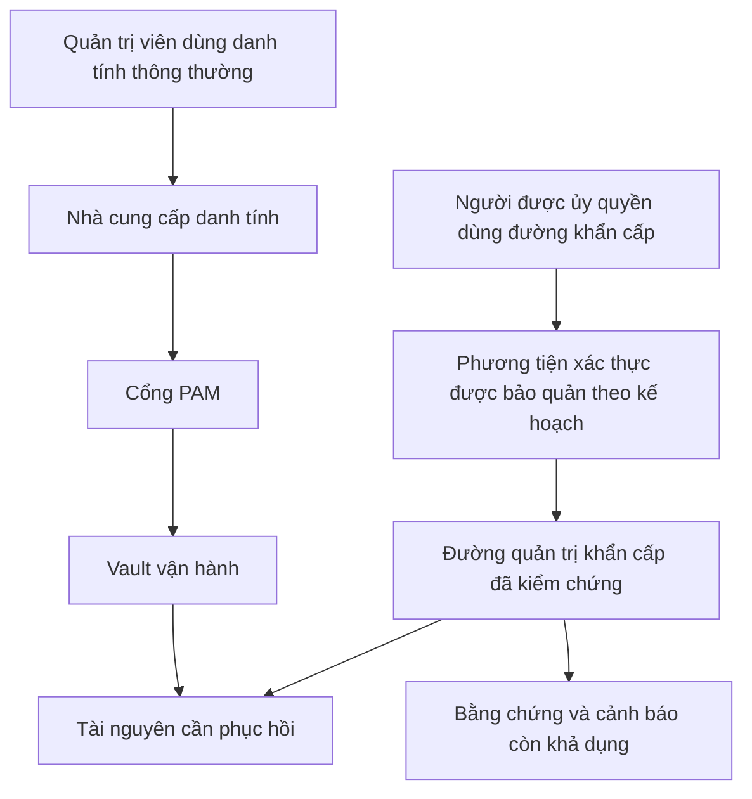
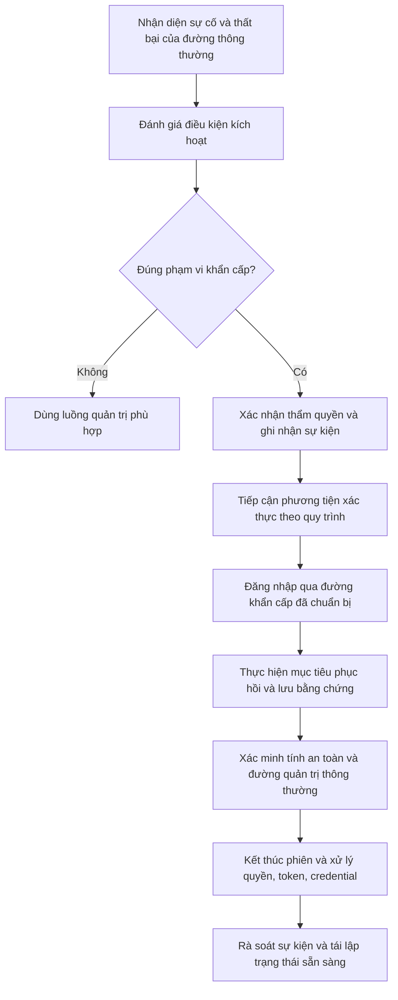

# Break-glass identity

## Mục tiêu bài học

Trong chương **Danh tính đặc quyền**, break-glass identity là danh tính được chuẩn bị cho những tình huống khẩn cấp mà đường quản trị thông thường không thể sử dụng hoặc không còn đáng tin cậy. Bài học thuộc module `SECURITY_IDENTITY_ACCESS_MANAGEMENT_PRIVILEGED_ACCESS_MANAGEMENT`, tập trung kiểm soát quyền truy cập đặc biệt đối với tài khoản quản trị, dịch vụ và hạ tầng nhạy cảm.

Sau bài học, bạn có thể:

- Phân biệt danh tính break-glass với tài khoản quản trị thường ngày và truy cập JIT.
- Nhận diện phụ thuộc vòng khiến một đường truy cập khẩn cấp không thực sự dùng được.
- Xác định chủ sở hữu, phạm vi quyền, cách bảo quản credential và điều kiện sử dụng.
- Thiết kế chuỗi bằng chứng từ kích hoạt đến khôi phục trạng thái an toàn.
- Lập kịch bản diễn tập để kiểm tra cả khả năng phục hồi và khả năng phát hiện sử dụng bất thường.

## 1. Break-glass identity là gì?

**Break-glass identity** là danh tính dành cho truy cập khẩn cấp theo một quy trình đã xác định, nhằm khôi phục hoặc kiểm soát hệ thống khi các đường truy cập bình thường không đáp ứng được tình huống.

Ví dụ, một thay đổi chính sách có thể khóa toàn bộ quản trị viên khỏi hệ thống danh tính. Hoặc nền tảng PAM bị gián đoạn khiến kỹ sư không thể lấy credential hay mở phiên để sửa chính PAM. Danh tính break-glass cung cấp một đường truy cập được chuẩn bị trước cho các tình huống như vậy.

Thuật ngữ này thường gợi hình ảnh phá lớp kính để lấy thiết bị cứu hộ: sử dụng phải có lý do khẩn cấp, dễ nhận biết và kéo theo một chuỗi xử lý sau đó. Trong thiết kế kỹ thuật, điều quan trọng là danh tính, credential, đường kết nối và thẩm quyền sử dụng đã được chuẩn bị và kiểm chứng.

Cần phân biệt ba thành phần:

| Thành phần | Ý nghĩa | Ví dụ |
|---|---|---|
| Danh tính | Đối tượng được hệ thống nhận diện và gán quyền | Một tài khoản khôi phục tại tầng quản trị danh tính |
| Credential và yếu tố xác thực | Phương tiện chứng minh danh tính | Mật khẩu, khóa, chứng thư hoặc thiết bị xác thực được hỗ trợ |
| Quy trình break-glass | Điều kiện và cách sử dụng có kiểm soát | Xác nhận sự cố, lấy phương tiện truy cập, thao tác, lưu bằng chứng và thu hồi |

Một danh tính có quyền cao chưa tự trở thành giải pháp break-glass. Nếu không biết ai giữ credential, không có đường kết nối hoạt động hoặc không có cảnh báo khi sử dụng, danh tính đó có thể chỉ là một tài khoản quản trị bị bỏ quên.

## 2. Bài toán cân bằng: khả năng phục hồi và rủi ro đặc quyền

PAM thường giảm quyền thường trực bằng least privilege, JIT và các luồng phê duyệt. Nhưng một sự cố có thể làm chính cơ chế cấp quyền ngừng hoạt động. Khi đó, chỉ dựa vào cùng cơ chế đang hỏng sẽ khiến tổ chức không thể phục hồi.

Danh tính break-glass xử lý yêu cầu về khả năng phục hồi này. Tuy nhiên, vì có thể tiếp cận các chức năng quan trọng và đôi khi phải duy trì quyền sẵn có, nó tạo ra một bề mặt rủi ro cần được quản lý chặt.

Hai yêu cầu phải được thiết kế đồng thời:

- **Dùng được khi cần:** danh tính, phương tiện xác thực, đường kết nối và người được ủy quyền vẫn hoạt động trong kịch bản sự cố dự kiến.
- **Khó bị lạm dụng:** quyền, người được lấy credential, nơi lưu giữ, điều kiện sử dụng và hoạt động thực tế đều được kiểm soát và giám sát.

Không có một trạng thái mặc định phù hợp cho mọi nền tảng. Một tài khoản có thể được giữ sẵn sàng để đăng nhập, hoặc bị khóa và có cách kích hoạt độc lập. Nếu lựa chọn khóa tài khoản, phải chứng minh rằng việc mở khóa không cần đến chính thành phần đang mất khả dụng.

## 3. Khi nào cần dùng và khi nào cần dùng luồng thông thường?

| Tình huống | Đánh giá sử dụng break-glass |
|---|---|
| Chính sách xác thực sai làm các quản trị viên hợp lệ không thể đăng nhập | Có thể phù hợp nếu đúng kịch bản được chuẩn bị |
| Nhà cung cấp danh tính hoặc hệ thống liên kết danh tính bị gián đoạn | Có thể phù hợp nếu đường khẩn cấp không phụ thuộc vào thành phần lỗi |
| PAM hoặc vault bị lỗi và cần truy cập để khôi phục | Có thể phù hợp nếu credential và đường quản trị khẩn cấp không bị khóa trong chính hệ thống đó |
| Có dấu hiệu hệ thống quản trị danh tính bị chiếm | Cần quy trình ứng phó, đường truy cập đáng tin cậy và đánh giá khả năng danh tính khẩn cấp cũng bị ảnh hưởng |
| Người vận hành quên xin quyền trước một công việc định kỳ | Nên xử lý bằng luồng cấp quyền và kế hoạch công việc thông thường |
| Một tác vụ triển khai cần quyền cao mỗi ngày | Nên thiết kế danh tính workload và quyền theo nhiệm vụ |
| Một người muốn bỏ qua thời gian chờ duyệt | Không phải cơ sở đủ để kích hoạt truy cập khẩn cấp |

Ngưỡng kích hoạt phải đủ rõ để người trực có thể áp dụng khi chịu áp lực. “Có sự cố nghiêm trọng” vẫn có thể quá mơ hồ; nên xác định tác động, đường quản trị đã thất bại và mục tiêu phục hồi mà quyền khẩn cấp cần đáp ứng.

## 4. Thiết kế từ kịch bản mất khả dụng

Câu hỏi đầu tiên là: **Cần phục hồi thành phần nào trong khi những thành phần nào đang không sử dụng được?**

Một sơ đồ phụ thuộc đơn giản:



Sơ đồ mô tả mục tiêu logic. Đường khẩn cấp không nhất thiết độc lập với mọi thành phần, nhưng phải tránh phụ thuộc vào những thành phần được giả định đang lỗi trong kịch bản cụ thể.

### 4.1. Các phụ thuộc dễ bị bỏ sót

| Phụ thuộc | Câu hỏi cần kiểm tra |
|---|---|
| Xác thực | Tài khoản có vẫn phải chuyển sang cùng nhà cung cấp danh tính đang lỗi không? |
| Yếu tố bổ sung | Thiết bị, dịch vụ kiểm tra yếu tố hoặc bước đăng ký có còn dùng được không? |
| Credential | Muốn mở kho chứa credential có cần đăng nhập qua hệ thống đang cần cứu không? |
| Kết nối mạng | VPN, DNS, proxy hoặc bastion có đang phụ thuộc vào cùng hệ thống lỗi không? |
| Kích hoạt tài khoản | Ai có thể mở khóa hoặc gán quyền khi luồng quản trị thường ngày không hoạt động? |
| Tài liệu | Runbook có chỉ nằm sau một cổng đăng nhập đang bị gián đoạn không? |
| Con người | Người giữ phương tiện truy cập có thể được liên hệ và tiếp cận trong thời gian cần thiết không? |
| Quan sát | Cảnh báo, liên lạc và lưu log có bị mất cùng thành phần đang lỗi không? |

Một credential nằm trong vault không thể mở được khi nhà cung cấp danh tính ngừng hoạt động không giải quyết kịch bản mất nhà cung cấp danh tính. Tương tự, một tài khoản khẩn cấp nhưng chỉ truy cập được qua VPN đang lỗi chưa cung cấp đường phục hồi khả dụng.

### 4.2. Độc lập theo miền sự cố

Sự độc lập cần gắn với miền sự cố, chẳng hạn một chính sách xác thực, một trung tâm dữ liệu hoặc một dịch vụ quản lý khóa. Hai phương tiện truy cập đặt ở hai nơi nhưng cùng cần một khóa giải mã không khả dụng vẫn có thể mất tác dụng đồng thời.

Số lượng danh tính hoặc phương tiện dự phòng cần dựa trên kiến trúc và các kịch bản lỗi chung. Tạo nhiều tài khoản giống nhau trong cùng một chuỗi phụ thuộc không tự tăng khả năng phục hồi.

## 5. Phân loại danh tính và xác định trách nhiệm

Một tổ chức có thể cần các đường khẩn cấp ở những tầng khác nhau, tùy kiến trúc:

- Tầng quản trị danh tính, để sửa chính sách hoặc khôi phục khả năng quản trị.
- Tầng PAM hoặc vault, để phục hồi dịch vụ quản lý đặc quyền và credential.
- Tầng hạ tầng, như console quản trị hoặc tài khoản cục bộ trên các hệ thống quan trọng khi công nghệ hỗ trợ.
- Tầng ứng dụng hoặc cơ sở dữ liệu, nếu có nhu cầu phục hồi riêng mà các tầng khác không đáp ứng.

Không nên dùng một danh tính duy nhất với quyền khắp mọi nơi chỉ vì dễ ghi nhớ. Việc phân tách cần tạo ra ranh giới phục hồi hữu ích, đồng thời không làm quy trình trở nên quá phức tạp để thực hiện khi khẩn cấp.

Một mô hình trách nhiệm có thể gồm:

| Vai trò | Trách nhiệm chính |
|---|---|
| Chủ sở hữu hệ thống | Xác nhận mục tiêu phục hồi và quyền cần thiết |
| Chủ sở hữu danh tính khẩn cấp | Duy trì cấu hình, lịch kiểm tra và hồ sơ ngoại lệ |
| Người giữ phương tiện truy cập | Bảo quản, bàn giao và ghi nhận việc mở quyền tiếp cận credential |
| Người chỉ huy hoặc người có thẩm quyền xử lý sự cố | Quyết định kích hoạt theo tiêu chí đã được chấp thuận |
| Người thực hiện | Thao tác trong phạm vi mục tiêu phục hồi và ghi nhận hoạt động |
| Người rà soát | Đối chiếu bằng chứng, kiểm tra quyền và xác nhận đóng sự kiện |

Một người có thể kiêm nhiệm một số vai trò nếu quy mô tổ chức yêu cầu. Khi đó cần ghi rõ mức tập trung quyền và biện pháp kiểm soát phù hợp, thay vì giả định việc tách nhiệm vụ đã tồn tại trên giấy tờ.

## 6. Quyền đủ dùng cho khôi phục

Danh tính break-glass có thể cần quyền rất mạnh, nhưng quyền đó vẫn phải gắn với mục tiêu phục hồi. Least privilege trong trường hợp này là giới hạn theo những công việc cứu hộ đã xác định và khả năng phân quyền thực tế của nền tảng.

Ví dụ:

| Mục tiêu | Quyền có thể cần xem xét | Điều cần giải thích nếu được cấp thêm |
|---|---|---|
| Sửa chính sách đăng nhập gây khóa quản trị | Quản trị chính sách hoặc vai trò phù hợp trên hệ thống danh tính | Quyền truy cập dữ liệu nghiệp vụ không phục vụ phục hồi |
| Khôi phục một nút PAM | Quyền quản trị hệ điều hành hoặc nền tảng cần thiết | Quyền trên toàn bộ các hệ thống do PAM quản lý |
| Phục hồi cấu hình thiết bị mạng | Quyền quản trị thiết bị hoặc miền cấu hình liên quan | Quyền truy cập mọi thiết bị khác |
| Khôi phục từ bản sao lưu | Quyền truy xuất và phục hồi bản sao cần thiết | Quyền xóa tất cả bản sao và sửa toàn bộ chính sách lưu giữ |

Một số nền tảng không cung cấp vai trò đủ chi tiết cho tình huống cần cứu hộ. Khi phải giữ quyền rộng, hồ sơ phải mô tả lý do, phạm vi ảnh hưởng và biện pháp giảm rủi ro như bảo quản chặt, giới hạn đường truy cập, cảnh báo và rà soát hoạt động.

### Quan hệ với JIT và JEA

JIT có thể giúp giới hạn thời gian sử dụng quyền khẩn cấp nếu cơ chế kích hoạt còn hoạt động trong kịch bản lỗi. Nhưng nếu việc kích hoạt JIT cần cùng dịch vụ đang hỏng, tổ chức phải chuẩn bị cách phục hồi khác.

Giới hạn thao tác theo JEA hoặc một giao diện tác vụ chuyên biệt có thể hữu ích nếu nó đủ khả năng thực hiện công việc phục hồi. Cần tránh phụ thuộc hoàn toàn vào một giao diện không thể chạy khi thành phần đích bị lỗi. Quyền rộng dự phòng, nếu cần, phải được nhận diện là ngoại lệ có quản lý.

## 7. Bảo quản credential và yếu tố xác thực

Mục tiêu là chỉ những người có thẩm quyền mới tiếp cận được phương tiện xác thực, đồng thời phương tiện đó vẫn tồn tại và dùng được trong sự cố dự kiến.

Các phương án có thể gồm kho dự phòng được kiểm soát, thiết bị xác thực được bảo quản vật lý, bản sao phục hồi được mã hóa hoặc cơ chế khác mà nền tảng hỗ trợ. Mỗi phương án cần được đánh giá theo cùng các câu hỏi:

1. Ai có thể lấy hoặc sử dụng phương tiện đó?
2. Việc lấy ra có để lại dấu vết và tạo thông báo không?
3. Nó có còn hoạt động khi dịch vụ liên quan bị gián đoạn không?
4. Có rủi ro cùng mất, cùng hỏng hoặc cùng bị chiếm với hệ thống chính không?
5. Làm thế nào kiểm tra tính toàn vẹn, thay thế và thu hồi?

### 7.1. Xác thực mạnh phải phù hợp với kịch bản phục hồi

Không nên coi việc tắt MFA là đặc tính mặc định của break-glass. Cần chọn cơ chế xác thực đủ mạnh và có chuỗi phụ thuộc phù hợp với kịch bản. Thiết bị xác thực vẫn có thể phụ thuộc vào nguồn điện, trình duyệt, đăng ký trước hoặc dịch vụ kiểm tra phía máy chủ; phải kiểm tra toàn bộ đường đi.

Nếu có ngoại lệ đối với một chính sách xác thực hoặc điều kiện truy cập, cần giới hạn rõ danh tính, lý do, người phê duyệt và biện pháp bù. Miễn trừ toàn bộ kiểm soát mà không đánh giá từng phụ thuộc tạo ra rủi ro vượt quá mục tiêu phục hồi.

### 7.2. Kiểm soát hai người và khả năng tiếp cận

Với phương tiện có tác động lớn, có thể yêu cầu hai người tham gia lấy hoặc sử dụng theo chính sách. Thiết kế đó phải tính cả việc liên hệ ngoài giờ, người thay thế và tình huống một người không có mặt.

Nếu dùng cơ chế chia sẻ bí mật, cần sử dụng phương án được thiết kế và vận hành đúng, có kiểm tra khôi phục. Chia một mật khẩu thành hai đoạn rồi gửi qua các kênh tùy tiện không tự tạo thành một cơ chế kiểm soát đáng tin cậy.

### 7.3. Tránh tạo bản sao không được kiểm soát

Không đưa credential thật vào ticket, nhóm chat, tài liệu hướng dẫn hoặc bản ghi sự cố. Nhật ký bàn giao nên ghi mã tham chiếu, người nhận, thời điểm, lý do và tình trạng niêm phong hoặc phương tiện, thay vì giá trị secret.

Khi chính sách cho phép lưu một phương tiện phục hồi ngoại tuyến, nơi lưu, cách mã hóa, người có quyền mở và cách cập nhật cần được quản lý. Tính ngoại tuyến chỉ mô tả một đặc điểm kỹ thuật; nó không tự chứng minh tính bảo mật hoặc tính sẵn sàng.

## 8. Quy trình sử dụng từ đầu đến cuối



### 8.1. Xác nhận trước khi kích hoạt

Người xử lý cần ghi nhận ít nhất tác động, đường quản trị đã thử hoặc đã xác định không thể dùng, mục tiêu truy cập và người có thẩm quyền quyết định. Nếu công cụ quản lý sự cố không hoạt động, phải có cách ghi nhận dự phòng đã chuẩn bị.

Quy trình có thể quy định xác nhận hai người, hoặc một cơ chế khẩn cấp khác theo mức tác động và khả năng liên lạc. Nếu cho phép thực hiện trước rồi hoàn tất xác nhận sau trong trường hợp đặc biệt, điều kiện đó phải nằm trong chính sách đã được chấp thuận và được rà soát sau sự kiện.

### 8.2. Khi đang sử dụng

Người thực hiện chỉ làm những thao tác phục vụ mục tiêu khẩn cấp. Các thay đổi cần được ghi nhận với thời điểm, đối tượng, lý do và kết quả. Một người hỗ trợ ghi nhận hoặc đối chiếu có thể hữu ích khi hệ thống quan sát tự động bị suy giảm.

Nếu sự cố có dấu hiệu bị tấn công, đường truy cập và thiết bị thực hiện phải được đánh giá về độ tin cậy. Sử dụng credential mới trên một máy nghi đã bị chiếm có thể làm lộ credential đó. Việc khôi phục khả năng đăng nhập chưa chứng minh môi trường đã an toàn để vận hành trở lại.

### 8.3. Khi công việc khẩn cấp kết thúc

Cần xác nhận mục tiêu phục hồi, kiểm tra đường quản trị thông thường và giải quyết những thay đổi tạm thời. Sau đó kết thúc phiên, xử lý token hoặc quyền đang hiệu lực và đưa danh tính break-glass về trạng thái sẵn sàng được thiết kế.

Việc đóng ticket không thay thế bước khôi phục an toàn cho danh tính và credential.

## 9. Giám sát và bằng chứng

Danh tính ít sử dụng cần được giám sát cả **đăng nhập** lẫn **thay đổi cấu hình**. Đăng nhập thành công không phải sự kiện duy nhất có ý nghĩa.

| Nhóm sự kiện | Ví dụ cần quan sát |
|---|---|
| Xác thực | Đăng nhập thành công, thất bại, nguồn truy cập, yếu tố xác thực |
| Credential và phương tiện | Đổi mật khẩu, đăng ký lại yếu tố, thêm khóa, mở kho hoặc lấy phương tiện |
| Quyền và trạng thái | Gán vai trò, mở khóa, vô hiệu hóa, thay đổi ngoại lệ chính sách |
| Hoạt động | Sửa cấu hình, tạo danh tính khác, truy cập dữ liệu, tác động trên tài nguyên |
| Kết thúc | Ngắt phiên, vô hiệu hóa token khi hỗ trợ, luân chuyển hoặc thu hồi credential |

Một cảnh báo có giá trị cần đến được người còn có khả năng phản ứng trong sự cố. Nếu kênh thông báo phụ thuộc hoàn toàn vào cùng dịch vụ đang mất khả dụng, cần có phương án phù hợp cho kịch bản đó.

Không phải mọi nguồn bằng chứng đều còn hoạt động khi break-glass được dùng. Kế hoạch cần xác định nguồn nào còn dùng được, cách ghi nhận bổ sung và cách nhập lại dữ liệu vào hồ sơ khi hệ thống phục hồi. Phải ghi rõ các khoảng trống quan sát thay vì coi một bản ghi thủ công là tương đương hoàn toàn với log tự động.

### Quy trách nhiệm khi dùng danh tính đích chung

Một số kiến trúc sử dụng danh tính khẩn cấp dùng chung. Khi đó, phải liên kết sự kiện lấy phương tiện, người thực hiện, mã sự cố, khoảng thời gian và hoạt động tại đích.

Bản ghi “một người đã lấy credential” là một bằng chứng về việc bàn giao, không tự chứng minh người đó thực hiện mọi thao tác sau đó. Cần đối chiếu thêm dữ liệu phiên, nguồn kết nối, nhật ký đích và những người tham gia. Nếu nền tảng hỗ trợ danh tính cá nhân độc lập phù hợp cho phục hồi, có thể sử dụng để cải thiện khả năng quy trách nhiệm.

## 10. Ví dụ: chính sách đăng nhập khóa quản trị viên

### Bối cảnh

Một nhóm cập nhật chính sách đăng nhập cho tầng quản trị danh tính. Sau thay đổi, các quản trị viên bình thường không thể truy cập để sửa lại chính sách. Cổng PAM cũng xác thực qua tầng này, nên việc yêu cầu quyền JIT thông thường thất bại.

Nhóm đã chuẩn bị một danh tính khẩn cấp và đường đăng nhập được nền tảng hỗ trợ, có phương tiện xác thực được kiểm soát riêng cho kịch bản này. Cấu hình cụ thể phải được kiểm chứng theo công nghệ đang dùng; tên “tài khoản cục bộ” hoặc “tài khoản khẩn cấp” không đủ chứng minh tính độc lập.

### Trình tự xử lý

1. Nhóm trực xác nhận sự cố làm mất khả năng quản trị và ghi nhận mã sự cố.
2. Người có thẩm quyền kích hoạt quy trình khẩn cấp, xác định mục tiêu sửa chính sách gây khóa.
3. Người được ủy quyền tiếp cận phương tiện xác thực; việc bàn giao được ghi nhận theo kế hoạch.
4. Kỹ sư đăng nhập bằng đường đã chuẩn bị, kiểm tra cấu hình hiện tại và thực hiện thay đổi cần thiết để phục hồi truy cập.
5. Nhóm kiểm tra một đường quản trị bình thường hoạt động lại với các điều kiện bảo vệ mong muốn.
6. Nhóm đối chiếu thay đổi, kiểm tra dấu hiệu bất thường và kết thúc truy cập khẩn cấp.
7. Credential, token, phiên và phương tiện đã sử dụng được xử lý theo chính sách; khả năng truy cập bằng phương tiện cũ cần được kiểm tra khi có thay thế.
8. Sự kiện được rà soát, runbook được cập nhật nếu cần và danh tính trở lại trạng thái sẵn sàng.

### Cần phân biệt phục hồi và mở rộng ngoại lệ

Nếu thay đổi một chính sách để cho phép quản trị viên trở lại, cần xác định rõ phạm vi thay đổi và điều kiện an toàn. Tắt một tập lớn kiểm soát rồi để nguyên có thể khôi phục truy cập nhưng đồng thời tạo một rủi ro mới. Những thay đổi tạm thời phải có người chịu trách nhiệm và điều kiện kết thúc.

## 11. Ví dụ: PAM hoặc vault không khả dụng

Giả sử vault không hoạt động và nhóm cần quyền quản trị máy chủ chứa vault để khôi phục dịch vụ. Credential quản trị máy chủ đó lại chỉ được lưu trong chính vault.

Đây là một phụ thuộc vòng: để mở vault cần credential, nhưng để lấy credential cần vault hoạt động.

Thiết kế phục hồi phải xác định một phương tiện truy cập thay thế phù hợp, chẳng hạn cơ chế quản trị hạ tầng hoặc bản phục hồi credential được bảo quản theo kế hoạch. Phương án cụ thể cần được kiểm tra cả danh tính, khóa giải mã, đường kết nối và người có quyền sử dụng.

Có hai vấn đề riêng cần giải quyết:

- **Tiếp cận để phục hồi:** người có thẩm quyền có thể đăng nhập và thực hiện thao tác cần thiết không?
- **Khôi phục trạng thái vault:** dữ liệu, khóa và cấu hình cần thiết có đủ để vault hoạt động đúng không?

Có tài khoản break-glass không thay thế cho bản sao lưu, khóa phục hồi hoặc quy trình khôi phục dữ liệu. Ngược lại, có bản sao lưu nhưng không có đường quản trị để thực hiện phục hồi cũng chưa giải quyết trọn vẹn bài toán.

## 12. Xử lý sau sử dụng: phiên, token và credential

Một lần sử dụng có thể làm lộ hoặc mở rộng sự tiếp cận đối với phương tiện vốn được niêm phong. Cần xem xét từng loại vật liệu xác thực thay vì áp một thao tác chung cho mọi công nghệ.

| Thành phần | Việc cần xác định |
|---|---|
| Mật khẩu đã được tiết lộ | Chính sách luân chuyển, nơi cập nhật và cách kiểm tra giá trị cũ không còn dùng được |
| Khóa hoặc chứng thư | Có cần thu hồi, thay thế hoặc cập nhật điểm tin cậy không? |
| Thiết bị xác thực | Tình trạng thu hồi về nơi bảo quản, tính toàn vẹn, mất hoặc có dấu hiệu bị sao chép/can thiệp |
| Mã phục hồi dùng một lần | Mã đã bị tiêu thụ chưa, bộ mã còn lại có cần thay thế không? |
| Token và phiên | Còn hiệu lực trong bao lâu, có cơ chế thu hồi hoặc ngắt phiên nào? |
| Quyền hoặc ngoại lệ tạm thời | Đã kết thúc, được hoàn nguyên hay cần quyết định thay đổi chính thức? |

Đổi mật khẩu không bảo đảm mọi phiên và token đã phát hành lập tức mất hiệu lực. Phải kiểm tra hành vi của hệ thống đích và ghi nhận kết quả xử lý.

Với các phương tiện dự phòng, việc cập nhật cũng cần tránh tạo thời điểm mất toàn bộ đường phục hồi. Thứ tự thay thế, xác nhận phương tiện mới và xử lý phương tiện cũ phải được lên kế hoạch theo khả năng nền tảng. Không để một bản credential cũ ở nơi dự phòng rồi cho rằng đã hoàn tất luân chuyển.

Nếu nghi ngờ danh tính bị chiếm, cần điều tra cả danh tính mới, khóa mới, quyền được gán và cấu hình đã thay đổi. Việc luân chuyển credential ban đầu không tự loại bỏ mọi đường duy trì truy cập có thể đã được tạo ra.

## 13. Hồ sơ tối thiểu cho một danh tính break-glass

Ví dụ dưới đây mô tả hồ sơ quản trị, không chứa secret và không phải cấu hình cho một sản phẩm cụ thể:

```text
Mã danh tính: emergency-identity-plane-01
Phạm vi: tầng quản trị danh tính
Chủ sở hữu: nhóm nền tảng danh tính
Người chịu trách nhiệm bảo quản: vai trò được chỉ định trong kế hoạch

Kịch bản phục hồi:
  - mất đường đăng nhập quản trị thông thường do lỗi chính sách
  - luồng cấp quyền thông thường không hoạt động theo kịch bản đã kiểm chứng

Mục tiêu quyền:
  sửa các cấu hình cần thiết để khôi phục quản trị an toàn

Phương tiện xác thực:
  tham chiếu đến hồ sơ bảo quản được kiểm soát, không lưu giá trị secret

Phụ thuộc cần kiểm chứng:
  xác thực, mạng, console, phương tiện xác thực, tài liệu và liên lạc

Điều kiện kích hoạt:
  tiêu chí sự cố và thẩm quyền đã được tổ chức phê duyệt

Quan sát:
  cảnh báo đăng nhập, thay đổi quyền, phương tiện và hoạt động quan trọng

Kết thúc:
  xác minh đường bình thường, xử lý phiên/token/credential và rà soát

Kiểm tra định kỳ:
  lịch, người thực hiện, kết quả và các khoảng trống cần khắc phục
```

Hồ sơ cần được cập nhật khi đổi người phụ trách, cấu hình xác thực, đường mạng hoặc cơ chế bảo quản. Thông tin đã đúng trong một lần diễn tập có thể trở nên sai sau một thay đổi hạ tầng.

## 14. Diễn tập và đánh giá tính sẵn sàng

Kiểm tra danh tính tồn tại hoặc mật khẩu chưa hết hạn mới chỉ chạm tới một phần nhỏ của bài toán. Một cuộc diễn tập hữu ích cần kiểm tra chuỗi từ quyết định kích hoạt đến trở lại trạng thái an toàn.

| Nội dung diễn tập | Câu hỏi cần trả lời |
|---|---|
| Liên hệ người có thẩm quyền | Có người trực và người thay thế trong kịch bản đã chọn không? |
| Tiếp cận phương tiện | Có lấy được đúng phương tiện mà không dùng thành phần giả định đang lỗi không? |
| Xác thực và kết nối | Đường khẩn cấp có hoạt động qua đầy đủ các bước không? |
| Quyền phục hồi | Có đủ quyền làm tác vụ phục hồi đại diện và hiểu rõ phạm vi ảnh hưởng không? |
| Cảnh báo | Sử dụng và thay đổi danh tính có được phát hiện, chuyển đến đúng người không? |
| Bằng chứng | Có nối được thẩm quyền, người dùng, phiên và hành động không? |
| Kết thúc | Có xử lý phiên/token, cập nhật phương tiện và xác nhận trạng thái sẵn sàng không? |

Lựa chọn thao tác kiểm tra cần phù hợp môi trường và mức tác động. Có thể dùng kịch bản mô phỏng, môi trường thử nghiệm hoặc thao tác được chấp thuận để xác nhận khả năng quản trị mà không gây gián đoạn không cần thiết. Mức độ diễn tập phải đủ để phát hiện các phụ thuộc thực, không chỉ hoàn thành danh sách trên giấy.

Trong diễn tập có kế hoạch, nên gắn mã sự kiện để nhóm giám sát đối chiếu. Không tắt toàn bộ cảnh báo về danh tính khẩn cấp chỉ để tránh thông báo; khả năng cảnh báo hoạt động chính là một phần cần kiểm tra.

Một số chỉ số có thể theo dõi gồm thời gian tiếp cận đường quản trị khả dụng trong kịch bản thử, số danh tính thiếu chủ sở hữu, tỷ lệ diễn tập thành công, số khoảng trống chưa khắc phục và thời gian hoàn tất xử lý sau sử dụng. Các chỉ số cần gắn với kịch bản cụ thể, thay vì một cam kết thời gian chung cho mọi sự cố.

## 15. Những sai lầm thường gặp

| Sai lầm | Hệ quả | Cách xử lý |
|---|---|---|
| Credential khẩn cấp chỉ nằm trong vault cần cứu | Không thể lấy credential khi cần phục hồi | Thiết kế phương tiện phục hồi tránh phụ thuộc vòng |
| Tài khoản bị khóa nhưng chỉ mở được qua IAM đang lỗi | Danh tính tồn tại nhưng không dùng được | Kiểm chứng cơ chế kích hoạt độc lập hoặc chọn trạng thái sẵn sàng khác |
| Tắt mọi chính sách bảo vệ cho tài khoản khẩn cấp | Tạo đường truy cập dễ bị lạm dụng | Đánh giá từng phụ thuộc và giới hạn ngoại lệ |
| Dùng break-glass cho công việc thường ngày | Mất ý nghĩa cảnh báo, tăng tiếp xúc credential | Thiết kế vai trò, JIT và danh tính workload cho công việc thông thường |
| Dùng chung một danh tính cho nhiều tầng không liên quan | Tăng phạm vi ảnh hưởng và khó phân định trách nhiệm | Phân tách theo mục tiêu phục hồi phù hợp |
| Chỉ cảnh báo đăng nhập, bỏ qua thêm khóa hoặc đổi quyền | Bỏ sót chuẩn bị lạm dụng | Giám sát cả vòng đời danh tính và phương tiện |
| Đổi mật khẩu rồi đóng sự cố ngay | Có thể còn phiên, token hoặc đường truy cập khác | Kiểm tra toàn bộ trạng thái truy cập và thay đổi liên quan |
| Không kiểm tra lại bản dự phòng sau luân chuyển | Bản dự phòng không còn dùng được khi cần | Đồng bộ quy trình thay thế và diễn tập xác nhận |
| Danh tính không được rà soát vì hiếm sử dụng | Quyền hoặc phương tiện bị lỗi thời mà không biết | Gắn chủ sở hữu, lịch kiểm tra và rà soát sau thay đổi |

## 16. Bài tập tình huống

### Đề bài

Một công ty có tài khoản `emergency-admin` để khôi phục nền tảng PAM. Tài khoản đang bị khóa; muốn mở khóa phải qua cổng IAM của công ty. Mật khẩu nằm trong vault do PAM quản lý. Runbook và danh sách người phê duyệt chỉ có trên một cổng tài liệu dùng cùng IAM. Cảnh báo đăng nhập được gửi vào hệ thống chat cũng phụ thuộc IAM đó.

Hãy trả lời:

1. Những phụ thuộc nào khiến đường khẩn cấp có thể không hoạt động?
2. Cần xác định lại danh tính, credential và đường kết nối như thế nào?
3. Nên lưu những bằng chứng nào khi phải dùng phương án ghi nhận dự phòng?
4. Sau khi dùng thành công, cần làm gì trước khi kết luận danh tính đã sẵn sàng cho lần sau?

### Gợi ý phân tích

Tài khoản phụ thuộc vào IAM để mở khóa, vault để lấy mật khẩu và cùng IAM để đọc hướng dẫn hoặc nhận cảnh báo. Nếu các thành phần đó thuộc kịch bản mất khả dụng, việc có sẵn tên tài khoản không tạo ra khả năng phục hồi thực tế.

Cần xác định mục tiêu phục hồi, kiểm chứng cách kích hoạt và xác thực không bị khóa bởi thành phần lỗi, chuẩn bị phương tiện truy cập cùng tài liệu phù hợp và chọn đường kết nối còn khả dụng. Quyền cần đủ cho công việc khôi phục PAM, đồng thời những quyền rộng hơn phải có lý do và kiểm soát bù rõ ràng.

Bằng chứng dự phòng cần ghi người có thẩm quyền, người lấy phương tiện, người thao tác, mã sự cố, thời điểm, tài nguyên, thay đổi và kết quả. Sau khi hệ thống quan sát trở lại, cần đối chiếu với log có sẵn và ghi rõ các khoảng trống.

Kết thúc cần xác nhận đường quản trị bình thường hoạt động an toàn, xử lý phiên và token, luân chuyển hoặc thay thế phương tiện khi chính sách yêu cầu, cập nhật bản dự phòng và kiểm tra khả năng sử dụng cho lần sau. Cuối cùng phải rà soát lý do kích hoạt, các thay đổi và bài học vận hành.

## 17. Kiến thức cần ghi nhớ

Break-glass identity là một thành phần của khả năng phục hồi quản trị đặc quyền. Hiệu quả của nó phụ thuộc vào cả danh tính, phạm vi quyền, phương tiện xác thực, đường kết nối, người được ủy quyền và khả năng quan sát trong kịch bản sự cố cụ thể.

Thiết kế cần tránh phụ thuộc vòng, bảo vệ phương tiện truy cập, xác định thẩm quyền sử dụng và lưu được chuỗi bằng chứng. Sau mỗi lần sử dụng hoặc diễn tập, phải xử lý quyền, phiên, token và credential phù hợp để đưa đường khẩn cấp về trạng thái sẵn sàng đã được kiểm chứng.
