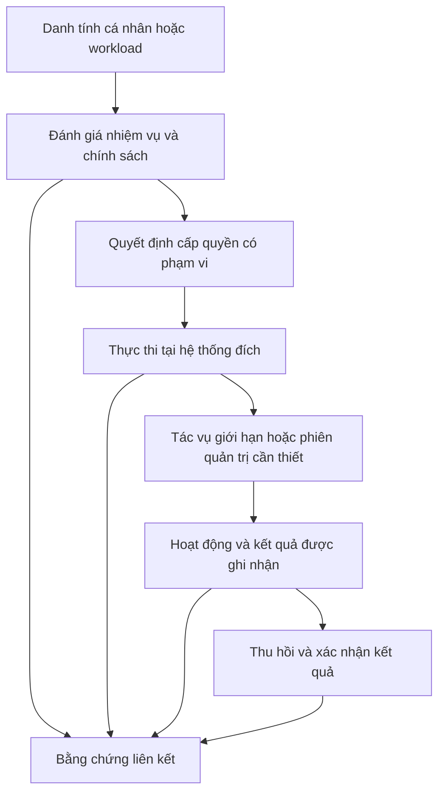

# Root và superuser identity

## 1. Root là một danh tính đặc quyền, không chỉ là tên tài khoản

Trong các hệ thống Unix và Linux, `root` thường là tên tài khoản gắn với user ID bằng `0`, viết tắt là **UID 0**. Đây là danh tính quản trị có ảnh hưởng rất lớn đến hệ điều hành, dữ liệu và các cơ chế bảo vệ cục bộ.

Điểm cần nhớ là tên `root` và quyền quản trị không hoàn toàn đồng nhất:

- Một tài khoản mang tên khác nhưng có UID 0 vẫn phải được xem là tài khoản có đặc quyền tương đương trong cùng ngữ cảnh hệ thống.
- Một người dùng có UID khác 0 vẫn có thể nhận quyền root qua cơ chế ủy quyền hoặc điều khiển một thành phần đang chạy với quyền cao.
- Một tiến trình có thể mang danh tính hiệu lực khác với danh tính ban đầu của người đăng nhập.
- Phạm vi quyền còn phụ thuộc cơ chế bảo vệ, capabilities và namespace, không chỉ một chuỗi tên trong log.

**Superuser identity** là khái niệm rộng hơn, chỉ danh tính có quyền quản trị rất cao trong một phạm vi nhất định. Root của hệ điều hành là một ví dụ; tài khoản superuser của cơ sở dữ liệu hoặc danh tính quản trị nền tảng là những ví dụ khác. Chúng không mặc nhiên có cùng quyền và cùng ranh giới tin cậy.

Trong PAM, cần quản lý cả tài khoản root, credential dùng để truy cập và những đường cho phép chủ thể khác đạt được quyền tương đương. Chỉ cất mật khẩu root vào vault sẽ bỏ sót nhiều đường đặc quyền quan trọng.

## 2. UID, danh tính hiệu lực và quyền thực tế

### 2.1. Tên người dùng và UID

Hệ thống dùng định danh số trong nhiều quyết định phân quyền. Tên tài khoản là cách biểu diễn thuận tiện để con người đọc và quản lý. Vì vậy, đổi tên tài khoản không phải là biện pháp loại bỏ đặc quyền.

Ví dụ, nếu một hệ thống có hai mục tài khoản khác tên nhưng cùng UID 0, việc chỉ kiểm kê tài khoản tên `root` sẽ không phản ánh đầy đủ các danh tính có quyền mạnh. Cần xác định nguồn cấp tài khoản, mục đích và cơ chế truy cập của từng mục.

UID cũng cần được hiểu trong đúng hệ thống hoặc namespace. UID 0 trong một container không tự động có cùng phạm vi quyền với UID 0 trên host. Hai máy có tài khoản cùng tên cũng không vì thế trở thành cùng một danh tính có thể quy thuộc cho một người.

### 2.2. Danh tính đăng nhập và danh tính hiệu lực

Một quản trị viên có thể đăng nhập bằng tài khoản cá nhân rồi chạy một tác vụ được ủy quyền dưới danh tính khác. Trong Linux, cần phân biệt khái niệm **real UID** và **effective UID** của tiến trình:

- Real UID thường phản ánh danh tính gốc của tiến trình theo luồng tạo và thay đổi danh tính của nó.
- Effective UID tham gia vào nhiều quyết định kiểm tra quyền truy cập của tiến trình.
- Các định danh khác và trạng thái bảo mật của tiến trình cũng có thể ảnh hưởng đến quyền thực tế.

Không nên dùng real UID như bằng chứng duy nhất về người thực hiện. Một tiến trình có quyền phù hợp có thể thay đổi các định danh của nó. Muốn quy trách nhiệm, cần nối danh tính đăng nhập với sự kiện ủy quyền, tiến trình hoặc phiên và hoạt động tại tài nguyên.

Ví dụ:

```text
Lan đăng nhập bằng tài khoản cá nhân
    -> cơ chế ủy quyền chấp nhận một nhiệm vụ quản trị
    -> tiến trình thực thi dưới quyền root
    -> hệ thống đích ghi nhận thay đổi
```

Nếu bản ghi cuối chỉ có `root`, thông tin về Lan có thể bị mất. Nếu chỉ có log Lan đăng nhập, vẫn chưa biết thao tác nào đã chạy dưới quyền cao.

### 2.3. Root có quyền rất lớn nhưng không phải quyền vô hạn

Theo mô hình Unix truyền thống, superuser có thể vượt qua nhiều kiểm tra quyền truy cập tùy nghi thông thường. Trên Linux hiện đại, quyền còn chịu ảnh hưởng của capabilities, các cơ chế kiểm soát truy cập bắt buộc, namespace và những giới hạn do môi trường thực thi áp đặt.

Ví dụ, một tiến trình UID 0 có thể bị giới hạn bởi chính sách bảo mật hoặc không sở hữu quyền cần thiết trong namespace liên quan. Ngược lại, một tiến trình không có UID 0 nhưng được cấp capability mạnh vẫn cần được kiểm kê như một đường đặc quyền.

Ở ranh giới khác, root trong máy ảo không mặc nhiên điều khiển hypervisor. Root trên một máy chủ cũng không tự động truy cập được kho bằng chứng nằm ở miền quản trị độc lập. Khả năng vượt qua các ranh giới đó phải được đánh giá từ quyền, cấu hình và quan hệ tin cậy thực tế.

Các giới hạn này không làm root trở thành danh tính rủi ro thấp. Trong nhiều môi trường, root vẫn có thể thay đổi cấu hình quan trọng, truy xuất bí mật cục bộ và làm suy yếu các kiểm soát cùng nằm trong phạm vi quản trị của nó.

## 3. Phân biệt các loại superuser theo phạm vi

| Danh tính hoặc vai trò | Phạm vi quyền chủ yếu | Không nên mặc định suy ra |
|---|---|---|
| Root của hệ điều hành | Quản trị trong ngữ cảnh hệ điều hành tương ứng | Tự động có quyền quản trị mọi hệ thống kết nối |
| Root trong container | Quyền trong container và namespace được cấu hình | Luôn tương đương root trên host hoặc luôn được cách ly an toàn |
| Superuser cơ sở dữ liệu | Quyền rất cao trong hệ quản trị cơ sở dữ liệu | Tự động là root của hệ điều hành; khả năng tác động ra ngoài tùy nền tảng và cấu hình |
| Quản trị viên thư mục danh tính | Quản lý danh tính, nhóm hoặc chính sách trong miền được giao | Chỉ có tác động tới đăng nhập; thực tế có thể ảnh hưởng nhiều hệ thống phụ thuộc |
| Danh tính gốc hoặc quản trị tài khoản cloud | Quyền theo mô hình danh tính và tài nguyên của nền tảng cloud | Đồng nghĩa với tài khoản Linux tên `root` trong từng máy ảo |
| Quản trị viên hypervisor hoặc nền tảng container | Điều khiển hạ tầng và workload trong phạm vi nền tảng | Chỉ là một tài khoản vận hành thông thường trên từng máy |

Tên gọi superuser không đủ để quyết định cách kiểm soát. Cần biết **tài nguyên nào nằm trong phạm vi quyền, hành động nào có thể thực hiện và chủ thể nào có thể sử dụng quyền đó**.

Trong môi trường cloud, tài khoản hoặc danh tính gốc có thể cần quy trình bảo vệ riêng theo nền tảng. Không áp dụng máy móc cách quản lý mật khẩu Linux cho mọi danh tính cloud, vì phương thức xác thực, khôi phục và khả năng thu hồi có thể khác nhau.

## 4. Những đường phổ biến dẫn tới quyền root

### 4.1. Đăng nhập trực tiếp

Người dùng xác thực trực tiếp vào tài khoản root bằng một phương thức được hệ thống cho phép, chẳng hạn mật khẩu, khóa hoặc chứng thư SSH.

Rủi ro lớn của cách này là mất liên kết tự nhiên với danh tính cá nhân, đặc biệt nếu nhiều người cùng giữ credential. Log chỉ ghi root có thể không đủ phân biệt ai thực hiện thao tác.

Nếu phải giữ đường trực tiếp cho mục đích cụ thể, cần xác định người được phép, nguồn truy cập, cách quản lý credential, bằng chứng và thời điểm rà soát. Việc một đường đăng nhập tồn tại để khôi phục không có nghĩa nên dùng đường đó cho mọi công việc hằng ngày.

### 4.2. Ủy quyền qua sudo hoặc cơ chế tương tự

`sudo` cho phép chạy tác vụ dưới danh tính được chính sách cho phép, thường được dùng để thực hiện nhiệm vụ quản trị dưới quyền root. Phạm vi thực tế phụ thuộc cấu hình, danh tính đích, câu lệnh và ngữ cảnh.

Một người được phép chạy mọi lệnh dưới quyền root vẫn có khả năng quản trị rất rộng, dù họ không biết mật khẩu root. Do đó, “không chia sẻ mật khẩu root” chỉ giải quyết một phần bài toán.

Cấp quyền thực hiện tác vụ cụ thể thường giúp thu hẹp quyền hơn so với mở shell quản trị toàn diện. Tuy nhiên, phải đánh giá khả năng của chính chương trình được cho phép: công cụ có thể gọi chương trình khác, sửa tập tin nhạy cảm hoặc cung cấp đường thoát sang môi trường thực thi rộng hơn.

### 4.3. Chuyển danh tính và mở shell quản trị

Các cơ chế chuyển danh tính như `su`, hoặc cách dùng công cụ ủy quyền để mở một shell quản trị, tạo ra ngữ cảnh thực thi kéo dài qua nhiều lệnh. Phương thức xác thực và điều kiện cho phép phụ thuộc chính sách của hệ thống.

Một sự kiện “đã mở shell root” chưa mô tả mọi hành động trong shell. Nếu quy trình cần giải trình chi tiết, phải xác định thêm nguồn bằng chứng tại phiên và hệ thống đích. Cũng cần biết shell cùng các tiến trình con kết thúc ra sao khi quyền tạm thời hết hạn.

### 4.4. Tài khoản dịch vụ và công cụ tự động

Agent quản lý cấu hình, công cụ sao lưu, bộ cài đặt và tác vụ triển khai có thể chạy dưới root hoặc có quyền đủ để điều khiển root. Người sửa được cấu hình, mã chạy hoặc đầu vào có ảnh hưởng tới các thành phần này có thể nắm một đường đặc quyền gián tiếp.

Ví dụ, pipeline được phép triển khai một script chạy dưới root cần kiểm soát cả người sửa script, người kích hoạt và danh tính của pipeline. Chỉ kiểm tra danh sách người có quyền SSH sẽ bỏ sót đường này.

### 4.5. Console, khôi phục và nền tảng quản trị

Console của máy ảo, hệ thống quản lý từ xa, quy trình khôi phục hoặc quyền thao tác đĩa máy chủ có thể cung cấp đường ảnh hưởng tới hệ điều hành. Phạm vi cụ thể tùy kiến trúc và các lớp bảo vệ.

Kiểm kê root cần xem cả những đường này. Tài khoản quản trị nền tảng có thể tác động tới nhiều máy, nên rủi ro có thể lớn hơn một tài khoản root đơn lẻ.

## 5. Vì sao root cần một mô hình kiểm soát riêng?

### 5.1. Phạm vi tác động lớn

Một thao tác sai dưới quyền root có thể làm dịch vụ ngừng hoạt động, thay đổi dữ liệu hệ thống hoặc phá hỏng khả năng đăng nhập. Một tài khoản bị chiếm có thể làm lộ bí mật nằm trong phạm vi quyền truy cập của nó và mở rộng tác động sang các hệ thống sử dụng những bí mật đó.

Khả năng ảnh hưởng không chỉ đến từ việc sửa tập tin. Root còn có thể quản lý tiến trình, dịch vụ, cấu hình xác thực và nhiều cơ chế bảo vệ cục bộ, trong giới hạn của nền tảng và chính sách được áp dụng.

### 5.2. Có thể tác động tới cơ chế bảo vệ cùng miền quản trị

Nếu agent ghi log, tập tin chính sách và kho log đều chịu sự quản trị của cùng một danh tính root, một chủ thể có đặc quyền có thể có khả năng làm suy yếu hoặc xóa dấu vết tại chỗ.

Vì vậy, cần cân nhắc chuyển bằng chứng tới miền lưu trữ được bảo vệ độc lập, hạn chế quyền quản trị kho bằng chứng và phát hiện khoảng trống thu thập. Điều này giúp giảm phụ thuộc vào một nguồn cục bộ, nhưng không đảm bảo nguồn đã ghi đầy đủ trước khi bị kiểm soát.

### 5.3. Quyền thường trực làm kéo dài cửa sổ rủi ro

Một quản trị viên có quyền root không giới hạn mọi lúc có thể bị lạm dụng ngay khi tài khoản hoặc phiên của họ bị chiếm. Cấp quyền theo nhiệm vụ và thời gian giúp giảm phạm vi sẵn có, nhưng phải có cơ chế thực thi tại đích.

Một vai trò bị gỡ khỏi cổng quản lý chưa chắc đã dừng shell đang mở. Bản sao khóa, token hoặc các phương thức xác thực khác cũng có vòng đời riêng. Thiết kế phải nêu rõ lớp nào đã thu hồi và lớp nào vẫn còn hiệu lực.

## 6. Nhận diện root và quyền tương đương bằng quan sát có kiểm soát

Các lệnh dưới đây là ví dụ đọc thông tin trên Linux, không được chạy tự động trong bài học. Chỉ sử dụng trên hệ thống được phép quản trị. Chúng là các điểm quan sát ban đầu, không phải công cụ kiểm kê đầy đủ mọi đường đặc quyền.

### 6.1. Xem danh tính của tiến trình hiện tại

```bash
id
id -u
id -un
whoami
```

- `id` hiển thị thông tin danh tính và nhóm trong ngữ cảnh gọi lệnh.
- `id -u` cho biết effective UID; giá trị `0` là dấu hiệu quan trọng về danh tính hiệu lực trong ngữ cảnh đó.
- `id -un` và `whoami` hiển thị tên tương ứng với effective UID.

Các kết quả này không tự xác định được người ban đầu đăng nhập, toàn bộ capabilities hay phạm vi quyền trên host bên ngoài một container. Cần kết hợp với ngữ cảnh phiên và cấu hình của môi trường.

### 6.2. Tìm tài khoản có UID 0 trong dữ liệu được liệt kê

```bash
getent passwd root
getent passwd | awk -F: '$3 == 0 { print $1 ":" $3 ":" $7 }'
```

Lệnh đầu tìm tài khoản tên `root` thông qua cơ chế tra cứu danh tính được cấu hình. Lệnh sau lọc các mục UID 0 trong kết quả liệt kê, chỉ hiển thị tên, UID và shell đăng nhập.

Không phải nguồn danh tính nào cũng hỗ trợ liệt kê đầy đủ. Kết quả rỗng hoặc chỉ có một dòng không chứng minh mọi đường đặc quyền đã được tìm thấy. Ngoài ra, người có quyền tương đương root qua ủy quyền hoặc công cụ tự động có thể không xuất hiện trong danh sách UID 0.

### 6.3. Xem quyền sudo của người đang gọi

```bash
sudo -l
```

Lệnh có thể yêu cầu xác thực và tạo sự kiện theo chính sách. Kết quả giúp xem quyền sudo được áp dụng cho danh tính và ngữ cảnh hiện tại, nhưng không phản ánh mọi cơ chế nhận quyền quản trị trong hệ thống.

Tên nhóm như `sudo` hoặc `wheel` chỉ có ý nghĩa theo cấu hình tương ứng. Không nên kết luận quyền thực tế chỉ từ tên nhóm mà chưa xem cách chính sách sử dụng nhóm đó.

## 7. Mô hình quản lý root trong PAM

### 7.1. Kiểm kê theo đường đặc quyền

Mỗi hệ thống cần ghi nhận tài khoản UID 0, phương thức xác thực, người hoặc nhóm được sử dụng, đường ủy quyền, đường tự động hóa và đường khôi phục. Với tài khoản dịch vụ, phải có chủ sở hữu và ứng dụng phụ thuộc.

Một bản ghi kiểm kê hữu ích có thể gồm:

| Nhóm thông tin | Nội dung |
|---|---|
| Tài nguyên | Định danh máy hoặc nền tảng, môi trường, mức quan trọng |
| Danh tính | Tên tài khoản, UID hoặc principal, nguồn danh tính, phạm vi |
| Chủ sở hữu | Nhóm chịu trách nhiệm và mục đích sử dụng |
| Đường truy cập | Đăng nhập trực tiếp, ủy quyền, agent, console hoặc khôi phục |
| Credential | Loại, tham chiếu nơi quản lý, phương thức cấp và thu hồi; không ghi giá trị bí mật |
| Kiểm soát | Least privilege, thời hạn, điều kiện xác thực, yêu cầu phê duyệt nếu có |
| Bằng chứng | Nguồn log, khả năng liên kết danh tính, kết quả thu hồi và ngày rà soát |

Một danh sách chỉ chứa `hostname` và mật khẩu root sẽ thiếu thông tin để xác định ai có thể nhận quyền tương đương qua các đường khác.

### 7.2. Dùng danh tính cá nhân trước khi nâng quyền

Với công việc tương tác, ưu tiên bắt đầu bằng danh tính cá nhân để quản lý vòng đời và quy trách nhiệm. Sau đó cấp quyền cần thiết cho tác vụ, thay vì dùng chung root cho mọi người.

Tách tài khoản làm việc hằng ngày với ngữ cảnh quản trị cũng giúp giảm việc vô tình sử dụng đặc quyền. Điều này không loại bỏ nhu cầu bảo vệ thiết bị đầu cuối: một thiết bị bị chiếm có thể lạm dụng chính phiên quản trị hợp lệ.

### 7.3. Áp dụng least privilege, JIT và JEA

**Least privilege** yêu cầu quyền phù hợp nhiệm vụ. **JIT — Just-in-Time** giảm thời gian quyền có hiệu lực. **JEA — Just Enough Administration** hướng đến giới hạn khả năng quản trị vào tác vụ cần thiết, bằng cơ chế mà nền tảng hỗ trợ.

Ví dụ, nhiệm vụ xem tình trạng và khởi động lại một dịch vụ không mặc nhiên cần toàn bộ shell root trên mọi máy. Có thể dùng vai trò hoặc giao diện tác vụ giới hạn vào đúng dịch vụ và môi trường.

Cần kiểm tra cả tài nguyên mà công cụ đặc quyền đọc hoặc thực thi. Nếu người dùng sửa được script do root chạy, việc chỉ cho phép một tên lệnh vẫn có thể tạo quyền rộng hơn dự định. Đường dẫn, chủ sở hữu, quyền sửa nội dung, tham số và các thành phần phụ thuộc đều liên quan đến phạm vi thực tế.

### 7.4. Liên kết quyền được cấp với quyền tại đích



Các khối là trách nhiệm logic, không yêu cầu mọi kết nối phải đi qua một proxy. Dù chọn kiến trúc nào, phải xác định được điểm thực thi quyền và cách ngăn đường truy cập ngoài kiểm soát trong phạm vi đã đặt ra.

## 8. Credential root: vault, luân chuyển và thu hồi

### 8.1. Không chỉ có mật khẩu

Credential hoặc cơ chế xác thực cho root có thể gồm mật khẩu, khóa SSH, chứng thư và các quan hệ tin cậy khác. Từng loại cần có chủ sở hữu, nơi quản lý và cách thu hồi phù hợp.

Khóa đăng nhập bằng mật khẩu không tự động chặn khóa SSH, chứng thư, cơ chế ủy quyền hay đường console. Thay mật khẩu root cũng không tự động kết thúc phiên đã mở hoặc làm mất hiệu lực một khóa riêng được cấp trước đó.

Khi đánh giá trạng thái “đã khóa root”, phải nói rõ đã khóa phương thức nào, tại đâu và còn những đường nào có thể sử dụng quyền cao.

### 8.2. Vault hỗ trợ kiểm soát bí mật nhưng không thu hẹp quyền tại đích

Vault có thể bảo vệ bí mật, kiểm soát người được lấy và ghi nhận lần cấp phát. Một kiến trúc khác có thể trung chuyển truy cập hoặc cấp credential ngắn hạn để giảm việc người dùng trực tiếp giữ bí mật lâu dài.

Tuy nhiên, người có phiên root vẫn có quyền trong phạm vi mà đích cho phép, ngay cả khi không nhìn thấy mật khẩu. Cần phối hợp vault với giới hạn quyền, kiểm soát đường truy cập và bằng chứng về hoạt động.

### 8.3. Luân chuyển phải xét phụ thuộc vận hành

Nếu script hoặc công cụ quản trị đang dùng một credential root tĩnh, thay bí mật mà không cập nhật bên sử dụng có thể làm tác vụ thất bại. Cần tìm và xử lý các phụ thuộc trước khi xác nhận quy trình luân chuyển đã hoàn tất.

Một quy trình hợp lý xác định nơi dùng, cách cập nhật, cách kiểm tra khả năng kết nối và phương án xử lý khi đồng bộ thất bại. Không lưu bản sao bí mật ngoài kiểm soát để khắc phục tạm thời mà không có quy trình quản lý.

Khi nền tảng hỗ trợ, có thể giảm bí mật tĩnh bằng danh tính workload, credential ngắn hạn hoặc cơ chế ủy quyền khác. Thời hạn ngắn vẫn phải đi cùng phạm vi phù hợp và hiểu rõ cách hết hạn ảnh hưởng đến phiên đang hoạt động.

## 9. Root trong container và hạ tầng cloud

### 9.1. Container root cần đánh giá theo cấu hình cách ly

UID 0 trong container không tự động chứng minh có quyền root trên host. Nếu có user namespace, UID trong container có thể được ánh xạ sang UID khác bên ngoài. Capabilities, mount, thiết bị, chính sách bảo mật và cấu hình runtime cũng ảnh hưởng quyền thực tế.

Ngược lại, không nên coi container là ranh giới bảo vệ tuyệt đối. Container có quyền quá rộng, được cấp quyền truy cập tài nguyên host nhạy cảm hoặc điều khiển một daemon đặc quyền có thể tạo ra đường tác động vượt dự kiến.

Những điểm cần kiểm kê gồm danh tính chạy workload, quyền được cấp, tài nguyên host được chia sẻ, quyền điều khiển runtime và người có thể thay đổi cấu hình triển khai. Chạy workload dưới UID khác 0 là một biện pháp hữu ích nhưng không thay thế việc kiểm tra các yếu tố còn lại.

### 9.2. Quyền điều khiển nền tảng có thể mạnh hơn quyền trong workload

Một người không có SSH vào máy chủ nhưng có quyền thay cấu hình workload, gắn tài nguyên nhạy cảm hoặc chạy tác vụ đặc quyền có thể vẫn có khả năng tác động lớn. Tùy kiến trúc, quyền điều khiển runtime hoặc API quản trị có thể tạo đường tương đương quản trị host.

Không nên phân loại người này là không có đặc quyền chỉ vì tài khoản cá nhân của họ không mang UID 0. PAM cần nhìn quan hệ điều khiển và khả năng thực thi thực tế.

### 9.3. Cloud root và hệ điều hành là hai lớp khác nhau

Danh tính quản trị tài khoản cloud quản lý tài nguyên theo mô hình của nền tảng. Root trong máy ảo quản lý ngữ cảnh hệ điều hành của máy đó. Hai lớp có thể liên quan qua console, API quản trị, danh tính gắn với workload hoặc credential mà workload sử dụng.

Cần tách kiểm kê và quy trình khôi phục cho từng lớp, rồi đánh giá các đường liên kết. Một máy ảo bị chiếm root có thể làm lộ hoặc lạm dụng những quyền cloud mà workload có khả năng truy cập; phạm vi cụ thể phụ thuộc quyền và cấu hình đã cấp.

## 10. Giám sát và accountability khi nhiều hành động chạy dưới root

Mục tiêu không chỉ là ghi dòng “root đã thực hiện”. Cần nối được chuỗi:

```text
Danh tính gốc
    -> yêu cầu và quyết định cấp quyền
    -> tài khoản hoặc principal thực thi
    -> phiên, tiến trình hoặc lần chạy
    -> hành động trên tài nguyên
    -> kết quả và kết thúc quyền
```

Với một phiên quản trị tương tác, bằng chứng có thể gồm log xác thực, sự kiện sudo hoặc cơ chế ủy quyền, mã phiên, hoạt động tại đích và kết quả thu hồi. Với tự động hóa, cần bổ sung danh tính workload, mã lần chạy và phiên bản tác vụ khi có thể liên kết đáng tin cậy.

Không mặc định log sudo mô tả đầy đủ mọi hành động phía sau một shell hoặc chương trình được cho phép. Cũng không coi lịch sử shell là nguồn hoàn chỉnh: nó có thể thiếu dữ liệu, bị thay đổi hoặc không bao phủ API và tác vụ nền.

Bản ghi phiên và log hệ thống đích bổ sung cho nhau. Mức ghi nhận phụ thuộc giao thức, công cụ và đường truy cập; cần ghi rõ phần quan sát được và phần chưa được bao phủ.

Bằng chứng có thể chứa dữ liệu nhạy cảm, đầu ra lệnh hoặc bí mật. Cần hạn chế dữ liệu thu thập theo nhu cầu, bảo vệ quyền xem và xuất, quản lý thời hạn lưu và ghi nhận hoạt động quản trị kho bằng chứng. Không đưa mật khẩu, private key hoặc token vào log để tăng độ chi tiết.

## 11. Root khẩn cấp và khôi phục hệ thống

Một quy trình quản trị phụ thuộc hoàn toàn vào IdP hoặc cổng PAM có thể không dùng được khi chính thành phần đó gặp sự cố. Do đó, có thể cần đường khẩn cấp, thường gọi là **break-glass**, để phục hồi khả năng quản trị.

Đường này cần được thiết kế trước với các yếu tố:

- Tình huống được sử dụng và phạm vi hệ thống cần khôi phục.
- Người chịu trách nhiệm và cách lấy credential khi phụ thuộc chính không hoạt động.
- Cách ghi nhận hoặc thông báo sử dụng trong điều kiện còn khả dụng.
- Cách đối chiếu hoạt động, thu hồi quyền và xử lý credential sau khi dùng.
- Kiểm thử khả năng sử dụng và tác động vận hành theo kế hoạch.

Không nên mặc định xóa tài khoản root hoặc vô hiệu hóa mọi đường khôi phục là cách tăng an toàn. Tài khoản và các chức năng hệ thống có thể có phụ thuộc; cần phân biệt việc giữ danh tính hệ thống với việc cho phép người dùng đăng nhập trực tiếp.

Đồng thời, credential khẩn cấp không nên trở thành bí mật dùng chung cho công việc hằng ngày. Nếu thiếu bằng chứng trong thời gian sự cố, hồ sơ sau đó phải nêu rõ khoảng trống thay vì trình bày như đã biết chắc mọi hành động.

## 12. Ví dụ áp dụng: bảo trì dịch vụ trên máy chủ sản xuất

### 12.1. Hiện trạng

Một nhóm vận hành có năm kỹ sư. Tất cả giữ mật khẩu root để xem log, kiểm tra tình trạng và khởi động lại dịch vụ. Một agent quản lý cấu hình cũng chạy dưới root. Hệ thống có log cục bộ nhưng không liên kết rõ từng thao tác với người thực hiện.

Các rủi ro chính là credential dùng chung, quyền luôn tồn tại, nhiệm vụ nhỏ dùng quyền quá rộng và đường tự động hóa chưa được quản lý cùng đường tương tác.

### 12.2. Thiết kế kiểm soát phù hợp nhiệm vụ

| Nhu cầu | Cách quản lý đề xuất | Bằng chứng cần có |
|---|---|---|
| Xem trạng thái dịch vụ | Vai trò đọc phù hợp, tránh dùng root nếu không cần | Danh tính, tài nguyên và sự kiện truy cập khi phù hợp |
| Khởi động lại một dịch vụ | Tác vụ ủy quyền giới hạn tài nguyên và điều kiện | Quyết định cấp quyền, thao tác và kết quả tại đích |
| Bảo trì cần shell root | Quyền tạm thời, danh tính cá nhân và đường truy cập được kiểm soát | Yêu cầu, phiên, hoạt động quan sát được và kết quả kết thúc |
| Agent quản lý cấu hình | Danh tính máy và quyền theo nhu cầu, kiểm soát nguồn cấu hình | Mã lần chạy, phiên bản tác vụ và thay đổi tại máy chủ |
| Mất đường quản trị chính | Quy trình break-glass được bảo vệ và kiểm thử | Việc lấy quyền, phạm vi sử dụng và đối chiếu sau khôi phục |

Các biện pháp phải được triển khai theo khả năng thực thi của hệ thống. Nếu chưa thể giới hạn tác vụ đủ hẹp, cần ghi nhận rủi ro còn lại và bổ sung kiểm soát phù hợp thay vì coi tên vai trò mới là bằng chứng quyền đã giảm.

### 12.3. Kết thúc một lần bảo trì

Sau nhiệm vụ, hệ thống cần xác nhận kết quả thay đổi và xử lý quyền tạm thời. Với phiên root đã mở, phải biết cơ chế nào kết thúc phiên và tiến trình liên quan theo chính sách. Với credential đã cấp, phải biết còn hiệu lực không và có cần thay hoặc thu hồi không.

Bỏ kỹ sư khỏi một nhóm không tự chứng minh mọi quyền đã kết thúc. Cũng cần xem liệu quá trình bảo trì có tạo thêm phương thức truy cập, thay đổi cấu hình quyền hoặc để lại tác vụ chạy nền ngoài kế hoạch hay không.

Việc xác nhận phải dựa trên nguồn bằng chứng phù hợp tại hệ thống đích. Một sự kiện từ cổng quản lý cho biết đã gửi yêu cầu chỉ phản ánh bước điều phối, chưa phải kết quả cuối cùng.

## 13. Những nhầm lẫn cần tránh

| Nhầm lẫn | Cách hiểu đúng |
|---|---|
| Chỉ tài khoản tên root mới là đặc quyền | Cần xét UID, quyền ủy quyền, capabilities và các đường điều khiển gián tiếp |
| Đổi tên root là đã giảm quyền | Tên đổi nhưng quyền theo định danh và chính sách có thể vẫn giữ nguyên |
| Không ai biết mật khẩu root nên không ai có quyền root | Người có sudo rộng, quyền điều khiển agent hoặc nền tảng vẫn có thể nhận quyền tương đương |
| Có sudo là đã least privilege | Phạm vi lệnh, tham số, chương trình con và tài nguyên thực thi quyết định quyền thực tế |
| Khóa mật khẩu là đã khóa mọi đường truy cập | Khóa, chứng thư, phiên, ủy quyền và console là các đường riêng cần đánh giá |
| Root trong container luôn là root trên host | Phải xét namespace và cấu hình quyền; cũng không được mặc định container luôn cách ly đủ |
| Có video phiên là đã quy trách nhiệm đầy đủ | Cần liên kết danh tính, quyền, hoạt động và kết quả, đồng thời hiểu giới hạn ghi nhận |
| Quyền JIT hết hạn là shell root đã dừng | Hiệu lực phiên và tiến trình phụ thuộc cơ chế thực thi riêng |
| Xóa root là mục tiêu cuối cùng | Mục tiêu là kiểm soát đường sử dụng quyền mạnh và vẫn duy trì khả năng vận hành, khôi phục |

## 14. Ghi nhớ cốt lõi

Root và superuser identity phải được nhận diện bằng **phạm vi quyền và khả năng tác động**, không chỉ tên tài khoản. Trong Linux, UID 0 là dấu hiệu quan trọng nhưng chưa mô tả toàn bộ trạng thái bảo mật, phạm vi namespace và các đường đặc quyền gián tiếp.

Quản lý hiệu quả cần nối kiểm kê danh tính với least privilege, JIT/JEA, quản lý credential, giám sát hoạt động, bằng chứng và khả năng thu hồi thực tế. Các đường tự động hóa, console và khôi phục phải được xem cùng với đăng nhập tương tác.

Một thiết kế PAM phù hợp cho root giúp trả lời được ai hoặc workload nào đã nhận quyền, vì nhiệm vụ gì, đã làm gì trên tài nguyên nào, kết quả ra sao và quyền đã kết thúc như thế nào. Khi chưa trả lời được một phần của chuỗi này, cần xác định rõ khoảng trống và trách nhiệm xử lý.