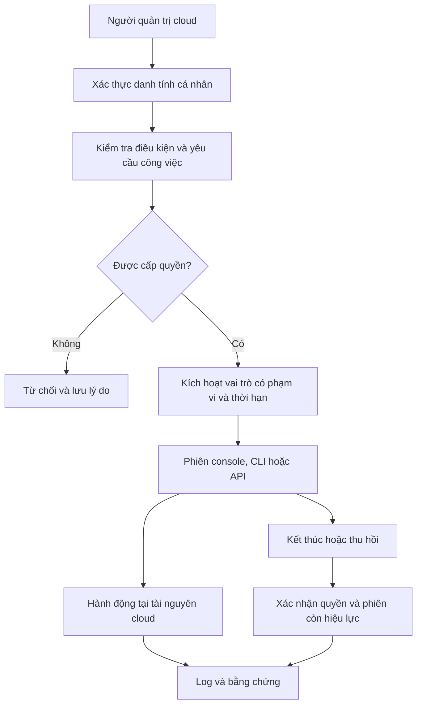

# Cloud administrator identity

## 1. Danh tính quản trị cloud là gì?

**Cloud administrator identity** là danh tính có khả năng thực hiện những hành động quản trị quan trọng trên một môi trường cloud, trực tiếp hoặc thông qua việc nhận một vai trò khác. Các hành động này có thể bao gồm quản lý tài nguyên, thay đổi chính sách truy cập, tạo danh tính, quản trị khóa và bí mật, cấu hình mạng hoặc điều khiển hệ thống giám sát.

Trong quản lý truy cập đặc quyền (Privileged Access Management — PAM), điều cần nhận diện là **khả năng tác động thực tế**, không chỉ tên tài khoản hoặc tên vai trò. Một danh tính không có chữ “admin” vẫn có thể rất nhạy cảm nếu được sửa chính sách tin cậy, phát hành credential cho tài khoản khác hoặc thay đổi mã của workload đang có quyền rộng.

Ví dụ, kỹ sư có quyền quản trị máy ảo chưa chắc có quyền quản trị toàn bộ môi trường cloud. Ngược lại, người được sửa chính sách của một vai trò triển khai có thể mở rộng quyền của chính mình, dù chưa được gán vai trò có tên “Administrator”.

Bài học trong chương Danh tính đặc quyền giúp người học:

- Phân biệt danh tính quản trị cloud với tài khoản quản trị hệ điều hành và danh tính workload.
- Nhận diện quyền quản trị trực tiếp, kế thừa và các đường dẫn gián tiếp đến đặc quyền.
- Thiết kế vòng đời cấp, kích hoạt, giám sát và thu hồi quyền cho người quản trị.
- Quản lý liên kết danh tính, credential, phiên tạm thời và truy cập khẩn cấp.
- Xác định bằng chứng cần có để kiểm toán và ứng phó khi danh tính bị chiếm dụng.

Các ví dụ trong bài sử dụng mô hình cloud trung lập. Tên gọi và quy tắc phân quyền khác nhau giữa các nền tảng; khi triển khai, phải ánh xạ mô hình sang cơ chế của môi trường đích.

## 2. Phân biệt danh tính, vai trò, credential và phiên

Một người quản trị có thể xuất hiện dưới nhiều đối tượng trong chuỗi truy cập. Nếu gộp tất cả thành “tài khoản admin”, việc kiểm kê và thu hồi dễ bỏ sót quyền hoặc phiên đang hoạt động.

| Khái niệm | Ý nghĩa trong bài học | Ví dụ |
| --- | --- | --- |
| Danh tính nguồn | Danh tính dùng để chứng minh người hoặc workload là ai | Tài khoản cá nhân của kỹ sư tại hệ thống danh tính tổ chức |
| Principal tại cloud | Đối tượng mà cơ chế phân quyền cloud nhận diện | Danh tính liên kết hoặc một đối tượng bảo mật được nền tảng hỗ trợ |
| Vai trò hoặc tập quyền | Mô tả hành động được phép và phạm vi áp dụng | Vai trò vận hành máy ảo trong dự án production |
| Credential | Vật liệu dùng để xác thực hoặc chứng minh quyền truy cập | Khóa, chứng chỉ hoặc token |
| Phiên quản trị | Một lần truy cập có ngữ cảnh và vòng đời | Phiên tạm thời nhận vai trò để xử lý ticket |
| Chủ sở hữu chịu trách nhiệm | Người hoặc nhóm giải thích được nhu cầu và quản lý vòng đời | Nhóm vận hành hạ tầng thanh toán |

Trong một số nền tảng, vai trò cũng là một loại principal hoặc được dùng để tạo principal của phiên. Bảng trên phân tách trách nhiệm để dễ phân tích, không khẳng định mọi cloud có cùng mô hình đối tượng.

Một người có thể đăng nhập bằng danh tính nguồn, được ánh xạ vào tập quyền, rồi tạo nhiều phiên qua console và CLI. Xóa một quyền gán ở nguồn chưa chắc vô hiệu hóa ngay các phiên đã được phát hành. Vì vậy, PAM phải quản lý cả liên kết giữa các đối tượng và vòng đời của từng khả năng truy cập.

### 2.1. Quản trị cloud khác quản trị bên trong máy ảo

Quyền quản trị hệ điều hành cho phép tác động trong phạm vi máy được quản trị. Quyền quản trị cloud có thể tạo hoặc xóa máy, thay cấu hình mạng, điều chỉnh quyền truy cập ổ đĩa hoặc thay danh tính gắn với workload, tùy chính sách thực tế.

Hai lớp quyền không đồng nhất, nhưng có thể dẫn tới nhau. Người điều khiển cấu hình khởi chạy máy có thể tác động tới mã hoặc môi trường thực thi bên trong máy. Người có quyền trên máy có thể tiếp cận credential workload nếu cơ chế bảo vệ không đủ. Khi kiểm kê, cần xem cả hai lớp và các điểm nối giữa chúng.

## 3. Những loại danh tính cần phân loại

### 3.1. Danh tính quản trị cá nhân

Đây là danh tính gắn với một người cụ thể, phục vụ công việc quản trị đã được giao. Mô hình thường dùng một tài khoản làm việc thông thường và một ngữ cảnh hoặc tài khoản quản trị riêng.

Mục tiêu là giảm việc đặc quyền luôn đi cùng hoạt động hằng ngày, đồng thời duy trì khả năng quy trách nhiệm. Việc tách tài khoản chỉ có giá trị khi quyền, điều kiện sử dụng và credential cũng được quản lý phù hợp.

### 3.2. Danh tính liên kết từ hệ thống nhận dạng tổ chức

**Federation**, hay liên kết danh tính, cho phép cloud dựa vào một hệ thống nhận dạng được cấu hình tin cậy để xác thực người dùng hoặc nhận các thuộc tính của họ. Người dùng có thể nhận quyền cloud mà không cần duy trì một mật khẩu đăng nhập cloud riêng cho từng môi trường.

Liên kết danh tính không tự giới hạn quyền. Cần quản lý người được nhận vai trò, ánh xạ nhóm hoặc thuộc tính, phạm vi tài nguyên, điều kiện phiên và các đường đăng nhập cục bộ còn tồn tại.

### 3.3. Danh tính cục bộ hoặc đăng nhập trực tiếp tại cloud

Một môi trường có thể còn các danh tính đăng nhập trực tiếp do yêu cầu kỹ thuật, lịch sử triển khai hoặc phương án khẩn cấp. Chúng dễ bị bỏ quên nếu tổ chức chỉ theo dõi tài khoản ở hệ thống danh tính trung tâm.

Cần có chủ sở hữu, lý do tồn tại, phương thức xác thực, credential, quyền và thời điểm rà soát cho từng danh tính. Không nên mặc nhiên coi mọi tài khoản cục bộ là tài khoản khẩn cấp.

### 3.4. Danh tính sở hữu hoặc khôi phục môi trường

Một số nền tảng có danh tính hoặc cơ chế đặc biệt liên quan đến sở hữu môi trường, khôi phục quyền truy cập hoặc các thao tác đặc biệt. Không nên giả định các cơ chế này hoạt động giống vai trò quản trị thông thường.

Cần nhận diện riêng quyền sở hữu, khả năng khôi phục, thông tin liên hệ, phương tiện xác thực và người quản lý. Email khôi phục hoặc một kênh xác minh ngoài cloud có thể trở thành đường dẫn tới việc tiếp quản môi trường.

### 3.5. Danh tính tự động hóa có quyền quản trị

Pipeline triển khai, công cụ hạ tầng dưới dạng mã và tác vụ tự động cũng có thể có quyền quản trị cloud. Chúng không phải tài khoản của con người, dù có thể đang dùng cùng một tập quyền.

Cần quản lý chúng như danh tính workload: có chủ sở hữu, mục đích, nguồn được phép sử dụng, phạm vi và vòng đời credential. Không nên dùng credential của quản trị viên cá nhân cho một pipeline hoặc dùng tài khoản dịch vụ chung làm danh tính thao tác hằng ngày.

### 3.6. Danh tính của nhà cung cấp hoặc đối tác

Nhà thầu, đơn vị hỗ trợ và nhóm bên ngoài có thể được truy cập thông qua liên kết giữa các môi trường hoặc tài khoản cá nhân được tạo riêng. Cần xác định cả danh tính bên ngoài lẫn quyền tại môi trường nhận truy cập.

Chấm dứt hợp đồng phải dẫn đến việc thu hồi khả năng truy cập tại tổ chức, không chỉ yêu cầu đối tác tự xóa tài khoản phía họ.

## 4. Đặc quyền nằm ở đâu trong cloud?

### 4.1. Lớp điều khiển và lớp dữ liệu

**Lớp điều khiển**, thường gọi là control plane, quản lý tài nguyên và cấu hình. **Lớp dữ liệu**, hay data plane, phục vụ thao tác với dữ liệu hoặc chức năng của dịch vụ.

Ví dụ, tạo một kho lưu trữ và thay chính sách truy cập là thao tác quản trị tài nguyên; đọc đối tượng trong kho là thao tác với dữ liệu. Một danh tính có thể có quyền ở một lớp mà không có quyền ở lớp kia, tùy mô hình phân quyền.

Tuy nhiên, quyền quản trị có thể tạo đường dẫn tới dữ liệu. Nếu người dùng được thay chính sách đọc, gắn một danh tính khác hoặc sửa mã xử lý dữ liệu, họ có thể mở đường truy cập dù ban đầu không có quyền đọc trực tiếp. Vì vậy, không nên kết luận một vai trò “không đọc được dữ liệu” chỉ dựa vào danh sách hành động hiện tại.

### 4.2. Phạm vi và kế thừa

Quyền có thể được gán ở cấp tổ chức, môi trường nhận dạng, tài khoản, vùng quản lý, dự án hoặc tài nguyên cụ thể. Tên gọi và quan hệ kế thừa phụ thuộc nền tảng.

Một quyền tưởng như hẹp ở cấp dự án có thể trở nên rộng khi cùng danh tính có quyền ở cấp cha. Ngược lại, một giới hạn tổ chức có thể chặn hành động mà vai trò cục bộ cho phép. Cần xác định **quyền hiệu lực** sau khi các nguồn chính sách được kết hợp.

Không áp dụng một quy tắc kết hợp quyền chung cho mọi cloud. Chính sách danh tính, chính sách tài nguyên, ranh giới quyền và các giới hạn tổ chức có thể được đánh giá khác nhau giữa các nền tảng.

### 4.3. Những quyền cần chú ý ngoài quản trị tài nguyên

| Khả năng | Vì sao có thể là đặc quyền cao |
| --- | --- |
| Thay nhóm, vai trò hoặc chính sách phân quyền | Có thể mở rộng quyền cho bản thân hoặc người khác |
| Thay cấu hình liên kết danh tính | Có thể thay người hoặc nguồn được môi trường cloud tin cậy |
| Chuyển vai trò hoặc chuyển sang danh tính khác | Có thể nhận quyền rộng hơn quyền hiện tại |
| Tạo hoặc lấy credential của danh tính khác | Có thể sử dụng quyền dưới danh tính đó |
| Quản trị khóa hoặc secret | Có thể mở đường tới dữ liệu và dịch vụ nhạy cảm |
| Sửa pipeline, script hoặc cấu hình chạy đặc quyền | Có thể tác động thông qua danh tính của tác vụ tự động |
| Quản lý log hoặc cấu hình giám sát | Có thể làm giảm khả năng phát hiện và điều tra |
| Quản trị bản sao lưu và khôi phục | Có thể đọc dữ liệu tập trung hoặc phá khả năng khôi phục |

Các quyền này phải được đánh giá theo chuỗi tác động cụ thể. Không phải mọi quyền trong bảng luôn dẫn tới toàn quyền, nhưng chúng đều cần được xem xét trong kiểm kê PAM.

## 5. Kiểm kê danh tính quản trị cloud

Một bản kiểm kê hữu ích phải nối được người chịu trách nhiệm, danh tính nguồn, quyền tại cloud và các credential hoặc phiên có liên quan.

| Nhóm thông tin | Dữ liệu cần ghi nhận |
| --- | --- |
| Nhận diện | Mã định danh ổn định, tên hiển thị, loại danh tính, môi trường |
| Trách nhiệm | Chủ sở hữu, nhóm vận hành, người xác nhận nhu cầu |
| Đường đăng nhập | Federation, đăng nhập cục bộ, nhận vai trò, truy cập qua PAM |
| Quyền | Quyền trực tiếp, nhóm, kế thừa, liên kết sang môi trường khác |
| Phạm vi | Tài nguyên, dự án, tài khoản hoặc phạm vi tổ chức liên quan |
| Credential | Loại credential, nơi quản lý, bên sử dụng, thời hạn hoặc chính sách đổi |
| Vòng đời | Ngày cấp, lý do, ngày rà soát, điều kiện hết quyền |
| Khả năng quan sát | Log xác thực, sự kiện cấp quyền, log hành động và kết quả thu hồi |

Mã định danh ổn định giúp tránh nhầm hai người có cùng tên hiển thị hoặc một tài khoản đã được đổi tên. Khi liên kết hệ thống, cần hiểu thuộc tính nào thực sự định danh người dùng; không nên giả định một chuỗi tên hoặc email do bên gọi tự khai luôn đủ tin cậy.

Nguồn kiểm kê có thể gồm hệ thống danh tính, chính sách cloud, PAM, vault và dữ liệu sử dụng. Chỉ xuất danh sách thành viên của nhóm có tên “Cloud Admin” sẽ bỏ sót quyền được cấp trực tiếp, danh tính cục bộ hoặc các đường chuyển vai trò.

Quyền chưa được dùng gần đây là tín hiệu để rà soát, không phải bằng chứng tuyệt đối rằng nó không cần thiết. Nhiệm vụ khôi phục hoặc vận hành định kỳ có thể ít xuất hiện; cần xác nhận với chủ sở hữu trước khi thu hồi.

## 6. Thiết kế vai trò theo công việc

Một yêu cầu “cần cloud admin” nên được làm rõ thành nhiệm vụ có thể giải thích và giới hạn.

| Nhiệm vụ | Phạm vi quyền nên phân tích | Quyền không tự động đi kèm |
| --- | --- | --- |
| Vận hành máy ảo ứng dụng | Xem trạng thái, thực hiện thao tác vận hành trên nhóm máy xác định | Quản trị toàn bộ danh tính và môi trường |
| Triển khai một ứng dụng | Thay phiên bản và cấu hình triển khai trong phạm vi ứng dụng | Đọc mọi secret hoặc sửa log tổ chức |
| Quản trị mạng | Thay cấu hình mạng được giao | Tự tạo tài khoản quản trị danh tính |
| Quản trị truy cập | Quản lý nhóm hoặc vai trò theo thẩm quyền | Tự duyệt mọi yêu cầu và xóa bằng chứng |
| Hỗ trợ sự cố dữ liệu | Các hành động chẩn đoán hoặc khôi phục được xác định | Quyền đọc toàn bộ dữ liệu thường trực |
| Quản trị giám sát | Cấu hình thu thập và vận hành log | Tùy ý xóa lịch sử thao tác đặc quyền |

Bảng là điểm bắt đầu phân tích, không phải bộ vai trò có thể áp dụng nguyên trạng. Một hành động quản trị ở nền tảng cụ thể có thể mang quyền gián tiếp rộng hơn mô tả nghiệp vụ.

Nên tách production với môi trường thử nghiệm và tránh để một danh tính mang quyền rộng ở mọi môi trường chỉ để tiện hỗ trợ. Tuy nhiên, tách tài khoản hoặc dự án không tự tạo ranh giới nếu người dùng vẫn có quyền ở cấp cha hoặc được nhận vai trò xuyên qua các môi trường.

Với tác vụ nhạy cảm, phân tách nhiệm vụ có thể yêu cầu người đề nghị không tự duyệt quyền của mình. Cũng cần xem tổ hợp quyền: người vừa sửa được chính sách cấp quyền vừa sửa được log có thể vượt qua nhiều kiểm soát dù từng vai trò riêng có vẻ hợp lý.

## 7. Liên kết danh tính và cấp quyền tạm thời

### 7.1. Một luồng truy cập điển hình

Trong mô hình có federation và PAM, một luồng quản trị có thể diễn ra như sau:

1. Người quản trị dùng danh tính cá nhân để xác thực ở hệ thống nhận dạng tổ chức.
2. Chính sách kiểm tra điều kiện như phương thức xác thực và thiết bị quản trị.
3. Người dùng yêu cầu quyền cho tài nguyên, nhiệm vụ và thời gian cụ thể.
4. Hệ thống kiểm tra quyền yêu cầu, phê duyệt theo chính sách và kích hoạt tập quyền phù hợp.
5. Cloud tạo hoặc chấp nhận một phiên với phạm vi được cấp.
6. Hành động qua console, CLI hoặc API được ghi nhận tại các điểm thích hợp.
7. Khi kết thúc, hệ thống xử lý quyền gán, phiên và credential đã phát hành.



PAM có thể điều phối yêu cầu, quản lý credential hoặc môi giới phiên, tùy cách triển khai. Một số quyền được thực thi trực tiếp bằng cơ chế cloud. Cần xác định thành phần thực hiện từng bước, thay vì giả định mọi thao tác cloud đều đi qua một proxy PAM.

### 7.2. Quản lý quan hệ tin cậy

Federation và nhận vai trò đòi hỏi quy tắc xác định nguồn danh tính nào được chấp nhận và được ánh xạ tới quyền nào. Các thay đổi ở quy tắc này là thay đổi đặc quyền cao.

Cần xem xét:

- Nguồn nhận dạng và đối tượng nào được phép nhận vai trò.
- Thuộc tính hoặc nhóm nào quyết định quyền, và ai được sửa chúng.
- Phạm vi môi trường mà quan hệ tin cậy cho phép truy cập.
- Thời hạn, điều kiện và bằng chứng gắn với phiên nhận vai trò.
- Cách phát hiện và thu hồi khi cấu hình tin cậy bị thay đổi trái phép.

Một danh sách người được cấp quyền hẹp không đủ nếu một nhóm khác có thể tự sửa quy tắc để đưa người vào danh sách đó.

### 7.3. JIT và JEA cần phối hợp

JIT giảm quyền thường trực bằng cách cho kích hoạt khi có nhu cầu. JEA giới hạn hành động quản trị ở mức đủ dùng; cách hiện thực phụ thuộc vào cơ chế của nền tảng.

Cấp vai trò quản trị toàn môi trường trong một giờ chỉ giải quyết một phần thời gian phơi lộ. Nếu nhiệm vụ chỉ là khởi động lại nhóm máy của một ứng dụng, vẫn cần thu hẹp hành động và phạm vi.

Không phải cloud nào cũng hỗ trợ tách mọi thao tác theo mức chi tiết mong muốn. Khi gặp giới hạn, cần ghi nhận quyền rộng còn lại, lý do, thời hạn và kiểm soát bổ sung, thay vì mô tả quyền đó như đã được giới hạn hoàn chỉnh.

## 8. Console, CLI và API là các đường sử dụng cùng đặc quyền

Người quản trị có thể dùng giao diện web, công cụ dòng lệnh, SDK hoặc công cụ hạ tầng dưới dạng mã. Cùng một danh tính có thể có quyền khác nhau giữa các phiên do cách nhận vai trò, thời điểm phát hành token hoặc chính sách áp dụng.

### 8.1. Phiên console

Phiên web cần được gắn với danh tính nguồn, vai trò tại cloud và điều kiện đăng nhập. Đăng xuất một giao diện hoặc ngắt phiên PAM không nên được mặc nhiên coi là đã vô hiệu hóa mọi token hay mọi phiên khác.

Credential phiên và dữ liệu trình duyệt cũng là tài sản nhạy cảm. Thiết bị quản trị bị chiếm dụng có thể làm giảm giá trị của bước xác thực trước đó.

### 8.2. Phiên CLI hoặc SDK

Người quản trị có thể nhận credential tạm thời để gọi API. Cần biết công cụ lưu chúng ở đâu, ứng dụng nào có thể sử dụng, thời hạn bao lâu và có hỗ trợ thu hồi sớm không.

Không nên ghi credential vào mã nguồn, lịch sử lệnh hoặc chia sẻ trong ticket. Nếu một ví dụ vận hành yêu cầu sao chép token thủ công, cần đánh giá cách hạn chế lộ token và các đường sử dụng ngoài luồng đã được phê duyệt.

### 8.3. Tự động hóa

Một pipeline nên dùng danh tính workload dành cho tác vụ của nó. Nếu pipeline dùng credential của một quản trị viên cá nhân:

- Khó phân biệt hành động do người thực hiện với hành động tự động.
- Việc người đó chuyển nhóm hoặc nghỉ việc có thể làm gián đoạn pipeline.
- Phạm vi quyền thường rộng hơn nhu cầu của tác vụ.
- Thu hồi một credential có thể ảnh hưởng nhiều bên sử dụng không được kiểm kê.

Tách danh tính là bước đầu; vẫn cần kiểm soát ai sửa pipeline, ai kích hoạt, quyền của môi trường chạy và quyền của workload được triển khai.

### 8.4. Ghi hình không bao phủ mọi hành động cloud

Ghi hình phiên có thể hữu ích với luồng được PAM hỗ trợ, nhưng hành động qua API hoặc SDK cần log tương ứng. Ngay cả khi có bản ghi giao diện web, sự kiện tại cloud vẫn cần thiết để xác nhận tài nguyên, hành động và kết quả.

Phải kiểm tra loại sự kiện nào thực sự được ghi, thuộc lớp điều khiển hay lớp dữ liệu, có được bật trong phạm vi cần thiết không và được chuyển về đâu. Không giả định mọi thao tác đọc dữ liệu đều tự có log đầy đủ chỉ vì đã bật log quản trị.

## 9. Ví dụ: cấp quyền vận hành một ứng dụng production

### 9.1. Bối cảnh

Kỹ sư Mai thuộc nhóm vận hành ứng dụng thanh toán. Nhóm đang có vai trò quản trị rộng trên môi trường production để tiện hỗ trợ, trong khi phần lớn công việc chỉ cần xem trạng thái và khởi động lại nhóm máy ứng dụng.

Mục tiêu là thay đặc quyền thường trực bằng quyền phù hợp nhiệm vụ mà vẫn duy trì khả năng xử lý sự cố. Ticket `INC-9154` yêu cầu Mai xử lý nhóm máy `payment-app`.

### 9.2. Thiết kế đề xuất

| Thành phần | Quyết định minh họa |
| --- | --- |
| Danh tính nguồn | Danh tính quản trị cá nhân của Mai tại hệ thống nhận dạng tổ chức |
| Phạm vi cloud | Môi trường production của ứng dụng thanh toán |
| Tài nguyên | Nhóm máy `payment-app` đã được xác định |
| Hành động | Xem trạng thái và thực hiện thao tác khởi động lại được cho phép |
| Điều kiện | Xác thực mạnh, thiết bị quản trị phù hợp, nhiệm vụ trực hợp lệ |
| Kích hoạt | JIT gắn với `INC-9154`, phê duyệt theo chính sách |
| Thời hạn | Ví dụ tối đa 30 phút |
| Ngoài phạm vi | Quản trị IAM, tạo credential cho người khác, thay log, sửa các tài nguyên không liên quan |
| Kết thúc | Gỡ quyền tạm, xử lý phiên và token, đối chiếu bằng chứng |

Thời hạn 30 phút là giả định cho ví dụ. Việc chọn thời hạn phải tính đến nhiệm vụ, khả năng gia hạn và giới hạn thực tế của token hoặc phiên.

### 9.3. Mô tả ý định cấp quyền

Đoạn JSON sau là **mô hình minh họa**, không phải cấu hình có thể nạp trực tiếp vào một cloud hay sản phẩm PAM. Tên hành động và tài nguyên cần được ánh xạ sang cơ chế thực thi của môi trường đích.

```json
{
  "requestId": "INC-9154",
  "subject": {
    "identityType": "humanAdministrator",
    "sourceIdentity": "admin-mai"
  },
  "target": {
    "environment": "production",
    "application": "payment",
    "resourceGroup": "payment-app"
  },
  "allowedActions": [
    "compute.readStatus",
    "compute.restartApprovedInstances"
  ],
  "activation": {
    "mode": "justInTime",
    "maxDurationMinutes": 30,
    "requireStrongAuthentication": true,
    "requireApprovedAdminDevice": true
  },
  "evidence": [
    "sourceIdentity",
    "cloudSessionIdentity",
    "grantDecision",
    "resourceActions",
    "revocationOutcome"
  ]
}
```

Danh sách hành động trên không tự vô hiệu hóa quyền mà Mai có từ nguồn khác. Khi triển khai, phải thu hồi vai trò rộng cũ sau khi xác nhận luồng mới đáp ứng nhiệm vụ.

Nếu phạm vi quyền dựa trên nhãn hoặc thuộc tính tài nguyên, cần kiểm soát cả người được sửa các nhãn hoặc thuộc tính đó. Một danh tính tự thay được điều kiện xác định phạm vi có thể làm cho giới hạn tài nguyên mất ý nghĩa.

### 9.4. Kiểm chứng hành vi

Một thiết kế triển khai nên được kiểm chứng bằng các tình huống:

- Mai thực hiện được thao tác đã cấp trên đúng nhóm máy.
- Cùng phiên đó không thực hiện được thao tác tương tự trên ứng dụng khác.
- Không tạo được credential hoặc sửa được chính sách IAM ngoài phạm vi.
- Quyền kế thừa và đường chuyển vai trò không khôi phục khả năng quản trị rộng.
- Khi kết thúc, việc cấp phiên mới bị chặn và các phiên đã phát hành được xử lý theo thiết kế.
- Log liên kết được danh tính nguồn, phiên cloud, ticket và tài nguyên bị tác động.

Đây là các tiêu chí cho một hệ thống thực tế, không phải yêu cầu chạy lệnh từ bài học.

## 10. Vault và vòng đời credential

### 10.1. Quản lý bí mật dài hạn còn tồn tại

Khi còn mật khẩu, khóa truy cập hoặc vật liệu xác thực dài hạn, cần biết chúng thuộc danh tính nào, được ai dùng và có thể tác động tới tài nguyên nào. Vault có thể hỗ trợ bảo quản, cấp phát và luân chuyển theo chính sách.

Đưa credential vào vault không thu hẹp quyền của danh tính phía sau. Một khóa quản trị toàn môi trường vẫn rất nhạy cảm dù đã được lưu ở nơi tập trung.

Với credential dùng bởi công cụ hoặc pipeline, luân chuyển phải có kế hoạch cập nhật các bên sử dụng, kiểm tra kết quả và xử lý lỗi. Đổi secret tại một nơi nhưng bỏ quên bên phụ thuộc có thể vừa làm gián đoạn vừa để sót khả năng truy cập cũ.

### 10.2. Ưu tiên truy cập tạm thời khi phù hợp

Federation, nhận vai trò và credential ngắn hạn có thể giảm nhu cầu cấp khóa quản trị dài hạn cho từng người. Lợi ích phụ thuộc vào cách kiểm soát người nhận, phạm vi quyền và thời gian hiệu lực.

Credential tạm thời không tự an toàn tuyệt đối: trong thời gian còn hiệu lực, bên nắm giữ vẫn có thể gọi những hành động được cấp nếu không có điều kiện ngăn chặn tương ứng.

### 10.3. Phân biệt các thao tác thu hồi

| Thao tác | Tác động cần kiểm tra | Điều không nên mặc nhiên suy ra |
| --- | --- | --- |
| Khóa danh tính nguồn | Chặn xác thực hoặc nhận phiên mới theo cơ chế được dùng | Mọi phiên cloud hiện có đều bị kết thúc ngay |
| Gỡ nhóm hoặc quyền gán | Thay đổi khả năng nhận hoặc sử dụng quyền theo nền tảng | Token phát hành trước đó không còn dùng được |
| Vô hiệu hóa hoặc đổi credential | Chặn tiếp tục sử dụng vật liệu cũ theo cơ chế xác thực | Kết nối và tác vụ đã tạo đều dừng |
| Kết thúc phiên môi giới | Ngắt đường truy cập mà môi giới quản lý | Những token hoặc đường trực tiếp khác cũng đã bị chặn |
| Thu hồi tại hệ thống đích | Áp dụng kiểm soát nơi quyền được sử dụng | Mọi nơi đã đồng bộ ngay lập tức |

Nếu không hỗ trợ thu hồi sớm một loại token, phải ghi rõ thời hạn còn lại và phương án hạn chế truy cập phù hợp. Không nên báo hoàn tất thu hồi chỉ dựa trên trạng thái “đã xóa thành viên nhóm”.

## 11. Danh tính sở hữu và truy cập khẩn cấp

### 11.1. Bảo vệ quyền sở hữu và khôi phục

Cần nhận diện những cơ chế có thể khôi phục hoặc chuyển quyền sở hữu môi trường, gồm danh tính đặc biệt, kênh liên hệ và phương tiện xác minh. Cách quản lý phụ thuộc nền tảng, không thể suy ra từ cách quản lý vai trò thông thường.

Các câu hỏi cần trả lời:

- Ai chịu trách nhiệm cho danh tính hoặc cơ chế sở hữu?
- Ai giữ phương tiện xác thực và ai được phép sử dụng?
- Kênh khôi phục có phụ thuộc vào một cá nhân hoặc hệ thống dễ bị mất quyền truy cập không?
- Sự kiện sử dụng hoặc thay đổi thông tin khôi phục được phát hiện bằng cách nào?
- Nếu người chịu trách nhiệm nghỉ việc, việc bàn giao được xác nhận ra sao?

Bảo vệ tài khoản cloud nhưng bỏ ngỏ email khôi phục hoặc cơ chế xác minh ngoài cloud có thể để lại đường tiếp quản môi trường.

### 11.2. Break-glass có mục đích và vòng đời

Break-glass là cơ chế truy cập khẩn cấp cho tình huống đã xác định, chẳng hạn hệ thống nhận dạng chính không hoạt động và cần khôi phục môi trường. Danh tính sở hữu đặc biệt và tài khoản break-glass có thể liên quan nhưng không nên mặc nhiên coi là cùng một đối tượng.

Cần quy định:

- Điều kiện sử dụng và người có thẩm quyền kích hoạt.
- Quyền và phạm vi cần thiết để khôi phục.
- Cách bảo quản phương tiện truy cập, kể cả khi thành phần chính bị lỗi.
- Cách tạo cảnh báo và thu thập bằng chứng còn khả dụng.
- Cách kết thúc, đổi credential khi cần và rà soát sau sử dụng.

Không nên vô hiệu hóa mọi kiểm soát chỉ để tránh phụ thuộc vào hệ thống nhận dạng chính. Phương án xác thực và thu thập bằng chứng dự phòng phải được thiết kế phù hợp với tình huống lỗi dự kiến.

Cơ chế khẩn cấp cần được diễn tập có kiểm soát. Một tài khoản có tên “emergency” nhưng thiếu phương tiện xác thực hoặc phụ thuộc vào chính hệ thống đang hỏng không chứng minh được khả năng khôi phục.

## 12. Vòng đời quản trị viên cloud

### 12.1. Khi bắt đầu công việc

Xác nhận chủ sở hữu, nhóm công việc, môi trường và nhiệm vụ. Tạo hoặc liên kết danh tính cá nhân, thiết lập xác thực và điều kiện thiết bị, rồi cấp khả năng yêu cầu đúng vai trò.

Việc được phép yêu cầu một vai trò không nhất thiết đồng nghĩa với luôn sở hữu quyền của vai trò đó. Mô hình JIT nên phân biệt rõ trạng thái đủ điều kiện và trạng thái đang được kích hoạt.

### 12.2. Khi thay đổi nhóm hoặc trách nhiệm

Rà soát các nhóm, quyền trực tiếp, liên kết xuyên môi trường và khả năng duyệt yêu cầu. Nếu chỉ thêm quyền mới mà giữ toàn bộ quyền cũ, danh tính sẽ tích lũy đặc quyền qua thời gian.

Các vai trò trong cloud, quyền ở hệ thống nhận dạng và quyền quản trị PAM phải được đối chiếu cùng nhau. Người chuyển nhóm có thể đã mất một vai trò tại cloud nhưng vẫn còn khả năng sửa nhóm cung cấp chính vai trò đó.

### 12.3. Khi quyền không còn cần thiết

Thu hồi quyền gán, khả năng nhận vai trò và các credential liên quan. Xử lý phiên đang có và chuyển giao trách nhiệm đối với danh tính dịch vụ mà người đó từng quản lý.

Không xóa vội bằng chứng liên quan đến người đã nghỉ việc. Khả năng truy vết cần duy trì được danh tính đã thao tác trong lịch sử, theo chính sách lưu trữ của tổ chức.

### 12.4. Rà soát định kỳ và theo sự kiện

Rà soát cần đối chiếu quyền với nhiệm vụ, cách sử dụng, chủ sở hữu và đường đi gián tiếp. Các sự kiện như thay đổi cấu trúc tổ chức, thêm môi trường cloud hoặc thay nền tảng danh tính cũng có thể làm thay đổi phạm vi quyền.

Một lần duyệt danh sách tên không đủ nếu người duyệt không biết quyền đó làm được gì hoặc được kế thừa từ đâu.

## 13. Ứng phó khi nghi danh tính quản trị bị chiếm dụng

### 13.1. Xác định phạm vi và ngăn truy cập tiếp diễn

Trước hết cần xác định danh tính nguồn, principal tại cloud, các phiên, vai trò đã nhận và tài nguyên có thể bị tác động. Biện pháp ngăn chặn có thể gồm chặn đăng nhập mới, gỡ khả năng nhận vai trò, vô hiệu hóa credential và xử lý phiên tại nơi thực thi.

Cần sử dụng đường quản trị tin cậy để thực hiện ứng phó. Nếu thiết bị quản trị hoặc nguồn danh tính bị nghi xâm nhập, việc tiếp tục dùng cùng đường truy cập có thể làm lộ các biện pháp khắc phục.

### 13.2. Tìm khả năng duy trì truy cập

Ngoài phiên ban đầu, phải tìm các thay đổi có thể tạo đường quay lại:

- Danh tính hoặc credential mới được tạo.
- Nhóm, vai trò, chính sách hoặc quan hệ tin cậy bị sửa.
- Quyền cấp cho bên ngoài hoặc môi trường khác.
- Pipeline, script và cấu hình workload bị thay đổi.
- Khóa, secret, dữ liệu hoặc bản sao lưu bị truy cập.
- Log hoặc cấu hình giám sát bị vô hiệu hóa.

Chỉ đổi mật khẩu của một người có thể không đủ nếu kẻ tấn công đã tạo một danh tính khác hoặc mở rộng quan hệ tin cậy.

### 13.3. Giữ bằng chứng và phục hồi

Giữ lại các sự kiện cần thiết để nối danh tính nguồn, phiên cloud, hành động và tài nguyên. Bảo vệ dữ liệu thu thập khỏi sửa hoặc xóa trái phép, đồng thời hạn chế người được xem.

Sau khi ngăn chặn, cần xác nhận cấu hình tin cậy và phân quyền, khôi phục thay đổi trái phép, xử lý credential đã lộ và kiểm tra các workload liên quan. Cấp lại quyền cho người dùng chỉ nên dựa trên trạng thái đã được xác minh phù hợp.

Nếu việc thu hồi chưa thể xác nhận ở một nơi, ghi rõ nơi đó và giới hạn còn tồn tại. Trạng thái ứng phó cần phản ánh quyền thực tế, không chỉ việc đã gửi lệnh khóa tài khoản.

## 14. Bằng chứng và chỉ số quản lý

### 14.1. Chuỗi bằng chứng

Một thao tác quản trị nên nối được chuỗi:

**người hoặc workload nguồn → yêu cầu công việc → quyết định cấp quyền → phiên cloud → hành động trên tài nguyên → kết quả thu hồi**.

Dữ liệu cần có thường gồm mã định danh ổn định, thời điểm, vai trò hoặc tập quyền, phạm vi, mã yêu cầu hoặc phiên và kết quả hành động. Tên người dùng hiển thị đơn lẻ thường không đủ để liên kết xuyên hệ thống.

Log của nguồn danh tính cho biết quá trình đăng nhập; log PAM cho biết quyết định hoặc phiên mà PAM quản lý; log cloud cho biết hành động mà cloud ghi nhận. Không nên giả định một nguồn thay thế hoàn toàn hai nguồn còn lại.

Quyền thay đổi cấu hình log, đọc bản ghi và xóa bằng chứng phải được quản lý như quyền nhạy cảm. Thời gian lưu và mức chi tiết cần phù hợp nhu cầu vận hành, kiểm toán và bảo vệ dữ liệu của tổ chức.

### 14.2. Các chỉ số hữu ích

| Chỉ số | Ý nghĩa cần xem xét |
| --- | --- |
| Số danh tính có quyền quản trị thường trực theo môi trường | Nơi còn thời gian phơi lộ lớn |
| Quyền quản trị chưa có chủ sở hữu hoặc lý do | Khả năng kiểm kê và chịu trách nhiệm |
| Danh tính cục bộ ngoài luồng liên kết chính | Những đường đăng nhập cần theo dõi riêng |
| Credential dài hạn gắn với người quản trị | Mức phụ thuộc vào bí mật dễ bị sao chép hoặc bỏ quên |
| Quyền tạm thời còn hiệu lực sau khi nhiệm vụ kết thúc | Hiệu quả kết thúc quyền trong thực tế |
| Thời gian từ quyết định thu hồi đến khi mất truy cập | Khả năng phản ứng tại điểm thực thi |
| Phiên không liên kết được với người hoặc workload nguồn | Khoảng trống trong quy trách nhiệm |
| Số lần dùng break-glass và kết quả rà soát | Mức phụ thuộc vào ngoại lệ |

Chỉ số cần kèm phạm vi đo. Số người đăng nhập qua federation tăng không chứng minh các tài khoản cục bộ, khóa dài hạn và đường nhận vai trò cũ đã được thu hồi.

## 15. Những sai lầm thường gặp

| Cách làm | Vấn đề | Hướng xử lý |
| --- | --- | --- |
| Coi mọi tài khoản có chữ admin là toàn bộ danh tính đặc quyền | Bỏ sót quyền gián tiếp, danh tính tự động và liên kết ngoài | Kiểm kê theo khả năng tác động và đường nhận quyền |
| Cấp toàn quyền production để hỗ trợ nhanh | Phạm vi quyền vượt nhu cầu và khó thu hồi có chọn lọc | Vai trò nhiệm vụ, phạm vi tài nguyên và JIT |
| Cho rằng federation đã giải quyết phân quyền | Nguồn xác thực tập trung vẫn có thể ánh xạ đến quyền rất rộng | Quản lý nhóm, ánh xạ, điều kiện và quyền cloud thực tế |
| Dùng khóa cá nhân cho pipeline | Trộn trách nhiệm con người với tự động hóa | Danh tính workload và credential được quản lý riêng |
| Chỉ ghi hình phiên web | Bỏ sót CLI, API và thao tác tự động | Kết hợp log danh tính, PAM, cloud và hệ thống đích |
| Khóa người dùng rồi báo đã thu hồi toàn bộ | Phiên, token hoặc danh tính mới có thể còn dùng được | Xử lý từng loại khả năng truy cập và xác nhận hiệu lực |
| Giữ tài khoản khẩn cấp như tài khoản làm việc | Ngoại lệ trở thành đặc quyền thường trực | Điều kiện sử dụng, cảnh báo, thời hạn và rà soát |
| Tin rằng quản trị tài nguyên không thể đọc dữ liệu | Có thể bỏ sót đường sửa chính sách, mã hoặc credential | Phân tích đường từ quyền quản trị đến dữ liệu |

## 16. Thực hành lập hồ sơ một danh tính

Giả sử một kỹ sư có quyền vận hành máy ảo ở production, nhận thêm vai trò hỗ trợ ở môi trường khác và đang giữ một khóa dùng bởi công cụ tự động.

Hãy lập một hồ sơ gồm:

1. Danh tính nguồn, mã định danh tại cloud và người chịu trách nhiệm.
2. Quyền trực tiếp, kế thừa và đường nhận vai trò.
3. Nhiệm vụ cần thiết, tài nguyên và môi trường được phép.
4. Các phiên console, CLI, API và credential có liên quan.
5. Phương án chuyển quyền thường trực sang quyền theo nhiệm vụ.
6. Cách tách công cụ tự động khỏi danh tính cá nhân.
7. Các bước thu hồi khi người đó chuyển nhóm.
8. Bằng chứng để xác nhận không còn truy cập ngoài phạm vi.

Điểm quan trọng là giải thích được từng khả năng truy cập và cách kết thúc nó. Nếu chưa biết token nào còn hiệu lực hoặc vai trò nào được nhận qua môi trường khác, hãy ghi đó là khoảng trống kiểm kê cần xử lý trước khi kết luận đã thu hồi đủ quyền.

## 17. Ghi nhớ

Danh tính quản trị cloud được xác định bởi quyền hiệu lực và những đường dẫn tới quyền, không chỉ bởi tên tài khoản. Quản lý tốt cần nối được danh tính nguồn, vai trò, phạm vi tài nguyên, credential, phiên và chủ sở hữu.

Trong PAM, mục tiêu là cấp đúng đặc quyền cho đúng nhiệm vụ, giảm quyền thường trực, kiểm soát cả console lẫn CLI và API, bảo vệ đường khẩn cấp, đồng thời xác nhận việc thu hồi bằng bằng chứng tại nơi quyền được sử dụng.
