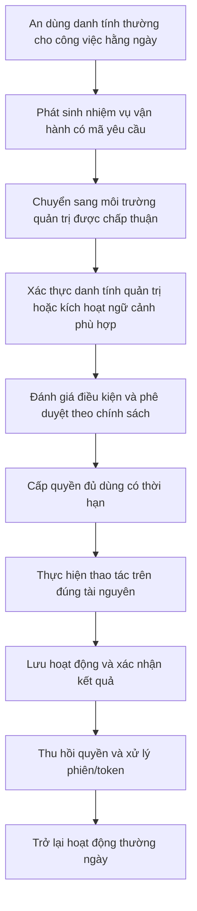

# Tách danh tính thường và đặc quyền

## Mục tiêu bài học

Trong chương **Danh tính đặc quyền**, bài học này trình bày cách tách hoạt động làm việc thông thường khỏi hoạt động quản trị có tác động lớn. Nội dung thuộc module `SECURITY_IDENTITY_ACCESS_MANAGEMENT_PRIVILEGED_ACCESS_MANAGEMENT`, áp dụng cho tài khoản quản trị, tài khoản dịch vụ và hạ tầng nhạy cảm.

Sau bài học, bạn có thể:

- Phân biệt con người, danh tính, tài khoản, credential và phiên truy cập.
- Xác định khi nào cần danh tính quản trị riêng và cách kết hợp với JIT/JEA.
- Nhận diện những đường liên kết khiến tài khoản thường vẫn có thể chiếm hoặc điều khiển danh tính đặc quyền.
- Thiết kế luồng truy cập, bảo vệ credential, quản lý vòng đời và lưu bằng chứng.
- Phác thảo cách chuyển một tài khoản đang dùng lẫn nhiều mục đích sang mô hình được kiểm soát.

## 1. Tách danh tính nghĩa là tách mục đích và khả năng tác động

Một kỹ sư có thể vừa đọc email, tham gia họp, viết tài liệu, vừa quản trị máy chủ sản xuất. Các hoạt động này có mức tiếp xúc và tác động khác nhau. Tài khoản dùng để mở tài liệu từ nhiều nguồn không nên đồng thời mang mọi khả năng thay đổi hạ tầng quan trọng.

**Tách danh tính thường và đặc quyền** là tổ chức những hoạt động đó vào các danh tính hoặc ngữ cảnh truy cập được kiểm soát riêng, với quyền hạn, phương tiện xác thực, đường truy cập và bằng chứng phù hợp từng mục đích.

Trong mô hình dùng tài khoản riêng, cùng một người có thể được gắn với:

| Danh tính minh họa | Mục đích | Quyền cần thiết |
|---|---|---|
| `an` | Email, tài liệu, công cụ cộng tác | Quyền làm việc thường ngày |
| `an-ops-prod` | Vận hành một nhóm dịch vụ sản xuất | Quyền quản trị theo nhiệm vụ, được kích hoạt khi cần |
| `an-admin-identity` | Quản trị một phần hệ thống danh tính, nếu công việc yêu cầu | Quyền riêng cho tầng quản trị danh tính |

Tên tài khoản chỉ giúp nhận diện. Đổi tên hoặc thêm hậu tố `admin` không tạo ranh giới an toàn nếu các tài khoản dùng chung mật khẩu, có thể khôi phục qua cùng một đường yếu hoặc đều có quyền quản trị như nhau.

Số lượng danh tính nên theo các ranh giới rủi ro và nhiệm vụ thực tế. Không cần tạo thật nhiều tài khoản nếu chúng không tạo ra sự phân tách có ý nghĩa hoặc không thể quản lý được vòng đời.

## 2. Phân biệt con người, danh tính và phiên truy cập

| Khái niệm | Ý nghĩa | Điều cần quản lý |
|---|---|---|
| Con người | Cá nhân chịu trách nhiệm thực hiện công việc | Quan hệ nhân sự, vai trò công việc, người quản lý |
| Danh tính | Biểu diễn của chủ thể trong một miền tin cậy | Mã định danh, thuộc tính, chủ sở hữu và liên kết tới cá nhân |
| Tài khoản | Đối tượng kỹ thuật dùng để đăng nhập hoặc nhận quyền | Trạng thái, nhóm, vai trò và chính sách áp dụng |
| Credential | Phương tiện xác thực hoặc chứng minh quyền truy cập | Mật khẩu, khóa, token, chứng thư và vòng đời tương ứng |
| Phiên | Ngữ cảnh truy cập sau khi được xác thực/cấp quyền | Thời hạn, khả năng thao tác, token, kết nối và bằng chứng |

Trong một số hệ thống, từ danh tính và tài khoản được dùng gần như thay thế nhau. Dù thuật ngữ khác nhau, vẫn cần phân biệt **ai chịu trách nhiệm**, **đối tượng nào được cấp quyền** và **hoạt động diễn ra trong phiên nào**.

Tách tài khoản không đồng nghĩa với tạo hai con người độc lập. Hệ thống quản trị vòng đời vẫn phải biết hai tài khoản thuộc cùng một người để cấp, rà soát và thu hồi đúng khi người đó đổi nhiệm vụ hoặc nghỉ việc. Tuy nhiên, mối liên kết phục vụ quản trị không nên tự tạo một đường tự phục hồi hay nâng quyền từ tài khoản thường sang tài khoản quản trị.

## 3. Vì sao dùng một tài khoản cho mọi việc làm tăng rủi ro?

Tài khoản thường tiếp xúc với email, tệp đính kèm, ứng dụng cộng tác và nội dung từ nhiều nguồn. Nếu cùng tài khoản đó có quyền quản trị thường trực, một sự cố ở luồng làm việc hằng ngày có thể mở đường tác động trực tiếp đến hệ thống nhạy cảm.

Ví dụ về chuỗi rủi ro:

```text
Tài khoản dùng email bị chiếm
    -> kẻ tấn công nhận được phiên hoặc credential của tài khoản đó
    -> tài khoản đang có quyền quản trị sản xuất
    -> thay đổi cấu hình, truy cập dữ liệu hoặc cấp thêm quyền
```

Một mô hình tách có kiểm soát hướng tới việc làm đứt chuỗi này:

```text
Tài khoản làm việc thường ngày bị chiếm
    -> quyền trực tiếp giới hạn trong phạm vi làm việc thường ngày
    -> truy cập quản trị vẫn cần danh tính/ngữ cảnh riêng
    -> phải đáp ứng xác thực, thiết bị, phê duyệt và thời hạn phù hợp
```

Kết quả mong muốn phụ thuộc cấu hình thực tế. Nếu tài khoản thường có thể tự đặt lại mật khẩu quản trị, lấy credential từ vault hoặc sửa chính sách cấp quyền, chuỗi rủi ro vẫn tồn tại dù đã tạo tài khoản thứ hai.

Tách danh tính cũng giúp giảm nhầm lẫn khi thao tác. Người vận hành có thể biết rõ mình đang làm việc với tư cách thông thường hay đang ở phiên có quyền tác động lớn. Dấu hiệu giao diện chỉ hỗ trợ nhận biết; quyền thực tế vẫn phải được giới hạn tại điểm thực thi.

## 4. Lựa chọn mô hình tách theo khả năng hệ thống

### 4.1. Danh tính quản trị riêng

Mỗi người có tài khoản thường và tài khoản quản trị chuyên biệt. Tài khoản quản trị được dùng qua đường truy cập được kiểm soát, không phục vụ duyệt nội dung hoặc cộng tác thường ngày.

Mô hình này cho phép áp chính sách khác nhau về xác thực, thiết bị, quyền và giám sát. Nó cũng tạo yêu cầu vận hành: phải liên kết chủ sở hữu, xử lý nhiều tài khoản khi thu hồi và bảo vệ credential đúng cách.

Tài khoản riêng vẫn có thể nhận quyền qua JIT. Không có lý do mặc định để mọi tài khoản quản trị riêng đều giữ quyền cao liên tục.

### 4.2. Một danh tính gốc, quyền quản trị được kích hoạt có kiểm soát

Một số nền tảng dùng cùng danh tính nhưng tách quyền thông thường với trạng thái được kích hoạt vai trò đặc quyền. Việc kích hoạt có thể yêu cầu xác thực bổ sung, phê duyệt, thiết bị phù hợp và thời hạn.

Mô hình này tách trạng thái và phiên sử dụng quyền, nhưng ranh giới danh tính không giống mô hình hai tài khoản. Cần đánh giá khi danh tính gốc bị chiếm, kẻ tấn công có thể đáp ứng bước kích hoạt hay lợi dụng phiên đã được nâng quyền không.

### 4.3. Danh tính cá nhân ở cổng, tài khoản đích được môi giới

Người dùng đăng nhập bằng danh tính cá nhân vào PAM. PAM thiết lập kết nối tới tài nguyên bằng tài khoản đích và giữ liên kết giữa người yêu cầu, quyết định cấp quyền và phiên.

Nếu tài khoản đích dùng chung, log trên tài nguyên có thể chỉ hiển thị tên tài khoản đó. Khả năng quy trách nhiệm phụ thuộc dữ liệu liên kết từ PAM và các nguồn bổ sung. Việc giấu credential khỏi người dùng giảm tiếp xúc secret, nhưng không tự giới hạn thao tác trong phiên.

| Mô hình | Ranh giới chính | Điều cần kiểm chứng |
|---|---|---|
| Tài khoản quản trị riêng | Danh tính/tài khoản và đường sử dụng | Tài khoản thường không thể điều khiển hoặc khôi phục tài khoản quản trị ngoài chính sách |
| Kích hoạt vai trò trên cùng danh tính | Trạng thái quyền và phiên truy cập | Điều kiện kích hoạt, cách ly phiên và xử lý khi danh tính gốc bị chiếm |
| Môi giới tới tài khoản đích | Danh tính nguồn, cổng truy cập và phiên đích | Truy nguyên, phạm vi quyền đích, ngăn đường truy cập bỏ qua cổng |

Có thể phối hợp các mô hình. Quyết định nên dựa trên rủi ro và khả năng thực thi của nền tảng, không chỉ số lượng tài khoản.

## 5. Xây dựng bản kiểm kê liên kết đúng người và đúng mục đích

Trước khi tách, cần biết những quyền và credential nào đang nằm trong tài khoản dùng lẫn. Bản kiểm kê nên bao gồm:

- Tài khoản cá nhân, tài khoản quản trị riêng, tài khoản dùng chung và tài khoản dịch vụ.
- Nhóm, vai trò trực tiếp, quyền kế thừa và các cơ chế chuyển vai trò/ủy quyền.
- Tài nguyên, môi trường và tầng quản trị mà mỗi danh tính có thể tác động.
- Credential, yếu tố xác thực, phương thức phục hồi và vị trí lưu giữ.
- Đường đăng nhập, nguồn thiết bị và các phiên hoặc kết nối sống lâu.
- Chủ sở hữu, nhiệm vụ, thời hạn và cách rà soát quyền.

Ví dụ hồ sơ liên kết, không chứa secret:

```text
Người chịu trách nhiệm: mã nhân sự nội bộ của An
Danh tính thường: an
Danh tính quản trị: an-ops-prod
Mục đích: vận hành dịch vụ order-api trong sản xuất
Chủ sở hữu quyền: nhóm vận hành dịch vụ
Quyền đủ điều kiện: xem trạng thái, đọc log đã giới hạn, khởi động lại dịch vụ
Cách kích hoạt: qua luồng PAM/JIT được áp dụng
Nguồn truy cập: môi trường quản trị đã được chấp thuận
Phục hồi danh tính quản trị: quy trình xác minh và phê duyệt riêng
Credential: tham chiếu kho hoặc cơ chế xác thực, không ghi giá trị
Thu hồi: khi hết nhiệm vụ, đổi vai trò hoặc nghỉ việc
```

Cần dùng mã định danh ổn định để liên kết tài khoản với người sở hữu khi có thể. Chỉ suy từ tên `an` và `an-admin` dễ sai khi đổi tên, trùng tên hoặc bàn giao trách nhiệm.

## 6. Ranh giới thứ nhất: quyền và phạm vi tài nguyên

Tài khoản thường cần được loại bỏ các quyền quản trị không còn phù hợp sau khi chuyển đổi. Nếu chỉ tạo tài khoản mới rồi giữ nguyên quyền cũ, tổ chức có thêm một tài khoản đặc quyền mà chưa giảm rủi ro của tài khoản thường.

Thiết kế quyền cần đi theo nhiệm vụ:

| Nhu cầu | Danh tính phù hợp | Phạm vi cần xem xét |
|---|---|---|
| Đọc email, cộng tác | Tài khoản thường | Quyền ứng dụng làm việc thông thường |
| Hỗ trợ xem trạng thái một dịch vụ | Danh tính/ngữ cảnh quản trị phù hợp | Chỉ dịch vụ, máy và dữ liệu cần thiết |
| Triển khai sản xuất | Danh tính quản trị hoặc workflow triển khai | Ứng dụng và môi trường được giao |
| Quản trị nền tảng danh tính | Danh tính chuyên biệt nếu cần theo ranh giới rủi ro | Chính sách, vai trò hoặc đối tượng được ủy quyền |
| Chạy tác vụ sao lưu | Danh tính workload riêng | Quyền theo công cụ và nguồn dữ liệu sao lưu |

Tách theo môi trường có thể cần thiết khi quyền ở môi trường phát triển không nên tạo đường tác động đến sản xuất. Tách theo tầng quản trị cũng quan trọng: danh tính quản trị hệ thống danh tính có thể tác động đến rất nhiều danh tính khác, khác với quyền vận hành một ứng dụng.

Không có mô hình phân tầng duy nhất áp dụng cho mọi hạ tầng. Cần xác định các đường điều khiển thực: ai có thể sửa chính sách, tạo credential, quản lý máy chạy workload hoặc thay đổi mã tự động hóa sẽ thực thi với quyền cao.

### Kết hợp least privilege, JIT và JEA

- **Least privilege:** chỉ giữ quyền cần thiết cho nhiệm vụ trên tài nguyên được giao.
- **JIT:** quyền được kích hoạt khi cần và trong thời hạn phù hợp.
- **JEA hoặc giao diện tác vụ giới hạn:** giới hạn những thao tác quản trị có thể thực hiện.

Ba yếu tố này bổ sung cho việc tách danh tính. Một tài khoản riêng được cấp toàn quyền vô thời hạn vẫn cần được rà soát về phạm vi và vòng đời.

## 7. Ranh giới thứ hai: credential và đường phục hồi

### 7.1. Không dùng lại cùng secret

Nếu hai tài khoản sử dụng cùng mật khẩu hoặc cùng một secret có thể sao chép, việc lộ secret ở tài khoản thường có thể dẫn trực tiếp tới tài khoản quản trị. Credential cần được quản lý theo mục đích và mức rủi ro.

Với hệ thống phải dùng credential tĩnh, vault có thể bảo vệ lưu trữ, kiểm soát lấy secret và hỗ trợ luân chuyển. Quyền đọc vault phải đủ hẹp; tài khoản thường không nên tự lấy credential quản trị chỉ vì người đó có cùng tên chủ sở hữu.

### 7.2. MFA và phương tiện xác thực

MFA cần phù hợp mức rủi ro và cơ chế hệ thống hỗ trợ. Yếu tố xác thực không nên được coi là một chi tiết tách rời khỏi vòng đời danh tính: đăng ký yếu tố mới, thay thiết bị và khôi phục khi mất yếu tố đều có thể tạo đường chiếm tài khoản.

Dùng cùng một thiết bị xác thực cho nhiều danh tính không tự có nghĩa là dùng chung cùng secret. Tuy nhiên, cần đánh giá các rủi ro chung như mất thiết bị, quy trình phục hồi hoặc quyền đăng ký lại. Mức độc lập cần thiết phải dựa trên mô hình đe dọa và yêu cầu vận hành.

### 7.3. Không để tài khoản thường trở thành chìa khóa khôi phục tài khoản quản trị

Một lỗi thiết kế thường gặp là mọi thông báo và thao tác đặt lại credential quản trị đều đi qua hộp thư thường. Nếu chiếm được hộp thư đủ để khôi phục quyền quản trị, ranh giới đã bị suy yếu.

Cần kiểm tra:

- Ai có thể đặt lại mật khẩu hoặc thay yếu tố xác thực của danh tính quản trị?
- Có yêu cầu xác minh và phê duyệt phù hợp không?
- Tài khoản thường có thể tự sửa thông tin phục hồi không?
- Nhóm hỗ trợ có quyền khôi phục vượt nhu cầu, và việc đó được ghi nhận ra sao?
- Sau phục hồi, phiên/token cũ có được xử lý theo thiết kế không?

Kênh gửi thông báo có thể phục vụ giám sát, nhưng việc nhận được thông báo không nên tự trở thành bằng chứng đủ để cấp lại đặc quyền.

## 8. Ranh giới thứ ba: thiết bị và phiên quản trị

Tài khoản riêng vẫn có thể bị ảnh hưởng nếu credential hoặc phiên quản trị được sử dụng trong một môi trường không đáng tin cậy. Nếu máy người dùng bị chiếm, việc mở một trình duyệt khác chưa bảo đảm phiên quản trị được an toàn.

Các mức tách cần được lựa chọn theo rủi ro:

| Biện pháp | Giá trị | Giới hạn cần hiểu |
|---|---|---|
| Hiển thị rõ danh tính và môi trường | Giảm thao tác nhầm | Không ngăn phần mềm độc hại lấy dữ liệu phiên |
| Hồ sơ trình duyệt riêng | Tách một phần cookie và ngữ cảnh sử dụng | Không tạo ranh giới tin cậy mạnh trước việc toàn máy bị chiếm |
| Môi trường hoặc máy trạm quản trị được bảo vệ | Giảm tiếp xúc nội dung không phục vụ quản trị | Cần bảo vệ cấu hình, cập nhật và cơ chế quản lý máy đó |
| Cổng quản trị hoặc bastion | Tập trung kiểm soát đường vào và ghi nhận | Cần kiểm soát các đường trực tiếp và bảo vệ chính cổng |
| Hạn chế thời gian phiên và chuyển dữ liệu | Giảm tồn tại phiên và tiếp xúc dữ liệu | Phụ thuộc khả năng thực thi, không thay thế quyền hẹp trên đích |

Nếu sử dụng máy ảo hoặc môi trường từ xa, cần đánh giá cả máy chủ/hypervisor và thiết bị nguồn. Một lớp ảo hóa không tự loại bỏ rủi ro khi tầng bên dưới hoặc kênh điều khiển đã bị chiếm.

Trong môi trường quản trị, nên giới hạn hoạt động vào công việc đã xác định. Hộp thư, nội dung cộng tác và duyệt web hằng ngày tạo thêm bề mặt tiếp xúc không cần thiết. Cơ chế chuyển clipboard, tệp hoặc thiết bị vào phiên cũng cần được xem xét theo nhu cầu.

## 9. Ranh giới thứ tư: tránh các đường nâng quyền gián tiếp

Không thể chỉ nhìn danh sách nhóm `admin`. Tài khoản thường có thể tác động tới danh tính đặc quyền thông qua những khả năng tưởng như không phải quản trị.

| Khả năng của tài khoản thường | Đường tác động có thể phát sinh | Điểm kiểm soát cần xem xét |
|---|---|---|
| Sửa thành viên nhóm đủ điều kiện quản trị | Tự đưa mình vào nhóm nhận quyền | Bảo vệ quản lý nhóm và kiểm soát thay đổi |
| Sửa script hoặc workflow chạy với quyền cao | Thay đổi hành động của danh tính thực thi | Tách quyền sửa mã, phê duyệt và danh tính chạy |
| Đọc cấu hình chứa secret | Lấy credential để đăng nhập bằng danh tính khác | Giới hạn dữ liệu, loại secret khỏi cấu hình không phù hợp |
| Quản lý điểm phục hồi hoặc yếu tố xác thực | Chiếm danh tính quản trị qua quy trình khôi phục | Xác minh, tách thẩm quyền và cảnh báo |
| Quản trị máy trạm quản trị | Tác động tới phiên và credential của quản trị viên | Kiểm soát ai quản lý tầng thiết bị đó |
| Tự đổi nhãn hoặc thuộc tính dùng trong chính sách | Mở rộng phạm vi tài nguyên hay điều kiện được nhận quyền | Bảo vệ nguồn thuộc tính và cơ chế đánh giá chính sách |

Một người có nhiều nhiệm vụ có thể cần một số khả năng trên, nhưng cần đánh giá tác động tổng hợp. Tách tài khoản theo tên mà bỏ qua quyền hiệu lực và các quan hệ ủy quyền sẽ tạo cảm giác kiểm soát không tương ứng với khả năng thực tế.

## 10. Luồng làm việc mẫu cho kỹ sư vận hành

Giả sử An cần khởi động lại `order-api` trên hai máy sản xuất thuộc phạm vi phụ trách.



Một luồng cụ thể có thể diễn ra như sau:

1. An dùng tài khoản thường để ghi nhận yêu cầu và theo dõi tình trạng công việc.
2. An truy cập môi trường quản trị được chấp thuận và xác thực bằng danh tính `an-ops-prod` theo chính sách.
3. Hệ thống xác nhận An đủ điều kiện nhận vai trò, kiểm tra điều kiện và phê duyệt nếu cần.
4. An nhận quyền xem trạng thái, đọc log đã giới hạn và khởi động lại đúng dịch vụ trong cửa sổ được cấp.
5. Hệ thống liên kết mã yêu cầu, danh tính An, vai trò, tài nguyên và phiên truy cập.
6. Sau khi kiểm tra dịch vụ hoạt động, An kết thúc phiên; cơ chế PAM xử lý quyền và phiên/token theo thiết kế.

Tài khoản thường có thể được phép tạo yêu cầu, nhưng quyền tạo yêu cầu không đồng nghĩa với quyền tự cấp hoặc tự phê duyệt. Khi sử dụng tự động hóa theo chính sách đã duyệt trước, phải xác định rõ điều kiện cho phép và bảo vệ cơ chế thực thi đó.

Nếu dùng tài khoản đích chung qua PAM, cần giữ được liên kết từ `an-ops-prod` tới tài khoản đích và hoạt động trong phiên. Một bản ghi lấy credential chỉ chứng minh việc cấp credential; cần dữ liệu bổ sung để giải thích các thao tác tại đích.

## 11. Tách danh tính con người khỏi tài khoản dịch vụ

Không dùng tài khoản quản trị cá nhân làm danh tính chạy lâu dài cho tác vụ sao lưu, pipeline hoặc ứng dụng. Vòng đời của một người và một workload khác nhau: người có thể đổi vai trò, mất thiết bị xác thực hoặc nghỉ việc trong khi dịch vụ vẫn cần hoạt động.

Danh tính workload nên có:

- Chủ sở hữu và mục đích rõ ràng.
- Quyền theo tác vụ, tài nguyên và môi trường cụ thể.
- Cơ chế nhận credential phù hợp, ưu tiên khả năng cấp ngắn hạn khi hạ tầng hỗ trợ.
- Vault và luân chuyển có phối hợp nếu cần dùng secret tĩnh.
- Nhật ký gắn với mã lần chạy hoặc phiên bản triển khai, không chỉ tên tài khoản chung.

Người quản trị danh tính workload cũng cần được đánh giá. Một tài khoản thường có quyền sửa pipeline hoặc lấy secret triển khai có thể tác động bằng quyền của workload dù không được gán vai trò quản trị trực tiếp.

Với credential tĩnh, luân chuyển phải cập nhật các phụ thuộc và kiểm tra tác vụ hoạt động đúng. Không giữ một bản mật khẩu cá nhân trong cấu hình như cách tránh phải thiết kế danh tính riêng.

## 12. Quản lý vòng đời: cấp, thay đổi và thu hồi đồng bộ

### 12.1. Khi cấp danh tính quản trị

Chủ sở hữu quyền cần xác nhận nhiệm vụ, tài nguyên, phạm vi dữ liệu và thời hạn. Hồ sơ phải liên kết đúng cá nhân nhưng vẫn tách chính sách và phương tiện truy cập phù hợp.

Không cấp một tài khoản quản trị toàn phần cho mọi kỹ sư chỉ vì tất cả đều thuộc bộ phận kỹ thuật. Cần phân vai theo công việc thực tế và khả năng tác động.

### 12.2. Khi đổi nhiệm vụ

Việc chuyển nhóm không nên chỉ thêm quyền mới. Cần xem lại quyền cũ, vai trò đủ điều kiện JIT, thành viên nhóm, khả năng truy cập vault và quyền quản lý workload liên quan.

Một tài khoản không được dùng gần đây có thể là quyền thừa, nhưng cũng có thể phục vụ nhiệm vụ phục hồi hiếm gặp. Quyết định cần có xác nhận của chủ sở hữu, không chỉ dựa trên thống kê đăng nhập.

### 12.3. Khi nghỉ việc hoặc mất quyền truy cập

Quy trình phải xác định toàn bộ danh tính liên quan, gồm tài khoản thường, tài khoản quản trị, khóa, token, vai trò được ủy quyền và quyền trên kho credential. Chỉ vô hiệu tài khoản email có thể để lại danh tính quản trị còn hoạt động.

Cần phân biệt:

- Chặn những lần xác thực hoặc cấp quyền mới.
- Thu hồi quyền đã gán hoặc trạng thái đủ điều kiện.
- Xử lý phiên và token đã phát hành.
- Luân chuyển credential dùng chung hoặc đã được tiết lộ khi cần.
- Bàn giao quyền sở hữu tài khoản dịch vụ và tài nguyên do người đó phụ trách.

Mật khẩu mới không tự bảo đảm mọi token và kết nối hiện hữu đã bị vô hiệu. Hành vi này phụ thuộc hệ thống đích và phải được xử lý theo cơ chế thực tế.

## 13. Giám sát và bằng chứng kiểm toán

Một thiết kế tách tốt cần giải thích được **người nào dùng danh tính nào, để làm nhiệm vụ gì và đã thực hiện hành động nào**.

| Câu hỏi | Bằng chứng cần liên kết |
|---|---|
| Hai tài khoản thuộc ai? | Mã cá nhân và hồ sơ sở hữu danh tính |
| Vì sao được cấp quyền quản trị? | Nhiệm vụ, chủ sở hữu quyền và quyết định cấp |
| Quyền được dùng khi nào? | Kích hoạt, thời hạn, danh tính và điều kiện truy cập |
| Hoạt động nào đã diễn ra? | Mã phiên, nguồn kết nối, tài nguyên và sự kiện tại đích |
| Có vượt mục đích không? | Phạm vi được phép, hành động thực tế và cảnh báo liên quan |
| Quyền đã kết thúc chưa? | Sự kiện thu hồi cùng trạng thái phiên/token theo cơ chế đích |

Những tín hiệu cần xem xét có thể gồm tài khoản quản trị dùng vào ứng dụng thường ngày, đăng nhập từ nguồn không được chấp thuận, tài khoản thường nhận vai trò cao, thay đổi đường phục hồi và truy cập credential ngoài nhiệm vụ.

Không phải tín hiệu nào cũng kết luận có sự cố. Cần đối chiếu với chính sách, yêu cầu công việc và các thay đổi được phê duyệt. Ngược lại, tên tài khoản đúng quy ước cũng không chứng minh hoạt động hợp lệ.

Nhật ký, bản ghi phiên và hồ sơ phê duyệt có thể chứa dữ liệu nhạy cảm. Cần bảo vệ quyền xem, sửa, xuất và lưu giữ, đồng thời tránh đưa secret thật vào bằng chứng. Sự nhất quán về thời gian và mã liên kết giúp tái dựng chuỗi hoạt động qua nhiều hệ thống.

## 14. Ứng phó khi một trong các danh tính bị chiếm

### Tài khoản thường bị chiếm

Cần hạn chế phiên và quyền của tài khoản đó theo quy trình, đồng thời xác minh liệu nó có đường khôi phục, lấy credential hoặc điều khiển danh tính quản trị không. Nếu có khả năng cả thiết bị bị chiếm, phải đánh giá những phiên quản trị từng được mở trên thiết bị đó.

Không kết luận tài khoản quản trị an toàn chỉ vì có tên khác. Kiểm tra cơ chế phục hồi, phiên SSO, yếu tố xác thực, quyền vault và các đường ủy quyền liên quan.

### Tài khoản quản trị bị chiếm

Ngoài vô hiệu hóa hoặc thu hồi quyền, cần điều tra tài nguyên đã truy cập và các thay đổi có thể tạo đường duy trì truy cập: danh tính mới, khóa mới, vai trò được gán, pipeline bị sửa hoặc cấu hình bảo mật bị thay đổi.

Nếu credential dùng chung đã được lấy, cần xử lý trên tài nguyên đích và cập nhật phụ thuộc theo chính sách. Việc chỉ khóa tài khoản nguồn trong PAM chưa chứng minh credential đích không còn dùng được trực tiếp.

### Khi đường quản trị thông thường không hoạt động

Có thể cần danh tính break-glass theo quy trình đã chuẩn bị. Danh tính khẩn cấp phải có mục đích phục hồi, phương tiện bảo quản, điều kiện sử dụng, cảnh báo và xử lý sau sự kiện. Không dùng nó như tài khoản quản trị thường ngày để né việc tách danh tính hoặc phê duyệt.

## 15. Lộ trình chuyển đổi từ tài khoản dùng lẫn

Một lộ trình thực tế có thể bắt đầu với nhóm nhỏ và hệ thống có chủ sở hữu rõ ràng:

1. **Kiểm kê:** xác định nhiệm vụ, quyền hiệu lực, credential, phương thức phục hồi và đường kết nối của tài khoản hiện tại.
2. **Thiết kế:** chọn ranh giới danh tính, vai trò theo nhiệm vụ, điều kiện kích hoạt và môi trường quản trị.
3. **Chuẩn bị:** cấp danh tính hoặc luồng quản trị mới, cấu hình xác thực, vault và bằng chứng cần thiết.
4. **Chuyển công việc:** kiểm tra các tác vụ quản trị hợp lệ chạy được qua luồng mới; tách workload khỏi tài khoản cá nhân.
5. **Rút quyền cũ:** loại quyền quản trị, secret và khả năng ủy quyền không cần thiết khỏi tài khoản thường.
6. **Kiểm chứng:** xác nhận tài khoản thường không còn quản trị trực tiếp hoặc gián tiếp ngoài chính sách; kiểm tra kết thúc quyền và phiên.
7. **Vận hành:** rà soát quyền, giám sát, xử lý ngoại lệ và cập nhật quy trình nhân sự.

Cần xác định phương án xử lý gián đoạn trước khi rút quyền, nhưng không giữ quyền quản trị cũ vô thời hạn như một biện pháp dự phòng không có chủ sở hữu. Ngoại lệ nên có mục đích, thời hạn và người chịu trách nhiệm.

Ma trận kiểm chứng minh họa:

| Trường hợp | Kết quả mong đợi |
|---|---|
| Tài khoản thường mở ứng dụng làm việc được giao | Hoạt động bình thường |
| Tài khoản thường truy cập tài nguyên quản trị ngoài phạm vi | Bị từ chối |
| Danh tính quản trị thực hiện nhiệm vụ đã duyệt | Được phép trong điều kiện và thời hạn được cấp |
| Danh tính quản trị tác động tài nguyên khác | Bị từ chối theo phạm vi thiết kế |
| Tài khoản thường tự đặt lại credential quản trị ngoài quy trình | Bị ngăn chặn hoặc yêu cầu xác minh có thẩm quyền |
| Phiên quản trị tiếp tục thao tác sau kết thúc quyền | Được xử lý theo yêu cầu thiết kế, có bằng chứng thực tế |
| Một người rời tổ chức | Các danh tính và phương tiện truy cập liên quan được xử lý đầy đủ |

Kiểm tra phải nằm trong phạm vi được phép, ưu tiên thao tác an toàn hoặc môi trường phù hợp. Đánh giá cần bao gồm cả công việc hợp lệ thực hiện được và các hành động ngoài phạm vi bị từ chối.

## 16. Những sai lầm thường gặp

| Sai lầm | Vì sao chưa đạt mục tiêu? |
|---|---|
| Tạo tài khoản quản trị nhưng giữ nguyên quyền trên tài khoản thường | Không loại bỏ đường tác động từ hoạt động hằng ngày |
| Hai tài khoản dùng cùng mật khẩu | Secret bị lộ có thể làm mất cả hai danh tính |
| Khôi phục quản trị chỉ cần kiểm soát hộp thư thường | Tài khoản thường trở thành đường chiếm tài khoản quản trị |
| Tài khoản quản trị vẫn dùng email và duyệt nội dung hằng ngày | Không giảm tiếp xúc với các nguồn rủi ro thông thường |
| Chỉ dùng hồ sơ trình duyệt khác rồi coi như máy quản trị độc lập | Chưa xử lý rủi ro khi toàn bộ thiết bị bị chiếm |
| Tách người nhưng để mọi pipeline dùng chung tài khoản quản trị | Workload vẫn tập trung quyền và khó quy trách nhiệm |
| Chỉ kiểm tra nhóm trực tiếp | Bỏ sót quyền kế thừa, vai trò khác và đường ủy quyền |
| Khi nghỉ việc chỉ khóa tài khoản email | Danh tính quản trị, token hoặc khóa khác có thể còn hoạt động |
| Coi vault là thay thế cho việc giới hạn quyền | Cất secret an toàn không tự giảm quyền của tài khoản đích |
| Chỉ ghi nhận đăng nhập thành công | Không đủ giải thích nhiệm vụ, thao tác và kết quả thu hồi |

## 17. Bài tập tình huống

### Đề bài

Bình có tài khoản `binh` dùng email và tài khoản `binh-admin` quản trị sản xuất. Hai tài khoản dùng cùng mật khẩu. Khi quên mật khẩu quản trị, một liên kết đặt lại được gửi về hộp thư `binh`. Bình thường mở cả hai tài khoản trên cùng một máy dùng để tải tài liệu từ bên ngoài. Một tác vụ sao lưu cũng đang chạy bằng `binh-admin`.

Hãy phân tích:

1. Những ranh giới nào đã tồn tại và những ranh giới nào còn yếu?
2. Cần thay đổi gì về credential, phục hồi, thiết bị và quyền?
3. Tác vụ sao lưu nên được chuyển sang mô hình nào?
4. Khi Bình đổi vai trò, phải rà soát những đối tượng nào?
5. Cần bằng chứng gì để chứng minh việc chuyển đổi đã giảm quyền trên tài khoản thường?

### Gợi ý phân tích

Hai tài khoản tạo được sự phân biệt về tên và có thể áp chính sách riêng, nhưng mật khẩu dùng chung và đường phục hồi qua hộp thư thường làm suy yếu ranh giới. Cùng thiết bị có mức tiếp xúc cao còn tạo rủi ro với các phiên quản trị. Tác vụ sao lưu gắn với danh tính cá nhân gây khó cho vòng đời và luân chuyển.

Cần credential được quản lý riêng, xác thực và phục hồi phù hợp mức rủi ro, môi trường quản trị được bảo vệ và vai trò theo nhiệm vụ. Đồng thời phải loại quyền quản trị không cần khỏi `binh`, kiểm tra quyền nhóm, vault, đường ủy quyền và khả năng sửa các tác vụ chạy đặc quyền.

Tác vụ sao lưu cần danh tính workload riêng với chủ sở hữu, quyền theo công cụ và dữ liệu, nguồn credential được quản lý và cơ chế luân chuyển kiểm tra các phụ thuộc. Khi Bình đổi vai trò, cần rà soát cả tài khoản thường, tài khoản quản trị, quyền đủ điều kiện JIT, khóa, phiên/token và quyền quản lý workload.

Bằng chứng chuyển đổi gồm quyền trước/sau, quyết định của chủ sở hữu, kết quả công việc hợp lệ qua luồng mới, kết quả từ chối quyền ngoài phạm vi trên tài khoản thường và dữ liệu xác nhận thu hồi. Chỉ có ảnh chụp hai tài khoản đã được tạo chưa đủ chứng minh sự phân tách có hiệu lực.

## 18. Kiến thức cần ghi nhớ

Tách danh tính thường và đặc quyền giúp giới hạn khả năng một sự cố trong công việc hằng ngày tác động trực tiếp đến hạ tầng nhạy cảm. Giá trị đến từ các ranh giới thực về quyền, credential, phục hồi, thiết bị và phiên truy cập.

Mỗi danh tính phải có mục đích và chủ sở hữu rõ ràng; danh tính của cùng một người cần được quản lý đồng bộ trong vòng đời. Least privilege, JIT/JEA, vault, luân chuyển credential và giám sát phiên phối hợp để bảo vệ việc dùng quyền, còn bằng chứng phải nối được con người, danh tính, nhiệm vụ, thao tác và kết quả thu hồi.
