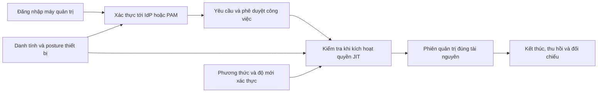

# MFA trên admin workstation

## 1. Mục tiêu bảo vệ máy trạm quản trị

Admin workstation là thiết bị dùng để thực hiện công việc quản trị nhạy cảm. Trong hệ thống quản lý truy cập đặc quyền (Privileged Access Management, PAM), đây là điểm bắt đầu của nhiều phiên đến vault, cổng PAM, nền tảng cloud và máy chủ quan trọng.

MFA trên admin workstation không chỉ là thêm một lời nhắc khi mở trình duyệt. Cần xác định phương thức xác thực ở từng điểm: đăng nhập thiết bị, truy cập dịch vụ danh tính, vào PAM, kích hoạt quyền và mở phiên quản trị. Mỗi điểm có cơ chế, thời hạn và khả năng thực thi khác nhau.

Sau bài học, người học có thể:

- Phân biệt MFA cho đăng nhập máy với MFA bảo vệ tài nguyên quản trị.
- Chọn phương thức phù hợp với yêu cầu chống phishing và bảo vệ credential.
- Kết hợp MFA với tài khoản định danh cá nhân, posture thiết bị và quyền JIT/JEA.
- Thiết kế đăng ký, khóa dự phòng, khôi phục và xử lý phiên đang mở.
- Kiểm thử các đường thay thế, truy cập từ xa, CLI/API và trạng thái offline.

Thiết bị đầu cuối vẫn phải được bảo vệ. Tài liệu về privileged access devices của Microsoft nhấn mạnh rằng máy nguồn bị kiểm soát có thể làm suy yếu bảo đảm của tài khoản, jump server và tài nguyên. Vì vậy, MFA cần nằm trong một thiết kế bảo vệ toàn bộ đường truy cập. [Hướng dẫn về thiết bị truy cập đặc quyền](https://learn.microsoft.com/en-us/security/privileged-access-workstations/privileged-access-devices).

## 2. Tình huống: đã MFA ở một nơi nhưng còn đường khác

An sử dụng máy quản trị để vận hành dịch vụ payment. Cổng web PAM yêu cầu MFA, nhưng một tài khoản quản trị khác vẫn có thể đăng nhập trực tiếp vào máy chủ bằng đường không đi qua cổng đó.

Trong tình huống này, việc cổng web có MFA là đúng nhưng chưa chứng minh mọi đường nhận quyền tương đương đã được bảo vệ. Cần kiểm kê các tài khoản, giao thức và endpoint thực tế, thay vì chỉ trình diễn một lần đăng nhập thành công trên trình duyệt.

Một trường hợp khác: An mở khóa máy bằng phương thức mạnh vào đầu ca, sau đó dùng phiên PAM còn tồn tại nhiều giờ để thực hiện một thao tác rất nhạy cảm. Có cần xác thực lại hay không phụ thuộc chính sách cho thao tác đó; việc mở khóa máy trước đó không tự trả lời câu hỏi.

Mục tiêu là bảo đảm đúng người, từ thiết bị phù hợp, đáp ứng yêu cầu xác thực tại đúng thời điểm, sau đó chỉ nhận quyền cần cho công việc.

## 3. Bốn điểm xác thực cần thiết kế riêng

| Điểm kiểm tra | Đối tượng cần bảo vệ | Điều không nên suy ra tự động |
|---|---|---|
| Đăng nhập hoặc mở khóa hệ điều hành | Quyền sử dụng phiên máy trạm | Mọi ứng dụng quản trị đã nhận bằng chứng MFA tương ứng |
| Đăng nhập IdP/PAM | Danh tính truy cập dịch vụ quản trị | Có quyền với mọi tài nguyên hoặc mọi tài khoản đích |
| Kích hoạt quyền, lấy credential | Một thao tác nâng quyền cụ thể | Bằng chứng cũ luôn đủ mới cho thao tác này |
| Mở và sử dụng phiên tới đích | Đường quản trị và tài khoản đích | Mọi phiên trực tiếp ngoài PAM đều đã bị chặn |

Các điểm này có thể dùng chung một kết quả xác thực khi tích hợp cho phép và chính sách chấp nhận. Không nhất thiết buộc người dùng nhập lại ở mọi bước, nhưng phải biết kết quả nào được dùng, thuộc chủ thể nào và có đáp ứng phương thức cùng độ mới yêu cầu hay không.

Ví dụ trên Windows: Conditional Access của Microsoft Entra bảo vệ truy cập tài nguyên cloud, không phải trực tiếp thay thế chính sách Windows sign-in. Tài liệu sign-in log cũng lưu ý sự khác biệt đó khi giải thích trạng thái của Windows Hello for Business. Vì vậy, bật một policy cloud chưa đồng nghĩa đã cưỡng chế cùng policy ở màn hình đăng nhập máy. [Tài liệu về ngữ cảnh sign-in và Conditional Access](https://learn.microsoft.com/en-us/entra/identity/monitoring-health/concept-sign-in-log-activity-details).

## 4. MFA phải được hiểu theo yếu tố và giao thức

MFA yêu cầu kết hợp những loại yếu tố khác nhau theo cơ chế được triển khai. Không đếm số màn hình hoặc số lần nhập để xác định số yếu tố.

| Cách người dùng trải nghiệm | Cách cần đánh giá |
|---|---|
| Mật khẩu và thêm một PIN được nhập như bí mật độc lập | Không tự thành hai yếu tố nếu cả hai chỉ là điều người dùng biết |
| Chạm security key | Có thể chỉ thể hiện hiện diện; cần biết luồng còn dùng yếu tố nào |
| Khóa được bảo vệ và PIN/sinh trắc học để sử dụng khóa | Có thể tạo luồng đa yếu tố phù hợp, tùy authenticator và kiểm tra phía xác minh |
| Hộp thoại nâng quyền trong hệ điều hành | Không tự đồng nghĩa MFA hoặc phê duyệt công việc PAM |
| Mã OTP từ thiết bị phần cứng | Có thể là yếu tố sở hữu, nhưng không tự có đặc tính chống phishing của FIDO |

PIN dùng để mở khả năng sử dụng khóa không nên bị nhầm với mật khẩu tài khoản gửi đến dịch vụ. Tương tự, PIN mở khóa ổ đĩa trước khởi động không tự chứng minh ứng dụng PAM đã xác thực người dùng bằng MFA.

Nếu yêu cầu là phương thức chống phishing, phải cấu hình và kiểm tra phương thức đáp ứng yêu cầu đó. Một cờ tổng quát `MFA=true` chưa đủ để khẳng định mọi thuộc tính mong muốn đã được thực hiện.

## 5. Các lựa chọn phương thức cho máy quản trị

### 5.1. Credential gắn với nền tảng

Một cơ chế được quản lý trên thiết bị có thể sử dụng khóa cục bộ cùng PIN hoặc sinh trắc học. Trong Windows Hello for Business, credential khóa công khai được đăng ký với hệ thống danh tính; cách bảo vệ khóa bằng phần cứng hay phần mềm phụ thuộc khả năng và policy triển khai. Nếu cần bắt buộc phần cứng, phải cấu hình và kiểm chứng yêu cầu đó. [Cách Windows Hello for Business hoạt động](https://learn.microsoft.com/en-us/windows/security/identity-protection/hello-for-business/how-it-works).

Không suy rằng mọi giao diện có nhãn “Hello” hoặc mọi lần nhập PIN đều tương đương cùng mô hình doanh nghiệp. Cần kiểm tra loại tài khoản, enrollment, cấu hình và đường xác thực thực tế.

### 5.2. Security key FIDO

Security key có thể phục vụ xác thực tới IdP hoặc PAM khi các thành phần hỗ trợ. Cần xác định yêu cầu user verification, cách đăng ký, thiết bị được chấp nhận và khóa dự phòng.

Một khóa rời có thể sử dụng trên nhiều máy. Nó chứng minh điều kiện về authenticator theo luồng tương ứng, không tự chứng minh máy đang dùng là admin workstation được cho phép. Nếu cần cả hai, bổ sung kiểm tra danh tính và posture thiết bị.

### 5.3. Chứng thư hoặc smart card

Một số kiến trúc sử dụng chứng thư và thiết bị bảo vệ khóa. Mức bảo vệ phụ thuộc cấp phát chứng thư, private key, kiểm tra phía xác minh và vòng đời thu hồi. Không coi chỉ một file chứng thư công khai là đủ để chứng minh quyền sử dụng credential.

### 5.4. Phương thức khác và đường thay thế

Nếu tổ chức còn dùng OTP hoặc push, cần đánh giá theo rủi ro, nền tảng hỗ trợ và lộ trình chuyển đổi. Không duy trì một đường yếu hơn không giới hạn chỉ để tránh xử lý lỗi của đường chính.

Phương thức dùng cho web, đăng nhập local, SSH và RDP có thể khác nhau. Cần lập ma trận hỗ trợ và kiểm thử, không chọn một phương thức rồi giả định mọi giao thức tự tích hợp.

## 6. Tách tài khoản và giữ thiết bị nguồn phù hợp

Admin workstation nên phục vụ công việc quản trị trong phạm vi được thiết kế. Việc dùng cùng phiên đặc quyền để đọc email, mở file không kiểm chứng hoặc duyệt web tùy ý làm tăng khả năng endpoint bị ảnh hưởng.

Tài khoản quản trị nên có định danh cá nhân và được tách khỏi tài khoản làm việc thông thường theo kiến trúc của tổ chức. Không dùng chung một tài khoản PAM cùng một authenticator cho cả đội rồi kỳ vọng log tự xác định ai thao tác.

Tuy nhiên, đăng nhập hệ điều hành máy quản trị cũng không nhất thiết phải trao local administrator thường trực. Quyền vận hành máy trạm, quyền yêu cầu PAM và quyền ở đích là những phạm vi cần xem xét riêng.

Đường điều khiển từ xa vào admin workstation cũng thuộc ranh giới bảo vệ. Nếu máy không đủ bảo đảm có thể điều khiển đầu vào và xem đầu ra của một phiên quản trị, phải đánh giá tác động; việc máy đích của remote session được làm cứng không tự xử lý mọi rủi ro ở máy nguồn.

Cũng cần kiểm soát ứng dụng, cập nhật, mã hóa lưu trữ, bảo vệ endpoint và quản lý cấu hình. MFA giảm một nhóm rủi ro xác thực; nó không làm thiết bị bị xâm nhập trở thành nơi an toàn để giữ phiên đặc quyền.

## 7. Thiết kế luồng truy cập từ đầu đến cuối



Một luồng minh họa:

1. An sử dụng thiết bị được cấp phát và đăng nhập theo chính sách hệ điều hành.
2. Client truy cập đúng IdP/PAM qua đường được tổ chức quản lý.
3. Hệ thống xác minh chủ thể, thiết bị và phương thức xác thực.
4. An yêu cầu tác vụ trên tài nguyên cụ thể, gắn với change hoặc incident phù hợp.
5. Khi kích hoạt, PAM đánh giá lại các điều kiện cần thiết, bao gồm độ mới xác thực nếu có.
6. PAM cấp quyền có hạn hoặc mở phiên bằng tài khoản đích được phép.
7. Sau công việc, đóng hoạt động và kiểm chứng vòng đời quyền/credential theo thiết kế.

Nếu dùng federation, PAM chỉ tin kết quả từ issuer đã cấu hình và được xác minh. Header, tham số trình duyệt hoặc chuỗi `strong_auth=true` không thể tự trở thành bằng chứng.

Mỗi bước cần có định danh để nối bằng chứng, nhưng không nên gửi password, OTP hoặc token đầy đủ vào log nhằm tạo liên kết.

## 8. Chính sách phương thức và độ mới tại thao tác nhạy cảm

Có thể đặt yêu cầu cao hơn khi kích hoạt production hoặc tiết lộ credential nhạy cảm so với khi xem danh mục tài nguyên. Điều kiện cần nói rõ loại phương thức, độ mới và cách xử lý nếu chưa đáp ứng.

Ví dụ hợp đồng chính sách, không phải cấu hình sản phẩm:

```text
Đối tượng:
  Tài khoản quản trị cá nhân của người vận hành.

Thiết bị:
  Admin workstation được phép sử dụng và đáp ứng posture profile.

Đăng nhập dịch vụ:
  Phương thức xác thực nằm trong tập được tổ chức chấp nhận.

Kích hoạt tác vụ production:
  Yêu cầu phương thức chống phishing theo tích hợp được hỗ trợ.
  Bằng chứng xác thực đáp ứng độ mới tối đa 5 phút trong lab.
  Yêu cầu công việc, phạm vi và phê duyệt còn hiệu lực.

Quyền sau kích hoạt:
  Chỉ capability và tài nguyên đã được cho phép.
  Thời hạn tối đa 15 phút trong lab.
```

Các giá trị 5 và 15 phút chỉ là ví dụ để kiểm thử; không phải tiêu chuẩn chung. Thời hạn phiên IdP, phiên PAM, bằng chứng xác thực và lease quyền không phải cùng một đồng hồ.

Microsoft Entra authentication strengths là ví dụ về kiểm soát tập phương thức được chấp nhận, có thể dùng với authentication context cho thao tác nhạy cảm theo hỗ trợ của nền tảng. Cần kiểm tra ngữ nghĩa của cả phương thức và độ mới; không suy ra mọi điều kiện luôn được hoàn thành trong cùng một lần tương tác chỉ vì đã cấu hình hai thiết lập. [Tài liệu về authentication strengths](https://learn.microsoft.com/en-us/entra/identity/authentication/concept-authentication-strengths).

Một lần xác thực lại bằng phương thức không thuộc tập được yêu cầu không tự đáp ứng điều kiện phương thức. Ngược lại, một phương thức mạnh dùng từ lâu chưa chắc đáp ứng điều kiện xác thực mới cho thao tác hiện tại.

## 9. SSO và prompt: không đếm lời nhắc để đánh giá bảo vệ

SSO có thể giúp người dùng không phải nhập lại khi bằng chứng trước đó được chính sách chấp nhận. Việc không thấy prompt mới chưa đủ để kết luận MFA bị bỏ qua.

Cần kiểm tra hệ thống đã sử dụng bằng chứng nào, ai xác minh, thời điểm nào và policy nào cho phép dùng lại. Cũng không tin rằng một phiên vẫn hợp lệ cho mọi tác vụ chỉ vì người dùng chưa logout.

Nếu triển khai yêu cầu xác thực bổ sung, giao diện phải thể hiện đúng công việc đang cần thực hiện. Không yêu cầu người dùng phê duyệt lời nhắc không gắn với hành động họ đang khởi tạo. Những lời nhắc bất ngờ cần có cách báo cáo và điều tra theo quy trình.

Khi kiểm thử, dùng các trạng thái phiên có kiểm soát: phiên mới, phiên còn hiệu lực, bằng chứng quá hạn và phương thức không phù hợp. Chỉ thử một cửa sổ trình duyệt luôn mới có thể bỏ sót hành vi tái sử dụng phiên.

Tương tự, mode riêng tư của trình duyệt chỉ thay đổi một phần cách giữ trạng thái phía client, không tự chứng minh đã có một ngữ cảnh xác thực hoàn toàn độc lập với mọi thành phần của hệ điều hành hoặc broker.

## 10. Đăng ký phương thức và quản lý khóa dự phòng

Enrollment là thời điểm đưa credential vào tài khoản có khả năng nhận quyền đặc biệt. Cần kiểm tra danh tính, đúng tài khoản, đúng thiết bị và thẩm quyền thêm phương thức trước khi tạo liên kết.

Một quy trình có thể gồm cấp phát thiết bị, xác minh chủ thể, đăng ký phương thức chính, đăng ký phương thức dự phòng nếu được phép, kiểm thử hai đường và lưu sự kiện quản lý. Với khóa phần cứng dự phòng, tạo credential độc lập theo cơ chế hỗ trợ; không cần sao chép private key của khóa chính.

Bảo quản phương thức dự phòng để tránh mất cùng lúc với máy và khóa chính. Đồng thời, bảo đảm nó thực sự được đăng ký cho những dịch vụ cần dùng, thay vì chỉ cất một thiết bị chưa cấu hình.

Việc thêm phương thức mới hoặc reset có thể làm thay đổi ranh giới bảo vệ. Không cho một phiên chưa đáp ứng điều kiện tự thêm credential mới rồi dùng credential đó để nhận quyền nhạy cảm mà không qua kiểm tra tương ứng.

Người hỗ trợ không nên yêu cầu gửi PIN, OTP, private key hoặc mã khôi phục trong ticket. Bằng chứng kiểm thử là kết quả trong hệ thống, không phải bản sao bí mật của người dùng.

## 11. Khóa màn hình, logout và vòng đời phiên

Khóa màn hình giúp hạn chế người khác sử dụng phiên máy trạm khi người vận hành rời đi. Tuy nhiên, nó không tự có nghĩa mọi phiên cloud, proxy hoặc lease PAM đã kết thúc.

Cần xác định chính sách cho:

- Thời gian không hoạt động trước khi khóa thiết bị.
- Điều kiện mở khóa và đường thay thế được phép.
- Phiên PAM không hoạt động và phiên đang có tác vụ.
- Thời hạn quyền JIT, token và credential được cấp.
- Hành vi khi logout, mất kết nối, sleep hoặc thu hồi thiết bị.

Nếu yêu cầu là khóa máy đồng thời ngăn một loại phiên đặc quyền tiếp tục, phải có cơ chế tích hợp và phép thử chứng minh. Không chỉ dựa vào việc giao diện desktop đã chuyển sang màn hình khóa.

Tương tự, logout cổng PAM không nhất thiết dừng tiến trình đã chạy ở đích. Cần mô tả việc kết thúc phiên, thu hồi quyền và tác vụ còn lại theo khả năng hệ thống.

Sau công việc, người dùng cần đóng đúng phiên và quyền theo quy trình. Nhưng việc thực thi thời hạn không nên phụ thuộc hoàn toàn vào việc họ nhớ nhấn một nút; các giới hạn bắt buộc phải có cơ chế tương ứng.

## 12. Truy cập từ xa, CLI/API và đường quản trị trực tiếp

Một cổng web có MFA không tự bảo vệ SSH, RDP, API hoặc tài khoản local. Cần kiểm kê đường sử dụng và xác định điểm kiểm soát của từng đường.

| Đường truy cập | Câu hỏi phải kiểm tra |
|---|---|
| Web PAM từ máy quản trị | Nhận đúng bằng chứng phương thức, thiết bị và độ mới không? |
| SSH/RDP qua gateway | Gateway kiểm tra người dùng ra sao, tài khoản đích nào được dùng? |
| SSH/RDP trực tiếp | Có được phép tồn tại, phạm vi nào và kiểm soát tương ứng là gì? |
| CLI/API | Dùng danh tính người hay workload, token có phạm vi và thời hạn nào? |
| Remote vào admin workstation | Máy nguồn và phiên từ xa có đáp ứng mô hình tin cậy không? |
| Nâng quyền local | Cơ chế nào cho phép thao tác, có cần MFA riêng theo thiết kế không? |

Đăng nhập bằng public key hoặc dùng một cơ chế xác thực ở tầng mạng không tự chứng minh đã có cùng yêu cầu MFA của cổng PAM. Phải đánh giá cơ chế cụ thể và bằng chứng của từng luồng.

Không cài credential quản trị dài hạn vào file cấu hình, trình duyệt hoặc script chỉ để tránh tương tác MFA. Với workload, dùng danh tính và cơ chế cấp credential phù hợp cho tự động hóa; không biến một tài khoản người đã được miễn MFA thành tài khoản dịch vụ không quản lý.

Nếu sản phẩm không hỗ trợ yêu cầu mong muốn trên một giao thức, cần thay đường truy cập, giới hạn phạm vi hoặc xử lý ngoại lệ rõ ràng. Không tuyên bố đã bảo vệ chỉ dựa trên đường demo thuận lợi.

## 13. Offline, mất authenticator và truy cập khẩn cấp

Thiết bị có thể cho phép một dạng đăng nhập hoặc mở khóa offline tùy cấu hình. Điều đó cần được đánh giá riêng với khả năng lấy bằng chứng mới từ IdP để truy cập tài nguyên quản trị từ xa.

Nếu policy yêu cầu kiểm tra online cho kích hoạt quyền, việc người dùng mở được desktop không tự thỏa điều kiện đó. Hệ thống cần từ chối hoặc chờ theo nhánh đã thiết kế khi không thể xác minh, thay vì hạ yêu cầu âm thầm.

Khi mất authenticator, xác định tài khoản và credential liên quan, xác minh người báo mất qua quy trình được cho phép, thu hồi liên kết bị ảnh hưởng và đánh giá phiên đang mở. Sau đó dùng phương thức dự phòng hoặc luồng cấp lại có kiểm soát.

Không cho rằng đổi mật khẩu tự thu hồi mọi token, phiên và khóa trên mọi nền tảng. Cần biết hành vi thực tế của IdP, PAM và đích, đồng thời kiểm tra kết quả xử lý.

Truy cập khẩn cấp cần được thiết kế trước với đối tượng, phạm vi, điều kiện sử dụng, phương thức xác thực, nơi giữ credential và trách nhiệm đối chiếu. Tài khoản khẩn cấp không tự đồng nghĩa một đường không xác thực mạnh hoặc không giám sát.

Trước khi tăng mức cưỡng chế MFA, kiểm thử đường khôi phục trong môi trường được phép để tránh khóa toàn bộ quản trị viên. Việc này không có nghĩa giữ một mật khẩu dùng chung thường trực cho mọi người để đi vòng.

## 14. Bằng chứng và cảnh báo trên đường quản trị

Cần nối được danh tính người dùng, thiết bị nguồn, kết quả xác thực, yêu cầu công việc, grant và phiên tới đích. Mỗi thành phần có thể dùng định danh khác nhau, nên phải có quy tắc đối chiếu rõ ràng.

Các sự kiện đáng theo dõi gồm:

- Thêm, xóa hoặc reset phương thức xác thực của tài khoản đặc quyền.
- Thay đổi policy phương thức, độ mới, nhóm loại trừ hoặc cấu hình đường thay thế.
- Kích hoạt quyền không có bằng chứng phù hợp hoặc chưa liên kết được.
- Sử dụng tài khoản khẩn cấp hoặc đường quản trị ngoài dự kiến.
- Thiết bị mất quản lý, posture quá hạn hoặc có trạng thái rủi ro liên quan.

Không coi một cờ MFA tổng hợp là toàn bộ bằng chứng. Khi điều tra, cần biết phương thức, nguồn xác minh, thời điểm và policy áp dụng. Cũng cần phân biệt log chưa đủ với việc đã xác nhận kiểm soát bị bỏ qua.

Bảo vệ log và dữ liệu phiên theo quyền cần thiết. Không ghi PIN, OTP, private key, token đầy đủ hoặc cookie vào hệ thống báo cáo. Thông tin thiết bị và định danh credential cũng cần được xử lý theo mục đích và thời hạn lưu.

## 15. Kế hoạch triển khai theo phạm vi nhỏ

Bắt đầu bằng một nhóm admin workstation, tài khoản lab và tài nguyên thử nghiệm đại diện. Lập ma trận gồm hệ điều hành, trình duyệt, client, authenticator, đường remote và tác vụ PAM cần hỗ trợ.

Xác định riêng chính sách đăng nhập máy, đăng nhập dịch vụ, thao tác nâng quyền và quản lý phiên. Mỗi yêu cầu cần có chủ sở hữu và phép thử chứng minh, tránh một dòng chung chung “MFA đã bật”.

Nếu có chế độ đánh giá hoặc report-only, dùng nó để tìm tác động và thiếu sót trước khi thực thi. Kết quả quan sát không phải bằng chứng đã chặn đường không đáp ứng. Sau khi bật, thử lại cả nhánh cho phép và nhánh bị cấm.

Hướng dẫn người dùng nên mô tả thao tác bình thường, cách nhận biết lời nhắc bất thường, cách dùng phương thức dự phòng và kênh hỗ trợ. Tránh thiết kế khiến người vận hành thường xuyên phải xin tắt MFA để hoàn thành công việc.

Khi mở rộng, theo dõi lỗi theo từng điểm: không đăng nhập được máy, không đáp ứng phương thức cloud, thiếu claim tới PAM hoặc không mở được phiên đích. Phân loại đúng giúp sửa cấu hình mà không mở rộng quyền không cần thiết.

## 16. Bộ kiểm thử chấp nhận trong lab

Chỉ dùng thiết bị, tài khoản, token và tài nguyên thử nghiệm được cho phép. Chuẩn bị đường khôi phục trước khi thử các nhánh mất phương thức.

| Phép thử | Điều cần chứng minh |
|---|---|
| Đăng nhập máy bằng phương thức đã chọn | Đúng loại credential, tài khoản và cấu hình hệ điều hành |
| Thử đường đăng nhập local thay thế | Hành vi đúng policy, không có fallback ngoài dự kiến |
| Truy cập PAM từ thiết bị đạt điều kiện | Nhận đúng danh tính và bằng chứng được yêu cầu |
| Dùng MFA nhưng thiết bị ngoài phạm vi | Không được cấp quyền chỉ vì người dùng đã hoàn thành MFA |
| Dùng phương thức không thuộc tập yêu cầu | Không hoàn thành thao tác nhạy cảm bằng phương thức đó |
| Bằng chứng xác thực đã quá hạn | Kích hoạt quyền được xử lý theo điều kiện độ mới |
| SSO còn hợp lệ theo policy | Không buộc prompt mới hoặc báo bypass chỉ vì không thấy tương tác |
| Khóa màn hình khi còn phiên quản trị | Hành vi phiên khớp thiết kế, không suy từ màn hình khóa |
| Logout PAM nhưng tác vụ đã chạy ở đích | Biết trạng thái thực tế của phiên, quyền và tiến trình |
| Gọi CLI/API hoặc SSH/RDP trực tiếp | Đúng ranh giới được phép và cơ chế xác thực tương ứng |
| Dùng phương thức dự phòng | Đáp ứng chính sách và có bằng chứng liên quan |
| Thu hồi credential bị mất | Không xác thực mới được theo phạm vi thu hồi; phiên cũ được xử lý đúng |
| Thiết bị offline hoặc IdP không phản hồi | Không tự hạ yêu cầu khi cần xác minh online |
| Kích hoạt đường khẩn cấp | Có quyền đúng phạm vi, cảnh báo và đối chiếu sau sử dụng |

Lưu cấu hình, ngữ cảnh phiên, policy, kết quả xác thực và quyền thực tế. Kiểm thử cùng trường hợp trên các client được tuyên bố hỗ trợ; một trình duyệt hoạt động đúng không thay cho kiểm thử toàn bộ đường quản trị.

## 17. Bài thực hành thiết kế MFA cho admin workstation

Chọn một máy trạm lab và một tác vụ PAM có giới hạn, ví dụ đọc trạng thái dịch vụ production giả lập trong 15 phút. Vẽ các điểm xác thực từ đăng nhập máy đến kết thúc phiên đích.

Với từng điểm, xác định phương thức, bằng chứng, cách dùng lại kết quả, yêu cầu độ mới và đường thay thế. Kết hợp danh tính cá nhân với thiết bị được phép, posture, yêu cầu công việc và quyền tối thiểu; không coi một lần MFA là cho phép mọi hành động sau đó.

Mô tả enrollment, phương thức dự phòng, thu hồi và cách khôi phục khi mất thiết bị hoặc authenticator. Sau đó thực hiện các phép thử phù hợp và đối chiếu bằng chứng.

Kết quả đạt yêu cầu khi có thể giải thích rõ người nào đã xác thực bằng cách nào, thiết bị và đường truy cập nào được chấp nhận, quyền nào được cấp trong bao lâu và hệ thống xử lý thế nào khi bằng chứng không còn đáp ứng.
