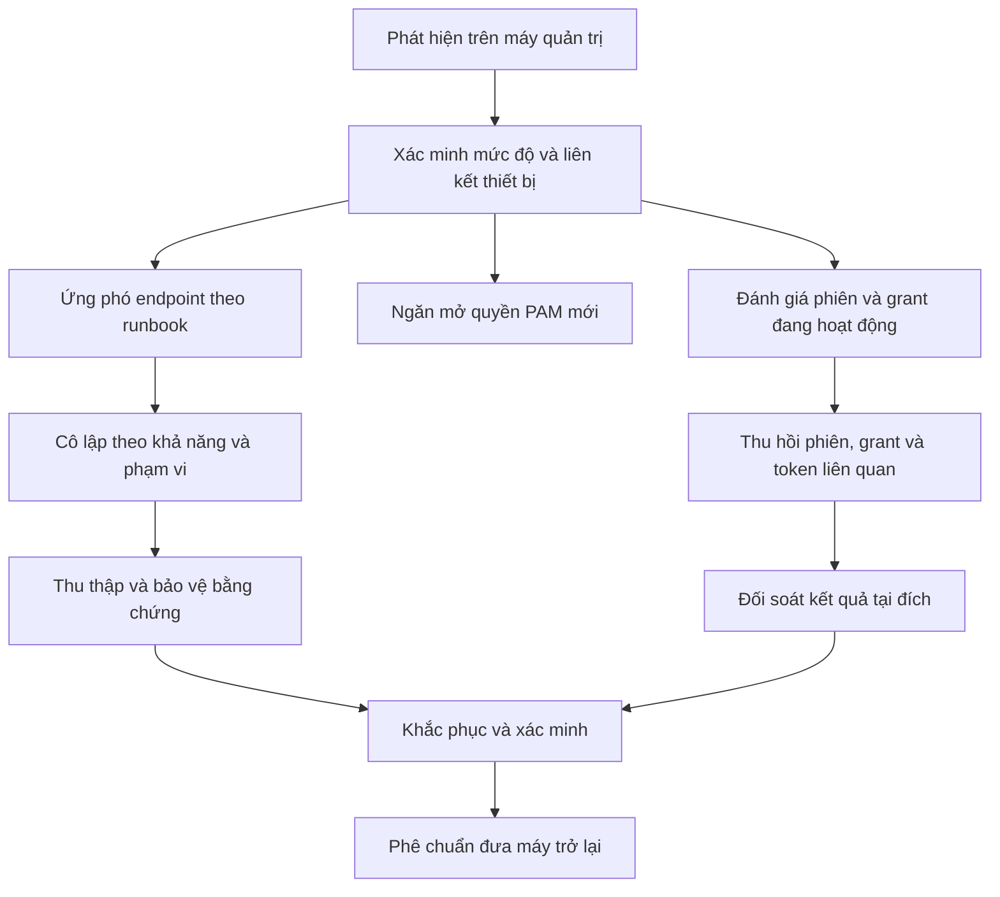

# EDR trên admin workstation

## Mục tiêu bài học

Admin workstation là máy trạm được sử dụng để thực hiện công việc quản trị. Khi máy này bị xâm nhập, kẻ tấn công có thể lợi dụng danh tính, phiên hoặc công cụ quản trị hợp lệ để tác động tới nhiều hệ thống nhạy cảm.

**Endpoint Detection and Response (EDR)** cung cấp khả năng thu thập tín hiệu trên endpoint, phát hiện hành vi và hỗ trợ điều tra, ứng phó. Trong Privileged Access Management (PAM), EDR là một nguồn tín hiệu và một điểm thực thi ứng phó quan trọng, nhưng không thay thế MFA, least privilege, JIT/JEA hoặc quyền tại hệ thống đích.

Sau bài học, bạn có thể:

- Giải thích vai trò của EDR trên một máy quản trị chuyên dụng.
- Phân biệt cài agent với trạng thái bảo vệ có thể tin cậy để ra quyết định.
- Liên kết thiết bị, danh tính, phiên PAM và bằng chứng tại đích.
- Thiết kế điều kiện mở phiên dựa trên tín hiệu EDR có độ mới xác định.
- Phối hợp cô lập endpoint với thu hồi phiên, grant và credential.
- Kiểm thử chính sách EDR và ngoại lệ mà không đưa mã độc thật vào môi trường vận hành.

## 1. Vì sao máy quản trị cần được giám sát riêng?

Một máy người dùng thông thường có thể truy cập tài liệu và ứng dụng văn phòng. Một máy quản trị có thể mở vault, khởi chạy phiên production, dùng công cụ triển khai và thay đổi IAM. Cùng một sự cố endpoint vì vậy có thể tạo hậu quả rất khác.

Trong một thiết kế quản trị chuyên dụng, admin workstation thường được hạn chế công việc thường ngày, chỉ cài công cụ cần thiết và dùng danh tính phù hợp nhiệm vụ. EDR bổ sung khả năng quan sát và ứng phó khi những giới hạn phòng ngừa không đủ.

### Ví dụ xuyên suốt

Lan dùng máy quản trị `paw-example-17` để mở phiên PAM tới dịch vụ production. PAM chỉ cấp vai trò vận hành hẹp trong 15 phút sau khi có approval.

Nếu một tiến trình không được phép trên máy Lan điều khiển trình duyệt hoặc sử dụng phiên đã mở, thao tác ở đích có thể vẫn mang danh tính hợp lệ. MFA trước đó không chứng minh endpoint còn an toàn tại thời điểm này.

EDR có thể phát hiện tín hiệu đáng ngờ và cung cấp căn cứ để:

- Ngăn mở phiên đặc quyền mới.
- Tạm ngừng hoặc thu hồi grant đang có theo chính sách.
- Cô lập máy khỏi những đường kết nối cần chặn.
- Thu thập và liên kết bằng chứng phục vụ điều tra.

Khả năng phát hiện và thực thi cụ thể phụ thuộc nền tảng, cấu hình và chất lượng tín hiệu. Không được coi EDR là bằng chứng tuyệt đối rằng một endpoint không có mã độc.

## 2. EDR khác gì antivirus, quản lý thiết bị và PAM?

| Thành phần | Vai trò chính | Giới hạn cần hiểu |
|---|---|---|
| Antivirus hoặc chức năng phòng ngừa endpoint | Phát hiện, chặn những đối tượng hoặc hành vi theo khả năng được triển khai | Không tự cung cấp toàn bộ điều tra và thu hồi quyền |
| EDR | Telemetry, phát hiện hành vi, điều tra và hành động ứng phó endpoint | Không hiểu đầy đủ mọi quyền và ngữ nghĩa nghiệp vụ tại đích |
| Quản lý thiết bị | Triển khai cấu hình, phần mềm, cập nhật và chính sách quản lý | Thiết bị compliant chưa chắc không bị xâm nhập |
| Application control | Giới hạn chương trình hoặc mã được phép chạy | Mã được phép vẫn có thể bị lạm dụng |
| PAM | Kiểm soát truy cập đặc quyền, credential, phiên và bằng chứng | Không thay thế cảm biến endpoint |
| IAM tại đích | Thực thi quyền trên hệ thống hoặc ứng dụng | Có thể không biết endpoint nguồn đang bị cảnh báo |

Một sản phẩm có thể gộp nhiều chức năng, nhưng khi thiết kế vẫn cần biết thành phần nào chịu trách nhiệm kiểm soát nào.

“Đã có EDR” không phải lý do cấp quyền quản trị thường trực. Ngược lại, “credential nằm trong vault” không loại bỏ nhu cầu bảo vệ máy sử dụng phiên PAM.

## 3. Mô hình đe dọa cho admin workstation

Các tình huống cần xem xét gồm:

- Chương trình không được phép chạy và sử dụng ngữ cảnh của người quản trị.
- Lạm dụng công cụ quản trị hợp lệ hoặc script có quyền cao.
- Truy cập bất thường vào thông tin xác thực hoặc dữ liệu phiên.
- Can thiệp trình duyệt, terminal hoặc phiên từ xa.
- Tạo cơ chế tồn tại lâu dài trên endpoint.
- Vô hiệu cảm biến, thay cấu hình hoặc làm gián đoạn telemetry.
- Truy cập mạng ngoài luồng công việc đã được phê chuẩn.
- Tài khoản quản lý EDR bị lạm dụng để điều khiển nhiều máy quản trị.

Không phải mọi lần chạy PowerShell, SSH, công cụ remote management hoặc thao tác triển khai đều là tấn công. Đây cũng là hoạt động hợp lệ của quản trị viên.

Vì vậy, việc phát hiện cần kết hợp ngữ cảnh: người dùng, máy, chuỗi tiến trình, nguồn mã, tài sản đích, cửa sổ công việc và request PAM. Một tên tiến trình đơn lẻ thường không đủ để kết luận.

### Những gì EDR không tự bảo đảm

- Không thấy cảnh báo không đồng nghĩa không có xâm nhập.
- Mã có chữ ký không đồng nghĩa mọi hành vi của mã đó đều an toàn.
- Agent đang chạy không chứng minh policy phòng ngừa đang được bật đúng.
- Endpoint đã cô lập không chứng minh token ở đích đã bị thu hồi.
- Máy đã quét sạch không chứng minh mọi credential từng tiếp cận máy còn an toàn.

Những giới hạn này cần được phản ánh trong quyết định truy cập và quy trình ứng phó.

## 4. Baseline trước khi dùng tín hiệu EDR

Một baseline cho máy quản trị có thể gồm:

- Định danh thiết bị được quản lý và người chịu trách nhiệm.
- Hệ điều hành, phần mềm và bản cập nhật theo chuẩn tổ chức.
- Mã hóa ổ đĩa và kiểm soát khởi động phù hợp.
- Tài khoản sử dụng thường ngày không có quyền local admin thường trực.
- Application control và tập công cụ quản trị được phê chuẩn.
- Hạn chế duyệt web, email, phần mềm cá nhân và thiết bị ngoại vi theo nhu cầu.
- Cấu hình bảo vệ EDR và khả năng phát hiện can thiệp.
- Đồng bộ thời gian, kết nối quản lý và chuyển log.
- Quy trình reimage, mất thiết bị và decommission.

Đây là các thành phần của một thiết kế, không phải bằng chứng chỉ cần đánh dấu đủ ô là máy an toàn.

### Tách quyền bảo trì endpoint khỏi quyền sử dụng endpoint

Người quản trị ứng dụng không mặc nhiên cần quyền tắt agent hoặc sửa policy EDR trên máy của mình.

Khi cần cài công cụ hoặc chẩn đoán agent, dùng quy trình bảo trì có phạm vi và thời hạn. Không trao quyền tự thêm mọi ngoại lệ vì người dùng cần thực hiện công việc quản trị.

### Egress phục vụ EDR vẫn cần quản lý

Agent có thể cần kết nối tới dịch vụ quản lý, cập nhật hoặc kho bằng chứng. Cho phép đúng endpoint và tuyến cần thiết theo thiết kế, đồng thời kiểm tra proxy, TLS và giới hạn mạng.

Một máy quản trị không cần được mở Internet rộng chỉ để agent hoạt động. Ngược lại, chặn mọi egress mà không thiết kế kênh quản lý có thể làm mất telemetry và khiến trạng thái bảo vệ trở nên không xác định.

## 5. “Agent installed” khác “EDR healthy”

Một quyết định PAM nên sử dụng trạng thái được định nghĩa rõ, không chỉ một trường nhị phân đã cài phần mềm.

| Thuộc tính | Câu hỏi vận hành |
|---|---|
| Đã onboard | Thiết bị có nằm trong phạm vi quản lý đúng không? |
| Agent hoạt động | Cảm biến có đang chạy theo thông tin đáng tin không? |
| Policy đúng | Thiết bị nhận đúng cấu hình dành cho admin workstation không? |
| Bảo vệ đang có hiệu lực | Chế độ cần thiết có đang được thực thi không? |
| Telemetry còn mới | Lần quan sát tin cậy gần nhất là khi nào? |
| Tình trạng can thiệp | Có dấu hiệu agent hoặc cấu hình bị sửa không? |
| Phát hiện đang mở | Có cảnh báo chưa được xử lý ảnh hưởng tới quyền không? |
| Trạng thái ứng phó | Máy đang bị cô lập, điều tra hay đã được cho phép hoạt động lại? |

Cần xác định nguồn cung cấp từng thuộc tính. Một giá trị do endpoint tự báo có thể hữu ích nhưng không phải bằng chứng bất khả giả mạo khi endpoint đã bị xâm nhập.

Kết hợp nhiều nguồn có thể tăng độ tin cậy, nhưng cũng cần xử lý mâu thuẫn và độ mới. Không mặc định một tín hiệu tích cực sẽ xóa một phát hiện nghiêm trọng từ nguồn khác.

### Không đồng nhất “không có alert” với “healthy”

Có thể không có alert vì agent offline, telemetry chưa tới hoặc quy tắc không quan sát được hành vi. Hệ thống cần tách các trạng thái:

```text
ACCEPTABLE
AT_RISK
COMPROMISED_OR_HIGH_CONCERN
UNKNOWN_OR_STALE
ISOLATED
RECOVERY_PENDING
```

Tên trạng thái tùy triển khai. Điều quan trọng là `UNKNOWN_OR_STALE` không tự rơi vào `ACCEPTABLE`.

## 6. Gắn tín hiệu với đúng thiết bị và phiên

Một request PAM cần được liên kết với thiết bị thực sự khởi tạo hoặc vận hành phiên. Không dùng hostname do trình duyệt gửi làm căn cứ duy nhất.

Những dữ liệu liên quan có thể gồm:

- Định danh thiết bị từ hệ thống quản lý.
- Danh tính hoặc chứng thư thiết bị theo cơ chế triển khai.
- Device ID tại EDR và mapping đã được quản lý.
- Danh tính người dùng đã xác thực.
- Phiên PAM và request/approval liên quan.
- Thời điểm và nguồn tín hiệu.

Địa chỉ IP không phải định danh thiết bị ổn định. Nhiều máy có thể dùng chung NAT hoặc proxy; cùng một máy có thể đổi mạng.

### Reimage, clone và thiết bị ảo

Một máy reimage hoặc một image được clone có thể gây trùng hoặc thay đổi định danh nếu onboarding không được thiết kế đúng. Cần kiểm chứng cơ chế cấp ID và decommission bản cũ.

Với VDI hoặc môi trường remote desktop, phải biết đâu là máy vật lý của người dùng, đâu là desktop ảo và đâu là host thực hiện công cụ quản trị. “Thiết bị compliant” của một lớp không tự chứng minh mọi lớp khác có trạng thái tương tự.

### Từ máy chủ tới máy chủ, không qua lời tự khai

PAM nên lấy kết quả posture qua tích hợp được xác thực với nguồn quản lý. Nếu client gửi một tham chiếu thiết bị, máy chủ vẫn phải kiểm chứng việc phiên hiện tại có thực sự gắn với thiết bị đó.

Bảo vệ quyền API của connector: chỉ đọc những dữ liệu cần thiết, có quản lý secret, giới hạn phạm vi và audit. Không cấp quyền remote response cho connector chỉ cần đọc posture.

## 7. Dùng tín hiệu EDR để quyết định truy cập

Một chính sách minh họa có thể phân biệt:

| Trạng thái | Phiên đặc quyền mới | Phiên đang hoạt động |
|---|---|---|
| Đáp ứng điều kiện, dữ liệu còn mới | Tiếp tục các kiểm tra PAM khác | Theo dõi và đánh giá lại theo thiết kế |
| Dữ liệu quá cũ hoặc không xác định | Chưa cấp cho tài sản yêu cầu posture xác minh | Áp dụng thời hạn và quy tắc mất tín hiệu đã công bố |
| Cảnh báo cần xem xét | Giữ hoặc từ chối theo mức rủi ro | Có thể hạn chế, yêu cầu xem xét hoặc thu hồi theo căn cứ |
| Xác định mức nguy cơ cao | Ngăn truy cập mới theo quy trình | Kích hoạt ứng phó và thu hồi phù hợp |
| Đang cô lập | Không coi là máy đã sẵn sàng quản trị | Chỉ cho các kênh ứng phó được phép |

Không có một ngưỡng alert chung cho mọi hệ thống. Tổ chức cần định nghĩa mapping từ phát hiện, độ tin cậy và bối cảnh sang hành động.

### Độ mới phải có nghĩa rõ ràng

Giả sử bài tập yêu cầu một quan sát từ nguồn quản lý không quá ba phút trước lúc mở phiên. Cần phân biệt:

- Lúc endpoint tạo dữ liệu.
- Lúc dịch vụ EDR nhận dữ liệu.
- Lúc connector PAM truy vấn.
- Lúc PAM ra quyết định.

Một truy vấn API vừa thực hiện có thể trả trạng thái endpoint từ nhiều giờ trước. Không dùng thời điểm nhận HTTP response làm bằng chứng agent vừa báo cáo.

Ba phút chỉ là ví dụ. Mốc phù hợp phụ thuộc rủi ro và khả năng của nền tảng; cần kiểm thử độ trễ thực tế.

### Đầu phiên và trong phiên là hai khả năng khác nhau

Kiểm tra EDR khi mở phiên không tự phát hiện và phản ứng với thay đổi 10 phút sau đó.

Muốn thu hồi trong phiên, cần có kênh sự kiện hoặc cơ chế kiểm tra định kỳ, mapping tới grant/session và điểm thực thi có thể ngăn tiếp tục truy cập. Phải công bố thời gian phản ứng, không gọi mọi kiểm tra đầu phiên là “continuous”.

### EDR là một điều kiện, không phải giấy phép

Máy đáp ứng posture vẫn phải đi qua eligibility, MFA, approval, scope và thời hạn. Tín hiệu EDR tích cực không tự cấp quyền mà người dùng vốn không được phép yêu cầu.

Ngược lại, MFA thành công không được dùng để bỏ qua một điều kiện endpoint bắt buộc. Hai kiểm soát trả lời những câu hỏi khác nhau.

## 8. Telemetry nào hữu ích cho hoạt động quản trị?

Tùy khả năng triển khai, những dữ liệu sau có thể hỗ trợ điều tra:

- Chuỗi tiến trình và quan hệ cha–con.
- Đường dẫn, nguồn và chữ ký của chương trình hoặc script.
- Kết nối mạng liên quan.
- Thay đổi cơ chế khởi động hoặc cấu hình bảo vệ.
- Sự kiện truy cập bất thường vào dữ liệu xác thực.
- Tác động tới agent và kênh telemetry.
- Sự kiện đăng nhập và ngữ cảnh người dùng.
- Hành động ứng phó và kết quả của chúng.

Đối chiếu với PAM giúp phân biệt một công cụ triển khai được mở trong cửa sổ thay đổi với một hành vi tương tự nhưng không có request hoặc tài sản phù hợp.

Không nên yêu cầu EDR biết đầy đủ ý nghĩa nghiệp vụ của mọi lệnh. Audit ứng dụng và hệ thống đích vẫn cần thiết để xác nhận đối tượng nào bị thay đổi và kết quả thực tế.

### Dữ liệu có thể chứa secret

Command line, environment, script output hoặc memory capture có thể chứa token, mật khẩu và dữ liệu người dùng. Thu thập rộng hơn không tự tạo bằng chứng tốt hơn.

Cần:

- Hạn chế việc đưa secret vào command line ngay từ công cụ và quy trình.
- Lọc hoặc giảm dữ liệu theo khả năng.
- Phân quyền truy cập bằng chứng.
- Mã hóa và quản lý thời hạn lưu.
- Kiểm soát export và thao tác điều tra nhạy cảm.

Không ghi credential của vault vào sự kiện EDR hoặc ticket chỉ để tiện hỗ trợ.

## 9. Tuning cho công cụ quản trị hợp lệ

Admin workstation có thể dùng PowerShell, trình SSH, công cụ quản lý cloud, script triển khai hoặc client cơ sở dữ liệu. Một số hành vi của chúng có thể giống kỹ thuật tấn công.

Cách tuning có căn cứ là xác định hành vi dự kiến và giảm nhiễu với phạm vi nhỏ. Không tạo ngoại lệ rộng kiểu:

- Bỏ giám sát mọi tiến trình con của công cụ PAM.
- Bỏ quét toàn bộ thư mục chứa script do người dùng có thể ghi.
- Tin mọi executable có một tên nhất định.
- Tắt cảm biến trên mọi máy quản trị vì một công cụ gặp lỗi.

### Một ngoại lệ cần chứa gì?

| Thuộc tính | Nội dung cần xác định |
|---|---|
| Căn cứ | Công cụ và tác vụ hợp lệ nào bị ảnh hưởng? |
| Phạm vi | Máy, chương trình, phiên bản hoặc điều kiện nào? |
| Mức ảnh hưởng | Tính năng bảo vệ hoặc telemetry nào bị giảm? |
| Thời hạn | Khi nào rà soát hoặc tự hết hạn? |
| Thẩm quyền | Ai xác nhận nhu cầu và ai chấp nhận rủi ro? |
| Biện pháp khác | Application control, quyền file hoặc giới hạn tác vụ nào vẫn có? |
| Kiểm chứng | Có kiểm tra hành vi ngoài ngoại lệ vẫn bị phát hiện không? |

Một file có chữ ký có thể là dữ liệu nhận diện tốt hơn tên file, nhưng chữ ký không làm mọi hành vi đều hợp lệ. Ngoại lệ vẫn cần cân nhắc khả năng mã hoặc công cụ được tin cậy bị lạm dụng.

### Thử nghiệm chế độ policy

Khi nền tảng hỗ trợ, có thể đánh giá một thay đổi trong chế độ quan sát trước khi chặn, trên nhóm thử nghiệm đại diện. Phải biết chế độ đó còn và không còn thực thi điều gì.

Không chuyển toàn bộ máy quản trị sang chế độ chỉ quan sát vô thời hạn vì lo ảnh hưởng vận hành. Cần kế hoạch, tiêu chí và trách nhiệm đưa policy vào trạng thái mong muốn.

## 10. Control plane của EDR cũng là tài sản đặc quyền

Console EDR có thể cho phép đổi policy, thêm ngoại lệ, cô lập máy, lấy file hoặc thực hiện lệnh response tùy nền tảng. Vì thế, quyền quản trị EDR có thể tạo tác động trên nhiều máy quản trị cùng lúc.

Cần áp dụng PAM cho chính những quyền này:

- Danh tính cá nhân và xác thực phù hợp.
- Phân vai đọc cảnh báo, điều tra, remote response và quản lý policy.
- Quyền có thời hạn khi phù hợp khả năng triển khai.
- Phê duyệt cho hành động có tác động cao theo quy trình.
- Audit về thay đổi cấu hình và hành động response.
- Kiểm soát tài khoản dịch vụ và API.
- Tách quản trị endpoint khỏi quyền sửa hoặc xóa dấu vết về chính mình.

### Kênh cập nhật và quản lý có rủi ro chuỗi cung ứng

Agent, policy và gói cập nhật cần được phân phối theo cơ chế được kiểm chứng. Thử nghiệm thay đổi có thể gây ảnh hưởng lớn trước khi mở rộng.

Đánh giá cả những hệ thống có quyền quản lý EDR. Nếu một control plane ở mức tin cậy thấp có thể đẩy lệnh tới các máy quản trị nhạy cảm, nó tạo một đường đặc quyền gián tiếp cần được xử lý.

## 11. Phối hợp ứng phó: cô lập máy và thu hồi quyền

Một phát hiện nguy cơ cao trên admin workstation có thể cần hành động ở nhiều lớp.



Những nhánh này có thể chạy song song theo quy trình. Không nên trì hoãn một biện pháp ngăn chặn cần thiết chỉ để thu thập đủ mọi bằng chứng.

### Cô lập không phải một hành động giống nhau ở mọi sản phẩm

Cần biết chế độ isolation chặn kết nối nào, còn giữ được kênh quản lý nào và có ảnh hưởng đến việc thu hồi phiên hoặc hỗ trợ từ xa không.

Kiểm thử trong lab trước khi tự động hóa. Nếu mất kênh response ngay sau cô lập, đội ứng phó cần có phương án đã được chuẩn bị.

Không tự động giải phóng một máy chỉ vì người dùng yêu cầu tiếp tục công việc. Hành động đưa trở lại cần thẩm quyền và tiêu chí xác minh.

### Phiên từ xa có thể sống sau khi máy bị cô lập

Một kết nối có thể bị ngắt nhưng token, grant hoặc job tại đích vẫn tồn tại. Hệ thống cần đóng phiên, gỡ quyền hoặc vô hiệu token ở nơi phù hợp, không chỉ ngắt mạng máy nguồn.

Nếu một tác vụ đã được khởi chạy, việc ngắt kết nối không tự hoàn tác tác vụ. Cần kiểm tra trạng thái nghiệp vụ ở đích trước khi thử lại hoặc khắc phục.

### Xác định credential cần xử lý

Đánh giá những credential hoặc phiên có thể bị tiếp cận: token trình duyệt, credential đã checkout, khóa có thể được sử dụng, tài khoản đích và quyền phát sinh.

Không kết luận hardware-backed private key chắc chắn đã bị xuất chỉ vì máy nhiễm; nhưng cũng không coi khóa đó loại bỏ nguy cơ phiên hoặc việc sử dụng khóa trên máy bị kiểm soát.

Phạm vi luân chuyển và thu hồi phải dựa trên bằng chứng cùng mức không chắc chắn được chấp nhận trong ứng phó. Ghi rõ phần chưa xác minh và người chịu trách nhiệm.

## 12. Runbook minh họa cho một cảnh báo

Giả sử `paw-example-17` phát sinh một phát hiện được đánh giá nguy cơ cao trong khi Lan có phiên production.

1. SOC xác minh device ID, người dùng, mức độ và nguồn tín hiệu.
2. PAM ngăn phiên hoặc checkout mới từ thiết bị theo chính sách.
3. Đội ứng phó xử lý isolation trong phạm vi runbook.
4. PAM xác định các grant và phiên liên quan tới thiết bị, danh tính và khoảng thời gian.
5. Broker và hệ thống đích thực hiện thu hồi có thẩm quyền.
6. Thu thập bằng chứng được phép và bảo vệ dữ liệu nhạy cảm.
7. Đối soát phiên, token và quyền ở đích; theo dõi lỗi thu hồi.
8. Khắc phục hoặc dựng lại máy từ nguồn tin cậy nếu cần theo điều tra.
9. Xác minh cấu hình, định danh thiết bị, EDR và trạng thái quyền.
10. Chỉ mở lại khả năng quản trị sau phê chuẩn phù hợp.

Đây là luồng minh họa, không phải lệnh tự động cho mọi alert. Hành động response phải có điều kiện và thẩm quyền đã được tổ chức định nghĩa.

### Phân công trách nhiệm

SOC có thể đánh giá cảnh báo, đội endpoint quản lý thiết bị, đội PAM thu hồi phiên và chủ hệ thống kiểm chứng tại đích. Không nên để một cảnh báo nằm giữa các đội vì mỗi bên cho rằng bên khác đã gỡ quyền.

Dùng một incident reference chung để nối bằng chứng. Trạng thái hoàn tất cần thể hiện những bước thực sự thành công, không chỉ việc ticket đã được đóng.

## 13. Khôi phục máy và đưa trở lại sử dụng

Quét xong hoặc không còn alert không tự chứng minh máy đủ điều kiện trở lại quản trị.

Tiêu chí có thể gồm:

- Đã xử lý nguyên nhân và phạm vi ảnh hưởng theo điều tra.
- Máy được khắc phục hoặc dựng lại từ nguồn được tin cậy.
- Agent và policy đúng, telemetry mới và định danh không trùng.
- Credential, token và grant liên quan đã được xử lý.
- Các quyền tạm thời phục vụ hỗ trợ đã bị gỡ.
- Ngoại lệ điều tra hoặc bảo trì đã hết hiệu lực khi không còn cần.
- Có xác nhận của những bên được giao trách nhiệm.

Một device ID mới không tự làm lịch sử sự cố biến mất. Giữ liên kết giữa tài sản, bản cài trước và sau khi phù hợp để phục vụ kiểm toán.

Khi decommission, xử lý cả bản ghi quản lý, credential thiết bị, dữ liệu trên ổ và thông tin cấp quyền. Không chỉ xóa một dòng trong console EDR.

## 14. Audit và chỉ số vận hành

Những bằng chứng hữu ích gồm:

- Định danh thiết bị và người chịu trách nhiệm.
- Phiên bản policy EDR và trạng thái có thời gian quan sát.
- Nguồn và lý do quyết định posture của PAM.
- Session, request, approval và grant liên quan.
- Phát hiện và incident reference.
- Hành động response, người thực hiện và kết quả.
- Thu hồi tại PAM và đích, cùng phần chưa hoàn tất.
- Ngoại lệ, thời hạn và lịch sử phê chuẩn.
- Điều kiện đưa máy trở lại.

```json
{
  "event_type": "pam.device_access_blocked",
  "device_reference": "device-example-17",
  "actor_reference": "principal-example-lan",
  "posture_observation_reference": "posture-example-221",
  "reason_code": "ENDPOINT_HIGH_CONCERN",
  "policy_version": "paw-access-example-v4",
  "incident_reference": "incident-example-63",
  "affected_session_reference": "session-example-901",
  "response_state": "revocation_requested"
}
```

Đây là schema minh họa. `revocation_requested` chưa phải `revocation_completed`; cần sự kiện và đối soát kết quả tiếp theo.

### Chỉ số nên theo dõi

- Tỷ lệ máy quản trị onboard đúng và nhận đúng policy.
- Tỷ lệ telemetry quá cũ hoặc không xác định.
- Thời gian từ phát hiện tới ngăn truy cập mới.
- Thời gian từ quyết định thu hồi tới xác nhận ở đích.
- Số phiên/grant chưa thu hồi được.
- Ngoại lệ hết hạn nhưng chưa được gỡ.
- Cảnh báo lặp do cấu hình hoặc tuning chưa phù hợp.
- Thời gian xử lý sự cố và xác minh đưa máy trở lại.

Không tối ưu chỉ theo số alert hoặc số máy “xanh”. Ít cảnh báo có thể do mất telemetry hoặc policy quá rộng ngoại lệ.

## 15. Bài thực hành có kiểm chứng

Dùng máy lab, tài khoản thử nghiệm và dịch vụ giả lập. Không triển khai mã độc thật hoặc kỹ thuật lấy credential thật để kiểm tra bài học.

### Chuẩn bị

Thiết lập một máy quản trị thử nghiệm, agent được quản lý, PAM lab và một tài sản staging. Có một phiên JIT thời hạn ngắn, audit tại broker và điểm đích giả lập.

Định nghĩa policy posture, cách xử lý unknown, sự kiện nguy cơ cao và quyền thực hiện isolation. Chuẩn bị các mô phỏng an toàn hoặc bài kiểm tra được nền tảng cho phép.

Một phép thử antivirus đơn giản chỉ kiểm chứng phần tương ứng; nó không chứng minh toàn bộ EDR, telemetry, response và tích hợp PAM hoạt động.

### Các ca kiểm tra

| Ca | Thao tác | Kết quả mong đợi |
|---|---|---|
| Trạng thái hợp lệ | Máy đúng policy, dữ liệu mới | Có thể đi tiếp các kiểm tra PAM khác |
| Agent chưa onboard | Thiết bị chưa thuộc phạm vi quản lý | Không tự được coi là đáp ứng điều kiện |
| Telemetry cũ | Mô phỏng quan sát quá hạn | PAM xử lý unknown/stale đúng chính sách |
| Khai sai device ID | Client gửi ID của máy khác | Không nhận posture chỉ bằng lời tự khai |
| Sai policy | Máy nhận policy không dành cho quản trị | Được phát hiện thay vì chỉ kiểm tra agent chạy |
| Công cụ hợp lệ | Chạy tác vụ đã phê chuẩn trong lab | Có telemetry và tuning không mở ngoại lệ quá rộng |
| Ngoài phạm vi ngoại lệ | Dùng hành vi thử an toàn không thuộc ngoại lệ | Kiểm soát liên quan vẫn có hiệu lực |
| Phát hiện khi đang có phiên | Mô phỏng sự kiện đáp ứng điều kiện response | Ngăn truy cập mới và xử lý phiên theo runbook |
| Isolation | Cô lập máy lab bằng thẩm quyền được giao | Kênh bị chặn và kênh quản lý đúng thiết kế |
| Token ở đích | Kiểm tra sau khi nguồn bị cô lập | Không coi ngắt mạng là thu hồi; xác minh riêng |
| Thu hồi lỗi | Mô phỏng API đích không phản hồi | Có trạng thái tồn đọng, cảnh báo và đối soát |
| Console EDR | Tài khoản chỉ đọc thử hành động response | Không có quyền ngoài vai trò được cấp |
| Reimage | Onboard lại máy lab theo quy trình | Không trộn định danh hoặc bỏ mất liên kết sự cố |
| Khôi phục | Đưa máy trở lại sau xác minh | Có căn cứ, thẩm quyền và audit |
| Log và export | Xem bằng chứng theo các vai trò | Không lộ secret hoặc dữ liệu ngoài quyền |

Với mỗi ca, ghi thời điểm quan sát, quyết định PAM, hành động endpoint và trạng thái tại đích. Đo độ trễ từ sự kiện tới thu hồi thực tế thay vì chỉ thời gian alert xuất hiện.

## 16. Câu hỏi tự kiểm tra

1. Vì sao agent đang chạy chưa đủ để chấp nhận máy cho quản trị production?
2. Tại sao IP hoặc hostname do browser gửi không đủ để ánh xạ posture?
3. Khi máy đã bị cô lập, còn những quyền hoặc phiên nào có thể tồn tại?
4. Vì sao ngoại lệ cho mọi tiến trình con của một công cụ PAM là quá rộng?
5. Điều gì cần xác minh trước khi đưa máy bị sự cố trở lại sử dụng?

### Gợi ý đối chiếu

1. Còn phải kiểm tra policy, bảo vệ, độ mới telemetry, phát hiện và trạng thái ứng phó.
2. IP có thể dùng chung hoặc đổi; dữ liệu client có thể giả. Cần mapping thiết bị và phiên được kiểm chứng.
3. Grant JIT, token, phiên đích và job đã khởi chạy có vòng đời riêng.
4. Nó có thể che hoạt động ngoài ý định thông qua công cụ hợp lệ; cần giới hạn ngoại lệ và kiểm thử phần còn lại.
5. Xử lý nguyên nhân, cấu hình tin cậy, telemetry, credential/quyền liên quan và phê chuẩn đưa trở lại.

EDR trên admin workstation đạt giá trị cho PAM khi tín hiệu endpoint được liên kết đúng danh tính và phiên, điều kiện truy cập có thể thực thi và ứng phó đi tới thu hồi quyền thực tế. Cài agent là bước khởi đầu; bằng chứng vận hành, kiểm soát ngoại lệ và phối hợp giữa endpoint, PAM và hệ thống đích mới quyết định hiệu quả.
