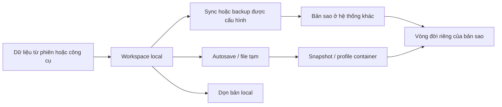

# Local storage control

## 1. Dữ liệu trên máy quản trị có thể kéo dài hơn quyền truy cập

Local storage control là việc kiểm soát dữ liệu được ghi, giữ, đọc, sao chép và loại bỏ trên máy trạm quản trị. Phạm vi không chỉ gồm file mà người dùng chủ động lưu; còn có browser profile, token cache, command history, file tạm, log, crash dump và những bản sao do ứng dụng hoặc hệ điều hành tạo ra.

Trong PAM, một grant có thể hết hạn sau 20 phút nhưng file cấu hình đã tải, bản log đã xuất hoặc credential đã ghi ra đĩa vẫn tồn tại. Vì vậy, giới hạn thời gian quyền không tự giới hạn vòng đời dữ liệu trên endpoint.

Ví dụ, kỹ sư chỉ cần đọc trạng thái dịch vụ qua broker để chẩn đoán. Nếu công cụ tự lưu toàn bộ transcript chứa secret vào profile được đồng bộ cá nhân, đường truy cập có kiểm soát đã tạo thêm một kho dữ liệu không nằm trong quyết định ban đầu.

Cần phân biệt ba mục tiêu:

| Mục tiêu | Câu hỏi |
|---|---|
| Giảm lưu cục bộ | Có cần tạo bản sao này không? |
| Bảo vệ bản sao được phép | Ai hoặc process nào có thể đọc, sửa và chuyển nó? |
| Quản lý vòng đời | Khi nào bản sao hết mục đích và kết quả xử lý được xác nhận ra sao? |

Bài học thuộc chương Admin workstation, kết hợp kiểm soát lưu trữ với least privilege, JIT/JEA, vault, rotation, giám sát phiên và bằng chứng. Trong bài, “local storage” có nghĩa rộng là lưu trữ trên endpoint; API browser `localStorage` chỉ là một phần cụ thể.

Các policy và luồng bên dưới là mô hình tham khảo. Không có một cờ “không lưu local” chung bảo đảm mọi ứng dụng và mọi lớp hệ điều hành không để lại dữ liệu.

## 2. Kiểm kê dữ liệu theo nơi nó có thể xuất hiện

### 2.1. Credential và bằng chứng có thể dùng để truy cập

| Loại dữ liệu | Ví dụ | Rủi ro |
|---|---|---|
| Secret đích | Mật khẩu quản trị, API key, connection string chứa password | Có thể dùng ngoài đường PAM |
| Bằng chứng phiên | Cookie, access token, ticket, refresh token | Có thể tiếp tục hoặc tạo truy cập theo giao thức |
| Private key | SSH key, key ứng dụng, key thiết bị khi được lưu bằng cơ chế đó | Có thể tham gia chứng minh danh tính |
| Dữ liệu recovery | Mã recovery, bản xuất authenticator, khóa mở lại dữ liệu | Có thể mở đường khôi phục hoặc giải mã |
| Cấu hình client | Cloud profile, file cấu hình SDK, cấu hình terminal | Có thể chứa hoặc chỉ tới credential |

Không phải mọi file cấu hình đều chứa secret. Một file chỉ có resource reference cũng cần được phân loại theo nội dung thực tế, không theo phần mở rộng.

Tương tự, không nên áp một lệnh xóa hàng loạt lên mọi profile hoặc key của người dùng khi chỉ một artifact chịu ảnh hưởng. Kiểm kê tốt giúp xử lý đúng đối tượng và giữ được khả năng vận hành.

### 2.2. Dữ liệu nghiệp vụ và bằng chứng

Máy trạm có thể giữ log ứng dụng, database dump, file cấu hình, ảnh màn hình, recording hoặc báo cáo kiểm toán. Những dữ liệu đó có thể không cho đăng nhập nhưng vẫn chứa thông tin nhạy cảm.

Một log vận hành có thể chứa tham số, tên máy nội bộ hoặc dữ liệu khách hàng. Một recording có thể chứa thông tin hiển thị trong phiên. Không nên coi chúng là “chỉ metadata” nếu chưa kiểm tra nội dung và mục đích.

### 2.3. Bản sao ngoài thư mục làm việc

Cần kiểm kê các nơi có thể tạo thêm bản:

- Downloads, Desktop và thư mục tạm của công cụ.
- History, transcript, output hoặc debug log của terminal/CLI.
- Cache browser, kho dữ liệu ứng dụng và profile.
- File autosave, bản phục hồi của editor và file preview.
- Crash dump, page/swap hoặc hibernation theo nền tảng.
- Recycle bin, snapshot, backup và profile container.
- Thư mục đồng bộ, file đính kèm và bản export của công cụ hỗ trợ.

Không cần khẳng định mọi loại ứng dụng luôn tạo mọi bản trên. Mục tiêu là xác định hành vi thực tế của tập công cụ được dùng cho nhiệm vụ đặc quyền.

## 3. Phân loại trước khi đặt quy tắc lưu

Một mô hình phân loại cho PAW có thể là:

| Nhóm | Chính sách minh họa | Ví dụ |
|---|---|---|
| Không cho lưu thành file tùy ý | Dùng qua cơ chế quản lý hoặc broker | Password đích, token có thể sử dụng |
| Chỉ lưu trong cơ chế credential được phê duyệt | Có kiểm soát quyền và vòng đời riêng | Credential cache hoặc private key theo nền tảng |
| Cho lưu tạm có điều kiện | Có mục đích, owner, nơi lưu và hạn | Bộ log chẩn đoán đã giới hạn |
| Cho lưu lâu hơn trong kho được quản lý | Theo retention và quyền truy cập | Bằng chứng cần giữ cho kiểm toán |
| Không nhạy cảm theo đánh giá | Vẫn chịu quản lý integrity phù hợp | Hướng dẫn công khai, cấu hình mẫu không có secret |

Đây là ví dụ thiết kế, không phải hệ phân loại bắt buộc cho mọi tổ chức. Một loại dữ liệu có thể phải xử lý khác tùy nội dung và tác động.

### 3.1. Không đồng nhất secret với mọi private key trên thiết bị

Một private key được giữ trong cơ chế bảo vệ của nền tảng khác với một file key có thể xuất và copy tùy ý. Cần đánh giá cả cách key được sử dụng, quyền gọi, khả năng xuất và nguồn quản lý.

Tuy nhiên, “không xuất được” không tự có nghĩa mã chạy trong ngữ cảnh được phép không thể yêu cầu dùng key. Bảo vệ endpoint và quyền process vẫn cần thiết.

### 3.2. Quyền truy cập khác với quyền tạo bản sao

Một grant cho đọc dữ liệu trên đích không tự cho quyền tải toàn bộ dữ liệu về PAW. Quyền mở phiên cũng không tự cho phép export recording hoặc đọc credential từ vault.

Khi cần một bản sao, nên xem đó là một hành động có mục đích, phạm vi và điều kiện riêng. Điều kiện có thể gồm dữ liệu tối thiểu, nơi nhận được quản lý, quyền xem, thời hạn và cách đối soát.

## 4. Giảm dữ liệu phát sinh ngay tại nguồn

### 4.1. Không tạo secret local nếu tác vụ không cần

Nếu tác vụ chỉ cần mở phiên qua broker, vault có thể cung cấp credential cho broker theo tích hợp mà không tiết lộ cho người dùng. Cách này giảm một đường tạo bản sao secret trên endpoint.

Nó không bảo đảm endpoint không nhìn thấy dữ liệu phiên. Screen, clipboard, file transfer hoặc công cụ client vẫn có hành vi cần quản lý.

Nếu phải tiết lộ credential, quyết định cần tính tới khả năng sao chép và dùng ngoài đường dự kiến. Thời hạn checkout không tự làm password đã nhận biến mất hoặc mất hiệu lực trên đích.

### 4.2. Giới hạn output và phạm vi thu thập

Thay vì tải toàn bộ database hoặc nhiều ngày log, có thể chọn dữ liệu đủ cho câu hỏi vận hành: khoảng thời gian, resource, loại sự kiện và trường cần thiết.

Việc redaction nên có nguồn và khả năng kiểm tra. Chỉ đổi tên file hoặc che một cột trên giao diện không chứng minh bản export đã loại thông tin nhạy cảm.

Không chuyển toàn bộ output sang ticket để tránh lưu local rồi coi là đã giải quyết. Ticket là một kho lưu khác, có người xem, export và retention riêng.

### 4.3. Ưu tiên reference khi không cần nội dung

Request, grant và báo cáo công việc thường chỉ cần evidence reference hoặc log reference đã được kiểm soát truy cập, thay vì một bản sao đầy đủ.

Ví dụ, ghi “đã đối chiếu evidence E-518 cho máy A trong phiên S-884” có thể đủ cho một bước điều phối. Người có nhiệm vụ kiểm tra sau đó dùng quyền riêng để đọc nội dung trong kho bằng chứng.

## 5. Bảo vệ dữ liệu cục bộ được phép

### 5.1. Mã hóa ổ đĩa có mục tiêu cụ thể

BitLocker là ví dụ mã hóa volume để giảm rủi ro lộ dữ liệu khi thiết bị bị mất, bị lấy cắp hoặc bị loại bỏ không phù hợp. [Microsoft — BitLocker](https://learn.microsoft.com/en-us/windows/security/operating-system-security/data-protection/bitlocker/)

Trong thiết kế PAW, cần xác minh đúng volume được bảo vệ, trạng thái có hiệu lực và cách quản lý recovery key. Một policy đã gửi xuống không đủ để kết luận mã hóa đang hoạt động.

Mã hóa dữ liệu trên đĩa không thay thế kiểm soát truy cập trong phiên đang mở. Một process được phép đọc file khi volume đã mở vẫn có thể lấy nội dung theo quyền của nó.

Nếu dùng thêm mã hóa ở mức file hoặc workspace, cần quản lý key riêng và xem quy trình mở file. Key hoặc password nằm cạnh ciphertext theo cách dễ lấy không tạo ra ranh giới bảo vệ có ý nghĩa.

### 5.2. Quyền file và process

Thư mục làm việc nhạy cảm nên có quyền tối thiểu cho người dùng và dịch vụ cần thiết. Cần xét ACL kế thừa, quyền của nhóm, quyền hỗ trợ và khả năng đọc từ process khác.

Không chỉ dựa vào tên thư mục “secure”. Một thư mục trong profile người dùng vẫn có thể bị ứng dụng chạy dưới cùng ngữ cảnh truy cập theo mô hình hệ điều hành.

Quyền quản trị local hoặc khả năng điều khiển hệ điều hành có thể vượt qua nhiều ranh giới file thông thường. Vì vậy, kiểm soát local privilege và phần mềm được chạy là phần liên quan trực tiếp tới local storage control.

### 5.3. Workspace có quản lý tốt hơn nhiều thư mục tùy ý

Một workspace tạm được quản lý có thể xác định:

- Những loại dữ liệu được nhận.
- Actor và device được phép mở.
- Thư mục hoặc container lưu cụ thể.
- Cơ chế mã hóa và kiểm tra trạng thái.
- Ứng dụng được phép xử lý.
- Hạn lưu, giới hạn dung lượng và cách chuyển bằng chứng.
- Những đường sync, backup hoặc export được phép.
- Quy tắc khắc phục và kết quả dọn dữ liệu.

Giới hạn dung lượng giúp ngăn tích tụ và giữ tính sẵn sàng, nhưng không thay giới hạn nội dung. Một file secret rất nhỏ vẫn có thể có tác động lớn.

### 5.4. Lưu trữ tháo rời và chia sẻ từ xa

USB, ổ ngoài, drive redirection và thư mục chia sẻ là các đường sao chép khác. Có thể cần giới hạn theo thiết bị, loại dữ liệu, chiều truyền và mục đích.

Mã hóa USB không tự cho phép chép mọi dữ liệu ra đó. Quyền export vẫn phải được xét riêng, cùng người nhận và thời hạn giữ.

Không cần cấm mọi thiết bị ngoại vi một cách máy móc nếu công việc hoặc phương thức xác thực cần hỗ trợ. Điều quan trọng là không để một chính sách lưu trữ rộng vô tình mở mọi đường ra ngoài.

## 6. Browser storage và phiên PAM

### 6.1. Không coi localStorage là kho bí mật

OWASP khuyến nghị tránh lưu dữ liệu nhạy cảm và session identifier trong browser local storage, vì JavaScript trong origin có thể truy cập và XSS có thể đọc hoặc sửa dữ liệu đó. Client-side storage cũng không thay kiểm tra authorization. [OWASP — HTML5 Local Storage](https://cheatsheetseries.owasp.org/cheatsheets/HTML5_Security_Cheat_Sheet.html#local-storage)

Đối với portal PAM, cần xem token, secret được hiển thị, response nhạy cảm và cấu hình frontend có bị giữ lại không. Đổi từ `localStorage` sang một kho client khác không tự tạo bảo vệ phù hợp.

Đóng tab, đăng xuất, xóa cache và vô hiệu hóa phiên là những hành động khác nhau. Ví dụ, token có thể đã bị sao chép trước đó; dọn bản local không làm bản sao kia hết hiệu lực.

### 6.2. HTTP cache và cơ chế cache ứng dụng cần kiểm tra riêng

Một response không được cache theo policy vẫn có thể bị mã ứng dụng chủ động ghi vào kho client hoặc tạo file. Cần kiểm tra hành vi frontend, service worker và công cụ tích hợp nếu có.

Mục tiêu là những response nhạy cảm không bị lưu ngoài ý định. Không nên chỉ nhìn một header rồi tuyên bố mọi loại cache đã được kiểm soát.

Một bản cache cũ cũng không được dùng để quyết định quyền hiện tại. Nếu frontend từng lưu “user is admin”, API vẫn phải kiểm tra quyền thật khi nhận hành động.

### 6.3. Profile, đồng bộ và chức năng nhớ đăng nhập

Browser profile có thể chứa cookie, dữ liệu website, lịch sử, thông tin autofill và cấu hình extension. Cần định nghĩa profile nào được dùng cho quản trị và có được đồng bộ không.

Trong mô hình bài học, profile quản trị không đồng bộ sang tài khoản hoặc thiết bị cá nhân. Các chức năng lưu password, tải xuống và extension được quản lý theo nhiệm vụ.

Chế độ duyệt riêng tư không thay chính sách dữ liệu: file người dùng tải xuống, nội dung đưa sang ứng dụng khác hoặc bằng chứng ở lớp hệ điều hành có thể có vòng đời riêng.

## 7. CLI, editor, log và file tạm

### 7.1. Không đưa secret vào dòng lệnh tùy ý

Một lệnh có password hoặc token trong tham số có thể xuất hiện trong history, transcript, chẩn đoán hoặc những điểm quan sát của nền tảng. Cần dùng cơ chế cấp credential phù hợp với công cụ thay vì nhúng trực tiếp.

Không nên coi việc tắt một loại history là biện pháp đủ cho mọi kênh. Công cụ có thể tạo log riêng, editor có thể autosave và hệ điều hành có thể thu thập dữ liệu khi lỗi.

Các file cấu hình CLI/cloud cần được kiểm kê. Một cấu hình chỉ định provider để lấy credential ngắn hạn khác với file chứa access key dài hạn, nhưng cả hai cần quản lý integrity và người có quyền sửa.

### 7.2. Output chẩn đoán cũng có thể nhạy cảm

OWASP lưu ý rằng access token, password, encryption key và các dữ liệu nhạy cảm khác thường không nên được ghi trực tiếp vào log. [OWASP — Logging: Data to exclude](https://cheatsheetseries.owasp.org/cheatsheets/Logging_Cheat_Sheet.html#data-to-exclude)

Trong PAW, cần kiểm tra mức debug, log request/response và output công cụ hỗ trợ. Một chế độ debug tạm thời không nên trở thành cấu hình mặc định lâu dài.

Chỉ che secret lúc hiển thị log có thể chưa xử lý bản raw đã được ghi xuống hoặc chuyển tới hệ thống khác. Nên giới hạn dữ liệu ngay trước khi ghi ở nơi có thể thực hiện an toàn, rồi quản lý những bản có thể đã phát sinh.

### 7.3. File tạm phải có owner và đường xử lý

Ứng dụng có thể tạo file trung gian khi giải nén, preview, chỉnh sửa hoặc export. Cần biết file nằm ở đâu, có quyền gì và khi nào được dọn.

Không nên chạy một cơ chế dọn toàn bộ profile không phân biệt dữ liệu công việc, bằng chứng và cấu hình vận hành. Cleanup phải nhận diện đúng phạm vi do công cụ hoặc workflow quản lý.

Nếu file tạm bị giữ do process còn mở hoặc thiết bị mất kết nối, trạng thái cần phản ánh chưa hoàn tất. Không báo “đã sạch” chỉ vì tác vụ dọn đã được lên lịch.

### 7.4. Crash dump, swap và hibernation

Dữ liệu trong bộ nhớ có thể liên quan tới các cơ chế lưu trạng thái hoặc chẩn đoán của hệ điều hành. Baseline cần đánh giá khả năng tạo, quyền đọc, mã hóa, nơi gửi và retention phù hợp.

Không nên tắt mọi chức năng chẩn đoán một cách tùy tiện rồi mất khả năng điều tra lỗi. Có thể cần cấu hình phạm vi thu thập, bảo vệ và kênh tiếp nhận riêng.

Cũng không được hứa “chỉ giữ trong RAM nên không thể có bản trên đĩa” khi chưa kiểm tra toàn bộ ứng dụng và cấu hình nền tảng.

## 8. Đồng bộ, backup, snapshot và máy ảo

### 8.1. Một lần lưu local có thể tạo nhiều bản

Luồng dữ liệu có thể là:



Dọn B không tự dọn C, D, E hoặc F. Vì vậy, retention cần được áp dụng theo luồng dữ liệu và nơi lưu, không chỉ theo một đường dẫn ban đầu.

### 8.2. Sync được phép phải có phạm vi rõ

Không phải mọi sync đều bị cấm. Một tổ chức có thể cho phép dữ liệu loại nhất định trong kho đồng bộ quản lý với phân quyền, retention và audit phù hợp.

Nhưng không nên tự đồng bộ secret hoặc bằng chứng nhạy cảm sang tài khoản cá nhân. Tên file đã mã hóa hoặc đuôi file khác không tự làm nội dung đủ điều kiện sync.

Khi cấu hình loại trừ một workspace khỏi sync, cần kiểm tra thực tế. Bản sao có thể đã tồn tại từ trước hoặc ứng dụng có thể lưu một bản ở thư mục khác.

### 8.3. Backup và khả năng phục hồi cũng là khả năng đọc dữ liệu

Người có quyền restore backup hoặc mở snapshot có thể tiếp cận dữ liệu đã không còn ở thư mục hiện hành. Những quyền đó thuộc phạm vi quản trị lưu trữ nhạy cảm.

Cần xác định dữ liệu nào được backup, mã hóa ra sao, ai được phục hồi và khi nào bản sao hết mục đích. Nếu có yêu cầu giữ bằng chứng, không tự xóa backup chỉ để làm cho kết quả cleanup đẹp hơn.

### 8.4. Non-persistent desktop không đồng nghĩa không có dữ liệu bền vững

Máy ảo được hủy sau phiên có thể vẫn dùng profile container, storage gắn ngoài, snapshot hoặc log tập trung. Hypervisor và hệ thống quản lý cũng có quyền riêng.

Cần đánh giá cả lớp host, storage, profile và những bản sao phục vụ recovery. Đổi tên mô hình thành “ephemeral” không tự chứng minh không còn artifact.

## 9. Retention, cleanup và sanitization là những việc khác nhau

### 9.1. Retention theo mục đích

Mỗi artifact được phép lưu nên có mục đích và điểm kết thúc: hoàn tất sự cố, chuyển vào kho bằng chứng hoặc hết thời hạn tạm được cấp.

Một thời hạn ví dụ như “xóa sau khi chuyển bằng chứng được xác nhận” phải có sự kiện xác nhận thật. Không bắt đầu dọn chỉ vì upload đã được gửi nhưng chưa biết bản trung tâm còn nguyên và có thể truy cập.

Nếu có yêu cầu bảo toàn cho điều tra, cần chuyển sang luồng giữ có kiểm soát. Ngoại lệ retention phải có owner, phạm vi và lý do; không nên biến thành giữ vô thời hạn trên laptop.

### 9.2. Xóa file không tự là sanitization

NIST mô tả media sanitization là quá trình làm cho việc truy cập dữ liệu mục tiêu trên phương tiện trở nên không khả thi ở một mức nỗ lực xác định. Cách thực hiện phải phù hợp loại phương tiện và mức nhạy cảm. [NIST SP 800-88 Rev. 2](https://csrc.nist.gov/pubs/sp/800/88/r2/final)

Trong vận hành thường ngày, cleanup loại bỏ bản làm việc và giảm khả năng truy cập thông thường. Khi bàn giao, sửa chữa hoặc loại bỏ thiết bị, có thể cần quy trình sanitization ở mức phương tiện, với xác minh và bằng chứng riêng.

Không nên ghi “đã xóa vĩnh viễn mọi nơi” chỉ từ kết quả một API xóa file.

### 9.3. SSD và cryptographic erase cần hiểu đúng điều kiện

NIST lưu ý hạn chế của ghi đè qua giao diện thông thường với flash có wear levelling; cryptographic erase cũng phụ thuộc những điều kiện về mã hóa và quản lý key. [NIST SP 800-88 Rev. 2 — Sanitization methods](https://nvlpubs.nist.gov/nistpubs/SpecialPublications/NIST.SP.800-88r2.pdf)

Không nên áp một thói quen ghi đè file rồi coi là đủ cho mọi SSD, snapshot hoặc storage ảo. Cần chọn phương pháp theo thiết bị và bằng chứng từ cơ chế được hỗ trợ.

Xóa một file key không tự chứng minh đã loại mọi bản key hoặc xử lý dữ liệu từng tồn tại dạng rõ. Recovery key, bản escrow và backup có thể tạo quan hệ cần xử lý riêng.

Bài học này không yêu cầu người vận hành tự xóa ổ hoặc phá dữ liệu. Những thao tác có tác động lớn cần thuộc quy trình và thẩm quyền cụ thể, sau khi xác định chính xác đối tượng và những bằng chứng phải giữ.

## 10. Ví dụ: lấy bộ log chẩn đoán có thời hạn

### 10.1. Nhu cầu

Kỹ sư cần phân tích một bộ log đã giới hạn của máy ứng dụng thanh toán. Tác vụ không cần database dump, password hay token. Một phần phân tích cần công cụ cục bộ nên tổ chức cho phép lưu tạm trên PAW.

Yêu cầu export được xét riêng với quyền mở phiên. Bộ log có reference, phạm vi thời gian và quy tắc loại trường không cần thiết. Nơi nhận là workspace quản lý, không phải Downloads mặc định hoặc thư mục sync cá nhân.

### 10.2. Policy ý định minh họa

```yaml
local_artifact_policy_ref: diagnostic-workspace-v3
purpose_ref: incident-731
subject_ref: principal-oncall-17
device_ref: privileged-workstation-17
artifact:
  source_ref: approved-log-export-731
  classification: restricted-diagnostic-data
  credential_material: excluded
  full_database_export: denied
storage:
  workspace_ref: managed-diagnostic-workspace-731
  encryption_state: verified_by_managed_source
  access_profile_ref: assigned-operator-only
  personal_sync: denied
  removable_media_export: denied
lifecycle:
  local_use_until: "2026-11-26T16:00:00+07:00"
  central_evidence_ref: incident-evidence-731
  cleanup_requires_upload_confirmation: true
  preservation_exception_requires_authorization: true
audit:
  link_actor_device_export_upload_cleanup: true
```

Đây là dữ liệu giả mô tả yêu cầu. Trường `credential_material: excluded` không tự chứng minh nội dung đã sạch; cần có cơ chế tạo/kiểm tra export phù hợp. Tương tự, `personal_sync: denied` cần được thực thi và kiểm tra tại endpoint.

### 10.3. Luồng hợp lệ

1. Xác minh actor, grant và quyền export đúng bộ log.
2. Tạo hoặc chọn bộ dữ liệu tối thiểu theo quy trình được phép.
3. Xác nhận PAW và workspace đáp ứng điều kiện.
4. Chuyển artifact qua kênh đã chọn, lưu reference và thông tin integrity cần thiết.
5. Chỉ cho những công cụ được phép xử lý nội dung.
6. Đưa kết quả cần giữ vào kho bằng chứng kiểm soát truy cập.
7. Xác nhận nội dung trung tâm đã nhận đúng trước khi cleanup bản làm việc theo policy.
8. Đối soát file trung gian, trạng thái sync/backup liên quan và phần chưa xử lý.
9. Lưu kết quả hoàn tất hoặc lý do cần giữ thêm.

Một hash có thể hỗ trợ đối chiếu nội dung nhưng không mã hóa file và không chứng minh ai đã được phép xem nó. Kho bằng chứng vẫn cần quyền truy cập và quản lý integrity riêng.

### 10.4. Các nhánh lỗi

| Tình huống | Hành vi cần thiết |
|---|---|
| Bộ log có token không dự kiến | Dừng luồng thông thường, hạn chế tiếp cận và xử lý theo phạm vi |
| Workspace chưa xác nhận mã hóa | Chưa cho nhận dữ liệu theo policy này |
| Upload trung tâm lỗi | Giữ trạng thái chưa hoàn tất, không tự tuyên bố bằng chứng đã lưu |
| Hết hạn nhưng có yêu cầu bảo toàn được phép | Chuyển sang cơ chế giữ có owner, scope và thời hạn phù hợp |
| Cleanup không xóa được file đang mở | Ghi phần còn chờ và khắc phục |
| Phát hiện bản đã sync ra ngoài phạm vi | Xử lý bản sao và khả năng lộ, không chỉ xóa bản local |
| Thiết bị mất trong lúc đang giữ dữ liệu | Đánh giá trạng thái thiết bị, lớp bảo vệ và dữ liệu chịu ảnh hưởng |

## 11. Credential bị lưu hoặc lộ cần xử lý vòng đời quyền

Nếu phát hiện một password hoặc token đã nằm trong file local không được phép, việc xóa file chỉ xử lý một bản dữ liệu. Secret có thể đã được copy, sync hoặc đọc trước đó.

Một luồng ứng phó có thể gồm:

1. Xác định loại credential, chủ thể/đích và phạm vi quyền.
2. Hạn chế file hoặc đường phát tán theo thẩm quyền.
3. Xác định những bản sao, phiên và consumer có thể liên quan.
4. Thu hồi token hoặc xử lý credential đích theo cơ chế được hỗ trợ.
5. Thực hiện rotation nếu cần, cân nhắc phụ thuộc và tác động.
6. Xử lý phiên hiện hữu theo policy.
7. Cleanup bản sao trong phạm vi sau khi đáp ứng yêu cầu bảo toàn.
8. Xác nhận từng kết quả, giữ phần chưa biết để đối soát.

Không mặc định mọi secret đều có cùng cơ chế thu hồi. Một access token, password cơ sở dữ liệu và private key có vòng đời khác nhau.

Cũng không đổi mọi credential của cả môi trường chỉ vì một file cục bộ bị phân loại sai. Phạm vi ứng phó cần dựa trên bằng chứng và tác động thực tế.

Nếu người dùng vẫn có thể lấy lại cùng secret qua một role quá rộng, chỉ xóa bản đã tìm thấy không sửa được đường tạo lại. Cần xem cả quyền đọc vault, profile và công cụ đã tạo bản đó.

## 12. Thực thi policy và giám sát

### 12.1. Không chỉ dựa vào hướng dẫn người dùng

Policy cần được chuyển thành kiểm soát phù hợp: quyền file, cấu hình ứng dụng, browser policy, hạn chế export, DLP khi được triển khai, managed workspace và kiểm tra posture.

Không có một loại kiểm soát nào tự bao phủ mọi đường. DLP có thể có giới hạn với nội dung mã hóa, công cụ hoặc giao thức cụ thể; mã hóa ổ không chặn mọi lần sao chép khi người dùng được phép đọc.

Cần ghi rõ phạm vi đã kiểm tra thay vì tuyên bố “không thể rò rỉ local”.

### 12.2. Dữ liệu đo phải gắn đúng thiết bị và thời điểm

Một trạng thái compliant cần có nguồn, device reference và độ mới. Không tin `disk_encrypted=true` hoặc `cleanup_complete=true` do client tùy ý gửi như bằng chứng đủ.

Nếu policy yêu cầu workspace được quản lý mới được export, PAM hoặc điểm truyền dữ liệu phải nhận được kết quả phù hợp từ nguồn có thẩm quyền.

Không nhất thiết chặn mọi thao tác chỉ vì một tín hiệu chưa có. Nhưng hành động cần điều kiện đó không được tự bỏ kiểm tra trong đường thông thường.

### 12.3. Bằng chứng không cần chứa nội dung secret

Audit nên nối được:

```text
Actor và thiết bị
    -> Mục đích và quyền export/checkout
    -> Artifact hoặc credential reference
    -> Workspace và policy được áp dụng
    -> Chuyển giao, xử lý hoặc sử dụng
    -> Bản trung tâm và xác nhận cần thiết
    -> Cleanup, ngoại lệ giữ và phần còn chờ
    -> Thu hồi/rotation nếu có lộ credential
```

Nên lưu metadata cần thiết, không ghi chính password hoặc token để chứng minh hệ thống đã thấy chúng. Tên file, đường dẫn và resource reference cũng có thể nhạy cảm, nên quyền xem log phải phù hợp.

Người có quyền đọc artifact không mặc nhiên có quyền đổi retention, bỏ hạn chế sync hoặc xóa bằng chứng. Những quyền quản trị đó cũng cần được kiểm kê.

## 13. Kiểm tra và duy trì theo vòng đời

### 13.1. Kiểm tra hành vi thật của công cụ

Một phiên bản mới có thể đổi thư mục cache, thêm tính năng sync, bật transcript hoặc tạo crash dump khác trước. Cần kiểm tra các luồng chính khi đổi công cụ, browser hoặc baseline.

Không chỉ tìm file theo tên chứa “password”. Credential có thể nằm trong cấu trúc khác; ngược lại, một file có tên đáng nghi có thể chỉ là dữ liệu mẫu. Việc phát hiện cần cân nhắc ngữ cảnh và tránh thu thập nội dung nhạy cảm ngoài phạm vi cần thiết.

### 13.2. Bàn giao và loại bỏ thiết bị

Khi chuyển PAW cho người khác, thay ổ, gửi sửa hoặc ngừng sử dụng, cần xác định dữ liệu đang giữ, bản sao, key và device identity liên quan.

Cleanup phiên làm việc, thu hồi danh tính và sanitization phương tiện là những bước khác nhau. Quy trình phải chọn đúng cách cho tình huống, có người chịu trách nhiệm và kết quả được xác nhận.

Không nên để người nhận thiết bị mới thừa kế token, profile, artifact hoặc key của người trước chỉ vì đã đổi tên tài khoản đăng nhập.

### 13.3. Đo kết quả có ý nghĩa

Các số liệu có thể gồm artifact tạm quá hạn, ngoại lệ retention chưa đóng, bản export không đúng workspace, thất bại cleanup, lần phát hiện secret trong log và thời gian xác nhận xử lý bản sao.

Số GB đã dọn không tự chứng minh local storage control hiệu quả. Một token nhỏ chưa xử lý có thể quan trọng hơn nhiều file không nhạy cảm đã xóa.

## 14. Thực hành trên dữ liệu giả

Dùng một máy hoặc môi trường lab và nội dung tổng hợp không có secret thật. Mô phỏng một bộ log chẩn đoán, một artifact cần giữ và một chuỗi đánh dấu giả đại diện cho dữ liệu không được lưu.

Xác định nơi ứng dụng nhận file, nơi tạo autosave/cache, có đường sync hoặc backup nào và ai có quyền đọc. Không chạy dọn rộng trên profile thật để làm bài tập.

Kiểm tra các tình huống:

| Tình huống | Kết quả cần quan sát |
|---|---|
| Export đúng quyền vào workspace phù hợp | Được tiếp nhận và có reference |
| Export vào thư mục không thuộc policy | Bị chặn hoặc xử lý theo cơ chế được thiết kế |
| Công cụ tạo file tạm | File trung gian thuộc phạm vi quản lý |
| Browser/frontend cố giữ dữ liệu nhạy cảm | Phát hiện khoảng trống và điều chỉnh thiết kế |
| Bản local đã xóa nhưng snapshot còn | Không báo mọi bản đã biến mất |
| Upload chưa xác nhận | Không coi bằng chứng trung tâm đã hoàn tất |
| Cleanup thất bại | Có trạng thái và người xử lý tiếp |
| Có yêu cầu bảo toàn hợp lệ | Giữ có scope và owner, không tự xóa |
| Chuỗi secret giả xuất hiện trong log | Kiểm tra luồng phát hiện và xử lý mà không dùng credential thật |

Đầu ra nên là một bản đồ dữ liệu và vòng đời có thể đối soát: dữ liệu nào được tạo, được lưu ở đâu, ai được đọc, những bản sao nào tồn tại và điều kiện nào xác nhận đã kết thúc mục đích lưu. Khi có credential liên quan, phải thể hiện riêng kết quả thu hồi quyền thay vì coi xóa file là đã chấm dứt truy cập.
