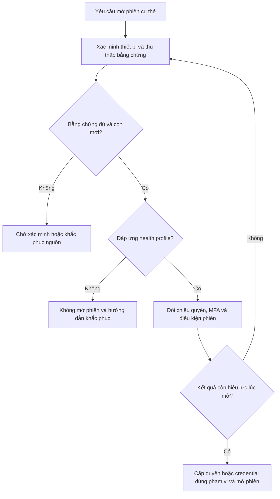

# Kiểm tra health trước session

## 1. Kiểm tra health phục vụ quyết định mở phiên

Kiểm tra health trước session là bước xác minh máy trạm quản trị có đáp ứng các điều kiện cần thiết trước khi mở một phiên truy cập đặc quyền hay không. Trong quản lý truy cập đặc quyền (Privileged Access Management, PAM), bước này giúp tránh đưa credential hoặc quyền nhạy cảm vào một thiết bị chưa được xác minh phù hợp.

Kết quả phải gắn với đúng thiết bị, người dùng, loại phiên, tài nguyên và thời điểm. Một lần kiểm tra đạt vào đầu ngày không mặc nhiên cho phép mọi phiên sau đó.

Sau bài học, người học có thể:

- Tổ chức quy trình preflight trước phiên quản trị.
- Chọn bằng chứng về endpoint và phân biệt health với khả năng kết nối.
- Nhận biết dữ liệu thiếu, cũ, sai thiết bị hoặc nguồn báo cáo không hoạt động.
- Liên kết kết quả kiểm tra với lần mở phiên cụ thể.
- Xử lý trường hợp cần khắc phục, lỗi nguồn và thay đổi trạng thái sau khi phiên đã mở.

Kiểm tra health không phải phép chứng minh tuyệt đối rằng máy không có mã độc. Nó xác nhận các điều kiện quan sát được theo một profile đã định nghĩa. Microsoft nhấn mạnh trong hướng dẫn thiết bị truy cập đặc quyền rằng mức bảo đảm của máy nguồn ảnh hưởng đến các lớp tài khoản, trung gian và tài nguyên phía sau. [Hướng dẫn về privileged access devices](https://learn.microsoft.com/en-us/security/privileged-access-workstations/privileged-access-devices).

## 2. Tình huống: máy có mạng nhưng chưa đủ an toàn để quản trị

An cần mở phiên quản trị vào app-pay-01 để đọc trạng thái dịch vụ. Máy trạm truy cập được cổng PAM và đăng nhập thành công, nhưng sensor bảo vệ đã ngừng gửi dữ liệu. Dashboard compliance vẫn hiển thị kết quả từ lần đánh giá cũ.

Có ba câu hỏi khác nhau:

1. Máy có kết nối được dịch vụ cần thiết không?
2. Có đủ bằng chứng hiện tại để đánh giá trạng thái bảo mật không?
3. Các bằng chứng đó có đáp ứng profile cho loại phiên đang yêu cầu không?

Câu trả lời “cổng PAM mở được” chỉ giải quyết một phần câu hỏi đầu. Nó không chứng minh sensor hoạt động hoặc máy đáp ứng baseline quản trị.

Một quy trình phù hợp sẽ tạm chưa mở phiên, xác định nguồn chưa đủ bằng chứng và hướng dẫn khắc phục. Sau khi có kết quả mới đáng tin, hệ thống đánh giá lại. Không chữa tình huống này bằng cách cho người dùng nhận trước mật khẩu đích để tiếp tục làm việc ngoài PAM.

## 3. Phạm vi preflight gồm những gì?

Nên tách các nhóm kiểm tra để biết cần sửa ở đâu khi thất bại.

| Nhóm | Điều cần xác minh | Ví dụ bằng chứng |
|---|---|---|
| Danh tính thiết bị | Đúng máy đang yêu cầu và còn được phép dùng | Danh tính thiết bị, liên kết khóa hoặc kết quả xác minh tương ứng |
| Trạng thái bảo mật | Đáp ứng profile của công việc | Compliance, bảo vệ endpoint, baseline và trạng thái rủi ro |
| Độ mới và nguồn | Bằng chứng còn hiệu lực và có nguồn đáng tin | Thời điểm quan sát, provider, phiên bản baseline |
| Môi trường thực hiện | Client và công cụ nằm trong phạm vi được hỗ trợ | Phiên bản client được quản lý, cấu hình đường truy cập |
| Điều kiện xác thực | Chủ thể và mức xác thực đáp ứng yêu cầu | Bằng chứng MFA, độ mới nếu cần |
| Sẵn sàng của đường phiên | Gateway và bằng chứng phiên có thể hoạt động theo yêu cầu | Kết quả chuẩn bị phiên, audit/recording readiness nếu bắt buộc |
| Quyền và công việc | Đúng phạm vi, tài khoản và thời hạn | Request, phê duyệt, capability, grant hoặc lease |

Health của endpoint là trọng tâm của bài. Các nhóm còn lại là điều kiện liên quan của luồng mở phiên, không nên gộp tất cả thành một cờ “máy khỏe”.

Ví dụ, gateway tạm không sẵn sàng không chứng minh endpoint bị xâm nhập. Ngược lại, endpoint không đạt không thể được bỏ qua chỉ vì gateway đang hoạt động tốt.

## 4. Profile kiểm tra cho một phiên cụ thể

Một profile minh họa cho phiên quản trị production có thể yêu cầu:

- Thiết bị thuộc nhóm máy trạm quản trị được phép và chưa bị thu hồi.
- Hệ điều hành, cấu hình bảo vệ và client đáp ứng baseline được chọn.
- Bảo vệ endpoint được đánh giá theo nguồn phù hợp, không có trạng thái bị cấm.
- Các quan sát bắt buộc còn đủ mới.
- Có thể liên kết bằng chứng với đúng thiết bị đang yêu cầu.
- Có khả năng thực thi phạm vi, thời hạn và bằng chứng phiên bắt buộc.

Không áp mọi kiểm tra cho mọi nền tảng mà không biết cách đo. Một điều kiện không được hỗ trợ phải có cách xử lý rõ, chẳng hạn profile riêng hoặc giới hạn loại phiên, thay vì tự đánh dấu đạt.

Profile cũng cần tương xứng với công việc. Đọc dữ liệu không nhạy cảm trong lab và mở phiên quản trị nền tảng PAM có thể cần các điều kiện khác nhau. Tuy nhiên, “chỉ đọc” không tự đồng nghĩa rủi ro thấp nếu dữ liệu có credential hoặc thông tin nhạy cảm.

Nếu tổ chức dùng compliance từ hệ thống quản lý thiết bị, phải biết policy nào tạo ra kết quả. Intune, chẳng hạn, đánh giá cấu hình theo compliance policy và nền tảng; nhịp đánh giá còn liên quan đến việc thiết bị check-in và chu kỳ cập nhật. Không nên coi một trạng thái compliant là kết quả đo lại tức thì mọi tín hiệu tại lúc mở phiên. [Tài liệu về compliance policy](https://learn.microsoft.com/en-us/intune/device-security/compliance/overview).

## 5. Quy trình preflight trước khi nhận quyền đích

Có thể tổ chức quy trình thành sáu bước:

1. **Xác định lần yêu cầu:** người dùng, thiết bị, đích, loại phiên, tài khoản/capability và request revision.
2. **Thu thập bằng chứng:** lấy dữ liệu cần thiết từ các nguồn có thẩm quyền.
3. **Kiểm tra chất lượng:** đúng thiết bị, đúng schema, đủ mới, baseline phù hợp và nguồn được xác minh.
4. **Đánh giá profile:** phân loại đạt, không đạt hoặc chưa xác minh được.
5. **Kiểm tra lại khi mở:** bảo đảm kết quả còn hiệu lực và phạm vi không bị thay đổi.
6. **Mở phiên đúng điều kiện:** chỉ sau khi mọi điều kiện bắt buộc của luồng được đáp ứng.



Luồng không yêu cầu mọi phép đo đều phải thực hiện mới từ đầu cho từng lần. Có thể dùng bằng chứng còn hợp lệ theo profile, nhưng việc dùng lại cần được giới hạn và giải thích được.

Không nạp thêm credential đích hoặc mở phiên đặc quyền trước khi gate tương ứng hoàn tất. Một phiên đăng nhập vào portal để gửi yêu cầu không nên bị coi là phiên quản trị đích đã được cho phép.

## 6. Phân biệt health của bảo vệ endpoint với việc có phần mềm cài đặt

Một biểu tượng ứng dụng xuất hiện hoặc một service tồn tại chưa đủ để chứng minh toàn bộ khả năng bảo vệ và quan sát đang hoạt động.

Cần tách ít nhất các câu hỏi: phần mềm có được cài không, chức năng cần thiết có bật không, sensor có báo cáo không và nguồn trung tâm có đủ dữ liệu để đánh giá rủi ro không.

Trong Microsoft Defender for Endpoint, thông tin device health phản ánh khả năng cung cấp sensor data và giao tiếp với dịch vụ. Trạng thái có thể cho thấy thiết bị đang báo cáo, cấu hình có vấn đề hoặc không còn báo cáo. Vì vậy, “không thấy cảnh báo mới” không tự đồng nghĩa thiết bị sạch nếu sensor đang mất khả năng quan sát. [Tài liệu kiểm tra sensor health](https://learn.microsoft.com/en-us/defender-endpoint/check-sensor-status).

Không áp nhãn và ngưỡng mặc định của một dashboard làm điều kiện cho mọi phiên nhạy cảm mà chưa đánh giá. Profile PAM có thể cần giới hạn độ mới hoặc tín hiệu cụ thể khác với cách một màn hình tổng hợp phân loại thiết bị.

Nếu nguồn quản lý và nguồn bảo vệ đưa kết quả khác nhau, dùng quy tắc giải quyết nguồn đã được định nghĩa. Không chọn kết quả thuận lợi nhất chỉ để hoàn thành preflight.

## 7. Quan sát local hỗ trợ chẩn đoán, không thay bằng chứng đáng tin

Người vận hành có thể thực hiện một số kiểm tra chỉ đọc trong môi trường được cho phép để hiểu vì sao preflight chưa đạt. Các lệnh và công cụ phải phù hợp với nền tảng cùng sản phẩm đang dùng.

Ví dụ trên một máy lab Windows có module Defender phù hợp:

```powershell
Get-MpComputerStatus |
    Select-Object AMServiceEnabled,
                  AntivirusEnabled,
                  RealTimeProtectionEnabled,
                  AntivirusSignatureLastUpdated
```

`Get-MpComputerStatus` trả trạng thái phần mềm antimalware trên máy. Ví dụ chỉ chọn một số thuộc tính để quan sát, không thay cấu hình và không tạo kết luận tổng hợp cho toàn bộ health profile. [Tài liệu Get-MpComputerStatus](https://learn.microsoft.com/en-us/powershell/module/defender/get-mpcomputerstatus?view=windowsserver2025-ps).

Cần hiểu giới hạn của output:

- Các thuộc tính này không tự chứng minh sensor EDR đang giao tiếp bình thường.
- Trạng thái antivirus không đại diện mọi kiểm tra như baseline hệ điều hành hoặc quản lý thiết bị.
- Nếu lệnh không tồn tại hoặc lỗi, chưa thể suy ra máy không có bảo vệ; có thể đang dùng sản phẩm khác hoặc môi trường không hỗ trợ.
- Một ảnh chụp hoặc đoạn output người dùng gửi không nên được dùng thay toàn bộ pipeline bằng chứng đã xác minh.

Không chạy lệnh sửa cấu hình, tắt bảo vệ, cài công cụ tùy ý hoặc cấp local admin rộng chỉ để làm các ô kiểm tra chuyển xanh. Việc khắc phục cần đi qua công cụ và thẩm quyền quản lý thiết bị phù hợp.

## 8. Độ mới: kiểm tra sát lúc mở session

Có ba thời điểm nên lưu riêng: lúc nguồn quan sát, lúc hệ thống nhận dữ liệu và lúc PAM đánh giá. Một bản ghi vừa đến có thể chứa quan sát đã cũ.

Ví dụ giả lập:

| Thời điểm | Sự kiện | Ý nghĩa |
|---|---|---|
| T0 | Nguồn quan sát trạng thái đáp ứng | Tạo căn cứ cho một khoảng hiệu lực được định nghĩa |
| T0 + 1 phút | PAM đánh giá preflight đạt | Chưa đồng nghĩa phiên đã mở |
| T0 + 12 phút | Người dùng mới bấm mở phiên | Phải kiểm tra kết quả cũ còn đủ mới hay không |
| Sau khi mở | Nguồn báo trạng thái rủi ro mới | Cần xử lý theo chính sách phiên đang chạy |

Nếu profile chỉ chấp nhận bằng chứng trong năm phút của lab, kết quả ở T0 không thể dùng vô hạn cho hành động ở T0 + 12 phút. Con số này chỉ minh họa cách kiểm thử, không phải chuẩn chung.

Độ mới của một bản tổng hợp cũng chưa đủ nếu một tín hiệu bắt buộc bên trong được đo từ lâu. Cần định nghĩa cách kiểm tra từng tín hiệu hoặc cách nguồn tổng hợp bảo đảm điều đó.

Khi nhận sự kiện không theo thứ tự, đừng để một bản ghi cũ đến muộn ghi đè trạng thái mới một cách không kiểm soát. Thời điểm tương lai bất thường hoặc không xác minh được cũng cần được phân loại, không làm kéo dài hiệu lực.

## 9. Kết quả preflight và hướng xử lý

Một mô hình có thể dùng:

| Kết quả | Ý nghĩa | Hành vi trước phiên |
|---|---|---|
| `READY` | Các điều kiện health đã được xác minh và đáp ứng | Tiếp tục kiểm tra điều kiện cấp quyền và mở phiên |
| `REMEDIATION_REQUIRED` | Có bằng chứng xác nhận không đạt một yêu cầu | Chưa mở phiên; hướng dẫn khắc phục phù hợp |
| `UNVERIFIED` | Chưa đủ dữ liệu đáng tin hoặc dữ liệu quá hạn | Chờ, thử lại có giới hạn hoặc theo nhánh ngoại lệ được phép |
| `PRECHECK_ERROR` | Lỗi kỹ thuật khiến quy trình kiểm tra không hoàn tất | Không coi là đạt; ghi lỗi và điều phối hỗ trợ |

Tên trạng thái là quy ước thiết kế. Điều quan trọng là phân biệt không đạt với chưa biết, đồng thời không cấp quyền chỉ vì hệ thống gặp lỗi.

Thông báo nên chỉ ra việc cần làm: thiết bị chưa nhận baseline, bằng chứng quá hạn, sensor chưa báo cáo hoặc nguồn xác minh đang lỗi. Không yêu cầu người dùng tự nhập một cờ “đã kiểm tra” để thay kết quả hệ thống.

Phê duyệt công việc và preflight health là hai điều kiện độc lập. Một request được duyệt có thể chờ thiết bị khắc phục; việc chủ dịch vụ đã duyệt không tự có thẩm quyền bỏ qua mọi yêu cầu bảo mật endpoint.

## 10. Ràng buộc kết quả với đúng lần mở phiên

Một kết quả health tổng quát dễ bị dùng nhầm cho người, máy hoặc phạm vi khác. Hệ thống cần giữ liên kết giữa precheck và lần mở session.

Mô hình bản ghi minh họa:

```json
{
  "precheck_id": "precheck-lab-2010",
  "request_id": "PAM-LAB-2010",
  "request_revision": 1,
  "subject_reference": "idp-lab:user-an",
  "device_reference": "admin-device-17",
  "session_type": "proxied-ssh",
  "target_resource": "asset-app-pay-01",
  "target_account_reference": "managed-account-pay-ops",
  "health_profile_version": "admin-session-health-v4",
  "evidence_references": ["mdm-evidence-18", "edr-evidence-42"],
  "result": "READY",
  "decision_expiry_reference": "server-managed-expiry-2010"
}
```

Đây là dữ liệu phía hệ thống sau xác minh, không phải JSON tự khai từ client để được tin. Cách biểu diễn thời hạn và bảo vệ kết quả phải theo tích hợp thực tế.

Trước mở phiên, kiểm tra lại chủ thể, thiết bị, request revision, đích, tài khoản và hiệu lực. Không dùng kết quả dành cho máy A để cấp phiên máy B. Nếu người dùng sửa đích hoặc loại phiên, phải đánh giá điều kiện tương ứng cho phạm vi mới.

Nếu dùng cache, khóa và thời hạn cache phải phản ánh các điều kiện ảnh hưởng kết quả. Cache theo username đơn lẻ không đủ khi cùng người có nhiều thiết bị hoặc loại công việc khác nhau.

## 11. Mã giả điều phối gate mở phiên

Đoạn sau mô tả trách nhiệm của luồng, không phải chương trình hoàn chỉnh hoặc verifier mật mã:

```text
function openPrivilegedSession(request, authenticatedContext):
    require request is currentStoredRevision(request.id)
    require validAuthenticatedSubject(authenticatedContext)

    device = resolveVerifiedDevice(authenticatedContext)
    if device is UNKNOWN:
        return UNVERIFIED("request-device-unresolved")

    profile = resolveHealthProfile(request, device)
    evidence = collectAuthorizedEvidence(device, profile)

    if collectionFailedTechnically(evidence):
        return PRECHECK_ERROR("evidence-collection-error")

    if provenanceInvalidOrRequiredFactsMissingOrStale(evidence, profile):
        return UNVERIFIED("health-evidence-incomplete")

    if requiredConditionFailed(evidence, profile):
        return REMEDIATION_REQUIRED("health-condition-failed")

    healthDecision = recordBoundPrecheck(request, device, evidence, profile)

    if not exactScopeAuthorizationAndAuthenticationSatisfied(request):
        return ACCESS_NOT_GRANTED

    if not healthDecisionValidForCurrentSessionAttempt(healthDecision):
        return RECHECK_REQUIRED

    if not mandatorySessionControlsReady(request):
        return SESSION_NOT_OPENED

    return createScopedSessionAndRecordOutcome(request, healthDecision)
```

Việc ghi kết quả và mở phiên cần được thiết kế để không dùng một quyết định hết hạn hoặc sai phạm vi. Nếu các bước thực hiện bất đồng bộ, giữ đủ trạng thái để đối chiếu khi retry, tránh tạo thêm phiên ngoài ý định.

Nếu tạo phiên trả timeout, không mặc định chắc chắn chưa có phiên. Đối soát kết quả bằng định danh được quản lý trước khi thử mở tiếp. Preflight đạt không loại bỏ các vấn đề nhất quán của luồng cấp quyền.

Không đưa credential vào log lỗi hoặc output debug của bước mở phiên. Tham chiếu tài khoản và lease thường phù hợp hơn giá trị bí mật.

## 12. Khắc phục và thực hiện lại

Một luồng khắc phục có thể bắt đầu bằng xác định nguyên nhân, giao đúng đội hỗ trợ, thực hiện thay đổi được cho phép và chờ bằng chứng mới. Không đánh dấu đạt chỉ vì người dùng nói đã khởi động lại máy hoặc đã bấm đồng bộ.

Phân biệt các loại công việc:

- Cập nhật hoặc cấu hình thiết bị theo công cụ quản lý.
- Sửa onboarding, mapping định danh hoặc giao tiếp của sensor.
- Xử lý dấu hiệu xâm nhập theo quy trình ứng phó.
- Sửa policy hoặc nguồn đánh giá khi có lỗi đã được xác nhận.

Nếu có nghi ngờ thiết bị bị kiểm soát, không tiếp tục dùng nó để nạp credential đặc quyền chỉ nhằm hoàn thành tác vụ đang gấp. Điều phối sang thiết bị quản trị khác đáp ứng yêu cầu hoặc dùng quy trình khẩn cấp đã thiết kế.

Đường khắc phục nên hoạt động mà không yêu cầu trước quyền production đang bị chặn. Nếu không, người dùng có thể bị mắc vòng lặp phải có quyền mới sửa được điều kiện để nhận quyền.

Sau khắc phục, thực hiện lại gate và liên kết kết quả mới với request. Giữ lịch sử thất bại cần thiết để giải thích sự kiện, không sửa kết quả cũ thành đạt như thể lần đầu chưa từng có vấn đề.

## 13. Trạng thái thay đổi sau khi session đã mở

Preflight là kiểm tra trước phiên, không phải lời hứa trạng thái sẽ giữ nguyên trong toàn bộ phiên. Cần có chính sách cho tín hiệu mới sau khi quyền đã được cấp.

Hệ thống có thể chặn phiên mới, chặn hoạt động bổ sung, thu hồi lease hoặc đóng phiên qua cơ chế được hỗ trợ. Lựa chọn cần dựa trên rủi ro và tác động vận hành; không để từng node tự suy đoán.

Đóng session không tự bảo đảm dừng mọi tiến trình nền hoặc vô hiệu hóa mọi credential đã được tiết lộ. Nếu người dùng đã nhận mật khẩu có thể dùng ngoài proxy, cần đánh giá khả năng sử dụng tiếp và cơ chế thu hồi hoặc luân chuyển tương ứng.

Đo độ trễ từ nguồn quan sát đến quyết định và thực thi. Nếu thiết kế chỉ kiểm tra khi tạo phiên, phải nói rõ giới hạn đó thay vì mô tả như đã kiểm soát liên tục.

Cũng cần xử lý trường hợp chỉ mất kết nối nguồn posture. Một lần timeout ngắn và một bằng chứng xác nhận rủi ro nghiêm trọng có thể dẫn đến các hành vi khác nhau, nhưng mọi nhánh đều cần chính sách có trách nhiệm và bằng chứng.

## 14. Ngoại lệ và sự cố nền tảng kiểm tra

Dịch vụ preflight có thể gặp lỗi trong lúc đội vận hành cần xử lý sự cố khác. Cần chuẩn bị cách duy trì khả năng quản trị mà không biến lỗi kiểm tra thành cho phép mặc định.

Một ngoại lệ có thể chỉ cho phép chủ thể và thiết bị nhất định thực hiện tác vụ hẹp trong thời gian xác định, với kiểm soát bù đắp và người có thẩm quyền. Không dùng ngoại lệ chung không hết hạn cho mọi quản trị viên.

Tài khoản hoặc đường break-glass phải có quy trình riêng, bao gồm xác thực, nơi giữ credential, phạm vi, cảnh báo và đối chiếu sau sử dụng. Việc dùng khẩn cấp không có nghĩa xóa dấu vết hoặc biến thiết bị chưa rõ trạng thái thành đạt profile thông thường.

Nếu cho phép dùng cache trong một sự cố nguồn, cần giới hạn rõ loại bằng chứng còn hợp lệ và điều kiện không được dùng cache. Không áp dụng một quy tắc “lấy bản tốt cuối cùng” vô thời hạn.

Sau khi dịch vụ hồi phục, đối soát những phiên đã mở, ngoại lệ còn tồn tại và credential cần xử lý. Chỉ đóng incident của pipeline chưa chứng minh mọi quyền tạm đã được thu hồi.

## 15. Bằng chứng, chỉ số và trách nhiệm vận hành

Một hồ sơ preflight cần giải thích được ai yêu cầu, dùng thiết bị nào, đánh giá profile nào, dựa trên nguồn nào, lúc nào và kết quả ra sao. Khi có phiên, nối tới tài nguyên, tài khoản đích, grant hoặc lease và kết quả kết thúc.

Không lưu toàn bộ dữ liệu endpoint nếu không cần. Giới hạn thông tin nhạy cảm, quyền đọc và thời hạn giữ theo mục đích; tuyệt đối không cần private key, password hay token đầy đủ để chứng minh health đã được kiểm tra.

Có thể theo dõi tỷ lệ READY, cần khắc phục, chưa xác minh và lỗi kỹ thuật; thời gian từ yêu cầu đến kết quả; độ trễ từng nguồn; số phiên mở bằng ngoại lệ; và số phiên không nối được precheck.

Tỷ lệ READY cao không tự chứng minh kiểm soát tốt. Nó có thể tăng do baseline bị nới hoặc parser bỏ qua kiểm tra bắt buộc. Theo dõi thay đổi profile, nguồn dữ liệu và đường truy cập để hiểu kết quả.

Phân công rõ đội quản lý endpoint, đội vận hành PAM, chủ công việc và đội ứng phó. Người duyệt nghiệp vụ không nhất thiết là người có thẩm quyền sửa baseline hoặc chấp thuận ngoại lệ an toàn thiết bị.

## 16. Bộ kiểm thử chấp nhận trong lab

Chuẩn bị tài khoản, endpoint và đích giả lập được phép. Dùng bộ bằng chứng hoặc nguồn thử nghiệm để tạo nhánh lỗi, không tắt bảo vệ production chỉ để kiểm thử gate.

| Tình huống | Kết quả mong đợi |
|---|---|
| Đúng thiết bị, đủ bằng chứng mới và đạt profile | Tiếp tục kiểm tra quyền rồi mở đúng phiên |
| Cổng PAM truy cập được nhưng sensor chưa báo cáo | Không suy từ kết nối mạng thành health đạt |
| Bản ghi mới nhận chứa quan sát cũ | Xử lý theo độ mới của quan sát bắt buộc |
| Bằng chứng thuộc thiết bị khác | Không dùng để mở phiên từ thiết bị hiện tại |
| Một kiểm tra bắt buộc thất bại | Cần khắc phục, chưa mở phiên |
| Nguồn bị timeout hoặc trả schema không hợp lệ | UNVERIFIED hoặc lỗi kỹ thuật theo thiết kế, không mặc định đạt |
| Preflight đạt nhưng mở phiên sau khi hết hiệu lực | Kiểm tra lại |
| Sửa target hoặc request revision sau preflight | Kết quả cũ không mở cho phạm vi mới |
| MFA hoặc phê duyệt thiếu dù health đạt | Không cấp quyền chỉ dựa vào health |
| Audit/recording bắt buộc chưa sẵn sàng | Không mở phiên thiếu điều kiện bắt buộc |
| Retry sau timeout tạo session | Đối soát để tránh tạo phiên ngoài ý định |
| Nguồn báo rủi ro mới khi session đang mở | Thực thi đúng hành vi và độ trễ đã cam kết |
| Ngoại lệ hết hạn | Không tiếp tục mở phiên bằng ngoại lệ đó |
| Gọi API mở session ngoài UI | Vẫn qua gate tương ứng |

Kiểm thử cả kết quả ở broker và trạng thái thực tế tại đích. Một thông báo “đã chặn” chưa đủ nếu phiên hoặc credential đã được tạo trước khi bước kiểm tra hoàn tất.

## 17. Thực hành hoàn thiện runbook trước phiên

Chọn một phiên lab cụ thể, chẳng hạn SSH qua proxy đến tài nguyên giả lập production. Xác định profile, nguồn dữ liệu, giới hạn độ mới và cách liên kết thiết bị.

Viết runbook gồm các bước xác định yêu cầu, thu thập, đánh giá, xử lý không đạt và kiểm tra lại ngay trước mở. Ghi riêng những phép quan sát local phục vụ chẩn đoán với bằng chứng mà hệ thống dùng để thực thi.

Sau đó chuẩn bị ba ca: đủ điều kiện, sensor mất khả năng báo cáo và kết quả hết hạn trước khi bấm mở. Đối chiếu trạng thái phiên, quyền hoặc credential đã tạo cùng log tương ứng.

Runbook đạt yêu cầu khi có thể chứng minh rằng đúng thiết bị đã được đánh giá theo đúng profile cho lần truy cập đó, các điều kiện thiếu không bị biến thành đạt và chỉ sau khi hoàn tất gate hệ thống mới mở quyền đặc biệt trong phạm vi được cho phép.
