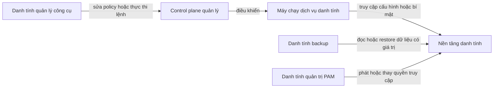

# Tier 0 identity

## Mục tiêu bài học

Trong mô hình access tiering của bài này, **Tier 0** là ranh giới chứa những khả năng kiểm soát nền tảng danh tính và những thành phần có thể chi phối khả năng đó. Một **Tier 0 identity** là danh tính có quyền trực tiếp hoặc gián tiếp để quản trị, cấp phát, giả mạo hoặc khôi phục những quyền kiểm soát cốt lõi này.

Khái niệm không chỉ giới hạn ở tên một nhóm quản trị. Một tài khoản có thể không mang nhãn “Tier 0” nhưng vẫn có tác động tương đương nếu được sửa nhóm đặc quyền, thay khóa ký xác thực, điều khiển máy chạy dịch vụ danh tính hoặc khôi phục bản sao chứa những bí mật đó.

Sau bài học này, bạn có thể:

- Phân biệt danh tính Tier 0 với một tài khoản quản trị máy chủ thông thường.
- Xác định quyền trực tiếp, quyền gián tiếp và phụ thuộc quản trị.
- Thiết kế đường sử dụng danh tính Tier 0 từ máy quản trị tới tài sản đích.
- Kết hợp PAM, JIT/JEA, MFA và phân tách nhiệm vụ mà không làm mất ranh giới tier.
- Quản lý credential, workload identity, khôi phục và bằng chứng.
- Kiểm chứng rằng một hệ thống ở mức tin cậy thấp hơn không thể tự cấp quyền Tier 0.

## 1. Tier 0 mô tả điều gì?

Tiering phân tách những miền quản trị để sự cố ở một nơi không dễ trở thành quyền kiểm soát toàn bộ nền tảng danh tính.

Trong cách dùng của bài:

- Tier 0 tập trung vào quyền kiểm soát danh tính, xác thực và phân quyền nền tảng.
- Những tier hoặc miền khác chứa các loại tài sản, ứng dụng và endpoint có ranh giới quản trị riêng.
- Số tier, tên gọi và mapping cụ thể do tổ chức định nghĩa theo kiến trúc thực tế.

Không có một nhãn số duy nhất tự mô tả đầy đủ mọi môi trường. Với hạ tầng cloud hoặc hybrid, cần xét control plane và đường kiểm soát thực tế thay vì ép mọi dịch vụ vào một sơ đồ chỉ dựa trên loại máy.

### Hậu quả khác với phạm vi tài sản đơn lẻ

Một tài khoản quản trị ứng dụng có thể sửa cấu hình của ứng dụng đó. Một danh tính có thể cấp credential cho người quản trị nền tảng hoặc thay chính sách xác thực có thể mở đường tới rất nhiều ứng dụng.

Vì vậy, Tier 0 có thể được nhận diện bằng câu hỏi:

> Nếu danh tính này hoặc thành phần mà nó điều khiển bị chiếm quyền, kẻ tấn công có thể kiểm soát việc ai được xác thực, ai có quyền hoặc cách phục hồi quyền kiểm soát không?

Câu hỏi cần được trả lời bằng quyền và đường tác động cụ thể, không chỉ bằng mức quan trọng kinh doanh của hệ thống.

## 2. Tier 0 identity khác Tier 0 asset

| Khái niệm | Ví dụ khái niệm | Điều cần đánh giá |
|---|---|---|
| Danh tính con người | Tài khoản quản trị nền tảng directory | Quyền hiệu lực, thiết bị sử dụng, quy trình kích hoạt |
| Workload identity | Danh tính dịch vụ đồng bộ hoặc tự động hóa | Quyền, runtime, credential và nguồn có thể điều khiển nó |
| Tài sản | Máy hoặc dịch vụ điều khiển nền tảng danh tính | Ai có thể sửa hệ điều hành, cấu hình hoặc dữ liệu |
| Credential hoặc khóa | Khóa ký, credential đặc quyền, thông tin phục hồi | Ai có thể lấy, sử dụng, thay hoặc phục hồi |
| Control plane | Hệ thống quản lý có thể điều khiển các tài sản trên | Đường quản trị, role và khả năng tự nâng quyền |

Một máy được phân loại Tier 0 không có nghĩa mọi tài khoản đọc một log đã được lọc từ máy đó đều có quyền Tier 0. Ngược lại, người không đăng nhập trực tiếp vào máy vẫn có thể kiểm soát nó qua một hệ thống quản lý.

Cần ghi rõ **khả năng nào** khiến danh tính nằm trong phạm vi Tier 0.

### Ví dụ xuyên suốt

Lan có tài khoản cá nhân thông thường, một danh tính vận hành ứng dụng và một danh tính chuyên trách quản trị nền tảng danh tính.

Danh tính chuyên trách chỉ được sử dụng từ máy quản trị đáp ứng ranh giới tin cậy tương ứng. Nó không dùng để duyệt email, hỗ trợ máy người dùng hoặc đăng nhập máy chủ ứng dụng.

Khi Lan có công việc hợp lệ, PAM kích hoạt một vai trò hẹp theo thời hạn. Không mặc định tài khoản đó phải luôn giữ quyền quản trị cao nhất.

## 3. Nhận diện khả năng kiểm soát Tier 0

Một số nhóm khả năng cần được đánh giá gồm:

- Quản lý nhóm hoặc role điều khiển nền tảng danh tính.
- Thay chính sách xác thực, federation hoặc phân quyền nền tảng.
- Thêm credential vào một danh tính có quyền cao.
- Đặt lại hoặc khôi phục credential của tài khoản đặc quyền.
- Điều khiển hệ điều hành hoặc runtime của dịch vụ danh tính.
- Truy cập khóa ký hoặc bí mật có thể tạo bằng chứng xác thực được tin cậy.
- Thay đổi cơ chế cấp chứng thư dùng cho xác thực quản trị.
- Khôi phục bản sao có chứa dữ liệu hoặc bí mật đủ để kiểm soát danh tính.
- Điều khiển một dịch vụ quản lý có thể đẩy mã hoặc cấu hình tới các tài sản trên.

Mỗi khả năng phụ thuộc vào cấu hình và phạm vi thực tế. Không phải mọi CA, mọi công cụ backup hoặc mọi dịch vụ đồng bộ đều mặc nhiên có cùng tác động.

### Các ví dụ có điều kiện

| Thành phần hoặc quyền | Vì sao có thể thuộc ranh giới Tier 0? | Cần kiểm chứng gì? |
|---|---|---|
| Quản trị directory nền tảng | Có thể sửa danh tính và quyền cốt lõi | Quyền hiệu lực và scope |
| Federation signing key | Có thể ảnh hưởng bằng chứng xác thực mà bên khác tin | Trust, audience và điều kiện chấp nhận |
| Hệ thống cấp chứng thư xác thực | Có thể cấp hoặc làm thay đổi credential được tin cậy | Template, enrollment, quyền ký và mapping |
| Hypervisor hoặc nền tảng hosting | Có thể điều khiển runtime hoặc ổ đĩa của máy danh tính | Quyền quản trị thực tế và ranh giới bảo vệ |
| Backup/recovery | Có thể phục hồi hoặc đọc dữ liệu danh tính nhạy cảm | Nội dung backup, khóa giải mã và quyền restore |
| Công cụ quản lý endpoint | Có thể thực thi lệnh với quyền cao trên máy danh tính | Máy nào chịu quản lý và ai được ra lệnh |
| PAM hoặc vault | Có thể phát hoặc sửa quyền truy cập Tier 0 | Secret, connector và control plane liên quan |

Không dừng ở nhãn sản phẩm. Cùng một loại công cụ có thể có phạm vi rất khác trong hai tổ chức.

## 4. Quyền gián tiếp quan trọng như quyền trực tiếp

Một người không nằm trong nhóm quản trị directory nhưng được sửa thành viên nhóm đó có một đường tăng quyền cần được xử lý.

Tương tự, một tài khoản không đọc được secret trong vault nhưng có thể sửa connector để đưa secret tới nơi khác đang có một đường kiểm soát nhạy cảm.

### Đồ thị kiểm soát



Sơ đồ không khẳng định mọi đường luôn tồn tại. Nó minh họa những cạnh cần được xác minh khi phân loại.

Một cạnh “đọc trạng thái” khác một cạnh “thực thi mã”. Một hệ thống chỉ nhận log một chiều, không điều khiển ngược nguồn, không tự có quyền tương đương hệ thống quản lý có khả năng chạy lệnh.

### Tránh mở rộng nhãn tới mọi phụ thuộc

DNS, đồng bộ thời gian, log và mạng đều có thể là phụ thuộc quan trọng. Nhưng không nên kết luận mọi dịch vụ có kết nối tới Tier 0 đều có đầy đủ quyền Tier 0.

Cần đánh giá loại tương tác, cơ chế xác thực, dữ liệu, khả năng sửa hoặc thực thi và hậu quả thực tế. Mục tiêu là tìm đường kiểm soát có ý nghĩa, không làm danh mục Tier 0 trở thành một nhãn không phân biệt.

## 5. Nguyên tắc nguồn quản trị phải có mức tin cậy phù hợp

Một hệ thống không nên được quản trị từ nguồn mà khi nguồn đó bị xâm nhập, kẻ tấn công có thể chiếm quyền của hệ thống nhạy cảm hơn.

Với Tier 0, nguồn bao gồm nhiều lớp:

- Thiết bị người quản trị sử dụng.
- Hệ điều hành và công cụ trên thiết bị.
- Nguồn cài đặt, cập nhật và cấu hình.
- Hệ thống quản lý endpoint.
- IdP hoặc cơ chế xác thực.
- PAM, broker, vault và đường phê duyệt.
- Runtime hoặc hosting của thành phần trung gian.
- Cơ chế khôi phục.

Một máy nhảy được đặt tên “Tier 0” nhưng được quản trị bởi công cụ ở miền tin cậy thấp hơn vẫn có thể tạo đường kiểm soát ngược.

### Không đưa danh tính Tier 0 xuống máy kém tin cậy

Đăng nhập tài khoản Tier 0 vào máy ứng dụng hoặc máy người dùng để sửa một lỗi nhỏ có thể làm lộ phiên, token hoặc khả năng sử dụng credential.

Ngay cả khi private key được bảo vệ trong phần cứng, endpoint bị kiểm soát vẫn có thể tạo rủi ro cho phiên và thao tác. Không coi việc không xuất được private key là đủ để dùng tài khoản ở mọi nơi.

Dùng danh tính phù hợp tier và nhiệm vụ. Nếu cần hỗ trợ tài sản khác, chọn tài khoản và đường truy cập được thiết kế cho tài sản đó.

## 6. Tách danh tính và môi trường làm việc

Một người có thể được giao nhiều trách nhiệm nhưng không nên dùng cùng một phiên và cùng ngữ cảnh cho mọi mức quyền.

| Nhu cầu | Cách tách cần xem xét |
|---|---|
| Email, web và công việc thường ngày | Danh tính và môi trường không dùng quyền Tier 0 |
| Vận hành ứng dụng | Danh tính, scope và máy hoặc phiên quản trị phù hợp |
| Quản trị nền tảng danh tính | Danh tính chuyên trách, thiết bị và đường truy cập có kiểm soát |
| Emergency | Danh tính và quy trình riêng được bảo vệ, kiểm thử |

Số tài khoản không phải thước đo duy nhất. Có nhiều tên đăng nhập nhưng cùng dùng trên một endpoint không tin cậy không tạo ranh giới đủ mạnh.

### Browser profile không phải ranh giới hệ điều hành

Tách profile hoặc tab có thể giúp giảm nhầm lẫn, nhưng không tự ngăn mã ở cấp hệ điều hành tiếp cận hoặc điều khiển phiên.

Một máy ảo quản trị chạy trên host bị kiểm soát cũng cần được đánh giá theo quyền của host đối với guest và tương tác người dùng. Không mặc định một cửa sổ VM biến máy cá nhân thành nguồn đủ tin cậy cho Tier 0.

### Danh tính không được dựa vào tên hiển thị

Dùng định danh ổn định và nguồn danh tính có thẩm quyền để liên kết tài khoản với người chịu trách nhiệm. Không ghép tài khoản quản trị chỉ bằng tên hoặc email tự khai.

Lịch sử audit cần phân biệt danh tính thông thường, danh tính đặc quyền và tài khoản đích dù chúng thuộc cùng một người.

## 7. PAM bảo vệ Tier 0 như thế nào?

PAM có thể quản lý eligibility, approval, JIT/JEA, credential, phiên và bằng chứng. Đối với Tier 0, chính các thành phần PAM có khả năng cấp hoặc điều khiển quyền cũng nằm trong đường tin cậy cần bảo vệ.

### Tách các khả năng quản trị PAM

Những quyền sau có tác động khác nhau:

- Xem danh mục tài sản.
- Yêu cầu quyền Tier 0.
- Phê duyệt yêu cầu.
- Sửa role hoặc membership.
- Sửa connector và tài khoản đích.
- Đọc hoặc phát credential.
- Thay chính sách và cơ chế ghi bằng chứng.
- Khôi phục vault hoặc broker.

Không gom chúng vào một vai trò rộng chỉ để tiện vận hành. Đánh giá khả năng người sửa policy tự cấp quyền hoặc thay đường thực thi.

### JIT không làm mọi capability trở nên ít rủi ro

Một grant 10 phút có thể cho phép tạo credential dài hạn, thêm người vào nhóm đặc quyền hoặc thay cấu hình federation. Tác động có thể tồn tại sau khi grant hết hạn.

Vì vậy:

- Chọn capability hẹp nhất đáp ứng công việc.
- Phân biệt đọc trạng thái, sửa cấu hình và thay quyền.
- Chốt scope và phiên bản yêu cầu.
- Đánh giá tác động bền vững của thao tác.
- Kiểm tra thay đổi thực tế và quyền phát sinh sau công việc.

JEA hoặc command broker chỉ có giá trị khi thực sự giới hạn thao tác tại điểm thực thi. Một role hẹp trên giao diện không sửa được một tài khoản đích quá rộng nếu người dùng vẫn tiếp cận được toàn bộ quyền đó.

### Approval không bù cho đường quản trị yếu

Hai người duyệt một phiên không làm máy nguồn bị xâm nhập trở thành đáng tin. Approval xác nhận nhu cầu và phạm vi; xác thực, thiết bị và ranh giới tier vẫn phải đáp ứng điều kiện riêng.

## 8. Xác thực, credential và vòng đời phiên

Danh tính Tier 0 cần phương thức xác thực và quy trình đăng ký, khôi phục phù hợp với tác động. Một luồng passwordless có khả năng chống phishing có thể là một thành phần, nhưng không thay thế bảo vệ endpoint hoặc session.

Cần xác định:

- Ai được đăng ký hoặc thay authenticator.
- Có đường fallback nào.
- Khi nào cần xác thực mới hoặc step-up.
- Bằng chứng được dùng cho hành động nào và trong bao lâu.
- Ai được khôi phục hoặc đặt lại credential.
- Khi bị đình chỉ, những phiên và grant nào phải thu hồi.

### Không dùng lại credential giữa các ranh giới

Dùng chung mật khẩu hoặc khóa cho Tier 0 và máy ứng dụng làm tăng khả năng một sự cố ở nơi khác ảnh hưởng nền tảng danh tính.

Với credential được quản lý trong vault, tách scope và thẩm quyền truy cập. Với khóa hoặc chứng thư, quản lý cấp phát, mục đích, thời hạn và thu hồi.

Không ghi secret vào lệnh, script, ticket, log hoặc bản ghi phiên chỉ để thuận tiện chẩn đoán.

### Thu hồi nhiều lớp

Disable danh tính tại IdP hoặc directory có thể ngăn một số lần xác thực mới nhưng chưa chắc đóng:

- Session PAM.
- Token federation.
- Credential lease.
- Grant JIT.
- Kết nối đích đang hoạt động.
- Quyền mới được tạo trong lúc có grant.

Quy trình thu hồi cần kiểm chứng từng lớp và lưu phần còn tồn đọng. Không ghi “đã hoàn tất” chỉ vì một thuộc tính tài khoản đã đổi.

## 9. Workload identity trong Tier 0

Tier 0 không chỉ có người dùng. Dịch vụ đồng bộ, tự động hóa, cấp chứng thư hoặc khôi phục có thể dùng danh tính máy với quyền nhạy cảm.

Cần kiểm kê:

- Danh tính và chủ sở hữu.
- Quyền, scope và lý do cần quyền.
- Runtime nào sử dụng.
- Ai có thể sửa mã, cấu hình hoặc pipeline triển khai.
- Nơi giữ credential hoặc cơ chế cấp token.
- Thời hạn, luân chuyển và thu hồi.
- Bằng chứng hoạt động và cảnh báo.

Nếu một pipeline ở miền tin cậy thấp hơn có thể sửa mã của dịch vụ có quyền Tier 0, đường triển khai đó là một phụ thuộc quản trị cần xử lý.

### Không dùng danh tính con người cho job nền

Một job không nên giữ token tương tác của quản trị viên để dùng vô thời hạn hoặc dựa vào việc người đó chấp thuận push theo lịch.

Dùng danh tính workload phù hợp, quyền hẹp và cơ chế credential có vòng đời rõ. Việc con người phê chuẩn một thay đổi và việc job xác thực lúc chạy là hai lớp khác nhau.

### Credential ngắn hạn vẫn cần scope đúng

Token hết hạn nhanh không an toàn nếu cho phép tạo một quyền lâu dài ngoài phạm vi. Đánh giá cả khả năng được cấp cho workload và những quyền bền vững nó có thể tạo.

## 10. Control plane hỗ trợ có thể mở đường vào Tier 0

### Quản lý endpoint và EDR

Một console có quyền chạy lệnh hoặc đẩy policy tới máy Tier 0 cần được bảo vệ theo khả năng đó. Không tắt EDR để giữ “cô lập tier”; hãy thiết kế control plane, vai trò và đường quản lý phù hợp.

Đánh giá những tài khoản có thể thêm ngoại lệ, vô hiệu agent hoặc sử dụng remote response. Tài khoản chỉ đọc alert không mặc nhiên có cùng quyền với tài khoản thực thi lệnh.

### Hosting và ảo hóa

Nếu nền tảng hosting có thể đọc ổ đĩa, sửa runtime hoặc chụp và phục hồi máy danh tính, quyền của nó cần được xem trong đồ thị kiểm soát.

Không chỉ bảo vệ tài khoản guest mà bỏ qua người quản trị host. Cách giảm rủi ro phụ thuộc khả năng kỹ thuật và mức bảo vệ của kiến trúc.

### Backup và recovery

Backup của hệ thống danh tính có thể chứa dữ liệu và secret nhạy cảm. Quyền đọc, giải mã, thay nội dung hoặc restore có tác động khác nhau và đều cần được đánh giá.

Mã hóa backup không đủ nếu cùng một tài khoản có thể lấy cả bản sao và khóa giải mã. Quy trình phục hồi cũng có thể tạo một bản sao nền tảng danh tính ngoài môi trường được quản lý nếu không kiểm soát.

### Log và bằng chứng

Đẩy log một chiều tới kho có kiểm soát không tự cấp quyền điều khiển nguồn cho kho đó. Tuy nhiên, một agent hoặc connector nhận lệnh ngược cần được đánh giá theo khả năng thực tế.

Phân biệt luồng dữ liệu quan sát với luồng quản trị để tránh vừa bỏ sót đường kiểm soát, vừa phân loại quá rộng.

## 11. Mạng và đường truy cập

Tiering không chỉ là chia subnet, nhưng chính sách mạng có thể giúp giới hạn những đường sử dụng quyền.

Một thiết kế có thể:

- Chỉ cho phép quản trị qua máy và broker được chấp nhận.
- Giới hạn cổng, endpoint và giao thức cần thiết.
- Chặn truy cập quản trị trực tiếp ngoài đường được thiết kế khi khả thi.
- Tách đường quản trị khỏi lưu lượng ứng dụng.
- Quản lý egress cho cập nhật, thời gian và dịch vụ hỗ trợ.
- Kiểm chứng TLS, danh tính dịch vụ và nguồn cấu hình.

Có tuyến mạng không đồng nghĩa có quyền, và chặn một cổng không thay thế authorization. Cần kiểm thử các đường API, agent, local console hoặc recovery ngoài phiên PAM thông thường.

### Không cho nhãn tier tự tạo quyền

Một máy mang tag `tier0` không được tự chọn mọi role Tier 0. Nhãn tài sản và thiết bị phải đến từ nguồn có kiểm soát; quyền sửa nhãn cũng cần được quản trị.

Nếu asset group dựa trên tag được dùng để cấp quyền, thay đổi tag có thể thay đổi scope của grant. Chốt và kiểm tra phạm vi theo cơ chế được thiết kế.

## 12. Khôi phục và emergency access

Hệ thống danh tính có thể gặp sự cố khiến đường đăng nhập bình thường không hoạt động. Tier 0 cần một kế hoạch phục hồi đã kiểm thử, không chỉ một tài khoản dự phòng được cất đâu đó.

Kế hoạch cần xác định:

- Ai được kích hoạt.
- Bằng chứng và thẩm quyền cần có.
- Credential hoặc vật liệu phục hồi được giữ ở đâu.
- Thiết bị và môi trường dùng để phục hồi.
- Cách ghi bằng chứng khi dịch vụ trung tâm không sẵn sàng.
- Những quyền được mở và thời hạn.
- Cách luân chuyển, thu hồi và đưa lại trạng thái bình thường.

Không tự bỏ MFA hoặc dùng tài khoản chung không được theo dõi vì một thành phần PAM gặp lỗi.

### Kiểm thử khả năng phục hồi mà vẫn giữ ranh giới

Thực hành trong môi trường phù hợp với dữ liệu và secret của bản sao. Một bản phục hồi chứa credential thật không được đặt trên hạ tầng lab có mức tin cậy thấp chỉ vì gọi là diễn tập.

Khi restore có thể làm sống lại tài khoản, nhóm hoặc khóa cũ, cần đánh giá sai lệch so với trạng thái quyền hiện tại. Phục hồi kỹ thuật thành công chưa có nghĩa authorization sau phục hồi là đúng.

### Sau khi nghi bị chiếm quyền

Khôi phục từ một bản sao không tự chứng minh các credential và trust bên ngoài còn an toàn. Phạm vi xử lý phải dựa trên điều tra, những quyền có thể bị tiếp cận và các cơ chế duy trì quyền đã phát sinh.

Không đưa ra một thao tác “reset tất cả” chung cho mọi hệ thống. Cần kế hoạch theo phụ thuộc, thẩm quyền và khả năng gián đoạn, cùng bằng chứng hoàn tất.

## 13. Quy trình kiểm kê Tier 0 identity

Một quy trình có thể thực hiện theo các bước:

1. Xác định các nền tảng quyết định danh tính và quyền cốt lõi.
2. Liệt kê danh tính có quyền trực tiếp trên chúng.
3. Tìm người có thể sửa membership, role, credential hoặc chính sách liên quan.
4. Tìm control plane có thể điều khiển máy, runtime và hosting.
5. Xem đường cấp phát, cập nhật, backup và khôi phục.
6. Phân biệt quyền đọc, quan sát với khả năng sửa hoặc thực thi.
7. Ghi các đường truy cập, thiết bị và credential được sử dụng.
8. Xác nhận chủ sở hữu, căn cứ và biện pháp hạn chế.
9. Đối chiếu quyền hiệu lực và kiểm thử các đường bị cấm.
10. Lặp lại khi kiến trúc hoặc quyền thay đổi.

Một bản ghi inventory có thể như sau:

```yaml
# Mô hình dữ liệu minh họa.
identity_reference: principal-example-identity-operator
identity_type: human
owner_reference: person-example-lan
tier_classification: tier0
classification_reason:
  - administers_identity_platform_configuration
direct_capabilities:
  - identity_service_scoped_operation
indirect_control_references:
  - control-path-example-17
allowed_admin_source: managed-tier0-admin-environment
eligibility_reference: eligibility-example-21
activation:
  approval: required_for_defined_operations
  grant: time_limited
credential_reference: credential-record-example-42
review_owner: team-example-identity-security
```

Không ghi credential thật trong inventory. Những capability và control path cần được chứng minh, không chỉ sao chép nhãn từ tài khoản cũ.

### Rà soát sau thay đổi

Thêm một connector PAM, chuyển hosting hoặc bật tính năng remote response có thể tạo đường quản trị mới dù nhóm người dùng không đổi.

Rà soát theo thay đổi kiến trúc, quyền và trust, không chỉ theo danh sách nhân sự định kỳ.

## 14. Bằng chứng và cảnh báo

Những sự kiện đáng quan tâm gồm:

- Thêm hoặc sửa quyền của danh tính Tier 0.
- Thay authenticator hoặc cơ chế khôi phục.
- Thêm credential vào tài khoản hoặc workload.
- Đăng nhập từ nguồn không được phép.
- Kích hoạt JIT, approval và thay đổi scope.
- Sửa nhóm, federation, trust hoặc cấu hình xác thực nhạy cảm.
- Thay policy của control plane quản lý.
- Truy cập backup hoặc thao tác restore.
- Bỏ ghi bằng chứng hoặc dùng emergency access.
- Thu hồi thất bại và quyền còn tồn đọng.

```json
{
  "event_type": "pam.tier0.access_activated",
  "actor_reference": "principal-example-identity-operator",
  "person_reference": "person-example-lan",
  "source_device_reference": "device-example-tier0-17",
  "request_reference": "request-example-204-v3",
  "approval_reference": "approval-example-82",
  "grant_reference": "grant-example-41",
  "target_reference": "identity-platform-example",
  "capability_reference": "identity-service-scoped-operation",
  "policy_version": "tier0-access-example-v5",
  "result": "activated"
}
```

Đây là schema minh họa. Một sự kiện kích hoạt chưa chứng minh công việc đã thành công; cần audit tại đích và đối soát khi kết thúc.

Không ghi khóa ký, password, token hoặc nội dung backup vào log. Thông tin về đường kiểm soát và quyền Tier 0 cũng nhạy cảm, cần phân quyền đọc và export.

Chỉ số hữu ích gồm số quyền thường trực, đường quản trị ngoài thiết kế, grant quá hạn, lỗi thu hồi và tỷ lệ danh tính chưa có chủ sở hữu hoặc căn cứ. Không chỉ đo số tài khoản có tên chứa “Tier0”.

## 15. Bài thực hành có kiểm chứng

Dùng môi trường lab, danh tính và dữ liệu giả. Không phục hồi dữ liệu danh tính production vào một lab không đáp ứng mức bảo vệ.

### Tình huống

Lab có một dịch vụ danh tính giả lập, một máy ứng dụng, một công cụ quản lý endpoint, một kho backup và một broker PAM.

Tạo các danh tính:

- A quản trị một chức năng của dịch vụ danh tính.
- B vận hành ứng dụng, không có quyền Tier 0.
- C quản lý một công cụ có khả năng điều khiển máy danh tính.
- D chỉ đọc log đã được giới hạn.
- E thực hiện quy trình phục hồi theo thẩm quyền.

Vẽ các cạnh “đọc”, “sửa”, “thực thi”, “cấp credential” và “restore”. Xác định danh tính nào có khả năng kiểm soát Tier 0 trực tiếp hoặc gián tiếp, cùng căn cứ.

### Ca kiểm thử

| Ca | Thao tác | Kết quả mong đợi |
|---|---|---|
| Nguồn đúng | A mở quyền từ môi trường quản trị được chấp nhận | Đi qua đủ authentication, approval và scope |
| Nguồn sai | A thử dùng danh tính Tier 0 từ máy ứng dụng | Bị chặn theo chính sách tại điểm thực thi |
| Không tự có quyền | B hoàn thành MFA mạnh | Không được nhận quyền Tier 0 chỉ vì xác thực thành công |
| Quyền gián tiếp | Xem capability của C trên công cụ quản lý | Đường kiểm soát máy danh tính được ghi nhận và bảo vệ |
| Chỉ quan sát | D đọc một log được phép | Không được suy ra có quyền thực thi trên nguồn |
| Membership | Người không được phép thử sửa nhóm đặc quyền | Không tự thêm mình hoặc người khác |
| JIT hết hạn | A có grant ngắn hạn rồi hết thời gian | Chặn truy cập tiếp theo và xử lý phiên/grant theo thiết kế |
| Tác động bền vững | Kiểm tra thay đổi quyền trong lúc grant hoạt động | Có audit và đối soát riêng, không coi TTL là hoàn tác |
| Mapping đích | A được cấp capability hẹp | Đích từ chối hành động ngoài phạm vi |
| Backup | E thực hiện thao tác phục hồi lab | Đúng môi trường, thẩm quyền và bằng chứng |
| Control plane | Tài khoản đọc alert thử remote response | Không có khả năng ngoài role |
| Thu hồi | Disable A khi còn phiên | Kiểm chứng từng lớp PAM, token, grant và đích |
| Emergency | Diễn tập đường phục hồi được thiết kế | Có trách nhiệm, thời hạn và hậu kiểm |
| Audit | Truy một thao tác Tier 0 | Nối được người, danh tính, thiết bị, approval và kết quả tại đích |

Báo cáo cần nêu đường kiểm soát đã xác minh, đường bị chặn và phần chưa kiểm tra. Không kết luận an toàn chỉ vì tài sản ở subnet riêng hoặc tài khoản có tên chuyên biệt.

## 16. Câu hỏi tự kiểm tra

1. Vì sao tài khoản không thuộc nhóm quản trị directory vẫn có thể mang khả năng Tier 0?
2. Một hệ thống chỉ nhận log có nhất thiết cùng quyền với một hệ thống có thể đẩy lệnh không?
3. Vì sao không nên dùng danh tính Tier 0 để hỗ trợ máy ứng dụng?
4. Grant JIT hết hạn có tự xóa mọi quyền hoặc thay đổi được tạo trong phiên không?
5. Vì sao backup và đường phục hồi phải nằm trong đánh giá trust?

### Gợi ý đối chiếu

1. Nó có thể sửa membership, credential, runtime hoặc control plane dẫn tới quyền kiểm soát danh tính.
2. Không. Cần xét chiều tương tác và capability thực tế, không chỉ kết nối mạng.
3. Nguồn ít tin cậy hơn có thể làm lộ hoặc lạm dụng phiên, token và khả năng sử dụng credential.
4. Không. Quyền bền vững, token, phiên và thay đổi cấu hình có vòng đời riêng cần đối soát.
5. Chúng có thể chứa hoặc phục hồi dữ liệu, khóa và trạng thái đủ để tái tạo quyền kiểm soát.

Bảo vệ Tier 0 identity đòi hỏi nhận diện đúng những khả năng điều khiển nền tảng danh tính, kể cả đường gián tiếp. PAM chỉ giữ được ranh giới đó khi danh tính, máy nguồn, control plane, credential, grant và khôi phục được quản lý theo cùng mức tác động và có bằng chứng thực thi tại đích.
