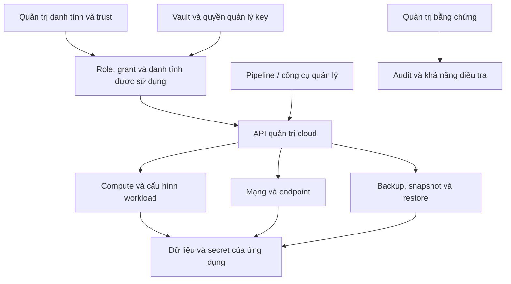

# Tách cloud control plane

## 1. Vì sao quyền quản trị cloud cần một ranh giới riêng?

Cloud control plane là tập khả năng dùng để tạo, thay đổi và quản trị tài nguyên cùng các quan hệ truy cập trong môi trường cloud. Một người hoặc workload có thể tác động tới nhiều hệ thống bằng API mà không cần đăng nhập trực tiếp vào máy chủ.

Trong PAM, cần bảo vệ không chỉ mật khẩu root hay phiên SSH/RDP, mà cả khả năng sửa IAM, thay trust, gắn danh tính vào compute, đổi cấu hình triển khai, sửa mạng, quản lý khóa hoặc thay đường ghi bằng chứng.

Ví dụ, một người không có quyền trực tiếp đọc database vẫn có thể tạo một đường tiếp cận nếu được phép chạy mã dưới danh tính có quyền đọc, khôi phục bản sao dữ liệu sang tài nguyên khác hoặc tự cấp role mạnh. Những khả năng gián tiếp này quyết định mức nhạy cảm thực tế.

Tách cloud control plane là tổ chức danh tính, thiết bị, thẩm quyền, scope và đường thực thi để một chủ thể ở vùng có mức bảo vệ thấp hơn không dễ điều khiển các khả năng quản trị có tác động lớn hơn.

Mục tiêu không phải chỉ tạo một subscription hoặc account mới rồi đặt tên “management”. Ranh giới phải được thực thi ở những điểm có thể thay đổi quyền và tài nguyên.

Bài học thuộc chương Tiering, kết hợp phân tầng truy cập với least privilege, JIT/JEA, vault, credential ngắn hạn, giám sát và bằng chứng. Các sơ đồ, role và workflow dưới đây là mô hình tham khảo, không phải cấu hình có thể áp dụng nguyên trạng cho mọi cloud.

## 2. Thống nhất ý nghĩa của control plane trước khi phân tầng

Các tài liệu có thể dùng thuật ngữ “control plane” ở các phạm vi khác nhau:

| Phạm vi | Ý nghĩa |
|---|---|
| API của dịch vụ cloud | Các thao tác quản lý tài nguyên thay vì sử dụng dữ liệu của tài nguyên |
| Kiến trúc truy cập doanh nghiệp | Hệ thống kiểm soát danh tính và quyền ở phạm vi rộng |
| Hạ tầng nội bộ nhà cung cấp | Thành phần vận hành nền tảng do nhà cung cấp quản lý |

Trong bài, trọng tâm là **những khả năng quản trị mà khách hàng có thể sử dụng hoặc cấu hình**, gồm quản trị danh tính/quyền và quản trị tài nguyên cloud. Không giả định tổ chức có quyền quản trị hạ tầng nội bộ của nhà cung cấp.

Microsoft Azure phân biệt control plane dùng để quản lý tài nguyên với data plane dùng khả năng mà tài nguyên cung cấp, chẳng hạn tạo storage account khác với đọc/ghi dữ liệu bên trong. [Microsoft — Control plane and data plane](https://learn.microsoft.com/en-us/azure/azure-resource-manager/management/control-plane-and-data-plane)

Ở mô hình truy cập doanh nghiệp của Microsoft, control plane tập trung vào kiểm soát truy cập/danh tính, management plane hỗ trợ quản trị hạ tầng và data/workload plane chứa ứng dụng cùng dữ liệu. [Microsoft — Enterprise access model](https://learn.microsoft.com/en-us/security/privileged-access-workstations/privileged-access-access-model)

Hai cách dùng không mâu thuẫn, nhưng cần ghi rõ khi thiết kế. Một API được nhà cung cấp xếp vào control plane có thể thuộc nhiệm vụ vận hành một workload cụ thể; một hệ thống danh tính có thể kiểm soát nhiều cloud cùng lúc.

### Cách gọi thống nhất trong bài

- **Quản trị danh tính/quyền:** issuer, federation, role assignment, chính sách truy cập và khả năng cấp quyền.
- **Quản trị tài nguyên cloud:** compute, network, deployment và cấu hình dịch vụ.
- **Vận hành workload/data:** tác vụ bên trong ứng dụng, hệ điều hành, database hoặc dữ liệu.

Mức bảo vệ được chọn theo tác động thật của từng khả năng, không chỉ theo nhãn của API.

## 3. Nhìn đường kiểm soát thay vì chỉ nhìn đường đăng nhập

Một khả năng quản trị có thể ảnh hưởng dữ liệu theo nhiều đường:



Sơ đồ mô tả quan hệ cần đánh giá, không khẳng định mọi permission trong mỗi nhóm đều cho toàn bộ khả năng phía sau.

| Khả năng | Câu hỏi về tác động gián tiếp |
|---|---|
| Sửa role assignment | Có thể cấp cho mình hoặc người khác quyền mạnh hơn không? |
| Sửa federation/mapping | Có thể làm một workload khác được nhận diện thành principal được tin cậy không? |
| Gắn hoặc sử dụng service identity | Có thể chạy mã bằng danh tính có quyền trên dữ liệu không? |
| Sửa deployment/script | Mã mới có thể lấy secret hoặc gọi API bằng identity của runtime không? |
| Quản lý snapshot/restore | Có thể tạo một bản dữ liệu tại nơi ít được bảo vệ hơn không? |
| Quản lý key hoặc key policy | Có thể mở quyền dùng key hoặc làm dữ liệu không còn truy cập được không? |
| Sửa logging/export | Có thể làm mất dấu vết hoặc thay nơi lưu bằng chứng không? |

Không thể đánh giá an toàn chỉ bằng việc một role thiếu permission “read database”. Cần xét cả khả năng tạo ra một chủ thể, bản sao hoặc đường gọi có quyền đó.

## 4. Các ranh giới cần tách đồng thời

Một thiết kế có thể xem ít nhất năm ranh giới:

| Ranh giới | Mục tiêu |
|---|---|
| Danh tính | Không dùng cùng credential/phiên cho công việc thường và quản trị mạnh |
| Nguồn truy cập | Không đưa quyền mạnh vào endpoint có mức bảo vệ thấp hơn |
| Scope tài nguyên | Không để một nhiệm vụ cục bộ mở rộng sang toàn môi trường |
| Thẩm quyền thay đổi | Không cho người dùng tự sửa điều kiện cấp quyền của mình |
| Đường thực thi và bằng chứng | Kiểm soát cả API, automation và đường khẩn cấp |

Tách chỉ một ranh giới có thể chưa đủ. Ví dụ, account production riêng nhưng cùng một pipeline development có quyền triển khai mã và dùng identity mạnh thì đường kiểm soát vẫn nối qua pipeline đó.

Tương tự, tài khoản cloud admin riêng nhưng đăng nhập từ browser profile cá nhân trên máy thường vẫn đưa phiên mạnh vào môi trường nguồn không đạt yêu cầu.

### Tiering không phải chỉ đánh số máy

Không nhất thiết mọi cloud phải sao chép một hệ thống tier đánh số cố định. Cần xây nhóm bảo vệ theo phạm vi ảnh hưởng và các quan hệ kiểm soát.

Một quản trị viên chỉ thay cấu hình một dịch vụ lab khác với người sửa trust áp dụng cho toàn tenant. Nhưng một công cụ quản lý nhiều workload, hệ thống vault hoặc pipeline trung tâm có thể cần được bảo vệ theo khả năng điều khiển của nó, dù tên máy không gợi ý “identity server”.

## 5. Tách danh tính con người và điều kiện kích hoạt

### 5.1. Tài khoản theo trách nhiệm

Một người có thể có những danh tính phục vụ các mục đích khác nhau:

| Danh tính minh họa | Công việc |
|---|---|
| an.work | Email, cộng tác và công việc thông thường |
| an.cloud-maint | Tác vụ quản trị tài nguyên trong scope được giao |
| an.access-governance | Thao tác quản trị quan hệ quyền khi được ủy quyền |

Đây là ví dụ tổ chức, không yêu cầu mọi người phải có đúng ba tài khoản. Số lượng và cách tách phụ thuộc mô hình danh tính, khả năng nền tảng và mức tác động.

Cần giữ quan hệ với cùng một con người cho kiểm toán và quy tắc tự duyệt. Tách account không cho phép một người dùng account này gửi request rồi account kia duyệt như hai người độc lập.

### 5.2. Quyền mạnh không nên luôn active chỉ vì được giao nhiệm vụ

PAM có thể quản lý eligibility và activation có hạn cho những tác vụ nhạy cảm. Quyết định nên gắn với actor, scope, role/profile, mục đích và thời hạn.

Một người đủ điều kiện quản trị cloud không mặc nhiên được nhận mọi role ở mọi account/project. Kích hoạt role cũng không tự cấp quyền sửa policy đã quyết định role đó.

MFA, độ mới xác thực, thiết bị quản trị và approval cần được áp dụng theo mức tác động. Chúng bổ sung cho giới hạn permission, không thay thế permission.

### 5.3. Recovery và hỗ trợ danh tính nằm trong ranh giới đặc quyền

Nếu helpdesk thông thường có thể reset MFA hoặc thêm authenticator cho tài khoản kiểm soát toàn môi trường, chức năng hỗ trợ đó trở thành đường tới tầng quản trị mạnh.

Cần xác định ai được khôi phục những danh tính này, dùng bằng chứng nào, có cần phân tách trách nhiệm không và phiên/quyền cũ bị xử lý ra sao. Không chỉ bảo vệ luồng đăng nhập chính rồi bỏ qua recovery.

## 6. Tách scope cloud và kiểm soát thừa kế

### 6.1. Account, subscription, project và tenant có ngữ nghĩa khác nhau

Các đơn vị tổ chức tài nguyên giúp phân chia ownership, policy, billing và quyền. Nhưng chúng không có cùng ngữ nghĩa ở mọi nhà cung cấp.

Google Cloud dùng hierarchy organization–folder–project, trong đó quyền và policy có thể được áp dụng từ các cấp cha. [Google Cloud — Resource hierarchy](https://docs.cloud.google.com/resource-manager/docs/cloud-platform-resource-hierarchy)

Suy luận thiết kế là phải kiểm tra quyền thừa kế từ trên xuống. Một project đã tách khỏi workload khác vẫn có thể chịu cùng một assignment hoặc principal mạnh ở cấp cha.

Không coi một resource group, folder hoặc nhãn môi trường là ranh giới an toàn độc lập nếu quyền ở cấp cao hơn vẫn cho phép thay đổi mọi thành phần bên trong.

### 6.2. Dùng guardrail đúng ý nghĩa

Một guardrail có thể giới hạn điều gì được phép xảy ra, nhưng không nhất thiết tự cấp quyền thực hiện tác vụ.

Ví dụ, AWS SCP giới hạn phạm vi quyền khả dụng và không tự cấp IAM permission; SCP cũng không áp dụng cho user/role trong management account như với member account. [AWS Organizations — Service control policies](https://docs.aws.amazon.com/organizations/latest/userguide/orgs_manage_policies_scps.html)

Không nên giả định rằng đặt tất cả vào một organization policy sẽ bảo vệ mọi principal và mọi đường gọi. Cần kiểm tra phạm vi áp dụng, trường hợp ngoại lệ và quyền có thể sửa chính guardrail đó.

### 6.3. Tách production và non-production theo quan hệ tin cậy

Một mô hình có thể dùng scope, identity, pipeline và kho credential khác nhau cho production và môi trường thử nghiệm.

Điều cần tránh là cho actor trong môi trường thấp hơn tự thay phần cấu hình hoặc secret quyết định đường vào production. Ví dụ:

- Pipeline lab có thể nhận role triển khai production qua trust quá rộng.
- Người vận hành non-production có thể sửa repository/script được workflow production tin cậy.
- Workload thử nghiệm dùng cùng identity có quyền đọc vault production.
- Nhóm support chung có thể sửa policy hoặc recovery của tài khoản quản trị cấp cao.

Tách tài nguyên cần đi cùng việc cắt hoặc quản trị những quan hệ này.

## 7. Tách máy nguồn, công cụ và phiên quản trị

### 7.1. Không đưa credential hoặc phiên mạnh xuống vùng ít được bảo vệ

Người quản trị danh tính/quyền cần dùng nguồn đáp ứng mức bảo vệ tương xứng. Không nên đăng nhập account mạnh trên máy ứng dụng hoặc jump host thuộc quyền quản trị của một nhóm có mức kiểm soát thấp hơn chỉ để tiện xử lý.

Một quản trị viên có thể quản lý workload bằng API hoặc automation mà không cần mở một phiên mang credential mạnh trực tiếp trong workload đó. Phải chọn đường thực thi phù hợp với tác vụ.

### 7.2. Cloud console, CLI và shell là các đường cùng cần quản trị

Chặn RDP/SSH không ngăn một người dùng cloud API để thay cấu hình. Một browser console hoặc cloud shell cũng có thể tạo khả năng quản trị đáng kể.

Cần biết nơi lưu token, identity được client chọn, độ mới xác thực và những nguồn credential mà SDK/CLI có thể dùng. Không để công cụ âm thầm rơi về access key dài hạn hoặc profile khác khi luồng chính lỗi.

Cùng một PAW có thể cần tách ngữ cảnh theo mức tác động nếu kiến trúc hỗ trợ và được đánh giá. Nhưng chỉ dùng hai tab hoặc hai tên profile không tự chứng minh đã có ranh giới phù hợp.

### 7.3. Output từ workload vẫn là dữ liệu cần thận trọng xử lý

Log, script hoặc file lấy từ một workload có thể chịu quyền sửa của bên khác. Không nên tải và chạy chúng trên máy quản trị mạnh như một bước mặc định.

Một đường hỗ trợ phải chỉ rõ công cụ nào xử lý dữ liệu và có làm chạy mã hay không. Trách nhiệm quản trị một workload không biến mọi nội dung của workload thành nguồn tin cậy cho control plane.

## 8. Thiết kế role theo tác vụ và khả năng tăng quyền

### 8.1. Tách các nhóm khả năng

Một ma trận ý định có thể như sau:

| Trách nhiệm | Khả năng được xem xét | Khả năng cần tách hoặc ủy quyền riêng |
|---|---|---|
| Người dùng dữ liệu | Sử dụng chức năng ứng dụng theo scope | Sửa hạ tầng, IAM hoặc trust |
| Vận hành workload | Chẩn đoán, tác vụ ứng dụng/OS được giao | Tự gán role cloud mạnh |
| Bảo trì tài nguyên | Tác vụ cloud cụ thể trong scope | Sửa federation, cấp mọi service identity |
| Quản trị quyền | Quản lý một tập assignment theo policy | Tự sửa toàn bộ giới hạn của chính mình |
| Quản trị pipeline mạnh | Quản lý đường triển khai có tác động tương ứng | Cho mọi developer sửa mã thực thi production |
| Người kiểm tra bằng chứng | Đọc tập audit được giao | Sửa/xóa bằng chứng hoặc thực hiện thay đổi tài nguyên |

Các tập này có thể chồng lấn theo tổ chức, nhưng phần chồng lấn cần được xét tác động. Tên role “Contributor”, “Operator” hoặc “Viewer” không đủ để hiểu quyền thật nếu chưa xem định nghĩa.

### 8.2. Hạn chế quyền ủy quyền và dùng danh tính khác

Cần xem các khả năng gắn identity vào compute, cho workload sử dụng role, tạo key, impersonation hoặc đổi trust. Một người có thể không tự assume một role, nhưng có thể triển khai mã vào nơi role đó được sử dụng.

Vì vậy, quyền triển khai và quyền sử dụng identity cần được đánh giá cùng nhau. Không nên gắn identity mạnh vào một workload mà nhóm ít được bảo vệ hơn có thể thay image hoặc tham số chạy tùy ý.

### 8.3. API ghi cấu hình có thể rộng hơn một tác vụ

Một permission cập nhật tài nguyên có thể cho sửa nhiều thuộc tính, không chỉ tham số mà công việc cần. Không phải nền tảng nào cũng hỗ trợ giới hạn quyền đến từng field theo ý muốn.

Nếu cần tác vụ rất hẹp, có thể dùng workflow/broker thực thi đã được bảo vệ, với template và tham số được kiểm tra phía máy chủ. Người gọi chỉ được yêu cầu tác vụ đó, không được sửa mã hoặc gửi template tùy ý để dùng quyền backend.

Cơ chế này chỉ hữu ích khi điểm thực thi thực sự hạn chế được tác vụ và không có đường gọi trực tiếp bằng cùng quyền rộng.

## 9. Automation là một phần của control plane

### 9.1. Tách danh tính workload khỏi người dùng

Pipeline hoặc job cần danh tính riêng, có owner và scope phù hợp. Không nhúng credential cá nhân của cloud admin để tự động hóa.

Credential ngắn hạn hoặc federation giúp giảm phân phối secret dài hạn, nhưng trust phải giới hạn đúng nguồn workload, môi trường và mục đích. Một token được ký hợp lệ từ issuer chung chưa chắc thuộc pipeline được phép triển khai production.

Nếu công việc cần approval, bằng chứng cần giữ quan hệ giữa người/hệ thống khởi tạo, quyết định, run và danh tính automation thực hiện.

### 9.2. Người sửa pipeline có thể sửa hành vi đặc quyền

Cần kiểm soát repository, workflow definition, runner, artifact, template, plugin và cấu hình provider. Nếu một người có thể thay một đoạn script được chạy dưới identity quản trị mạnh, họ có thể tác động tới khả năng của identity đó.

Một approval triển khai không nên chỉ xem tên job nếu nội dung thực thi có thể thay sau khi duyệt. Quyết định cần gắn với version hoặc artifact đã xác định theo thiết kế.

### 9.3. Tách task runner theo phạm vi

Một runner dùng chung cho mọi môi trường có thể làm trộn credential, cache và quyền. Có thể cần tách theo mức nhạy cảm, dùng runtime có vòng đời phù hợp và giới hạn đường lấy credential.

Không nên giải quyết bằng cách chỉ đổi tên biến `PROD_TOKEN`. Cần ranh giới người được sửa, nơi thực thi, nguồn credential và policy ở cloud đích.

## 10. Ví dụ: điều chỉnh capacity bằng workflow cố định

### 10.1. Nhu cầu

Nhóm vận hành thanh toán cần điều chỉnh capacity của một tập compute production. Họ không cần sửa IAM, thay service identity, chạy script tùy ý hay đọc secret.

Tổ chức chọn một workflow bảo trì đã được bảo vệ. Workflow chỉ nhận những tham số được cho phép và thực thi trên tập tài nguyên được máy chủ phân giải. Template và mã thực thi không nằm trong quyền sửa của người đề nghị tác vụ.

### 10.2. Các bên và giới hạn

| Thành phần | Trách nhiệm |
|---|---|
| Kỹ sư vận hành | Gửi yêu cầu tác vụ trong scope |
| Chủ sở hữu tài nguyên | Xem xét nhu cầu và tác động thay đổi |
| Policy/PAM | Kiểm tra danh tính, nguồn, quyền, grant và điều kiện |
| Workflow được bảo vệ | Xác minh tham số và gọi API bằng identity riêng |
| Identity automation | Chỉ có tập quyền cần cho cơ chế được chọn |
| Kho bằng chứng | Giữ request, quyết định, run và cloud event liên quan |

Nếu provider không cho giới hạn quyền backend đủ hẹp, phần quyền còn rộng phải được thừa nhận và bảo vệ bằng ranh giới workflow tương xứng. Không tuyên bố một field trong YAML đã tạo giới hạn ở IAM khi nền tảng không hỗ trợ.

### 10.3. Ý định quyền minh họa

```yaml
access_profile_ref: payments-capacity-maintenance-v3
human_scope:
  allowed_operation: request_capacity_change
  resource_set_ref: payments-production-compute
  direct_cloud_write: denied
  iam_and_trust_management: denied
execution:
  workflow_ref: protected-capacity-workflow
  artifact_revision_ref: reviewed-workflow-revision-731
  automation_identity_ref: payments-capacity-runner
  caller_supplied_template: denied
  parameter_profile_ref: approved-capacity-bounds
grant:
  request_ref: change-731
  beneficiary_ref: principal-operator-17
  not_before: "2026-11-26T14:00:00+07:00"
  absolute_access_until: "2026-11-26T14:30:00+07:00"
conditions:
  approved_admin_source: required
  strong_recent_authentication: required
  current_authorization: required
evidence:
  link_request_decision_run_cloud_events: true
```

Đây là dữ liệu giả mô tả thiết kế. Tên hành động không phải permission chuẩn của một provider và các field không tự thực thi. Cần ánh xạ tới khả năng thật của IAM, PAM và workflow.

### 10.4. Diễn biến

1. Kỹ sư gửi request cho tập compute đã được kiểm kê cùng mức capacity đề nghị.
2. Hệ thống kiểm tra scope, giới hạn tham số và căn cứ thay đổi.
3. Quyết định được gắn với request revision và workflow revision phù hợp.
4. Khi kích hoạt, PAM kiểm tra lại actor, nguồn quản trị, grant và trạng thái hiện hành.
5. Workflow nhận một tác vụ cụ thể; người gọi không được thay identity hoặc target ngoài phạm vi.
6. Automation dùng credential phù hợp với thời hạn và quyền đã thiết kế.
7. Cloud API thực hiện hoặc từ chối thao tác; kết quả được ghi cùng run reference.
8. Hệ thống đối soát trạng thái tài nguyên, quyền có hạn và bằng chứng.

Một quyết định chấp thuận không chứng minh thay đổi đã thành công. Một cloud API trả thành công cũng có thể cần đối soát tác vụ bất đồng bộ tới trạng thái cuối cùng.

### 10.5. Những điều không được suy ra

- Có quyền gửi tác vụ không có nghĩa được gọi mọi API bằng identity backend.
- Được phép điều chỉnh capacity không có nghĩa được đổi image hoặc service identity.
- Hoàn thành MFA không cấp thêm scope.
- Workflow tên production không chứng minh mã thực thi đã được bảo vệ.
- Hết grant không tự hoàn tác capacity đã thay đổi.
- Credential hết hạn không tự kết thúc mọi tác vụ đã khởi chạy.

## 11. Vault, key management, backup và logging có thể nối các tầng

### 11.1. Vault là điểm cấp khả năng truy cập

Một vault giữ credential cho nhiều môi trường cần được phân tách quyền sử dụng, đọc giá trị, rotation và quản trị policy. Người có quyền sửa policy vault có thể ảnh hưởng tới ai nhận credential.

Không nên để workload ít nhạy cảm hơn có quyền sửa hoặc lấy credential điều khiển toàn môi trường. Phân tách namespace/path chỉ có ý nghĩa khi quyền và cơ chế quản trị thực sự giữ ranh giới đó.

### 11.2. Key management có thể ảnh hưởng cả bí mật lẫn tính sẵn sàng

Quản trị key, quản trị key policy và quyền dùng key có thể là những khả năng khác nhau. Cần xét ai có thể tự cấp quyền dùng, thay điều kiện hoặc làm dữ liệu không còn truy cập được.

Không mặc định tên role “Key Administrator” nghĩa là không có đường tới dữ liệu; cũng không mặc định mọi người quản trị key đều trực tiếp đọc được plaintext. Phải kiểm tra quyền và khả năng thay đổi thật.

### 11.3. Backup và restore là đường tới bản sao dữ liệu

Quyền tạo, copy, export hoặc restore snapshot có thể tạo bản dữ liệu ngoài môi trường ban đầu. Vì vậy, tách data-plane read không đủ nếu đường backup vẫn mở rộng không kiểm soát.

Cần xem nơi nhận, encryption/key, identity thực thi, khả năng sửa policy và bằng chứng. Đặc biệt, tài khoản vận hành backup trung tâm có thể có phạm vi tác động lớn hơn một workload đơn lẻ.

### 11.4. Bằng chứng cần được bảo vệ khỏi người tạo sự kiện

Người có quyền thay đổi tài nguyên không nên mặc nhiên có quyền xóa mọi audit về thay đổi đó. Có thể cần scope lưu riêng, quyền ghi/đọc/xóa tách biệt và cơ chế bảo vệ theo khả năng nền tảng.

Tuy nhiên, một kho log “ở account khác” chưa đủ nếu cùng principal mạnh vẫn quản trị cả hai hoặc có thể sửa đường chuyển log. Cần đánh giá quan hệ kiểm soát đầy đủ.

## 12. Mạng hỗ trợ ranh giới nhưng không thay IAM

Cloud API có thể được tiếp cận qua nhiều endpoint và kênh. Việc chặn một đường SSH không thay quyền gọi API quản trị.

Một thiết kế có thể dùng private endpoint, egress được quản lý hoặc điều kiện network phù hợp cho một số dịch vụ. Cần xác nhận dịch vụ, kiểu gọi và context mà nền tảng hỗ trợ.

Không nên coi source IP của broker là danh tính người dùng gốc. Nếu backend thay mặt actor gọi API, cần giữ subject, grant, task và scope trong quan hệ đã được xác minh.

Location/network condition cũng không thay thế quản trị trust hoặc role. Một principal đã vào đúng mạng vẫn chỉ được dùng quyền đúng phạm vi. Ngược lại, policy mạng quá rộng có thể cho phép đường trực tiếp bỏ qua điểm PAM dự kiến.

## 13. Thu hồi, sự cố và đường khẩn cấp

### 13.1. Phân biệt quyền được cấp và credential đã phát

Thu hồi eligibility hoặc trust có thể ngăn cấp mới nhưng chưa có cùng tác động với credential đã phát, phiên console, tác vụ cloud bất đồng bộ hoặc kết nối đích.

Cần xác định theo từng loại:

| Đối tượng | Câu hỏi khi thu hồi |
|---|---|
| Assignment/grant | Có chặn activation và hành động mới chưa? |
| Credential tạm | Có cơ chế làm mất quyền sớm hay phải chờ hạn/điểm thực thi khác? |
| Console/CLI session | Trạng thái xác thực và quyền được đánh giá lại thế nào? |
| Automation run | Có thể dừng đúng tác vụ không, tác động đã xảy ra là gì? |
| Secret đã đọc | Cần rotation hay xử lý consumer nào? |
| Resource đã thay đổi | Có cần khôi phục cấu hình theo quyết định riêng không? |

Không báo “đã thu hồi toàn bộ” chỉ vì một hệ thống đã gửi lệnh. Giữ kết quả xác nhận, thất bại và phần chưa biết để đối soát.

### 13.2. Ứng phó phải xét đường tăng quyền

Khi một workload bị xâm nhập, cần xem identity của nó, quyền tới vault, khả năng tác động pipeline, trust và các tài nguyên quản trị khác. Không chỉ dừng container rồi bỏ qua credential có thể đã được lấy.

Khi một tài khoản control plane bị nghi bị chiếm, cần bảo vệ bằng chứng và xác định thay đổi quyền, identity, key, logging và tài nguyên trong phạm vi nghi vấn. Đổi password đơn lẻ có thể chưa xử lý hết authenticator, phiên hoặc trust đã bị thay.

### 13.3. Break-glass cần độc lập đủ để phục hồi

Nếu IdP hoặc đường PAM chính lỗi, đường khẩn cấp phải được chuẩn bị trước với danh tính, quyền, cách bảo quản credential, người kích hoạt và bằng chứng.

Không cần biến mọi ngoại lệ thành một quyền toàn cục không có hạn. Phạm vi nên đủ cho mục đích phục hồi; sau sử dụng cần đối soát thay đổi, xử lý credential và đóng quyền tạm.

Quy trình cũng phải tính tới việc người quản trị cloud không còn truy cập được kho credential khẩn cấp vì chính sự cố đang xử lý. Chuẩn bị phụ thuộc là một phần của tách control plane, không chỉ là bài toán tài khoản dự phòng.

## 14. Kiểm tra ranh giới và đo kết quả

### 14.1. Kiểm kê theo đồ thị khả năng kiểm soát

Với mỗi chủ thể, công cụ và dịch vụ, hỏi:

- Có thể cấp hoặc thay quyền của ai?
- Có thể sửa mã chạy dưới identity nào?
- Có thể gắn identity mạnh vào tài nguyên nào?
- Có thể lấy secret/key hoặc tạo bản sao dữ liệu nào?
- Có thể sửa logging, backup hoặc policy ở đâu?
- Ai quản trị chính thiết bị, pipeline và kho bằng chứng đó?

Một đường không được ghi trong danh sách role vẫn có thể xuất hiện qua automation, recovery hoặc quyền quản trị hạ tầng.

### 14.2. Bằng chứng phải nối người, quyết định và API

Chuỗi cần liên kết:

```text
Người/hệ thống khởi tạo + nguồn quản trị
    -> Request và phạm vi
    -> Quyết định/activation có hạn
    -> Identity hoặc workflow thực hiện
    -> Cloud API và tài nguyên đích
    -> Kết quả thay đổi
    -> Thu hồi/hết hạn và đối soát
```

Không mặc định session recording bao phủ mọi cloud API. Browser recording, broker transcript và audit API có khả năng quan sát khác nhau; cần biết nguồn nào chứng minh bước nào.

Log cũng không nên chứa access key, token hay secret nhận từ vault. Dùng principal, request, grant và run reference để nối bằng chứng theo dữ liệu thực tế.

### 14.3. Những lỗi thường gặp

| Lỗi | Vì sao ranh giới còn hở? | Điều chỉnh |
|---|---|---|
| Chỉ tách account/project | Cùng principal hoặc pipeline vẫn kiểm soát cả hai | Xét identity, trust và thừa kế |
| Role không đọc data nên coi là an toàn | Có thể tạo đường đọc gián tiếp | Xét deployment, identity, key và snapshot |
| Chỉ quản lý SSH/RDP | API cloud vẫn có thể thay mọi tài nguyên | Bao phủ console, CLI và automation |
| Mọi admin dùng một endpoint chung | Credential/phiên mạnh đi vào vùng thấp hơn | Tách nguồn và ngữ cảnh theo mức tác động |
| Pipeline production do nhóm thấp hơn sửa tùy ý | Có thể đổi mã chạy dưới quyền mạnh | Bảo vệ definition, artifact và runner |
| Guardrail được coi là permission | Nhầm giới hạn với cấp quyền | Kiểm tra mô hình đánh giá provider |
| Token ngắn hạn nên role có thể rất rộng | Tác động vẫn lớn khi token còn hiệu lực | Least privilege và scope thực tế |
| Xóa grant là chấm dứt mọi hoạt động | Credential và tác vụ có vòng đời khác | Xác nhận từng lớp |
| Log ở nơi khác nên không thể bị xóa | Cùng bên có thể quản trị cả hai | Tách thẩm quyền và bảo vệ đường audit |

### 14.4. Thực hành trên môi trường lab

Chọn một môi trường cloud lab không có dữ liệu production. Mô hình hóa ba trách nhiệm: vận hành workload, thực hiện một tác vụ quản trị tài nguyên và quản trị quyền.

Lập bảng identity, scope, công cụ nguồn, pipeline, vault/key và kho bằng chứng. Vẽ các quan hệ “có thể sửa”, “có thể cấp quyền”, “có thể chạy mã dưới identity” để tìm đường đi từ workload lên những khả năng mạnh hơn.

Thiết kế một workflow có tác vụ hẹp, quyền có hạn và tham số được kiểm tra. Kiểm tra rằng người vận hành không thể thay target, identity, template hoặc scope ngoài quyết định; một run cũ hoặc grant hết hạn cũng không tạo cửa sổ quyền mới.

Cuối cùng, mô tả cách thu hồi identity của một run đang hoạt động và đối soát tác động đã xảy ra. Đầu ra cần chứng minh ranh giới kiểm soát thực sự tồn tại qua danh tính, thiết bị, scope và automation, thay vì chỉ có những tài nguyên được đặt ở các folder khác nhau.
