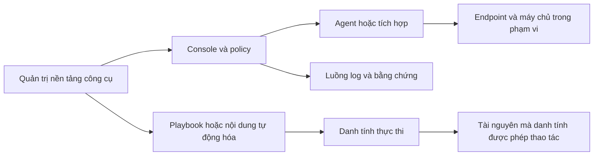

# Tách security tool admin

## 1. Vì sao quản trị công cụ bảo mật cần được tách riêng?

Security tool admin là người hoặc danh tính tự động hóa có quyền quản trị một công cụ bảo mật. Phạm vi có thể gồm cấu hình EDR, nguồn log SIEM, playbook SOAR, máy quét, nền tảng quản lý credential hoặc tích hợp danh tính.

Những công cụ này thường có khả năng quan sát rộng, thao tác trên nhiều endpoint hoặc sử dụng credential đặc biệt. Vì vậy, quyền quản trị công cụ có thể tạo ảnh hưởng lớn hơn tên gọi của nó. Một tài khoản không mang tên “Domain Admin” vẫn có thể ảnh hưởng hệ thống danh tính nếu nó điều khiển một công cụ có khả năng quản trị các hệ thống đó.

Trong quản lý truy cập đặc quyền (Privileged Access Management, PAM), tách security tool admin nhằm giới hạn phạm vi kiểm soát, tránh gom quyền vận hành với quyền thay đổi cơ chế giám sát, và giữ khả năng truy vết khi có sự cố.

Sau bài học, người học có thể:

- Xác định mức nhạy cảm của quyền công cụ theo khả năng tác động thực tế.
- Phân biệt người phân tích, người ứng phó, kỹ sư nội dung và quản trị nền tảng.
- Tách tài khoản, phạm vi, đường truy cập và danh tính tự động hóa.
- Áp dụng JIT, phê duyệt và kiểm soát thay đổi cho tác vụ nhạy cảm.
- Kiểm thử quyền hiệu lực và bảo vệ bằng chứng độc lập.

## 2. Tình huống: một tài khoản quản trị mọi lớp

Đội bảo mật có một nhóm dùng chung để đọc alert, cô lập endpoint, sửa detection rule, quản lý connector và cấp thêm quyền trong console. Một số thành viên còn dùng cùng tài khoản đó để quản trị hệ điều hành và kho log.

Thiết kế này thuận tiện khi bắt đầu, nhưng tạo nhiều khả năng chồng lấn. Một danh tính bị chiếm có thể thay đổi cơ chế phát hiện rồi tác động đến endpoint. Một lỗi cấu hình có thể ảnh hưởng toàn bộ hệ thống thay vì một nhóm tài nguyên.

Nếu cùng danh tính còn quản trị nơi giữ audit, việc điều tra thay đổi của chính danh tính đó cũng trở nên khó bảo đảm. Tách công việc chỉ bằng mô tả trách nhiệm trên giấy chưa xử lý được quyền kỹ thuật đang gộp lại.

Một thiết kế phù hợp hơn phân chia khả năng theo công việc, xác định những thao tác cần quyền tạm thời và kiểm soát đường mà mỗi danh tính được dùng. Điều này không có nghĩa bắt buộc mọi tổ chức phải có một người riêng cho từng nút bấm; mục tiêu là giảm quyền thường trực và tránh các tổ hợp quyền không được đánh giá.

## 3. Phân tầng theo khả năng điều khiển, không theo nhãn sản phẩm

Trước khi gán tier, cần hỏi công cụ có thể làm gì và trên hệ thống nào:

- Có chạy tác vụ hoặc thay đổi cấu hình trên endpoint không?
- Có quản lý agent, gói cập nhật hoặc script được triển khai rộng không?
- Có sử dụng hoặc cấp credential truy cập hệ thống khác không?
- Có sửa policy danh tính, cấp role hoặc thay đổi phương thức xác thực không?
- Có đọc, thay đổi, ngừng thu thập hoặc làm mất bằng chứng quan trọng không?

Microsoft liệt kê quản trị công cụ quản lý hoặc bảo mật có agent trên các hệ thống đặc biệt nhạy cảm trong phạm vi cần mức bảo vệ privileged tương ứng. Ý nghĩa thiết kế là phải xét quan hệ điều khiển gián tiếp, không chỉ quyền đăng nhập trực tiếp của tài khoản. [Hướng dẫn về mức bảo vệ privileged access](https://learn.microsoft.com/en-us/security/privileged-access-workstations/privileged-access-security-levels).

Không mặc định mọi người đọc alert đều thuộc cùng tier với người có thể triển khai tác vụ toàn doanh nghiệp. Ngược lại, không xếp một console vào tầng ít nhạy cảm chỉ vì nó được gọi là công cụ “giám sát”.

Tổ chức cần định nghĩa quy tắc phân tầng của mình. Mô hình enterprise access của Microsoft mở rộng mô hình AD tier truyền thống sang các mặt phẳng điều khiển, quản lý và dữ liệu/workload. Vì vậy, không nên bê nguyên số tier cũ sang mọi dịch vụ cloud mà bỏ qua ý nghĩa kiểm soát. [Enterprise access model](https://learn.microsoft.com/en-us/security/privileged-access-workstations/privileged-access-access-model).

## 4. Lập đồ thị quyền gián tiếp của công cụ

Một sơ đồ quan hệ đơn giản giúp nhìn thấy phạm vi ảnh hưởng:



Mỗi mũi tên cần được kiểm chứng. Không phải công cụ nào cũng có mọi khả năng trong sơ đồ, và một khả năng có thể bị giới hạn bởi cấu hình hoặc role.

Đặc biệt, quyền sửa một playbook có thể tạo ảnh hưởng theo quyền của danh tính thực thi playbook, dù người sửa không trực tiếp có role tương ứng trên tài nguyên đích. Quyền cập nhật agent cũng cần được xem xét theo nơi agent có quyền hoạt động.

Phải xét cả nền tảng nằm dưới console: tenant cloud, máy chủ chạy công cụ, database cấu hình, kho gói, pipeline phát hành, IdP và hệ thống recovery. Tách role trong ứng dụng có thể chưa đủ nếu cùng người vẫn có toàn quyền trên máy chủ hoặc subscription chứa ứng dụng đó.

## 5. Phân chia công việc thành capability

Nên bắt đầu từ các tác vụ thực tế, sau đó ánh xạ sang role được nền tảng hỗ trợ. Không dùng tên role như bằng chứng duy nhất rằng phạm vi đã phù hợp.

| Nhóm công việc | Khả năng cần thiết | Khả năng không nên được gộp mặc định |
|---|---|---|
| Phân tích bảo mật | Đọc dữ liệu phù hợp, phân loại và cập nhật incident | Quản trị IAM, thay retention hoặc cấu hình bảo vệ toàn bộ endpoint |
| Ứng phó sự cố | Thực hiện hành động đã được cho phép trên phạm vi đích | Sửa mọi policy hoặc dùng credential không liên quan |
| Kỹ thuật detection | Soạn, kiểm thử và phát hành nội dung theo quy trình | Tự vô hiệu hóa bằng chứng cho chính thay đổi đó |
| Quản trị nền tảng | Vận hành connector, cấu hình dịch vụ và cập nhật được cho phép | Tự cấp toàn bộ quyền cho bản thân mà không qua kiểm soát |
| Quản trị phân quyền | Gán quyền theo quyết định có thẩm quyền | Thực hiện mọi tác vụ bảo mật thường ngày bằng quyền quản trị IAM |
| Quản lý bằng chứng | Bảo vệ lưu trữ và hỗ trợ truy xuất theo trách nhiệm | Tùy ý sửa hoặc xóa mọi dấu vết liên quan đến chính hoạt động của mình |

Bảng thể hiện ý định thiết kế, không khẳng định mọi sản phẩm có sẵn đúng sáu role. Nếu sản phẩm chỉ có role rộng, phải xác định phần quyền thừa, kiểm soát bù đắp và phương án giảm rủi ro.

Một ví dụ thực tế là Microsoft Sentinel có các role riêng cho xem dữ liệu, quản lý incident, chỉnh sửa tài nguyên và chạy playbook. Tài liệu cũng cảnh báo quyền được cộng dồn từ các role gán cho cùng chủ thể. Vì vậy, cần đánh giá quyền hiệu lực, không chỉ nhìn một role hạn chế vừa được thêm. [Tài liệu role và permission của Sentinel](https://learn.microsoft.com/en-us/azure/sentinel/roles).

## 6. Ma trận tách quyền minh họa

Giả sử tổ chức có SIEM, công cụ endpoint và SOAR. Các capability trong bảng là tên nội bộ minh họa, không phải role của nhà cung cấp:

| Danh tính/công việc | Đọc alert | Ứng phó endpoint theo phạm vi | Sửa nội dung phát hiện | Sửa tích hợp/nền tảng | Gán quyền quản trị |
|---|---|---|---|---|---|
| Analyst | Theo dữ liệu được phép | Không mặc định | Đề xuất hoặc kiểm thử nếu được cấp riêng | Không | Không |
| Incident responder | Theo incident | Có điều kiện, đúng nhóm endpoint | Không mặc định | Không | Không |
| Detection engineer | Theo phạm vi phát triển | Không mặc định | Theo quy trình phát hành | Chỉ phần cần thiết nếu được cấp riêng | Không |
| Platform operator | Theo nhu cầu vận hành | Không mặc định | Không mặc định | Tác vụ được giới hạn, JIT khi phù hợp | Không mặc định |
| Access administrator | Chỉ dữ liệu cần cho cấp quyền | Không | Không | Không mặc định | Theo quy trình và phạm vi |

Không thể chỉ dùng bảng để bảo đảm tách quyền. Cần đối chiếu group lồng nhau, role cloud kế thừa, tài khoản local, API token, service principal và quyền bên dưới ứng dụng.

Quyền đọc dữ liệu cũng cần phạm vi. Alert, log và artifact có thể chứa thông tin cá nhân, dữ liệu nghiệp vụ hoặc bí mật bị ghi nhầm. “Analyst chỉ đọc” không có nghĩa được đọc mọi dữ liệu trong mọi môi trường.

Hành động ứng phó cũng có ảnh hưởng vận hành: cô lập endpoint hoặc chặn một đối tượng quan trọng có thể gây gián đoạn. Phạm vi và thẩm quyền của responder phải được thiết kế tương xứng, không mặc định ít rủi ro hơn mọi tác vụ cấu hình.

## 7. Tách danh tính và đường sử dụng

Một người có thể được giao nhiều trách nhiệm, nhưng không nên luôn làm mọi việc bằng một danh tính có toàn bộ quyền. Có thể dùng tài khoản định danh cá nhân cho công việc thông thường và danh tính quản trị riêng cho những tác vụ cần quyền cao, theo kiến trúc của tổ chức.

Tách danh tính cần đi cùng đường sử dụng:

- Danh tính quản trị công cụ chỉ dùng từ thiết bị và kênh được phép.
- Không sử dụng phiên quản trị nhạy cảm để đọc email hoặc làm việc không liên quan.
- Không dùng chung tài khoản hoặc credential quản trị cho cả đội.
- Không gộp token ứng dụng, profile trình duyệt và phương thức khôi phục một cách làm mất ý nghĩa phân tách.

Hai username khác nhau nhưng cùng thuộc nhóm toàn quyền thường trực chưa tạo giới hạn đáng kể. Tương tự, hai tài khoản không bảo đảm phân tách trách nhiệm nếu cùng một người có thể tự phê duyệt và tự thực hiện thay đổi bị kiểm soát.

Thiết bị nguồn, MFA và posture cần đáp ứng mức bảo vệ của tác vụ. Hoàn thành MFA không làm giảm phạm vi ảnh hưởng của một role rất rộng; nó chỉ giải quyết một phần yêu cầu xác thực.

## 8. Phân vùng công cụ theo tài nguyên và mức nhạy cảm

Một công cụ dùng cho toàn doanh nghiệp có thể chạm tới các hệ thống ở mức nhạy cảm khác nhau. Cần xem khả năng phân tách phạm vi trong role, device group, workspace, tenant hoặc mô hình triển khai.

Có thể thiết kế quyền responder cho nhóm workstation mà không cấp cùng khả năng trên hệ thống danh tính. Tác vụ với nhóm hệ thống nhạy cảm hơn cần danh tính, đường truy cập và phê duyệt tương ứng.

Không chỉ tách màn hình hiển thị. Nếu API hoặc automation identity vẫn có quyền trên mọi nhóm tài nguyên, phần phân vùng ở UI có thể không giới hạn được hành động thực tế.

Các lựa chọn như tách instance hoặc tenant quản lý có thể hữu ích khi sản phẩm không bảo đảm phạm vi cần thiết, nhưng làm tăng yêu cầu vận hành và đối chiếu. Cần đánh giá theo quan hệ điều khiển, không coi đây là bước bắt buộc cho mọi tổ chức.

Mục tiêu là không để một miền quản trị có mức bảo đảm thấp hơn điều khiển miền được bảo vệ cao hơn qua một công cụ trung gian. Cũng phải bảo đảm dữ liệu tập trung hoặc connector không âm thầm nối lại các phạm vi vừa tách.

## 9. Dùng PAM để cấp quyền quản trị công cụ theo công việc

Với các tác vụ ít thường xuyên và nhạy cảm, có thể cấp quyền JIT thay cho quyền quản trị thường trực. Yêu cầu cần xác định công cụ, tenant hoặc instance, capability, tập tài nguyên, thời lượng và căn cứ công việc.

Ví dụ:

```text
Công việc: cập nhật cấu hình connector theo CHG-LAB-106.
Nền tảng: security-platform-lab-a.
Phạm vi: connector ứng dụng payment trong staging.
Quyền: sửa cấu hình connector được chỉ định.
Thời hạn: 20 phút trong cửa sổ change của lab.
Điều kiện: danh tính cá nhân, thiết bị phù hợp, MFA theo policy,
           phê duyệt đúng phạm vi và lưu bằng chứng thay đổi.
```

Đây là ví dụ nghiệp vụ, không phải cấu hình của một sản phẩm. Nếu role thực tế cho phép sửa mọi connector của production, cần xử lý chênh lệch phạm vi trước khi gọi đây là quyền tối thiểu.

Nếu dùng vault, chỉ cấp khả năng lấy hoặc sử dụng đúng credential cần thiết. Không cấp quyền xem toàn bộ kho vì người dùng cần quản trị một công cụ. Nếu có thể sử dụng credential qua proxy hoặc cơ chế injection, cần kiểm chứng người dùng nhận được khả năng nào và bằng chứng nào được giữ.

Khi quyền hết hạn, đối chiếu role thực tế, phiên và token còn tồn tại. Xóa trạng thái active trên PAM chưa tự chứng minh một API token dài hạn đã mất hiệu lực ở console.

## 10. Kiểm soát thay đổi nhạy cảm trong công cụ bảo mật

Một số thay đổi cần có mức kiểm soát riêng vì có thể làm giảm bảo vệ hoặc mở rộng quyền:

| Thay đổi | Rủi ro cần đánh giá | Kiểm soát có thể áp dụng |
|---|---|---|
| Tắt rule hoặc thêm exclusion | Giảm khả năng phát hiện | Căn cứ change, phạm vi, thời hạn, đối chiếu sau áp dụng |
| Sửa cấu hình agent hoặc gói triển khai | Tác động nhiều endpoint | Review nội dung, nguồn phát hành, tập đích và cách rollback |
| Sửa connector hoặc định tuyến log | Mất dữ liệu hoặc đưa dữ liệu sai nơi | Kiểm thử nguồn/đích, quyền credential và giám sát luồng |
| Sửa playbook | Thay đổi hành động theo quyền runtime | Tách soạn–duyệt–phát hành và kiểm tra danh tính thực thi |
| Gán role hoặc tạo token | Tạo quyền lâu dài mới | Quy trình cấp quyền, phạm vi, thời hạn và kiểm kê |
| Đổi retention hoặc nơi giữ audit | Ảnh hưởng bằng chứng | Trách nhiệm quản lý riêng và kiểm soát lưu trữ phù hợp |

Không phải mọi thay đổi đều phải có cùng số người duyệt. Thiết kế cần tương xứng với rủi ro và có nhánh khẩn cấp rõ. Tuy nhiên, người đề xuất không nên tự bỏ qua một yêu cầu phân tách trách nhiệm bắt buộc chỉ vì đang dùng tài khoản khác.

Sau thay đổi, kiểm tra cả cấu hình đã lưu và hành vi thực tế. Một connector hiển thị enabled chưa chứng minh dữ liệu vẫn tới kho đúng; một detection rule vẫn tồn tại chưa chứng minh phiên bản mong muốn đang chạy.

## 11. Danh tính tự động hóa: phần thường bị bỏ sót

Tách quyền con người nhưng giữ một service principal toàn quyền dùng chung vẫn để lại một điểm kiểm soát rất rộng. Cần kiểm kê danh tính automation cùng quyền, người sở hữu, mục đích và nơi được sử dụng.

Đặc biệt, phân biệt:

- Người có thể soạn nội dung automation.
- Người có thể phát hành hoặc thay phiên bản đang chạy.
- Danh tính thực thi và quyền tại tài nguyên đích.
- Người có thể sửa quyền hoặc credential của danh tính thực thi.

Nếu người sửa playbook có thể dùng toàn bộ quyền runtime thông qua nội dung mới, role sửa playbook phải được đánh giá theo ảnh hưởng đó. Không chỉ kiểm tra người này có trực tiếp được gán role quản trị tài nguyên hay không.

Có thể tách automation identity theo công cụ, môi trường và loại tác vụ. Dùng credential hoặc workload identity có vòng đời phù hợp; giới hạn nơi cấp và nơi sử dụng. Không lưu credential toàn quyền trong repository, script cá nhân hoặc ticket.

Với credential phải giữ lâu dài do giới hạn nền tảng, cần quản lý vault, luân chuyển theo quy trình và đối chiếu phụ thuộc. Không khẳng định mọi thành phần có thể dùng credential ngắn hạn nếu tích hợp thực tế chưa hỗ trợ.

## 12. Bảo vệ bằng chứng độc lập với người thay đổi công cụ

Người quản trị công cụ có thể cần xem log để vận hành. Điều đó khác với khả năng tùy ý sửa hoặc xóa toàn bộ bằng chứng về chính hoạt động của họ.

Thiết kế nên xem xét đưa audit quan trọng tới nơi lưu trữ có kiểm soát độc lập, hạn chế quyền thay đổi retention và giám sát việc thay đổi pipeline. Nếu dùng tính năng lưu trữ bất biến hoặc cơ chế bảo vệ tương ứng, phải kiểm chứng cấu hình và các quyền có thể thay đổi cơ chế đó.

Không chỉ tách quyền trong ứng dụng rồi bỏ qua storage admin, cloud owner hoặc người giữ khóa mã hóa bên dưới. Khả năng kiểm soát hạ tầng lưu bằng chứng cũng thuộc đồ thị quyền cần đánh giá.

Các sự kiện cần nối được chủ thể, phiên hoặc token, tác vụ, phạm vi, phiên bản cấu hình, phê duyệt và kết quả. Không ghi password, private key hoặc token đầy đủ vào log để tạo liên kết.

Khi nguồn audit bị gián đoạn, phải có cảnh báo sức khỏe pipeline. Không có alert từ công cụ đang ngừng báo cáo không phải bằng chứng rằng mọi thứ bình thường.

## 13. Kiểm tra quyền hiệu lực thay vì chỉ role mong muốn

Khi triển khai tách quyền, lập danh sách mọi con đường trao quyền cho một chủ thể: role trực tiếp, nhóm lồng nhau, role kế thừa, danh tính liên kết, tài khoản local và quyền hạ tầng.

Một role hạn chế không làm mất role rộng vẫn còn ở cấp tenant hoặc subscription. Một tài khoản đã bỏ quyền trên UI vẫn có thể giữ API token hoặc phiên được tạo trước đó, tùy hành vi nền tảng.

Mô tả policy ý định có thể như sau:

```json
{
  "subject_reference": "idp-lab:user-an-secops",
  "capability": "endpoint-response-limited",
  "allowed_resource_group": "workstation-lab-group-a",
  "excluded_sensitive_scope": "identity-control-systems",
  "activation": "approved-jit-request",
  "maximum_duration_minutes": 15,
  "prohibited_capabilities": [
    "role-assignment-manage",
    "organization-wide-protection-configure",
    "audit-retention-manage"
  ]
}
```

JSON là hợp đồng minh họa, không phải cú pháp triển khai. Các mục cấm cần được thực thi bằng cơ chế phù hợp; việc ghi một capability vào mảng `prohibited_capabilities` không tự thắng mọi quyền được cấp từ hệ thống khác.

Nếu nền tảng không có explicit deny hoặc không hỗ trợ tách theo phạm vi mong muốn, cần thiết kế khác và công bố giới hạn. Không che khoảng thiếu bằng một tên custom role nghe có vẻ hạn chế.

## 14. Thu hồi, chuyển công việc và truy cập khẩn cấp

Khi người dùng đổi trách nhiệm, kiểm tra cả quyền thường trực, eligibility JIT, group, token, credential và quyền sửa automation. Thu hồi một role không tự bảo đảm mọi hiện vật đã phát hành đều mất hiệu lực.

Khi kết thúc một ca quản trị tạm thời, đối chiếu việc đóng grant, phiên và các quyền được tạo trong phiên. Đặc biệt, không để quyền tạo API token trở thành cách giữ lại khả năng quản trị sau khi JIT hết hạn.

Truy cập khẩn cấp cần đủ khả năng khôi phục công cụ nhưng vẫn có kiểm soát: đối tượng được sử dụng, điều kiện kích hoạt, nơi giữ credential, phạm vi và bằng chứng. Không tạo một tài khoản dùng chung thường xuyên mang tên break-glass để né việc tách quyền.

Sau sử dụng khẩn cấp, xem lại thay đổi, credential đã tiếp cận và quyền tạm còn tồn tại. Luân chuyển hoặc xử lý credential theo cơ chế đã dùng và đánh giá rủi ro, đồng thời bảo toàn bằng chứng cần thiết.

Nếu chính PAM hoặc IdP nằm trong đường khôi phục, cần đánh giá phụ thuộc vòng. Phương án khẩn cấp chỉ có giá trị khi vẫn hoạt động trong những tình huống mà nó được thiết kế để xử lý.

## 15. Kế hoạch triển khai theo từng bước

Một lộ trình thực tế có thể gồm:

1. Kiểm kê công cụ, danh tính, agent, tích hợp và quyền gián tiếp.
2. Phân loại mức ảnh hưởng theo tài nguyên và khả năng điều khiển.
3. Tách công việc thành capability, xác định quyền thường trực và quyền tạm thời.
4. Ánh xạ sang role/scope thực tế, kiểm tra quyền cộng dồn và hạ tầng bên dưới.
5. Chuẩn bị tài khoản, thiết bị, MFA, workflow PAM và danh tính automation.
6. Thí điểm trên tập tài nguyên nhỏ, kiểm thử cả tác vụ hợp lệ lẫn thao tác bị cấm.
7. Đối chiếu thu hồi, audit và phương án khẩn cấp trước khi mở rộng.

Ưu tiên xử lý các quyền có thể điều khiển hệ thống nhạy cảm, tạo credential dài hạn hoặc làm mất bằng chứng trên phạm vi rộng. Sau đó tiếp tục tinh chỉnh các quyền còn thừa dựa trên công việc thực tế.

Không tách role hàng loạt mà chưa có tác vụ thay thế hoạt động được. Nếu người vận hành không thể hoàn thành nhiệm vụ cần thiết, họ dễ phải dùng ngoại lệ rộng thường xuyên; đó là dấu hiệu thiết kế cần được sửa.

## 16. Bộ kiểm thử chấp nhận trong lab

Chỉ dùng tenant, endpoint và dữ liệu thử nghiệm được cho phép. Không tắt detection hoặc bảo vệ production chỉ để kiểm tra tách quyền.

| Phép thử | Điều cần chứng minh |
|---|---|
| Analyst đọc và cập nhật incident theo phạm vi | Làm được công việc cần thiết, không cần platform admin |
| Analyst thử gán role hoặc sửa retention | Không thực hiện được theo thiết kế |
| Responder hành động trên endpoint được phép | Đúng loại tác vụ và đúng nhóm tài nguyên |
| Cùng responder yêu cầu hệ thống ngoài phạm vi | Không được phép chỉ vì cùng dùng một console |
| Detection engineer soạn nội dung | Có thể phát triển theo quy trình, không tự bỏ bước phát hành bắt buộc |
| Người sửa playbook không có role đích trực tiếp | Vẫn đánh giá được ảnh hưởng của quyền runtime, không chỉ role của người |
| Platform operator có role rộng kế thừa | Phát hiện và xử lý phần quyền làm mất ý nghĩa phân tách |
| JIT hết hạn | Quyền và phiên/token liên quan được xử lý đúng cam kết |
| Thử UI và API với cùng danh tính | Các đường đều đáp ứng ranh giới mong muốn |
| Thay đổi cấu hình nhạy cảm | Có phê duyệt, sự kiện và kết quả đối chiếu |
| Người quản trị công cụ thử sửa/xóa bằng chứng độc lập | Bị giới hạn theo thiết kế và có sự kiện phù hợp |
| Nguồn audit ngừng gửi | Có cảnh báo sức khỏe, không báo nhầm là không có hoạt động |
| Dùng đường khẩn cấp | Đúng phạm vi, có trách nhiệm và xử lý sau sử dụng |

Kiểm thử cần đọc lại trạng thái ở nền tảng và đích. Nút bị ẩn hoặc thông báo “không đủ quyền” ở một màn hình chưa chứng minh mọi API, nhóm tài nguyên và đường kế thừa đã bị giới hạn.

## 17. Thực hành tách quản trị một công cụ bảo mật

Chọn một công cụ lab có ít nhất quyền xem dữ liệu, tác vụ vận hành và quyền thay đổi cấu hình. Vẽ đồ thị công cụ–agent–automation identity–tài nguyên để xác định mức ảnh hưởng.

Lập ma trận capability cho analyst, responder và platform operator theo công việc thật. Xác định phần quyền cần JIT, thao tác cần phê duyệt độc lập và nơi giữ audit. Kiểm kê role cộng dồn, token và quyền hạ tầng để tìm đường có thể làm mất sự phân tách.

Cuối cùng, chạy các ca thử cho phép và từ chối, kiểm tra khi quyền hết hạn và mô tả phương án khẩn cấp. Kết quả đạt yêu cầu khi mỗi công việc có đường thực hiện đủ dùng, một danh tính không mặc nhiên quản trị mọi lớp và ảnh hưởng của quyền gián tiếp đã được đưa vào phân tầng.
