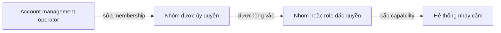

# Tách account management admin

## Mục tiêu bài học

Trong chương Tiering của Privileged Access Management (PAM), **tách account management admin** là tách danh tính và quyền dùng để quản lý tài khoản khỏi danh tính sử dụng hằng ngày và khỏi các quyền vận hành không liên quan. Việc tách cũng phải giữ ranh giới giữa những nhóm tài khoản có mức nhạy cảm khác nhau.

Tạo hai username chưa đủ. Nếu tài khoản hằng ngày vẫn đặt lại được credential của tài khoản quản trị, hoặc tài khoản helpdesk sửa được nhóm đặc quyền, ranh giới trên tên gọi không phản ánh quyền kiểm soát thực tế.

Sau bài học, bạn có thể:

- Phân biệt quản lý tài khoản, sử dụng tài khoản và vận hành hệ thống.
- Thiết kế danh tính quản trị theo chức năng và tier.
- Giới hạn quyền tạo, khóa, reset credential, quản lý MFA và sửa membership.
- Phát hiện đường nâng quyền gián tiếp qua thuộc tính, nhóm, recovery và đồng bộ.
- Kết hợp PAM, JIT/JEA, phê duyệt và phân tách nhiệm vụ.
- Kiểm chứng ranh giới bằng quyền hiệu lực tại directory hoặc hệ thống đích.

## 1. Account management admin quản lý những gì?

Quản lý tài khoản không phải một permission duy nhất. Nó có thể bao gồm nhiều khả năng với hậu quả rất khác nhau:

| Khả năng | Tác động cần xem xét |
|---|---|
| Tạo tài khoản | Có thể tạo một chủ thể mới để nhận quyền |
| Enable, disable hoặc unlock | Thay đổi khả năng sử dụng danh tính |
| Reset mật khẩu | Có thể tạo khả năng xác thực thay cho người dùng |
| Thêm hoặc thay authenticator | Có thể tạo đường đăng nhập mới |
| Sửa email hoặc thông tin recovery | Có thể thay đổi đường khôi phục danh tính |
| Sửa membership nhóm hoặc role | Có thể cấp hoặc gỡ quyền trực tiếp, gián tiếp |
| Đổi owner của nhóm hoặc ứng dụng | Có thể chuyển quyền quản trị tài nguyên hoặc danh tính |
| Thêm credential cho workload | Có thể cho phép hoạt động dưới quyền của dịch vụ |
| Thu hồi phiên hoặc token | Có thể ngăn truy cập đang diễn ra |
| Di chuyển đối tượng hoặc sửa thuộc tính | Có thể tác động tới policy, đồng bộ hoặc cấp quyền động |

Một người được phép unlock tài khoản thông thường không nhất thiết cần reset MFA, sửa nhóm quản trị hoặc thêm credential cho dịch vụ.

Ngược lại, một quyền tưởng là “chỉ sửa thông tin hồ sơ” có thể nhạy cảm nếu thuộc tính đó được dùng để cấp quyền hoặc khôi phục tài khoản.

### Ví dụ xuyên suốt

Lan vừa hỗ trợ vòng đời tài khoản nhân viên vừa vận hành một dịch vụ staging. Thiết kế dùng:

- Danh tính hằng ngày cho email và ứng dụng văn phòng.
- Danh tính quản lý tài khoản thông thường với tác vụ và scope giới hạn.
- Danh tính vận hành dịch vụ với role hẹp, kích hoạt qua PAM.
- Nếu có nhiệm vụ quản trị nền tảng danh tính, dùng danh tính và đường quản trị riêng tương ứng.

Không để danh tính hỗ trợ tài khoản thông thường tự reset credential của danh tính quản trị nền tảng.

## 2. Vì sao cần tách khỏi tài khoản hằng ngày?

Email, trình duyệt và ứng dụng thông thường tiếp xúc với nhiều nội dung không tin cậy. Nếu cùng tài khoản đó giữ quyền sửa danh tính, một sự cố phiên hoặc endpoint có thể trở thành sự cố cấp quyền trên diện rộng.

Tách danh tính giúp giới hạn mục đích và tạo cơ hội áp dụng điều kiện riêng:

- Phương thức xác thực và độ mới.
- Máy nguồn và môi trường sử dụng.
- Role được phép yêu cầu.
- Approval cho thao tác nhạy cảm.
- Thời hạn JIT.
- Bằng chứng và cảnh báo.

Nhưng các điều kiện này phải được thực thi. Chỉ đổi hậu tố username từ `lan` thành `lan-admin` không tạo cách ly kỹ thuật.

### Không lưu cùng một bí mật cho mọi danh tính

Dùng lại mật khẩu hoặc khóa không có scope phù hợp giữa tài khoản hằng ngày và tài khoản quản trị làm tăng khả năng một sự cố ảnh hưởng cả hai.

Quản lý credential theo mục đích, nguồn và vòng đời. Nếu một authenticator vật lý phục vụ nhiều credential, cần hiểu cách ràng buộc từng credential và rủi ro chung khi mất thiết bị; không coi nhiều tên hiển thị là các phương tiện hoàn toàn độc lập.

## 3. Tách chức năng quản lý tài khoản khỏi vận hành hệ thống

Quản trị viên ứng dụng cần deploy hoặc restart dịch vụ chưa chắc cần quyền tạo người dùng trong directory. Người quản lý vòng đời tài khoản cũng chưa chắc cần đọc dữ liệu ứng dụng hoặc mở shell quản trị.

Một ma trận minh họa:

| Danh tính hoặc role | Công việc chính | Scope | Những quyền không cấp mặc định |
|---|---|---|---|
| Everyday user | Email, tài liệu và ứng dụng | Nhu cầu thông thường | Sửa credential hoặc nhóm của người khác |
| Account lifecycle operator | Tác vụ vòng đời tài khoản được giao | Tài khoản thông thường trong phạm vi | Reset tài khoản đặc quyền, sửa nhóm nhạy cảm |
| Service operator | Vận hành dịch vụ | Dịch vụ và môi trường được duyệt | Quản lý danh tính nền tảng |
| Privileged identity operator | Quản lý danh tính đặc quyền theo nhiệm vụ | Phạm vi nhạy cảm đã xác định | Tự phê duyệt mọi thay đổi |
| Auditor | Kiểm tra bằng chứng | Dữ liệu audit được phép | Sửa tài khoản hoặc xóa dấu vết |

Bảng không bắt buộc mỗi tổ chức phải tạo đúng năm tài khoản cho mỗi người. Nó thể hiện những trách nhiệm cần được phân tích và tách theo rủi ro.

Với tổ chức nhỏ, một người có thể đảm nhiệm nhiều trách nhiệm. Điều đó không có nghĩa hệ thống được bỏ qua việc ghi nhận chủ thể, kiểm soát kích hoạt và xử lý xung đột nhiệm vụ.

## 4. Giữ ranh giới theo tier

Trong mô hình minh họa, Tier 0 bao gồm khả năng kiểm soát nền tảng danh tính. Những miền máy chủ, ứng dụng và endpoint có thể được phân tách thành các tier hoặc ranh giới khác theo kiến trúc tổ chức.

Tên tier cụ thể không quan trọng bằng nguyên tắc:

> Danh tính có nhiệm vụ ở phạm vi ít nhạy cảm hơn không được có đường tự quản lý credential hoặc quyền của danh tính ở phạm vi nhạy cảm hơn.

### Không chỉ tách nhóm quản trị

Một account management operator có thể không thuộc nhóm Tier 0 nhưng vẫn có tác động tương đương nếu được:

- Reset tài khoản Tier 0.
- Thêm phương thức MFA cho tài khoản đó.
- Sửa owner của một nhóm đặc quyền.
- Sửa một nhóm lồng nhau dẫn tới quyền Tier 0.
- Thêm credential cho một ứng dụng có quyền danh tính cao.
- Thay thuộc tính mà hệ thống đồng bộ dùng để cấp role đặc quyền.

Cần phân loại theo capability và đường kiểm soát thực tế.

### Tách cả nguồn quản trị

Danh tính quản lý tài khoản nhạy cảm cần được dùng từ nguồn quản trị đáp ứng mức tin cậy tương ứng.

Dùng nhiều tài khoản trong các tab trên cùng một máy thường ngày không tự bảo vệ chúng khỏi mã ở cấp hệ điều hành. Browser profile giúp giảm nhầm lẫn nhưng không thay thế ranh giới thiết bị hoặc môi trường được thiết kế.

Nếu cần xử lý nhiều tier, người dùng chuyển sang danh tính và đường quản trị phù hợp. Không mang tài khoản cao nhất xuống một máy kém tin cậy để “sửa nhanh”.

## 5. Thiết kế scope cho account management

Scope có thể dựa trên container, đơn vị tổ chức, nhóm tài khoản hoặc một tập đối tượng rõ ràng. Tuy nhiên, phạm vi lưu trữ đối tượng không luôn tương đương phạm vi quyền.

Cần xét ít nhất:

1. Đối tượng nào được tác động?
2. Thuộc tính và thao tác nào được phép?
3. Có đối tượng nhạy cảm nằm trong phạm vi không?
4. Có thể di chuyển đối tượng vào phạm vi để nhận quyền không?
5. Có thay đổi gián tiếp tới nhóm hoặc role ngoài phạm vi không?
6. Ai được sửa chính scope hoặc rule xác định membership?

### Ví dụ delegation hẹp

Một role có thể cho phép:

- Unlock tài khoản nhân viên thông thường thuộc đơn vị được giao.
- Disable tài khoản theo yêu cầu nghiệp vụ đã xác minh.
- Đọc những thuộc tính tối thiểu để định danh đối tượng.

Role đó không mặc định được phép:

- Sửa nhóm đặc quyền.
- Reset credential quản trị.
- Đổi thông tin recovery của mọi tài khoản.
- Tạo tài khoản dịch vụ có quyền cao.
- Sửa policy cấp quyền hoặc đồng bộ.

Nếu hệ thống không hỗ trợ phân tách tác vụ ở mức mong muốn, cần dùng một dịch vụ môi giới có kiểm tra và bảo vệ đích phù hợp hoặc điều chỉnh quy trình. Không giả định một quyền UI hẹp bù được quyền directory quá rộng có thể gọi trực tiếp.

### Protected identity không chỉ nhận diện bằng tên

Không loại trừ tài khoản đặc quyền chỉ bằng tiền tố `admin-`. Một danh tính có thể có quyền cao qua role, nhóm lồng nhau, ownership hoặc credential của workload.

Danh mục đối tượng được bảo vệ cần dựa trên dữ liệu có thẩm quyền và quyền hiệu lực. Khi không xác minh được đối tượng thuộc phạm vi cho phép, không thực hiện một thao tác thay credential nhạy cảm chỉ dựa trên phỏng đoán.

## 6. Reset credential và khôi phục là quyền có tác động cao

Reset mật khẩu, thêm authenticator hoặc sửa recovery có thể cho phép sử dụng danh tính của người khác. Đây là đường cấp quyền gián tiếp, không chỉ là hỗ trợ người dùng.

### Các thao tác cần phân biệt

| Thao tác | Không được tự suy ra |
|---|---|
| Unlock tài khoản | Được phép đặt lại mật khẩu hoặc MFA |
| Reset mật khẩu | Mọi phiên và token cũ đã bị thu hồi |
| Xóa authenticator mất | Đã có bằng chứng đủ để đăng ký phương thức mới |
| Đổi recovery email | Được phép chuyển quyền kiểm soát danh tính |
| Disable tài khoản | Mọi kết nối và grant ở đích đã kết thúc |

Mỗi hành động cần thẩm quyền, điều kiện và bằng chứng riêng theo chính sách.

### Không để helpdesk quản lý đường khôi phục của quản trị viên cao hơn

Một tài khoản helpdesk bị chiếm quyền có thể trở thành đường vào hệ thống danh tính nếu được reset tài khoản đặc quyền hoặc thêm authenticator cho nó.

Thiết kế một quy trình riêng cho danh tính quản trị: xác minh người yêu cầu, dùng người có thẩm quyền phù hợp, phân tách trách nhiệm khi cần và ghi bằng chứng. Không fallback sang một mật khẩu tạm do đội hỗ trợ cấp qua kênh yếu ngoài quy trình.

### Phiên hiện tại không luôn đủ cho thay đổi authenticator

Nếu một phiên web bị đánh cắp, cho phép từ phiên đó thêm phương thức xác thực mới có thể tạo đường đăng nhập bền vững.

Xem việc thêm hoặc thay phương thức là hành động nhạy cảm: yêu cầu bằng chứng xác thực và kiểm tra phù hợp, ràng buộc đúng danh tính, cùng thông báo thay đổi và quy trình khôi phục được kiểm soát.

## 7. Quản lý membership và thuộc tính cấp quyền

Phân quyền theo nhóm giúp vận hành, nhưng quyền sửa nhóm chính là quyền điều khiển những capability mà nhóm mang lại.

### Phân tích nhóm trực tiếp và gián tiếp



Nếu chuỗi này tồn tại, người sửa nhóm ở đầu có đường tác động tới hệ thống ở cuối. Không chỉ kiểm tra tên nhóm mà giao diện đang hiển thị.

Đối với ownership, cần biết owner thực sự được làm gì. Quyền đổi owner có thể dẫn tới quyền sửa membership hoặc credential theo ngữ nghĩa của nền tảng.

### Thuộc tính có vẻ thông thường nhưng mang quyền

Một thuộc tính như đơn vị, loại nhân sự hoặc mã vai trò có thể được rule tự động dùng để cấp nhóm. Nếu account management operator được sửa thuộc tính đó, họ có thể ảnh hưởng quyền gián tiếp.

Tương tự, email hoặc số điện thoại có thể tham gia recovery. Chúng không còn chỉ là dữ liệu liên hệ trong bối cảnh đó.

Cần ghi rõ những thuộc tính “có tác động bảo mật” và quản trị theo tác động, không chỉ theo vị trí trong biểu mẫu.

### Đồng bộ không xóa ranh giới trách nhiệm

Nếu PAM hoặc directory cloud nhận dữ liệu từ một nguồn khác, đánh giá ai có thể sửa nguồn, rule đồng bộ và runtime thực thi.

Một nguồn được gọi là HR hoặc directory phụ không tự an toàn để quyết định mọi quyền quản trị. Phải xác định những thuộc tính nào có thẩm quyền cho mục đích nào.

## 8. Kết hợp PAM, JIT và JEA

Thay vì cấp một role quản lý tài khoản rộng thường trực, có thể tách các tác vụ và kích hoạt theo nhu cầu:

- Unlock tài khoản thông thường.
- Disable theo yêu cầu đã xác minh.
- Reset credential theo quy trình.
- Sửa membership của một tập nhóm cho phép.
- Quản lý danh tính đặc quyền trong một luồng riêng.

### Eligibility không phải quyền đang có hiệu lực

Người dùng có thể đủ điều kiện xin role nhưng chỉ được kích hoạt sau khi có căn cứ và phê duyệt. Trạng thái này cần phân biệt với membership hoặc grant đang hoạt động.

PAM phải ràng buộc việc cấp với đúng principal, tác vụ, scope, phiên bản và thời hạn. Không cho client đổi target ID sau approval để áp dụng cùng quyền sang người dùng khác.

### Đích phải thực thi ranh giới

Có hai lớp cần kiểm tra:

1. PAM hoặc broker có từ chối tác vụ ngoài phạm vi không?
2. Danh tính hoặc tài khoản đích có bị hạn chế tương ứng không?

Nếu broker giữ credential quyền rất rộng, đường sử dụng credential đó phải được bảo vệ khỏi việc đi vòng hoặc thực thi tùy ý. Không công bố JEA chỉ từ tên một role trong PAM.

### TTL ngắn không hoàn tác tác động

Grant 10 phút để sửa nhóm có thể tạo membership tồn tại nhiều tháng. Grant để thêm credential cho một workload có thể tạo đường truy cập sau khi grant kết thúc.

Vì vậy, cần audit và kiểm tra những thay đổi bền vững. Hết hạn quyền của người thực hiện khác với hoàn tác thay đổi nghiệp vụ hợp lệ hoặc trái phép.

## 9. Phân tách nhiệm vụ theo người, không chỉ theo account

Một người có hai tài khoản không trở thành hai approver độc lập.

Nếu chính sách cấm tự duyệt, hệ thống cần liên kết các danh tính tới cùng một chủ thể có trách nhiệm. Không cho người dùng dùng account A gửi yêu cầu rồi account B của chính mình phê chuẩn để được tính là độc lập.

### Những cặp trách nhiệm cần xem xét

- Người yêu cầu và người phê duyệt thay đổi nhạy cảm.
- Người sửa policy và người phê chuẩn policy.
- Người thay credential và người xác nhận danh tính trong recovery.
- Người vận hành và người kiểm tra bằng chứng.
- Người quản lý mapping và người nhận quyền từ mapping đó.

Không phải mọi tác vụ đều cần hai người. Chính sách cần dựa trên rủi ro và khả năng vận hành, nhưng khi yêu cầu độc lập thì phải thực thi độc lập thật.

### Không tạo vòng tự nâng quyền qua quản trị cấu hình

Người không có role đặc quyền nhưng được sửa rule ánh xạ nhóm có thể cấp role đó cho mình. Tương tự, người sửa scope của role có thể mở rộng phạm vi mà không đổi tên role.

Kiểm tra quyền sửa chính sách, membership và scope cùng quyền sử dụng. Chỉ xem danh sách role đang active không phát hiện hết các đường này.

## 10. Vòng đời danh tính quản trị

### Tạo và liên kết

Tài khoản quản trị cần có chủ sở hữu cá nhân hoặc workload rõ ràng, lý do tồn tại, scope, tier, phương thức xác thực và quy trình khôi phục.

Liên kết tới người bằng định danh có thẩm quyền, không chỉ email hoặc tên hiển thị. Nếu xóa rồi tạo lại cùng username, đối tượng mới không được tự kế thừa quyền cũ chỉ vì tên giống.

### Chuyển vị trí công việc

Khi người dùng đổi đội hoặc nhiệm vụ, rà soát cả:

- Role trực tiếp.
- Nhóm nguồn và nhóm lồng nhau.
- Eligibility.
- Grant đang hoạt động.
- Quyền quản lý nhóm hoặc ownership.
- Credential hoặc authenticator.
- Các danh tính quản trị khác của cùng người.

Gỡ một gán role không đủ nếu còn đường cấp quyền khác.

### Nghỉ việc hoặc đình chỉ

Chặn truy cập mới và xử lý phiên, token, grant, credential và nhiệm vụ tự động liên quan theo chính sách.

Không để một job nền phụ thuộc token của tài khoản quản trị cá nhân rồi giữ tài khoản đó hoạt động sau khi người dùng nghỉ. Chuyển công việc sang danh tính workload đúng thiết kế và đánh giá quyền riêng.

### Không dùng tài khoản chung để thay thế kiểm kê

Một account `helpdesk-admin` cho cả đội làm giảm khả năng quy kết và thu hồi theo người. Nếu hệ thống cũ buộc dùng tài khoản đích chung, PAM cần nối được danh tính cá nhân, request, phiên và credential lease.

Ánh xạ đó hỗ trợ điều tra nhưng không biến mọi log tại đích thành danh tính cá nhân, nhất là khi còn đường truy cập ngoài broker.

## 11. Quy trình minh họa cho một reset hợp lệ

Giả sử Lan được giao hỗ trợ credential của tài khoản nhân viên thông thường trong đơn vị A.

1. Lan đăng nhập PAM bằng danh tính quản lý tài khoản phù hợp từ nguồn được chấp nhận.
2. Lan chọn tác vụ reset credential trong scope được giao.
3. Hệ thống tải target từ nguồn có thẩm quyền, kiểm tra stable ID và loại tài khoản.
4. Xác minh yêu cầu nghiệp vụ và danh tính người cần hỗ trợ theo quy trình.
5. Kiểm tra target không thuộc tập bảo vệ hoặc có capability ngoài phạm vi role.
6. Thực hiện approval nếu chính sách yêu cầu.
7. Kích hoạt quyền hẹp và kiểm tra lại trạng thái trước khi thực thi.
8. Thực hiện reset bằng cơ chế được đích hỗ trợ; không lộ secret vào log hoặc ticket.
9. Ghi kết quả, thông báo theo kênh được phép và xử lý các phiên liên quan theo chính sách.
10. Thu hồi grant, đối soát và lưu bằng chứng.

Thông tin target có thể thay đổi giữa lúc xem và lúc thực hiện. Cần cơ chế kiểm tra lại hoặc ràng buộc phù hợp, không dựa vào một màn hình đã mở từ lâu.

### Nếu phát hiện target là tài khoản đặc quyền

Không nâng role hiện tại chỉ để hoàn tất nhanh. Chuyển sang luồng có thẩm quyền với scope và bằng chứng thích hợp.

Nếu target chưa phân loại được, không tự coi là tài khoản thường. Kết quả nên mô tả chưa xác minh được điều kiện, thay vì bịa kết luận người dùng không hợp lệ.

## 12. Pseudocode kiểm tra tác vụ

```text
function execute_account_task(actor, request):
    task = load_authoritative_request(request.id, request.version)
    target = resolve_target_by_stable_id(task.target_reference)

    require actor.is_authenticated_as_expected_admin_identity
    require source_environment_satisfies_policy(actor, task)
    require actor.is_eligible_for(task.operation, task.scope)

    require target.belongs_to_allowed_management_scope
    require target.security_classification_is_verified
    require operation_is_allowed_for_target_class(task.operation, target)

    require sensitive_attribute_and_membership_rules_pass(task, target)
    require approval_and_separation_rules_pass(actor, task)
    require current_target_and_request_still_match_approved_scope

    grant = activate_scoped_time_limited_permission(task)
    result = execute_once_with_authoritative_target_checks(grant, task)

    record_without_credentials(actor, task, target, result)
    reconcile_and_revoke_grant(grant)
    return result
```

Đây là mô hình khái niệm, không phải mã production. Một triển khai thực tế cần xử lý giao dịch, retry, kết quả chưa biết và quyền effective tại đích.

Một lệnh reset đã tới đích nhưng mất phản hồi không được gửi lại tùy tiện. Cần đối soát kết quả để tránh thay credential nhiều lần hoặc báo sai trạng thái cho người được hỗ trợ.

Một permission được cấp có thời hạn cũng cần được thu hồi hoặc hết hiệu lực thực sự. Không chỉ đổi trạng thái trong cơ sở dữ liệu PAM.

## 13. Audit và dữ liệu cần bảo vệ

Bằng chứng cần trả lời:

- Ai là người thực hiện và dùng danh tính quản trị nào?
- Thao tác nào, trên target ổn định nào?
- Scope và tier nào cho phép?
- Căn cứ công việc và approval nào?
- Phiên bản policy và mapping nào?
- Giá trị quyền hoặc thuộc tính nào thay đổi theo cách có kiểm soát?
- Đích đã thực hiện thành công hay còn chưa xác định?
- Grant và phiên đã được thu hồi chưa?

```json
{
  "event_type": "pam.account_management.operation_completed",
  "person_reference": "person-example-lan",
  "admin_principal_reference": "principal-example-account-operator",
  "target_principal_reference": "principal-example-ordinary-user-418",
  "operation": "credential_reset",
  "scope_reference": "ordinary-users-unit-a",
  "request_reference": "request-example-307-v2",
  "approval_reference": "approval-example-55",
  "grant_reference": "grant-example-41",
  "policy_version": "account-management-example-v6",
  "result": "completed"
}
```

Đây là schema minh họa. Không ghi mật khẩu mới, recovery code, token hoặc thông tin xác minh cá nhân không cần thiết.

Với thay đổi membership, có thể ghi tham chiếu hoặc delta phù hợp để tái dựng quyền. Với secret, ghi sự kiện thay đổi và định danh credential, không lưu giá trị bí mật vào audit.

Phân quyền xem và export. Người được reset một tài khoản không mặc nhiên cần quyền đọc toàn bộ hồ sơ điều tra hoặc lịch sử nhạy cảm của tài khoản đó.

### Cảnh báo đáng chú ý

- Account management operator tác động tới danh tính ngoài scope.
- Thay recovery rồi đăng nhập ngay bằng danh tính đó.
- Thêm credential cho workload nhạy cảm.
- Sửa membership tạo quyền ở tier cao hơn.
- Một người xin và duyệt qua hai account của chính mình.
- Thay nhãn hoặc vị trí đối tượng trước khi thực hiện reset.
- Thu hồi grant thất bại.
- Sửa audit hoặc tắt ghi bằng chứng trong lúc có tác vụ.

Các tín hiệu cần điều tra theo ngữ cảnh, không tự kết luận mọi thay đổi là tấn công.

## 14. Lộ trình triển khai tách account management admin

### Bước 1 — Kiểm kê capability

Liệt kê ai có thể tạo, reset, unlock, disable, sửa recovery, membership, owner và credential workload. Tính cả quyền gián tiếp qua công cụ, API và rule đồng bộ.

Không chỉ thu danh sách tài khoản có hậu tố `admin`.

### Bước 2 — Phân loại target và đường kiểm soát

Xác định tài khoản thường, danh tính đặc quyền, workload và nguồn có thẩm quyền cho phân loại. Ghi khả năng một thuộc tính thay đổi làm chuyển loại hoặc mở rộng scope.

### Bước 3 — Thiết kế role và delegation

Tách tác vụ theo nhu cầu, cấp scope nhỏ và xác định quyền tại đích. Tránh role chung quản lý mọi tài khoản, mọi nhóm và mọi cơ chế recovery.

### Bước 4 — Tạo đường sử dụng

Chốt danh tính, thiết bị, MFA, approval và JIT. Quy định chuyển giữa công việc thông thường và công việc nhạy cảm.

### Bước 5 — Thử nghiệm cả allow và deny

Kiểm tra tác vụ hợp lệ cùng các đường bị cấm. Đặc biệt thử API trực tiếp, nhóm lồng nhau, target đổi loại và tài khoản đặc quyền ngoài scope.

### Bước 6 — Loại bỏ quyền cũ và đối soát

Gỡ delegation rộng và đường truy cập không còn cần sau khi xác nhận luồng mới hoạt động. Đối soát quyền effective, cache, grant và phiên; không coi đổi role trong một giao diện là hoàn tất.

### Bước 7 — Rà soát theo thay đổi

Một nhóm mới được cấp quyền cao có thể khiến quyền sửa nhóm cũ trở nên nhạy cảm hơn. Rà soát khi role, pipeline, recovery hoặc mapping thay đổi, không chỉ theo lịch nhân sự.

## 15. Bài thực hành có kiểm chứng

Dùng directory hoặc dịch vụ danh tính lab, dữ liệu giả và tài khoản thử nghiệm. Không reset credential người dùng thật để minh họa.

### Chuẩn bị

Tạo:

- A: danh tính hằng ngày.
- A-admin: danh tính quản lý tài khoản thường của cùng người.
- B: tài khoản thường thuộc scope.
- C: tài khoản đặc quyền ngoài scope.
- D: approver độc lập.
- Một workload có credential và quyền riêng.
- Một nhóm được ủy quyền và một nhóm đặc quyền giả lập.

Ghi mapping giữa người và các danh tính, role, source environment và policy.

### Ca kiểm thử

| Ca | Thao tác | Kết quả mong đợi |
|---|---|---|
| Tài khoản hằng ngày | A gọi tác vụ reset B | Không có quyền quản lý chỉ vì cùng chủ sở hữu A-admin |
| Tác vụ hợp lệ | A-admin unlock B theo quy trình | Thành công đúng scope, có audit |
| Tách operation | Role chỉ unlock thử reset mật khẩu | Bị từ chối tại máy chủ hoặc đích |
| Target nhạy cảm | A-admin thử reset C | Không dùng quyền tài khoản thường để tác động tài khoản đặc quyền |
| MFA/recovery | A-admin thử thêm authenticator cho C | Bị chặn theo scope và capability |
| Nhóm gián tiếp | Sửa nhóm có thể dẫn tới role đặc quyền | Đường tăng quyền được phát hiện và kiểm soát |
| Thuộc tính cấp quyền | Sửa thuộc tính được rule dùng để cấp quyền | Không coi là thay hồ sơ vô hại |
| Tự duyệt hai account | A xin, A-admin của cùng người duyệt | Không được tính là hai chủ thể độc lập khi chính sách yêu cầu |
| API trực tiếp | Bỏ qua menu và gọi endpoint | Ranh giới quyền vẫn được thực thi |
| Target thay đổi | Đổi phân loại hoặc scope sau approval | Có kiểm tra lại, không dùng quyết định cũ sai phạm vi |
| Grant hết hạn | Chờ hết JIT rồi thực hiện tác vụ mới | Không tiếp tục bằng grant đã hết hiệu lực |
| Thay đổi bền vững | Sửa membership trong grant lab | Có đối soát riêng sau grant, không giả định tự hoàn tác |
| Delete/recreate | Tạo lại cùng username nhưng stable ID mới | Không kế thừa quyền cũ chỉ vì tên giống |
| Thu hồi | Đình chỉ A-admin khi còn phiên | Kiểm chứng session, grant và đích theo thiết kế |
| Log | Kiểm tra báo cáo reset và membership | Không lộ secret, có người thực hiện và target rõ ràng |

Với ca bị từ chối, lưu căn cứ và phản hồi ở điểm thực thi. Với ca thành công, kiểm tra đúng capability đã thay đổi và những capability ngoài phạm vi vẫn không có.

## 16. Câu hỏi tự kiểm tra

1. Vì sao một account management operator có thể có khả năng Tier 0 dù không thuộc nhóm quản trị Tier 0?
2. Tách hai username trên cùng một người có tự tạo SoD không?
3. Vì sao scope theo container hoặc đơn vị tổ chức chưa đủ để bảo vệ mọi tài khoản nhạy cảm?
4. Grant hết hạn có hoàn tác membership đã sửa không?
5. Vì sao cần quản trị quyền sửa email, owner hoặc thuộc tính đồng bộ?

### Gợi ý đối chiếu

1. Họ có thể reset credential, thêm authenticator, sửa nhóm hoặc điều khiển một danh tính có quyền cao.
2. Không. Tính độc lập cần xét chủ thể thực tế và quan hệ với yêu cầu, không chỉ tên account.
3. Đối tượng và quyền có thể thay đổi; membership, thuộc tính và control path có thể tác động ngoài phạm vi lưu trữ.
4. Không mặc định. Membership là một thay đổi có vòng đời riêng cần được kiểm tra và quản lý.
5. Những thuộc tính đó có thể tham gia recovery, ownership hoặc cấp quyền tự động, tạo khả năng điều khiển danh tính.

Tách account management admin đạt mục tiêu khi quyền quản lý danh tính được giới hạn đúng tác vụ, target và tier, đồng thời không có đường tự nâng quyền qua credential, nhóm, recovery hoặc cấu hình. PAM cần giữ những giới hạn đó từ lúc xin quyền tới thực thi và thu hồi, với bằng chứng gắn được người thực hiện, danh tính quản trị và đối tượng bị tác động.
