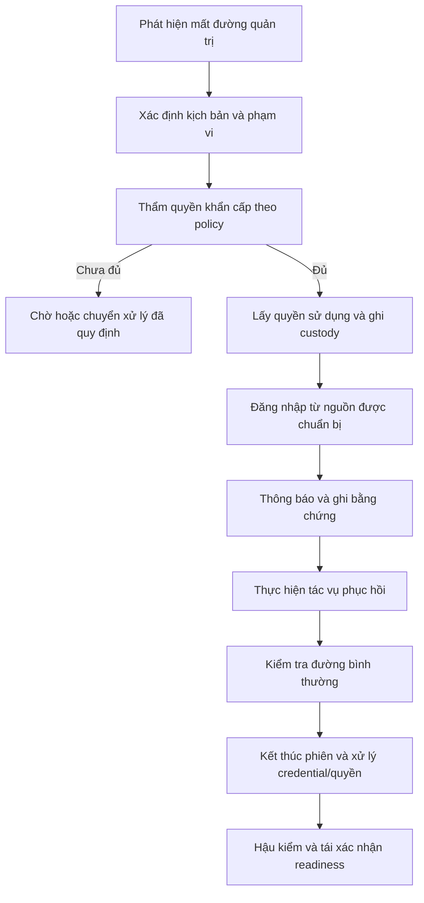

# Break-glass account

## 1. Tài khoản break-glass dùng để phục hồi đường quản trị

Break-glass account là tài khoản được chuẩn bị cho tình huống khẩn cấp khi đường quản trị thông thường không sử dụng được hoặc không đáp ứng được nhu cầu phục hồi đã xác định. Tài khoản này còn thường được gọi là emergency access account.

Trong PAM, đường thông thường có thể gồm IdP, MFA, phê duyệt, vault và session broker. Nếu một thành phần bị lỗi hoặc chính sách bị cấu hình sai làm mọi quản trị viên bị khóa ngoài, tổ chức vẫn cần một cách phục hồi có thẩm quyền.

Tài khoản break-glass không chỉ là một username và password dự phòng. Để dùng được và có thể kiểm tra, nó cần đi cùng phạm vi quyền, phương thức xác thực, nơi bảo quản, người được sử dụng, điều kiện kích hoạt, bằng chứng và cách trở lại trạng thái sẵn sàng sau sự cố.

AWS mô tả break-glass như một cơ chế hỗ trợ phản ứng trước sự cố, với quyền phù hợp, MFA, cảnh báo và liên kết quy trình ứng phó/phục hồi. [AWS — Implement break-glass procedures](https://docs.aws.amazon.com/wellarchitected/latest/devops-guidance/ag.sad.5-implement-break-glass-procedures.html)

Mục tiêu là khôi phục khả năng quản trị an toàn, không tạo một tài khoản tiện lợi để tránh JIT, JEA hoặc approval hằng ngày.

Bài học thuộc chương Break-glass, tập trung vào tài khoản khẩn cấp trong quản lý quyền đặc biệt. Các profile và quy trình bên dưới là mô hình tham khảo, không phải cấu hình dùng trực tiếp cho mọi sản phẩm.

## 2. Khi nào cần và khi nào chưa đủ căn cứ?

| Tình huống | Có thể thuộc kịch bản break-glass? | Điều cần xác định |
|---|---|---|
| IdP hoặc federation chính không hoạt động | Có, nếu đường khẩn cấp được thiết kế cho lỗi đó | Bên xác thực thay thế còn hoạt động không? |
| Policy khóa toàn bộ người quản trị | Có | Tài khoản khẩn cấp có bị cùng policy chặn không? |
| Không còn người có thể kích hoạt role phục hồi | Có thể | Cơ chế ủy quyền khẩn cấp đã chuẩn bị thế nào? |
| Vault hoặc broker không hoạt động | Có thể | Có đường quản trị thay thế đúng phạm vi không? |
| Sự cố cần một tác vụ ngoài quyền vận hành thông thường | Có thể | Tác vụ có thuộc policy khẩn cấp và thẩm quyền không? |
| Một người quên thiết bị nhưng còn recovery thông thường | Chưa chắc | Có thể dùng quy trình recovery trước không? |
| Không muốn chờ approval hoặc không muốn ghi phiên | Không phải căn cứ tự động | Cần thực hiện luồng bình thường hoặc ngoại lệ hợp lệ |
| Nhà cung cấp cloud gặp sự cố toàn bộ dịch vụ liên quan | Tài khoản có thể không giúp được | Lỗi có nằm ngoài khả năng của tài khoản không? |

Tính khẩn cấp và thẩm quyền là hai câu hỏi khác nhau. Người dùng nhập “urgent” vào ticket không tự được quyền lấy credential dự phòng.

Cũng không nên tạo account mới giữa sự cố rồi coi đó là một đường dự phòng đã được kiểm tra. Một số lỗi có thể làm mất chính khả năng tạo account, gán role hoặc đăng ký MFA.

Break-glass cần có trước, được duy trì và được diễn tập cho những lỗi mà nó dự kiến xử lý.

## 3. Phân biệt tài khoản, quyền khẩn cấp và một lần sử dụng

| Đối tượng | Vòng đời hoặc ý nghĩa |
|---|---|
| Emergency principal | Danh tính tồn tại để phục vụ một tập kịch bản phục hồi |
| Quyền gắn với principal | Khả năng được chuẩn bị hoặc có thể kích hoạt theo thiết kế |
| Credential/authenticator | Cách chứng minh quyền sử dụng principal |
| Emergency use record | Một lần sử dụng cụ thể, gắn với người thực hiện và sự cố |
| Phiên hoặc credential được phát | Bằng chứng truy cập thực sự trong lần sử dụng đó |
| Thay đổi phục hồi | Tác động đã thực hiện lên hệ thống |

Một account có thể cần tồn tại lâu dài để sẵn sàng, trong khi mỗi lần sử dụng phải có mục đích và điểm kết thúc. Không được nhầm account thường trực với quyền sử dụng tùy ý không có trách nhiệm.

Ngược lại, không nên đặt mọi tài khoản khẩn cấp ở trạng thái không thể kích hoạt nếu thao tác kích hoạt phụ thuộc chính dịch vụ mà chúng dùng để phục hồi.

### 3.1. Quyền active hay JIT phụ thuộc kịch bản

Đường thông thường nên giảm quyền thường trực khi có thể. Nhưng một tài khoản phục hồi tình trạng hệ thống activation bị khóa không thể chỉ dựa vào chính activation đó.

Một thiết kế có thể cần role phục hồi được gán sẵn cùng custody và kiểm soát bù phù hợp. Thiết kế khác có thể cấp quyền khẩn cấp có hạn bằng một thành phần độc lập còn hoạt động.

Không có một quy tắc “luôn disable” hoặc “luôn active mọi quyền” áp dụng cho mọi hệ thống. Quyết định phải được giải thích bằng kịch bản, phụ thuộc và khả năng thực thi.

### 3.2. Account khẩn cấp không đồng nghĩa root toàn tổ chức

Quyền cần đủ để khôi phục đúng thành phần. Một account chỉ dùng để quản trị một thiết bị mạng không tự cần quyền trên mọi database.

Tuy vậy, một lỗi ở tầng danh tính có thể đòi hỏi quyền rất mạnh để phục hồi. Nếu không thể giới hạn thêm mà vẫn đáp ứng mục tiêu, phải thừa nhận phạm vi tác động và bảo vệ tương xứng, không đổi tên role để làm nó trông ít nhạy cảm hơn.

## 4. Thiết kế theo lỗi và quan hệ phụ thuộc

### 4.1. Đường dự phòng không được mắc cùng điểm hỏng

Một sơ đồ phụ thuộc đơn giản:

```text
Đường thông thường:
    Người quản trị -> IdP chính -> activation/PAM -> vault/broker -> đích

Đường khẩn cấp:
    Người được ủy quyền -> phương thức xác thực phù hợp còn sẵn sàng
    -> đường quản trị đã chuẩn bị -> phạm vi phục hồi cụ thể
```

Cần trả lời: mỗi thành phần trong đường khẩn cấp có còn hoạt động trong kịch bản giả định không?

| Thành phần | Ví dụ phụ thuộc cần xét |
|---|---|
| Xác thực | Có chuyển hướng về IdP đang lỗi không? |
| Authenticator | Có phụ thuộc điện thoại, PKI hoặc mạng đang mất không? |
| Lấy credential | Có cần mở chính vault đang bị khóa không? |
| Phê duyệt | Có cần dịch vụ hoặc người không còn sẵn sàng không? |
| Thiết bị | Có PAW hoặc nguồn quản trị đạt yêu cầu và dùng được không? |
| Mạng | Có DNS, đường quản trị và endpoint hoạt động không? |
| Tài liệu | Có đọc được runbook khi portal nội bộ không truy cập được không? |
| Cảnh báo | Có kênh liên hệ thay thế khi kênh chính lỗi không? |

Độc lập không có nghĩa bỏ hết thành phần quản lý. Nó nghĩa là không phụ thuộc vào cùng điểm hỏng đối với kịch bản cụ thể.

### 4.2. “Có emergency access” phải nói rõ che phủ lỗi nào

AWS nêu một cấu hình truy cập trực tiếp bằng federation có thể dùng khi IAM Identity Center không khả dụng, nhưng vẫn cần IAM data plane và IdP bên ngoài hoạt động. [AWS — Emergency access to the Management Console](https://docs.aws.amazon.com/singlesignon/latest/userguide/emergency-access.html)

Ví dụ đó cho thấy một đường dự phòng có thể hữu ích nhưng không che phủ mọi outage. Nếu mục tiêu là cả lỗi IdP bên ngoài, cần một thiết kế khác hoặc lớp dự phòng bổ sung.

Tương tự, tài khoản cloud-only có thể tránh phụ thuộc federation nội bộ nhưng không vượt qua mọi lỗi của dịch vụ cloud hoặc mọi cấu hình chặn đăng nhập.

### 4.3. Tài khoản khẩn cấp theo hệ thống có thể cần tách biệt

Tài khoản phục hồi directory, cloud tenant, vault, hypervisor và thiết bị mạng có phạm vi khác nhau. Dùng một secret chung cho tất cả làm tăng phạm vi ảnh hưởng và khó xử lý sau khi lộ.

Cần xây danh mục và quan hệ phục hồi. Một tài khoản không nên vừa là credential phục hồi của kho, vừa chỉ được cất trong chính kho đó mà không có đường tiếp cận khác phù hợp.

## 5. Danh tính, xác thực và khả năng quy trách nhiệm

### 5.1. Xác thực mạnh theo khả năng được chuẩn bị

Break-glass không mặc nhiên nghĩa là bỏ MFA. Cần chọn phương thức đủ mạnh, có thể sử dụng trong kịch bản lỗi và được kiểm tra cùng đường đăng nhập thật.

Ví dụ, hướng dẫn Microsoft Entra khuyến nghị hai hoặc nhiều emergency account cloud-only, xác thực chống phishing, role cần thiết được chuẩn bị phù hợp và nguồn quản trị an toàn. Đây là hướng dẫn cho môi trường cụ thể, không phải mẫu dùng cho mọi hệ thống. [Microsoft — Emergency access accounts](https://learn.microsoft.com/en-us/entra/identity/role-based-access-control/security-emergency-access)

Nếu cần ngoại lệ với một policy có thể khóa đường khẩn cấp, ngoại lệ phải được xác định, kiểm tra và giám sát có chủ ý. Không biến nó thành việc tắt mọi xác thực hay miễn mọi policy cho mọi tài khoản admin.

Với một đích không hỗ trợ phương thức mong muốn, cần đánh giá mức bảo vệ còn lại, đường quản trị và kiểm soát bù. Không tuyên bố một password đã trở thành MFA chỉ vì được lấy từ két.

### 5.2. Tài khoản cá nhân và account được quản lý tập thể

Có thể sử dụng principal khẩn cấp gắn với cá nhân hoặc một principal được giữ dưới cơ chế custody. Cách chọn tùy nền tảng, khả năng phục hồi và yêu cầu truy vết.

Với principal cá nhân, vẫn cần đảm bảo offboarding và mất phương thức của người đó không làm mất toàn bộ khả năng phục hồi.

Với principal dùng theo custody, log chỉ ghi tên account có thể chưa chứng minh người nào thực hiện. Cần liên kết bằng chứng lấy quyền sử dụng, người bàn giao, thiết bị, thời gian và phiên. Nếu thiếu liên kết này, phải ghi nhận khoảng trống truy vết, không tự suy ra actor từ một tên hiển thị.

Không nên để nhiều người cùng sử dụng một account trong một thời điểm mà không có cách phân biệt hoạt động. Nếu kịch bản cần nhiều người thao tác đồng thời, phải thiết kế khả năng định danh và giới hạn phù hợp.

### 5.3. Không dùng cho automation thường ngày

Một service hoặc pipeline dùng emergency account hằng ngày làm cho nó không còn là đường dự phòng hiếm dùng. Khi đó, rotation, điều tra và hạn chế có thể ảnh hưởng các consumer khó biết.

Workload cần danh tính và quyền riêng theo nhiệm vụ. Account break-glass nên được dành cho kịch bản đã định nghĩa, không trở thành nơi gom các tích hợp chưa kịp thiết kế.

## 6. Bảo quản credential và authenticator

### 6.1. Có thể lấy khi cần, không phải ai cũng lấy được

Custody cần cân bằng hai mục tiêu: khả năng phục hồi và ngăn sử dụng trái phép.

Một thiết kế có thể dùng kho điện tử độc lập phù hợp, thiết bị xác thực được bảo quản hoặc cơ chế niêm phong/vật lý có quản lý. Tùy lựa chọn, cần xác định:

- Những người được tiếp cận và thẩm quyền bàn giao.
- Cách xác minh người nhận khi đường danh tính chính không hoạt động.
- Địa điểm hoặc kênh lấy vật liệu.
- Bằng chứng mở, nhận, sử dụng và trả lại.
- Phương án khi một địa điểm hoặc người phụ trách không sẵn sàng.
- Cách thu hồi quyền custody khi thay đổi nhân sự.

Không gửi password, private key, mã recovery hoặc PIN trong ticket hay nhóm chat đông người chỉ để mọi người “có sẵn”.

### 6.2. Hai người kiểm soát không đồng nghĩa chia password thủ công

Có thể cần hai trách nhiệm cùng tham gia cho phép lấy hoặc dùng credential. Điều đó khác với việc tự cắt password thành hai đoạn rồi tin rằng đã tạo một cơ chế mật mã an toàn.

Nếu dùng kỹ thuật chia sẻ bí mật, cần một cơ chế được thiết kế và vận hành đúng với mục tiêu. Nếu dùng bàn giao có hai người, phải kiểm tra hai con người khác nhau, thẩm quyền và kịch bản vắng mặt.

Một policy yêu cầu hai người nhưng không chuẩn bị người thay thế có thể gây bế tắc. Cách xử lý là định nghĩa phương án dự phòng từ trước, không âm thầm coi một người là hai phiếu.

### 6.3. Không để vật liệu âm thầm mất hiệu lực

Authenticator, certificate, password, quyền role, device identity và cơ chế mở két có thể thay đổi hoặc hết hiệu lực. Một account lâu không dùng có thể rơi vào quy tắc dọn tự động.

Cần kiểm tra và duy trì khả năng dùng thật, có kế hoạch renewal và ngoại lệ phù hợp với chức năng emergency. Không chọn cách làm credential không bao giờ được quản lý chỉ để tránh hết hạn.

Tài liệu recovery key hoặc thông tin định danh cũng cần được cập nhật. Một runbook đúng nhưng vật liệu không còn dùng được vẫn làm đường khẩn cấp thất bại.

## 7. Quyền, scope và kiểm soát sử dụng

### 7.1. Xác định tác vụ phục hồi trước

Một profile khẩn cấp nên mô tả những gì được chuẩn bị để làm:

| Nhóm | Ví dụ |
|---|---|
| Phục hồi danh tính | Sửa một quan hệ federation hoặc policy gây khóa ngoài |
| Phục hồi PAM/vault | Khôi phục khả năng điều phối hoặc tiếp cận quản trị |
| Phục hồi hạ tầng | Sửa đường mạng/quản lý cần thiết theo kịch bản |
| Ứng phó xâm nhập | Chặn quyền hoặc thay cấu hình trong phạm vi đã ủy quyền |
| Khôi phục dịch vụ | Thực hiện một tập tác vụ cần thiết để trở lại đường bình thường |

Một profile mạnh có thể làm được nhiều hơn danh sách công việc được phép. Khi nền tảng không hạn chế được chi tiết kỹ thuật, cần phân biệt **khả năng có thật** với **phạm vi sử dụng được ủy quyền** và có giám sát tương ứng.

Không nên dùng văn bản “chỉ sửa lỗi” để tuyên bố account không thể đọc dữ liệu nếu permission thực tế cho phép.

### 7.2. Tách thẩm quyền dùng và thẩm quyền sửa đường break-glass

Người được dùng một account trong sự cố không mặc nhiên được thay credential custody, mở rộng role, bỏ cảnh báo hoặc sửa danh sách người được sử dụng.

Những thay đổi này có thể làm biến dạng cơ chế dự phòng. Chúng cần quy trình, quyền và audit riêng.

### 7.3. Thời hạn của lần sử dụng khác với thời hạn tồn tại account

Một incident use có thể quy định cửa sổ 30 phút hoặc hạn theo diễn biến, nhưng account sẵn sàng có thể vẫn phải tồn tại sau đó.

Nếu nền tảng hỗ trợ session có hạn hoặc quyền tạm độc lập, cần thực thi và kiểm tra. Nếu account có role được gán sẵn, một field `use_until` trong ticket không tự làm quyền hoặc phiên hết hiệu lực.

Khi không có khả năng tự động chấm dứt đúng mức cần thiết, phải thừa nhận giới hạn và thiết kế điểm thực thi/đối soát phù hợp. Không gọi một deadline hành chính là một expiry kỹ thuật.

## 8. Luồng sử dụng có kiểm soát



### 8.1. Xác định sự cố và điểm dừng

Cần biết thành phần nào không hoạt động, tác động nào cần giảm và điều kiện nào cho phép chuyển lại đường thông thường.

Không nên khởi đầu bằng mục tiêu “dùng emergency account để làm xong mọi việc còn tồn”. Khi đường bình thường đã phục hồi, những công việc khác trở lại quy trình approval/JIT tương ứng.

### 8.2. Thẩm quyền phải tồn tại trong cả kịch bản lỗi

Có thể có quy trình thông thường cần quyết định nhiều người, hoặc một nhánh đã được ủy quyền trước cho người trực trong điều kiện nhất định. Nhánh đó phải được mô tả rõ cùng bằng chứng và hậu kiểm.

Không suy ra thẩm quyền chỉ từ việc người đó biết nơi cất secret. Khả năng lấy vật liệu và quyền quyết định sử dụng cần được quản lý liên quan nhưng không được nhầm lẫn.

Nếu thực tế chỉ có hậu kiểm theo một policy khẩn cấp, audit phải ghi đúng điều đó. Không tạo một bản ghi giả rằng đã có người duyệt trước thời điểm sử dụng.

### 8.3. Ghi phạm vi và thay đổi thực tế

Nên có incident/use reference, actor, account, tài nguyên, lý do, thời điểm và kế hoạch phục hồi đủ ngắn gọn để dùng trong sự cố.

Khi cần thay phạm vi đáng kể, cần theo cơ chế mở rộng đã quy định. Không để một lần lấy account cho tài nguyên A tự trở thành quyền dùng trên mọi môi trường.

## 9. Ví dụ: phục hồi federation bị cấu hình sai

### 9.1. Bối cảnh

Sau một thay đổi, quản trị viên không đăng nhập được qua federation thông thường. Dịch vụ danh tính cloud vẫn hoạt động, đường mạng quản trị còn dùng được và có emergency account đã chuẩn bị cho tình huống mất federation.

Mục tiêu là khôi phục cấu hình quan hệ xác thực về trạng thái được xác nhận, rồi chuyển lại luồng bình thường. Không dùng account để mở rộng quyền hoặc đọc dữ liệu ứng dụng.

### 9.2. Mô tả readiness và một lần sử dụng

```yaml
emergency_profile_ref: identity-federation-recovery-v3
account_ref: emergency-identity-admin-a
target_scope_ref: approved-cloud-identity-scope
covered_failure:
  normal_federation_unavailable: true
  cloud_identity_service_available: required
access_material:
  custody_ref: independent-emergency-custody
  authentication_profile_ref: approved-emergency-authentication
source:
  workstation_profile_ref: privileged-recovery-workstation
authorized_use:
  incident_ref: incident-731
  operator_ref: principal-oncall-17
  authority_ref: emergency-authority-record-731
  purpose: restore_approved_federation_configuration
  planned_use_until: "2026-11-26T14:30:00+07:00"
evidence:
  use_record_ref: emergency-use-731
  notify_responsible_parties: required
  capture_change_and_signin_events: required
closure:
  normal_path_validation: required
  session_and_credential_review: required
  readiness_revalidation: required
```

Đây là dữ liệu giả mô tả ý định và quan hệ bằng chứng, không phải cấu hình của một sản phẩm. `planned_use_until` không tự vô hiệu hóa phiên hay role.

### 9.3. Diễn biến minh họa

1. Nhóm trực xác nhận lỗi thuộc kịch bản, kiểm tra rằng dịch vụ cloud cần thiết vẫn hoạt động.
2. Thẩm quyền khẩn cấp được xác minh qua đường đã chuẩn bị; ghi incident và actor thực tế.
3. Vật liệu xác thực được tiếp cận theo custody, không đưa vào ticket.
4. Kỹ sư dùng PAW hoặc môi trường phục hồi đạt yêu cầu và đăng nhập emergency account.
5. Cảnh báo được gửi; nếu kênh chính lỗi thì dùng kênh thay thế đã quy định và ghi tình trạng.
6. Kỹ sư đối chiếu cấu hình được phép phục hồi từ nguồn đáng tin cậy.
7. Thực hiện thay đổi tối thiểu cần thiết và ghi change reference/kết quả.
8. Kiểm tra đường federation thông thường bằng cách có kiểm soát.
9. Khi đã phục hồi, dừng dùng emergency account và chuyển về danh tính/luồng bình thường.
10. Đối soát phiên, vật liệu, quyền, thay đổi và khôi phục readiness của account.

Không lấy bất kỳ bản cấu hình cũ nào rồi coi là an toàn: nó có thể chứa trust hoặc credential đã bị thu hồi trước đó. Điểm phục hồi cần được chọn và xác minh phù hợp với sự cố.

### 9.4. Các nhánh không thành công

| Tình huống | Điều cần làm rõ |
|---|---|
| Cloud identity service cũng lỗi | Account này có thể không giúp; chuyển kế hoạch phục hồi tương ứng |
| Authenticator không sử dụng được | Dùng phương án dự phòng đã chuẩn bị, không tự bỏ xác thực |
| Thiếu người có thẩm quyền | Theo nhánh escalation/ủy quyền có sẵn |
| Nguồn cấu hình phục hồi không đáng tin | Chưa áp dụng chỉ để thử cho nhanh |
| Cảnh báo không gửi được | Ghi phần thiếu, dùng kênh thay thế theo policy |
| API trả về chưa xác nhận | Theo dõi kết quả, không báo đã phục hồi chắc chắn |
| Đường bình thường chưa dùng được | Không đóng incident/use như đã hoàn tất |
| Có thay đổi ngoài mục đích | Ghi trung thực và chuyển đánh giá/ứng phó phù hợp |

## 10. Bằng chứng và giám sát trong điều kiện suy giảm

### 10.1. Mọi lần dùng đều cần được giải thích

Account break-glass thường ít hoạt động nên mỗi lần đăng nhập hoặc thay đổi liên quan đều đáng được xem xét, kể cả diễn tập.

Bằng chứng cần nối:

```text
Kịch bản và incident
    -> Người có thẩm quyền và người thực hiện
    -> Custody/lấy quyền sử dụng
    -> Emergency principal và phương thức xác thực
    -> Thiết bị, phiên và phạm vi
    -> Thay đổi/thao tác cùng kết quả
    -> Phục hồi đường thông thường
    -> Kết thúc và readiness sau sử dụng
```

Không dùng timestamp gần nhau làm bằng chứng duy nhất rằng người lấy credential là người thực hiện mọi hành động. Cần reference và quan hệ có thể kiểm tra theo khả năng thực tế.

### 10.2. Logging, recording và notification khác nhau

Thông báo cho nhóm trực không thay audit thao tác. Recording giao diện cũng không tự bao phủ mọi cloud API hoặc tác vụ chạy ngoài phiên được ghi.

Cần xác định nguồn nào chứng minh đăng nhập, nguồn nào chứng minh thay đổi và nguồn nào xác nhận kết quả. Không bắt hệ thống phải tạo bằng chứng mà nó không quan sát được.

Nếu dịch vụ ghi trung tâm lỗi, policy có thể cho một cách ghi thay thế đã chuẩn bị hoặc có thể không cho một số tác vụ tiếp tục. Cách lựa chọn phải được định nghĩa theo kịch bản và rủi ro.

Một bản ghi tạm trên thiết bị cũng cần được bảo vệ và chuyển về kho trung tâm khi khả dụng. Không ghi password, PIN, private key hoặc token để chứng minh việc bàn giao.

### 10.3. Không tự xóa dấu vết khi dọn sau sự cố

Lịch sử truy cập, thay đổi authenticator, custody và cloud event cần được giữ theo quy trình bằng chứng. Xóa session/token để thu hồi khác với xóa log về session đó.

Nếu thiếu một đoạn bằng chứng, báo rõ phạm vi và nguyên nhân. Không thay bằng một bản tổng kết có vẻ đầy đủ nhưng không có nguồn xác nhận.

## 11. Kết thúc sử dụng và đưa account về trạng thái sẵn sàng

### 11.1. Phục hồi đường bình thường trước khi kết luận

Cần xác nhận những người có thẩm quyền có thể đăng nhập, kích hoạt và thực hiện tác vụ phù hợp qua đường bình thường. Một API sửa policy trả thành công chưa đủ để chứng minh toàn chuỗi đã hoạt động.

Nên kiểm tra thay đổi không làm mở rộng quyền ngoài mục đích, không để một ngoại lệ tạm tồn tại và không làm hỏng đường dự phòng còn lại.

### 11.2. Phiên, credential và quyền có vòng đời riêng

Kết thúc emergency use có thể cần:

- Đóng phiên quản trị và phiên ứng dụng liên quan theo khả năng nền tảng.
- Thu hồi credential tạm hoặc chặn lần sử dụng tiếp theo khi cần.
- Xử lý password/key đã tiết lộ hoặc nghi bị sao chép.
- Đóng quyền tạm và ngoại lệ phát sinh trong incident.
- Đối soát những tác vụ bất đồng bộ hoặc thay đổi còn chạy.
- Xác nhận vật liệu được trả lại hoặc custody được thiết lập lại.

Không mặc định thay password sẽ ngắt mọi phiên. Cũng không mặc định account phải bị disable sau mọi lần dùng nếu điều đó làm mất đường sẵn sàng đã thiết kế.

### 11.3. Rotation phải theo loại vật liệu và mức phơi lộ

Password đã được tiết lộ cho người vận hành có thể cần được thay theo policy và quy trình hệ thống. Phải xác nhận giá trị mới dùng được và được lưu an toàn, tránh thay xong không ai còn lấy được.

Authenticator mật mã không nhất thiết cần được xóa và đăng ký lại sau mỗi lần dùng hợp lệ. Cần đánh giá quyền kiểm soát thiết bị, dấu hiệu bị lộ, giới hạn nền tảng và policy.

Nếu có consumer thường ngày dùng cùng secret emergency, đó là dấu hiệu thiết kế cần sửa. Rotation không nên bị trì hoãn vô thời hạn chỉ vì tồn tại một tích hợp không được kiểm kê.

### 11.4. Closure không chỉ là đóng ticket

Một use record có thể chưa đóng khi còn phiên chưa xác nhận, credential chưa xử lý hoặc bằng chứng chưa chuyển. Giữ rõ những phần còn chờ và người chịu trách nhiệm.

Khi hoàn tất, account cần trở lại trạng thái sẵn sàng đã được kiểm tra, không đơn giản trở thành account “đã khóa cho an toàn” hoặc “còn mở cho lần sau”.

## 12. Diễn tập và duy trì khả năng phục hồi

Break-glass là một phần của kế hoạch dự phòng hệ thống, cần gắn với mục tiêu phục hồi và khả năng vận hành thực tế. NIST SP 800-34 cung cấp khung lập kế hoạch dự phòng theo hệ thống và ưu tiên hoạt động. [NIST — Contingency Planning Guide](https://csrc.nist.gov/pubs/sp/800/34/r1/upd1/final)

### 12.1. Kiểm tra toàn chuỗi

Một buổi diễn tập nên kiểm tra:

| Nhóm | Điều cần xác nhận |
|---|---|
| Account/role | Principal tồn tại, có đúng quyền và không bị dọn ngoài ý định |
| Xác thực | Authenticator, credential và đường đăng nhập dùng được |
| Custody | Người được phép có thể lấy vật liệu qua đúng quy trình |
| Nguồn/mạng | Thiết bị, DNS, endpoint và đường dự phòng sẵn sàng |
| Tác vụ | Có thể thực hiện một phép kiểm tra an toàn đại diện cho mục tiêu |
| Cảnh báo | Đúng người nhận được thông tin và phân biệt drill với incident |
| Bằng chứng | Có thể nối actor, account và thao tác |
| Kết thúc | Phiên/vật liệu/quyền được xử lý và readiness được xác nhận lại |

Chỉ kiểm tra password đúng không đủ nếu account thiếu role hoặc không tiếp cận được endpoint.

### 12.2. Diễn tập không nên làm mất kiểm soát production

Dùng phép kiểm tra ít tác động, môi trường phù hợp và phạm vi đã được phép. Nếu diễn tập trên production, cần xác định rõ tác vụ và cách tránh tạo thay đổi ngoài mục đích.

Có thể gắn nhãn drill và thông báo trước cho đội giám sát. Điều đó khác với tắt toàn bộ cảnh báo rồi không kiểm tra chúng có hoạt động.

Tần suất kiểm tra cần theo rủi ro và hướng dẫn nền tảng; ngoài định kỳ còn cần xét thay đổi identity, policy, mạng, nhân sự, custody hoặc authenticator. Không để kết quả lần trước thay cho kiểm tra sau một thay đổi lớn.

### 12.3. Quản lý người và tài liệu

Khi người có quyền custody rời tổ chức hoặc đổi trách nhiệm, cần cập nhật danh sách, quyền tiếp cận, vật liệu liên quan và người dự phòng.

Runbook phải đủ rõ để người được đào tạo dùng được trong điều kiện áp lực. Nó cần có kịch bản, điều kiện, liên hệ, phạm vi và điểm dừng; không được chứa secret dễ đọc cho mọi người.

Có thể giữ bản tài liệu dự phòng được quản lý nếu portal nội bộ không dùng được. Cũng cần kiểm soát phiên bản để người trực không làm theo một hướng dẫn đã hết hiệu lực.

## 13. Những lỗi thiết kế thường gặp

| Lỗi | Tác động | Điều chỉnh |
|---|---|---|
| Account khẩn cấp phụ thuộc cùng IdP đang cần phục hồi | Không dùng được đúng lúc cần | Phân tích phụ thuộc theo từng kịch bản |
| Credential chỉ ở vault đang bị khóa | Có account nhưng không lấy được quyền sử dụng | Chuẩn bị custody phù hợp và kiểm tra |
| Luôn disabled, cần dịch vụ lỗi để bật | Tạo bế tắc activation | Chọn mô hình readiness theo lỗi cần che phủ |
| Luôn dùng như tài khoản admin hằng ngày | Mất tính khẩn cấp và tăng phơi lộ | Tách nhiệm vụ thường ngày và giám sát mọi use |
| Bỏ MFA vì là emergency | Tạo đường đăng nhập yếu | Chọn phương thức mạnh có thể hoạt động |
| Chỉ một người hoặc một địa điểm giữ mọi vật liệu | Mất khả năng phục hồi khi người/địa điểm không sẵn sàng | Có dự phòng được ủy quyền |
| Shared account nhưng không có liên kết actor | Không quy được trách nhiệm | Gắn custody, operator, device và session |
| Ticket ghi hết giờ nhưng phiên vẫn chạy | Nhầm deadline nghiệp vụ với thực thi | Xác nhận session/credential/quyền từng lớp |
| Xoay password nhưng không kiểm tra lại | Có thể tự làm mất đường khẩn cấp | Xác nhận giá trị mới và readiness |
| Đóng incident rồi bỏ ngoại lệ tạm | Đường mở rộng quyền còn tồn tại | Đối soát thay đổi và hậu kiểm |

## 14. Thực hành mô hình hóa một emergency account

Chọn một hệ thống lab không có dữ liệu production. Giả định đường đăng nhập bình thường không dùng được do một lỗi đã xác định, chẳng hạn federation sai cấu hình.

Thiết kế một account/profile khẩn cấp với quyền đủ cho mục tiêu, phương thức xác thực, nguồn quản trị, custody và người có thẩm quyền. Lập bảng phụ thuộc để chỉ ra những thành phần vẫn phải hoạt động; nêu rõ lỗi nào account này không giải quyết được.

Mô tả một lần sử dụng bằng dữ liệu giả: incident, operator, authority, phạm vi, thời gian dự kiến, bằng chứng và điều kiện dừng. Không ghi credential thật vào bài tập.

Sau đó kiểm tra các nhánh: authenticator không dùng được; người giữ vật liệu vắng; kho tài liệu chính lỗi; cảnh báo không gửi; tác vụ phục hồi chưa xác nhận; phiên cũ còn hoạt động và rotation không hoàn tất.

Đầu ra cần chứng minh đường quản trị có thể được phục hồi bằng một cơ chế đã chuẩn bị, đồng thời giữ được giới hạn và trách nhiệm. Một account chỉ được xem là sẵn sàng khi cả danh tính, quyền, vật liệu, người, đường kết nối và quy trình kết thúc đều có thể sử dụng theo kịch bản đã định nghĩa.
