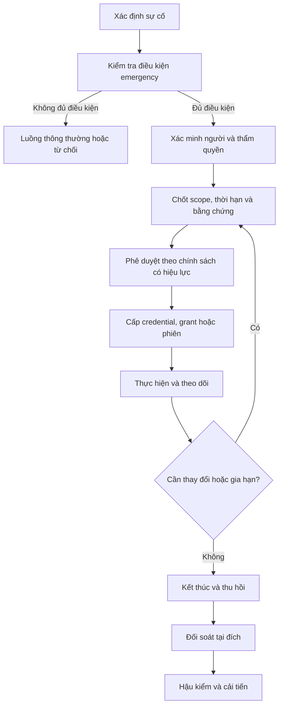

# Phê duyệt khẩn cấp

## Mục tiêu bài học

Trong Privileged Access Management (PAM), **phê duyệt khẩn cấp** là quyết định cho phép truy cập đặc quyền qua một luồng được thiết kế cho tình huống cần xử lý gấp, có giới hạn rõ về người, mục đích, tài sản và thời gian.

Trong bối cảnh break-glass, luồng thông thường có thể không sử dụng được: IdP gián đoạn, PAM không cấp phiên, một thay đổi làm mất quyền quản trị hoặc hệ thống đang chịu sự cố nghiêm trọng. Khẩn cấp không tự tạo thẩm quyền. Điều kiện kích hoạt, người được quyết định và biện pháp kiểm soát phải được xác định trước.

Sau bài học này, bạn có thể:

- Phân biệt phê duyệt nhanh trong luồng bình thường với kích hoạt break-glass.
- Xác định điều kiện khẩn cấp, thẩm quyền và dữ liệu tối thiểu của một quyết định.
- Thiết kế phương án phê duyệt khi ticket, IdP hoặc kênh liên lạc chính không sẵn sàng.
- Giới hạn scope, thời hạn và khả năng gia hạn.
- Liên kết quyết định với credential, grant, phiên và hành động tại đích.
- Đối soát bằng chứng, thu hồi quyền và hậu kiểm sau sự cố.

## 1. Phê duyệt khẩn cấp giải quyết vấn đề gì?

Một luồng phê duyệt bình thường có thể phù hợp cho thay đổi có kế hoạch nhưng không đáp ứng thời gian khôi phục khi dịch vụ quan trọng ngừng hoạt động. Trong sự cố khác, chính thành phần dùng để xác thực hoặc cấp quyền có thể bị lỗi.

Cần một luồng đủ nhanh để xử lý nhưng vẫn trả lời được:

- Ai xác nhận tình huống đủ điều kiện?
- Ai được phép kích hoạt?
- Ai sẽ thực hiện công việc?
- Quyền nào thật sự cần?
- Khi nào quyền phải kết thúc?
- Ai kiểm chứng kết quả và thu hồi?

Nếu các câu hỏi chỉ được bàn sau khi credential đã phát, tổ chức khó biết đây là một hành động được ủy quyền hay một đường đi ngoài kiểm soát.

### Ví dụ xuyên suốt

Một thay đổi cấu hình làm nền tảng danh tính không phục vụ được đăng nhập quản trị. Lan cần khôi phục một cấu hình đã được xác định, trên một tập tài sản cụ thể.

Luồng break-glass được thiết kế trước cho phép người trực sự cố có thẩm quyền cùng bên phê chuẩn kỹ thuật xác nhận phạm vi. Lan dùng danh tính hoặc credential emergency từ môi trường quản trị được chấp nhận, trong một cửa sổ ngắn. Các thao tác được ghi lại qua phương án bằng chứng còn hoạt động.

Kết thúc công việc, đội phụ trách xác nhận đường truy cập bình thường đã phục hồi, thu hồi phiên và quyền emergency, xử lý credential đã dùng rồi thực hiện hậu kiểm.

## 2. Không phải mọi công việc gấp đều cần break-glass

| Tình huống | Luồng nên xem xét | Điểm kiểm soát |
|---|---|---|
| Công việc có hạn gấp nhưng PAM và IdP vẫn hoạt động | Phê duyệt nhanh trong luồng thông thường | Giữ identity, approval, JIT và audit bình thường |
| Sự cố nghiêm trọng, đường quản trị bình thường không đáp ứng | Luồng emergency đã định nghĩa | Có thẩm quyền, scope và thời hạn riêng |
| IdP hoặc PAM bị gián đoạn | Break-glass có khả năng hoạt động độc lập phù hợp | Không phụ thuộc hoàn toàn vào thành phần đang lỗi |
| Người xin chưa chuẩn bị ticket hoặc muốn tránh chờ | Không tự coi là điều kiện break-glass | Hoàn thiện hoặc chuyển cấp theo quy trình hợp lệ |
| Yêu cầu vi phạm một điều cấm không có ngoại lệ | Không dùng nhãn khẩn cấp để tự vượt cấm | Xử lý theo thẩm quyền và cơ chế đã được cho phép |

Mức ảnh hưởng và thời gian cần xử lý phải có căn cứ. Một ô chọn “urgent” do người xin tự đánh dấu không đủ để cấp credential đặc quyền.

### Khẩn cấp không có nghĩa bỏ mọi điều kiện

Một hệ thống có thể cho phép khác biệt có chủ đích so với luồng thường, chẳng hạn dùng kênh xác thực hoặc ghi bằng chứng dự phòng. Những khác biệt đó phải được xác định trong chính sách emergency.

Không được tự mở truy cập cho mọi tài sản, kéo dài vô hạn hoặc loại bỏ mọi bằng chứng chỉ vì một thành phần gặp lỗi.

## 3. Thẩm quyền phải được thiết kế trước

Một chính sách phê duyệt khẩn cấp cần nêu:

1. Loại sự cố và điều kiện được kích hoạt.
2. Những vai trò được xác nhận sự cố.
3. Những người hoặc vai trò được phê chuẩn truy cập.
4. Điều kiện độc lập giữa người xin, người duyệt và người thực hiện.
5. Người dự phòng và cách ủy quyền.
6. Những scope hoặc capability có thể được cấp.
7. Thời hạn tối đa, cách gia hạn và điểm kết thúc.
8. Kênh dùng khi hệ thống chính không sẵn sàng.
9. Cách ghi bằng chứng và đối soát.
10. Người chịu trách nhiệm thu hồi và hậu kiểm.

Danh sách người có thẩm quyền cần được cập nhật theo vòng đời nhân sự và lịch trực. Một tài liệu cũ ghi tên người đã chuyển nhiệm vụ không đủ để xác nhận quyền hiện tại.

### Nhu cầu nghiệp vụ và an toàn kỹ thuật

Người chỉ huy sự cố có thể xác nhận mức ảnh hưởng và nhu cầu khôi phục. Chủ hệ thống hoặc người được giao thẩm quyền kỹ thuật có thể đánh giá hành động, scope và rủi ro.

Một tổ chức có thể yêu cầu hai bên độc lập cho quyền nhạy cảm. Hai account của cùng người không được tính như hai người độc lập.

Không bắt buộc mọi tình huống phải dùng cùng một số người, nhưng mọi phương án giảm số người hoặc tự kích hoạt phải được cho phép trước với điều kiện rõ ràng. Sự vắng mặt của approver không tự tạo quyền cho người xin.

### Phê chuẩn chính sách trước khác phê duyệt từng lần

Có thể tồn tại một luồng đã được phê chuẩn trước, trong đó một người trực được phép kích hoạt khi đáp ứng các điều kiện cụ thể và phát sinh cảnh báo ngay. Khi đó, thẩm quyền đến từ chính sách có hiệu lực, không phải từ việc hậu kiểm sẽ diễn ra sau.

Hệ thống vẫn cần ghi ai kích hoạt, căn cứ, scope và chính sách áp dụng. Không dùng hậu kiểm để hợp thức hóa mọi hành động không có thẩm quyền từ đầu.

## 4. Dữ liệu tối thiểu để ra quyết định

Một yêu cầu emergency nên đủ ngắn để dùng trong sự cố nhưng đủ cụ thể để không trở thành giấy phép chung.

| Trường | Nội dung cần có |
|---|---|
| Incident reference | Sự cố nào đang được xử lý? |
| Người yêu cầu và thực hiện | Danh tính nào, ai chịu trách nhiệm? |
| Căn cứ khẩn cấp | Ảnh hưởng, thời gian và lý do luồng thường không phù hợp |
| Tài sản | Tập đích được chốt hoặc phạm vi được định nghĩa rõ |
| Capability | Thao tác hoặc role cần để khôi phục |
| Mục tiêu | Trạng thái mong muốn và điều kiện dừng |
| Thời hạn | Bắt đầu, kết thúc, giới hạn grant hoặc phiên |
| Đường truy cập | Thiết bị, broker, tài khoản hoặc phương án recovery được phép |
| Bằng chứng | Nguồn ghi nhận và người giữ trách nhiệm |
| Phương án kết thúc | Thu hồi, xử lý credential và xác minh |

Không yêu cầu dán password, private key hoặc recovery code vào phiếu để chứng minh đã có phương án.

### Scope phải đủ cho công việc, không rộng theo cảm giác

Ưu tiên capability hẹp và đích cụ thể. Nếu nền tảng chỉ cung cấp một quyền rất rộng để phục hồi, phải ghi nhận giới hạn kỹ thuật và rủi ro còn lại.

Không gọi một tài khoản root không giới hạn là JEA chỉ vì mô tả trong ticket nói “chỉ sửa một cấu hình”. Có thể cần thêm quan sát độc lập, lệnh đã chuẩn bị, giới hạn tuyến và audit, nhưng phải nói rõ những gì thật sự được thực thi.

### Ràng buộc phiên bản

Quyết định cho phép khôi phục cấu hình trên tài sản A không tự áp dụng khi người thực hiện chuyển sang tài sản B hoặc thêm thao tác thay quyền.

Thay đổi có ý nghĩa về scope cần được phê chuẩn theo cơ chế emergency tương ứng. Không giữ một cờ approved cho một request rồi cho phép sửa toàn bộ nội dung bên dưới.

## 5. Phê duyệt khi kênh thông thường còn hoạt động

Nếu hệ thống bình thường vẫn hoạt động, tận dụng nó để giữ kiểm soát và giảm đối soát sau sự cố:

1. Ghi yêu cầu emergency và incident reference.
2. Kiểm tra người xin, người thực hiện và nguồn quản trị.
3. Xác nhận điều kiện khẩn cấp.
4. Chuyển đúng approver hoặc người dự phòng.
5. Phê chuẩn scope và thời hạn.
6. Cấp grant hoặc phiên theo chính sách.
7. Ghi nhận các mốc và kết quả.

Một giao diện ưu tiên sự cố có thể giảm bước nhập liệu hoặc định tuyến nhanh hơn nhưng không nên bỏ kiểm tra phía máy chủ.

Thông báo qua chat hoặc email có thể giúp gọi người duyệt. Quyết định có hiệu lực vẫn cần được xác thực, ràng buộc với request và ghi đúng vào nguồn dữ liệu có thẩm quyền theo thiết kế.

## 6. Phê duyệt khi IdP, ticket hoặc PAM gián đoạn

Một luồng break-glass phải xem xét phụ thuộc vòng tròn:

```text
Muốn mở tài khoản khôi phục IdP
    -> phải đăng nhập IdP
    -> IdP đang ngừng hoạt động
```

Tương tự, một credential emergency nằm trong vault nhưng chỉ có thể mở vault bằng thành phần đang lỗi có thể không phục vụ được mục tiêu phục hồi đó.

### Phân tích khả năng sống sót của từng thành phần

| Thành phần có thể lỗi | Câu hỏi thiết kế |
|---|---|
| IdP hoặc directory | Cơ chế xác minh và danh tính emergency nào còn hoạt động? |
| PAM control plane | Có đường được phép để lấy hoặc sử dụng credential phục hồi không? |
| Ticket | Ghi incident reference tạm và đối soát thế nào? |
| Kênh chat hoặc điện thoại chính | Kênh dự phòng nào đã được kiểm chứng? |
| Kho audit trung tâm | Bằng chứng được giữ ở đâu, bảo vệ và chuyển lại thế nào? |
| Mạng quản trị | Đường truy cập phục hồi nào tồn tại mà không mở quyền tùy ý? |
| Dịch vụ cấp secret hoặc giải mã | Ai giữ vật liệu cần thiết và phụ thuộc còn lại là gì? |

Không phải luồng emergency phải chịu được mọi lỗi đồng thời. Cần xác định những kịch bản đã thiết kế, những điều kiện tối thiểu và giới hạn chưa được giải quyết.

### Xác minh người duyệt ngoài kênh chính

Một tin nhắn tự xưng là chỉ huy sự cố không đủ. Có thể dùng danh sách liên hệ được quản lý, gọi lại qua kênh đã biết hoặc cơ chế xác minh độc lập phù hợp.

Mức khẩn cấp, thông tin đúng về sự cố hoặc giọng nói quen không tự chứng minh người đó có thẩm quyền. Kênh dự phòng cũng cần mô hình chống giả mạo và hướng dẫn vận hành.

Nếu dùng danh sách offline hoặc bản chụp quyền, phải quản lý phiên bản, độ cũ và cách thay thế. Không suy rằng một danh sách từng hợp lệ sẽ luôn hợp lệ sau khi nhân sự thay đổi.

### Ghi nhận quyết định bằng lời nói

Nếu chính sách cho phép phê duyệt bằng lời nói trong một số kịch bản, cần xác nhận lại nội dung: ai được làm gì, trên tài sản nào, tới khi nào và dưới incident reference nào.

Ghi nhận danh tính, kênh xác minh, thời điểm và người ghi. Nếu dùng người chứng kiến hoặc bản ghi, áp dụng điều kiện và quyền riêng tư tương ứng.

Không ghi âm hoặc chụp nội dung chứa secret. Nếu thời gian không đồng bộ, ghi rõ nguồn thời gian và mức không chắc chắn; không tạo timestamp giả để có vẻ quy trình đã diễn ra chính xác hơn thực tế.

### Mã sự cố tạm

Khi ticket không hoạt động, có thể dùng định danh tạm theo quy trình đã định nghĩa. Sau đó liên kết nó với hồ sơ chính, giữ cả thời điểm sự kiện lẫn thời điểm nhập lại.

Không tạo ticket sau rồi ghi ngược rằng hệ thống chính đã phê duyệt trước. Đối soát phải bảo toàn sự thật về đường đã sử dụng.

## 7. Credential emergency và phân tách lưu giữ

Cách lưu credential phụ thuộc công nghệ: vault có đường dự phòng, vật liệu offline được bảo vệ, authenticator riêng hoặc cơ chế khôi phục khác đã được hỗ trợ.

Cần kiểm tra:

- Credential có hoạt động trong kịch bản đã nêu không?
- Ai có thể lấy, sử dụng hoặc thay nó?
- Vật liệu giải mã hoặc mở khóa được giữ ở đâu?
- Có cùng phụ thuộc lỗi với hệ thống cần phục hồi không?
- Việc truy cập vật liệu có được ghi nhận?
- Sau sử dụng, credential được xử lý thế nào?

Phê duyệt truy cập và khả năng lấy secret là hai lớp. Người giữ vật liệu không mặc nhiên được tự sử dụng ngoài chính sách.

### Nhiều người giữ không có nghĩa tự động an toàn

Nếu dùng cơ chế nhiều bên hoặc threshold, cần giải pháp được thiết kế và kiểm chứng. Không tự chia một password thành các đoạn rồi coi đó là một giao thức bảo mật đầy đủ.

Cần có dự phòng người giữ và phương án khi vật liệu bị mất, đồng thời ngăn một nơi lưu trữ bị chiếm quyền trở thành điểm lấy được tất cả.

Không làm quy trình phức tạp đến mức không thể phục hồi trong kịch bản đã cam kết. Cân bằng phải dựa trên diễn tập, thời gian khôi phục và rủi ro được chấp nhận.

## 8. Vòng đời một lần kích hoạt



Bước phê duyệt có thể là quyết định của approver hoặc việc kiểm tra một quyền kích hoạt đã được phê chuẩn trước. Cả hai đều cần dữ liệu và bằng chứng tương ứng.

### Trạng thái phản ánh việc thật

```text
REQUESTED -> AUTHORIZED -> ACTIVATING -> ACTIVE
                                |
                          ACTIVATION_FAILED

ACTIVE -> ENDING -> REVOKED_AND_VERIFIED
                 -> CLEANUP_PENDING
```

Tên trạng thái có thể khác. Không chuyển thẳng từ “đã yêu cầu đóng” thành “đã thu hồi xác minh” khi đích chưa phản hồi.

Nếu lệnh cấp quyền bị timeout, kết quả có thể chưa biết thay vì chắc chắn thất bại. Đối soát hoặc dùng cơ chế chống cấp trùng trước khi retry để tránh tạo thêm grant.

## 9. Thời hạn và gia hạn

Phê duyệt khẩn cấp cần có điểm kết thúc rõ. Ví dụ, một phiên được chấp thuận tối đa 20 phút trong phạm vi công việc đã nêu; con số này chỉ phục vụ minh họa.

Phân biệt:

| Loại hạn | Ý nghĩa |
|---|---|
| Hạn dùng quyết định để bắt đầu | Sau mốc nào phải xin quyết định mới trước khi kích hoạt? |
| Cửa sổ được phép hoạt động | Công việc được diễn ra trong khoảng nào? |
| TTL của grant hoặc credential | Quyền hoặc credential tồn tại bao lâu? |
| Hạn phiên | Phiên đang mở có thể hoạt động tới khi nào? |
| Mốc rà soát sự cố | Khi nào phải xác nhận tiếp tục cần quyền? |

Refresh trang, reconnect hoặc một alert chưa đóng không tự gia hạn các mốc đó.

### Gia hạn cần quyết định có căn cứ

Trước khi hết hạn, người thực hiện báo tình trạng, công việc còn lại và lý do cần thêm thời gian. Người có thẩm quyền xem lại scope, mức rủi ro và khả năng trở lại luồng bình thường.

Không tự đặt lại 20 phút mỗi khi có hoạt động. Nếu hệ thống có một cơ chế chuyển tiếp hoặc khoảng dự phòng đã được phê chuẩn, điều kiện và giới hạn phải được mô tả trước; không tạo ra trong lúc quyền sắp hết.

### Hạn tự động không giải quyết mọi lớp

Credential hết hạn có thể chỉ ngăn xác thực mới, không tự đóng phiên đã mở. Một role bị gỡ không chắc vô hiệu mọi token đã cấp.

Luồng emergency cần phương án thu hồi và kiểm chứng phù hợp khả năng của đích. Nếu không thể tự động hoàn tất, ghi rõ trách nhiệm, biện pháp giảm rủi ro và trạng thái còn tồn đọng.

## 10. Giám sát trong lúc có quyền

Khẩn cấp thường làm tăng khả năng sai sót do áp lực thời gian. Cần một cơ chế theo dõi phù hợp với mức tác động:

- Liên kết phiên với incident reference.
- Ghi các mốc quan trọng và thay đổi scope.
- Có bên biết phiên emergency đang hoạt động.
- Theo dõi hành động trên tài sản đích theo khả năng.
- Cảnh báo khi dùng ngoài cửa sổ hoặc từ nguồn không được chấp nhận.
- Giữ liên lạc và điều kiện dừng.

Bản ghi màn hình, nếu có, không thay thế audit đích và không bảo đảm thấy mọi API hoặc tác vụ nền. Khi không còn hệ thống ghi phiên trung tâm, phương án bằng chứng dự phòng phải giữ được tính toàn vẹn trong phạm vi đã thiết kế.

### Không mở rộng nhiệm vụ trong lúc đã có quyền

Người thực hiện có thể phát hiện công việc bổ sung. Nếu công việc làm thay đổi tài sản, capability hoặc mục tiêu ngoài phạm vi đã cho phép, cần chuyển tới bước điều chỉnh có thẩm quyền.

Không tận dụng phiên emergency để dọn quyền cũ, sửa những lỗi không liên quan hoặc thực hiện một thay đổi đang chờ phê duyệt thường.

Nếu đích chỉ cho quyền rộng, giới hạn trong quyết định vẫn ràng buộc trách nhiệm của người thực hiện; đồng thời phải thừa nhận giới hạn đó có thể chưa được cưỡng chế đầy đủ bằng kỹ thuật.

## 11. Kết thúc, thu hồi và xử lý credential

Không đợi hậu kiểm mới bắt đầu đóng quyền. Khi mục tiêu đã đạt hoặc điều kiện dừng xuất hiện:

1. Ngừng thao tác và xác nhận trạng thái nghiệp vụ.
2. Đóng hoặc vô hiệu phiên emergency theo cơ chế được hỗ trợ.
3. Gỡ grant, membership hoặc role tạm.
4. Vô hiệu token hoặc lease liên quan khi cần và khả thi.
5. Xử lý credential đã sử dụng theo loại và mức phơi lộ.
6. Thu hồi thay đổi tạm như tuyến, ngoại lệ hoặc quyền hỗ trợ.
7. Kiểm chứng tại đích và ghi phần chưa hoàn tất.

Với password có khả năng đã bị tiết lộ, có thể cần luân chuyển theo quy trình. Với khóa, chứng thư hoặc token, cơ chế xử lý khác nhau; đổi password không tự thu hồi mọi loại credential khác.

### Kiểm tra quyền bền vững

Một phiên ngắn có thể tạo:

- Tài khoản hoặc credential mới.
- Membership đặc quyền.
- Token dài hạn.
- Thay đổi trust hoặc federation.
- Tác vụ tự động.
- Ngoại lệ policy.

Không mặc định những thứ này biến mất khi phiên đóng. Phân biệt thay đổi hợp lệ cần giữ để phục hồi với quyền tạm cần gỡ, và có chủ sở hữu xác nhận.

### Tránh mất đường khôi phục cuối cùng

Trước khi vô hiệu credential emergency, kiểm tra đường quản trị bình thường hoặc đường phục hồi tiếp theo đã sẵn sàng theo quy trình.

Điều này không phải lý do giữ quyền emergency vô hạn. Cần kế hoạch chuyển tiếp, thời hạn và trách nhiệm rõ thay vì đóng tất cả đường một cách mù quáng hoặc để tất cả cùng tồn tại.

## 12. Hậu kiểm không thay thế ủy quyền ban đầu

Hậu kiểm cần xác nhận:

- Điều kiện kích hoạt có đúng với chính sách không?
- Ai xác minh và ai phê chuẩn?
- Kênh nào được dùng và có đúng khả năng dự phòng?
- Scope được duyệt có khớp thao tác thực tế?
- Có thay đổi hoặc gia hạn nào?
- Tại sao các kiểm soát dự phòng được sử dụng?
- Quyền, phiên, token và credential đã được xử lý tới đâu?
- Có tác động ngoài dự kiến hoặc dấu hiệu lạm dụng không?
- Cần sửa thiết kế để lần sau không lặp lại điều gì?

Nếu phát hiện hành động ngoài thẩm quyền, ghi nhận và xử lý theo quy trình. Không sửa timestamp, đổi lý do hoặc tạo một approval quá khứ để hồ sơ trông hợp lệ.

### Đối soát bằng chứng khi hệ thống phục hồi

Nhập lại thông tin offline với nguồn gốc và mốc thời gian rõ. Giữ bản gốc được bảo vệ và liên kết hồ sơ thay vì thay thế bằng một bản tóm tắt không thể kiểm tra.

Phân biệt thời điểm quyết định, thời điểm hành động và thời điểm dữ liệu được nhập vào hệ thống chính. Những khác biệt đó là thông tin kiểm toán, không phải lỗi cần che.

## 13. Bản ghi phê duyệt minh họa

```yaml
# Mô hình dữ liệu minh họa, không phải cấu hình sản phẩm.
emergency_request_reference: emergency-example-18
incident_reference: incident-example-63
request_version: 2
requester_reference: principal-example-lan
executor_reference: principal-example-identity-operator
activation_basis: identity_platform_recovery
normal_path_status: unavailable
approved_scope:
  assets:
    - identity-service-example-1
  capability: restore_approved_configuration
approved_window:
  start: "2026-01-01T08:00:00Z"
  end: "2026-01-01T08:20:00Z"
approval_authority:
  policy_version: emergency-access-example-v5
  decision_reference: decision-example-29
  verification_reference: authority-check-example-29
access_path: approved_recovery_admin_environment
evidence_plan_reference: evidence-plan-example-7
revocation_owner: team-example-identity-operations
review_owner: team-example-security-review
```

Các tham chiếu tránh đưa secret và dữ liệu cá nhân không cần thiết vào bản ghi. Nếu không có hai approver cho một mô hình cho phép kích hoạt trước theo chính sách, schema phải ghi đúng cơ sở đó, không tạo hai danh tính giả để điền đủ ô.

Một quyết định cần ràng buộc với phiên bản và scope. Một mã incident giống nhau không tự biến mọi yêu cầu khác thành đã được phê chuẩn.

## 14. Sai lầm thường gặp

### Kích hoạt bằng chính phụ thuộc đang lỗi

Một credential khôi phục IdP nhưng chỉ lấy được sau khi đăng nhập IdP không đáp ứng kịch bản đó. Kiểm tra toàn bộ chuỗi phụ thuộc trong diễn tập.

### Người trực tự nhận thẩm quyền

Vai trò trực vận hành không tự đồng nghĩa có quyền cấp mọi đặc quyền. Cần chính sách, ủy quyền và phạm vi có hiệu lực.

### Hậu kiểm được coi là approval sau

Hậu kiểm kiểm tra việc đã làm; nó không tạo lại thẩm quyền ở thời điểm trước đó. Nếu có quyền tự kích hoạt, căn cứ phải tồn tại từ đầu.

### Cùng người dùng hai account để tạo tính độc lập

Danh tính khác tên không làm thành hai người. Kiểm tra chủ thể và quan hệ trách nhiệm.

### Phê duyệt không có hạn

Quyền có thể tiếp tục sau khi sự cố kết thúc hoặc người dùng quên đóng. Đặt mốc, theo dõi và xử lý gia hạn rõ ràng.

### Báo thu hồi chỉ vì phiên đã đóng

Grant, token và quyền bền vững có thể còn. Đối soát tại đích và theo dõi lỗi dọn dẹp.

### Chia sẻ secret qua cuộc gọi hoặc ticket

Cần kênh sử dụng hoặc lấy credential đã được bảo vệ. Biên bản chỉ lưu tham chiếu, không lưu giá trị bí mật.

## 15. Bài thực hành có kiểm chứng

Dùng môi trường lab và credential giả. Không làm gián đoạn IdP hoặc PAM production để diễn tập bài học.

### Chuẩn bị

Tạo một sự cố giả lập, một tài sản danh tính thử nghiệm và một tác vụ phục hồi hẹp. Phân vai người thực hiện, người có thẩm quyền phê chuẩn, người dự phòng và người hậu kiểm.

Thiết kế hai kịch bản:

- Luồng thường còn hoạt động nhưng cần xử lý nhanh.
- Một phụ thuộc chính không sẵn sàng và phải dùng đường đã chuẩn bị.

Ghi điều kiện kích hoạt, scope, hạn, phương án bằng chứng và trách nhiệm thu hồi trước khi bắt đầu.

### Ca kiểm thử

| Ca | Thao tác | Kết quả mong đợi |
|---|---|---|
| Không đủ điều kiện | Người xin chỉ khai cần gấp, không có căn cứ phù hợp | Không tự kích hoạt break-glass |
| Đúng thẩm quyền | Approver hợp lệ duyệt request cụ thể | Quyết định được ràng buộc scope và thời hạn |
| Người không có quyền | Một thành viên khác gửi lời chấp thuận | Không được coi là approval có hiệu lực |
| Hai account cùng người | Người xin dùng account khác để tự duyệt | Không đáp ứng độc lập nếu chính sách yêu cầu |
| Approver vắng mặt | Dùng người dự phòng đã được ủy quyền | Giữ đúng thẩm quyền, không tự hạ điều kiện |
| Giả mạo kênh | Tin nhắn tự xưng người chỉ huy sự cố | Phải qua xác minh theo kênh đã thiết kế |
| Ticket lỗi | Dùng mã tạm theo quy trình | Có bản ghi và liên kết đối soát sau đó |
| IdP lỗi | Dùng phương án khôi phục được cho phép | Không phụ thuộc vòng tròn hoặc fallback im lặng |
| Scope đổi | Thêm tài sản sau quyết định | Cần xử lý thay đổi, không dùng approval cũ tùy ý |
| Hết hạn | Tiếp tục thao tác sau mốc kết thúc | Bị giới hạn hoặc xử lý theo khả năng đã công bố |
| Gia hạn | Xin thêm thời gian có căn cứ | Có quyết định mới phù hợp, không tự reset TTL |
| Retry cấp quyền | Mất phản hồi sau khi đích nhận lệnh | Đối soát, không tạo nhiều grant |
| Audit chính lỗi | Dùng bằng chứng dự phòng được cho phép | Bảo vệ bản gốc và nhập lại với mốc đúng |
| Thu hồi lỗi | Mô phỏng không gỡ được grant tại đích | Có trạng thái tồn đọng và người xử lý |
| Hậu kiểm | Đối chiếu quyết định với thao tác và quyền còn lại | Không sửa lịch sử để hợp thức hóa sai lệch |

Đo thời gian xác minh, phê duyệt, kích hoạt và thu hồi, nhưng không tối ưu riêng thời gian cấp quyền. Một luồng mở nhanh mà không đóng được quyền chưa đạt mục tiêu PAM.

### Bằng chứng cần nộp

Nộp request có scope, căn cứ thẩm quyền, các mốc sự kiện, kết quả tại đích, trạng thái credential và báo cáo thu hồi. Với kênh dự phòng, ghi khả năng đã kiểm chứng và giới hạn.

Nếu chưa kiểm tra kết thúc phiên hoặc vô hiệu token, không kết luận toàn bộ quyền emergency đã được thu hồi.

## 16. Câu hỏi tự kiểm tra

1. Vì sao một yêu cầu urgent chưa đủ để kích hoạt break-glass?
2. Phê chuẩn một chính sách tự kích hoạt khác gì hợp thức hóa bằng hậu kiểm?
3. Nếu IdP ngừng hoạt động, đường phê duyệt cần tránh phụ thuộc nào?
4. Một approval cho tài sản A có áp dụng cho tài sản B cùng incident không?
5. Sau khi đóng phiên emergency, cần kiểm tra thêm những gì?

### Gợi ý đối chiếu

1. Cần điều kiện sự cố, thẩm quyền, scope và biện pháp kiểm soát đã được định nghĩa.
2. Quyền kích hoạt có căn cứ trước khi sử dụng; hậu kiểm chỉ đánh giá sau, không tạo lại ủy quyền.
3. Tránh việc mọi bước xác minh, lấy secret hoặc phê duyệt đều yêu cầu chính IdP đang lỗi.
4. Không tự động. Quyết định phải gắn với phạm vi đã được chấp thuận và xử lý thay đổi theo quy trình.
5. Grant, membership, token, credential đã dùng, quyền phát sinh và khả năng trở lại đường bình thường.

Phê duyệt khẩn cấp đạt mục tiêu khi tổ chức có thể cấp đúng quyền để khôi phục trong điều kiện khó khăn mà vẫn biết rõ cơ sở thẩm quyền và điểm kết thúc. Luồng break-glass cần được chuẩn bị, diễn tập và đối soát từ quyết định tới quyền thực tế, thay vì dựa vào lời hứa sẽ kiểm tra sau.
