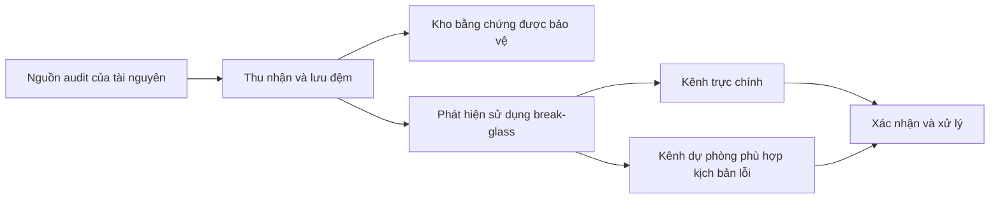

# Theo dõi sử dụng tài khoản break-glass

## 1. Vì sao truy cập khẩn cấp cần được theo dõi riêng?

Break-glass là cơ chế truy cập khẩn cấp giúp người có trách nhiệm khôi phục quyền quản trị khi đường truy cập thông thường không còn hoạt động hoặc không đáp ứng được tình huống đã định nghĩa. Trong một chương trình Privileged Access Management (PAM), đây thường là quyền rất nhạy cảm: tài khoản có thể tồn tại lâu dài, được giữ ngoài một số phụ thuộc thông thường và chỉ được dùng trong hoàn cảnh đặc biệt.

Đặc điểm đó tạo ra hai yêu cầu đồng thời. Người ứng cứu phải nhận được quyền cần thiết để cứu hệ thống; tổ chức phải biết quyền ấy được ai sử dụng, sử dụng vì sự cố nào và đã tác động đến tài nguyên nào. Nếu chỉ biết rằng tài khoản vẫn đăng nhập được mà không quan sát được quá trình sử dụng, break-glass dễ trở thành một đường quản trị thường ngày hoặc một lối duy trì truy cập trái phép.

**Theo dõi sử dụng** là quá trình thu nhận, liên kết và đánh giá các dấu vết trước, trong và sau lần truy cập khẩn cấp. Một bản ghi đăng nhập thành công chỉ là một phần của quá trình này. Nó chưa chứng minh được ai là người thực tế cầm credential, người đó đã làm gì hoặc quyền truy cập đã được kết thúc hoàn toàn hay chưa.

Sau bài học, bạn có thể:

- Xác định các sự kiện cần thu thập cho một lần sử dụng break-glass.
- Thiết kế đường cảnh báo vẫn hữu ích khi một thành phần IAM, PAM hoặc hệ thống giám sát bị lỗi.
- Liên kết người vận hành, lần lấy credential, phiên truy cập và hành động trên tài nguyên.
- Phân biệt sử dụng được giải trình, sử dụng có sai lệch và sử dụng chưa xác định được người chịu trách nhiệm.
- Đóng một lần sử dụng bằng bằng chứng về thu hồi quyền, xử lý credential và rà soát hậu kiểm.

## 2. Phân biệt tính sẵn sàng với việc sử dụng thực tế

Có ba câu hỏi thường bị trộn lẫn:

| Câu hỏi | Ví dụ quan sát | Kết luận có thể rút ra |
|---|---|---|
| Cơ chế break-glass có sẵn sàng không? | Kiểm tra vật chứa credential, khả năng liên hệ người giữ khóa, bài diễn tập có kiểm soát | Cơ chế có thể đáp ứng kịch bản đã kiểm tra |
| Có ai đang dùng hoặc tìm cách dùng quyền đó không? | Đăng nhập, thất bại xác thực, lấy credential, mở kết nối quản trị | Đã xuất hiện tín hiệu liên quan đến sử dụng |
| Quyền đó được dùng để làm gì? | Thay đổi cấu hình, lệnh quản trị, yêu cầu API, thay đổi phân quyền | Có bằng chứng về hoạt động trên tài nguyên |

Một bài kiểm tra khả dụng có thể tạo ra sự kiện sử dụng thật. Vì vậy, cần gắn nó với một mã diễn tập, phạm vi và khoảng thời gian cụ thể. Không nên đánh dấu toàn bộ tài khoản là “tài khoản kiểm tra” rồi tắt cảnh báo vĩnh viễn.

Cũng cần phân biệt **sử dụng** và **lộ hoặc tiếp xúc credential**. Một lần mở phong bì, giải mã bí mật hoặc checkout mật khẩu có thể chưa dẫn đến đăng nhập, nhưng đã làm thay đổi trạng thái kiểm soát của credential. Đó vẫn là sự kiện phải theo dõi và xử lý theo chính sách.

Trong môi trường có tài khoản khẩn cấp dùng chung, tên tài khoản đích không đủ để nhận diện người thao tác. Hệ thống theo dõi phải tìm cách nối tài khoản đó với danh tính cá nhân hoặc bằng chứng bàn giao có trách nhiệm. Nếu chưa nối được, phải thể hiện rõ “chưa xác định người vận hành”, không biến suy đoán thành kết luận.

## 3. Quan sát toàn bộ vòng đời của một lần sử dụng

Có thể coi mỗi lần sử dụng break-glass là một hồ sơ sự kiện gồm nhiều mốc. Không phải mọi nền tảng đều phát sinh đủ từng loại log; thiết kế phải ghi rõ nguồn có sẵn, nguồn thay thế và khoảng trống còn lại.

| Mốc | Sự kiện cần quan sát | Nội dung cần giải thích |
|---|---|---|
| Kích hoạt | Khai báo sự cố, quyết định dùng cơ chế khẩn cấp | Vì sao đường truy cập thường không phù hợp? |
| Tiếp cận credential | Checkout, giải mã, bàn giao vật chứa, truy cập kho bí mật | Ai đã có khả năng sử dụng credential? |
| Xác thực | Thành công, thất bại, từ chối, tạo phiên mới | Truy cập bắt đầu từ đâu và bằng phương thức nào? |
| Hành động | Thay đổi quyền, cấu hình, tài nguyên hoặc chính sách | Hoạt động có nằm trong mục tiêu khôi phục không? |
| Duy trì truy cập | Tạo khóa, token, tài khoản hoặc thành viên nhóm mới | Có quyền nào có thể tồn tại sau phiên khẩn cấp? |
| Kết thúc | Đăng xuất, đóng phiên, kết thúc kết nối | Cửa sổ thao tác đã kết thúc theo bằng chứng nào? |
| Khôi phục kiểm soát | Xoay credential, thu hồi token, gỡ quyền tạm | Đường truy cập nào đã được vô hiệu hóa hoặc thay thế? |
| Hậu kiểm | Đối chiếu hoạt động, chấp nhận sai lệch, mở điều tra | Hồ sơ đã đủ bằng chứng để đóng chưa? |

Cơ chế kích hoạt không nhất thiết luôn có phê duyệt trước. Một kịch bản khẩn cấp đã được tổ chức cho phép có thể yêu cầu người ứng cứu thao tác ngay rồi bổ sung xác nhận sau. Hệ thống theo dõi cần phản ánh đúng điều kiện này: thiếu phê duyệt trước có thể là sai lệch cần xác minh, nhưng không tự động chứng minh hành vi tấn công.

Ngược lại, có ticket hoặc mã sự cố cũng không tự động hợp thức hóa mọi hành động. Ticket có thể không đúng phạm vi, đã đóng hoặc được dùng lại. Cần đối chiếu cả thời gian, người tham gia, tài nguyên và tác động thực tế.

### Ví dụ: một phiên khôi phục dịch vụ xác thực

Một nhóm vận hành không thể dùng tài khoản quản trị thông thường vì dịch vụ xác thực trung tâm gặp sự cố. Người trực kích hoạt cơ chế khẩn cấp để sửa cấu hình kết nối của dịch vụ.

Hồ sơ theo dõi nên cho phép tái dựng chuỗi sau:

1. Người trực khai báo sự cố `INC-DEMO-042` và lý do cần break-glass.
2. Người giữ credential xác nhận việc bàn giao bằng kênh dự phòng đã định nghĩa.
3. Tài khoản khẩn cấp được xác thực trên tài nguyên quản trị dự kiến.
4. Người vận hành sửa cấu hình cần thiết; mọi thay đổi ngoài phạm vi đều được đánh dấu để rà soát.
5. Phiên được kết thúc, quyền phát sinh được kiểm tra và credential được xử lý theo chính sách.
6. Người rà soát độc lập đối chiếu log, xác nhận kết quả khôi phục và ghi nhận khoảng trống bằng chứng nếu có.

Nếu chỉ thu log ở mốc 3, tổ chức sẽ không biết credential được tiếp cận từ lúc nào hoặc có quyền tồn dư nào được tạo ra ở mốc 4.

## 4. Thiết kế nguồn log và đường cảnh báo

### 4.1. Dùng nhiều nguồn để kiểm chứng lẫn nhau

Một thiết kế thực tế thường kết hợp các nguồn sau:

- **Nguồn nhận diện tài khoản:** danh mục tài khoản khẩn cấp và định danh ổn định của chúng trên từng hệ thống.
- **Nguồn quản lý credential:** lịch sử checkout, truy cập bí mật, bàn giao hoặc kiểm tra vật chứa ngoại tuyến.
- **Nguồn xác thực:** nhật ký của hệ thống đích, nền tảng danh tính hoặc dịch vụ chấp nhận credential.
- **Nguồn hành động:** audit quản trị, thay đổi phân quyền, thao tác API, tiến trình hoặc lệnh nếu nền tảng hỗ trợ.
- **Nguồn phiên:** gateway hoặc proxy PAM, bản ghi phiên và dữ liệu kết nối khi có.
- **Nguồn ngữ cảnh:** hồ sơ sự cố, danh sách người trực, kế hoạch diễn tập và quyết định sử dụng cơ chế khẩn cấp.

Không nên chỉ theo dõi tên hiển thị như `emergency-admin`. Tên có thể đổi, trùng giữa môi trường hoặc bị tái sử dụng. Khi nền tảng cung cấp định danh ổn định, hãy lưu cả định danh đó, miền quản trị, môi trường và tên hiển thị tại thời điểm sự kiện.

Bản ghi của proxy PAM chỉ bao phủ các phiên thực sự đi qua proxy. Nếu break-glass cho phép truy cập trực tiếp để xử lý tình huống PAM bị lỗi, cần có nguồn quan sát trên hệ thống đích hoặc nguồn thay thế. “Không thấy phiên trong PAM” không đồng nghĩa với “không có sử dụng”.

### 4.2. Tránh phụ thuộc hoàn toàn vào thành phần đang được cứu

Giả sử tài khoản khẩn cấp dùng để khôi phục hệ thống danh tính, nhưng mọi cảnh báo đều yêu cầu đăng nhập vào chính hệ thống danh tính đó mới đọc được. Cảnh báo có thể tồn tại nhưng người trực không tiếp cận được lúc cần nhất.

Thiết kế cần đánh giá cả chuỗi phụ thuộc:



Mức độc lập cần phù hợp với kịch bản hỏng đã chọn. Không phải tổ chức nào cũng cần hạ tầng riêng cho mọi thành phần, nhưng phải biết những phụ thuộc chung: mạng, DNS, nguồn điện, quyền quản trị, tài khoản đọc cảnh báo và dịch vụ gửi thông báo.

Một số quyết định cần làm rõ:

- Nếu bộ thu log mất kết nối, hệ thống đích có lưu đệm hay không, lưu được bao lâu và điều gì xảy ra khi đầy?
- Nếu SIEM không hoạt động, nguồn nào có thể phát tín hiệu trực tiếp hoặc lưu bằng chứng để thu hồi sau?
- Nếu kênh trực chính không gửi được, ai nhận thông báo ở kênh dự phòng?
- Nếu người dùng break-glass có quyền sửa log tại nguồn, bản sao nào đã được chuyển sang miền kiểm soát khác?
- Nếu hoàn toàn không nhận được log, tín hiệu sức khỏe nào giúp nhận biết khoảng thời gian mất quan sát?

Không tự động chặn mọi truy cập khẩn cấp khi hệ thống giám sát mất kết nối. Hành động đó có thể phá hỏng mục tiêu phục hồi. Cách xử lý phải được định nghĩa theo mức độ nghiêm trọng, nhu cầu duy trì dịch vụ và nguồn quan sát thay thế. Trong tình huống suy giảm giám sát đã được chấp nhận, cần ghi nhận người ra quyết định, thời điểm và biện pháp bù.

### 4.3. Phát hiện cả việc mất quan sát

Cảnh báo sử dụng chỉ đáng tin khi biết nguồn dữ liệu còn hoạt động. Vì tài khoản khẩn cấp ít được dùng, không có log sử dụng trong nhiều ngày có thể là bình thường; nó không phải phép kiểm tra sức khỏe đường thu log.

Dùng tín hiệu sức khỏe của bộ thu, sự kiện kiểm tra được kiểm soát hoặc sự kiện audit thông thường để xác nhận dữ liệu đang đến. Theo dõi lần cuối nhận dữ liệu, độ trễ thu nhận, lỗi chuyển tiếp, dung lượng hàng đợi và thay đổi cấu hình audit. Khoảng trống log phải xuất hiện trong hồ sơ điều tra dưới dạng khoảng trống, không được coi là bằng chứng rằng không có hoạt động.

## 5. Xây dựng hồ sơ sự kiện có thể liên kết

### 5.1. Những trường dữ liệu hữu ích

Không có một schema duy nhất phù hợp với mọi hệ thống. Tuy nhiên, bộ dữ liệu sau thường đủ để bắt đầu thiết kế:

| Nhóm | Trường gợi ý | Mục đích |
|---|---|---|
| Định danh sự kiện | `event_id`, `event_type`, `source_system` | Phân biệt sự kiện và khử trùng lặp |
| Thời gian | `occurred_at`, `ingested_at`, múi giờ hoặc độ lệch | Phân biệt thời điểm xảy ra và thời điểm nhận |
| Tài khoản khẩn cấp | `account_id`, `account_name`, `tenant_or_domain` | Nhận diện đúng tài khoản trong đúng miền |
| Người thực hiện | `operator_id`, `operator_evidence`, mức tin cậy | Nêu rõ người vận hành và cơ sở quy thuộc |
| Phạm vi | `environment`, `target_id`, `target_type` | Giới hạn tài nguyên và môi trường tác động |
| Ngữ cảnh truy cập | `source_address`, `device_id`, `auth_method` | Hỗ trợ đánh giá nguồn truy cập |
| Liên kết | `incident_id`, `checkout_id`, `session_id` | Nối các mốc của cùng một lần sử dụng |
| Kết quả | `outcome`, `action`, đối tượng bị thay đổi | Mô tả điều đã xảy ra |
| Tình trạng chứng cứ | `collection_health`, `evidence_reference` | Thể hiện độ đầy đủ và vị trí bằng chứng |

Địa chỉ IP chỉ là một tín hiệu ngữ cảnh. NAT, VPN, máy trung gian và môi trường dùng chung có thể khiến nhiều người xuất hiện dưới cùng một địa chỉ. Không dùng riêng IP để kết luận danh tính người thao tác.

Tương tự, một mã `incident_id` do người dùng tự nhập chưa phải bằng chứng mã đó hợp lệ. Hệ thống hoặc người rà soát cần đối chiếu nó với hồ sơ sự cố thực tế.

### 5.2. Ví dụ sự kiện chuẩn hóa

Ví dụ sau là dữ liệu minh họa, không phải schema hoặc cấu hình của một sản phẩm cụ thể:

```json
{
  "event_id": "evt-demo-00087",
  "event_type": "break_glass.authentication.success",
  "source_system": "admin-plane-audit",
  "occurred_at": "2026-11-20T03:14:22Z",
  "ingested_at": "2026-11-20T03:14:29Z",
  "account_id": "bg-account-demo-01",
  "account_name": "emergency-admin-demo",
  "tenant_or_domain": "training.example.invalid",
  "operator_id": "operator-demo-17",
  "operator_evidence": "checkout-record-and-duty-confirmation",
  "attribution_confidence": "corroborated",
  "incident_id": "INC-DEMO-042",
  "checkout_id": "checkout-demo-091",
  "session_id": "session-demo-308",
  "environment": "training",
  "target_id": "identity-admin-demo",
  "source_address": "192.0.2.45",
  "auth_method": "platform-reported-emergency-method",
  "outcome": "success",
  "collection_health": "healthy"
}
```

Ví dụ không chứa mật khẩu, khóa riêng, mã khôi phục hoặc token truy cập. Cần tránh đưa các bí mật này vào log, tiêu đề cảnh báo hay ticket. Với bản ghi lệnh và phiên, phải đánh giá nguy cơ thu cả dữ liệu nhạy cảm, đồng thời giới hạn người được xem và ghi lại các lần truy cập bằng chứng.

Không phải nguồn nào cũng cung cấp `session_id` hoặc `checkout_id`. Khi thiếu, có thể liên kết bằng một tổ hợp tài khoản, tài nguyên, cửa sổ thời gian và bằng chứng bàn giao. Cần lưu rõ đây là liên kết suy luận; không tự tạo một mã chung rồi coi đó là quan hệ đã được nguồn xác nhận.

### 5.3. Thời gian và độ tin cậy của thứ tự sự kiện

Nên chuẩn hóa thời gian khi xử lý nhưng giữ được giá trị gốc và múi giờ của nguồn. Đồng bộ đồng hồ giúp đối chiếu, song nguồn mất mạng hoặc máy bị can thiệp vẫn có thể lệch giờ.

Ví dụ, log checkout đến sau log đăng nhập không nhất thiết có nghĩa người vận hành đăng nhập trước khi lấy credential. Có thể đường chuyển log checkout bị chậm. Cần so sánh `occurred_at`, `ingested_at`, độ lệch đồng hồ đã biết và quan hệ do nguồn cung cấp trước khi kết luận.

Độ trễ cao cũng làm giảm hiệu quả ứng cứu. Thu hồi được log đầy đủ sau sự cố giúp hậu kiểm, nhưng không tương đương khả năng cảnh báo kịp thời trong lúc phiên đang diễn ra.

## 6. Thiết kế quy tắc phát hiện và cảnh báo

### 6.1. Có tín hiệu cho mọi lần dùng, ưu tiên theo ngữ cảnh

Vì break-glass được dành cho tình huống hiếm và có tác động lớn, mọi lần xác thực thành công bằng tài khoản khẩn cấp nên tạo một tín hiệu theo dõi rõ ràng. Một lần lấy credential cũng cần tín hiệu riêng, kể cả chưa thấy đăng nhập.

Mức ưu tiên và cách chuyển người trực có thể thay đổi theo môi trường, mục tiêu sử dụng và kế hoạch diễn tập. Các mức sau là ví dụ thiết kế để tổ chức hiệu chỉnh, không phải ngưỡng bắt buộc:

| Tín hiệu | Cách phân loại ban đầu | Nội dung cần kiểm tra |
|---|---|---|
| Đăng nhập khẩn cấp có hồ sơ sự cố phù hợp | Sử dụng cần xác nhận | Người thao tác, phạm vi, người giám sát |
| Đăng nhập không có ngữ cảnh đối chiếu | Sử dụng chưa giải trình | Sự cố có khai báo qua kênh dự phòng không? |
| Checkout credential nhưng chưa thấy đăng nhập | Credential đã được tiếp cận | Lý do không dùng, khả năng đã dùng ngoài nguồn quan sát |
| Đăng nhập nhưng không có checkout tương ứng | Sai lệch chuỗi kiểm soát | Credential ngoại tuyến, cache, cách tiếp cận khác hoặc sử dụng trái phép |
| Nhiều thất bại rồi thành công | Dấu hiệu cần tăng ưu tiên | Lỗi thao tác, diễn tập hay dò credential? |
| Tắt audit hoặc thay đổi nơi gửi log | Can thiệp khả năng quan sát | Có thuộc thao tác phục hồi đã định nghĩa không? |
| Tạo quyền truy cập tồn tại lâu dài | Nguy cơ quyền tồn dư | Quyền mới có cần thiết và đã được thu hồi chưa? |
| Vẫn có hoạt động sau khi hồ sơ đánh dấu kết thúc | Sai lệch thời gian hoặc quyền tồn dư | Phiên cũ, token chưa bị thu hồi hay log đến muộn? |

Tài khoản break-glass không nên được đưa vào danh sách miễn phát hiện chỉ vì hoạt động của nó “luôn là đặc biệt”. Cách làm đó loại bỏ đúng đối tượng cần được quan sát kỹ.

### 6.2. Tách phát hiện khỏi kết luận vi phạm

Một bộ quy tắc có thể vận hành theo logic khái niệm sau:

```text
Khi nhận sự kiện liên quan tới định danh break-glass:
    Lưu sự kiện nguồn và dữ liệu chuẩn hóa.
    Tìm hồ sơ sự cố hoặc diễn tập có thể đối chiếu.
    Tạo hoặc cập nhật hồ sơ sử dụng đang mở.

    Nếu là tiếp cận credential hoặc xác thực thành công:
        Phát tín hiệu tới người trực được chỉ định.

    Nếu chưa xác định được người vận hành:
        Gắn trạng thái ATTRIBUTION_PENDING và yêu cầu xác minh.

    Nếu hành động vượt phạm vi hoặc tác động tới audit:
        Tăng ưu tiên và chuyển người chịu trách nhiệm điều tra.

    Nếu dữ liệu thiếu hoặc đến chậm:
        Ghi rõ mức độ suy giảm quan sát.
```

Pseudocode này không tự động thu hồi mọi phiên. Phản ứng kỹ thuật phải theo playbook đã được kiểm thử. Một phiên không rõ nguồn gốc có thể cần cô lập ngay, trong khi một phiên đang sửa hệ thống sống còn cần phối hợp với người chỉ huy sự cố để chọn cách khống chế phù hợp.

### 6.3. Nội dung cảnh báo phải giúp người trực hành động

Một cảnh báo hữu ích nên trả lời được:

- Tài khoản khẩn cấp nào, thuộc môi trường nào và đang tác động tới tài nguyên nào?
- Tín hiệu là checkout, thất bại đăng nhập, thành công đăng nhập hay hành động quản trị?
- Thời điểm xảy ra, độ trễ nhận log và trạng thái đường thu nhận là gì?
- Ai được quy thuộc là người vận hành, dựa trên bằng chứng nào?
- Có hồ sơ sự cố hoặc diễn tập phù hợp không; điều gì còn chưa khớp?
- Ai phải xác nhận, thời hạn phản hồi theo quy trình nội bộ và đường chuyển cấp là gì?

Nên gửi liên kết tới bằng chứng có kiểm soát truy cập thay vì đính kèm toàn bộ bản ghi phiên. Cảnh báo cần mang đủ thông tin để định tuyến, nhưng không phát tán bí mật hoặc dữ liệu nhạy cảm sang nhiều kênh liên lạc.

### 6.4. Tránh nhiễu và mất tín hiệu

Một lần thao tác có thể tạo nhiều log trùng hoặc log từ nhiều nguồn. Có thể gom chúng vào một hồ sơ sử dụng nhưng phải giữ lại sự kiện gốc. Khử trùng lặp cần dựa vào định danh sự kiện của từng nguồn khi có; chỉ gom theo cùng tài khoản trong một phút có thể che mất hai lần đăng nhập độc lập.

Đối với diễn tập, chỉ thay đổi cách định tuyến hoặc mức ưu tiên khi đối chiếu đủ mã diễn tập, người tham gia, tài nguyên và cửa sổ thời gian. Hoạt động vượt phạm vi diễn tập vẫn cần được xử lý như sai lệch.

Nếu cảnh báo được gom trong một khoảng thời gian để giảm nhiễu, phải bảo đảm tín hiệu đầu tiên không bị trì hoãn quá mức và những thay đổi nghiêm trọng sau đó vẫn được chuyển cấp.

## 7. Quy trình xử lý khi phát hiện sử dụng

### Bước 1: xác nhận đã tiếp nhận cảnh báo

Người trực ghi thời điểm tiếp nhận và nhận trách nhiệm xử lý. Hệ thống cần phát hiện trường hợp không có ai xác nhận và chuyển cấp theo lịch trực. Việc thông báo “đã gửi thành công” không chứng minh rằng một người đã đọc và đang hành động.

### Bước 2: đối chiếu người vận hành và lý do

Liên hệ người vận hành bằng kênh đã được tổ chức xác minh trước, không chỉ dùng số điện thoại hoặc địa chỉ liên hệ do chính cảnh báo đáng ngờ cung cấp. Đối chiếu hồ sơ sự cố, danh sách người trực và bằng chứng tiếp cận credential.

Nếu chưa xác minh được, giữ trạng thái “chưa xác minh” và thực hiện playbook phù hợp. Không đóng cảnh báo chỉ vì người dùng trả lời rằng họ đang xử lý sự cố.

### Bước 3: quan sát hoạt động và giới hạn tác động

Kiểm tra tài nguyên đích, thay đổi quyền và các thao tác ngoài kế hoạch. Khi có khả năng, một người khác theo dõi hoặc xác nhận các thay đổi quan trọng. Với nguồn log có độ trễ, cần ghi rõ quan sát hiện tại mới phản ánh tới thời điểm nào.

Tìm cả dấu vết duy trì truy cập như khóa mới, token mới, tài khoản phụ, thay đổi nhóm quản trị và tác vụ tự động. Một người có quyền khẩn cấp có thể tạo phương tiện truy cập vẫn còn hiệu lực sau khi phiên ban đầu đã đóng.

### Bước 4: xử lý sai lệch theo playbook

Nếu có dấu hiệu lạm dụng, người phụ trách quyết định biện pháp khống chế dựa trên mức độ tin cậy của bằng chứng và tác động tới phục hồi. Có thể cần đóng một phiên, thu hồi một token, thay credential hoặc cô lập điểm truy cập. Các thao tác này không phải lúc nào cũng tương đương nhau.

Không xóa tài khoản, xóa log hoặc hủy bằng chứng để “dọn sạch” sự cố. Cần giữ dấu vết đủ cho điều tra và khôi phục trong phạm vi được cho phép.

### Bước 5: xác nhận kết thúc và khôi phục kiểm soát

Đóng cửa sổ thao tác khẩn cấp bằng các kiểm tra cụ thể:

- Phiên và kết nối liên quan đã được kết thúc ở nơi cần thiết.
- Credential đã được thay thế hoặc xử lý theo chính sách sau sử dụng; bản dự phòng mới được bảo quản đúng cách.
- Token, khóa và quyền phát sinh đã được kiểm tra riêng theo khả năng thu hồi của nền tảng.
- Hoạt động sau thời điểm kết thúc đã được đối chiếu, bao gồm log đến muộn.
- Cơ chế break-glass vẫn sẵn sàng cho lần khẩn cấp tiếp theo theo phương án được duyệt.

Đổi mật khẩu không mặc nhiên làm mất hiệu lực mọi phiên hoặc token đã cấp. Ngược lại, đóng phiên proxy cũng không chứng minh các kết nối trực tiếp hoặc credential khác đã được thu hồi. Hồ sơ kết thúc phải chỉ rõ điều đã kiểm tra và điều còn chưa xác nhận.

### Bước 6: hậu kiểm và đóng hồ sơ

Người rà soát đối chiếu mục tiêu ban đầu với hoạt động thực tế. Hồ sơ có thể được đóng khi các điều kiện nội bộ đã đáp ứng, sai lệch đã có người chịu trách nhiệm và khoảng trống bằng chứng được chấp nhận hoặc chuyển sang điều tra riêng.

Nên phân biệt trạng thái **đã kết thúc sử dụng** với **đã đóng hậu kiểm**. Phiên có thể kết thúc lúc 10:30, nhưng việc rà soát bằng chứng và xác nhận thu hồi quyền chỉ hoàn thành vào ngày sau. Hai mốc này có ý nghĩa khác nhau.

## 8. Bảo vệ bằng chứng và người được theo dõi

Log trên cùng hệ thống mà tài khoản khẩn cấp có thể quản trị cần được coi là một nguồn có thể bị can thiệp. Chuyển bản sao sang nơi có quyền quản trị tách biệt giúp giảm rủi ro này. Các biện pháp lưu trữ chống sửa, phân quyền và ghi dấu truy cập bằng chứng cần phù hợp với hạ tầng thực tế.

Hash có thể hỗ trợ kiểm tra tính toàn vẹn, nhưng một giá trị hash lưu cạnh file dưới cùng quyền quản trị không tự tạo ra bằng chứng chống giả mạo. Cần bảo vệ cả bản gốc, thông tin kiểm tra và quy trình tiếp nhận. Khi xuất bằng chứng, ghi rõ người thực hiện, thời điểm, nguồn, bộ lọc, phạm vi thời gian và cách xác minh bản sao.

Quyền xem log và bản ghi phiên phải theo nhu cầu công việc. Người vận hành cần biết cơ chế giám sát áp dụng theo chính sách nội bộ. Bản ghi có thể chứa dữ liệu cá nhân hoặc thông tin kinh doanh; việc thu thập toàn bộ màn hình hay lệnh không nên được coi là lựa chọn mặc định cho mọi môi trường.

Thời gian lưu cần dựa trên yêu cầu vận hành, điều tra và nghĩa vụ áp dụng cho tổ chức; bài học này không đặt một số ngày chung cho mọi hệ thống. Cần kiểm tra thực tế rằng bản ghi quan trọng không bị hết hạn trước khi hồ sơ sự cố hoàn tất. Nếu phát sinh yêu cầu bảo toàn bằng chứng, xử lý theo quy trình có thẩm quyền.

## 9. Đo hiệu quả theo dõi

Các chỉ số nên đo khả năng quan sát và xử lý, không chỉ đếm số cảnh báo.

| Chỉ số | Cách đo gợi ý | Giới hạn cần hiểu |
|---|---|---|
| Bao phủ tài khoản | Số tài khoản break-glass có nguồn xác thực được theo dõi / tổng tài khoản trong danh mục | Không chứng minh đã bao phủ mọi đường truy cập |
| Bao phủ kịch bản | Số kịch bản sử dụng đã kiểm thử phát hiện thành công / tổng kịch bản kiểm thử | Chỉ phản ánh tập kịch bản đã chọn |
| Độ trễ phát hiện | Thời điểm tạo tín hiệu trừ thời điểm sự kiện gốc | Bị ảnh hưởng bởi độ lệch đồng hồ và log đến chậm |
| Độ trễ xác nhận | Thời điểm người trực xác nhận trừ thời điểm tạo tín hiệu | Gửi thông báo thành công chưa phải xác nhận |
| Tỷ lệ quy thuộc | Số hồ sơ xác định được người thao tác bằng bằng chứng / số hồ sơ sử dụng quan sát được | Có thể bỏ sót những lần sử dụng không được phát hiện |
| Mức đầy đủ hậu kiểm | Số hồ sơ có đủ bằng chứng theo tiêu chí nội bộ / số hồ sơ cần hậu kiểm | Cần định nghĩa rõ tiêu chí đủ |
| Khoảng thời gian mất quan sát | Tổng thời gian nguồn quan trọng không đáp ứng kiểm tra sức khỏe | Không thể suy ra số lần sử dụng trong khoảng đó |

Ví dụ, tháng này hệ thống ghi nhận bốn lần sử dụng, cả bốn đều quy thuộc được cho người vận hành. Tỷ lệ quy thuộc của **các lần đã quan sát** là 100%. Không được dùng con số đó để khẳng định không tồn tại lần sử dụng thứ năm bị bỏ sót do một bộ thu đã ngừng hoạt động.

Với thời gian phát hiện, nên xem cả phân bố hoặc các trường hợp chậm nhất thay vì chỉ trung bình. Một cảnh báo đến muộn một giờ giữa nhiều cảnh báo đến trong vài giây có thể bị che khuất bởi số trung bình đẹp.

Chủ sở hữu vận hành và an ninh cần thống nhất mục tiêu phản hồi. Ngưỡng phải xét độ trễ mà nguồn có thể cung cấp và thời gian thực tế người trực có thể hành động, đồng thời được kiểm thử bằng diễn tập.

## 10. Bài thực hành: tái dựng một lần sử dụng trong môi trường mô phỏng

Bài thực hành dùng dữ liệu tổng hợp. Không cần sử dụng credential khẩn cấp thật hoặc sửa cấu hình sản xuất.

### 10.1. Dữ liệu đầu vào

Giả sử có hồ sơ diễn tập `EX-DEMO-022`, cho phép `operator-demo-17` dùng tài khoản `bg-account-demo-01` trên `identity-admin-demo` trong khoảng 03:00–03:30 UTC. Mục tiêu là khôi phục một cấu hình kết nối; không có yêu cầu tạo quyền quản trị lâu dài.

| Thời điểm xảy ra UTC | Nguồn | Sự kiện |
|---|---|---|
| 03:02 | Kênh diễn tập | Người điều phối xác nhận bắt đầu |
| 03:04 | Kho credential | Checkout do `operator-demo-17` thực hiện |
| 03:05 | Audit tài nguyên | Đăng nhập bằng tài khoản khẩn cấp |
| 03:07 | Audit tài nguyên | Thay đổi cấu hình kết nối đúng mục tiêu |
| 03:09 | Audit phân quyền | Tạo khóa truy cập mới cho tài khoản phụ |
| 03:12 | Nguồn phiên | Phiên quản trị kết thúc |
| 03:14 | Kho credential | Mật khẩu tài khoản khẩn cấp được thay |
| 03:18 | Audit tài nguyên | Khóa mới tiếp tục được dùng để đọc cấu hình |

Giả sử nguồn audit phân quyền chỉ chuyển dữ liệu lúc 03:20. Các nguồn khác có độ trễ dưới một phút.

### 10.2. Nhiệm vụ

1. Tạo một hồ sơ sử dụng chứa tài khoản, người vận hành, mã diễn tập, tài nguyên và các bằng chứng liên kết.
2. Xác định cảnh báo đầu tiên phải được tạo ở mốc nào và ai cần xác nhận.
3. Đánh dấu hoạt động vượt phạm vi, phân biệt thời điểm xảy ra với thời điểm phát hiện thực tế.
4. Nêu bằng chứng cần kiểm tra trước khi kết luận phiên đã được kết thúc hoàn toàn.
5. Quyết định hồ sơ có đủ điều kiện đóng hay phải tiếp tục xử lý.

### 10.3. Phân tích kết quả

Checkout lúc 03:04 là tín hiệu credential đã được tiếp cận. Đăng nhập lúc 03:05 là tín hiệu sử dụng trên hệ thống đích. Cả hai cần được nối vào hồ sơ diễn tập, đồng thời xác nhận danh tính người vận hành theo bằng chứng sẵn có.

Thay đổi cấu hình lúc 03:07 phù hợp mục tiêu đã cho. Việc tạo khóa lúc 03:09 vượt phạm vi mô tả và tạo khả năng truy cập tồn dư. Do audit phân quyền đến lúc 03:20, người xử lý không thể nói rằng quy tắc dựa trên nguồn này đã phát hiện lúc 03:09. Phải ghi cả hai mốc.

Phiên kết thúc lúc 03:12 và mật khẩu đổi lúc 03:14 chưa đủ để đóng hồ sơ. Hoạt động lúc 03:18 cho thấy cần kiểm tra khóa mới, chủ thể sử dụng và phạm vi hiệu lực. Cần xác nhận việc thu hồi hoặc xử lý khóa, rà soát các quyền liên quan và kiểm tra hoạt động sau đó theo khả năng quan sát của nền tảng.

Nếu nguồn khóa truy cập không có bằng chứng quy thuộc người dùng, hồ sơ phải ghi nhận điều này. Không tự kết luận rằng mọi hoạt động đều do người đã checkout mật khẩu thực hiện chỉ vì chúng xảy ra gần nhau.

### 10.4. Kiểm thử bổ sung

Lặp lại bằng dữ liệu mô phỏng cho các tình huống:

- Đăng nhập thành công nhưng không có checkout.
- Checkout rồi không thấy đăng nhập nào.
- Tài khoản được đổi tên nhưng định danh ổn định giữ nguyên.
- Bộ thu log bị ngắt trong cửa sổ sử dụng.
- Kênh trực chính không nhận được thông báo.
- Diễn tập hợp lệ nhưng có hành động ngoài tài nguyên được phép.
- Hai phiên khác nhau dùng cùng tài khoản trong một khoảng thời gian ngắn.
- Credential đã đổi nhưng một token hoặc khóa khác tiếp tục hoạt động.

Với từng tình huống, kiểm tra không chỉ việc tạo cảnh báo mà cả định tuyến, xác nhận của người trực, lưu bằng chứng và thể hiện dữ liệu chưa biết.

## 11. Các lỗi thiết kế thường gặp

### Chỉ theo dõi đăng nhập thành công

Cách này bỏ qua việc tiếp cận credential, các lần thử thất bại và quyền tồn dư sau phiên. Cần quan sát thêm vòng đời credential và audit hành động phù hợp với nền tảng.

### Coi ticket là bằng chứng đầy đủ

Một ticket tồn tại không chứng minh người thao tác đúng, thời gian đúng hoặc hành động đúng. Cần đối chiếu nhiều thuộc tính và lưu kết quả xác minh.

### Gán mọi hành động cho người checkout gần nhất

Nhiều người có thể đã biết cùng credential; một token cũ cũng có thể tiếp tục hoạt động. Chỉ quy thuộc ở mức bằng chứng cho phép, nêu rõ mức tin cậy và trường hợp chưa xác định.

### Miễn cảnh báo cho mọi lần diễn tập

Nếu miễn toàn tài khoản, hành vi ngoài phạm vi diễn tập sẽ bị bỏ qua. Nên đối chiếu cửa sổ thời gian, người, tài nguyên và mã diễn tập cụ thể, đồng thời giữ audit đầy đủ.

### Đồng nhất đổi mật khẩu với kết thúc mọi truy cập

Các phiên, token, khóa và quyền mới có vòng đời riêng. Cần xác minh từng loại phương tiện truy cập có liên quan thay vì suy ra tất cả từ một sự kiện xoay mật khẩu.

### Chỉ dựa vào một nơi giữ log

Nếu tài khoản khẩn cấp có thể sửa hoặc xóa nguồn duy nhất, bằng chứng có thể mất. Cần xem xét bản sao được bảo vệ, phân tách quyền và cảnh báo thay đổi cấu hình thu nhận.

### Tự động khóa tài khoản mà không xét tác động phục hồi

Một hành động tự động thiếu ngữ cảnh có thể chặn người đang khôi phục hệ thống. Chọn phản ứng theo playbook, mức tin cậy và tác động; diễn tập cả tình huống lạm dụng lẫn khẩn cấp hợp lệ.

### Đóng hồ sơ khi thông báo đã gửi

Một thông báo chỉ chứng minh hệ thống đã thực hiện bước gửi theo khả năng của kênh. Hồ sơ cần có người xác nhận, kết quả xử lý và bằng chứng kết thúc phù hợp.

## 12. Câu hỏi tự kiểm tra

1. Vì sao checkout credential nhưng không có đăng nhập vẫn là một sự kiện cần xử lý?
2. Khi nào có thể xác định người vận hành từ log, và khi nào phải ghi nhận chưa đủ bằng chứng?
3. Nguồn nào còn quan sát được nếu phiên break-glass không đi qua proxy PAM?
4. Bạn phát hiện việc mất quan sát như thế nào khi tài khoản khẩn cấp vốn ít khi được dùng?
5. Vì sao thời điểm xảy ra và thời điểm nhận sự kiện phải được giữ riêng?
6. Một cảnh báo trong diễn tập có thể được giảm ưu tiên trong điều kiện nào?
7. Cần kiểm tra gì sau khi đã đổi mật khẩu và đóng phiên ban đầu?
8. Bằng chứng nào cho phép chuyển hồ sơ từ “đã kết thúc sử dụng” sang “đã đóng hậu kiểm”?

Một thiết kế theo dõi tốt phải cho phép người chịu trách nhiệm trả lời bằng chứng cụ thể cho từng câu hỏi. Với thông tin chưa thu được hoặc chưa xác minh, hồ sơ cần thể hiện rõ giới hạn đó để người xử lý chọn bước tiếp theo phù hợp.
