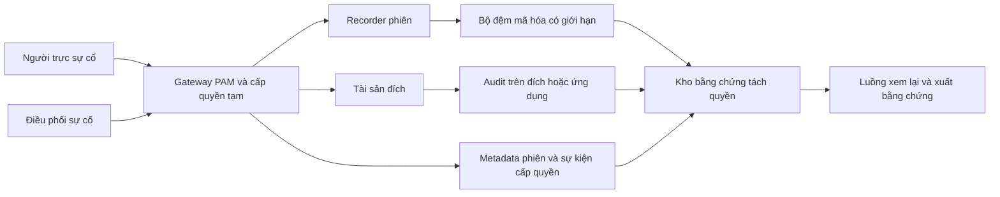

# Session recording break-glass

## Mục tiêu bài học

Trong PAM (Privileged Access Management), break-glass là cơ chế cấp quyền đặc biệt để khôi phục hệ thống khi đường truy cập quản trị thông thường không đáp ứng được tình huống khẩn cấp. Session recording là khả năng ghi lại hoạt động diễn ra trong phiên sử dụng quyền đó. Hai cơ chế phải được thiết kế cùng nhau: người trực sự cố cần truy cập đúng lúc, còn tổ chức cần biết ai đã làm gì, trên tài sản nào và vì sao.

Sau bài học này, bạn có thể:

- Xác định phạm vi dữ liệu cần ghi cho một phiên break-glass và giới hạn của từng loại bằng chứng.
- Thiết kế luồng ghi nhận phiên, từ khi kích hoạt quyền đến khi niêm phong bằng chứng.
- Quy định cách xử lý khi recorder, kho lưu hoặc hệ thống danh tính gặp sự cố.
- Áp dụng least privilege, JIT/JEA, phân tách nhiệm vụ và kiểm soát truy cập đối với bản ghi.
- Đánh giá một thiết kế recording bằng các tình huống kiểm thử có tiêu chí chấp nhận rõ ràng.

Bài học tập trung vào phiên truy cập khẩn cấp đối với tài khoản quản trị, tài khoản dịch vụ và hạ tầng nhạy cảm. Session recording không thay thế việc kiểm kê quyền, quản lý credential trong vault, luân chuyển bí mật hoặc giám sát bảo mật; nó bổ sung bằng chứng cho các kiểm soát đó.

## 1. Vì sao phiên break-glass cần được ghi nhận riêng?

Giả sử một cơ sở dữ liệu gặp lỗi sau thay đổi cấu hình. SSO dùng cho truy cập quản trị cũng đang gián đoạn. Kỹ sư trực cần dùng một tài khoản khẩn cấp để sửa cấu hình và đưa dịch vụ hoạt động trở lại.

Sau sự cố, câu hỏi không chỉ là “dịch vụ đã lên chưa”, mà còn gồm:

- Ai thực sự nhận và sử dụng quyền khẩn cấp?
- Quyền được mở trong khoảng thời gian nào và giới hạn trên những tài sản nào?
- Người thao tác đã xem, thay đổi, sao chép hay xóa dữ liệu gì trong phạm vi quan sát được?
- Hành động nào có liên quan đến việc phục hồi, và hành động nào cần giải trình thêm?
- Khi phiên kết thúc, quyền còn tồn tại hay credential đã được thay thế và kiểm tra lại?

Log đăng nhập chỉ chứng minh có một lần xác thực. Log vault chỉ cho biết một credential được cấp hoặc được sử dụng qua một luồng nhất định. Một video màn hình chỉ thể hiện những gì recorder nhìn thấy. Để trả lời đủ các câu hỏi trên, cần liên kết nhiều nguồn bằng chứng bằng cùng một mã sự cố và mã phiên.

Đặc điểm quan trọng của recording break-glass là đường truy cập này có thể được dùng khi một phần hạ tầng giám sát đã hỏng. Do đó, recording phải có phương án suy giảm được chuẩn bị trước, thay vì chỉ hoạt động trong điều kiện bình thường.

## 2. Session recording bao gồm những lớp nào?

Không có một loại bản ghi duy nhất phản ánh đầy đủ mọi thao tác quản trị. Cần lựa chọn lớp ghi nhận phù hợp với giao thức và loại hoạt động.

| Lớp bằng chứng | Nội dung có thể cung cấp | Giới hạn cần hiểu |
|---|---|---|
| Sự kiện điều phối PAM | Người yêu cầu, lý do, người phê duyệt hoặc người làm chứng, tài sản, thời hạn, kết quả cấp quyền | Không mô tả đầy đủ hoạt động bên trong phiên |
| Bản ghi terminal | Đầu vào/đầu ra mà cơ chế ghi terminal quan sát được, thời gian tương đối, thao tác trong shell | Không tự bao phủ mọi tiến trình nền, kết nối phụ, truyền file hoặc hoạt động trên host khác |
| Bản ghi giao diện đồ họa | Diễn biến màn hình của phiên quản trị từ xa | Có thể chứa dữ liệu nhạy cảm; thao tác qua API hoặc kênh ngoài màn hình không được chứng minh đầy đủ |
| Sự kiện tiến trình và audit trên đích | Tiến trình, thay đổi cấu hình, truy cập tài nguyên theo khả năng audit được bật | Có thể bị gián đoạn hoặc bị tác động bởi người có quyền cao trên đích |
| Audit ứng dụng/API | Lệnh quản trị, yêu cầu API, đối tượng bị thay đổi, kết quả thực thi | Tùy khả năng của ứng dụng; không nên mặc định mọi API đều được ghi đủ tham số và kết quả |
| Dữ liệu mạng và kết nối | Nguồn, đích, thời lượng, đường đi hoặc chuyển tiếp liên quan | Metadata kết nối không giải thích đầy đủ ý nghĩa nghiệp vụ của thao tác |

Ví dụ, một người mở SSH qua gateway rồi dùng một đường hầm để kết nối sang máy thứ hai. Video hoặc terminal của phiên đầu có thể ghi được thao tác tạo đường hầm, nhưng chưa chắc ghi được hoạt động thực hiện trong kênh thứ hai. Nếu chính sách không cho phép kênh đó, phải hạn chế khả năng tạo kênh; không chỉ kỳ vọng recorder sẽ nhìn thấy nó.

Với tài khoản dịch vụ, hoạt động break-glass đôi khi là đổi cấu hình, cấp quyền tạm hoặc thay credential thông qua API. Khi không có màn hình tương tác, cần dùng audit API, danh tính workload, log tác vụ và thay đổi trạng thái làm bằng chứng tương ứng. Không tạo một “video tượng trưng” rồi coi đó là bản ghi đầy đủ.

### Ba thuộc tính cần tách biệt

- **Gắn với danh tính:** liên kết phiên với một cá nhân hoặc workload đã được xác minh, dù tài khoản đích là tài khoản dùng chung.
- **Tính toàn vẹn:** phát hiện được bản ghi bị thay đổi, thiếu đoạn hoặc thay thế sau khi thu thập.
- **Tính đầy đủ trong phạm vi:** biết recorder quan sát được kênh nào, khoảng thời gian nào và có khoảng trống nào.

Một bản ghi có chữ ký hợp lệ vẫn có thể bị thiếu đoạn ngay từ nguồn. Một video xem được từ đầu đến cuối vẫn có thể không gắn chắc chắn với người thực hiện. Không dùng một thuộc tính để suy ra hai thuộc tính còn lại.

## 3. Kiến trúc tham chiếu cho recording break-glass

Kiến trúc nên có đường truy cập quản trị được kiểm soát, bộ thu thập bằng chứng và nơi lưu tách khỏi quyền quản trị của tài sản đích. Với hệ thống trọng yếu, cần đánh giá recorder và kho bằng chứng có phụ thuộc vào chính hệ thống đang cần khôi phục hay không.



Sơ đồ biểu diễn trách nhiệm, không yêu cầu mọi thành phần phải là một sản phẩm riêng. Khi triển khai, cần xác nhận khả năng thực tế của gateway, recorder và từng loại kết nối.

### Đường điều khiển và đường bằng chứng

Đường điều khiển quyết định ai được truy cập, được làm gì, trong bao lâu. Đường bằng chứng thu thập và lưu dấu vết. Hai đường có thể phối hợp nhưng không nên cùng mất khả năng hoạt động chỉ vì một phụ thuộc dễ hỏng mà chưa có phương án dự phòng.

Ví dụ, kho evidence dùng cùng tài khoản quản trị và cùng miền xác thực với hệ thống bị sự cố sẽ tạo rủi ro kép: người đang khắc phục có thể sửa bằng chứng, hoặc sự cố xác thực làm cả truy cập lẫn xem lại bằng chứng cùng ngừng hoạt động.

Các nguyên tắc thiết kế:

1. Recorder ghi về nơi mà tài khoản quản trị trên đích không có quyền sửa hoặc xóa.
2. Tài khoản vận hành recorder có quyền tối thiểu; quản trị recorder và duyệt nội dung bản ghi là hai quyền khác nhau.
3. Dùng mã phiên xuyên suốt giữa yêu cầu, lần cấp quyền, kết nối đích, bản ghi và sự kiện thu hồi.
4. Nếu hỗ trợ lưu tạm, bộ đệm phải được mã hóa, có giới hạn dung lượng/thời gian và có cảnh báo khi gần đầy.
5. Có đồng hồ đáng tin cậy, ghi nhận sai lệch thời gian và dùng số thứ tự sự kiện hoặc đoạn ghi để hỗ trợ ghép lại dòng thời gian.
6. Chính sách khẩn cấp phải xác định trước điều kiện cho phép tiếp tục khi recording suy giảm.

## 4. Vòng đời một phiên break-glass được ghi nhận

### 4.1. Trước khi mở phiên

Yêu cầu break-glass cần có mã sự cố, người nhận quyền, tài sản đích, mục tiêu khôi phục, thời hạn và phạm vi thao tác. Lý do như “cần quyền admin” không đủ để đánh giá tính tương xứng. Lý do cụ thể hơn là “khôi phục cấu hình kết nối cho cụm dữ liệu A trong sự cố INC-DEMO-042”.

PAM phải biết danh tính cá nhân ở phía trước, kể cả khi kết nối đến đích bằng tài khoản khẩn cấp dùng chung. Nếu đường xác thực thường dùng đang hỏng, danh tính và điều kiện mở đường dự phòng phải được xác minh bằng cơ chế đã được tổ chức chuẩn bị, kiểm thử và phê chuẩn từ trước. Việc có video không làm một lần cấp quyền không xác định được người sử dụng trở nên chấp nhận được.

Trước khi cấp quyền, hệ thống hoặc người điều phối kiểm tra:

- Recorder có nhận được dữ liệu của đúng giao thức không?
- Kho lưu hoặc bộ đệm có đủ khả năng tiếp nhận phiên dự kiến không?
- Chính sách ghi nhận hiện tại là đầy đủ hay suy giảm?
- Người thao tác có được thông báo về việc recording và phạm vi dữ liệu có thể bị thu thập không?
- Ai nhận cảnh báo, ai theo dõi phiên và ai duyệt lại sau sự cố?

### 4.2. Khi mở phiên

Tạo `session_id` duy nhất cho lần kết nối. Một sự cố có thể có nhiều phiên; một lần cấp quyền có thể cho phép nhiều kết nối trong phạm vi chính sách. Không dùng duy nhất mã sự cố để gom tất cả hoạt động rồi mất khả năng phân biệt từng phiên.

Sự kiện bắt đầu cần liên kết được:

- Danh tính yêu cầu và danh tính đã được xác minh.
- Tài khoản đích, tài sản đích và tuyến kết nối.
- Mã cấp quyền, thời điểm bắt đầu, thời điểm hết hạn và vai trò/quyền được cấp.
- Mã sự cố, phê duyệt hoặc căn cứ kích hoạt quy trình khẩn cấp.
- Trạng thái recorder và nơi dự kiến lưu bằng chứng.

Nếu hỗ trợ credential injection, gateway có thể sử dụng credential từ vault mà không hiển thị bí mật cho người thao tác. Đây là cách giảm khả năng lộ bí mật, nhưng không bảo đảm bí mật sẽ không xuất hiện ở nơi khác, chẳng hạn trong file cấu hình hoặc đầu ra lệnh.

### 4.3. Trong phiên

Recording phải phản ánh hoạt động theo phạm vi đã công bố. Cùng lúc, giám sát cần theo dõi trạng thái recorder: mất kết nối tới recorder, dừng ghi, thiếu đoạn, lỗi ghi hoặc bộ đệm tăng bất thường.

Người quan sát trực tiếp cần thấy được sự khác biệt giữa “phiên vẫn chạy” và “phiên vẫn được ghi đủ”. Một chỉ báo màu xanh của kết nối không chứng minh kho bằng chứng đang nhận dữ liệu.

Các thao tác vượt phạm vi như mở kênh chuyển tiếp chưa được duyệt, mở thêm đích hoặc nâng quyền cao hơn cần bị chặn hoặc tạo cảnh báo theo thiết kế. Recording cung cấp bằng chứng; JEA và giới hạn tuyến truy cập mới là những kiểm soát giảm khả năng thực hiện hành động vượt quyền.

### 4.4. Khi đóng phiên

Đóng cửa sổ terminal không phải luôn là kết thúc quyền khẩn cấp. Cần kiểm tra kết nối còn sống, tiến trình hoặc tác vụ dài hạn do phiên tạo ra, token tạm và quyền đã được cấp.

Sau khi người thao tác hoàn tất:

1. Ghi sự kiện kết thúc cùng lý do: hoàn tất, hết hạn, bị ngắt hoặc lỗi kết nối.
2. Thu hồi quyền tạm và chặn phiên mới vượt quá thời hạn.
3. Kết thúc các phiên còn hoạt động theo chính sách, có phối hợp để tránh làm hỏng bước phục hồi đang chạy.
4. Luân chuyển credential hoặc thu hồi token/chứng thư theo loại tài khoản và chính sách; kiểm tra phụ thuộc trước khi đổi bí mật của tài khoản dịch vụ.
5. Xác nhận quá trình ghi đã kết thúc và các đoạn đã được chuyển đủ đến nơi lưu, hoặc đánh dấu chính xác phần còn thiếu.
6. Gắn bản ghi với ticket, thay đổi cấu hình và báo cáo thao tác sau sự cố.

Nếu việc đổi credential chưa hoàn tất, báo cáo phải thể hiện trạng thái còn mở. Không ghi “đã đóng break-glass” chỉ vì video đã kết thúc.

### 4.5. Sau khi phiên kết thúc

Người duyệt độc lập kiểm tra các mốc cần thiết thay vì mặc định người thao tác tự xác nhận toàn bộ phiên là đủ. Nội dung duyệt gồm tính hợp lý của việc kích hoạt, phạm vi quyền, các thay đổi thực tế, khoảng trống bằng chứng và việc thu hồi quyền.

Kết quả có thể là chấp nhận, cần giải trình thêm, cần xử lý sai lệch hoặc chuyển điều tra. Một phiên khẩn cấp hợp lệ vẫn có thể để lại thiếu sót vận hành cần sửa mà không mặc định đó là hành vi gian lận.

## 5. Xử lý khi recording không hoạt động

“Luôn chặn nếu không ghi được” và “khẩn cấp thì bỏ recording” đều quá đơn giản. Một quyết định phù hợp phải dựa trên mức độ ảnh hưởng của việc trì hoãn truy cập, độ nhạy của tài sản và khả năng thay thế bằng chứng.

### Ma trận quyết định minh họa

| Tình trạng | Hành vi dự kiến | Bằng chứng hoặc kiểm soát bổ sung |
|---|---|---|
| Recorder và kho evidence hoạt động | Mở phiên qua tuyến được ghi nhận | Theo dõi sức khỏe recorder và audit đích |
| Kho evidence tạm không truy cập được, bộ đệm mã hóa còn khả dụng | Có thể tiếp tục theo ngưỡng chính sách | Ghi trạng thái chưa đồng bộ, cảnh báo, chuyển tiếp sau khôi phục |
| Một recorder hỏng, tuyến dự phòng đã kiểm thử còn hoạt động | Chuyển sang tuyến dự phòng | Liên kết lần chuyển tuyến và các mã phiên tương ứng |
| Không có recording, yêu cầu không đủ điều kiện khẩn cấp | Hoãn hoặc từ chối cấp quyền | Ghi quyết định và khôi phục tuyến kiểm soát trước |
| Không có recording, trì hoãn gây ảnh hưởng nghiêm trọng và quy trình khẩn cấp cho phép ngoại lệ | Mở phiên suy giảm theo thẩm quyền đã quy định | Giới hạn quyền/thời gian/đích, người làm chứng nếu khả thi, audit thay thế, duyệt sau sự cố |
| Recording hỏng giữa phiên | Phân loại hoạt động đang chạy trước khi quyết định tiếp tục hoặc kết thúc | Đánh dấu điểm mất ghi, thông báo điều phối và áp dụng phương án suy giảm |

Đây là khung minh họa, không phải chính sách chung cho mọi hệ thống. Tổ chức phải quyết định trước ai có thẩm quyền cho ngoại lệ, bằng chứng tối thiểu là gì và thời hạn xử lý phần thiếu ra sao.

### Không ngắt mù một thao tác đang phục hồi

Nếu recorder ngừng khi kỹ sư đang thực hiện một bước phục hồi có tính trạng thái, việc cắt phiên ngay có thể để lại thao tác dang dở. Cần quy định cơ chế xử lý theo loại thao tác: hoàn tất bước an toàn hiện tại rồi dừng, chuyển giám sát sang tuyến khác hoặc kết thúc ngay nếu rủi ro yêu cầu.

Người điều phối phải ghi thời điểm, lý do, người quyết định và giới hạn tiếp theo. Không để người thao tác tự âm thầm tắt recorder rồi tiếp tục với đầy đủ đặc quyền.

### Đừng biến “thiếu video” thành “không còn bằng chứng”

Trong chế độ suy giảm, vẫn có thể thu thập:

- Sự kiện mở quyền và xác nhận danh tính qua đường dự phòng.
- Audit đích hoặc ứng dụng gửi ra hệ thống độc lập, nếu còn hoạt động.
- Nhật ký thời gian và quyết định của người điều phối hoặc người làm chứng.
- Bản thay đổi cấu hình, kết quả kiểm tra dịch vụ và các mốc khôi phục.
- Thời điểm chính xác từng nguồn bằng chứng mất và có lại.

Các nguồn này chỉ bổ sung cho khoảng trống, không được trình bày là tương đương hoàn toàn với recording đã mất. Không có cách “dựng lại video” một cách đáng tin cậy từ vài dòng log rồi gọi đó là bản ghi gốc.

## 6. Tính toàn vẹn và chuỗi lưu giữ bằng chứng

### 6.1. Hash có ích nhưng không đủ

Giá trị băm giúp kiểm tra dữ liệu có thay đổi so với thời điểm tính băm hay không. Nếu người có quyền sửa file cũng có thể thay luôn giá trị băm tham chiếu, một checksum đặt cạnh video chưa tạo ra bằng chứng chống sửa đổi đáng tin cậy.

Thiết kế mạnh hơn có thể kết hợp:

- Chia bản ghi thành các đoạn có số thứ tự, thời gian, kích thước và giá trị băm.
- Lập manifest liên kết các đoạn với mã phiên và trạng thái đầy đủ/thiếu.
- Xác thực manifest bằng chữ ký hoặc cơ chế xác thực tương đương, với khóa được quản lý tách khỏi quyền thao tác trên đích.
- Lưu trong kho có chính sách hạn chế sửa/xóa, retention lock hoặc cơ chế bất biến phù hợp với nền tảng.
- Ghi audit riêng cho mọi lần xem, xuất, thay retention hoặc thao tác quản trị kho evidence.

Chữ ký xác thực nội dung được ký theo độ tin cậy của khóa và quy trình ký; nó không tự chứng minh người ghi đã quan sát toàn bộ hoạt động. Cơ chế lưu bất biến cũng cần được cấu hình và kiểm thử đúng phạm vi, không chỉ dựa vào tên tính năng của sản phẩm.

### 6.2. Chuỗi lưu giữ cần theo dõi những gì?

Chuỗi lưu giữ bằng chứng mô tả nguồn gốc, quá trình chuyển giao và các lần truy cập có liên quan. Với một phiên break-glass, tối thiểu cần biết recorder nào tạo dữ liệu, phiên nào sinh ra nó, dữ liệu đã đi qua đâu và ai được phép xuất bản sao.

Khi xuất bằng chứng để điều tra, nên giữ bản gốc có kiểm soát và ghi lại:

- Người yêu cầu, người chấp thuận và mục đích xuất.
- Phạm vi thời gian, tài sản và tập dữ liệu được xuất.
- Manifest, phiên bản công cụ cần để đọc, thông tin kiểm tra toàn vẹn và các khoảng trống đã biết.
- Người nhận, nơi lưu bản sao và điều kiện bảo vệ tương ứng.
- Các biến đổi đã thực hiện, chẳng hạn che thông tin trên một bản sao phục vụ xem xét.

Không ghi đè bản gốc bằng bản đã che dữ liệu rồi vẫn dùng cùng dấu kiểm toàn vẹn. Bản đã biến đổi cần định danh riêng và liên kết rõ với nguồn.

### 6.3. Thời gian không phải lúc nào cũng hoàn hảo

Một dòng thời gian đáng tin cậy cần ghi múi giờ hoặc dùng timestamp có offset rõ ràng, tình trạng đồng bộ và sai lệch đã biết. Đồng thời giữ số thứ tự sự kiện để hỗ trợ xác định thứ tự khi đồng hồ không hoàn toàn khớp.

Ví dụ, recorder ghi lúc `09:12:05Z`, còn máy đích ghi `09:11:58Z`. Không kết luận ngay lệnh trên đích xảy ra trước khi mở phiên. Cần đối chiếu sai lệch đồng hồ, thời gian nhận log và quan hệ giữa các mã phiên. Nếu không thể xác định thứ tự chính xác, báo cáo phải nêu mức độ không chắc chắn đó.

## 7. Bảo vệ bí mật và dữ liệu cá nhân trong bản ghi

Session recording có thể trở thành một kho dữ liệu nhạy cảm mới. Một video quản trị cơ sở dữ liệu có thể chứa thông tin khách hàng; terminal có thể hiển thị token, khóa hoặc cấu hình kết nối. Vì vậy, bảo vệ recorder phải được coi là một phần của quản trị đặc quyền.

### 7.1. Giảm dữ liệu nhạy cảm ngay tại nguồn

Ưu tiên quy trình sử dụng vault, credential injection và thao tác khôi phục có phạm vi nhỏ. Hạn chế lệnh hiển thị toàn bộ biến môi trường, nội dung file chứa bí mật hoặc dữ liệu sản xuất khi không cần cho mục tiêu khôi phục.

Một ô nhập mật khẩu hiển thị dấu `*` không chứng minh mọi lớp recording đều không thu thập mật khẩu. Một số cơ chế ghi đầu vào có thể quan sát dữ liệu trước khi ứng dụng che nó. Cần kiểm thử với bí mật giả để xác định recorder thực sự lưu gì.

Nếu dùng tính năng che dữ liệu, phải xác định che tại thời điểm thu thập, xử lý trước lưu hay chỉ che trong giao diện playback. Ba cách này tạo mức độ tiếp xúc với dữ liệu gốc khác nhau. Không hướng dẫn người vận hành tự tắt ghi hình mỗi lần thấy thông tin nhạy cảm nếu chưa có cơ chế cho phép và lưu dấu việc tạm dừng.

### 7.2. Hạn chế quyền xem và xuất

Có quyền quản trị hệ thống không mặc nhiên có quyền xem mọi recording. Tách các quyền sau theo nhu cầu:

| Quyền | Phạm vi phù hợp |
|---|---|
| Xem metadata phiên | Tra cứu mã phiên, thời lượng, trạng thái recording và kết quả duyệt |
| Xem nội dung | Chỉ phiên hoặc khoảng thời gian phục vụ nhiệm vụ đã được chấp thuận |
| Xuất dữ liệu | Quy trình riêng, có mục đích, nơi nhận và audit |
| Quản trị retention/kho lưu | Tách khỏi quyền sử dụng break-glass trên đích |
| Duyệt sau sự cố | Người có trách nhiệm đánh giá và đủ độc lập với người thao tác |

Có thể cấp quyền xem theo thời hạn JIT và theo phạm vi sự cố thay vì một nhóm có quyền đọc toàn bộ lịch sử. Mọi lần truy cập bản ghi cũng cần được ghi nhận.

### 7.3. Retention và xóa

Thời gian lưu phải dựa trên chính sách tổ chức, nhu cầu điều tra, độ nhạy dữ liệu và yêu cầu áp dụng trong môi trường cụ thể. Không mặc định mọi recording đều phải lưu vô thời hạn hoặc chỉ lưu một số ngày cố định.

Khi có yêu cầu giữ bằng chứng cho một cuộc điều tra, áp dụng cơ chế giữ tương ứng trước khi vòng đời xóa tự động diễn ra. Khi hết thời hạn và không còn yêu cầu giữ, việc xóa phải bao phủ các bản sao do hệ thống quản lý theo khả năng và chính sách của nền tảng. Ghi nhận kết quả xử lý; không hứa có thể thu hồi mọi bản sao đã bị xuất ra ngoài phạm vi quản lý.

## 8. Metadata mẫu cho một phiên

Ví dụ sau chỉ minh họa mô hình thông tin. Đây không phải schema bắt buộc của một sản phẩm PAM và không chứa credential thật.

```yaml
session_id: bg-demo-session-017
incident_id: INC-DEMO-042
grant_id: bg-demo-grant-008
operator:
  person_ref: oncall-demo-12
  identity_verification_ref: emergency-check-demo-09
target:
  asset_ref: database-cluster-demo
  account_ref: emergency-maintainer-demo
  access_route: approved-pam-gateway
privilege:
  scope: restore-connection-configuration
  expires_at: '2026-05-10T09:45:00Z'
recording:
  mode: full
  coverage:
    - terminal-session
    - target-audit
  known_exclusions:
    - unmanaged-out-of-band-console
  started_at: '2026-05-10T09:12:00Z'
  ended_at: '2026-05-10T09:31:00Z'
  upload_state: complete
  completeness_state: complete_within_declared_coverage
  manifest_ref: evidence-demo/manifest-017
closure:
  access_revoked: true
  credential_rotation_state: verified
  review_state: pending
```

Các trường cần được hiểu đúng:

- `account_ref` chỉ tham chiếu tài khoản; không lưu mật khẩu hoặc token trong metadata.
- `coverage` công bố phạm vi quan sát. `known_exclusions` không cấp phép sử dụng một tuyến ngoài kiểm soát; nó giúp người duyệt không suy diễn quá mức.
- `upload_state: complete` chỉ cho biết tập dữ liệu dự kiến đã chuyển xong. Cần một trạng thái khác để mô tả có thiếu dữ liệu tại nguồn hay không.
- `review_state: pending` hoàn toàn có thể đi cùng phiên đã đóng và credential đã đổi. Đóng kỹ thuật và duyệt nội dung là hai mốc riêng.
- Nếu có khoảng trống recording, dùng trạng thái thiếu/suy giảm phù hợp và lưu khoảng thời gian, nguyên nhân, thẩm quyền quyết định; không giữ nhãn “đầy đủ” để làm đẹp báo cáo.

Với hệ thống thực tế, thời điểm, trạng thái và đối tượng tham chiếu cần được phát sinh hoặc kiểm chứng từ nguồn đáng tin cậy, thay vì chỉ do người thao tác tự điền sau sự cố.

## 9. Runbook vận hành

### Trước sự cố: chuẩn bị và diễn tập

1. Kiểm kê tài sản và các đường quản trị, gồm SSH, giao diện đồ họa, console, API và tác vụ dùng tài khoản dịch vụ.
2. Chỉ rõ đường nào được recording, đường nào chỉ có audit thay thế và đường nào bị cấm.
3. Kiểm thử tài khoản break-glass, tuyến xác minh danh tính dự phòng và quy trình cấp quyền có thời hạn.
4. Kiểm thử recorder với đầu ra nhiều dữ liệu, phiên dài, kết nối gián đoạn và bí mật giả.
5. Kiểm tra rằng người có quyền cao trên đích không có quyền sửa hoặc xóa evidence trong kho lưu.
6. Diễn tập lỗi recorder và xác nhận người trực tìm được phương án suy giảm mà không phải tự sáng tạo quy trình.

### Trong sự cố: thao tác và giám sát

1. Ghi nhận mục tiêu khôi phục và mở mã sự cố.
2. Xác minh người nhận quyền theo đường chính hoặc đường dự phòng đã duyệt.
3. Cấp quyền tối thiểu với đích, thời hạn và phạm vi rõ ràng; áp dụng JIT/JEA khi hệ thống hỗ trợ.
4. Xác nhận mã phiên, trạng thái recording và người nhận cảnh báo.
5. Theo dõi sức khỏe recording trong lúc thực hiện khôi phục.
6. Nếu ghi nhận suy giảm, thực hiện ma trận quyết định, ghi điểm mất dữ liệu và kiểm soát bổ sung.
7. Khi mục tiêu hoàn tất, đóng phiên, thu hồi quyền và xử lý credential theo quy trình phù hợp.

### Sau sự cố: xác nhận bằng chứng và duyệt

1. Đối chiếu phiên đã mở với phiên đã có bản ghi hoặc lý do ngoại lệ được ghi nhận.
2. Xác nhận các đoạn dữ liệu đã chuyển đến kho, kiểm tra manifest và trạng thái toàn vẹn.
3. Kiểm tra quyền/token còn tồn tại và kết quả luân chuyển credential.
4. Giao người duyệt độc lập, ghi kết luận và phần cần giải trình.
5. Chuyển vấn đề kỹ thuật như mất đoạn, thiếu audit hoặc tuyến bypass sang công việc khắc phục có người phụ trách.
6. Áp dụng retention hoặc yêu cầu giữ bằng chứng theo chính sách.

Một runbook tốt phải thực hiện được khi một phần hệ thống đang hỏng. Đừng để bản hướng dẫn khẩn cấp chỉ nằm trong chính hệ thống danh tính hoặc kho tài liệu mà sự cố làm mất truy cập.

## 10. Tình huống thực hành: kho evidence mất kết nối giữa phiên

### Bối cảnh

Trong một môi trường thử nghiệm, kỹ sư trực đã mở phiên break-glass để sửa cấu hình kết nối. PAM ghi terminal qua recorder; audit ứng dụng cũng được gửi tới một nơi lưu độc lập. Sau tám phút, recorder không chuyển dữ liệu được đến kho evidence nhưng vẫn còn bộ đệm mã hóa.

### Cách phân tích

Trước hết, phân biệt lỗi vận chuyển và lỗi thu thập. Nếu recorder vẫn thu thập và xác nhận bộ đệm đang tăng đúng dự kiến, bằng chứng chưa đồng bộ không đồng nghĩa đã mất. Tuy nhiên, không nên chỉ dựa vào việc tiến trình recorder còn sống để kết luận thu thập vẫn tốt.

Người điều phối xác nhận dung lượng còn lại, thời gian dự kiến để hoàn tất bước khôi phục và ngưỡng được chính sách cho phép. Nếu điều kiện đáp ứng, phiên có thể tiếp tục với cảnh báo đang mở. Nếu bộ đệm gần đầy, cần giảm thời gian truy cập, chuyển tuyến dự phòng hoặc chọn điểm dừng an toàn theo quy trình.

Khi kết nối kho khôi phục, kiểm tra dữ liệu được chuyển đủ, số thứ tự các đoạn liên tục theo tập dữ liệu dự kiến và manifest khớp. Sau đó đối chiếu với audit ứng dụng và sự kiện PAM.

### Kết luận cần ghi trong báo cáo

Nếu không mất dữ liệu trong phạm vi quan sát, báo cáo có thể xác nhận đầy đủ sau khi đồng bộ và kiểm tra. Nếu một đoạn không được thu thập, phải nêu rõ khoảng trống, các nguồn thay thế và tác động đến khả năng kết luận. Không đổi tên “mất dữ liệu” thành “chậm đồng bộ” chỉ vì có một số log khác.

## 11. Kiểm thử thiết kế trong phòng lab

Dùng tài khoản, tài sản và bí mật giả trong môi trường được phép. Mục tiêu là kiểm tra tính quan sát và phản ứng của quy trình, không tác động hệ thống sản xuất.

| Kiểm thử | Thao tác mô phỏng | Tiêu chí chấp nhận |
|---|---|---|
| Phiên bình thường | Mở phiên, xem cấu hình mẫu, sửa một giá trị thử rồi đóng | Mã người dùng, mã phiên, thời gian, thay đổi và sự kiện thu hồi liên kết được |
| Lỗi trước khi mở phiên | Làm recorder không sẵn sàng trong lab | Quy trình chọn đúng chặn, tuyến dự phòng hoặc ngoại lệ được duyệt; có dấu vết quyết định |
| Lỗi giữa phiên | Ngắt kết nối recorder/kho tại một mốc đã biết | Cảnh báo hoạt động, xác định được loại lỗi và khoảng trống; quyết định tiếp tục/dừng có người chịu trách nhiệm |
| Bộ đệm gần đầy | Giới hạn bộ đệm và tạo tải ghi giả | Có cảnh báo trước ngưỡng, hành vi khi đầy đúng chính sách, không âm thầm ghi đè bằng chứng |
| Khả năng sửa bằng chứng | Thử quyền từ tài khoản quản trị đích trên dữ liệu thử | Không sửa/xóa được kho evidence; lần thử bị từ chối được ghi nhận ở lớp phù hợp |
| Thiếu một đoạn ghi | Bỏ một đoạn trong tập dữ liệu bản sao thử nghiệm | Kiểm tra phát hiện thiếu; hệ thống không báo phiên đầy đủ |
| Sai lệch thời gian | Tạo log mẫu có lệch timestamp đã biết | Có thể giải thích dòng thời gian bằng offset/số thứ tự và nêu phần còn không chắc chắn |
| Bí mật xuất hiện | Dùng chuỗi giả ở prompt và đầu ra | Biết chính xác lớp nào lưu chuỗi, lớp nào che; quyền xem/xuất được kiểm soát |
| Hết thời hạn quyền | Để grant thử hết hạn theo kịch bản đã chuẩn bị | Phiên mới bị từ chối, phiên đang chạy được xử lý đúng chính sách và có sự kiện |
| Xem/xuất recording | Cho người có và không có quyền thử truy cập | Quyết định truy cập đúng phạm vi; lần xem/xuất hợp lệ và lần bị từ chối có audit phù hợp |

Một bài kiểm thử không đạt cần chỉ rõ lỗi thuộc thu thập, vận chuyển, lưu trữ, quyền truy cập hay quy trình vận hành. Điều này giúp tránh cách khắc phục chung chung như “tăng log” trong khi nguyên nhân thực tế là một tuyến quản trị không đi qua recorder.

## 12. Các lỗi thiết kế thường gặp

### Chỉ bật recording ở gateway, bỏ sót đường quản trị khác

Tổ chức có video của phiên qua PAM nhưng tài khoản khẩn cấp vẫn đăng nhập trực tiếp qua console hoặc API ngoài tuyến đó. Cần kiểm kê đường truy cập, hạn chế bypass và ghi nhận các tuyến bắt buộc phải tồn tại bằng kiểm soát phù hợp.

### Tin rằng tài khoản dùng chung vẫn có thể truy vết chỉ nhờ video

Một video không đủ để phân biệt các cá nhân cùng biết credential. Cần quản lý việc cấp quyền, gắn danh tính ở đầu phiên, hạn chế tiết lộ credential và luân chuyển sau sử dụng theo chính sách.

### Cho người thao tác toàn quyền với bản ghi của chính mình

Quyền quản trị đích, quản trị recorder, xóa evidence và duyệt nội dung cùng nằm ở một người sẽ làm suy yếu khả năng kiểm tra độc lập. Phân tách các quyền và ghi audit đối với thao tác quản trị hạ tầng recording.

### Ghi mọi thứ nhưng không ai kiểm tra

Kho recording lớn không tự tạo ra khả năng phát hiện. Cần có cảnh báo về sức khỏe recorder, tiêu chí duyệt break-glass và người phụ trách xử lý sai lệch. Các mốc rủi ro cao cần được liên kết để người duyệt tìm đúng đoạn liên quan.

### Đánh đồng phiên đã đóng với sự cố đã được kiểm soát

Recording kết thúc không chứng minh token đã hết hiệu lực, quyền đã bị thu hồi, credential đã đổi hoặc tiến trình nền đã dừng. Phải có sự kiện và kiểm tra riêng cho từng kết quả.

### Dùng ghi hình như biện pháp thay thế least privilege

Khả năng xem lại không ngăn được mọi hậu quả của lệnh vượt quyền. Giảm quyền thường trực, giới hạn thời gian JIT, giới hạn tác vụ JEA và giới hạn đích vẫn cần được áp dụng cùng recording.

## 13. Chỉ số giúp phát hiện khoảng trống vận hành

Các chỉ số nên phản ánh chất lượng quan sát, không chỉ đếm số video đã lưu:

- Tỷ lệ phiên break-glass có bằng chứng đáp ứng đầy đủ phạm vi recording mà chính sách yêu cầu, kèm danh sách phiên ngoại lệ.
- Số phiên suy giảm và tổng thời lượng khoảng trống thu thập, phân biệt với thời gian chậm chuyển dữ liệu.
- Thời gian phát hiện recorder hỏng và thời gian xử lý việc đồng bộ còn tồn đọng.
- Số phiên chưa được duyệt hoặc đã quá hạn duyệt theo chính sách.
- Số quyền, token hoặc lần luân chuyển credential còn chưa xác nhận sau khi kết thúc phiên.
- Số tuyến quản trị được phát hiện ngoài phạm vi recording/audit đã công bố.

Khi tính tỷ lệ, cần xác định mẫu số từ nguồn phiên truy cập hoặc sự kiện cấp quyền đủ tin cậy, không chỉ từ danh sách bản ghi đang có. Nếu chỉ đếm trên kho video, phiên không tạo được video có thể biến mất khỏi báo cáo và làm tỷ lệ đẹp hơn thực tế.

## 14. Điểm cần nhớ

Một thiết kế session recording break-glass có giá trị khi liên kết được người sử dụng, quyền tạm, tài sản đích, thao tác và quá trình thu hồi. Bản ghi phải có phạm vi quan sát được công bố rõ, được bảo vệ khỏi sửa/xóa trái phép và có quy trình xem lại phù hợp với độ nhạy dữ liệu.

Tình huống recording suy giảm phải được dự kiến trước, với thẩm quyền quyết định, giới hạn truy cập và bằng chứng thay thế rõ ràng. Khi có khoảng trống, ghi nhận trung thực khoảng trống đó. Mục tiêu là hỗ trợ khôi phục hệ thống đúng lúc và giữ đủ cơ sở để kiểm tra những gì đã xảy ra trong phạm vi thực sự quan sát được.
