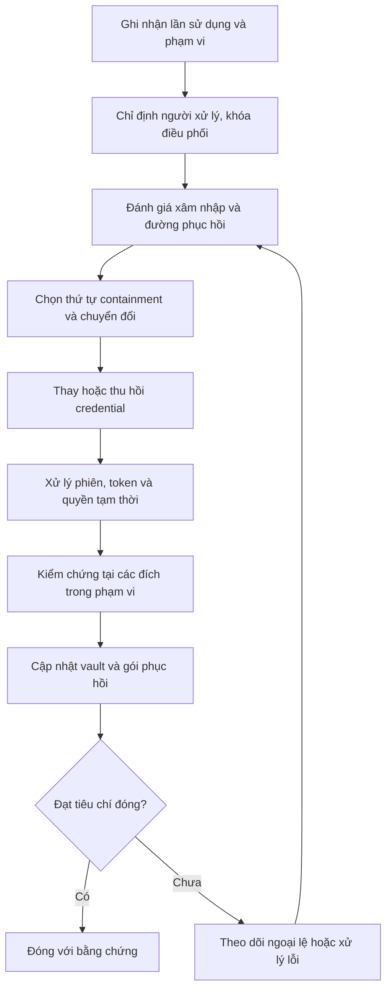

# Rotate sau sử dụng

## 1. Vì sao kết thúc phiên break-glass chưa phải là kết thúc công việc?

Break-glass là cơ chế truy cập đặc quyền khẩn cấp khi đường truy cập thông thường không đáp ứng được nhu cầu khôi phục hệ thống. Người vận hành có thể mở một phong bì chứa mật khẩu dự phòng, lấy credential từ vault, kích hoạt một tài khoản khẩn cấp hoặc sử dụng phương thức xác thực dự phòng đã được phê duyệt.

Một khi credential được lấy ra sử dụng, phạm vi những nơi có thể biết hoặc giữ credential đó đã thay đổi. Nó có thể đã xuất hiện trong bộ nhớ của máy quản trị, công cụ kết nối, clipboard, bản ghi phiên hoặc kho lưu trữ tạm. Điều này không khẳng định credential chắc chắn bị lộ, nhưng có nghĩa không nên tiếp tục coi nó là một bí mật chưa từng được sử dụng.

**Rotate sau sử dụng** là quy trình thay credential hoặc vật liệu xác thực có liên quan, xử lý những quyền truy cập còn tồn tại và cập nhật lại khả năng phục hồi sau một lần dùng break-glass.

Trong quản lý truy cập đặc quyền, mục tiêu không chỉ là “đổi được mật khẩu”. Kết quả cần đạt gồm:

- Credential cũ không còn được chấp nhận tại các nơi thuộc phạm vi xử lý.
- Phiên đăng nhập, token hoặc lease được tạo ra từ lần sử dụng đó đã được xử lý theo chính sách.
- Credential mới được bảo quản đúng nơi, không phát sinh một vòng lộ bí mật mới.
- Đường truy cập khẩn cấp vẫn hoạt động khi cần.
- Có bằng chứng đủ để xác nhận ai đã thực hiện, thay đổi gì và còn ngoại lệ nào.

Ví dụ, một quản trị viên dùng tài khoản khẩn cấp để sửa cấu hình mạng của vault. Sau khi kết nối được phục hồi, việc đóng cửa sổ SSH chưa làm mật khẩu cũ hết hiệu lực. Ngay cả khi mật khẩu đã được đổi, một phiên SSH còn mở cũng có thể tiếp tục hoạt động. Hai vấn đề này cần được kiểm tra riêng.

## 2. Phân biệt những đối tượng cần xử lý

### 2.1. Identity, credential và session là ba lớp khác nhau

Một tài khoản khẩn cấp là một **identity**. Mật khẩu, khóa riêng hoặc thiết bị xác thực là **credential** dùng để chứng minh quyền sử dụng identity đó. Sau khi xác thực thành công, hệ thống có thể tạo **session**, token hoặc một dạng quyền truy cập tạm thời.

Thay đổi ở một lớp không tự động bảo đảm mọi lớp khác thay đổi theo.

| Đối tượng | Ví dụ | Việc cần xem xét sau sử dụng |
|---|---|---|
| Identity | Tài khoản quản trị khẩn cấp | Trạng thái tài khoản, nhóm quyền, cơ chế kích hoạt và chủ sở hữu |
| Credential | Mật khẩu, SSH key, client secret | Thay thế, vô hiệu hóa hoặc hủy theo loại credential |
| Phương thức phục hồi | Recovery code, mã mở khóa dự phòng | Đánh dấu mã đã dùng, cấp lại bộ mã khi cần, cập nhật cách bảo quản |
| Session | SSH, RDP, phiên web quản trị | Kết thúc hoặc vô hiệu hóa qua cơ chế của nền tảng |
| Token và lease | Access token, refresh token, credential tạm thời | Thu hồi nếu hỗ trợ, chặn sử dụng hoặc theo dõi đến hết hạn |
| Quyền được cấp thêm | Membership tạm thời, role assignment | Gỡ bỏ theo phạm vi đã phê duyệt |

Không được suy luận “đổi mật khẩu thành công” đồng nghĩa “mọi token cũ đã chết”. Cách xử lý session và token phụ thuộc nền tảng, loại token và cách dịch vụ đích kiểm tra quyền.

### 2.2. Rotate, revoke và disable không đồng nghĩa

- **Rotate**: tạo hoặc đặt credential thay thế và chuyển sang sử dụng credential mới.
- **Revoke**: làm credential, token, phiên hoặc quyền đã cấp không còn được chấp nhận bằng cơ chế thu hồi phù hợp.
- **Disable**: ngăn identity hoặc một phương thức truy cập tiếp tục được dùng.
- **Expire**: để hiệu lực kết thúc theo thời hạn đã được cấu hình.

Ví dụ, thêm một SSH public key mới không phải là thu hồi SSH key cũ. Nếu khóa cũ vẫn còn trong danh sách được phép trên một máy chủ, người giữ private key cũ vẫn có thể đăng nhập vào máy đó.

Tương tự, một credential tạm thời có thể không có thao tác “đổi giá trị”. Công việc sau sử dụng khi đó là ngừng cấp mới, xử lý quyền và phiên liên quan, thu hồi theo khả năng của nền tảng hoặc kiểm soát khoảng thời gian còn lại đến khi hết hạn.

### 2.3. Phạm vi rotation phải được xác định rõ

Phạm vi không chỉ là tên tài khoản. Cần xác định:

1. Identity nào đã được sử dụng.
2. Credential hoặc phương thức xác thực nào đã được mở, lấy ra hoặc nhập vào hệ thống.
3. Những đích nào chấp nhận credential đó.
4. Phiên, token, quyền tạm thời và tác vụ nền nào có thể còn tồn tại.
5. Những bản sao phục hồi, tài liệu niêm phong hoặc phiên bản trong vault nào phải cập nhật.

Nếu một mật khẩu quản trị bị dùng chung trên nhiều thiết bị, đổi mật khẩu ở một thiết bị chưa hoàn tất phạm vi xử lý. Thiết kế dài hạn nên hướng đến credential riêng theo identity hoặc tài sản và quản lý tập trung, thay vì duy trì một bí mật chung cho cả hạ tầng.

## 3. Sự kiện nào kích hoạt rotation?

Một chính sách khả thi cần nêu rõ sự kiện bắt đầu quy trình, người chịu trách nhiệm và tiêu chí đóng.

| Sự kiện | Hướng xử lý |
|---|---|
| Credential tĩnh đã được dùng để đăng nhập | Thực hiện quy trình thay credential và xử lý quyền còn lại |
| Bí mật đã được mở hoặc xem nhưng đăng nhập thất bại | Xem như bí mật đã được truy xuất; áp dụng chính sách xử lý tương ứng |
| Credential được cấp nhưng hệ thống chứng minh chưa bao giờ hiển thị hoặc sử dụng | Xác định theo bằng chứng và chính sách, không chỉ dựa vào lời xác nhận |
| Recovery code đã được sử dụng | Không tiếp tục dựa vào mã đã dùng; kiểm tra việc cấp lại và bảo quản bộ mã |
| Có dấu hiệu lộ credential hoặc máy quản trị bị xâm nhập | Chuyển sang quy trình ứng phó sự cố, xử lý phạm vi có thể rộng hơn lần sử dụng được ghi nhận |
| Credential động đã hết hạn | Xác nhận hiệu lực kết thúc, phiên và quyền liên quan được xử lý; không tạo thao tác đổi mật khẩu không cần thiết |

“Không đăng nhập thành công” không có nghĩa “credential chưa bị lộ”. Nếu mật khẩu đã được dán vào một máy trung gian không đáng tin cậy, việc xác thực thất bại không khôi phục lại tính bí mật của nó.

Thời hạn rotation cần xuất phát từ rủi ro, khả năng kỹ thuật và quy trình của tổ chức. Không có một con số phút áp dụng đúng cho mọi hệ thống. Tuy nhiên, việc trì hoãn cần có lý do, chủ sở hữu và thời điểm xem xét lại cụ thể; không để công việc biến thành một nhắc nhở không có hạn kết thúc.

## 4. Điều kiện chuẩn bị trước khi thay credential

### 4.1. Xác nhận quyền thực hiện và người chịu trách nhiệm

Một lần dùng break-glass nên gắn với mã sự cố hoặc yêu cầu được phê duyệt. Rotation sau đó tiếp tục thuộc phạm vi kiểm soát của yêu cầu này.

Các vai trò thường gặp:

| Vai trò | Trách nhiệm chính |
|---|---|
| Người điều phối sự cố | Quyết định thời điểm chuyển từ khôi phục sang thu dọn, theo dõi rủi ro còn lại |
| Người vận hành PAM | Thực hiện thay credential và cập nhật nơi bảo quản |
| Chủ hệ thống đích | Xác nhận ảnh hưởng đến dịch vụ, phiên và phụ thuộc |
| Người kiểm chứng | Đối chiếu kết quả với tiêu chí chấp nhận |
| Nhóm ứng phó sự cố | Xử lý dấu hiệu xâm nhập, lưu bằng chứng và xác định phạm vi bổ sung |

Cơ chế hai người kiểm soát có thể được áp dụng theo chính sách. Mục đích là giảm khả năng một người tự mở, sử dụng, thay và xác nhận toàn bộ vòng đời mà không có kiểm tra độc lập.

### 4.2. Chuẩn bị đường phục hồi đã được kiểm chứng

Thay credential trong lúc đang xử lý sự cố có thể làm mất đường truy cập cuối cùng. Trước khi vô hiệu hóa credential đang dùng, cần biết sẽ khôi phục thế nào nếu thao tác thất bại.

Đường phục hồi có thể là một tài khoản khẩn cấp khác, console ngoài băng hoặc phương thức phục hồi do nền tảng hỗ trợ. Nó cần:

- Phù hợp với quyền hạn được phê duyệt.
- Không phụ thuộc hoàn toàn vào thành phần vừa gặp lỗi.
- Có người và công cụ đủ khả năng sử dụng trong tình huống hiện tại.
- Được kiểm tra theo cách không tạo thêm rủi ro không kiểm soát.

Không được “bảo đảm an toàn” bằng cách cố tình để credential cũ hoạt động vô thời hạn. Nếu cần giữ tạm một đường truy cập trong quá trình chuyển đổi, phải quản lý nó như một ngoại lệ có phạm vi và thời hạn rõ ràng.

Khi nghi ngờ đang có kẻ tấn công sử dụng credential, yêu cầu chặn truy cập có thể cần được ưu tiên hơn một phép thử thuận tiện. Người điều phối phải cân nhắc nguy cơ tiếp tục bị chiếm quyền và nguy cơ mất khả năng khôi phục, thay vì áp dụng máy móc một thứ tự duy nhất.

### 4.3. Kiểm tra môi trường quản trị và phụ thuộc

Không tạo credential mới trên một máy quản trị vẫn bị nghi ngờ xâm nhập. Nếu private key mới được sinh hoặc mật khẩu mới được nhập trên máy đó, rotation có thể chỉ thay một bí mật đã lộ bằng một bí mật khác cũng bị lộ.

Trước khi thực hiện, cần xác định:

- Có máy hoặc kênh quản trị đáng tin cậy để thao tác hay chưa.
- Vault và kết nối đến hệ thống đích có hoạt động ổn định không.
- Tài khoản dùng cho rotation có đủ quyền và có phụ thuộc vào credential sắp thay không.
- Có tác vụ tự động, dịch vụ hoặc thiết bị nào đang dùng credential này không.
- Có worker khác đang thực hiện rotation cùng identity không.
- Những log cần giữ đã được bảo vệ, và thao tác thu hồi có ảnh hưởng tới việc thu thập bằng chứng không.

Nếu một dịch vụ nền đang chạy bằng tài khoản khẩn cấp, đó là một phụ thuộc cần được xử lý cẩn thận. Không đổi mật khẩu rồi giả định dịch vụ sẽ tự cập nhật. Sau sự cố, nên tách danh tính dịch vụ khỏi tài khoản break-glass để tránh lặp lại tình huống.

## 5. Quy trình rotation sau sử dụng

Một quy trình có thể được biểu diễn bằng các trạng thái sau:



Sơ đồ thể hiện những công việc phải được bao quát, không áp đặt rằng luôn phải đổi credential trước khi thu hồi phiên. Khi có truy cập trái phép đang diễn ra, thu hồi hoặc cô lập có thể phải thực hiện ngay từ bước containment.

### Bước 1: Ghi nhận lần sử dụng

Gắn yêu cầu rotation với lần dùng break-glass cụ thể. Tối thiểu ghi nhận:

- Mã sự cố và mã lần sử dụng.
- Identity và tài sản đích.
- Người đã truy xuất và sử dụng.
- Thời điểm truy xuất, bắt đầu phiên và kết thúc thao tác.
- Loại credential, phiên bản tham chiếu trong vault và phạm vi quyền.
- Có dấu hiệu lộ bí mật hoặc xâm nhập hay không.

Không ghi mật khẩu, private key, recovery code hoặc token vào ticket. Dùng mã tham chiếu bí mật, mã phiên bản và mã sự kiện để đối chiếu.

### Bước 2: Ngừng phát sinh sử dụng mới trong phạm vi đang xử lý

Khi phù hợp với sự cố, ngăn checkout mới hoặc việc tiếp tục dùng đường break-glass vừa sử dụng. Cần tránh hai nhóm cùng thay credential hoặc một người lại lấy phiên bản cũ ngay giữa quá trình chuyển đổi.

Cơ chế điều phối có thể là khóa theo identity, trạng thái maintenance trong hệ thống PAM hoặc một thay đổi được kiểm soát. Không tự vô hiệu hóa mọi tài khoản khẩn cấp trong cùng một lúc nếu điều đó làm mất toàn bộ khả năng phục hồi.

Nếu khóa có thời hạn, worker mất khóa không được tiếp tục ghi thay đổi như thể vẫn sở hữu công việc. Hệ thống tự động nên có cơ chế phát hiện quyền sở hữu đã hết hiệu lực để giảm nguy cơ hai lượt chạy ghi đè kết quả của nhau.

### Bước 3: Lập kế hoạch thay theo loại credential

Xác định rõ thao tác thực tế:

- Đặt mật khẩu mới tại hệ thống đích.
- Tạo cặp SSH key mới và loại public key cũ khỏi các đích.
- Cấp client secret mới, chuyển các bên sử dụng và thu hồi secret cũ.
- Thay certificate cùng private key khi private key có nguy cơ bị lộ.
- Cấp lại phương thức phục hồi hoặc cập nhật gói niêm phong.
- Thu hồi lease hoặc ngừng quyền của credential động theo cơ chế được hỗ trợ.

Với hệ thống cho phép hai credential cùng hiệu lực, cần quyết định có dùng giai đoạn chuyển tiếp hay không. Giai đoạn này có thể giúp giảm gián đoạn khi cần cập nhật phụ thuộc, nhưng cũng kéo dài thời gian credential cũ còn dùng được. Chỉ dùng trong phạm vi được chấp nhận và phải có điểm kết thúc.

Với hệ thống chỉ có một mật khẩu hợp lệ, không được giả định có thể cập nhật vault và hệ thống đích trong một giao dịch nguyên tử. Cần thiết kế trước cách nhận diện và phục hồi trạng thái cập nhật dở dang.

### Bước 4: Sinh và áp dụng credential mới

Credential mới phải được tạo bằng cơ chế phù hợp và bảo vệ trong toàn bộ quá trình chuyển giao.

Một số nguyên tắc thực hành:

- Dùng chức năng tạo credential của vault hoặc công cụ được phê duyệt.
- Không tái sử dụng mật khẩu cũ, mật khẩu của tài khoản khác hoặc quy tắc sửa vài ký tự.
- Không đưa bí mật vào tham số dòng lệnh có thể bị ghi lại, biến môi trường được thu thập rộng rãi hoặc log chẩn đoán.
- Hạn chế việc con người xem trực tiếp credential khi có thể chuyển giao qua kênh bảo vệ.
- Tránh ghi bí mật vào bản ghi màn hình, transcript hoặc nội dung lệnh.
- Áp dụng tại đúng hệ thống đích và đúng identity đã được xác định.

Thứ tự cập nhật nơi lưu và đích xác thực tùy khả năng nền tảng. Có thể lưu một phiên bản mới ở trạng thái chờ, đặt credential ở đích, kiểm chứng rồi chuyển phiên bản đó thành phiên bản đang dùng. Nếu đích đã đổi nhưng vault chưa cập nhật, cần đưa công việc vào trạng thái cần đối soát, không giả vờ mọi thứ đã hoàn tất.

### Bước 5: Xử lý các quyền truy cập còn tồn tại

Kiểm tra riêng từng loại:

1. Phiên SSH, RDP, web hoặc console còn mở.
2. Refresh token có thể cấp thêm access token.
3. Access token còn hiệu lực.
4. Lease hoặc credential tạm thời đã cấp.
5. Role assignment, membership hoặc quyền nâng cao tạm thời.
6. Tác vụ nền được khởi tạo bằng phiên đặc quyền.

Việc đổi mật khẩu có thể không chấm dứt những quyền này. Nếu nền tảng hỗ trợ “revoke sessions”, cần kiểm chứng phạm vi của thao tác: thu hồi mọi phiên hay chỉ một nhóm phiên, có độ trễ hay không, có tác dụng với token đang lưu ở dịch vụ đích hay không.

Với token tự chứa mà dịch vụ chấp nhận đến hết hạn, thao tác thu hồi tại hệ thống danh tính có thể chưa đủ. Có thể cần cơ chế chặn ở dịch vụ đích, thay đổi chính sách quyền, cô lập đường truy cập hoặc giám sát khoảng thời gian còn lại, tùy thiết kế và yêu cầu sự cố.

Không kết thúc một tiến trình hệ thống chỉ vì nó xuất hiện trong phiên khẩn cấp mà chưa hiểu tác động. Cần xác định tiến trình nào là công việc khôi phục hợp lệ, tiến trình nào không còn cần thiết và ai chịu trách nhiệm tiếp nhận.

### Bước 6: Kiểm chứng credential mới và việc loại bỏ credential cũ

Có hai câu hỏi riêng biệt:

- **Positive verification**: credential mới có dùng được đúng như thiết kế không?
- **Negative verification**: credential cũ đã bị loại khỏi các đích hoặc không còn được chấp nhận chưa?

Kiểm chứng dương không chứng minh kiểm chứng âm. Việc đăng nhập bằng mật khẩu mới thành công không loại trừ một SSH key cũ vẫn còn được phép.

Ưu tiên kiểm tra cấu hình có thẩm quyền, trạng thái API và log xác thực để xác nhận loại bỏ credential cũ. Chỉ thử xác thực bằng credential cũ khi cần, được phép và có kiểm soát. Không thử lặp lại đến mức gây khóa tài khoản, phát tán bí mật hoặc kích hoạt sự cố mới.

Phải kiểm chứng đúng phạm vi: các node, thiết bị, identity provider hoặc vùng cấu hình thực sự chấp nhận credential. Khi có đồng bộ hoặc cache, cần xác định trạng thái hoàn tất theo cơ chế của hệ thống, không lấy kết quả của một máy làm đại diện cho toàn bộ hạ tầng.

### Bước 7: Cập nhật vault và gói phục hồi

Sau khi đối soát đích và nơi lưu:

- Chỉ định đúng phiên bản credential đang hoạt động trong vault.
- Chặn việc checkout phiên bản cũ theo chính sách.
- Gỡ bản sao tạm thời khỏi nơi vận hành có thể kiểm soát.
- Cập nhật phong bì hoặc kho phục hồi ngoài băng nếu chúng chứa vật liệu đã thay.
- Ghi nhận người bảo quản, vị trí, mã niêm phong và thời điểm cập nhật.
- Kiểm tra đường truy cập khẩn cấp bằng phương thức được phê duyệt.

Giữ lịch sử phiên bản trong vault để phục vụ quản trị không có nghĩa cho phép sử dụng credential cũ. Quyền truy xuất lịch sử và thời hạn lưu cần được kiểm soát.

Không nên xóa chứng cứ liên quan đến sự cố chỉ để tuyên bố “đã xóa mọi bản sao”. Phân biệt bản sao bí mật không cần thiết với bằng chứng phải bảo quản; bằng chứng có chứa bí mật phải được hạn chế truy cập và xử lý theo quy trình phù hợp.

### Bước 8: Đóng hoặc bàn giao ngoại lệ

Chỉ đóng khi đạt tiêu chí đã thống nhất. Nếu còn một thiết bị chưa cập nhật hoặc một token chưa thể thu hồi, ghi nhận đó là công việc chưa hoàn tất hoặc ngoại lệ được chấp thuận, cùng biện pháp giảm rủi ro.

Một thông báo “rotation completed” từ công cụ chỉ chứng minh công cụ đã hoàn thành phần thao tác mà nó được lập trình. Người vận hành vẫn cần xác định kết quả đó bao phủ credential, phiên và đích nào.

## 6. Khác biệt theo loại credential

### 6.1. Mật khẩu quản trị

Đổi mật khẩu ở nguồn xác thực có thẩm quyền, sau đó kiểm tra tác động của bản sao, cache và các tài khoản cục bộ liên quan.

Nếu có cả tài khoản miền và tài khoản cục bộ cùng tên, không được coi chúng là một identity duy nhất. Mật khẩu được thay ở một nơi có thể không ảnh hưởng đến nơi còn lại.

Những phiên đã xác thực có thể tồn tại sau khi đổi mật khẩu. Cần sử dụng cơ chế quản lý phiên hoặc thu hồi phù hợp, thay vì chỉ đóng ứng dụng ở máy của người dùng.

### 6.2. SSH key

Một quy trình thay SSH key cần bao gồm cả sinh khóa mới và loại khóa cũ:

1. Tạo cặp khóa mới trong môi trường đáng tin cậy.
2. Phân phối public key mới tới đúng các đích.
3. Kiểm tra đăng nhập mới theo quyền được phê duyệt.
4. Loại public key cũ khỏi các nguồn cấp quyền liên quan.
5. Xử lý phiên SSH và kết nối ghép kênh còn tồn tại nếu thuộc phạm vi thu hồi.
6. Kiểm chứng không còn đích bỏ sót.

Không sao chép private key cũ sang một tệp có tên mới rồi gọi đó là rotation. Nếu dùng SSH certificate, cần phân biệt certificate ngắn hạn với private key nền và cơ chế thu hồi mà máy chủ thực sự thực thi.

### 6.3. API key, client secret và credential dịch vụ

Một số hệ thống cho phép nhiều secret hoạt động đồng thời. Khi đó, việc tạo secret mới chỉ là bước đầu.

Cần xác định những bên sử dụng, triển khai tham chiếu mới, quan sát hoạt động và vô hiệu hóa secret cũ. Nếu credential được dùng trong đường break-glass, phải giới hạn phạm vi phân phối; tránh biến một tài khoản khẩn cấp thành tài khoản dùng thường xuyên cho nhiều dịch vụ.

Với access token đã được cấp từ một client secret, việc thay client secret không nhất thiết thu hồi những token đó. Cần xem xét riêng quyền và thời hạn hiệu lực của token.

### 6.4. Certificate và private key

Nếu mục tiêu là xử lý nguy cơ private key đã lộ, chỉ cấp lại certificate trên cùng private key chưa loại bỏ nguy cơ đó. Cần một cặp khóa mới cùng kế hoạch thay trust hoặc mapping cần thiết.

Việc thu hồi certificate cũng phụ thuộc cơ chế kiểm tra của bên chấp nhận. CRL hoặc OCSP không bảo đảm mọi client ngừng chấp nhận ngay lập tức; có thể có cache, độ trễ hoặc client không thực hiện kiểm tra theo cách mong muốn.

Bằng chứng hoàn tất cần phản ánh cách hệ thống thực sự kiểm tra credential, không chỉ phản ánh trạng thái tại nơi cấp certificate.

### 6.5. Recovery code và yếu tố xác thực dự phòng

Recovery code có thể là mã dùng một lần hoặc thuộc một bộ mã, tùy nền tảng. Sau sử dụng:

- Xác nhận mã đã dùng không còn hợp lệ theo cơ chế của nền tảng.
- Xác định có cần tái tạo toàn bộ bộ mã hay không.
- Cập nhật gói phục hồi và thu hồi bản sao cũ thuộc phạm vi quản lý.
- Kiểm tra người bảo quản và cách truy xuất trong lần khẩn cấp tiếp theo.

Nếu nghi ngờ thiết bị xác thực dự phòng hoặc hạt giống xác thực đã bị lộ, cần xử lý phương thức xác thực đó, không chỉ đổi mật khẩu. Việc gỡ và đăng ký lại yếu tố xác thực phải có đường phục hồi phù hợp để tránh khóa tài khoản khẩn cấp.

### 6.6. Credential động và quyền JIT

Credential động ngắn hạn giúp giảm nhu cầu duy trì bí mật tĩnh lâu dài, nhưng không loại bỏ công việc sau sử dụng.

Cần xác nhận lease, thời hạn và quyền được cấp đã kết thúc. Một phiên hoặc tài nguyên được tạo trong khoảng thời gian đặc quyền còn hiệu lực có thể tồn tại lâu hơn chính credential. Kiểm tra những thay đổi đó theo phạm vi của lần sử dụng.

Không kéo dài TTL chỉ để trì hoãn việc thu dọn. Khi công việc khẩn cấp tiếp tục, cần một quyết định gia hạn rõ ràng và được ghi nhận.

## 7. Tự động hóa mà không bỏ qua kiểm chứng

Một hệ thống PAM có thể kích hoạt rotation khi kết thúc checkout hoặc phiên. Tự động hóa hữu ích khi nó có trạng thái rõ ràng, xử lý lỗi và bằng chứng thực tế.

### 7.1. Những thuộc tính cần có

- Mỗi lần rotation có mã thao tác và tham chiếu tới lần dùng break-glass.
- Có điều phối theo identity để tránh hai lượt chạy xung đột.
- Các bước có thể tiếp tục sau lỗi mà không sinh thêm credential không kiểm soát.
- Không ghi secret vào log, exception hoặc thông báo.
- Không thử lại thao tác thay credential một cách mù quáng khi chưa biết lần trước thành công hay chưa.
- Tách trạng thái “đã áp dụng ở đích” khỏi “đã đối soát với vault”.
- Có cảnh báo và chủ sở hữu khi quá hạn hoặc cần thao tác thủ công.

“Idempotent” ở đây không có nghĩa luôn sinh một mật khẩu mới mỗi lần chạy lại. Nó có nghĩa cùng một yêu cầu được xử lý nhất quán, biết bước nào đã hoàn tất và tránh làm mất dấu phiên bản đang hợp lệ.

### 7.2. Mã giả cho một lượt xử lý

Đoạn dưới đây minh họa điều phối, không phải lệnh thực thi hay API của một sản phẩm cụ thể. Các hàm cần được ánh xạ sang khả năng thật của nền tảng.

```text
function close_break_glass_use(use_id):
    record = load_use_record(use_id)
    operation = get_or_create_rotation_operation(use_id)

    ownership = acquire_identity_ownership(record.identity)
    try:
        verify_ownership_is_current(ownership)
        plan = build_plan(record, operation)

        assert plan.authorized
        assert plan.recovery_or_containment_decision_recorded
        assert plan.execution_environment_trusted

        if operation.outcome_is_uncertain:
            reconcile_target_and_vault_without_logging_secrets()
            if state_is_still_uncertain:
                mark_needs_reconciliation()
                notify_owner()
                return

        if plan.requires_immediate_containment:
            contain_access_using_supported_controls()

        if plan.requires_replacement_credential:
            staged_reference = get_or_create_staged_secret(operation)
            apply_or_reconcile_target_credential(staged_reference)
            record_target_update_result()

        handle_sessions_tokens_and_temporary_grants(plan)
        verify_new_access_if_applicable(plan)
        verify_old_access_removed_across_scope(plan)
        reconcile_active_vault_reference(plan)
        update_recovery_material_and_custody(plan)

        if all_closure_conditions_verified():
            mark_closed_with_evidence_references()
        else:
            mark_open_with_owner_and_due_time()
    finally:
        release_identity_ownership(ownership)
```

Bí mật trong mã giả được đại diện bằng một tham chiếu bảo vệ. Không được biến mã tham chiếu đó thành một lý do để in giá trị thật ra log khi xử lý lỗi.

### 7.3. Xử lý sự kiện trùng và thông báo thất lạc

Một sự kiện kết thúc phiên có thể được gửi nhiều lần hoặc bị mất. Vì vậy, chỉ dựa vào một callback là chưa đủ.

Có thể kết hợp:

- Mã lần sử dụng để nhận biết sự kiện trùng.
- Hàng đợi có xác nhận và thử lại theo chính sách.
- Tác vụ đối soát tìm những lần dùng chưa đóng.
- Cảnh báo nếu credential được checkout quá thời gian cho phép.
- Kiểm tra chênh lệch giữa trạng thái PAM và hệ thống đích.

Nếu ứng dụng không nhận được phản hồi sau lệnh đổi mật khẩu, trạng thái hợp lý là “chưa xác định kết quả”. Không suy ra rằng đích chưa đổi và lập tức phát sinh một secret khác.

## 8. Kịch bản thực tế: khôi phục vault sau lỗi mạng

### 8.1. Tình huống

Một lỗi định tuyến khiến nhóm vận hành không truy cập được vault. Một quản trị viên được phê duyệt sử dụng tài khoản cục bộ khẩn cấp trên máy quản trị mạng để sửa cấu hình.

Mật khẩu được lấy từ gói phục hồi ngoài băng. Trong quá trình sửa, một phiên quản trị được mở trên console và một phiên SSH được tạo tới thiết bị liên quan.

Sau khi định tuyến hoạt động lại, nhóm cần hoàn tất vòng đời của lần dùng break-glass.

### 8.2. Xác định phạm vi

Đội vận hành ghi nhận:

- Tài khoản khẩn cấp cục bộ đã được dùng trên một máy quản trị mạng.
- Gói phục hồi đã được mở.
- Có một phiên console và một phiên SSH liên quan.
- Không phát hiện dấu hiệu xâm nhập tại thời điểm đánh giá.
- Một đường console ngoài băng độc lập có thể được sử dụng nếu việc thay mật khẩu gặp lỗi.
- Credential không được phép dùng cho dịch vụ nền.

Nếu điều tra cho thấy mật khẩu còn được sao chép sang thiết bị khác, phạm vi phải được mở rộng trước khi kết luận hoàn tất.

### 8.3. Trình tự xử lý minh họa

| Mốc | Hành động | Điều kiện cần quan sát |
|---|---|---|
| Kết thúc sửa mạng | Đối chiếu tài sản và phiên đã mở | Không bỏ sót đích hoặc phiên liên quan |
| Chuẩn bị rotation | Chỉ định người thực hiện, xác nhận console phục hồi | Có thể xử lý nếu cập nhật thất bại |
| Chuyển credential | Tạo bí mật mới và cập nhật đích qua kênh quản trị tin cậy | Đích xác nhận thao tác và có tham chiếu phiên bản |
| Thu dọn quyền | Kết thúc các phiên không còn cần thiết | Không chỉ đóng cửa sổ ở máy người dùng |
| Kiểm chứng | Thử đường truy cập mới và xác minh credential cũ bị loại | Bao phủ đúng nguồn xác thực và đích |
| Cập nhật phục hồi | Thay gói niêm phong, đối chiếu vault | Mã gói, người giữ và phiên bản khớp nhau |
| Đóng yêu cầu | Đính kèm bằng chứng đã che bí mật | Các tiêu chí đóng đều có kết quả |

Các mốc không quy định số phút cố định. Đội vận hành phải gắn thời hạn theo mức rủi ro của sự cố và khả năng kỹ thuật thực tế.

### 8.4. Dấu hiệu chưa thể đóng

Không thể kết luận hoàn tất nếu:

- Mật khẩu mới hoạt động nhưng chưa xác nhận trạng thái của bản sao cũ.
- Phiên SSH cũ vẫn đang chạy mà chưa có quyết định xử lý.
- Vault đang cung cấp credential khác với credential được đích chấp nhận.
- Gói phục hồi niêm phong vẫn chứa thông tin cũ.
- Nhóm không thể giải thích vì sao còn một lượt sử dụng identity sau thời điểm đáng lẽ đã thu hồi.

Nếu phát hiện hoạt động không được phép, rotation trở thành một phần của ứng phó sự cố. Cần tìm các quyền, tài khoản, khóa hoặc cơ chế duy trì truy cập mà kẻ tấn công có thể đã tạo; đổi credential ban đầu không tự loại bỏ chúng.

## 9. Lỗi thường gặp và cách phục hồi

| Lỗi | Nguy cơ | Cách xử lý |
|---|---|---|
| Đích đã đổi, vault chưa cập nhật | Không biết credential nào đang hợp lệ | Giữ trạng thái cần đối soát; dùng tham chiếu được bảo vệ hoặc đường phục hồi để xác định và đồng bộ |
| Vault đã kích hoạt phiên bản mới, đích chưa đổi | Checkout trả về credential không dùng được | Không đóng yêu cầu; đối soát lại trạng thái đích và phiên bản đang cung cấp |
| Một số đích cập nhật, một số thất bại | Credential cũ còn hiệu lực ở nơi bị bỏ sót | Ghi kết quả theo từng đích, cô lập khi cần và tiếp tục xử lý có chủ sở hữu |
| Mất phản hồi sau lệnh thay | Không biết lệnh đã thành công chưa | Kiểm tra trạng thái trước khi thử lại; không phát sinh secret liên tiếp |
| Credential mới bị ghi vào log | Bí mật thay thế cũng có thể đã lộ | Hạn chế truy cập bằng chứng, xử lý lộ bí mật và thay lại qua môi trường tin cậy |
| Còn token không thể thu hồi trực tiếp | Quyền có thể tồn tại đến hết hạn | Dùng biện pháp nền tảng hỗ trợ, theo dõi khoảng hiệu lực còn lại và giữ việc xử lý ở trạng thái mở |
| Hai người cùng rotate | Phiên bản đích và vault lệch nhau | Dừng ghi xung đột, xác định chủ sở hữu và đối soát kết quả thật |
| Đường khẩn cấp mới không hoạt động | Không thể phục hồi trong sự cố sau | Xử lý trước khi đóng; không coi việc lưu thành công trong vault là đủ |

### Không phục hồi bằng cách đưa bí mật nghi lộ trở lại hoạt động

Khi rotation làm gián đoạn truy cập, phản ứng dễ gặp là đặt lại mật khẩu cũ. Nếu mật khẩu đó đã được xem là có nguy cơ lộ, thao tác này đưa rủi ro trở lại.

Phương án phù hợp hơn là dùng đường phục hồi đã chuẩn bị để đặt một credential mới khác và đối soát lại vault. Nếu buộc phải có ngoại lệ đặc biệt, nó cần một quyết định ứng phó sự cố rõ ràng; không che giấu ngoại lệ dưới nhãn “rollback thành công”.

Bản sao lưu cấu hình cũng cần được chú ý. Khôi phục một snapshot hoặc cấu hình cũ có thể đưa credential, public key hoặc trạng thái tài khoản cũ trở lại. Sau phục hồi, phải đối soát các kiểm soát truy cập với trạng thái hiện hành.

## 10. Bằng chứng và tiêu chí hoàn tất

### 10.1. Bằng chứng cần giữ

Một hồ sơ đủ dùng thường có:

- Mã sự cố, mã lần dùng và mã lượt rotation.
- Identity, phạm vi đích và loại credential.
- Người thực hiện, người kiểm chứng và thời điểm có múi giờ rõ ràng.
- Tham chiếu phiên bản trước và sau trong hệ thống bảo quản.
- Kết quả áp dụng tại từng đích.
- Kết quả xử lý phiên, token, lease và quyền tạm thời.
- Kết quả kiểm chứng đường truy cập mới và việc loại bỏ đường cũ.
- Tham chiếu tới gói phục hồi cập nhật.
- Ngoại lệ, chủ sở hữu, thời hạn và biện pháp giảm rủi ro.

Không lưu hash của một mật khẩu yếu vào ticket để thay cho việc lưu mật khẩu. Một giá trị băm công khai vẫn có thể hỗ trợ đoán mật khẩu ngoại tuyến. Bằng chứng phù hợp là mã sự kiện và tham chiếu do hệ thống bảo quản cung cấp, không phải dữ liệu giúp khôi phục bí mật.

Một ví dụ hồ sơ đã loại bỏ bí mật:

```yaml
incident_id: INC-DEMO-042
break_glass_use_id: BGU-DEMO-017
identity_ref: emergency-admin-network
rotation_operation_id: ROT-DEMO-017
credential_kind: password
target_scope:
  - network-management-host
new_secret_reference: protected-reference-version-new
target_update: verified
vault_reconciliation: verified
sessions_handled: verified
old_credential_removed: verified
recovery_package_updated: verified
verification_evidence_ref: EVIDENCE-DEMO-017
remaining_exceptions: []
closure_state: closed
```

Ví dụ chỉ minh họa cấu trúc. Trong hệ thống thật, mỗi kết quả “verified” cần liên kết được với bằng chứng và người hoặc thành phần đã kiểm chứng.

### 10.2. Danh sách điều kiện đóng

- [ ] Phạm vi identity, credential và tài sản đích được xác định.
- [ ] Credential đã được thay hoặc xử lý phù hợp với loại của nó.
- [ ] Nguồn cấp credential và đích xác thực đã được đối soát.
- [ ] Credential cũ đã bị loại trong phạm vi cần xử lý.
- [ ] Phiên, token, lease và quyền tạm thời đã có kết quả xử lý.
- [ ] Không còn bản sao vận hành chưa được quản lý trong phạm vi có thể kiểm soát.
- [ ] Gói phục hồi và đường khẩn cấp được cập nhật, kiểm chứng.
- [ ] Bằng chứng không chứa bí mật được lưu sai nơi.
- [ ] Ngoại lệ được xử lý hoặc chấp thuận theo chính sách với chủ sở hữu và thời hạn.
- [ ] Người có trách nhiệm xác nhận việc đóng.

Một ngoại lệ được chấp thuận không nên bị xóa khỏi số liệu. Cần phân biệt “đóng theo chính sách với ngoại lệ” và “đã hoàn tất toàn bộ kiểm chứng” để người xem hiểu rủi ro còn lại.

## 11. Theo dõi hiệu quả vận hành

Chỉ đếm số lần đổi mật khẩu thành công dễ tạo cảm giác an toàn sai. Nên theo dõi các chỉ số phản ánh vòng đời:

| Chỉ số | Ý nghĩa |
|---|---|
| Thời gian từ kết thúc sử dụng đến loại bỏ credential cũ | Khoảng rủi ro sau sử dụng |
| Tỷ lệ lần sử dụng đã được đối soát đầy đủ | Khả năng bao phủ quy trình |
| Số lượt rotation cần đối soát thủ công | Mức độ bất định giữa PAM và đích |
| Số phiên hoặc token còn hiệu lực sau thời điểm dự kiến | Chất lượng xử lý truy cập còn tồn tại |
| Số gói phục hồi chưa cập nhật | Nguy cơ không thể dùng break-glass lần tới |
| Số ngoại lệ quá hạn | Khả năng theo dõi công việc chưa hoàn tất |
| Số lượt xác thực đáng ngờ sau thời điểm thu hồi | Tín hiệu có thể bỏ sót credential hoặc cơ chế duy trì truy cập |

Cần định nghĩa điểm bắt đầu và kết thúc của từng chỉ số. “Thời gian rotation” có thể chỉ đo thời gian gọi API đổi mật khẩu, trong khi khoảng rủi ro thực tế kéo dài đến lúc credential cũ và quyền liên quan không còn dùng được.

Log xác thực sau rotation cần được diễn giải theo loại sự kiện. Một lần đăng nhập thành công bằng identity không tự chứng minh credential cũ vẫn hoạt động nếu hệ thống không ghi rõ phương thức hoặc phiên bản credential. Phải đối chiếu nguồn sự kiện, session và thay đổi cấu hình trước khi kết luận.

## 12. Thực hành tư duy

Xét một tài khoản khẩn cấp có mật khẩu tĩnh. Quản trị viên đã dùng nó để mở một phiên quản trị web và tạo một access token phục vụ sửa cấu hình. Mật khẩu được đổi thành công, vault đã cập nhật, nhưng token còn hiệu lực hai giờ và gói phục hồi ngoài băng chưa thay.

Hãy xác định:

1. Phần nào của quy trình đã hoàn tất?
2. Vì sao chưa thể coi toàn bộ lần dùng đã được xử lý?
3. Những bằng chứng nào cần lấy trước khi chọn biện pháp với token?
4. Nếu thu hồi token có thể làm dừng một tác vụ khôi phục đang chạy, ai cần quyết định và ghi nhận điều gì?
5. Làm thế nào cập nhật gói phục hồi mà không để bí mật mới lan ra ngoài kênh bảo vệ?

Hướng phân tích:

- Credential mật khẩu và nơi lưu đã được cập nhật, nhưng vẫn cần chứng minh mật khẩu cũ không còn được chấp nhận trong phạm vi.
- Token và phiên web là các đối tượng riêng; đổi mật khẩu chưa chứng minh chúng đã hết hiệu lực.
- Cần biết loại token, phạm vi quyền, khả năng thu hồi và cách dịch vụ đích thực thi thời hạn hoặc chính sách.
- Người điều phối cùng chủ hệ thống cần cân nhắc tác động và rủi ro, đặt giới hạn thời gian nếu phải giữ lại một phần quyền.
- Gói phục hồi phải được cập nhật qua quy trình bảo quản được phê duyệt và có kiểm chứng, không gửi bí mật mới vào ticket.

## 13. Những điểm cần nhớ

Rotate sau sử dụng là khâu khôi phục trạng thái kiểm soát của đường break-glass. Nó bao gồm thay credential khi cần, thu hồi hoặc xử lý quyền còn tồn tại, đối soát nơi lưu với hệ thống đích và bảo đảm khả năng truy cập khẩn cấp cho lần sau.

Ba câu hỏi thực tế quyết định chất lượng của quy trình là: **credential cũ còn dùng được ở đâu, những quyền nào còn tồn tại từ lần sử dụng đó, và đường phục hồi mới đã được kiểm chứng chưa?**

Chỉ khi các câu hỏi này có câu trả lời cùng bằng chứng phù hợp, nhóm vận hành mới có cơ sở đóng công việc sau sử dụng.
