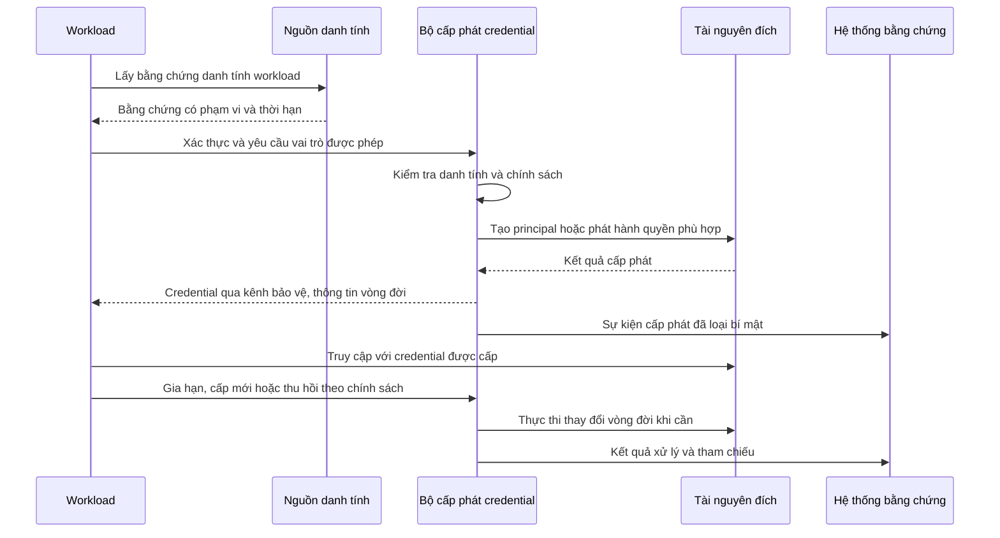

# Dynamic service credential

## 1. Từ bí mật dùng chung đến credential được cấp theo nhu cầu

Một service account là danh tính được ứng dụng, tác vụ nền hoặc thành phần hạ tầng sử dụng để truy cập tài nguyên. Khác với tài khoản của con người, service account thường hoạt động liên tục và không thể chờ người vận hành nhập mật khẩu cho mỗi lần kết nối.

Cách triển khai quen thuộc là tạo một tài khoản cơ sở dữ liệu, đặt mật khẩu vào cấu hình rồi dùng lại trong nhiều tháng. Khi ứng dụng có nhiều bản sao, cùng một credential có thể được sao chép sang nhiều máy, container, pipeline và kho cấu hình. Việc biết ai đang sử dụng nó, thu hồi một bản sao bị lộ hoặc thay mật khẩu mà không gây lỗi trở nên khó khăn.

**Dynamic service credential** là credential được hệ thống cấp phát tạo ra hoặc phát hành theo yêu cầu cho một workload đã được xác thực, với phạm vi quyền và thời gian hiệu lực được kiểm soát.

Ví dụ, khi một bản sao của dịch vụ xử lý đơn hàng cần truy cập cơ sở dữ liệu, nó xác thực với bộ cấp phát credential. Bộ cấp phát tạo một tài khoản cơ sở dữ liệu tạm thời chỉ có quyền cần thiết, trả credential qua kênh bảo vệ và theo dõi vòng đời sử dụng. Khi bản sao dừng hoặc thời hạn kết thúc, credential được thu hồi theo khả năng của hệ thống đích.

Trong quản lý truy cập đặc quyền, cơ chế này giúp giảm số lượng bí mật tồn tại lâu dài, giới hạn phạm vi ảnh hưởng khi một workload bị xâm nhập và tạo quan hệ rõ hơn giữa danh tính máy, quyền được cấp và hoạt động thực tế.

Tuy nhiên, “dynamic” không tự động có nghĩa là an toàn. Một bộ cấp phát cho phép mọi workload xin quyền quản trị, hoặc một credential được đánh dấu hết hạn nhưng vẫn dùng được ở đích, vẫn tạo ra rủi ro lớn.

## 2. Những khái niệm cần phân biệt

### 2.1. Danh tính, credential, quyền và lease

Bốn thành phần thường bị gộp chung nhưng có vai trò khác nhau:

| Thành phần | Ý nghĩa | Ví dụ |
|---|---|---|
| Workload identity | Danh tính của ứng dụng hoặc tác vụ yêu cầu truy cập | Dịch vụ xử lý đơn hàng trong môi trường production |
| Credential | Bằng chứng được trình cho hệ thống đích | Tên tài khoản và mật khẩu tạm thời, access token, certificate |
| Authorization | Quyền mà đích cho phép sau xác thực | Đọc bảng sản phẩm và cập nhật trạng thái đơn hàng |
| Lease | Bản ghi quản lý vòng đời do hệ thống cấp phát theo dõi | Thời hạn, khả năng gia hạn và tham chiếu thu hồi |

Lease không nhất thiết là một token ứng dụng có thể dùng trực tiếp để truy cập tài nguyên. Nó có thể chỉ là bản ghi quản lý credential.

Cũng không được giả định lease hết hạn đồng nghĩa mọi kết nối đang mở đều bị đóng. Việc thực thi hết hạn phụ thuộc loại credential, cơ chế thu hồi và hành vi của tài nguyên đích.

### 2.2. Dynamic khác với xoay vòng bí mật tĩnh

| Cơ chế | Điều diễn ra | Hạn chế cần hiểu |
|---|---|---|
| Bí mật tĩnh | Một credential được dùng lâu dài | Dễ bị sao chép và khó quy trách nhiệm theo workload |
| Bí mật tĩnh được rotate | Thay credential của danh tính lâu dài theo chu kỳ hoặc sự kiện | Các bên sử dụng phải chuyển đổi; nhiều bản sao có thể vẫn chia sẻ cùng một credential |
| Credential động | Cấp credential mới theo nhu cầu với vòng đời xác định | Cần bộ cấp phát, chính sách, xác thực đầu vào và xử lý hết hạn |
| Token liên kết danh tính | Dùng bằng chứng từ một miền tin cậy để lấy token cho tài nguyên | Phải kiểm tra miền tin cậy, đối tượng nhận và quyền được ánh xạ |

Một hệ thống tự động đọc mật khẩu lâu dài từ vault rồi đưa vào biến môi trường chưa nhất thiết đang dùng credential động. Nếu mọi bản sao vẫn nhận cùng mật khẩu, hệ thống chủ yếu đã thay đổi cách phân phối bí mật.

Ngược lại, một access token ngắn hạn có thể là credential động dù không tạo ra một tài khoản người dùng mới trên tài nguyên đích. Điểm cần xem là cách cấp, phạm vi, thời hạn và khả năng kiểm soát, không phải chỉ có hay không một hàng tài khoản mới.

### 2.3. “Không có mật khẩu tĩnh” không đồng nghĩa “không có credential”

Workload vẫn phải chứng minh danh tính để xin credential. Bằng chứng đó có thể là token của nền tảng chạy ứng dụng, certificate, danh tính máy hoặc cơ chế chứng thực khác.

Nếu workload dùng một client secret lâu dài để lấy các credential ngắn hạn, bí mật khởi đầu vẫn tồn tại. Thiết kế đã cải thiện vòng đời của credential đích, nhưng chưa giải quyết hoàn toàn bài toán bootstrap.

Cần quản lý cả hai lớp:

1. Credential hoặc bằng chứng dùng để xác thực với bộ cấp phát.
2. Credential được cấp để truy cập tài nguyên đích.

## 3. Kiến trúc cấp credential cho service account

Một kiến trúc tổng quát gồm các thành phần sau:



Không phải mọi hệ thống đều có đầy đủ các bước qua mạng như sơ đồ. Một số nền tảng tự phát hành token mà không gọi API tạo tài khoản ở tài nguyên đích. Một số workload nhận credential qua agent cục bộ. Dù hình thức khác nhau, các ranh giới tin cậy vẫn cần được xác định.

### 3.1. Nguồn danh tính phải đáng tin cậy

Bộ cấp phát cần kiểm tra bằng chứng đúng loại, đúng nguồn phát hành và dành cho đúng đối tượng nhận.

Tùy cơ chế, các điều kiện có thể gồm:

- Nguồn phát hành được tin cậy.
- Chữ ký hoặc chứng thực hợp lệ.
- Thời hạn còn hiệu lực.
- Audience phù hợp với dịch vụ nhận bằng chứng.
- Danh tính workload, môi trường và phạm vi triển khai đúng với chính sách.
- Điều kiện chống sử dụng lại hoặc ràng buộc với kênh, nếu cơ chế đó hỗ trợ.

Tên do ứng dụng tự gửi như “tôi là order-service-production” không phải bằng chứng danh tính. Địa chỉ IP hoặc vị trí mạng cũng không nên là căn cứ duy nhất để cấp quyền nhạy cảm.

### 3.2. Chính sách ánh xạ workload sang quyền

Workload không được tự quyết định mọi đặc tính của credential muốn nhận.

Ví dụ chính sách minh họa:

```yaml
workload_selector:
  identity: order-service
  environment: production

allowed_credential_role: order-runtime
target_scope: order-database
permissions_profile: order-read-write-limited

lifecycle:
  initial_ttl: 20m
  maximum_lifetime: 90m
  renewal_allowed: true
```

Đây là cấu hình minh họa, không phải cú pháp của một sản phẩm cụ thể. Các giá trị thời gian cũng chỉ phục vụ việc giải thích.

Bộ cấp phát phải thực thi ánh xạ phía máy chủ. Nếu bên gọi có thể đổi trường role thành database-admin và được chấp nhận, credential ngắn hạn vẫn có thể cấp đặc quyền quá mức.

Nên tách quyền của ứng dụng chạy thường xuyên với quyền migration, sao lưu hoặc quản trị. Không cấp quyền thay đổi cấu trúc toàn bộ cơ sở dữ liệu chỉ vì ứng dụng đôi khi cần triển khai một phiên bản mới.

### 3.3. Tài khoản dùng để cấp phát là tài sản đặc quyền

Bộ cấp phát có thể cần quyền tạo tài khoản, gán quyền và thu hồi credential tại tài nguyên đích. Đây là một lớp đặc quyền quan trọng trong PAM.

Cần xác định:

- Quyền tối thiểu đủ để tạo và thu hồi các credential thuộc phạm vi.
- Credential quản trị đầu vào được lưu và thay như thế nào.
- Ai được thay chính sách và mẫu quyền.
- Cách kiểm soát truy cập trực tiếp tới tài nguyên đích.
- Cách phát hiện bộ cấp phát tạo tài khoản ngoài phạm vi được phép.

Không nên mặc định cấp toàn quyền quản trị cho bộ cấp phát. Nếu nền tảng đích bắt buộc một mức quyền rộng, cần ghi nhận rõ phạm vi ảnh hưởng và có kiểm soát tương ứng.

## 4. Vòng đời của credential động

### 4.1. Cấp phát

Khi yêu cầu hợp lệ, bộ cấp phát tạo hoặc phát hành credential và ghi nhận quan hệ giữa:

- Danh tính bên yêu cầu.
- Vai trò được cấp.
- Tài nguyên đích.
- Principal hoặc token được tạo.
- Thời điểm cấp và thời hạn.
- Tham chiếu quản lý vòng đời.

Nếu mỗi bản sao nhận một principal riêng, log tại đích có thể quy hoạt động về một lần cấp cụ thể tốt hơn so với việc mọi bản sao chia sẻ cùng tài khoản. Tuy nhiên, mức độ chi tiết thực tế còn phụ thuộc log của đích và chất lượng liên kết sự kiện.

Không nhất thiết phải tạo credential mới cho mỗi câu truy vấn. Tần suất cấp cần cân bằng giữa ranh giới cô lập, tải của hệ thống đích và khả năng vận hành.

### 4.2. Phân phối và sử dụng

Credential cần được chuyển qua kênh bảo vệ và chỉ tới thành phần cần sử dụng.

Một số cách phân phối:

| Cách phân phối | Điểm thuận lợi | Điều phải quản lý |
|---|---|---|
| Ứng dụng gọi trực tiếp bộ cấp phát | Ứng dụng hiểu vòng đời và có thể phản ứng chủ động | Tích hợp xác thực, retry, cache và bảo vệ log |
| Agent hoặc sidecar cục bộ | Gom logic cấp phát và gia hạn | Quyền truy cập giữa tiến trình, đồng bộ file và tín hiệu cập nhật |
| Tệp được cập nhật có kiểm soát | Phù hợp ứng dụng đọc cấu hình từ tệp | Quyền tệp, cập nhật nguyên tử, reload và xóa sau sử dụng |
| Cơ chế danh tính của nền tảng | Có thể giảm việc phân phối bí mật lâu dài | Miền tin cậy, audience, ánh xạ quyền và xử lý token |

Không có cách phân phối nào tự loại bỏ mọi khả năng lộ bí mật. Dữ liệu vẫn có thể tồn tại trong bộ nhớ tiến trình, heap dump, crash dump, bản sao chẩn đoán hoặc tệp tạm.

Đặc biệt, một sidecar nhận credential mới không bảo đảm ứng dụng chính đã sử dụng nó. Cần có cơ chế cập nhật và bằng chứng rằng kết nối mới thật sự dùng phiên bản mới.

### 4.3. Gia hạn

Gia hạn có thể kéo dài thời gian sử dụng của cùng một credential hoặc lease, tùy cơ chế. Nó không nhất thiết tạo ra bí mật mới.

Phải phân biệt:

- TTL của một lần cấp hoặc gia hạn.
- Giới hạn tuổi tối đa.
- Thời hạn mà tài nguyên đích thực sự thực thi.
- Thời hạn của danh tính hoặc token dùng để yêu cầu gia hạn.

Nếu tuổi tối đa là 90 phút, việc gia hạn nhiều lần không được mặc định biến credential thành tồn tại vô hạn. Đến giới hạn, workload có thể cần lấy một credential mới và chuyển đổi kết nối.

Cũng không được giả định mọi credential đều gia hạn được. Phản hồi từ bộ cấp phát và chính sách thực tế phải quyết định hành vi.

### 4.4. Cấp mới và chuyển đổi

Khi không thể gia hạn hoặc cần thay credential, workload lấy một credential mới, kiểm tra nó và chuyển các kết nối mới sang sử dụng.

Có thể tồn tại một giai đoạn hai credential cùng hợp lệ để hoàn thành công việc đang chạy. Giai đoạn này cần có giới hạn và được quan sát; nếu không, hệ thống có thể tích lũy nhiều credential không còn ai quản lý.

Việc cấp mới không tự thu hồi credential cũ. Sau khi chuyển đổi, phải xử lý credential cũ theo kế hoạch.

### 4.5. Thu hồi và hết hạn

Thu hồi có thể là:

- Vô hiệu hóa hoặc xóa principal tại đích.
- Loại khóa hay mapping được chấp nhận.
- Thu hồi lease.
- Thay đổi quyền để chặn truy cập.
- Yêu cầu tài nguyên đích chấm dứt session.
- Đợi token hết hạn khi không có cơ chế thu hồi tức thời, đồng thời áp dụng kiểm soát khác khi cần.

Điểm quan trọng là **trạng thái trong bộ cấp phát và trạng thái tại đích có thể không thay đổi cùng lúc**.

Một lease đã hết hạn có thể cần một tác vụ thu hồi liên hệ với cơ sở dữ liệu. Nếu tác vụ đó thất bại vì mất mạng, tài khoản tại đích có thể chưa bị loại. Ngược lại, token có thời điểm hết hạn được đích kiểm tra có thể tự ngừng được chấp nhận theo cơ chế token, nhưng vẫn có vấn đề về độ lệch thời gian, cache hoặc phiên đã thiết lập.

Do đó, cần hiểu cơ chế thực thi của loại credential đang dùng thay vì chỉ nhìn một trường TTL.

## 5. Thiết kế TTL và thời điểm làm mới

### 5.1. TTL là lựa chọn vận hành có ảnh hưởng tới rủi ro

TTL ngắn giảm khoảng thời gian một credential bị đánh cắp có thể được dùng, nếu thời hạn đó được thực thi hiệu quả. Đồng thời, TTL ngắn làm workload phải phụ thuộc thường xuyên hơn vào bộ cấp phát và quá trình chuyển đổi.

TTL dài giảm tần suất làm mới nhưng kéo dài thời gian tồn tại của credential. Cần đánh giá theo loại tài nguyên, mức quyền, khả năng thu hồi và đặc điểm tác vụ.

Các câu hỏi cần trả lời:

1. Workload chạy liên tục hay kết thúc nhanh?
2. Mất bao lâu để cấp và kiểm tra credential?
3. Có tác vụ hoặc giao dịch kéo dài không?
4. Tài nguyên đích giới hạn số tài khoản hoặc token thế nào?
5. Khi bộ cấp phát lỗi, credential hiện có còn dùng được đến lúc nào?
6. Thu hồi có chấm dứt phiên đang mở hay chỉ ngăn xác thực mới?

Không chọn TTL chỉ vì một giá trị mặc định có sẵn.

### 5.2. Làm mới trước khi hết hạn

Workload nên bắt đầu làm mới đủ sớm để còn thời gian xử lý độ trễ, thử lại có giới hạn và chuyển kết nối.

Một cách suy nghĩ:

```text
Ngân sách thời gian còn lại
    > thời gian yêu cầu cấp/gia hạn
    + thời gian kiểm tra credential mới
    + thời gian chuyển đổi cần thiết
    + dự phòng sai lệch và biến động
```

Không cần biến biểu thức này thành một con số cố định cho mọi dịch vụ. Cần đo hành vi thực tế và dùng thời hạn mà bộ cấp phát trả về, thay vì luôn giả định yêu cầu xin 20 phút sẽ nhận đủ 20 phút.

Các bản sao nên phân tán thời điểm làm mới bằng jitter có giới hạn. Nếu tất cả cùng làm mới ở một thời điểm, một đợt tăng tải có thể làm hệ thống cấp phát quá tải.

Jitter không được đẩy thời điểm làm mới vượt quá giới hạn an toàn. Thử lại cũng không được tự kéo dài hiệu lực credential trong nhận thức của ứng dụng.

### 5.3. Không suy ra thời hạn từ thời gian cache

Nếu ứng dụng cache credential trong 10 phút nhưng credential thực tế chỉ còn hiệu lực 3 phút, thời gian cache không làm credential sống thêm.

Ứng dụng cần lưu metadata vòng đời cùng credential và kiểm tra thời hạn trước các thao tác cần xác thực mới. Khi sử dụng thời điểm tuyệt đối, cần xem xét đồng bộ đồng hồ; khi tính khoảng thời gian nội bộ, tránh để thay đổi đồng hồ hệ thống làm sai lịch xử lý.

Không tự cộng thêm một “khoảng ân hạn” mà hệ thống đích không bảo đảm. Nếu kết nối còn hoạt động sau hết hạn, đó là hành vi cần hiểu và kiểm soát, không phải quyền gia hạn do ứng dụng tự đặt ra.

## 6. Connection pool và công việc đang chạy

Credential động thường thất bại trong thực tế không phải ở bước cấp phát mà ở bước đưa credential mới vào những kết nối đang được ứng dụng quản lý.

### 6.1. Đổi cấu hình không đổi các kết nối đã tồn tại

Một connection pool có thể tạo nhiều kết nối bằng credential cũ. Khi tệp cấu hình đổi mật khẩu, các kết nối đó có thể vẫn mở, trong khi những kết nối tạo mới bắt đầu thất bại hoặc dùng một credential khác.

Cần phân biệt:

- Credential của thế hệ pool hiện tại.
- Kết nối đã được xác thực.
- Giao dịch đang dùng kết nối.
- Credential sẽ được dùng cho kết nối tạo mới.

Nếu thư viện pool không hỗ trợ cập nhật credential an toàn, có thể cần tạo một thế hệ pool mới thay vì sửa trực tiếp đối tượng đang hoạt động.

### 6.2. Chuyển pool theo thế hệ

Một quy trình thường dùng:

1. Lấy credential mới khi credential cũ vẫn còn đủ thời gian sử dụng.
2. Tạo pool mới với số kết nối khởi tạo được kiểm soát.
3. Kiểm tra xác thực và một thao tác phù hợp với quyền được cấp.
4. Chuyển các yêu cầu mới sang pool mới.
5. Dừng nhận yêu cầu mới vào pool cũ.
6. Cho công việc đang chạy hoàn tất trong giới hạn đã định.
7. Đóng pool cũ và thu hồi credential cũ khi phù hợp.
8. Ghi kết quả chuyển đổi.


Giai đoạn drain phải phù hợp với thời gian còn lại và khả năng thu hồi ở đích. Không để giao dịch kéo dài vô hạn khiến credential cũ không bao giờ được thu dọn.

### 6.3. Khi đang có sự cố bảo mật

Nếu credential cũ bị nghi lộ và đang bị sử dụng trái phép, ưu tiên thu hồi có thể làm giao dịch đang chạy thất bại. Thiết kế ứng dụng cần chấp nhận quyết định containment thay vì yêu cầu giữ credential cũ đến khi mọi công việc thuận tiện kết thúc.

Việc thử lại một giao dịch sau khi mất kết nối cũng cần xem xét kết quả nghiệp vụ. Nếu lệnh thanh toán đã thành công nhưng phản hồi bị mất, chạy lại toàn bộ giao dịch có thể tạo tác dụng phụ trùng.

Vì vậy, retry kết nối và retry thao tác nghiệp vụ là hai vấn đề khác nhau. Cơ chế idempotency của nghiệp vụ vẫn cần tồn tại dù credential được quản lý tốt.

### 6.4. Mã giả quản lý một thế hệ credential

Đoạn sau mô tả ý tưởng điều phối, không phải API của thư viện hay sản phẩm cụ thể.

```text
function refresh_generation(current):
    assert current.has_enough_time_for_safe_refresh()

    candidate = request_authorized_dynamic_credential()
    candidate_pool = create_pool(candidate)

    if not verify_authentication_and_required_access(candidate_pool):
        close(candidate_pool)
        request_revocation(candidate.reference)
        record_failure_without_secrets()
        return KEEP_CURRENT_IF_STILL_VALID

    old_generation = atomic_switch_active_generation(
        credential = candidate,
        pool = candidate_pool
    )

    stop_new_borrows(old_generation.pool)
    drain_with_deadline(old_generation.pool)
    close(old_generation.pool)

    result = request_revocation(old_generation.credential.reference)
    if result.is_uncertain_or_failed:
        track_reconciliation_with_owner()
    else:
        record_generation_retired()
```

Trong triển khai thật, cần quản lý cả trường hợp tiến trình chết sau khi chuyển pool nhưng trước khi thu hồi credential cũ. Một tác vụ đối soát phía bộ cấp phát giúp xử lý những vòng đời không nhận được tín hiệu kết thúc từ workload.

## 7. Ví dụ: dịch vụ xử lý đơn hàng

### 7.1. Thiết kế ban đầu

Một dịch vụ có sáu bản sao dùng chung tài khoản cơ sở dữ liệu với mật khẩu lâu dài. Tài khoản có quyền rộng hơn nhu cầu chạy ứng dụng, vì nó cũng được dùng cho migration.

Các vấn đề:

- Một bản sao bị xâm nhập làm lộ credential dùng được từ các bản sao khác nếu không có ràng buộc bổ sung.
- Không dễ phân biệt truy vấn của từng bản sao trong log tài khoản.
- Đổi mật khẩu yêu cầu phối hợp cả sáu bản sao.
- Quyền migration tồn tại trong mọi tiến trình chạy thường xuyên.

### 7.2. Thiết kế dùng credential động

Tách danh tính và quyền:

| Workload | Vai trò credential | Quyền dự kiến |
|---|---|---|
| Ứng dụng xử lý đơn hàng | order-runtime | Các thao tác dữ liệu cần cho nghiệp vụ |
| Tác vụ migration | order-migration | Quyền thay đổi cấu trúc trong phạm vi được phê duyệt |
| Tác vụ báo cáo | order-reporting | Chỉ đọc tập dữ liệu phù hợp |

Mỗi bản sao ứng dụng có thể nhận một credential riêng cho một khoảng thời gian, nếu tài nguyên đích và hệ thống cấp phát đáp ứng được tải tài khoản. Credential runtime không được phép xin quyền migration.

Khi một bản sao dừng, nó yêu cầu thu hồi credential của mình. Nếu tiến trình dừng đột ngột, cơ chế hết hạn và đối soát phía bộ cấp phát tiếp tục chịu trách nhiệm.

### 7.3. Luồng vận hành

```text
Bản sao A khởi động
    -> chứng minh danh tính order-service trong production
    -> được ánh xạ sang order-runtime
    -> nhận credential A1 và metadata vòng đời
    -> mở pool A1
    -> bắt đầu phục vụ

Đến thời điểm làm mới
    -> lấy A2 hoặc gia hạn theo phản hồi thực tế
    -> nếu lấy A2: kiểm tra pool mới, chuyển yêu cầu, drain A1
    -> thu hồi A1 và lưu kết quả

Bản sao A bị nghi xâm nhập
    -> chặn khả năng xin credential mới của danh tính liên quan
    -> xử lý credential và phiên đã cấp cho A
    -> cô lập workload và điều tra
    -> kiểm tra những quyền hoặc dữ liệu đã bị tác động
```

Chỉ thu hồi A1 nhưng vẫn để workload bị xâm nhập tiếp tục xác thực với bộ cấp phát là chưa đủ: nó có thể xin A2. Khi xử lý sự cố, phải quản lý cả đường cấp mới và những quyền đã cấp.

### 7.4. Những giới hạn còn lại

Credential động không ngăn một ứng dụng bị chiếm quyền thực hiện mọi hành động mà credential hiện tại cho phép. Nó cũng không thu hồi dữ liệu mà kẻ tấn công đã đọc.

Do đó, vẫn cần least privilege, giới hạn tài nguyên, phân đoạn truy cập, kiểm soát dữ liệu và khả năng phát hiện hành vi bất thường. Credential động giải quyết một phần vòng đời truy cập, không thay thế toàn bộ thiết kế an toàn của ứng dụng.

## 8. Xử lý lỗi và tính sẵn sàng

### 8.1. Bộ cấp phát không truy cập được

Nếu credential hiện tại còn hiệu lực và chính sách cho phép, workload có thể tiếp tục dùng nó trong phạm vi thời hạn. Đồng thời, cần thử lại có backoff, jitter và giới hạn rõ ràng.

Khi credential đã hết hiệu lực hoặc không còn đủ điều kiện sử dụng, workload phải xử lý lỗi theo thiết kế: ngừng nhận phần công việc cần tài nguyên, trả lỗi có kiểm soát hoặc chuyển sang chế độ giảm chức năng phù hợp.

Không tự động rơi về một mật khẩu quản trị tĩnh giấu trong mã nguồn. Đường phục hồi đặc biệt, nếu cần, phải được thiết kế và kiểm soát như một cơ chế khẩn cấp riêng.

### 8.2. Cấp được ở đích nhưng phản hồi bị mất

Bộ cấp phát có thể đã tạo tài khoản nhưng không nhận hoặc không trả được phản hồi. Nếu bên gọi lặp lại mù quáng, nhiều tài khoản không còn chủ sở hữu có thể xuất hiện.

Cách xử lý gồm:

- Có mã thao tác để đối soát khi nền tảng hỗ trợ.
- Ghi trạng thái cấp phát theo từng bước mà không lưu bí mật sai nơi.
- Phân biệt lỗi xác định với kết quả chưa rõ.
- Tìm và xử lý principal mồ côi.
- Không giả định một API tạo credential hỗ trợ idempotency nếu chưa có bảo đảm đó.

### 8.3. Thu hồi thất bại

Thu hồi thất bại cần được coi là một trạng thái tồn tại thật, có rủi ro, thay vì chỉ là một dòng cảnh báo không ai xử lý.

Ví dụ, database mất kết nối nên bộ cấp phát không thể vô hiệu hóa tài khoản. Hệ thống cần ghi nhận credential còn chờ thu hồi, thử lại theo chính sách và cảnh báo khi quá hạn.

Nếu cần containment ngay, có thể phải phối hợp chủ tài nguyên dùng biện pháp khác. Một sự kiện “lease expired” không đủ để xác nhận quyền tại đích đã bị loại.

### 8.4. Tăng tải khi triển khai hoặc khởi động lại

Khi nhiều bản sao cùng khởi động, nhu cầu xác thực và cấp credential tăng đồng thời. Cần tính đến:

- Hạn mức yêu cầu của bộ cấp phát.
- Chi phí tạo tài khoản tại cơ sở dữ liệu.
- Giới hạn kết nối.
- Số principal còn chờ thu hồi.
- Tải kiểm chứng credential và khởi tạo pool.
- Khả năng hàng đợi và đối soát.

Giới hạn tốc độ khởi động, phân tán làm mới và giảm số kết nối tạo sẵn có thể giúp kiểm soát tải. Không giải quyết vấn đề bằng cách chia sẻ một credential đặc quyền cho toàn bộ hệ thống mà không đánh giá lại phạm vi ảnh hưởng.

### 8.5. Tác vụ chạy lâu hơn TTL

Một tác vụ nhiều giờ không nhất thiết cần một credential sống nhiều giờ. Có thể gia hạn theo chính sách hoặc lấy credential mới giữa các giai đoạn khi ứng dụng hỗ trợ.

Tuy nhiên, nếu một giao dịch không thể chuyển kết nối giữa chừng, cần thiết kế thời hạn phù hợp hoặc chia lại công việc. Không giả định ứng dụng có thể thay credential giữa mọi loại thao tác.

## 9. Bảo vệ credential trong ứng dụng và hạ tầng

### 9.1. Hạn chế nơi bí mật xuất hiện

Credential không nên được đưa vào:

- Log ứng dụng và log request/response.
- Thông báo lỗi, ticket hoặc tin nhắn vận hành.
- URL hoặc tham số dòng lệnh có thể bị ghi nhận.
- Container image, mã nguồn và cấu hình được công khai rộng.
- Artifact build hoặc tệp cấu hình tạm không được quản lý.
- Endpoint debug hoặc bản dump được nhiều người truy cập.

Biến môi trường không tự bảo đảm bí mật. Công cụ chẩn đoán, tiến trình con và cơ chế thu thập thông tin có thể làm dữ liệu xuất hiện ở những nơi không mong muốn.

Cũng không nên tuyên bố credential “chỉ nằm trong RAM” là đã an toàn tuyệt đối. Bộ nhớ vẫn thuộc phạm vi bảo vệ của hệ điều hành, tiến trình và cơ chế thu thập chẩn đoán.

### 9.2. Quyền truy cập agent và file phân phối

Nếu agent ghi credential vào tệp, cần quản lý:

- Chủ sở hữu và quyền đọc tối thiểu.
- Ranh giới giữa container hoặc tiến trình.
- Cách cập nhật tệp để ứng dụng không đọc nội dung dở dang.
- Cách thông báo và xác nhận reload.
- Khả năng tệp bị đưa vào bản sao lưu hoặc gói chẩn đoán.
- Xử lý khi workload kết thúc.

Một tệp được cập nhật nguyên tử giải quyết vấn đề đọc một phần nội dung, nhưng chưa giải quyết việc ứng dụng giữ credential cũ trong bộ nhớ hoặc pool.

### 9.3. Kiểm soát đường xin credential mới

Bên tấn công lấy được credential đích chỉ có thể dùng nó trong phạm vi được cấp. Bên tấn công kiểm soát danh tính có quyền cấp mới có thể tiếp tục lấy các credential tiếp theo.

Cần giám sát:

- Tần suất yêu cầu bất thường.
- Vai trò hoặc tài nguyên được yêu cầu ngoài mô hình bình thường.
- Yêu cầu đến từ môi trường hoặc vị trí không phù hợp.
- Sự kiện xác thực của workload đã được đánh dấu bị xâm nhập.
- Việc cấp credential sau khi workload được cho là đã dừng.

Khả năng thu hồi một lần cấp và khả năng chặn danh tính xin thêm credential phải được thiết kế riêng.

## 10. Bằng chứng kiểm toán và đối soát

### 10.1. Cần liên kết những sự kiện nào?

Một chuỗi bằng chứng hữu ích là:

```text
Workload identity
    -> sự kiện xác thực với bộ cấp phát
    -> quyết định chính sách và vai trò
    -> sự kiện cấp credential
    -> principal hoặc phiên tại tài nguyên đích
    -> gia hạn, cấp thay thế hoặc thu hồi
    -> kết quả thực thi tại đích
```

Nếu thiếu mắt xích giữa principal tạm thời và workload gốc, việc tạo nhiều tài khoản ngắn hạn có thể khiến điều tra khó hơn thay vì dễ hơn.

Không dùng credential thật làm khóa đối chiếu trong log. Có thể dùng mã sự kiện, mã thao tác và tham chiếu vòng đời được kiểm soát. Các tham chiếu này cũng có thể là metadata nhạy cảm và cần quyền truy cập phù hợp.

### 10.2. Hồ sơ minh họa không chứa bí mật

```yaml
issuance_event: ISSUE-DEMO-028
workload_identity: order-service
environment: production
workload_instance: replica-a
credential_role: order-runtime
target_reference: order-database
principal_reference: generated-principal-reference
lifecycle_reference: protected-lifecycle-reference
requested_ttl: 20m
granted_ttl: 15m
renewable: true
policy_decision_reference: POLICY-DEMO-014
revocation_state: pending
```

Ví dụ thể hiện TTL được cấp có thể khác TTL yêu cầu. Nó không chứa password, access token, private key hay bằng chứng bearer có thể dùng để xác thực.

Không ghi “revoked” chỉ vì đã gửi yêu cầu thu hồi. Cần phân biệt yêu cầu đã tiếp nhận, tác vụ đã hoàn tất và kết quả đã được kiểm chứng ở đích theo khả năng hệ thống.

### 10.3. Những chỉ số có ích

| Chỉ số | Vấn đề giúp phát hiện |
|---|---|
| Tỷ lệ cấp phát thành công và độ trễ | Khả năng đáp ứng nhu cầu của workload |
| Số lần làm mới thất bại gần hết hạn | Nguy cơ gián đoạn sắp xảy ra |
| Số credential hoặc principal mồ côi | Vòng đời cấp phát bị bỏ dở |
| Số lượt thu hồi đang chờ và tuổi của chúng | Khoảng trống giữa lease và trạng thái thật |
| Thời gian chuyển pool | Khả năng thích nghi với vòng đời ngắn |
| Số lượt cấp mới theo workload và vai trò | Hành vi bất thường hoặc cấu hình retry sai |
| Quyền thực tế so với quyền dự kiến | Drift hoặc mẫu cấp quyền quá rộng |
| Số lần sử dụng đường khẩn cấp | Vấn đề sẵn sàng hoặc lạm dụng cơ chế dự phòng |

Tránh biến các mã principal ngắn hạn thành nhãn metric không giới hạn, vì số lượng nhãn có thể tăng rất nhanh. Log hoặc hệ thống truy vấn sự kiện phù hợp hơn cho việc theo dõi từng lần cấp; metric nên có phạm vi tổng hợp được kiểm soát.

## 11. Lộ trình áp dụng cho một dịch vụ

### Bước 1: Kiểm kê phụ thuộc và quyền hiện tại

Xác định ứng dụng nào dùng credential, có bao nhiêu bản sao, kết nối tới tài nguyên nào và quyền thực sự cần cho luồng chạy thường xuyên.

Tách tài khoản runtime với tài khoản triển khai, migration hoặc quản trị trước khi tự động hóa việc cấp quyền. Nếu cấp động một tập quyền quá rộng, mức quyền vẫn quá rộng.

### Bước 2: Chọn ranh giới cấp phát

Quyết định credential được cấp theo dịch vụ, bản sao, job hoặc một ranh giới khác. Cân nhắc cô lập, khả năng quy trách nhiệm và tải tạo principal.

Ví dụ, một job độc lập có thể phù hợp với credential riêng theo lần chạy. Một dịch vụ có nhiều request mỗi giây thường không nên mặc định tạo tài khoản cơ sở dữ liệu mới cho từng request.

### Bước 3: Thiết lập xác thực và chính sách phía bộ cấp phát

Chỉ tin các nguồn danh tính đã định nghĩa. Ánh xạ workload sang role được phê duyệt và giới hạn tài nguyên đích.

Kiểm tra cả tình huống bị từ chối: sai môi trường, sai audience, sai identity, yêu cầu vai trò vượt quyền hoặc bằng chứng hết hạn.

### Bước 4: Tích hợp vòng đời vào ứng dụng

Bổ sung lịch làm mới, quản lý pool, xử lý hết hạn và cơ chế bảo vệ log. Nếu dùng agent, xác định trách nhiệm giữa agent và ứng dụng.

Thử các tình huống mất phản hồi, gia hạn bị từ chối, ứng dụng dừng đột ngột và thu hồi thất bại. Mục tiêu là hiểu trạng thái còn lại, không chỉ thấy happy path chạy được.

### Bước 5: Triển khai có kiểm soát

Bắt đầu ở phạm vi có thể quan sát và khôi phục. Đo độ trễ cấp phát, lỗi kết nối, tải principal và độ ổn định chuyển đổi.

Nếu duy trì credential tĩnh trong giai đoạn chuyển đổi, cần giới hạn người dùng, thời gian và khả năng fallback. Khi cơ chế động đã được chấp nhận, thu hồi credential cũ thay vì để nó trở thành một cửa truy cập lâu dài bị quên.

### Bước 6: Vận hành và đối soát định kỳ

Đối soát danh sách principal tại đích với các lần cấp hợp lệ. Theo dõi drift về quyền, credential chờ thu hồi và workload không còn tồn tại.

Đánh giá lại TTL và ranh giới cấp phát khi số bản sao, lưu lượng, thời gian giao dịch hoặc mô hình quyền thay đổi.

## 12. Sai lầm thường gặp

| Sai lầm | Vì sao chưa đáp ứng mục tiêu | Hướng sửa |
|---|---|---|
| Gọi bí mật đọc từ vault là credential động dù mọi bản sao dùng cùng mật khẩu lâu dài | Vòng đời và phạm vi chia sẻ chưa thay đổi | Phân biệt phân phối bí mật với cấp credential mới |
| Cấp role quản trị cho mọi workload | TTL ngắn không bù được quyền quá rộng | Ánh xạ quyền tối thiểu theo nhiệm vụ |
| Chỉ quản lý TTL trong ứng dụng | Đích có thể vẫn chấp nhận credential | Xác định và kiểm chứng cơ chế thực thi tại đích |
| Gia hạn liên tục mà không có giới hạn tuổi | Credential ngắn hạn có thể trở thành tồn tại lâu dài | Tôn trọng giới hạn và chuyển credential khi cần |
| Thu hồi credential nhưng để workload bị xâm nhập xin cái mới | Đường cấp mới vẫn bị kiểm soát bởi bên tấn công | Chặn danh tính hoặc điều kiện cấp liên quan |
| Đổi tệp credential mà không xử lý pool | Kết nối cũ vẫn dùng vòng đời trước | Quản lý thế hệ kết nối và drain |
| Ghi đầy đủ phản hồi API để debug | Secret hoặc token đi vào log | Lọc dữ liệu từ đầu và dùng mã tham chiếu |
| Tự fallback về mật khẩu đặc quyền tĩnh | Tạo đường truy cập vượt qua cơ chế chính | Thiết kế chế độ lỗi và cơ chế khẩn cấp được kiểm soát |
| Coi hết lease là đã thu hồi thành công | Tác vụ tại đích có thể thất bại | Theo dõi kết quả và đối soát |
| Dùng cùng danh tính cho nhiều môi trường | Khó cô lập và dễ cấp sai quyền | Phân tách miền tin cậy, chính sách và phạm vi |

## 13. Thực hành phân tích

Một tác vụ xuất báo cáo chạy 50 phút. Nó nhận credential cơ sở dữ liệu có TTL ban đầu 15 phút, được phép gia hạn nhưng có tuổi tối đa 30 phút. Tác vụ mở một pool và không bao giờ đọc lại credential. Bộ cấp phát có thể thu hồi tài khoản, nhưng hành vi với kết nối đã mở cần được xác định theo cấu hình của cơ sở dữ liệu.

Hãy trả lời:

1. Vì sao việc nhận credential thành công lúc khởi động chưa đủ?
2. Gia hạn có giải quyết được toàn bộ thời gian chạy 50 phút không?
3. Cần thay đổi gì trong cách quản lý pool hoặc chia công việc?
4. Nếu thu hồi tài khoản nhưng kết nối cũ vẫn thực thi truy vấn được, tiêu chí kết thúc truy cập phải bổ sung gì?
5. Nếu tác vụ chết trước khi yêu cầu thu hồi, ai tiếp tục quản lý vòng đời?
6. Bằng chứng nào giúp liên kết truy vấn với lần chạy báo cáo mà không ghi bí mật?

Hướng phân tích:

- Tác vụ cần xử lý cả gia hạn, giới hạn tuổi và cấp mới; một credential ban đầu không tự kéo dài theo thời gian chạy.
- Gia hạn trong giới hạn 30 phút không bảo đảm đủ cho tác vụ 50 phút.
- Có thể cần chia công việc thành giai đoạn hoặc chuyển pool bằng credential mới trước giới hạn, tùy đặc tính giao dịch.
- Phải xác định cơ chế xử lý session tại đích và kiểm chứng quyền thực tế đã kết thúc.
- Bộ cấp phát cùng tác vụ đối soát cần xử lý vòng đời khi workload không gửi được tín hiệu kết thúc.
- Mã lần chạy, sự kiện cấp và tham chiếu principal giúp liên kết hoạt động mà không dùng credential làm bằng chứng.

## 14. Những điểm cần nhớ

Dynamic service credential đưa việc truy cập của service account vào một vòng đời được quản lý: xác thực workload, ánh xạ quyền, cấp credential, sử dụng, làm mới và kết thúc.

Chất lượng của thiết kế nằm ở ba điểm: **đúng danh tính được nhận đúng quyền, ứng dụng thích nghi được với vòng đời credential, và trạng thái thu hồi được kiểm chứng ở nơi thực thi quyền**.

TTL ngắn có ích khi đi cùng cơ chế xác thực đáng tin cậy, least privilege, quản lý kết nối và khả năng đối soát. Nếu thiếu các phần này, hệ thống có thể đổi bí mật rất thường xuyên nhưng vẫn để quyền truy cập tồn tại ngoài dự kiến.
