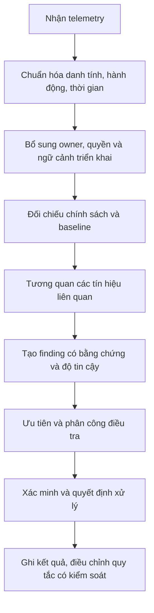

# Giám sát atypical usage

## 1. Vì sao service account cần giám sát hành vi riêng?

Service account là danh tính phục vụ ứng dụng, tác vụ nền hoặc thành phần hạ tầng. Một tài khoản có thể đọc hàng triệu bản ghi mỗi ngày, kết nối từ nhiều bản sao của ứng dụng và hoạt động ngoài giờ làm việc mà vẫn hoàn toàn hợp lệ.

Vì vậy, giám sát service account không thể chỉ dựa vào quy tắc dành cho người dùng như “đăng nhập ban đêm là đáng ngờ” hoặc “nhiều yêu cầu là bất thường”. Điều cần biết là **danh tính này đang làm gì khác với nhiệm vụ, quyền hạn và cách vận hành đã được xác định**.

Atypical usage là việc sử dụng không điển hình khi đối chiếu với chính sách hoặc ngữ cảnh hoạt động phù hợp. Nó có thể là:

- Một service account chỉ dành cho ứng dụng lại được dùng để mở phiên quản trị tương tác.
- Tài khoản chạy báo cáo truy cập dữ liệu của một môi trường khác.
- Credential được dùng từ một workload chưa từng được phép.
- Tài khoản runtime tự tạo credential mới hoặc thay đổi quyền quản trị.
- Lưu lượng tăng mạnh không giải thích được bằng lịch xử lý hoặc số lượng bản sao.
- Đường truy cập đi thẳng tới hệ thống đích thay vì qua cơ chế PAM đã quy định.

Hành vi không điển hình là tín hiệu để đánh giá, không tự chứng minh có xâm nhập. Một lần triển khai hợp lệ, lỗi cấu hình hoặc thay đổi lịch kinh doanh cũng có thể tạo ra tín hiệu tương tự.

Mục tiêu của giám sát trong PAM là phát hiện việc sử dụng vượt khỏi phạm vi đã phê duyệt, xác định mức rủi ro và cung cấp đủ bằng chứng để xử lý mà không gây gián đoạn dịch vụ một cách máy móc.

## 2. Xác định đúng đối tượng đang được quan sát

### 2.1. Không chỉ nhìn tên tài khoản

Một tên hiển thị như order-service có thể tồn tại trong nhiều môi trường hoặc hệ thống khác nhau. Nếu gộp chúng thành một thực thể, giám sát dễ nhầm hoạt động production với thử nghiệm hoặc bỏ qua việc một danh tính đi sang miền khác.

Nên phân biệt ít nhất:

| Thành phần | Ví dụ ngữ cảnh cần giữ |
|---|---|
| Danh tính | Mã principal ổn định, miền hoặc tenant, loại tài khoản |
| Workload | Dịch vụ, job, bản sao, môi trường triển khai |
| Credential | Loại credential và tham chiếu phiên bản hoặc lần cấp nếu có |
| Nguồn truy cập | Máy, cụm, danh tính workload, đường mạng |
| Đích | Hệ thống, tài nguyên, tập dữ liệu, môi trường |
| Hành động | Xác thực, đọc dữ liệu, thay cấu hình, cấp quyền |
| Phiên hoặc lần chạy | Mã session, mã job, correlation ID phù hợp |

Không phải sự kiện nào cũng có đủ các trường này. Khi thiếu, cần thể hiện độ tin cậy của việc liên kết thay vì tự điền bằng phỏng đoán.

### 2.2. Phân biệt danh tính và credential

Một service account có thể sử dụng nhiều credential theo thời gian. Sau rotation, các sự kiện mới của cùng danh tính không nhất thiết dùng credential cũ.

Do đó, kết luận “credential cũ vẫn hoạt động sau thu hồi” chỉ hợp lý nếu có bằng chứng về phương thức xác thực, phiên bản hoặc phiên liên quan. Nếu log chỉ có mã tài khoản, kết luận đúng hơn là “danh tính tiếp tục có hoạt động, cần xác định đường xác thực”.

Với credential động, cần liên kết principal tạm thời hoặc token đã cấp với workload gốc. Nếu không có liên kết đó, hàng nghìn principal ngắn hạn có thể tạo ra nhiều sự kiện “tài khoản mới” nhưng không giúp hiểu ai thực sự đang sử dụng.

### 2.3. Phân biệt xác thực, phiên và hành động

Đăng nhập thành công chưa cho biết tài khoản đã thực hiện thao tác gì. Ngược lại, một kết nối lâu dài có thể phát sinh nhiều hành động mà không tạo sự kiện đăng nhập mới.

Ví dụ, một pool kết nối cơ sở dữ liệu chỉ xác thực khi tạo kết nối. Nếu ứng dụng đổi từ đọc bảng sản phẩm sang đọc một tập dữ liệu nhạy cảm, chỉ quan sát log đăng nhập có thể không phát hiện thay đổi.

Cần kết hợp các lớp:

1. Ai hoặc workload nào đã được xác thực.
2. Phiên hay credential nào được sử dụng.
3. Tài nguyên và hành động nào thực sự xuất hiện ở hệ thống đích.
4. Hoạt động đó có nằm trong nhiệm vụ được phê duyệt hay không.

## 3. Nguồn dữ liệu cần có

Giám sát tốt bắt đầu từ khả năng quan sát, không phải từ một thuật toán chấm điểm.

| Nguồn dữ liệu | Câu hỏi có thể trả lời | Giới hạn cần hiểu |
|---|---|---|
| Kiểm kê service account | Tài khoản phục vụ dịch vụ nào, ai sở hữu, quyền dự kiến là gì? | Thông tin có thể lỗi thời hoặc thiếu chủ sở hữu |
| Log xác thực | Danh tính nào xác thực, từ đâu, bằng phương thức nào? | Có thể thiếu hành động sau xác thực |
| Log vault và PAM | Ai hoặc workload nào lấy bí mật, mở phiên, xin quyền? | Không chứng minh mọi sử dụng ở đích đều đi qua PAM |
| Log cấp và thu hồi credential | Credential nào được phát hành, hết hạn hoặc thu hồi? | Trạng thái quản lý có thể khác trạng thái thực thi ở đích |
| Log tài nguyên đích | Tài khoản làm gì với tài nguyên nào? | Mức chi tiết phụ thuộc cấu hình và khả năng hệ thống |
| Telemetry máy và tiến trình | Tiến trình nào khởi tạo kết nối, chạy trên máy nào? | Đường dẫn tiến trình không tự chứng minh tiến trình đáng tin |
| Dữ liệu triển khai và job | Có rollout, scale hoặc tác vụ được phê duyệt không? | Một thay đổi hợp lệ không giải thích được mọi hành động |
| Dữ liệu quyền và cấu hình | Có role, membership hoặc chính sách mới nào? | Cần so sánh trạng thái trước và sau, không chỉ một ảnh chụp |
| Tín hiệu mạng | Luồng kết nối có đi tới đích hay đường mạng mới không? | NAT, proxy và cân bằng tải có thể che nguồn thực |

Không cần thu thập toàn bộ nội dung dữ liệu nghiệp vụ chỉ để phát hiện bất thường. Có thể ưu tiên metadata như loại thao tác, tài nguyên, số lượng, kết quả và thời gian, sau đó mở rộng theo nhu cầu điều tra được kiểm soát.

Một bản ghi truy vấn hoặc URL có thể chứa dữ liệu nhạy cảm. Cấu hình ghi log cần tránh biến hệ thống giám sát thành một kho sao chép bí mật và dữ liệu cá nhân.

## 4. Chuẩn hóa và đánh giá chất lượng dữ liệu

### 4.1. Chuẩn hóa danh tính và thời gian

Các nguồn có thể dùng username, mã principal, mã client hoặc một định dạng khác nhau. Cần có cách ánh xạ về thực thể ổn định nhưng vẫn giữ giá trị gốc để đối chiếu.

Một sự kiện chuẩn hóa có thể có:

```yaml
event_reference: EVENT-DEMO-091
source_type: target-audit
event_time: "<thời điểm sự kiện có múi giờ>"
ingest_time: "<thời điểm tiếp nhận có múi giờ>"

principal:
  stable_id: principal-demo-order-runtime
  realm: production
  account_type: service

workload:
  service: order-service
  instance_reference: replica-demo-b
  attribution_confidence: high

action:
  category: data-access
  operation: read
  resource_reference: order-data
  outcome: success

correlation:
  session_reference: session-demo-042
  credential_reference: protected-reference-if-available
```

Ví dụ không phải schema của một sản phẩm cụ thể và không chứa credential thật.

Giữ cả thời gian sự kiện và thời gian tiếp nhận giúp phân biệt hoạt động mới với log tới muộn. Một sự kiện xuất hiện sau rotation trong hệ thống giám sát có thể đã xảy ra trước rotation nhưng bị chậm chuyển tới.

### 4.2. Đánh giá độ tin cậy của việc quy nguồn

Một địa chỉ IP có thể đại diện cho nhiều workload sau NAT. Một máy chạy nhiều dịch vụ có thể tạo kết nối dưới nhiều danh tính. Vì vậy:

- Không coi IP trùng là bằng chứng chắc chắn cùng một workload.
- Không coi IP mới là bằng chứng chắc chắn có máy lạ.
- Dùng thêm danh tính nền tảng, metadata triển khai hoặc telemetry tiến trình khi có.
- Ghi rõ liên kết là trực tiếp hay suy ra.

Việc đặt mức độ tin cậy giúp người điều tra tránh đưa ra một hành động mạnh dựa trên một phép nối dữ liệu yếu.

### 4.3. Giám sát cả khoảng trống quan sát

Khi một nguồn log ngừng gửi, số cảnh báo có thể giảm dù rủi ro không giảm.

Cần theo dõi:

- Độ trễ nhận log.
- Nguồn đã mất tín hiệu.
- Tỷ lệ sự kiện không ánh xạ được danh tính.
- Tỷ lệ hành động không có mã tài nguyên hoặc môi trường.
- Những đích nhạy cảm chưa bật audit phù hợp.
- Sự thay đổi bất thường về số lượng sự kiện sau thay cấu hình.

“Không thấy sử dụng ngoài PAM” chỉ có ý nghĩa trong phạm vi những đích và đường truy cập mà hệ thống đang quan sát được.

## 5. Xây dựng baseline đúng với nhiệm vụ

Baseline là mô hình hoạt động dự kiến dùng để so sánh. Nó có thể đến từ chính sách đã định nghĩa, lịch sử quan sát hoặc kết hợp cả hai.

### 5.1. Baseline theo chính sách

Những đặc tính sau nên được xác định từ nhiệm vụ, không chỉ học từ quá khứ:

- Service account thuộc dịch vụ và môi trường nào.
- Có được đăng nhập tương tác hay không.
- Được phép truy cập tài nguyên và loại hành động nào.
- Có được tạo credential hoặc thay đổi quyền hay không.
- Cơ chế truy cập bắt buộc: broker, proxy, vault hoặc đường đã phê duyệt.
- Ai là chủ sở hữu và người nhận cảnh báo.
- Những ngoại lệ nào có thời hạn.

Nếu một tài khoản runtime không được phép quản trị quyền, việc nó thay role là tín hiệu vi phạm chính sách ngay cả khi hành vi đã từng xuất hiện nhiều lần trong quá khứ.

Không nên để thuật toán tự học biến một hành vi sai diễn ra thường xuyên thành hành vi được chấp nhận.

### 5.2. Baseline từ lịch sử

Lịch sử có thể giúp hiểu:

- Tần suất truy cập theo giờ, ngày và chu kỳ nghiệp vụ.
- Tập tài nguyên thường dùng.
- Phân bố số lượng bản ghi hoặc dung lượng xử lý.
- Nguồn workload và đường mạng thường gặp.
- Số lượng lỗi xác thực bình thường.
- Nhịp cấp mới, gia hạn và thu hồi credential.

Cần phân biệt ngày thường với ngày chốt sổ, batch cuối tuần hoặc giai đoạn triển khai. So sánh một tác vụ cuối tháng với một giờ giữa tuần có thể tạo cảnh báo không hữu ích.

Các khoảng quan sát như hai tuần hoặc một tháng chỉ là lựa chọn minh họa. Thời gian thực tế phải bao phủ được chu kỳ của dịch vụ và được đánh giá lại khi hành vi thay đổi.

### 5.3. Baseline phải có phiên bản và người chịu trách nhiệm

Một bản mô tả ngữ cảnh có thể như sau:

```yaml
baseline_reference: BASELINE-DEMO-ORDER-03
identity_reference: principal-demo-order-runtime
owner_team: order-platform
environment: production

policy:
  interactive_use_allowed: false
  permission_administration_allowed: false
  approved_targets:
    - order-database
  approved_workload: order-service

operational_context:
  expected_pattern: continuous-with-business-peaks
  known_batch_window_reference: approved-schedule-reference
  deployment_reference_source: deployment-events

review:
  status: approved
  next_review_reference: tracked-review-item
```

Không đưa password, token hoặc nội dung bí mật vào baseline. Những danh sách cho phép cũng cần được rà soát: một host cũ không nên được giữ mãi chỉ vì nó từng hợp lệ.

### 5.4. Workload mới và dữ liệu ít

Khi chưa có lịch sử, vẫn có thể phát hiện vi phạm chính sách: sai môi trường, hành động ngoài quyền dự kiến hoặc đăng nhập tương tác không được phép.

Với tín hiệu thống kê, nên ghi rõ trạng thái chưa đủ dữ liệu, dùng nhóm tương đương có kiểm soát nếu phù hợp và tránh kết luận mạnh chỉ từ một mức tăng tương đối lớn.

Ví dụ, từ một yêu cầu lên ba yêu cầu là tăng ba lần nhưng chưa chắc đáng kể. Cần kết hợp số lượng tuyệt đối, loại hành động và mức nhạy cảm của tài nguyên.

## 6. Những nhóm hành vi không điển hình

### 6.1. Sử dụng tương tác

Một tài khoản chỉ dành cho ứng dụng xuất hiện trong phiên shell, desktop, console hoặc cổng quản trị là tín hiệu cần kiểm tra.

Câu hỏi điều tra:

- Chính sách có thực sự cấm hình thức truy cập này không?
- Đây có phải công cụ vận hành hợp lệ hay hành vi con người mượn tài khoản dịch vụ?
- Có phê duyệt, mã thay đổi hoặc phiên PAM liên quan không?
- Tiến trình và nguồn tạo phiên là gì?
- Tài khoản đã thực hiện thao tác gì sau khi vào phiên?

Cách phân loại “interactive” phụ thuộc nguồn log và nền tảng. Không nên dùng một trường hoặc một mã sự kiện theo trí nhớ mà chưa xác nhận ý nghĩa của nó trong triển khai thực tế.

### 6.2. Nguồn sử dụng mới hoặc không được phép

Một service account của production được dùng từ máy thử nghiệm, máy cá nhân hoặc workload khác có thể cho thấy credential bị sao chép hoặc chính sách danh tính quá rộng.

Tuy nhiên, địa chỉ IP mới cũng có thể đến từ một đợt mở rộng cụm, thay gateway hoặc thay vùng triển khai. Cần đối chiếu dữ liệu vận hành trước khi quy kết nguồn mới là độc hại.

Mức tín hiệu mạnh hơn khi nguồn mới đi kèm bằng chứng danh tính workload không phù hợp hoặc một hình thức truy cập bị cấm.

### 6.3. Tài nguyên và hành động mới

Ví dụ:

- Tài khoản chỉ đọc báo cáo bắt đầu sửa dữ liệu.
- Ứng dụng đặt hàng truy cập kho dữ liệu nhân sự.
- Tài khoản runtime gọi API cấp quyền hoặc tạo credential mới.
- Tác vụ sao lưu bắt đầu thay chính sách audit.

Đây thường là tín hiệu quan trọng hơn chỉ riêng sự thay đổi về lưu lượng. Một thao tác duy nhất tác động đến quyền quản trị có thể đáng quan tâm hơn hàng triệu lần đọc hợp lệ.

### 6.4. Khối lượng và tần suất khác thường

Có thể theo dõi số yêu cầu, dung lượng, số tài nguyên được chạm tới hoặc tần suất xác thực.

Cần phân biệt:

- Tăng tải nghiệp vụ hợp lệ.
- Vòng lặp lỗi hoặc retry thiếu kiểm soát.
- Cấu hình credential hết hạn gây nhiều lỗi.
- Truy xuất dữ liệu ngoài dự kiến.
- Hoạt động từ một nguồn chưa được nhận diện.

Nếu số bản sao tăng gấp đôi, tổng số yêu cầu tăng chưa chắc là bất thường. Có thể cần chuẩn hóa theo số bản sao, số job hoặc lượng công việc thực tế, đồng thời vẫn giữ tổng lượng truy cập để phát hiện rủi ro ở mức toàn dịch vụ.

### 6.5. Hành vi liên quan vòng đời credential

Các tín hiệu hữu ích gồm:

- Tần suất xin credential tăng mạnh.
- Workload xin một role chưa từng được phép.
- Credential được cấp sau khi workload đã dừng.
- Tài khoản còn hoạt động sau sự kiện vô hiệu hóa.
- Principal tạm thời không gắn được với lần cấp hợp lệ.
- Hoạt động vẫn tiếp diễn ngoài khoảng hiệu lực dự kiến.

Những tín hiệu này cần đối chiếu với thời gian sự kiện, session và khả năng thực thi thu hồi. Không đồng nhất việc lease hết hạn với việc mọi phiên đã mất quyền.

### 6.6. Đi vòng cơ chế PAM

Một chính sách có thể yêu cầu truy cập tài nguyên nhạy cảm qua proxy hoặc chỉ nhận credential do broker cấp. Nếu đích ghi nhận một đường truy cập trực tiếp, cần xác định đó là ngoại lệ hay bypass.

Không có log checkout không đủ để kết luận bypass trong mọi trường hợp. Ứng dụng có thể dùng credential đã được cấp trước đó, kết nối dài hạn hoặc cơ chế khác được phê duyệt.

Cần biết đường truy cập bắt buộc và phạm vi thời gian mà sự kiện cấp có thể giải thích cho việc sử dụng.

### 6.7. Thay đổi quyền và cơ chế duy trì truy cập

Service account thực hiện các hành động như thêm credential, tạo danh tính mới, thay trust hoặc sửa chính sách cấp quyền có thể làm tăng khả năng duy trì truy cập.

Một số tài khoản tự động hóa có nhiệm vụ hợp lệ làm những việc này. Với chúng, baseline cần chi tiết hơn về loại tài nguyên, phạm vi thay đổi và pipeline được phép, thay vì bỏ qua toàn bộ nhóm hành vi.

## 7. Thiết kế quy tắc phát hiện có thể giải thích

### 7.1. Quy tắc dựa trên chính sách

Ví dụ ý tưởng, không phải cú pháp của công cụ cụ thể:

```text
WHEN identity.type == service
 AND identity.policy.interactive_use_allowed == false
 AND event.is_confirmed_interactive_session == true
THEN create_finding(
    reason = "Interactive use outside approved policy",
    identity = identity.reference,
    evidence = event.reference,
    attribution_confidence = event.attribution_confidence
)
```

Quy tắc chỉ hữu ích khi trường xác định phiên tương tác đáng tin cậy. Nếu nguồn không phân biệt được, cần chuyển thành tín hiệu cần xác minh thay vì gán nhãn chắc chắn.

Một quy tắc khác:

```text
WHEN identity.type == service
 AND event.operation in permission_administration_operations
 AND identity.policy.permission_administration_allowed == false
THEN create_high_priority_finding_with_evidence()
```

Danh sách hành động cần được xây từ hệ thống đang giám sát và có người quản lý phiên bản. Không lấy tên một API hoặc một từ khóa xuất hiện trong log làm bằng chứng quyền đã thay đổi thành công.

### 7.2. Quy tắc nguồn hoặc tài nguyên mới

Một phép phát hiện nguồn mới nên kết hợp chính sách và ngữ cảnh:

```text
IF source_is_not_in_approved_workload_scope:
    finding = policy_deviation
ELSE IF source_is_new_in_observed_history:
    finding = novelty_signal

ENRICH finding WITH
    deployment_context,
    target_sensitivity,
    action_type,
    source_attribution_confidence
```

Nguồn mới nhưng nằm trong một đợt triển khai được kiểm chứng có thể cần mức ưu tiên khác với nguồn nằm ngoài miền workload.

Sự kiện thay đổi hợp lệ không nên làm tự động bỏ qua những hành động nhạy cảm không liên quan. Một deployment không giải thích cho việc runtime tự cấp quyền quản trị.

### 7.3. Quy tắc theo tần suất

Một ví dụ phương pháp:

```text
current = count_successful_operations(identity, target, current_window)
expected = baseline_for_matching_operational_context()

IF baseline_has_enough_data
 AND current >= configured_absolute_floor
 AND current is materially_above expected
THEN emit_volume_anomaly_with_context()
```

“Materially above” cần được định nghĩa và hiệu chỉnh cho từng nhóm hoạt động. Có thể dùng phân vị hoặc thống kê bền vững nếu phù hợp, nhưng phải xử lý trường hợp baseline bằng không, dữ liệu ít và mùa vụ.

Không nên đưa một ngưỡng như “gấp ba lần” vào mọi service account mà không xem phân bố. Các giá trị minh họa trong tài liệu không phải tiêu chuẩn áp dụng sẵn.

### 7.4. Tương quan nhiều tín hiệu

Một nguồn mới đơn lẻ có thể là rollout. Một nguồn mới, không có ngữ cảnh triển khai, dùng tài khoản runtime để thay quyền trên tài nguyên nhạy cảm là một tổ hợp đáng ưu tiên hơn.

Tương quan có thể dùng:

- Cùng danh tính và khoảng thời gian.
- Cùng session hoặc lần cấp credential.
- Cùng workload nguồn và tài nguyên đích.
- Chuỗi thay đổi quyền rồi truy cập dữ liệu.
- Sự kiện vô hiệu hóa rồi có sử dụng tiếp theo.

Không ghép mọi sự kiện cùng username thành một câu chuyện chắc chắn. Các phép nối cần giữ được thực thể, miền, thời gian và độ tin cậy.

Một điểm rủi ro có thể giúp sắp thứ tự, nhưng điểm số không phải xác suất xâm nhập nếu hệ thống chưa được xây và hiệu chuẩn cho cách diễn giải đó.

## 8. Từ sự kiện đến cảnh báo có thể xử lý

Một luồng vận hành tổng quát:



### 8.1. Cảnh báo phải trả lời được câu hỏi đầu tiên

Một cảnh báo chỉ ghi “service account anomaly, score 92” không giúp người trực biết bắt đầu từ đâu.

Nên có:

- Danh tính và môi trường.
- Chủ sở hữu.
- Hành vi quan sát được.
- Vì sao khác chính sách hoặc baseline.
- Nguồn và đích liên quan.
- Thời gian sự kiện và khoảng thời gian được phân tích.
- Độ tin cậy của việc quy nguồn.
- Bằng chứng và dữ liệu còn thiếu.
- Ngữ cảnh thay đổi được tìm thấy.
- Hướng điều tra phù hợp.

Ví dụ:

```yaml
finding_reference: FINDING-DEMO-018
identity_reference: principal-demo-order-runtime
environment: production
owner_team: order-platform

observed_behavior:
  operation: permission-change
  target_reference: sensitive-role-policy
  source_workload_reference: unrecognized-workload

deviation:
  policy: runtime-identity-cannot-administer-permissions
  baseline_reference: BASELINE-DEMO-ORDER-03

confidence:
  identity_attribution: high
  source_workload_attribution: medium

evidence_references:
  - EVENT-DEMO-091
  - EVENT-DEMO-092

context:
  deployment_match: none-found-within-observed-data
  known_gaps:
    - source-process-telemetry-unavailable

priority: high
recommended_next_step: validate-policy-change-and-source-ownership
```

“Không tìm thấy thay đổi” khác với “không có thay đổi”. Cách diễn đạt cần phản ánh phạm vi dữ liệu thực sự đã tra cứu.

### 8.2. Gộp cảnh báo mà vẫn giữ chuỗi bằng chứng

Một lỗi cấu hình có thể tạo hàng nghìn sự kiện. Có thể gộp theo danh tính, loại hành vi, tài nguyên và khoảng thời gian để giảm tải cho người trực.

Tuy nhiên:

- Giữ số lượng sự kiện và thời điểm đầu, cuối.
- Không làm mất sự kiện tác động lớn giữa nhiều sự kiện lỗi.
- Giữ quan hệ tới từng bằng chứng cần thiết.
- Cho phép mở lại khi hành vi lan sang tài nguyên hoặc quyền khác.
- Không dùng việc gộp để che khoảng thời gian cảnh báo kéo dài.

Những thay đổi về mức nhạy cảm hoặc quyền cần có khả năng nâng mức ưu tiên, dù finding đã tồn tại.

### 8.3. Ngoại lệ và maintenance window

Ngoại lệ nên gắn với danh tính, hành động, đích, lý do, người chấp thuận và thời hạn. Không tắt mọi cảnh báo của một tài khoản chỉ vì đang triển khai.

Một cửa sổ bảo trì có thể giải thích việc tăng kết nối hoặc nguồn mới. Nó không mặc nhiên hợp thức hóa mọi thao tác cấp quyền, tắt audit hoặc truy cập môi trường ngoài phạm vi.

Các ngoại lệ hết hạn cần được loại khỏi logic cho phép và được xem xét lại khi vẫn còn sử dụng.

## 9. Quy trình điều tra một finding

### Bước 1: Kiểm tra dữ liệu và danh tính

Xác nhận finding nói về đúng principal, miền và môi trường. Kiểm tra log tới muộn, đồng hồ, sự kiện trùng và chất lượng quy nguồn.

Nếu finding gắn nhầm principal do username trùng, cần sửa cách ánh xạ. Không đóng bằng lý do “false positive” rồi để lỗi ánh xạ tiếp tục tồn tại.

### Bước 2: Đối chiếu nhiệm vụ và thay đổi hợp lệ

Tra cứu chủ sở hữu, baseline và quyền dự kiến. Đối chiếu với triển khai, lịch batch, yêu cầu vận hành hoặc thay đổi đã phê duyệt.

Một xác nhận “đó là job của chúng tôi” cần được gắn với lần chạy, nguồn và hành động cụ thể. Không chỉ dựa vào việc tên tài khoản nghe quen.

### Bước 3: Dựng chuỗi hoạt động

Khi có dữ liệu, liên kết:

1. Bằng chứng workload xác thực.
2. Sự kiện lấy hoặc cấp credential.
3. Phiên tại đích.
4. Hành động đã thực hiện.
5. Thay đổi quyền hoặc credential mới.
6. Hoạt động tiếp theo từ cùng thực thể.

Tách điều đã quan sát khỏi suy luận. Ví dụ, có log đọc dữ liệu chưa chứng minh dữ liệu đã rời khỏi hệ thống; cần thêm bằng chứng nếu muốn kết luận về việc đưa dữ liệu ra ngoài.

### Bước 4: Đánh giá tác động và khả năng tiếp diễn

Xác định:

- Tài nguyên và dữ liệu nào đã bị tác động.
- Hành động thành công hay thất bại.
- Quyền mới hoặc credential mới nào đã được tạo.
- Phiên và token nào có thể còn hiệu lực.
- Workload có thể tiếp tục xin credential mới hay không.
- Những dịch vụ hợp lệ nào sẽ bị ảnh hưởng nếu chặn danh tính.

Mức ưu tiên nên dựa cả vào khả năng tiếp tục gây tác động, không chỉ mức độ khác thường của sự kiện đầu tiên.

### Bước 5: Chọn containment theo thẩm quyền đã định nghĩa

Các lựa chọn có thể gồm:

- Chặn workload bị nghi xâm nhập tiếp tục xin credential.
- Thu hồi credential hoặc lease liên quan.
- Xử lý session và token còn tồn tại theo khả năng nền tảng.
- Cô lập nguồn cụ thể.
- Hạn chế một quyền hoặc một đích.
- Chuyển dịch vụ sang workload sạch theo kế hoạch.
- Rotate bí mật khi phù hợp.

Không mặc định vô hiệu hóa toàn bộ service account với mọi cảnh báo. Một tài khoản có thể là phụ thuộc của dịch vụ quan trọng, trong khi finding chỉ có độ tin cậy thấp.

Ngược lại, yêu cầu duy trì dịch vụ không phải lý do để bỏ qua truy cập trái phép đang xảy ra. Cần có người chịu trách nhiệm cân nhắc tác động và quyết định trong phạm vi ứng phó sự cố.

### Bước 6: Bảo quản bằng chứng và kết luận

Giữ bằng chứng gốc cùng tham chiếu, thời gian, người xử lý và những thao tác đã thực hiện. Hạn chế truy cập nếu log chứa thông tin nhạy cảm.

Kết quả có thể là:

- Hoạt động hợp lệ đã được giải thích.
- Lỗi cấu hình hoặc vi phạm quy trình.
- Nghi ngờ xâm nhập cần điều tra tiếp.
- Sự cố đã được xác nhận.
- Chưa đủ dữ liệu để kết luận.

“Chưa đủ dữ liệu” không nên được ghi thành “an toàn”. Nó cần chỉ rõ khoảng trống quan sát và ai theo dõi việc bổ sung.

## 10. Ba tình huống minh họa

### 10.1. Đợt triển khai làm xuất hiện nguồn mới

Một service account của dịch vụ thanh toán bắt đầu truy cập từ một nhóm địa chỉ mới. Tần suất xác thực cũng tăng.

Dữ liệu bổ sung cho thấy một đợt rollout đã tăng số bản sao trong cùng môi trường. Danh tính workload phù hợp, tài nguyên và hành động vẫn nằm trong phạm vi.

Cách xử lý:

- Xác minh thời gian và danh sách workload của rollout.
- Kiểm tra không có thay đổi quyền hoặc đích ngoài phạm vi.
- Kết luận hoạt động hợp lệ nếu bằng chứng khớp.
- Cập nhật cách bổ sung ngữ cảnh triển khai hoặc baseline, không tắt toàn bộ quy tắc nguồn mới.

Điểm học được: nguồn mới là một tín hiệu cần ngữ cảnh, không phải bản án xâm nhập.

### 10.2. Tài khoản báo cáo truy cập tương tác

Một service account chỉ đọc báo cáo xuất hiện trong một phiên quản trị tương tác từ máy không thuộc phạm vi workload. Sau đó có thao tác sửa quyền thành công.

Ngay cả khi lưu lượng thấp, tổ hợp này cần được ưu tiên vì vi phạm nhiệm vụ và có tác động tới quyền.

Điều tra cần xác định người hoặc tiến trình tạo phiên, nguồn credential, thay đổi đã áp dụng và những quyền còn tồn tại. Chỉ rotate password chưa đủ nếu quyền mới hoặc phiên cũ vẫn hoạt động.

Điểm học được: ý nghĩa hành động và mức nhạy cảm thường quan trọng hơn số lượng sự kiện.

### 10.3. Hoạt động xuất hiện sau rotation

Hệ thống nhận sự kiện truy cập của một danh tính sau khi credential đã được rotate.

Có ít nhất ba khả năng:

1. Sự kiện cũ được gửi tới muộn.
2. Credential mới đang được dùng hợp lệ.
3. Credential cũ, token hoặc session liên quan vẫn có khả năng truy cập.

Cần so sánh thời gian sự kiện, loại xác thực, tham chiếu credential và session. Nếu log không phân biệt được, finding phải giữ trạng thái cần xác minh.

Điểm học được: sự liên tục của danh tính không chứng minh sự liên tục của cùng một bí mật.

## 11. Tránh false positive và baseline bị sai lệch

### 11.1. Mùa vụ và thay đổi kiến trúc

Chốt sổ, khuyến mại, backup, phục hồi dữ liệu hoặc thay số bản sao đều có thể thay đổi hành vi. Baseline cần tiếp nhận ngữ cảnh đó nhưng không tự học vô điều kiện mọi biến động.

Một thay đổi dài hạn nên có người sở hữu xác nhận và phiên bản baseline mới. Điều này giúp phân biệt “mô hình nghiệp vụ đã đổi” với “hành vi bất thường dần trở nên quen thuộc”.

### 11.2. Hành vi độc hại diễn ra chậm

Không phải mọi hoạt động xấu đều tạo đột biến. Một lượng truy cập nhỏ nhưng hướng tới tài nguyên không đúng nhiệm vụ vẫn có thể quan trọng.

Vì vậy, kết hợp phát hiện thống kê với quy tắc theo chính sách, quyền và phạm vi tài nguyên. Không để ngưỡng lưu lượng trở thành điều kiện bắt buộc cho mọi cảnh báo.

### 11.3. Phản hồi từ người điều tra

Khi đánh dấu một finding là hợp lệ, cần ghi lý do cụ thể:

- Thay đổi triển khai đã được xác minh.
- Sai ánh xạ danh tính.
- Ngưỡng chưa xét mùa vụ.
- Dữ liệu trùng hoặc tới muộn.
- Ngoại lệ đã được phê duyệt.
- Quy tắc hiểu sai hành động.

Không dùng một nhãn “false positive” duy nhất để tự động mở rộng danh sách cho phép. Mỗi nguyên nhân cần một cách cải thiện khác nhau.

### 11.4. Không để hành vi sai tự trở thành baseline

Nếu tài khoản runtime đã bị cấp quyền quá rộng trong nhiều tháng, lịch sử “không có cảnh báo” không chứng minh cấu hình đó đúng.

Kiểm kê quyền và chính sách nghiệp vụ cần là nguồn độc lập để đối chiếu. Baseline lịch sử mô tả điều đã xảy ra; chính sách xác định điều được phép.

## 12. Đo hiệu quả và kiểm chứng phát hiện

Số lượng cảnh báo không phải thước đo duy nhất. Ít cảnh báo có thể do tuning tốt hoặc do nguồn log đã hỏng.

| Chỉ số | Ý nghĩa cần đánh giá |
|---|---|
| Tỷ lệ service account có owner và baseline | Mức sẵn sàng để giải thích hành vi |
| Phạm vi tài nguyên có audit phù hợp | Khả năng quan sát thực tế |
| Độ trễ telemetry và phát hiện | Khoảng thời gian từ sự kiện đến finding |
| Thời gian tới người xử lý | Khả năng điều phối |
| Tỷ lệ finding có kết luận và bằng chứng | Chất lượng điều tra |
| Tỷ lệ finding hợp lệ do thiếu ngữ cảnh | Cơ hội cải thiện enrichment |
| Ngoại lệ quá hạn | Nguy cơ mở rộng phạm vi cho phép ngoài dự kiến |
| Finding quan trọng được phát hiện qua kiểm thử | Khả năng bắt đúng tình huống cần quan tâm |
| Các khoảng mất log hoặc sai quy nguồn | Mức tin cậy của kết quả giám sát |

Không thể tính đầy đủ tỷ lệ bỏ sót chỉ từ những cảnh báo đã nhìn thấy. Có thể dùng kiểm thử có kiểm soát, diễn tập hoặc đối chiếu sự cố đã biết để đánh giá thêm khả năng bao phủ.

### 12.1. Kiểm thử an toàn một quy tắc

Một kế hoạch kiểm chứng có thể gồm:

1. Chọn môi trường và identity thử nghiệm được phép.
2. Xác định một hành vi không điển hình có tác động thấp.
3. Ghi thời gian và tham chiếu lần thử.
4. Kiểm tra nguồn tạo đúng sự kiện.
5. Kiểm tra quy tắc tạo finding với đúng danh tính, đích và lý do.
6. Kiểm tra người chịu trách nhiệm nhận được thông tin.
7. Xác nhận bằng chứng không chứa bí mật.
8. Thu dọn quyền và ngoại lệ của lần thử.

Không cần thực hiện một hành động quản trị nguy hiểm trên production chỉ để chứng minh một pipeline cảnh báo hoạt động. Có thể dùng một tình huống thử được thiết kế riêng hoặc phát lại dữ liệu kiểm thử theo khả năng công cụ.

### 12.2. Kiểm chứng hành động tự động riêng biệt

Nếu finding có thể kích hoạt tự động thu hồi hoặc cô lập, cần kiểm tra cơ chế đó như một quyết định vận hành riêng:

- Điều kiện nào đủ mạnh để kích hoạt.
- Phạm vi tác động được giới hạn ra sao.
- Làm gì khi danh tính bị gắn nhầm.
- Có cơ chế phục hồi và người chịu trách nhiệm không.
- Bằng chứng nào chứng minh hành động đã được đích thực thi.

Việc detector hoạt động đúng không tự chứng minh containment tự động an toàn hoặc đầy đủ.

## 13. Danh sách triển khai cho một service account

- [ ] Có mã danh tính ổn định, môi trường và chủ sở hữu.
- [ ] Biết nhiệm vụ, quyền dự kiến và hình thức truy cập được phép.
- [ ] Có ngữ cảnh workload hoặc job để quy nguồn.
- [ ] Có log xác thực và hành động cần thiết ở đích nhạy cảm.
- [ ] Liên kết được với sự kiện PAM hoặc cấp credential khi có.
- [ ] Phân biệt thời gian sự kiện với thời gian tiếp nhận.
- [ ] Có baseline theo chính sách và chu kỳ vận hành phù hợp.
- [ ] Có phát hiện cho nguồn, tài nguyên, quyền và hành vi tương tác ngoài dự kiến.
- [ ] Có theo dõi vòng đời credential và truy cập còn tồn tại.
- [ ] Cảnh báo có lý do, bằng chứng, độ tin cậy và người xử lý.
- [ ] Ngoại lệ có phạm vi, chủ sở hữu và thời hạn.
- [ ] Có quy trình điều tra, containment và bảo quản bằng chứng.
- [ ] Có kiểm tra chất lượng telemetry và thử nghiệm phát hiện.
- [ ] Có cơ chế cập nhật baseline được kiểm soát.

## 14. Thực hành phân tích

Một service account chạy tác vụ tổng hợp dữ liệu mỗi đêm. Trong một ngày cuối tháng, số lần đọc tăng mạnh, xuất hiện một nguồn mạng mới và có một sự kiện tạo credential mới cho cùng danh tính.

Thông tin hiện có:

- Có lịch chốt sổ đã được phê duyệt.
- Một cụm xử lý mới vừa được đưa vào sử dụng.
- Baseline lịch sử chưa bao phủ chốt sổ.
- Tài khoản được phép đọc dữ liệu nhưng chưa được xác nhận có quyền tự quản trị credential.
- Chưa có telemetry tiến trình tại nguồn mới.

Hãy xác định:

1. Tín hiệu nào có thể được giải thích bằng ngữ cảnh nghiệp vụ?
2. Tín hiệu nào vẫn cần ưu tiên điều tra riêng?
3. Dữ liệu nào cần bổ sung để quy nguồn?
4. Có thể kết luận credential mới là hợp lệ chỉ vì có đợt triển khai không?
5. Nếu cần containment, làm thế nào giới hạn tác động tới batch hợp lệ?

Hướng phân tích:

- Khối lượng tăng và nguồn mới có thể phù hợp chốt sổ cùng thay đổi cụm, nhưng cần đối chiếu lần chạy và danh tính workload thực tế.
- Sự kiện tạo credential cần được đánh giá theo quyền và nhiệm vụ; lịch chốt sổ không tự giải thích được hành động này.
- Cần tìm bằng chứng cấp phát, chủ sở hữu cụm, identity của workload, session và kết quả thay đổi.
- Khi chưa có đủ dữ liệu, giữ rõ mức độ tin cậy và khoảng trống quan sát.
- Containment có thể tập trung vào credential mới, quyền cấp mới hoặc nguồn cụ thể theo kết quả điều tra, thay vì mặc định dừng toàn bộ tác vụ.

## 15. Những điểm cần nhớ

Giám sát atypical usage của service account là quá trình đối chiếu hành vi với danh tính, nhiệm vụ, quyền và ngữ cảnh vận hành.

Một mô hình hiệu quả kết hợp **kiểm kê chính xác, telemetry có thể liên kết, baseline theo chính sách và lịch sử, cùng quy trình điều tra có bằng chứng**. Nguồn mới hay lưu lượng tăng chỉ là tín hiệu; hành động vượt nhiệm vụ, thay đổi quyền và đường truy cập ngoài kiểm soát thường cần được xem xét sâu hơn.

Câu hỏi cuối cùng không chỉ là “tài khoản này có làm điều khác trước không”, mà còn là “điều đó có được phép, được giải thích bằng bằng chứng và đã được xử lý phù hợp với rủi ro hay chưa”.
