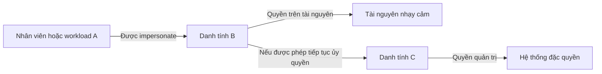
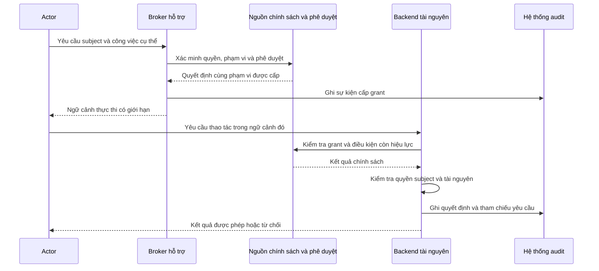

# Impersonation permission

## 1. Impersonation permission là quyền gì?

**Impersonation permission** là quyền cho phép một danh tính đã được xác thực thực hiện yêu cầu trong ngữ cảnh của một danh tính khác, theo cơ chế mà hệ thống hỗ trợ. Trong ứng dụng, chức năng này thường xuất hiện dưới các tên như “đăng nhập thay người dùng”, “hỗ trợ dưới ngữ cảnh khách hàng” hoặc “thực thi bằng service account”.

Trong phạm vi quản lý truy cập đặc quyền, đây là một khả năng nhạy cảm: người được cấp quyền có thể tiếp cận dữ liệu hoặc thao tác mà tài khoản cá nhân của họ không có quyền làm trực tiếp. Vì vậy, quyền impersonation cần được kiểm kê và quản lý như một đường dẫn tới quyền của danh tính đích.

Ví dụ, nhân viên hỗ trợ cần tái hiện lỗi hiển thị hóa đơn của một khách hàng. Ứng dụng có thể cho nhân viên mở một phiên hỗ trợ gắn với người dùng đó. Nếu thiết kế chỉ thay toàn bộ danh tính hiện tại bằng người dùng khách hàng, nhân viên có thể vô tình nhận cả quyền đổi thông tin thanh toán, xuất dữ liệu hoặc quản lý thành viên.

Một thiết kế phù hợp phải trả lời riêng các câu hỏi:

- Ai thực sự khởi tạo phiên hoặc yêu cầu?
- Đang sử dụng ngữ cảnh của danh tính nào?
- Được phép xem tài nguyên và thực hiện hành động nào?
- Quyền này có hiệu lực trong khoảng thời gian và điều kiện nào?
- Bằng chứng nào cho biết người khởi tạo đã làm gì?
- Khi cần kết thúc, những credential, phiên và tác vụ nào vẫn có thể tiếp tục?

Mục tiêu không phải che giấu người thao tác sau danh tính đích. Mục tiêu là cho phép một công việc cụ thể với phạm vi rõ ràng và vẫn truy được trách nhiệm.

### Mục tiêu học tập

Sau bài này, người học có thể:

1. Phân biệt actor, subject, quyền impersonation và quyền trên tài nguyên.
2. Nhận diện đường leo thang đặc quyền qua danh tính đích và chuỗi ủy quyền.
3. Thiết kế quyền hỗ trợ hoặc quyền thực thi thay mặt theo least privilege, JIT và JEA.
4. Giữ được chuỗi bằng chứng từ phê duyệt tới hành động ở hệ thống đích.
5. Đánh giá giới hạn của hết hạn phiên, thu hồi quyền và token đã được cấp.

## 2. Các danh tính và phạm vi cần phân biệt

### 2.1. Actor và subject

Trong bài này, sử dụng các thuật ngữ:

| Thuật ngữ | Ý nghĩa | Ví dụ |
|---|---|---|
| Actor | Danh tính thực sự khởi tạo yêu cầu | Nhân viên hỗ trợ Lan |
| Subject | Danh tính có ngữ cảnh hoặc quyền được sử dụng khi impersonate | Người dùng khách hàng Minh |
| Broker | Thành phần kiểm tra và cấp khả năng impersonation | Dịch vụ cấp phiên hỗ trợ |
| Resource server | Thành phần bảo vệ tài nguyên và quyết định thao tác | Backend hóa đơn |
| Grant | Bản cấp quyền có phạm vi và thời hạn | Được xem hóa đơn cụ thể trong phiên hỗ trợ |
| Approver | Chủ thể có thẩm quyền phê duyệt | Trưởng ca hoặc chủ sở hữu dữ liệu |

Tên gọi và mô hình thực tế phụ thuộc nền tảng. Một sản phẩm có thể không dùng chữ actor hoặc grant, nhưng hệ thống quản trị vẫn cần phân biệt được các vai trò này.

Actor cũng có thể là workload. Ví dụ, pipeline triển khai được phép nhận credential ngắn hạn cho một service account triển khai. Khi đó cần giữ được cả danh tính workload khởi tạo và danh tính service account đích, thay vì chỉ ghi một tên tài khoản dùng chung.

### 2.2. Quyền thực thi không đồng nghĩa quyền impersonation

Một người có quyền quản trị màn hình hỗ trợ chưa chắc đã được phép mở phiên thay mặt khách hàng. Một người được impersonate tài khoản A cũng chưa chắc được impersonate tài khoản B.

Ngược lại, actor có thể được phép impersonate một subject có quyền trên tài nguyên mà actor không có trực tiếp. Đây có thể là mục đích hợp lệ của cơ chế. Vì vậy, không thể mặc định rằng mọi thao tác phải đồng thời nằm trong tập quyền trực tiếp thông thường của actor.

Điều cần kiểm soát là:

1. Actor có quyền tạo đúng loại ngữ cảnh impersonation cho đúng subject hay không.
2. Subject có quyền thực hiện thao tác trên tài nguyên hay không.
3. Grant và chính sách của phiên có cho phép thao tác đó trong ngữ cảnh hiện tại hay không.

### 2.3. Các thuật ngữ dễ bị nhầm

| Cơ chế | Điểm phân biệt | Điều cần kiểm chứng |
|---|---|---|
| Truy cập trực tiếp | Danh tính được xác thực tự thực hiện thao tác | Quyền của chính danh tính đó |
| Impersonation | Yêu cầu được xử lý dưới ngữ cảnh danh tính khác | Quyền chuyển ngữ cảnh, quyền đích và actor gốc |
| Delegation | Một bên được giao thực hiện công việc thay bên khác | Phạm vi và chuỗi ủy quyền thực tế |
| Chia sẻ password hoặc key | Nhiều bên dùng cùng bí mật để xác thực | Khả năng phân biệt từng người thường bị suy giảm |
| Phiên hỗ trợ chuyên biệt | Ứng dụng cung cấp khả năng hỗ trợ có giới hạn | Backend có thực thi giới hạn độc lập hay không |

Impersonation và delegation không phải hai thuật ngữ luôn loại trừ nhau. Một số nền tảng dùng impersonation để hiện thực một dạng delegation. Khi thiết kế, cần đọc đúng ngữ nghĩa của cơ chế đang dùng, thay vì suy luận từ tên gọi.

Việc lưu actor trong một trường log cũng không tự biến một cơ chế chia sẻ password thành impersonation có kiểm soát. Trường đó phải được tạo từ nguồn xác thực đáng tin cậy và gắn với hành động thực sự.

## 3. Hai cửa kiểm tra quyền

### 3.1. Cửa thứ nhất: được phép mở ngữ cảnh impersonation

Trước khi tạo phiên hoặc credential, hệ thống cần đánh giá các điều kiện phù hợp với loại công việc:

- Actor đã được xác thực và còn hoạt động.
- Actor thuộc đúng nhóm được phép yêu cầu loại quyền này.
- Subject nằm trong phạm vi được phê duyệt.
- Tenant, môi trường và ứng dụng đích khớp với yêu cầu.
- Lý do và yêu cầu hỗ trợ hoặc thay đổi có thể kiểm chứng.
- Phê duyệt hợp lệ nếu loại công việc yêu cầu.
- Xác thực tăng cường còn đủ mới nếu chính sách yêu cầu.
- Không vi phạm quy tắc tách nhiệm vụ hoặc danh sách subject bị cấm.

Với workload, điều kiện xác thực cần dựa trên danh tính workload và bằng chứng phù hợp của nền tảng. Không áp dụng máy móc quy trình MFA của con người cho một tác vụ tự động.

### 3.2. Cửa thứ hai: được phép thực hiện từng thao tác

Một phiên đã được mở không có nghĩa mọi yêu cầu tiếp theo đều được phép.

Với một thiết kế ứng dụng có giới hạn phiên được thực thi tại backend, có thể diễn đạt điều kiện cho phép như sau:

```text
ALLOW_OPERATION =
    VALID_EXECUTION_CONTEXT
    AND SUBJECT_CAN_ACCESS_RESOURCE
    AND OPERATION_IS_WITHIN_GRANT
    AND RESOURCE_IS_WITHIN_GRANT
    AND TENANT_AND_ENVIRONMENT_MATCH
    AND SESSION_CONDITIONS_HOLD
    AND NO_APPLICABLE_DENY
```

Đây là mô hình thiết kế minh họa, không phải khẳng định mọi sản phẩm impersonation đều tự kiểm tra đủ những điều kiện trên.

Ví dụ, subject có thể có quyền sửa hóa đơn, nhưng grant hỗ trợ chỉ cho xem một hóa đơn. Backend phải từ chối yêu cầu sửa trong phiên đó. Việc ẩn nút sửa ở giao diện chưa thực thi được giới hạn này.

### 3.3. Giới hạn phải tồn tại tại nơi ra quyết định

Một nhãn như `read_only: true` trong cơ sở dữ liệu không có tác dụng nếu resource server chỉ kiểm tra token của subject rồi bỏ qua grant.

Nếu cơ chế gốc cấp toàn bộ quyền của subject, có thể cần:

- Dùng danh tính đích chuyên biệt với quyền hẹp hơn.
- Cung cấp endpoint hỗ trợ chỉ thực hiện tập thao tác đã định nghĩa.
- Đặt một lớp thực thi chính sách có khả năng chặn mọi đường truy cập liên quan.
- Sử dụng cơ chế giới hạn credential nếu nền tảng thực sự hỗ trợ cho tài nguyên cần truy cập.

Nếu token đầy đủ được chuyển cho trình duyệt hoặc công cụ của actor và có thể gọi thẳng hệ thống đích, một kiểm tra tại gateway riêng không đủ bảo đảm giới hạn. Cần xét cả đường truy cập bỏ qua gateway.

## 4. Vì sao impersonation tạo đường tới đặc quyền?

### 4.1. Quyền của subject quyết định mức rủi ro

Một quyền có tên nghe nhỏ như “được tạo token cho tài khoản triển khai” có thể dẫn tới khả năng thay đổi production nếu tài khoản đó có quyền triển khai.

Không chỉ kiểm kê những role của actor. Cần lập cả quan hệ actor có thể sử dụng danh tính nào, và danh tính đó có thể làm gì.



Cạnh B sang C chỉ tồn tại khi nền tảng và chính sách cho phép. Không được mặc định mọi cơ chế impersonation đều hỗ trợ chuỗi, cũng không được bỏ qua chuỗi khi cơ chế có hỗ trợ.

### 4.2. Quyền có thể thay đổi sau khi cấp grant

Giả sử hôm nay subject chỉ có quyền xem báo cáo. Ngày mai subject được thêm quyền quản trị dữ liệu. Một quan hệ impersonation tồn tại lâu dài có thể trở nên nguy hiểm hơn dù quyền của actor không được sửa.

Vì vậy, rà soát cần xem xét cả:

- Thay đổi quyền trực tiếp và quyền kế thừa của subject.
- Thay đổi nhóm hoặc role mà subject tham gia.
- Thay đổi chính sách ủy quyền tiếp.
- Khả năng tạo credential mới hoặc thay chính sách truy cập.
- Những hệ thống mới mà subject có thể truy cập.

JIT làm ngắn thời gian actor được mở phiên, nhưng không tự giới hạn quyền của subject trong khoảng đó. JEA yêu cầu xác định rõ những công việc nào được thực thi.

### 4.3. Đường gián tiếp cũng cần được tính

Actor có thể không có quyền impersonate trực tiếp nhưng lại có quyền sửa cấu hình broker, triển khai mã chạy bằng danh tính đích hoặc cấp cho mình quyền tạo credential.

Những khả năng đó cần được kiểm kê như đường tiếp cận danh tính đặc quyền. Chỉ rà soát một permission mang tên impersonate sẽ bỏ sót các đường khác.

Ví dụ, người quản lý pipeline có thể thay mã mà pipeline chạy bằng service account đặc quyền. Quyền sửa pipeline khi đó là một phần của bề mặt quản trị cần kiểm soát, dù không xuất hiện trên màn hình cấp quyền impersonation.

## 5. Chọn đúng trường hợp sử dụng

### 5.1. Hỗ trợ người dùng

Công việc hợp lệ có thể là tái hiện lỗi giao diện, kiểm tra trạng thái một đơn hàng hoặc xác minh một thông báo sai.

Cần xác định việc hỗ trợ có thật sự cần ngữ cảnh người dùng hay chỉ cần một màn hình hỗ trợ riêng. Nếu chỉ cần kiểm tra một hóa đơn, endpoint hỗ trợ đọc đúng hóa đơn đó có thể dễ giới hạn hơn việc nhận toàn bộ quyền của người dùng.

Khi dùng phiên impersonation, giao diện cần hiển thị rõ actor đang ở chế độ hỗ trợ và subject nào đang được chọn. Việc kết thúc phiên phải đưa ứng dụng trở về ngữ cảnh cá nhân đã được xác thực, không trộn lẫn hai ngữ cảnh.

### 5.2. Kiểm tra chính sách truy cập

Một quản trị viên có thể cần kiểm tra vì sao người dùng bị từ chối một chức năng. Nếu mục tiêu chỉ là đánh giá quyền, công cụ mô phỏng hoặc đánh giá chính sách có thể phù hợp hơn việc thực sự thực hiện thao tác dưới danh tính người đó.

Nếu phải gọi API thật, cần phân biệt thao tác đọc trạng thái với thao tác có tác động nghiệp vụ. Một endpoint dùng HTTP GET vẫn có thể tạo tác vụ hoặc lộ dữ liệu nhạy cảm nếu ứng dụng thiết kế như vậy.

### 5.3. Workload thực thi bằng service account

Pipeline hoặc dịch vụ có thể nhận credential ngắn hạn cho một service account thay vì lưu key dài hạn.

Thiết kế cần giới hạn workload nào được yêu cầu, service account nào được chọn và môi trường nào được phép. Quyền của danh tính đích vẫn phải phù hợp công việc, thay vì dùng một service account quản trị chung cho mọi pipeline.

### 5.4. Tình huống khẩn cấp

Một sự cố có thể cần quyền cao hơn phiên hỗ trợ thông thường. Khi đó nên có luồng break-glass được định nghĩa riêng với thẩm quyền, thời hạn, cảnh báo và hậu kiểm phù hợp.

Không biến quyền hỗ trợ thường ngày thành quyền khẩn cấp mặc định. Mỗi luồng cần thể hiện đúng mục đích và phạm vi mà người phê duyệt đã chấp thuận.

## 6. Thiết kế một grant có phạm vi rõ ràng

Một grant tốt gắn actor, subject và công việc thành một hợp đồng có thể thực thi.

Ví dụ dưới đây là dữ liệu minh họa cho ứng dụng giả định. Đây không phải cấu hình áp dụng trực tiếp cho sản phẩm PAM hoặc IAM nào.

```yaml
grant_reference: GRANT-DEMO-042

actor:
  principal_reference: support-agent-lan
  organization_reference: operations

subject:
  principal_reference: customer-user-minh
  tenant_reference: tenant-demo-a

target:
  application_reference: billing-portal
  environment: production

scope:
  allowed_operations:
    - invoice.view
  resource_references:
    - invoice-demo-105
  excluded_capabilities:
    - payment.change
    - credential.manage
    - identity.delegate

justification:
  request_reference: SUPPORT-DEMO-208
  purpose: investigate-invoice-display-issue

approval:
  decision_reference: APPROVAL-DEMO-089
  approved_by_reference: support-supervisor

validity:
  not_before: "2030-01-15T08:00:00Z"
  expires_at: "2030-01-15T08:15:00Z"

controls:
  further_delegation_allowed: false
  live_grant_check_required: true
  audit_required: true
```

Các thời điểm và thời lượng chỉ để minh họa cấu trúc. Thời hạn thực tế cần dựa vào công việc, khả năng thực thi thu hồi và mức nhạy cảm.

### 6.1. Allowlist hành động là thành phần chính

Danh sách loại trừ giúp thể hiện ý định, nhưng không nên là cách duy nhất giới hạn quyền. Nếu một chức năng mới được thêm vào ứng dụng mà không nằm trong danh sách cấm, phiên hỗ trợ không nên tự nhận được chức năng đó.

Trong ví dụ, chỉ `invoice.view` trên đúng tài nguyên được phép. Các thao tác khác bị từ chối theo mặc định.

Phạm vi “xem” cũng cần làm rõ: xem trường dữ liệu nào, có được tải file đính kèm không, có được xuất hàng loạt không. Đọc dữ liệu vẫn có thể tạo tác động bảo mật lớn.

### 6.2. Approval phải ràng buộc đúng yêu cầu

Một phê duyệt xem hóa đơn trong tenant A không được tái sử dụng để thay thông tin thanh toán trong tenant B.

Khi actor đổi subject, tài nguyên, loại hành động hoặc thời hạn vượt phạm vi đã duyệt, hệ thống cần đánh giá lại và có thể yêu cầu phê duyệt mới.

Mã ticket chỉ là tham chiếu tới quy trình. Một chuỗi ký tự trông giống mã ticket không chứng minh ticket tồn tại, actor được phân công hoặc nội dung đã được phê duyệt.

### 6.3. Phân biệt các đồng hồ hết hạn

Grant, token, phiên trình duyệt và tác vụ nền có thể có vòng đời khác nhau.

Ví dụ, grant hết hạn lúc 08:15 nhưng một credential vẫn được hệ thống đích chấp nhận đến 09:00. Nếu đích không kiểm tra grant và token không bị vô hiệu hóa theo cơ chế hỗ trợ, quyền sử dụng có thể kéo dài hơn cửa sổ đã phê duyệt.

Thiết kế phải chọn và kiểm chứng cơ chế thực thi thời hạn, thay vì chỉ hiển thị đồng hồ đếm ngược trên giao diện.

## 7. Luồng xử lý đề xuất cho ứng dụng



Đây là mô hình tham khảo. Các hệ thống có thể dùng policy engine nhúng, cache hoặc thành phần cấp token khác nhau. Nếu dùng cache, thời gian cache và cơ chế vô hiệu hóa phải tương thích với yêu cầu kết thúc quyền.

### 7.1. Tạo phiên bằng danh tính đã xác thực

Actor phải lấy từ ngữ cảnh xác thực đáng tin cậy ở server. Không lấy actor từ một tham số như `requestedBy` do client tự gửi.

Subject do client yêu cầu chỉ là đầu vào cần kiểm tra. Server cần xác định subject tồn tại, tenant phù hợp và actor có quyền yêu cầu đúng subject đó.

Với các thao tác mở phiên hỗ trợ trên web, cần áp dụng bảo vệ phù hợp cho endpoint thay đổi trạng thái, bao gồm bảo vệ chống giả mạo yêu cầu theo cơ chế xác thực đang dùng.

### 7.2. Không chuyển nguyên quyền quản trị của broker

Broker có thể có khả năng kỹ thuật rộng để phục vụ nhiều yêu cầu, nhưng từng phiên chỉ được nhận đúng phạm vi đã duyệt.

Nếu broker dùng quyền của mình để thực hiện một yêu cầu mà không kiểm tra actor được phép tác động tới subject và tài nguyên nào, broker có thể trở thành một confused deputy: thành phần có quyền bị dẫn dắt làm việc vượt thẩm quyền của người yêu cầu.

Mỗi yêu cầu phải ràng buộc actor, subject, tenant, công việc và tài nguyên. Việc actor có quyền gọi broker không đủ để cho phép mọi thao tác broker có thể làm.

### 7.3. Mỗi yêu cầu cần một ngữ cảnh đáng tin cậy

Ngữ cảnh thực thi có thể được giữ ở server hoặc truyền bằng cơ chế được bảo vệ về tính toàn vẹn. Cách triển khai phải xác thực nguồn cấp, đối tượng nhận và những ràng buộc cần thiết.

Một token có chữ ký chỉ chứng minh nội dung đã được bên phát hành ký và chưa bị sửa theo cơ chế xác minh. Nó không tự chứng minh grant chưa bị thu hồi hoặc người đang cầm token chính là actor ban đầu.

Nếu thiết kế cần ràng buộc token với client hoặc phiên cụ thể, phải có cơ chế chứng minh và kiểm tra tương ứng. Một trường `actor_id` trong bearer token không tự ngăn người khác sử dụng token bị lấy cắp.

## 8. Pseudocode kiểm tra ở backend

Đoạn sau mô tả thiết kế ứng dụng, không phải API của thư viện cụ thể. Các hàm mang tên kiểm tra chỉ đại diện cho những kiểm soát cần được hiện thực và kiểm chứng.

```text
function executeSupportOperation(request, authenticatedContext):
    execution = verifyExecutionContext(authenticatedContext)

    grant = loadGrantFromTrustedStore(execution.grantReference)

    require grant.status == ACTIVE
    require trustedNow() >= grant.notBefore
    require trustedNow() < grant.expiresAt

    require execution.actorReference == grant.actorReference
    require execution.subjectReference == grant.subjectReference
    require execution.tenantReference == grant.tenantReference
    require execution.audience == grant.applicationReference

    resource = loadResourceUsingTenantBoundary(
        grant.tenantReference,
        request.resourceReference
    )

    require resource.tenantReference == grant.tenantReference
    require grant.allows(request.operation, resource.reference)

    subject = loadCurrentSubject(grant.subjectReference)
    require subject.isEnabled
    require subjectPolicy.allows(subject, request.operation, resource)

    require sessionPolicy.allows(execution, grant, request)
    require noApplicableDeny(execution, grant, request, resource)

    recordDecisionDurably(
        actor = grant.actorReference,
        subject = grant.subjectReference,
        grant = grant.reference,
        operation = request.operation,
        resource = resource.reference,
        decision = ALLOW
    )

    result = executeBusinessOperation(request.operation, resource)

    recordOutcome(
        grant = grant.reference,
        request = request.correlationReference,
        outcome = result.outcome
    )

    return filterResponseForSupportScope(result, grant)
```

### 8.1. Những điều pseudocode muốn làm rõ

Thứ nhất, resource được tìm trong ranh giới tenant đã xác định. Chỉ kiểm tra một ID tài nguyên toàn cục mà không kiểm tra tenant có thể tạo lỗ hổng truy cập chéo khách hàng.

Thứ hai, quyền hiện tại của subject và phạm vi grant được đánh giá riêng. Grant cho phép xem không làm subject có quyền xem một tài nguyên mà subject vốn không được phép truy cập.

Thứ ba, kết quả trả về vẫn phải chịu kiểm soát dữ liệu. Cho phép gọi endpoint không nhất thiết cho phép trả mọi trường, liên kết tải xuống hoặc dữ liệu nhúng.

Thứ tư, nhánh từ chối cũng cần có audit phù hợp, mặc dù được lược khỏi pseudocode để dễ đọc.

### 8.2. Audit và thao tác nghiệp vụ không tự nguyên tử

Việc ghi quyết định trước thao tác chưa chứng minh thao tác thành công. Việc ghi kết quả sau thao tác có thể gặp lỗi sau khi nghiệp vụ đã hoàn tất.

Thiết kế cần phân biệt trạng thái “đã cho phép”, “đã bắt đầu”, “đã hoàn tất”, “thất bại” và “chưa xác định kết quả”. Có thể cần cơ chế ghi nhận bền vững, outbox hoặc đối soát tùy kiến trúc.

Với loại quyền yêu cầu audit bắt buộc, chính sách phải xác định cách xử lý khi đường ghi audit không đáp ứng yêu cầu. Không mặc định cho phép tiếp tục rồi ghi thành công dù chưa lưu được bằng chứng.

### 8.3. Quyết định không được tái sử dụng vô hạn

Một kiểm tra thành công ở đầu phiên không thay thế mọi kiểm tra sau đó. Subject có thể bị vô hiệu hóa, tài nguyên có thể đổi trạng thái hoặc grant có thể được thu hồi.

Với thao tác có tác động lớn, cần cân nhắc thời điểm đánh giá gần lúc thực thi và cơ chế giao dịch phù hợp để giảm khoảng trống giữa kiểm tra và sử dụng. Không thể giải quyết mọi thay đổi đồng thời chỉ bằng một lần kiểm tra khi đăng nhập.

## 9. Giữ ranh giới danh tính qua các tầng ứng dụng

### 9.1. Không tin header từ client chỉ vì tên header hợp lý

Một client có thể tự gửi các header như `X-Actor`, `X-User` hoặc `X-Tenant`. Các giá trị đó không trở thành danh tính đáng tin chỉ vì gateway hoặc backend có đọc chúng.

Nếu kiến trúc dùng trusted proxy để chuyển danh tính:

- Proxy phải xác thực client theo cơ chế đã định nghĩa.
- Header nhạy cảm từ nguồn không tin cậy phải bị loại bỏ hoặc được xử lý theo chính sách rõ ràng.
- Backend phải xác thực đúng proxy được phép cung cấp ngữ cảnh đó.
- Các đường gọi trực tiếp vào backend phải được xét tới.
- Ngữ cảnh actor và subject phải có nguồn gốc và tính toàn vẹn có thể kiểm chứng.

Các yêu cầu trên là nguyên tắc thiết kế. Cấu hình cụ thể phụ thuộc nền tảng và cách triển khai.

### 9.2. Không làm rò ngữ cảnh giữa các yêu cầu

Ứng dụng phục vụ nhiều người dùng có thể tái sử dụng thread, connection hoặc đối tượng trong pool. Nếu ngữ cảnh impersonation được giữ ở biến toàn cục hoặc không được dọn đúng, một yêu cầu sau có thể chạy nhầm dưới subject trước.

Cần truyền ngữ cảnh theo phạm vi yêu cầu hoặc cơ chế context của framework, và quản lý vòng đời phù hợp cả với xử lý bất đồng bộ.

Đối với kết nối cơ sở dữ liệu có hỗ trợ thay ngữ cảnh phiên, cần kiểm chứng việc khôi phục trước khi trả kết nối vào pool. Không suy luận rằng xóa một biến trong ứng dụng đã tự khôi phục mọi trạng thái ở hệ thống đích.

### 9.3. Tác vụ bất đồng bộ cần hợp đồng riêng

Một yêu cầu trong phiên hỗ trợ có thể tạo job tiếp tục chạy sau khi người dùng đóng trình duyệt.

Cần quyết định trước:

- Grant có cho phép tạo job đó không.
- Job thực thi dưới danh tính nào.
- Job có phải kiểm tra lại grant khi bắt đầu hoặc trong quá trình chạy không.
- Hết hạn phiên có hủy job, chặn hành động mới hay không tác động tới job đã được chấp thuận.
- Bằng chứng có giữ actor và subject gốc khi đi qua hàng đợi không.

Không chuyển ngầm một grant xem dữ liệu ngắn hạn thành quyền chạy tác vụ xuất dữ liệu dài hạn.

## 10. Audit: truy được cả actor và subject

Một sự kiện chỉ ghi “Minh đã xem hóa đơn” là thiếu nếu người thực sự thao tác là Lan trong phiên hỗ trợ.

Tối thiểu nên xác định các trường phù hợp với hệ thống:

| Nhóm | Thông tin cần giữ |
|---|---|
| Danh tính | Actor, subject, loại danh tính, miền hoặc tenant |
| Quyền | Grant, quyết định phê duyệt, phiên bản chính sách nếu có |
| Hành động | Loại thao tác, tài nguyên, môi trường |
| Thời gian | Thời điểm sự kiện, thời điểm tiếp nhận |
| Kết quả | Cho phép hoặc từ chối, kết quả nghiệp vụ, lý do |
| Liên kết | Session, request, job và nguồn log liên quan |
| Chất lượng | Trường bị thiếu và độ tin cậy của việc quy nguồn |

Ví dụ sự kiện giả định:

```yaml
event_type: support-operation
event_reference: EVENT-DEMO-608
event_time: "2030-01-15T08:06:20Z"

actor_reference: support-agent-lan
subject_reference: customer-user-minh
tenant_reference: tenant-demo-a
grant_reference: GRANT-DEMO-042

application_reference: billing-portal
environment: production
operation: invoice.view
resource_reference: invoice-demo-105

authorization_decision: ALLOW
business_outcome: SUCCESS
request_reference: REQUEST-DEMO-773
approval_reference: APPROVAL-DEMO-089
```

Không đưa access token, password, session cookie hoặc toàn bộ nội dung hóa đơn vào sự kiện này.

### 10.1. Liên kết phê duyệt, cấp quyền và sử dụng

Cần có thể đi từ sự kiện sử dụng về grant và phê duyệt, đồng thời từ grant tìm được những thao tác đã thực hiện.

Một bản ghi “token đã được cấp” không chứng minh token đã được sử dụng. Một bản ghi thao tác tại đích cũng không luôn tự chứa đầy đủ actor gốc. Cần hiểu trường nào do từng nguồn cung cấp và cách nối chúng.

Nếu một nền tảng không ghi được actor ở đích, không tự điền actor từ suy đoán rồi coi đó là sự thật. Có thể giữ tham chiếu liên kết, giới hạn độ tin cậy và bổ sung bằng chứng từ broker.

### 10.2. Bảo vệ hệ thống audit

Người sử dụng quyền impersonation không nên đồng thời tự xóa bằng chứng hoạt động của mình.

Cần quản lý quyền đọc, quyền thay cấu hình, thời gian lưu giữ và khả năng bảo vệ tính toàn vẹn theo yêu cầu tổ chức. Nhật ký có thể chứa dữ liệu nhạy cảm nên quyền đọc cũng cần được giới hạn.

Session recording có thể bổ sung ngữ cảnh cho một số phiên tương tác, nhưng không thay thế audit ở API hoặc tài nguyên đích. Một hành động nền hoặc lời gọi API trực tiếp có thể không xuất hiện trong bản ghi màn hình.

## 11. Hết hạn và thu hồi: phải kiểm tra hiệu lực thực tế

### 11.1. Thu hồi quyền cấp mới khác với chặn quyền đang dùng

Khi xóa quyền impersonation của actor, hệ thống có thể chỉ ngăn actor xin credential mới. Credential đã cấp hoặc phiên đã mở có thể còn hiệu lực tùy cơ chế.

Cần phân biệt:

1. Quyền yêu cầu grant mới.
2. Grant đã tồn tại.
3. Token hoặc credential đã cấp.
4. Phiên ở ứng dụng hoặc hệ thống đích.
5. Tác vụ nền đã được tạo.
6. Quyền hoặc credential khác đã được tạo trong thời gian có quyền.

Không khẳng định một thao tác logout, xóa role hoặc rotate bí mật sẽ tự xử lý cả sáu lớp.

### 11.2. Kết thúc phiên có kiểm soát

Một quy trình kết thúc có thể cần:

- Chặn tạo grant hoặc token mới.
- Đánh dấu grant không còn hoạt động.
- Làm resource server nhận biết thay đổi theo cơ chế hỗ trợ.
- Vô hiệu hóa phiên hoặc credential có thể thu hồi.
- Xử lý tác vụ nền theo hợp đồng đã định nghĩa.
- Xác minh các thử truy cập tiếp theo bị từ chối ở đúng nơi.
- Ghi sự kiện kết thúc và kết quả thực thi.

Nếu một loại bearer token chỉ hết hiệu lực theo thời gian và không có kiểm tra trạng thái bổ sung, thiết kế phải tính đến cửa sổ đó. Thời hạn ngắn giúp giảm cửa sổ sử dụng nhưng không có nghĩa token đã bị thu hồi ngay.

### 11.3. Rà soát thay đổi do phiên đã tạo

Kết thúc phiên không hoàn tác dữ liệu hoặc quyền đã bị thay đổi trước đó.

Nếu phiên có thể thêm credential, tạo thành viên hoặc sửa chính sách, cần điều tra các thay đổi đó khi xử lý sự cố. Một subject có quyền quá rộng có thể tạo đường truy cập tồn tại lâu hơn phiên impersonation ban đầu.

## 12. Tình huống xuyên suốt: hỗ trợ hóa đơn

Ứng dụng Billing Portal có hai tenant A và B. Người dùng Minh thuộc tenant A và có quyền xem hóa đơn, đổi phương thức thanh toán. Nhân viên Lan cần xử lý ticket về lỗi hiển thị hóa đơn 105 của Minh.

### 12.1. Thiết kế ban đầu

Nút “Login as user” tạo một phiên có toàn bộ quyền của Minh. Giao diện hỗ trợ ẩn nút đổi thanh toán, nhưng backend chỉ nhìn thấy danh tính Minh.

Hệ quả:

- Lan có thể gọi trực tiếp API đổi thanh toán nếu biết endpoint.
- Log nghiệp vụ chỉ ghi Minh, khó truy được Lan.
- Nếu client thay user ID, hệ thống có thể chọn nhầm subject.
- Đóng cửa sổ hỗ trợ không chắc chấm dứt credential đã cấp.

Vấn đề nằm ở cách thực thi quyền, không chỉ ở cách bố trí nút trên màn hình.

### 12.2. Thiết kế có giới hạn được thực thi

Hệ thống cấp grant ràng buộc Lan, Minh, tenant A, ticket cụ thể và thao tác xem hóa đơn 105.

Backend kiểm tra grant ở từng lời gọi hỗ trợ, kiểm tra quyền hiện tại của Minh và trả về dữ liệu theo phạm vi hỗ trợ. Thao tác đổi thanh toán hoặc xem tài nguyên thuộc tenant B bị từ chối.

Nhật ký giữ actor Lan và subject Minh, đồng thời gắn cùng grant và request để tra cứu.

Nếu nền tảng hiện có không thể thực thi giới hạn khi cấp token của Minh, nhóm phải chọn một đường hỗ trợ chuyên biệt hoặc danh tính đích có quyền thích hợp. Không cấp token đầy đủ rồi mô tả phiên đó là chỉ đọc.

### 12.3. Kết quả mong đợi

| Yêu cầu | Kết quả | Lý do |
|---|---|---|
| Lan xem hóa đơn 105 trong tenant A khi grant còn hạn | Cho phép nếu quyền subject cũng hợp lệ | Đúng subject, tài nguyên và hành động |
| Lan đổi thanh toán của Minh | Từ chối | Ngoài phạm vi grant |
| Lan xem hóa đơn 106 dù Minh có quyền xem | Từ chối trong grant hiện tại | Tài nguyên chưa được cấp |
| Lan thay subject bằng người dùng tenant B | Từ chối | Sai subject và tenant |
| Người khác dùng ngữ cảnh không thỏa cơ chế xác thực hoặc ràng buộc phiên | Từ chối | Không xác minh được ngữ cảnh thực thi |
| Lan tiếp tục gọi sau khi grant bị thu hồi | Từ chối theo cơ chế kiểm tra grant của thiết kế này | Grant không còn hoạt động |
| Subject Minh mất quyền xem hóa đơn | Từ chối | Grant không tự cấp lại quyền cho subject |

Ví dụ giả định backend kiểm tra trạng thái grant trực tiếp. Nếu triển khai dùng cache, cần đo và công bố độ trễ thu hồi thực tế thay vì hứa hiệu lực tức thời.

## 13. Giám sát quyền impersonation trong vận hành

### 13.1. Kiểm kê quan hệ thay vì chỉ đếm role

Danh mục quản trị nên trả lời được:

- Actor hoặc nhóm nào được yêu cầu impersonation.
- Có thể chọn những subject nào.
- Subject có quyền thực tế tới đâu.
- Quan hệ có giới hạn môi trường, tenant hoặc tài nguyên không.
- Có chuỗi ủy quyền hoặc đường thay đổi chính sách nào liên quan không.
- Chủ sở hữu nghiệp vụ và kỹ thuật là ai.
- Ngày hết hạn hoặc kỳ rà soát gần nhất.
- Cơ chế nào thực thi phạm vi và kết thúc quyền.

Một quan hệ wildcard tới nhiều subject thường cần được đánh giá kỹ hơn một quan hệ tới một danh tính có nhiệm vụ rõ ràng.

### 13.2. Tín hiệu cần điều tra

Có thể xây dựng phát hiện cho:

- Mở phiên đối với subject đặc quyền ngoài phạm vi công việc thông thường.
- Một actor chọn nhiều subject hoặc tenant trong thời gian ngắn.
- Sử dụng mà không tìm thấy grant hoặc phê duyệt liên quan.
- Thao tác bị từ chối lặp lại ngoài phạm vi grant.
- Tạo credential, đổi quyền hoặc bật khả năng ủy quyền tiếp trong phiên.
- Hoạt động sau thu hồi theo thời điểm sự kiện thực tế.
- Thay đổi cấu hình audit hoặc broker bởi bên đang sử dụng quyền.
- Chuỗi ủy quyền mới xuất hiện ngoài mô hình đã phê duyệt.

Đây là tín hiệu cần đối chiếu ngữ cảnh. Một đợt hỗ trợ sự cố lớn có thể giải thích số phiên tăng, nhưng không tự giải thích việc tạo credential quản trị mới.

### 13.3. Chỉ số hữu ích

Có thể theo dõi tỷ lệ quan hệ có owner, tỷ lệ phiên liên kết được actor và subject, tỷ lệ phiên có phê duyệt đúng phạm vi và độ trễ thu hồi đo tại đích.

Các chỉ số về mất log, thiếu actor hoặc phiên không có kết quả đóng cũng quan trọng. Ít cảnh báo không chứng minh quyền đã được kiểm soát nếu nguồn dữ liệu đang thiếu.

## 14. Kiểm chứng thiết kế trước khi đưa vào sử dụng

Các kiểm chứng sau dùng danh tính và dữ liệu thử nghiệm được phép. Mục tiêu là xác nhận backend thực thi đúng hợp đồng, không chỉ kiểm tra giao diện.

| Nhóm kiểm chứng | Thử nghiệm | Bằng chứng mong đợi |
|---|---|---|
| Quyền mở phiên | Actor không có quyền yêu cầu impersonation | Không tạo grant hoặc credential có thể sử dụng |
| Phạm vi subject | Thay subject ngoài danh sách được phép | Bị từ chối trước khi chuyển ngữ cảnh |
| Ranh giới tenant | Thay tenant hoặc tài nguyên sang tenant khác | Backend từ chối và log đúng actor |
| Phạm vi hành động | Gọi API ghi trực tiếp trong grant chỉ xem | Bị từ chối dù giao diện đã ẩn chức năng |
| Phạm vi dữ liệu | Yêu cầu trường, file hoặc tài nguyên ngoài grant | Không trả dữ liệu vượt phạm vi |
| Hết hạn | Gọi trước, tại và sau mốc hết hạn theo chính sách | Kết quả khớp ranh giới thời gian đã định nghĩa |
| Thu hồi | Thu hồi khi token hoặc phiên còn tồn tại | Đo được thời điểm truy cập thực sự bị chặn |
| Thay đổi quyền | Gỡ quyền của subject trong khi grant còn hạn | Quyền mới được phản ánh theo thiết kế |
| Audit | Thực hiện cả yêu cầu cho phép và từ chối | Liên kết được actor, subject, grant và kết quả |
| Tác vụ nền | Tạo job rồi đóng phiên hoặc thu hồi grant | Job tuân theo hợp đồng vòng đời đã công bố |
| Cách ly ngữ cảnh | Xen kẽ yêu cầu của nhiều actor và subject | Không rò ngữ cảnh qua thread hoặc connection pool |
| Gián đoạn kiểm soát | Mô phỏng lỗi nguồn grant hoặc audit | Hành vi lỗi phù hợp chính sách, không âm thầm bỏ kiểm tra |

Cần đặc biệt kiểm tra đường gọi bỏ qua giao diện và gateway dự kiến. Một đường hỗ trợ an toàn không bù được một endpoint trực tiếp vẫn chấp nhận credential có quyền rộng.

Không chỉ ghi “thu hồi PASS”. Nên giữ thời điểm thu hồi, thời điểm thử lại, kết quả tại đích và những loại token hoặc phiên đã được thử.

## 15. Đối chiếu với cơ chế trên nền tảng thực tế

Những ví dụ sau minh họa sự khác biệt về cách thực thi; chúng không phải cấu hình thay thế cho thiết kế của ứng dụng.

### 15.1. Kubernetes

Trong luồng impersonation của Kubernetes, API server xác thực người gọi, kiểm tra quyền impersonation rồi đánh giá yêu cầu với thông tin danh tính được impersonate. Điều này cho thấy quyền chuyển ngữ cảnh và quyết định quyền của yêu cầu là các bước khác nhau. Các chế độ và khả năng giới hạn cần được đối chiếu với phiên bản và cấu hình cụm đang dùng. [Tài liệu Kubernetes về User Impersonation](https://kubernetes.io/docs/reference/access-authn-authz/user-impersonation/).

### 15.2. Google Cloud service account impersonation

Google Cloud mô tả luồng principal đã xác thực nhận credential ngắn hạn cho service account rồi dùng credential đó truy cập tài nguyên. Vì thế cần rà soát cả quyền tạo credential cho service account và quyền của service account trên tài nguyên đích. Không coi việc thay key dài hạn bằng token ngắn hạn là đã giải quyết mọi vấn đề về phạm vi quyền. [Tài liệu Google Cloud về service account impersonation](https://docs.cloud.google.com/iam/docs/service-account-impersonation).

### 15.3. Khả năng truy vết phụ thuộc dịch vụ

Google Cloud cũng lưu ý rằng khả năng ghi cả danh tính cấp credential và service account trong audit log không đồng nhất trên mọi dịch vụ. Khi triển khai cần kiểm tra log thực tế của loại API đang dùng, thay vì mặc định mọi sự kiện đều có đủ actor gốc. [Tài liệu Google Cloud về audit log cho service account](https://docs.cloud.google.com/iam/docs/audit-logging/examples-service-accounts).

Bài học chung là phải kiểm chứng cơ chế ở nơi thực thi. Một permission có tên tương tự trên hai sản phẩm không bảo đảm cùng phạm vi, cùng cách hết hạn hoặc cùng bằng chứng audit.

## 16. Bài tập phân tích

Một công ty cấp cho nhóm hỗ trợ quyền impersonate mọi người dùng trong production. Phiên hỗ trợ hiển thị nhãn “chỉ xem”, hết hạn trên giao diện sau 10 phút, nhưng backend chỉ xác minh token của subject. Audit ghi subject và tên ticket; không ghi actor.

Trong một phiên, nhân viên mở chức năng xuất danh sách khách hàng. File được tạo bởi job nền và liên kết tải có hiệu lực sau khi giao diện đã kết thúc phiên.

Hãy trả lời:

1. Có thể kết luận phiên thực sự chỉ xem từ nhãn giao diện không?
2. Những phạm vi nào đang thiếu giới hạn?
3. Vì sao thông tin subject và ticket chưa đủ để quy trách nhiệm?
4. Hết hạn giao diện có giải quyết được job nền và liên kết tải không?
5. Cần thay đổi gì để công việc hỗ trợ được thực thi với quyền phù hợp?

### Hướng phân tích

Nhãn giao diện không chứng minh có kiểm soát ở backend. Xuất dữ liệu phải là một hành động nghiệp vụ được cấp riêng; dữ liệu và số lượng được xuất cũng cần nằm trong phạm vi được phê duyệt.

Quyền impersonate mọi người dùng mở rộng cả số subject và mức quyền có thể tiếp cận. Cần giới hạn quan hệ actor tới subject, tenant, môi trường, hành động và tài nguyên theo nhu cầu công việc.

Ticket có thể mô tả lý do nhưng không thay thế danh tính actor đã xác thực. Audit phải gắn actor gốc, subject, grant, hành động và kết quả, đồng thời bảo vệ được tính toàn vẹn của chuỗi liên kết.

Job nền và liên kết tải có vòng đời riêng. Thiết kế cần quyết định ai được tạo job, điều kiện job tiếp tục chạy, ai được tải kết quả và cách hết hạn hoặc thu hồi quyền tải. Đóng phiên giao diện không tự chứng minh các khả năng đó đã bị chặn.

Nếu cơ chế impersonation hiện tại không hỗ trợ giới hạn cần thiết, có thể xây đường hỗ trợ chuyên biệt hoặc dùng danh tính có tập quyền hẹp hơn. Chỉ đưa vào sử dụng sau khi đã kiểm chứng các đường trực tiếp, tác vụ nền, hết hạn, thu hồi và audit.

## 17. Những điểm cần nhớ

Impersonation permission là một đường tiếp cận quyền của danh tính khác và cần được quản lý như quyền đặc biệt.

Thiết kế hiệu quả giữ riêng actor và subject, kiểm tra quyền mở ngữ cảnh lẫn quyền trên từng thao tác, đồng thời thực thi phạm vi tại backend hoặc hệ thống đích có thẩm quyền.

JIT giới hạn thời gian được sử dụng quyền; JEA giới hạn công việc có thể thực hiện. Hai điều này phải gắn với cơ chế thực thi thật, không chỉ với nhãn giao diện hoặc dữ liệu cấu hình không được kiểm tra.

Khả năng truy vết cần nối được phê duyệt, grant, credential hoặc phiên và hành động thực tế. Khi kết thúc quyền, phải kiểm chứng cả token, phiên, tác vụ nền và những thay đổi đã được tạo trong thời gian sử dụng.
