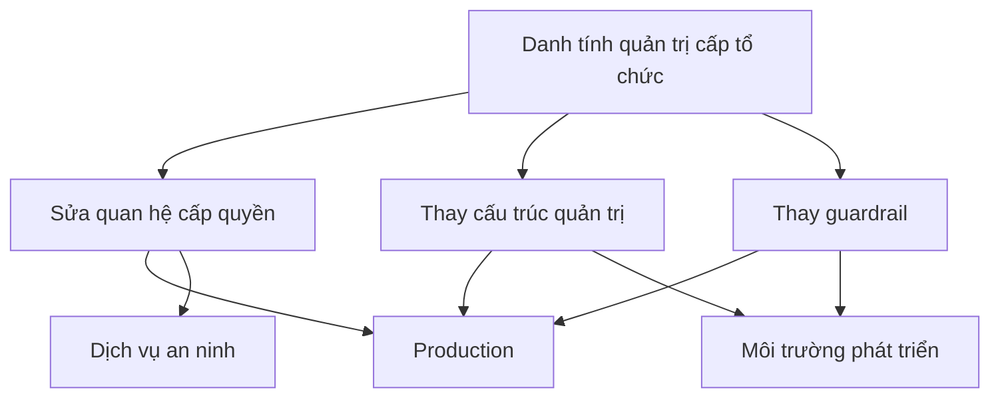
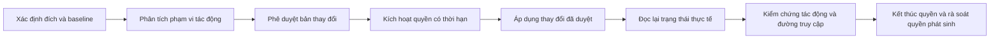

# Cloud organization administrator

## 1. Quản trị cấp tổ chức là một đặc quyền có phạm vi ảnh hưởng rộng

Cloud organization administrator là người hoặc danh tính tự động được giao quyền quản trị một phần hoặc toàn bộ cấu trúc tổ chức trên nền tảng đám mây. Công việc có thể bao gồm quản lý hệ thống phân cấp tài nguyên, thiết lập chính sách chung, phân quyền quản trị hoặc cấu hình tích hợp dịch vụ ở phạm vi lớn.

Đây là cách gọi theo chức năng. Không có một role “organization administrator” chung cho mọi nhà cung cấp với cùng tập quyền.

Điểm nhạy cảm của quyền này là **một thay đổi ở tầng quản trị có thể tác động tới nhiều môi trường phía dưới**, ngay cả khi người thực hiện không trực tiếp đăng nhập vào máy chủ hoặc đọc dữ liệu ứng dụng.

Ví dụ:

- Thay đổi nhóm được cấp quyền ở cấp cao có thể mở rộng quyền truy cập xuống nhiều đơn vị.
- Di chuyển một đơn vị tài nguyên có thể làm thay đổi những chính sách được kế thừa.
- Thay cấu hình liên kết danh tính có thể cho một nguồn mới yêu cầu quyền quản trị.
- Cấp quyền cho một danh tính tự động có thể tạo đường truy cập lâu dài sau khi phiên quản trị đã kết thúc.
- Thay cấu hình thu thập nhật ký có thể làm giảm khả năng quan sát của đội an ninh.

Trong PAM, cần kiểm soát không chỉ credential dùng để đăng nhập mà cả **khả năng thay đổi cách toàn bộ hệ thống cấp và thực thi quyền**.

### Mục tiêu học tập

Sau bài này, người học có thể:

1. Xác định phạm vi thực tế của chức năng quản trị cấp tổ chức.
2. Phân biệt quản trị danh tính, tài nguyên, chính sách và dữ liệu.
3. Thiết kế phân quyền theo least privilege, JIT, JEA và tách nhiệm vụ.
4. Thực hiện thay đổi cấp tổ chức với phạm vi, bằng chứng và đường phục hồi rõ ràng.
5. Kiểm chứng việc kết thúc quyền, phát hiện quyền phát sinh và xử lý sự cố phù hợp.

## 2. Xác định chính xác đang quản trị đối tượng nào

### 2.1. Phải có định danh phạm vi

Một tên hiển thị như “Production Organization” không đủ để xác định đích thao tác. Hai môi trường có thể dùng cùng tên, hoặc một tài khoản có thể truy cập nhiều tenant và organization.

Mỗi yêu cầu quyền cần gắn với định danh ổn định của đối tượng thực tế:

| Đối tượng | Câu hỏi phải trả lời |
|---|---|
| Organization hoặc tenant | Đang thao tác trong miền quản trị nào? |
| Account, subscription hoặc project | Đơn vị tài nguyên nào nằm trong phạm vi? |
| OU, management group hoặc folder | Đối tượng đang thuộc nhánh quản trị nào? |
| Principal | Người hoặc workload nào có quyền? |
| Role hoặc permission set | Những hành động nào được cấp? |
| Policy | Chính sách nào sẽ được sửa, ở điểm gắn nào? |
| Identity provider | Nguồn nào có thể xác thực hoặc cấp danh tính? |
| Dịch vụ tích hợp | Tích hợp có thể làm gì và ở những đơn vị nào? |

Các tên đối tượng trong bảng không phải ánh xạ tương đương tuyệt đối giữa các nền tảng. Khi làm việc cần dùng đúng mô hình tài nguyên của nhà cung cấp đang sử dụng.

### 2.2. Phân biệt người được giao trách nhiệm và quyền kỹ thuật

Một người giữ chức danh “cloud organization administrator” trong công ty có thể chỉ được giao:

- Xem cấu trúc và lập báo cáo.
- Quản lý một nhánh môi trường thử nghiệm.
- Đề xuất chính sách nhưng không có quyền áp dụng.
- Quản lý IAM nhưng không được sửa chính sách bảo mật chung.
- Thực hiện thay đổi ở cấp tổ chức theo từng lần kích hoạt.

Không nên biến chức danh thành một role kỹ thuật có toàn bộ quyền thường trực. Cần đi từ nhiệm vụ cụ thể đến permission, scope và điều kiện thực thi.

### 2.3. Các kiểu “root” không giống nhau

Từ root có thể chỉ tài khoản đặc biệt, điểm gốc của cây tổ chức hoặc phạm vi gán quyền ở tầng cao nhất.

Một nút gốc trong cây tài nguyên không phải là một người dùng. Quyền quản trị một tổ chức cũng không tự đồng nghĩa với việc nắm credential của tài khoản root.

Sự nhầm lẫn này dễ dẫn tới các kết luận sai như:

- Ai quản trị cấu trúc cũng là người có mọi quyền dữ liệu.
- Có chính sách ở root thì mọi tài khoản đều chắc chắn bị giới hạn như nhau.
- Chỉ tài khoản root mới là đặc quyền đáng kiểm soát.
- Một cơ chế khẩn cấp có thể vượt mọi chính sách từ chối.

Cần xác định đúng đối tượng và cơ chế đánh giá quyền, thay vì suy luận từ tên.

## 3. Ba mô hình nền tảng cần phân biệt

### 3.1. AWS Organizations

AWS phân biệt management account với member account. Management account nên chỉ phục vụ những nhiệm vụ cần phạm vi đó; AWS khuyến nghị hạn chế người truy cập, tránh đặt workload thông thường tại đây và ủy quyền công việc ra ngoài khi dịch vụ hỗ trợ. [AWS — Best practices for the management account](https://docs.aws.amazon.com/organizations/latest/userguide/orgs_best-practices_mgmt-acct.html).

Service control policy, hay SCP, là giới hạn quyền chứ không tự cấp quyền. SCP không giới hạn user và role trong management account. Vì vậy, gắn SCP ở organization root không có nghĩa đã bảo vệ management account bằng cùng cơ chế. Cần đọc cả phạm vi áp dụng và các ngoại lệ của SCP. [AWS — Service control policies](https://docs.aws.amazon.com/organizations/latest/userguide/orgs_manage_policies_scps.html).

Trong kiểm kê PAM, cần phân biệt quyền thao tác Organizations, quyền IAM trong từng account và những đường truy cập liên tài khoản. Không gom chúng thành một nhãn “admin AWS”.

### 3.2. Microsoft Entra ID và Azure

Quản trị Microsoft Entra ID và quản trị tài nguyên Azure là hai hệ thống phân quyền riêng. Global Administrator có cơ chế nâng quyền để nhận User Access Administrator tại root scope `/`, từ đó có thể quản lý việc cấp quyền trên các subscription và management group của tenant. [Microsoft Learn — Elevate access](https://learn.microsoft.com/en-us/azure/role-based-access-control/elevate-access-global-admin).

Microsoft lưu ý rằng ngừng kích hoạt Global Administrator qua PIM không tự đặt lại trạng thái nâng quyền này. Vì vậy, quy trình kết thúc cần xử lý riêng quyền đã nâng tại root scope. [Microsoft Learn — Remove elevated access](https://learn.microsoft.com/en-us/azure/role-based-access-control/elevate-access-global-admin).

Bài học quản trị là phải kiểm kê các miền quyền và những cầu nối giữa chúng, không giả định hết hạn một role sẽ xóa mọi quyền được tạo từ role đó.

### 3.3. Google Cloud

Google Cloud có organization resource, folder và project. Organization Administrator là role IAM cụ thể; Organization Policy Administrator là một role khác để quản lý các ràng buộc cấu hình qua Organization Policy. Không suy ra mọi người quản trị tổ chức đều có cùng hai tập quyền này. [Google Cloud — Access control for organization resources](https://docs.cloud.google.com/resource-manager/docs/access-control-org).

Google cũng phân biệt tài khoản super administrator của Google Workspace hoặc Cloud Identity với việc giao role Organization Administrator cho user hoặc group quản trị cloud. [Google Cloud — Set up an organization resource](https://docs.cloud.google.com/resource-manager/docs/creating-managing-organization).

Khi rà soát, cần đọc những role thực tế đã được gán, phạm vi gán và đường quản trị danh tính liên quan. Tên nhóm nội bộ không thay thế được việc xác minh các quyền đó.

### 3.4. Điều chung và điều không thể đồng nhất

Điều chung là quyền ở tầng cao có thể thay đổi cách nhiều tài nguyên được quản trị. Điều khác nhau nằm ở mô hình phân cấp, hệ thống danh tính, loại chính sách, ngoại lệ và cơ chế cấp quyền.

Không viết một công thức đánh giá IAM duy nhất rồi áp cho cả ba nền tảng. Cần kiểm chứng riêng các tình huống allow, deny, inheritance, điều kiện và danh tính dịch vụ trên hệ thống thực tế.

## 4. Tách các miền đặc quyền

### 4.1. Quản trị cấu trúc

Nhóm quyền này liên quan đến tạo đơn vị quản trị, thay quan hệ cha–con, di chuyển hoặc quản lý vòng đời tài nguyên.

Một thay đổi cấu trúc không chỉ có tác động tổ chức. Nó có thể làm thay đổi chính sách kế thừa, khả năng quan sát hoặc phạm vi của các công cụ quản trị.

### 4.2. Quản trị IAM

Nhóm quyền này liên quan đến gán role, sửa policy cấp quyền, quản lý group hoặc thay cách một principal có thể yêu cầu quyền.

Người có quyền cấp quyền rộng có thể không đang có quyền đọc dữ liệu, nhưng có khả năng tạo một đường để nhận quyền đó. Trong PAM cần ghi nhận đường gián tiếp này.

### 4.3. Quản trị guardrail

Guardrail là cách gọi chung cho những giới hạn hoặc yêu cầu quản trị. Mỗi nền tảng hiện thực bằng các loại chính sách khác nhau.

Quyền sửa guardrail có thể:

- Mở rộng những hành động mà danh tính phía dưới có thể thực hiện.
- Làm gián đoạn những workflow đang hoạt động.
- Cho phép cấu hình tài nguyên ngoài chuẩn.
- Làm mất một lớp kiểm soát mà đội vận hành đang dựa vào.

Một guardrail cho phép hành động không nhất thiết tự cấp quyền thực hiện hành động đó. Cũng không thể giả định mọi guardrail đều áp dụng cho mọi principal.

### 4.4. Quản trị danh tính nguồn

Quản trị identity provider, federation, nhóm đồng bộ hoặc tài khoản khôi phục có thể tạo đường tới quyền cloud.

Ví dụ, nếu một nhóm được gán quyền tổ chức, người có quyền thêm thành viên vào nhóm có thể tác động tới quyền truy cập thực tế. Chỉ rà soát role trên cloud mà bỏ qua người quản lý membership sẽ thiếu một phần quan trọng.

### 4.5. Quản trị logging và tích hợp

Quyền cấu hình thu thập log, điểm lưu trữ, retention, khóa bảo vệ hoặc dịch vụ tích hợp có thể ảnh hưởng tới khả năng phát hiện và điều tra.

Cần phân biệt quyền cấu hình nguồn log với quyền xóa bản ghi đã lưu. Việc tách hai quyền này có ích nhưng phải kiểm chứng trên kiến trúc cụ thể.

### 4.6. Quyền dữ liệu

Đọc cơ sở dữ liệu, tải object hoặc giải mã nội dung là một miền quyền khác.

Không mặc định quyền quản trị cấp tổ chức tự cấp mọi quyền dữ liệu. Tuy nhiên, cần đánh giá liệu quyền quản trị đó có thể dùng để cấp quyền dữ liệu, thay danh tính workload hoặc thay cấu hình truy cập hay không.

| Miền | Ví dụ nhiệm vụ | Rủi ro chính |
|---|---|---|
| Cấu trúc | Di chuyển đơn vị tài nguyên | Đổi chính sách kế thừa |
| IAM | Gán role cho principal | Tạo đường đặc quyền mới |
| Guardrail | Sửa giới hạn cấu hình | Mở rộng hoặc làm gián đoạn hoạt động |
| Danh tính nguồn | Sửa federation hoặc nhóm | Đưa danh tính mới vào miền tin cậy |
| Logging | Thay đường thu thập log | Giảm bằng chứng và khả năng quan sát |
| Dữ liệu | Đọc hoặc giải mã nội dung | Tác động trực tiếp tới dữ liệu nhạy cảm |

## 5. Xác định blast radius trước khi cấp quyền

Blast radius là phạm vi có thể bị tác động nếu quyền bị sử dụng sai hoặc credential bị lộ.

Không đánh giá chỉ bằng số permission. Một permission sửa policy ở cấp cao có thể quan trọng hơn nhiều permission đọc trạng thái ở một project thử nghiệm.

### 5.1. Các chiều cần phân tích

- Có bao nhiêu nhánh và đơn vị tài nguyên chịu ảnh hưởng?
- Có production, dữ liệu nhạy cảm hoặc hệ thống khôi phục trong phạm vi không?
- Có thể tự cấp thêm quyền hoặc cấp cho principal khác không?
- Có thể thay đổi nguồn danh tính được tin cậy không?
- Có thể tắt hoặc chuyển hướng audit không?
- Có thể di chuyển tài nguyên sang phạm vi có kiểm soát khác không?
- Có thể tạo workload thực thi bằng danh tính mạnh hơn không?
- Những thay đổi nào tồn tại sau khi phiên kết thúc?

### 5.2. Quyền gián tiếp là một phần của phạm vi



Sơ đồ mô tả những đường ảnh hưởng cần đánh giá, không khẳng định một role cụ thể trên mọi nền tảng đều có toàn bộ các khả năng này.

### 5.3. Đường vòng qua automation

Một người không có quyền tổ chức trực tiếp có thể sửa mã hoặc cấu hình pipeline đang dùng danh tính đặc quyền.

Vì vậy, danh mục truy cập còn cần bao gồm:

- Ai sửa được repository chính sách.
- Ai thay được workflow triển khai.
- Ai thay biến cấu hình hoặc identity binding của pipeline.
- Ai phê duyệt chạy pipeline.
- Ai sửa được cơ chế cấp quyền JIT.
- Ai có thể truy cập credential của hệ thống tự động.

PAM phải bao phủ cả hệ thống cấp và sử dụng quyền, không chỉ màn hình đăng nhập cloud.

## 6. Kiểm kê trước khi áp dụng kiểm soát

Một bản kiểm kê hữu ích cần phản ánh quyền thực tế và đường đạt được quyền.

```yaml
privileged_access_reference: ORG-ACCESS-DEMO-01

target:
  provider_reference: cloud-provider-demo
  organization_reference: organization-demo-main
  scope_reference: hierarchy-root-demo

principal:
  stable_reference: principal-demo-platform-admin
  principal_type: human
  identity_source_reference: workforce-idp-demo

access:
  function: hierarchy-governance
  assignment_mode: eligible
  role_reference: organization-role-demo
  inherited_from_reference: null

ownership:
  business_owner_reference: cloud-governance
  technical_owner_reference: platform-security
  review_record_reference: REVIEW-DEMO-204

risk:
  production_in_scope: true
  can_change_access_policy: true
  can_modify_identity_trust: false
  persistent_changes_possible: true
```

Đây là schema minh họa cho kiểm kê nội bộ, không phải cấu hình của nhà cung cấp cloud.

Cần phân biệt:

- **Eligible**: có khả năng yêu cầu hoặc kích hoạt quyền theo điều kiện.
- **Active**: quyền đang được kích hoạt hoặc đã gán.
- **Standing**: quyền tồn tại thường trực.
- **Effective**: khả năng thực hiện hành động sau khi xét cơ chế thực thi liên quan.

Các nhãn này cần được ánh xạ tới dữ liệu thực tế. Một người được ghi “eligible” trong bảng nội bộ nhưng vẫn có role thường trực qua group khác chưa được kiểm soát đúng.

### 6.1. Những trường hợp dễ bị bỏ sót

- Quyền kế thừa từ tầng cao.
- Nhóm lồng nhau hoặc nhóm đồng bộ từ hệ thống khác.
- Tài khoản ngoài tổ chức được cấp quyền.
- Service principal, service account hoặc workload liên kết.
- Principal đã đổi tên nhưng vẫn giữ cùng định danh.
- Role tùy chỉnh có quyền gần tương đương role quản trị.
- Credential cũ của một hệ thống cấp quyền đã ngừng dùng.
- Quyền tạo hoặc thay đổi principal có thể truy cập tổ chức.

Khi thiếu dữ liệu, cần đánh dấu khoảng trống. Không ghi “không có quyền” chỉ vì một công cụ kiểm kê không thấy đường cấp quyền đó.

## 7. Thiết kế least privilege theo nhiệm vụ

### 7.1. Bắt đầu từ công việc nhỏ nhất

Thay vì yêu cầu “quản trị toàn tổ chức”, hãy diễn đạt công việc:

> Di chuyển một đơn vị thử nghiệm đã xác định từ nhánh Sandbox sang nhánh Staging, sau khi kiểm chứng chính sách kế thừa ở đích.

Từ đó xác định những hành động đọc, thay đổi và kiểm chứng cần thiết. Quyền cấp ở phạm vi nhỏ hơn nên được ưu tiên khi cơ chế nền tảng hỗ trợ.

Không phải permission nào cũng có thể giới hạn tới cùng một loại resource. Nếu một API chỉ hỗ trợ scope rộng, cần ghi rõ giới hạn đó và bổ sung kiểm soát phù hợp thay vì mô tả sai rằng đã có ràng buộc kỹ thuật.

### 7.2. Chia vai trò theo trách nhiệm

Một mô hình tổ chức có thể phân công:

| Vai trò chức năng | Công việc chính | Ranh giới cần giữ |
|---|---|---|
| Người xem cấu trúc | Kiểm kê và phân tích | Không sửa cấu trúc hoặc policy |
| Người đề xuất chính sách | Soạn thay đổi | Không tự phê duyệt và áp dụng |
| Người thực thi thay đổi | Áp dụng bản đã duyệt | Không tự mở rộng nội dung |
| Người quản trị danh tính | Quản lý nguồn và vòng đời danh tính | Không mặc định được cấp mọi quyền cloud |
| Người giám sát | Theo dõi sự kiện, kiểm tra kết quả | Không tự xóa bằng chứng |
| Người khôi phục khẩn cấp | Phục hồi theo runbook | Chỉ kích hoạt trong điều kiện đã định nghĩa |

Đây là phân công trách nhiệm. Để có tách nhiệm vụ thực sự, quyền kỹ thuật và các hệ thống upstream phải không cho một người dễ dàng tự vượt ranh giới.

### 7.3. Tránh tự phê duyệt qua một đường khác

Một người có thể không được tự bấm phê duyệt nhưng lại sửa được danh sách approver hoặc cấu hình broker.

Khi đó, điều kiện “người yêu cầu khác người duyệt” chưa đủ. Cần xét ai quản trị:

- Nhóm người đủ điều kiện yêu cầu.
- Nhóm approver.
- Chính sách cấp quyền.
- Danh tính thực thi.
- Nơi lưu bằng chứng và cấu hình cảnh báo.

Không phải mọi tổ chức đều cần cùng một mức tách nhiệm vụ. Mức kiểm soát nên tương ứng phạm vi tác động của thay đổi.

## 8. JIT và JEA ở cấp tổ chức

JIT giới hạn thời gian quyền được kích hoạt. JEA giới hạn công việc được thực hiện. Hai yêu cầu cần được thiết kế riêng.

Một phiên 15 phút với quyền thay mọi policy vẫn có phạm vi hành động rất rộng. Ngược lại, một workflow chỉ được đổi một cấu hình nhưng được chạy vô hạn từ principal bị bỏ quên vẫn có rủi ro vòng đời.

### 8.1. Nội dung yêu cầu quyền

```yaml
request_reference: CHANGE-DEMO-731

requester_reference: principal-demo-huy
target_organization_reference: organization-demo-main

task:
  operation_reference: move-test-resource-unit
  resource_reference: resource-unit-demo-test
  source_parent_reference: sandbox-demo
  destination_parent_reference: staging-demo
  expected_state_reference: APPROVED-PLAN-DEMO-19

requested_capability_reference: hierarchy-maintenance
reason: align-test-unit-with-approved-governance

window:
  not_before: "2030-03-12T02:00:00Z"
  expires_at: "2030-03-12T02:20:00Z"

approval:
  change_owner_reference: platform-lead
  security_reviewer_reference: security-reviewer

verification:
  expected_policy_reference: DESTINATION-BASELINE-DEMO-08
  recovery_plan_reference: RECOVERY-DEMO-12
```

Tên operation và capability là mô tả nội bộ của ví dụ. Chúng không phải tên permission thật của AWS, Azure hoặc Google Cloud.

### 8.2. Kiểm tra trước khi kích hoạt

Cần xác minh:

1. Requester là danh tính hiện hành và đúng đối tượng đủ điều kiện.
2. Tổ chức đích và resource khớp bản thay đổi được duyệt.
3. Phạm vi và thời hạn không vượt nội dung phê duyệt.
4. Cơ chế xác thực tăng cường phù hợp đã được đáp ứng.
5. Không vi phạm tách nhiệm vụ.
6. Audit và cảnh báo cho loại thao tác này đang hoạt động.
7. Đường phục hồi phù hợp còn sử dụng được.
8. Không có thay đổi đồng thời khiến baseline phê duyệt đã lỗi thời.

Không coi việc có mã change là đủ. Phê duyệt phải gắn với đúng nội dung thay đổi và người thực hiện.

### 8.3. Chọn cách thực thi JEA

Có thể dùng role hẹp, điều kiện được nền tảng hỗ trợ hoặc workflow được kiểm soát chỉ thực hiện bản thay đổi đã duyệt.

Nếu API không cho giới hạn chính xác resource hoặc loại thay đổi, workflow có thể bổ sung ràng buộc ở phía tổ chức. Tuy nhiên, cần kiểm soát ai có thể gọi API trực tiếp bằng danh tính thực thi.

Một pipeline kiểm tra input nhưng để người yêu cầu lấy credential đặc quyền rồi gọi ngoài pipeline sẽ không giữ được giới hạn dự kiến.

## 9. Quy trình thay đổi cấp tổ chức



### 9.1. Chụp baseline có thể đối chiếu

Trước khi sửa cần biết trạng thái đang có:

- Định danh và quan hệ cha–con.
- Policy hoặc binding hiện tại.
- Những đối tượng chịu kế thừa.
- Phiên bản, revision hoặc thông tin kiểm soát đồng thời nếu API hỗ trợ.
- Những ngoại lệ đang được chấp thuận.
- Những workflow có thể bị tác động.
- Chủ sở hữu và người liên hệ khi có sự cố.

Baseline không cần chứa credential hoặc sao chép dữ liệu nghiệp vụ. Chỉ thu thập thông tin cần cho quyết định và phục hồi.

### 9.2. Phân tích trạng thái sau thay đổi

Đối với thay đổi cấu trúc, cần đánh giá chính sách ở cả nguồn và đích. Không chỉ kiểm tra API có cho phép di chuyển.

Đối với policy, cần hiểu thay đổi thêm, bớt hoặc sửa điều kiện ảnh hưởng tới ai. Một policy ngắn hơn không nhất thiết có phạm vi nhỏ hơn.

Đối với IAM, cần đánh giá các quyền gián tiếp như tạo credential, sửa trust hoặc quản lý danh tính có thể nhận role.

### 9.3. Kiểm thử phạm vi hẹp khi phù hợp

Có thể kiểm thử với môi trường đại diện, mô phỏng chính sách nếu công cụ hỗ trợ hoặc áp dụng theo giai đoạn.

Kết quả mô phỏng là bằng chứng hỗ trợ, không thay thế mọi kiểm chứng runtime. Công cụ có thể không mô hình hóa đầy đủ những điều kiện, dịch vụ hoặc đường truy cập mà hệ thống đang sử dụng.

Không tự động coi “API cập nhật thành công” là “thay đổi đúng về bảo mật và nghiệp vụ”.

### 9.4. Áp dụng với kiểm soát thay đổi đồng thời

Nếu API hỗ trợ revision, ETag hoặc cơ chế tương tự, dùng chúng để tránh ghi đè một thay đổi khác đã xuất hiện sau phê duyệt.

Nếu phát hiện baseline đã thay đổi, cần so sánh lại. Không âm thầm thay toàn bộ policy hiện tại bằng bản snapshot cũ.

Với workflow tự động, cần giới hạn các tham số đích và nội dung theo bản đã duyệt. Thay resource hoặc phạm vi giữa lúc phê duyệt và thực thi phải dẫn tới đánh giá lại.

### 9.5. Đọc lại ở nguồn có thẩm quyền

Sau apply cần kiểm tra:

- Đối tượng nào thực sự đã đổi.
- Cấu hình hiện tại có khớp thay đổi được duyệt không.
- Chính sách hiệu lực có đúng kỳ vọng không.
- Đường truy cập cần có vẫn hoạt động.
- Những đường cần bị chặn đã bị chặn.
- Log có ghi đúng actor, đích và kết quả không.

Một số thay đổi cần thời gian lan truyền. Khi đó cần ghi nhận khoảng chờ và kết quả quan sát, không giả định mọi nơi đã đồng bộ ngay.

## 10. Tình huống: di chuyển một đơn vị tài nguyên

Một đơn vị thử nghiệm chứa workload tích hợp đang nằm trong nhánh Sandbox. Nhóm vận hành muốn chuyển nó sang nhánh Staging để dùng quy trình chuẩn bị phát hành.

### 10.1. Phân tích trước khi di chuyển

Cần xác định những khác biệt liên quan, chẳng hạn:

- Role hoặc policy được kế thừa từ hai nhánh.
- Những giới hạn về dịch vụ, vị trí hoặc cấu hình tài nguyên.
- Quyền của pipeline triển khai.
- Cấu hình giám sát và kiểm kê có phụ thuộc vị trí trong cây không.
- Tích hợp an ninh nào có thể thay đổi phạm vi.
- Điều kiện đưa tài nguyên quay lại hoặc khôi phục cấu hình.

Đây là các câu hỏi phân tích, không phải khẳng định mọi nền tảng đều thay đổi tất cả các mục trên khi di chuyển.

### 10.2. Một giả định không đủ

> “Cả hai nhánh đều thuộc cùng organization nên quyền truy cập sẽ không đổi.”

Cùng organization không chứng minh cùng chính sách hiệu lực. Nhánh đích có thể có role kế thừa hoặc giới hạn khác.

Cần so sánh trạng thái hiệu lực của workload và các principal liên quan, thay vì chỉ so sánh tên organization.

### 10.3. Kết quả cần chứng minh

Sau di chuyển, có thể cần bằng chứng rằng:

- Đơn vị đã thuộc đúng parent được duyệt.
- Pipeline hợp lệ vẫn triển khai được theo phạm vi cần thiết.
- Principal không được phép không nhận quyền mới ngoài dự kiến.
- Các hành động cần hạn chế vẫn bị chặn.
- Telemetry của đơn vị vẫn được thu thập.
- Không xuất hiện quyền tạm thời còn sót từ quá trình xử lý.

Nếu có lỗi, việc đưa đơn vị trở lại vị trí cũ chưa chắc khôi phục mọi thay đổi khác phát sinh trong khoảng đó. Cần đọc lại trạng thái và xử lý theo từng loại cấu hình.

## 11. Bằng chứng kiểm toán phải bao phủ control plane

Ghi hình một phiên trình duyệt có thể bổ sung ngữ cảnh, nhưng không bao phủ đầy đủ lời gọi CLI, API hoặc pipeline tự động.

Bằng chứng nên liên kết được:

1. Yêu cầu và nội dung phê duyệt.
2. Principal được kích hoạt hoặc nhận credential.
3. Phiên, lần thực thi hoặc chuỗi ủy quyền phù hợp.
4. API thay đổi đối tượng tổ chức.
5. Trạng thái trước và sau.
6. Kết quả kiểm chứng.
7. Việc kết thúc quyền và xử lý quyền phát sinh.

### 11.1. Bản ghi sự kiện minh họa

```yaml
event_reference: EVENT-DEMO-904
event_type: organization-governance-change

actor:
  original_principal_reference: principal-demo-huy
  effective_principal_reference: privileged-session-demo
  identity_source_reference: workforce-idp-demo

target:
  organization_reference: organization-demo-main
  resource_reference: resource-unit-demo-test
  operation_reference: move-test-resource-unit

authorization:
  activation_reference: ACTIVATION-DEMO-44
  change_reference: CHANGE-DEMO-731
  approval_reference: APPROVAL-DEMO-55

state:
  before_reference: BASELINE-DEMO-61
  after_reference: READBACK-DEMO-62

result:
  api_outcome: success
  verification_state: pending

correlation:
  request_reference: REQUEST-DEMO-901
  workflow_run_reference: RUN-DEMO-316
```

`api_outcome: success` và `verification_state: pending` cùng tồn tại là hợp lý. API đã nhận thay đổi nhưng người vận hành chưa hoàn thành kiểm chứng hậu quả.

### 11.2. Giữ danh tính gốc và danh tính hiệu lực

Khi dùng federation, role tạm thời hoặc impersonation, sự kiện có thể chứa một danh tính phiên thay vì tên cá nhân.

Cần biết cách liên kết về principal gốc bằng những trường thực tế của nền tảng. Không giả định một tên session do người gọi tự chọn luôn là bằng chứng đáng tin cậy về con người.

Nếu thiếu chuỗi liên kết, ghi rõ giới hạn. Không bổ sung actor bằng phỏng đoán rồi coi là dữ liệu gốc.

### 11.3. Bảo vệ bằng chứng

Người được cấp quyền thay đổi tổ chức không nên dễ dàng sửa hoặc xóa toàn bộ bằng chứng của chính mình.

Có thể tách quyền quản lý nguồn log, nơi nhận log và cơ chế bảo vệ dữ liệu theo kiến trúc được chọn. Cần kiểm chứng những quyền nào vẫn có thể thay retention, khóa, destination hoặc đường thu thập.

Không gọi một kho log là bất biến chỉ vì người vận hành thông thường không có quyền xóa. Phải hiểu đúng cơ chế và ranh giới quản trị của kho đó.

## 12. Kết thúc JIT và quyền còn tồn tại

### 12.1. Có nhiều lớp cần kết thúc

| Lớp | Câu hỏi kiểm chứng |
|---|---|
| Điều kiện đủ để yêu cầu quyền | Người đó còn có thể kích hoạt lại không? |
| Role đang active | Assignment hoặc activation đã hết hiệu lực chưa? |
| Token hoặc phiên | Credential đã cấp còn được đích chấp nhận không? |
| Job đang chạy | Có thể tiếp tục gọi API sau khi cửa sổ kết thúc không? |
| Role mới được tạo | Có quyền thường trực nào được cấp trong phiên không? |
| Chính sách hoặc cấu trúc | Thay đổi có tồn tại và đúng phê duyệt không? |
| Danh tính mới | Có principal, trust hoặc credential mới cần rà soát không? |

Việc hết hạn một activation chỉ xử lý được những lớp mà cơ chế đó thật sự quản lý.

### 12.2. Quyền tạo ra có thể sống lâu hơn quyền tạo nó

Một quản trị viên được cấp quyền 20 phút có thể tạo một assignment thường trực trong phút thứ 5. Assignment mới có thể không tự biến mất khi 20 phút kết thúc.

Điều tương tự có thể xảy ra với trust, credential hoặc tích hợp được tạo trong phiên, tùy nền tảng và quyền được cấp.

Vì vậy, kế hoạch hậu kiểm cần so sánh những thay đổi phát sinh với nội dung phê duyệt. Không chỉ kiểm tra principal ban đầu đã mất role.

### 12.3. Xác minh ở đích

Sau khi kết thúc, cần thử những đường truy cập phù hợp để xác nhận hiệu lực thực tế:

- Không xin được phiên mới ngoài điều kiện cho phép.
- Credential cũ bị chặn theo cơ chế và thời điểm đã thiết kế.
- Quyền nâng thêm không còn nếu không được phê duyệt giữ lại.
- Job hoặc pipeline tuân theo hợp đồng vòng đời.
- Không còn assignment tạm thời ngoài danh mục được chấp thuận.

Việc revoke có thể bị ảnh hưởng bởi cache, thời gian lan truyền và kiểu credential. Phải ghi nhận hành vi đo được thay vì khẳng định hiệu lực tức thời cho mọi nền tảng.

## 13. Quản trị bằng mã và danh tính tự động

Chính sách tổ chức thường được quản lý qua repository và pipeline. Cách này hỗ trợ review và lưu lịch sử, nhưng không tự bảo đảm least privilege.

### 13.1. Cả pipeline là một đường đặc quyền

Cần kiểm soát:

- Quyền sửa mã và cấu hình workflow.
- Quyền phê duyệt và chạy bản thay đổi.
- Điều kiện mà workload được nhận credential.
- Organization hoặc tenant đích.
- Quyền của principal thực thi.
- Những trường đầu vào có thể làm thay đổi scope.
- Log của lần chạy và artifact phê duyệt.

Nếu bất kỳ nhánh mã nào cũng có thể nhận danh tính quản trị cấp tổ chức, một bước phê duyệt ở giao diện có thể không đủ giữ ranh giới.

### 13.2. Không dùng một danh tính cho mọi môi trường

Nếu một pipeline thử nghiệm dùng cùng danh tính có quyền thay policy production, sự cố ở workflow thử nghiệm có thể mở đường sang production.

Nên phân tách danh tính và phạm vi theo nhiệm vụ khi mô hình nền tảng hỗ trợ. Quyền thay chính sách cấp tổ chức cần được giới hạn vào những workflow thực sự cần.

### 13.3. Credential ngắn hạn vẫn cần quyền hẹp

Thay key dài hạn bằng credential ngắn hạn làm thay đổi cách quản lý vòng đời credential. Nó không tự làm giảm quyền của danh tính thực thi.

Cần đồng thời kiểm soát ai được nhận credential, có thể nhận cho principal nào và principal đó thực hiện được những thao tác gì.

### 13.4. Tránh rollback ghi đè thay đổi hợp lệ khác

Nếu phát hiện policy lỗi, không lấy một snapshot cũ rồi ghi đè toàn bộ mà không so sánh trạng thái hiện tại.

Một khôi phục phù hợp cần xác định thay đổi nào thuộc lần chạy, có thay đổi đồng thời nào khác và API hỗ trợ điều kiện phiên bản nào.

“Quay về baseline” là mục tiêu cần chứng minh, không phải giấy phép xóa mọi cấu hình mới xuất hiện sau baseline.

## 14. Break-glass và khả năng phục hồi

Quyền cấp tổ chức có thể cần thiết để sửa chính hệ thống phân quyền hoặc danh tính. Vì vậy, đường khôi phục phải được thiết kế trước khi có sự cố.

### 14.1. Những phụ thuộc cần xác định

- Nếu identity provider ngừng hoạt động thì ai có thể khôi phục?
- Nếu broker JIT hoặc PIM có lỗi thì quy trình nào còn dùng được?
- Nếu một policy chặn người vận hành thì principal khôi phục có bị chặn tương tự không?
- Credential và phương tiện xác thực khẩn cấp được bảo quản ở đâu?
- Ai có thẩm quyền kích hoạt khi một người phụ trách vắng mặt?
- Có kênh liên hệ với nhà cung cấp và bằng chứng sở hữu cần thiết không?

Không giả định một tài khoản mang tên emergency hoặc root sẽ vượt được mọi deny. Khả năng thực tế phải được xác minh theo nền tảng và chính sách đang áp dụng.

### 14.2. Tránh khôi phục phụ thuộc hoàn toàn vào thành phần đang hỏng

Ví dụ, nếu mọi phương tiện lấy credential khẩn cấp đều yêu cầu cùng identity provider đang ngừng hoạt động, đường khôi phục có thể không sử dụng được.

Cần cân bằng khả năng phục hồi với bảo vệ credential, giám sát việc sử dụng và trách nhiệm của người giữ quyền. Không chia sẻ credential khẩn cấp rộng rãi chỉ để tránh phụ thuộc cá nhân.

### 14.3. Diễn tập có phạm vi

Một cuộc diễn tập nên xác minh khả năng xác thực, thẩm quyền, truy cập đúng phạm vi và luồng thông báo mà không cần tạo thay đổi nguy hiểm trên production.

Nếu diễn tập có tạo quyền hoặc ngoại lệ tạm thời, phải kiểm chứng việc thu hồi và lưu kết quả. Kết luận “đăng nhập được” chưa đủ chứng minh có thể phục hồi sự cố dự kiến.

## 15. Phát hiện và xử lý sử dụng bất thường

### 15.1. Những tín hiệu đáng quan tâm

Có thể xây dựng phát hiện cho:

- Cấp quyền quản trị cấp cao cho principal mới.
- Thêm thành viên vào nhóm được cấp quyền tổ chức.
- Đổi identity provider hoặc điều kiện federation.
- Sửa guardrail ngoài cửa sổ thay đổi.
- Di chuyển đơn vị tài nguyên không khớp bản đã duyệt.
- Thay cấu hình logging, retention hoặc destination.
- Tạo credential hoặc trust mới trong phiên đặc quyền.
- Kích hoạt quyền liên tục hoặc vượt nhiệm vụ thường gặp.
- Hoạt động sau khi quyền được thông báo đã thu hồi.
- Một người yêu cầu, phê duyệt và thực thi qua nhiều danh tính liên quan.

Mỗi tín hiệu cần được đối chiếu với danh tính, phạm vi và dữ liệu thay đổi. Một rollout được duyệt có thể tạo nhiều sự kiện; không chỉ dựa vào số lượng để kết luận.

### 15.2. Ưu tiên theo khả năng thay đổi miền tin cậy

Một thao tác đọc cấu trúc có thể là hoạt động kiểm kê. Một thay đổi nguồn federation hoặc cấp role ở tầng cao có thể tạo đường tiếp cận mới.

Khi ưu tiên điều tra, cần xét principal mới có thể làm gì tiếp theo và những ranh giới nào đã thay đổi, không chỉ mức độ hiếm của API.

### 15.3. Khi nghi ngờ danh tính quản trị bị xâm nhập

Các bước điều tra có thể gồm:

1. Xác minh principal gốc, phiên và đường nhận quyền.
2. Ngăn nhận quyền mới bằng cơ chế phù hợp.
3. Xác định token hoặc phiên đang tồn tại.
4. Bảo quản log và trạng thái liên quan.
5. Rà soát assignment, group, trust và credential phát sinh.
6. Kiểm tra cấu trúc, guardrail và logging đã bị sửa.
7. Đánh giá tác động tới những đơn vị phía dưới.
8. Khôi phục theo phạm vi đã xác định và xác minh kết quả.

Containment phải cân nhắc đường khôi phục còn lại. Vô hiệu hóa đồng loạt mọi principal quản trị mà không xác định ai còn quyền sửa hệ thống có thể làm khó việc ứng phó.

Kết thúc credential ban đầu chưa đủ nếu một đường truy cập khác đã được tạo thành công.

## 16. Kiểm chứng mô hình PAM cấp tổ chức

Những kiểm chứng sau nên thực hiện với môi trường và đối tượng thử nghiệm được phép.

| Nội dung | Tình huống | Bằng chứng cần có |
|---|---|---|
| Định danh đích | Chọn sai organization hoặc tenant | Workflow từ chối trước khi áp dụng |
| Phạm vi quyền | Người chỉ được quản lý một nhánh thao tác ngoài nhánh | Bị chặn tại nơi thực thi |
| Tách nhiệm vụ | Người yêu cầu tự sửa nội dung sau phê duyệt | Phê duyệt cũ không còn dùng cho nội dung mới |
| Membership | Thêm người vào nhóm quản trị | Có audit, phê duyệt và đánh giá quyền thực tế |
| JIT | Gọi trước, trong và sau cửa sổ được cấp | Hành vi khớp chính sách thời gian |
| Quyền phát sinh | Tạo assignment tạm thời trong phiên | Hậu kiểm phát hiện và xử lý đúng hợp đồng |
| Kế thừa | Di chuyển đơn vị thử nghiệm giữa hai nhánh | So sánh được chính sách hiệu lực trước và sau |
| Đồng thời | Baseline đổi sau phê duyệt | Không ghi đè mù cấu hình mới |
| Automation | Thay scope bằng input pipeline | Không thể mở rộng ngoài bản đã duyệt |
| Logging | Thử thay đường log bằng principal bị giới hạn | Bị chặn hoặc có kiểm soát đúng thiết kế |
| Thu hồi | Credential còn tồn tại sau khi bỏ activation | Đo được hiệu lực thực tế ở đích |
| Phục hồi | Thành phần danh tính chính không khả dụng | Đường khôi phục đúng phạm vi vẫn dùng được |

Không cần kiểm thử bằng cách khóa toàn bộ tổ chức thật. Mục tiêu là chọn tình huống đại diện có tác động thấp nhưng đủ chứng minh ranh giới.

Khi báo cáo kết quả, cần nêu đối tượng, loại credential, thời điểm và nguồn bằng chứng. Một nhãn PASS không mô tả được mức độ bao phủ.

## 17. Bài tập phân tích

Một công ty dùng nhóm `Cloud-Org-Admins` để cấp quyền quản trị cấp cao. Các thành viên làm việc qua SSO và phải kích hoạt quyền trong 30 phút.

Nhóm vận hành cho rằng thiết kế đã an toàn vì quyền tự hết hạn. Tuy nhiên:

- Trưởng nhóm hỗ trợ có thể tự thêm thành viên vào nhóm đủ điều kiện.
- Pipeline thử nghiệm có thể chạy bằng cùng danh tính thực thi thay đổi cấp tổ chức.
- Người đang có quyền có thể tạo một assignment thường trực cho principal khác.
- Hệ thống chỉ lưu log đăng nhập và ảnh chụp phiên trình duyệt.
- Chưa có kiểm chứng token và job sau khi activation hết hạn.
- Kế hoạch phục hồi yêu cầu đăng nhập qua chính SSO đang cần được khôi phục.

Hãy trả lời:

1. Những đường tới đặc quyền nào chưa được quản lý đầy đủ?
2. Thời hạn 30 phút đang kiểm soát phần nào và bỏ sót phần nào?
3. Cần tách nhiệm vụ ở những hệ thống nào?
4. Bằng chứng nào còn thiếu để biết đã thay đổi gì?
5. Làm thế nào xác nhận kết thúc quyền thực sự?
6. Đường khôi phục có phụ thuộc vòng tròn không?

### Hướng phân tích

Nhóm quản lý membership và pipeline đều là đường tới quyền cấp tổ chức. Chúng cần được kiểm kê và ràng buộc theo nhiệm vụ, không chỉ xem danh sách role đang active.

Thời hạn activation không tự xử lý assignment mới, credential khác, policy đã sửa hoặc job đã khởi tạo. Cần phân biệt vòng đời quyền ban đầu với những khả năng và trạng thái mà quyền đó đã tạo.

Tách nhiệm vụ phải xét việc quản lý nhóm đủ điều kiện, approver, broker và mã pipeline. Chỉ tách nút “request” với nút “approve” không đủ nếu cùng một người sửa được toàn bộ cấu hình nền.

Log đăng nhập và ghi hình không thay thế control-plane audit. Cần sự kiện API, danh tính gốc, principal hiệu lực, đối tượng, trạng thái trước–sau và bản thay đổi đã được duyệt.

Kết thúc quyền cần được kiểm chứng bằng hành vi tại hệ thống đích và rà soát quyền phát sinh. Nếu chỉ ghi “activation expired”, chưa thể kết luận mọi đường truy cập đều đã bị chặn.

Đường khôi phục đang phụ thuộc vào thành phần cần sửa. Cần thiết kế một phương án được bảo vệ và diễn tập, phù hợp cơ chế thực tế của nhà cung cấp và tổ chức.

## 18. Những điểm cần nhớ

Cloud organization administrator là chức năng quản trị có thể tác động tới cấu trúc, quyền truy cập và các cơ chế kiểm soát của nhiều môi trường.

Cần xác định chính xác organization hoặc tenant, role, phạm vi và đường nhận quyền. Không đồng nhất management account, Global Administrator, Organization Administrator, tài khoản root và quyền dữ liệu.

Một mô hình PAM phù hợp kết hợp kiểm kê đường đặc quyền, chia quyền theo nhiệm vụ, kích hoạt có thời hạn, thực thi phạm vi, tách nhiệm vụ và bằng chứng control plane.

Với thay đổi cấp tổ chức, hoàn thành không chỉ là API trả về thành công. Cần đọc lại trạng thái, kiểm chứng ảnh hưởng kế thừa, kết thúc quyền và xác nhận không để lại đường đặc quyền ngoài phê duyệt.
