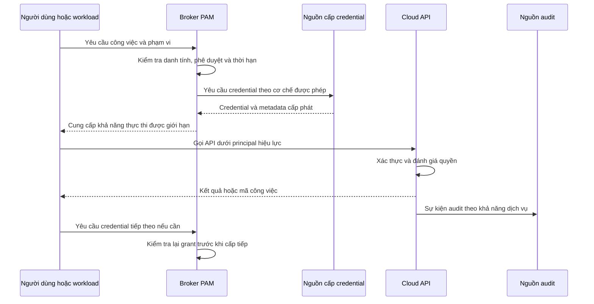

# Cloud API session

## 1. Cloud API session là gì trong quản lý truy cập đặc quyền?

Cloud API session là cách mô tả một khoảng hoạt động mà người dùng hoặc workload thực hiện các yêu cầu tới API cloud dưới một danh tính và tập quyền nhất định.

Không phải nền tảng nào cũng có một đối tượng kỹ thuật duy nhất mang tên “API session”. Trên thực tế, hoạt động có thể gồm một grant PAM, một lần kích hoạt role, một hoặc nhiều bộ credential, nhiều kết nối HTTP và nhiều yêu cầu độc lập tới các dịch vụ khác nhau.

Ví dụ, kỹ sư vận hành được phê duyệt xem trạng thái một nhóm máy ảo trong production. Kỹ sư dùng CLI nhận credential ngắn hạn rồi gọi API kiểm tra tài nguyên. Trong cùng khoảng làm việc, CLI có thể mở nhiều kết nối, tự thử lại yêu cầu và nhận credential mới qua một credential provider.

Đối với PAM, câu hỏi quan trọng không phải chỉ là “phiên đã mở hay chưa”, mà là:

- Ai thực sự yêu cầu quyền?
- Danh tính nào được cloud nhận diện khi gọi API?
- Credential nào được cấp, có hiệu lực tới khi nào?
- Những tài nguyên và hành động nào được phép?
- Công cụ có thể tự nhận credential tiếp theo không?
- Bằng chứng nào liên kết phê duyệt với hành động tại cloud?
- Làm thế nào chứng minh quyền đã kết thúc tại nơi thực thi?

Một phiên được ghi “đã đóng” trong giao diện PAM chưa tự chứng minh mọi credential hoặc công việc cloud liên quan đã ngừng hoạt động.

### Mục tiêu học tập

Sau bài này, người học có thể:

1. Phân biệt phiên quản trị, credential, token, kết nối và yêu cầu API.
2. Thiết kế quyền API có phạm vi và thời hạn phù hợp nhiệm vụ.
3. Liên kết actor gốc với principal hiệu lực và các hành động ở cloud.
4. Xử lý refresh, hết hạn, retry và tác vụ bất đồng bộ.
5. Kiểm chứng việc thu hồi quyền và điều tra sử dụng bất thường.

## 2. Phân biệt những đối tượng thường bị gọi chung là phiên

| Đối tượng | Chức năng | Không nên suy luận |
|---|---|---|
| Phiên đăng nhập IdP | Xác thực người dùng với nguồn danh tính | Đăng xuất sẽ chặn mọi token đã cấp |
| Grant hoặc activation PAM | Cho phép yêu cầu hay sử dụng quyền theo điều kiện | Cloud tự đọc và thực thi mọi điều kiện nội bộ |
| Credential hoặc access token | Dùng trong cơ chế xác thực hoặc truy cập API | Có credential nghĩa là được làm mọi hành động |
| Credential provider | Lấy và cung cấp credential cho SDK hoặc CLI | Provider chỉ cấp đúng một bộ trong toàn phiên |
| Kết nối HTTP/TLS | Chuyển yêu cầu và phản hồi | Đóng kết nối đồng nghĩa thu hồi credential |
| Yêu cầu API | Một lần gọi thao tác cụ thể | API nhận yêu cầu nghĩa là nghiệp vụ đã hoàn tất |
| Tác vụ cloud | Công việc có thể tiếp tục sau phản hồi ban đầu | Token hết hạn sẽ tự hủy tác vụ |
| Bản ghi audit | Bằng chứng về một sự kiện quan sát được | Mọi dữ liệu và kết quả đều đã được ghi đầy đủ |

### 2.1. Kết nối không phải ranh giới đặc quyền

Một công cụ có thể tái sử dụng một kết nối cho nhiều yêu cầu hoặc mở kết nối mới cho từng yêu cầu. Credential cũng có thể được dùng qua nhiều kết nối và từ nhiều tiến trình nếu bị sao chép.

Do đó, thời gian sống của TCP hoặc HTTP connection không phải thời hạn quyền truy cập.

Nếu PAM chỉ quản lý kết nối tới một terminal nhưng credential đã được xuất ra ngoài, việc ngắt terminal không bảo đảm những bản sao khác ngừng gọi cloud API.

### 2.2. Phiên nghiệp vụ và credential có thể có quan hệ một–nhiều

Một grant 30 phút có thể liên quan tới nhiều lần lấy credential. Ngược lại, một bộ credential có thể được sử dụng cho nhiều thao tác trong phạm vi quyền của principal.

Cần lưu được quan hệ giữa:

- Yêu cầu đã được duyệt.
- Phiên hoặc activation quản trị.
- Những lần cấp credential.
- Principal hiệu lực ở cloud.
- Những hành động và job phát sinh.

Không cần lưu bí mật để xây dựng quan hệ này. Có thể dùng tham chiếu cấp phát, định danh principal và những trường audit được nền tảng cung cấp.

### 2.3. Một yêu cầu không nhất thiết là một công việc hoàn chỉnh

Ví dụ, API tạo bản sao dữ liệu có thể trả về mã tác vụ. Sau đó hệ thống tiếp tục xử lý mà không cần client giữ kết nối ban đầu.

PAM phải phân biệt quyền gửi yêu cầu tạo việc, quyền đọc tiến độ, quyền hủy và quyền tải kết quả. Những quyền đó có thể có vòng đời khác nhau.

## 3. Danh tính gốc, danh tính hiệu lực và bên cấp credential

### 3.1. Actor gốc

Actor gốc là con người hoặc workload bắt đầu luồng yêu cầu quyền. Ví dụ:

- Kỹ sư được phân công xử lý change.
- Pipeline triển khai của một repository.
- Dịch vụ vận hành đã được cấp danh tính workload.

Định danh gốc cần lấy từ nguồn xác thực có thẩm quyền. Một tên session do client tự nhập không tự chứng minh ai đang thao tác.

### 3.2. Principal hiệu lực

Principal hiệu lực là danh tính cloud sử dụng khi đánh giá yêu cầu API. Nó có thể là một role session, một service account hoặc một danh tính ứng dụng.

Principal hiệu lực có thể khác actor gốc. Nếu chỉ ghi principal hiệu lực, nhiều người dùng cùng một role có thể khó phân biệt trong điều tra.

Ngược lại, chỉ ghi actor gốc mà không biết principal hiệu lực sẽ khó xác định tập quyền và đường truy cập thực tế.

### 3.3. Issuer, broker và resource server

- **Issuer** cấp credential hoặc token theo cơ chế của hệ thống.
- **Broker PAM** kiểm tra yêu cầu và điều phối việc nhận quyền.
- **Resource server** bảo vệ API hoặc tài nguyên và thực thi quyết định truy cập.

Một broker có thể chỉ tham gia lúc cấp credential. Sau đó client gọi thẳng cloud API, không đi qua broker nữa.

Đây là khác biệt kiến trúc quan trọng. Một điều kiện được broker kiểm tra lúc mở phiên không tự được kiểm tra lại ở mỗi API nếu resource server không biết điều kiện đó.

### 3.4. Chuỗi ủy quyền

Một luồng có thể đi qua nhiều danh tính:

```text
Người dùng hoặc workload gốc
    -> danh tính được xác thực với nguồn cấp
    -> principal trung gian
    -> principal hiệu lực ở cloud
    -> yêu cầu tới tài nguyên
```

Không phải nền tảng nào cũng hỗ trợ cùng kiểu chuỗi hoặc giữ đầy đủ actor trong mọi log. Cần xác minh trường nào tồn tại và độ tin cậy của phép liên kết.

Những tag hoặc nhãn session do người gọi đặt chỉ trở thành bằng chứng đáng tin khi nguồn và quyền đặt giá trị được kiểm soát phù hợp.

## 4. Credential trong các mô hình cloud phổ biến

### 4.1. AWS: credential tạm thời và session token

Credential tạm thời của AWS gồm access key ID, secret access key và session token. Khi dùng chúng để gọi API phải có session token theo cơ chế tương ứng; chúng có thời điểm hết hạn. SDK hoặc credential provider phù hợp có thể nhận một bộ mới trước khi bộ cũ hết hạn. [AWS IAM — Use temporary credentials](https://docs.aws.amazon.com/IAM/latest/UserGuide/id_credentials_temp_use-resources.html).

Cần phân biệt bộ credential đã cấp với khả năng yêu cầu bộ tiếp theo. Công cụ tự nhận bộ mới không có nghĩa thời điểm hết hạn của chính bộ cũ đã được kéo dài.

### 4.2. Microsoft identity platform: access token và refresh token

Access token được client dùng để gọi protected API. API đích có trách nhiệm xác minh token; client nên sử dụng metadata trả về để quản lý thời hạn và coi token là giá trị opaque, thay vì phụ thuộc vào việc tự giải mã token. [Microsoft Learn — Access tokens](https://learn.microsoft.com/en-us/entra/identity-platform/access-tokens).

Trong những luồng có refresh token, refresh token có thể được dùng để xin access token mới. Không phải mọi luồng xác thực workload đều cấp refresh token cho client. [Microsoft Learn — Refresh tokens](https://learn.microsoft.com/en-us/entra/identity-platform/refresh-tokens).

Vì vậy, kiểm kê cần xác định chính xác kiểu luồng và khả năng nhận token mới, không chỉ thời hạn của access token đang dùng.

### 4.3. Google Cloud: credential ngắn hạn cho service account

Khi tạo access token bằng service account impersonation theo luồng được Google mô tả, access token không đi kèm refresh token. Khi nó hết hạn, cần thực hiện lại quá trình impersonation để nhận token mới. [Google Cloud — Create short-lived credentials](https://docs.cloud.google.com/iam/docs/create-short-lived-credentials-direct).

Điều này không có nghĩa SDK luôn yêu cầu người dùng thao tác thủ công. Một thành phần được cấu hình phù hợp có thể yêu cầu cấp token tiếp theo bằng danh tính nguồn, miễn là nó vẫn được phép.

### 4.4. Không áp dụng một thời hạn chung cho mọi nền tảng

Thời hạn được hỗ trợ phụ thuộc loại credential, luồng cấp phát, chính sách, principal và dịch vụ.

Không đưa vào thiết kế một giả định như “mọi cloud token đều hết hạn sau một giờ” hoặc “logout sẽ thu hồi mọi token”. Cần dùng thời điểm cấp và hết hạn thực tế, đồng thời kiểm chứng khả năng nhận credential mới.

## 5. Thiết kế phạm vi quyền cho phiên API

### 5.1. Xác thực thành công chưa đủ

Một credential được chấp nhận chỉ là một phần của quyết định truy cập. Hệ thống còn cần đánh giá những chính sách và điều kiện liên quan tới principal, tài nguyên và thao tác.

Không dùng một công thức IAM duy nhất cho mọi cloud. Cơ chế phối hợp giữa identity policy, resource policy, deny, điều kiện và giới hạn tổ chức phụ thuộc nền tảng.

Ở mức thiết kế PAM, cần kiểm chứng rằng yêu cầu hợp lệ chỉ được thực hiện trong phạm vi công việc được duyệt.

### 5.2. Xác định hành động nghiệp vụ cụ thể

Thay vì ghi “truy cập production”, nên ghi:

> Đọc trạng thái của các tài nguyên thuộc nhóm triển khai đã xác định để xác minh một sự cố, trong cửa sổ được phê duyệt.

Sau đó ánh xạ tới những API và permission cần thiết.

Một công việc có thể cần cả thao tác phụ trợ để liệt kê hoặc phân giải tài nguyên. Cần xác định chúng thay vì cấp quyền quản trị rộng để tránh lỗi quyền.

Quyền đọc cũng cần được giới hạn. Đọc bí mật, tải object hoặc xuất dữ liệu không phải tác động thấp chỉ vì không sửa cấu hình.

### 5.3. Scope, audience và resource không giống nhau

Trong các cơ chế token có audience, audience xác định đối tượng API hoặc bên nhận mà token hướng tới. Nó không tự bảo đảm token chỉ truy cập một tài nguyên cụ thể hoặc chỉ được thực hiện một loại thao tác.

Scope hoặc role cũng cần được hiểu theo API và mô hình quyền đang dùng. Một chuỗi `read` trong yêu cầu nội bộ không tự biến thành quyền chỉ đọc tại cloud.

Nếu nền tảng không hỗ trợ giới hạn chính xác một resource hoặc điều kiện, phải ghi nhận giới hạn đó và chọn kiến trúc thực thi phù hợp.

### 5.4. Điều kiện của grant phải được thực thi ở đâu?

Có thể có các cách:

- Principal đích được cấp quyền hẹp phù hợp nhiệm vụ.
- Cơ chế session hoặc token hỗ trợ giới hạn cần thiết.
- Resource policy hoặc điều kiện nền tảng thực thi ràng buộc.
- Một broker giữ credential và thực hiện từng thao tác được phép thay cho client.
- Một workflow được kiểm soát chỉ nhận bản thay đổi đã được duyệt.

Cần đánh giá đường bỏ qua. Nếu client có credential rộng và có thể gọi thẳng API, điều kiện tại một proxy tùy chọn không giới hạn được mọi đường sử dụng credential.

## 6. Ba đồng hồ: grant, credential và công việc

Giả sử một phiên PAM được phê duyệt từ 09:00 tới 09:15. Một credential minh họa được cấp lúc 09:00 và có thể được đích chấp nhận tới 09:45.

Các thời điểm chỉ để phân tích, không phải thời hạn mặc định của sản phẩm cụ thể.

```text
09:00          09:15                         09:45
|---------------|-----------------------------|
Grant PAM       hết hạn
Credential      còn có thể được chấp nhận     hết hạn
```

Nếu cloud không kiểm tra trạng thái grant và không có ràng buộc bổ sung, hết hạn grant lúc 09:15 chưa tự chặn credential đang tồn tại.

### 6.1. Cửa sổ phát hành và cửa sổ sử dụng

Cần thiết kế riêng:

1. Đến khi nào client được xin credential mới?
2. Đến khi nào credential đã cấp được đích chấp nhận?
3. Đến khi nào client được khởi tạo công việc mới?
4. Công việc đã được chấp nhận được tiếp tục tới đâu?

Một broker ngừng cấp mới lúc 09:15 chỉ xử lý câu hỏi thứ nhất. Nó không tự giải quyết toàn bộ phần còn lại.

### 6.2. Không giả lập thời hạn bằng nhãn nội bộ

Nếu cloud cấp credential lâu hơn cửa sổ phê duyệt, việc ghi một trường `expires_at` ngắn hơn trong cơ sở dữ liệu PAM không làm cloud biết thời hạn đó.

Thiết kế phải dùng ràng buộc mà đích thực sự thực thi hoặc chọn phương án khác, chẳng hạn đường thực thi từng thao tác với credential không được xuất cho client.

Nếu không thể đáp ứng thời hạn yêu cầu, cần thể hiện giới hạn kỹ thuật và điều chỉnh thiết kế. Không báo một thời hạn nghiêm ngặt mà không có bằng chứng thực thi.

### 6.3. Refresh phải xét thời gian còn lại

Khi client cần credential mới gần cuối cửa sổ, broker hoặc cơ chế cấp quyền cần kiểm tra lại grant, phạm vi và thời gian còn lại.

Không cấp tiếp một bộ có vòng đời vượt giới hạn được duyệt rồi mặc định rằng client sẽ tự ngừng sử dụng.

Một số nền tảng có giới hạn thời lượng tối thiểu, tối đa hoặc ràng buộc khác. Cần xử lý chúng theo khả năng thực tế thay vì chỉ tính toán một thời hạn mong muốn.

## 7. Luồng quản lý một phiên Cloud API



Sơ đồ thể hiện trường hợp client gọi trực tiếp cloud sau khi nhận credential. Với mô hình proxy giữ credential, đường dữ liệu sẽ đi qua proxy và cần kiểm chứng việc không tồn tại đường cấp credential rộng ra ngoài.

### 7.1. Trước khi cấp

Cần xác định:

- Actor đã được xác thực đúng mức.
- Đích cloud, tenant, account, subscription hoặc project chính xác.
- Principal hiệu lực nằm trong phạm vi được phép chọn.
- Công việc và tài nguyên khớp phê duyệt.
- Thời hạn có thể được thực thi.
- Bằng chứng cấp phát và sử dụng có thể liên kết.
- Cơ chế dừng cấp mới và xử lý credential đang tồn tại đã được xác định.

Với workload, dùng danh tính và bằng chứng nguồn phù hợp. Không yêu cầu một tiến trình tự động nhập MFA theo cách dành cho người dùng rồi tìm cách lưu mã để vượt quy trình.

### 7.2. Trong khi sử dụng

Công cụ cần giữ rõ môi trường và principal đang dùng. Một profile có tên production nhưng đang trỏ tới tenant khác vẫn là sai đích.

Các thao tác nhạy cảm cần xác minh đích từ thông tin có thẩm quyền. Không chỉ tin tên hiển thị hoặc một biến được đặt từ đầu phiên mà không có kiểm tra.

### 7.3. Khi kết thúc

Kết thúc cần bao gồm ngừng cấp credential mới, xử lý những quyền đang tồn tại theo khả năng nền tảng, đối soát các thao tác và thu dọn bản sao credential do phiên quản lý.

Thu dọn cache cục bộ là một phần của vệ sinh vận hành. Nó không chứng minh các bản sao bên ngoài đã bị vô hiệu hóa.

## 8. Lưu metadata phiên mà không lưu bí mật

Một bản ghi quản trị có thể như sau:

```yaml
pam_session_reference: PAM-API-DEMO-078
grant_reference: GRANT-DEMO-084

actor:
  stable_reference: engineer-demo-lan
  principal_type: human
  identity_source_reference: workforce-idp-demo

cloud_context:
  provider_reference: provider-demo
  tenant_or_organization_reference: organization-demo-a
  resource_boundary_reference: production-boundary-demo
  effective_principal_reference: operations-reader-demo

task:
  operation_reference: inspect-deployment-state
  resource_set_reference: approved-resource-set-demo
  change_reference: CHANGE-DEMO-217

validity:
  approved_start: "2030-05-14T09:00:00Z"
  approved_end: "2030-05-14T09:15:00Z"

credential_issuance:
  record_reference: ISSUANCE-DEMO-028
  provider_reference: credential-provider-demo
  issued_at: "2030-05-14T09:00:20Z"
  expires_at: "2030-05-14T09:15:00Z"
  secret_material_stored: false

enforcement:
  scope_control_reference: VERIFIED-SCOPE-CONTROL-DEMO
  expiry_control_reference: VERIFIED-EXPIRY-CONTROL-DEMO

lifecycle:
  state: active
  closure_reference: null
```

Đây là schema minh họa. Các trường enforcement là tham chiếu tới kiểm soát cần được kiểm chứng, không phải cấu hình tự tạo ra giới hạn.

### 8.1. Không đưa các giá trị sau vào báo cáo

- Access token và refresh token.
- Secret access key.
- Session token có thể dùng cùng credential.
- Private key hoặc client secret.
- Cookie xác thực.
- Header Authorization đầy đủ.
- URL ký sẵn còn có thể dùng để truy cập tài nguyên.
- Nội dung phản hồi chứa bí mật hoặc dữ liệu nhạy cảm không cần thiết.

Định danh credential hoặc token cũng có thể là metadata nhạy cảm. Chỉ lưu khi cần liên kết và bảo vệ theo phân loại phù hợp.

### 8.2. Không lấy token làm khóa liên kết mặc định

Không nên lưu nguyên token để tra cứu những lần gọi có liên quan. Nếu nền tảng cung cấp định danh cấp phát hoặc session phù hợp, ưu tiên dùng chúng.

Nếu cần một tham chiếu nội bộ, tham chiếu đó phải được thiết kế riêng và liên kết qua nguồn tin cậy. Không mặc định một request ID ở phía client đã tự xuất hiện trong audit log cloud.

## 9. Bảo vệ credential tại CLI, SDK và môi trường thực thi

### 9.1. Credential ngắn hạn vẫn là credential

Nếu một credential còn hiệu lực bị sao chép, kẻ có nó có thể sử dụng trong phạm vi cơ chế xác thực và điều kiện thực thi cho phép.

TLS bảo vệ đường truyền phù hợp, nhưng không ngăn một tiến trình có quyền đọc bộ nhớ, cache hoặc output lấy credential ở phía client.

Không coi token ngắn hạn là dữ liệu có thể in ra console hoặc gửi trong ticket.

### 9.2. Những nơi dễ làm lộ

- Lịch sử lệnh và transcript.
- Log debug của SDK hoặc proxy.
- Biến môi trường bị tiến trình khác đọc theo quyền hệ thống.
- File cache hoặc cấu hình được cấp quyền đọc quá rộng.
- Artifact, crash dump và ảnh chụp terminal.
- Biến CI bị in trong lỗi hoặc script.
- Nội dung clipboard được đồng bộ.
- File cấu hình đóng gói vào image hoặc repository.

Không phải mọi nền tảng hay công cụ đều lưu ở cùng nơi. Cần hiểu credential provider và chế độ debug của công cụ đang dùng.

### 9.3. Giữ credential trong phạm vi tiến trình phù hợp

Có thể dùng môi trường làm việc được quản lý, provider có kiểm soát hoặc proxy thực thi để giảm việc phân phối credential.

Nếu tạo cache riêng cho phiên, cần quản lý đường dẫn, quyền truy cập và vòng đời của đúng cache đó. Không xóa rộng cache của người dùng hoặc phiên khác để kết thúc một nhiệm vụ.

Với workload, cần đánh giá ai có thể chạy mã dưới cùng danh tính, đọc metadata cấp credential hoặc thay cấu hình nguồn cấp.

### 9.4. Không tự giải mã token để quyết định quyền ở client

Client cần biết thời hạn và đích cần gọi, nhưng quyết định quyền có thẩm quyền nằm ở cơ chế của API đích.

Giải mã một JWT chỉ cho thấy dữ liệu có thể đọc được; nó không tự xác minh chữ ký, nguồn cấp hoặc trạng thái hiện tại. Một số access token còn không có định dạng mà client có thể hoặc nên diễn giải.

Dùng metadata và thư viện phù hợp cho luồng đang sử dụng. Không gửi token thật tới một dịch vụ kiểm tra bên ngoài chỉ để xem nội dung.

## 10. Refresh, hết hạn và retry

### 10.1. Quản lý credential provider

Credential provider có thể tự nhận bộ tiếp theo khi cần. Do đó, thiết kế phải xác định:

- Provider dùng danh tính nguồn nào?
- Có thể xin cho principal nào?
- Điều kiện cấp lại được kiểm tra ở đâu?
- Provider dừng thế nào khi grant hết hạn?
- Có cache hoặc bản sao ở tiến trình khác không?
- Ai có thể sửa cấu hình provider?

Dừng một tiến trình không xử lý mọi provider khác đang dùng cùng nguồn danh tính.

### 10.2. Không dùng mọi lỗi làm lý do cấp thêm quyền

Một API thất bại có thể do credential hết hạn, thiếu quyền, sai tài nguyên, sai audience, giới hạn tốc độ, lỗi mạng hoặc trạng thái dịch vụ.

Cần phân loại lỗi theo phản hồi của nền tảng. Không thấy một mã lỗi chung rồi tự động cấp role rộng hơn hoặc lặp lại quy trình xác thực vô hạn.

Nếu thiếu permission ngoài phạm vi được duyệt, dừng thao tác phụ thuộc và đánh giá lại nhu cầu. Không âm thầm biến một phiên đọc trạng thái thành phiên quản trị.

### 10.3. Retry có thể tạo tác động lặp

Nếu client timeout sau khi cloud đã nhận một yêu cầu thay đổi, gọi lại có thể tạo thêm tài nguyên hoặc lặp một tác động nghiệp vụ, tùy API.

Cần dùng cơ chế idempotency mà API thực sự hỗ trợ hoặc đọc trạng thái để đối soát trước khi quyết định gửi lại.

Không mặc định một request ID bất kỳ do ứng dụng đặt sẽ được cloud dùng làm khóa chống lặp. Cũng không giả định cùng credential sẽ làm hai yêu cầu được coi là một.

### 10.4. Hết hạn giữa một công việc

Khi token hết hạn, các lời gọi mới cần credential còn hợp lệ theo cơ chế đích. Công việc cloud đã được chấp nhận trước đó có thể vẫn tiếp tục.

Nếu client mất quyền đọc trạng thái, cần ghi nhận kết quả chưa xác định và dùng một danh tính được phép để đối soát. Không tự gọi bằng credential quản trị chung để “hoàn tất cho xong”.

### 10.5. Xử lý đồng thời

Nhiều worker hoặc thread trong cùng ứng dụng có thể cùng phát hiện credential sắp hết hạn. Provider cần có cách quản lý phù hợp để tránh bão yêu cầu cấp phát.

Tuy nhiên, việc tối ưu cache không được làm trộn principal, tenant hoặc grant của những phiên khác nhau. Cache key cần phản ánh đúng những ranh giới mà thiết kế sử dụng.

## 11. Tác vụ bất đồng bộ và quyền tải kết quả

### 11.1. Tách các quyền trong vòng đời công việc

Một workflow xuất dữ liệu có thể có các khả năng riêng:

1. Khởi tạo export.
2. Xem tiến độ.
3. Hủy export.
4. Đọc artifact kết quả.
5. Tạo hoặc chia sẻ liên kết tải.
6. Xóa artifact.

Grant cho một khả năng không mặc định cho tất cả các khả năng còn lại.

Một API có tên đọc hoặc liệt kê cũng có thể trả về liên kết mang quyền truy cập. Cần phân loại theo dữ liệu và tác động, không chỉ động từ HTTP.

### 11.2. Token hết hạn không phải nút hủy

Nếu một job đã được cloud chấp nhận lúc 09:10, token client hết hạn lúc 09:15 không tự chứng minh job dừng lúc đó.

Thiết kế cần xác định công việc đã được phê duyệt chạy tới đâu, ai giám sát, ai có quyền hủy và ai được nhận kết quả.

Khi chính sách yêu cầu chấm dứt cả công việc, cần có cơ chế hủy hoặc containment được nền tảng hỗ trợ và xác minh trạng thái sau đó.

### 11.3. Artifact có vòng đời riêng

Một file hoặc URL tải kết quả có thể còn sử dụng được sau khi phiên API ban đầu kết thúc.

Cần quản lý thời hạn, quyền đọc và chia sẻ artifact như một phần của workflow. Không đưa URL còn hiệu lực vào log chung hoặc báo cáo hỗ trợ nếu nó mang khả năng truy cập.

Kết thúc phiên không tự hoàn tác việc dữ liệu đã được tải hoặc chia sẻ trước đó.

## 12. Audit cho một phiên Cloud API

### 12.1. Cần nhiều lớp bằng chứng

| Nguồn | Có thể giúp trả lời | Giới hạn |
|---|---|---|
| IdP | Danh tính nguồn xác thực ra sao? | Không mô tả đầy đủ API cloud đã gọi |
| PAM | Ai được duyệt, cho việc gì, trong khoảng nào? | Không chứng minh mọi lời gọi đều đi qua broker |
| Nguồn cấp credential | Principal nào nhận credential và khi nào? | Cấp phát không đồng nghĩa đã sử dụng |
| Audit control plane | Cấu hình hoặc tài nguyên nào bị tác động? | Không thay thế mọi log truy cập dữ liệu |
| Audit data plane | Hoạt động với dữ liệu nào được ghi nhận? | Phụ thuộc dịch vụ và cấu hình |
| Client hoặc workflow | Lần chạy có ý định và trạng thái gì? | Có thể thiếu hoặc không đáng tin khi client bị xâm nhập |
| Nguồn trạng thái tài nguyên | Kết quả cuối hiện tại là gì? | Trạng thái hiện tại không thay thế lịch sử đầy đủ |

Không có một nguồn đơn lẻ tự trả lời mọi câu hỏi.

### 12.2. Phạm vi log phải được kiểm chứng theo nền tảng

AWS CloudTrail phân biệt management events và data events. Không nên mặc định cấu hình ghi management events đã bao phủ mọi truy cập dữ liệu. [AWS CloudTrail — Logging management events](https://docs.aws.amazon.com/awscloudtrail/latest/userguide/logging-management-events-with-cloudtrail.html).

Azure Activity Log chủ yếu phục vụ hoạt động control plane; resource logs phục vụ những hoạt động trong tài nguyên và cần cấu hình phù hợp. Activity Log cũng không phải nhật ký bao phủ mọi yêu cầu bị từ chối ngay ở bước xác thực hoặc phân quyền. [Microsoft Learn — Activity log](https://learn.microsoft.com/en-us/azure/azure-monitor/fundamentals/activity-log).

Google Cloud phân biệt Admin Activity, Data Access, System Event và Policy Denied audit logs. Cần đọc phần bao phủ và cấu hình của dịch vụ cụ thể, đặc biệt với Data Access. [Google Cloud — Cloud Audit Logs](https://docs.cloud.google.com/logging/docs/audit).

Một kết luận “không thấy API bị gọi” chỉ có ý nghĩa trong phạm vi dịch vụ, loại sự kiện và khoảng thời gian thực sự được quan sát.

### 12.3. Trường liên kết hữu ích

Một sự kiện chuẩn hóa có thể giữ:

```yaml
event_reference: CLOUD-EVENT-DEMO-602
event_time: "2030-05-14T09:06:12Z"
ingest_time: "2030-05-14T09:06:40Z"

identity:
  effective_principal_reference: operations-reader-demo
  original_actor_reference: engineer-demo-lan
  original_actor_attribution: linked-from-trusted-issuance-record

context:
  cloud_boundary_reference: production-boundary-demo
  pam_session_reference: PAM-API-DEMO-078
  grant_reference: GRANT-DEMO-084
  issuance_reference: ISSUANCE-DEMO-028

operation:
  service_reference: compute-service-demo
  action_reference: inspect-resource-state
  resource_reference: resource-demo-19
  request_reference: PROVIDER-REQUEST-DEMO-402
  outcome: success

evidence:
  provider_event_reference: ORIGINAL-EVENT-DEMO-602
  source_reference: cloud-audit-source-demo
```

Đây là sự kiện chuẩn hóa minh họa. Không phải cloud nào cũng có sẵn tất cả các trường này.

Nếu actor gốc được suy ra bằng phép nối, cần giữ nguồn và chất lượng phép nối. Không ghi như thể cloud đã trực tiếp khẳng định trường đó khi sự kiện gốc không có.

### 12.4. Thời gian sự kiện và thời gian nhận log

Log nhận sau khi grant hết hạn có thể mô tả một hành động xảy ra trước hết hạn.

Điều tra phải so thời gian sự kiện, thời gian cấp credential, thời gian thu hồi và độ lệch đồng hồ phù hợp. Không chỉ nhìn thời điểm SIEM nhận bản ghi rồi kết luận credential đã được sử dụng sau thu hồi.

## 13. Thu hồi và đóng phiên theo nhiều lớp

### 13.1. Ngừng khả năng nhận credential mới

Có thể cần dừng grant, activation, quyền nhận credential hoặc điều kiện federation theo cơ chế hỗ trợ.

Cần kiểm tra provider có dùng một đường nguồn khác để xin tiếp không. Xóa quyền ở một broker không đủ nếu actor vẫn có quyền nhận cùng principal qua đường trực tiếp.

### 13.2. Xử lý credential đang tồn tại

Khả năng thu hồi trước hết hạn phụ thuộc nền tảng, loại credential và dịch vụ đích.

Thiết kế có thể cần cơ chế vô hiệu hóa phiên, điều kiện từ chối, thay đổi quyền hoặc biện pháp khác được nhà cung cấp hỗ trợ. Không có một lệnh logout chung áp dụng cho mọi Cloud API session.

Với loại token chỉ bị chặn khi hết hạn hoặc khi đích đánh giá một điều kiện cụ thể, cần ghi nhận đúng cửa sổ còn lại và dùng biện pháp phù hợp nếu yêu cầu containment nhanh hơn.

### 13.3. Xử lý các tác động đã tạo

Một phiên đặc quyền có thể tạo role assignment, trust, key, workload hoặc job mới.

Những đối tượng này không tự biến mất chỉ vì credential ban đầu hết hiệu lực. Cần so sánh với nội dung đã duyệt và xử lý các thay đổi trái phép hoặc quyền tạm thời.

### 13.4. Thu dọn phía client

Có thể cần đóng tiến trình được quản lý, xóa bản sao credential trong phạm vi phiên, ngừng provider và kết thúc môi trường làm việc.

Đây là kiểm soát bổ sung. Không dùng kết quả “đã xóa cache” làm bằng chứng rằng credential đã bị thu hồi ở cloud.

### 13.5. Đọc lại trạng thái và thử truy cập phù hợp

Kết quả đóng phiên cần chứng minh:

- Không nhận được credential mới ngoài quyền cho phép.
- Yêu cầu dùng credential liên quan bị xử lý theo chính sách thu hồi.
- Job và artifact được quản lý theo hợp đồng vòng đời.
- Không còn quyền tạm hoặc đường truy cập phát sinh ngoài phê duyệt.
- Bằng chứng kết thúc có thể liên kết với phiên ban đầu.

Phải chọn cách thử có tác động thấp và đúng thẩm quyền. Không tạo thay đổi nguy hiểm chỉ để chứng minh credential còn hay mất quyền.

## 14. Tình huống xuyên suốt: phiên kiểm tra triển khai

Kỹ sư Lan được phê duyệt từ 09:00 tới 09:15 để đọc trạng thái tài nguyên thuộc một đợt triển khai. Công cụ dùng provider nhận credential cho principal chỉ phục vụ kiểm tra.

### 14.1. Trạng thái mong đợi

- Actor gốc là Lan, principal hiệu lực là danh tính kiểm tra đã xác định.
- Đích là đúng môi trường production được duyệt.
- Chỉ các API và tài nguyên phục vụ công việc nằm trong phạm vi.
- Các lần cấp credential đều liên kết với cùng grant.
- Cơ chế thời hạn được đích hoặc đường thực thi có thẩm quyền kiểm soát.
- Hết cửa sổ không tiếp tục cấp khả năng truy cập ngoài phê duyệt.
- Log đủ liên kết các yêu cầu kiểm tra với phiên.

### 14.2. Tình huống A: công cụ xin credential mới lúc 09:14

Không thể chỉ thấy grant còn một phút rồi cấp một bộ sống thêm nhiều chục phút mà không có kiểm soát tương ứng.

Broker phải đánh giá thời gian còn lại và khả năng thực thi của nền tảng. Nếu cơ chế không đáp ứng yêu cầu, có thể từ chối cấp tiếp hoặc dùng một phương án đã được phê duyệt để hoàn tất công việc trong phạm vi.

Không tự kéo dài grant chỉ vì SDK muốn tiếp tục.

### 14.3. Tình huống B: một API báo thiếu quyền

Cần xác định API đó có nằm trong nhiệm vụ và bản cấp quyền đã duyệt hay không.

Nếu là thao tác đọc phụ trợ bị thiếu, cần xử lý theo quy trình bổ sung quyền. Nếu là thao tác sửa cấu hình ngoài nhiệm vụ, việc từ chối là kết quả đúng.

Không tự chuyển sang principal quản trị rộng để loại bỏ lỗi.

### 14.4. Tình huống C: yêu cầu tạo tác vụ ngoài phạm vi

Công cụ có một chức năng tạo bản xuất dữ liệu chẩn đoán. Dù tên chức năng nghe giống kiểm tra, nó tạo job và artifact chứa dữ liệu.

Grant đọc trạng thái không tự cho phép công việc đó. Cần đánh giá quyền tạo job, nội dung dữ liệu, nơi lưu và người nhận kết quả trước khi cấp.

### 14.5. Tình huống D: có log được nhận lúc 09:18

Cần kiểm tra thời gian sự kiện và credential liên quan. Có thể đây là log của yêu cầu lúc 09:13 bị chuyển tới muộn, hoặc là lời gọi mới sau cửa sổ.

Hai trường hợp có kết luận khác nhau. Chỉ thời gian tiếp nhận không đủ để xác định vi phạm.

## 15. Phát hiện sử dụng bất thường

### 15.1. Những tín hiệu có thể theo dõi

- Credential được sử dụng ngoài đích hoặc môi trường được duyệt.
- Một actor xin credential cho nhiều principal nhạy cảm ngoài nhiệm vụ.
- Tần suất cấp credential tăng không phù hợp workload.
- API cấp quyền, tạo credential hoặc đổi logging xuất hiện trong phiên chỉ kiểm tra.
- Hoạt động không liên kết được với grant hoặc issuance record.
- Yêu cầu cấp mới sau khi phiên bị thu hồi.
- Credential được dùng từ nguồn không phù hợp với cơ chế ràng buộc đã định nghĩa.
- Sử dụng sau thời điểm lẽ ra đã bị chặn tại đích.
- Một job tạo dữ liệu hoặc liên kết tải ngoài phạm vi phê duyệt.

Đây là tín hiệu cần điều tra. Nguồn IP mới có thể đến từ proxy hoặc thay đổi hạ tầng; một nguồn IP quen cũng không chứng minh tiến trình đang dùng credential là hợp lệ.

### 15.2. Phân biệt lỗi vận hành và dấu hiệu xâm nhập

Một loạt lỗi hết hạn có thể do provider không nhận được credential mới. Một loạt lỗi quyền có thể do deployment đổi API gọi. Cả hai cũng có thể xuất hiện trong tình huống credential bị lạm dụng.

Cần kết hợp actor, principal hiệu lực, công việc, nguồn, tài nguyên, hành động và thời gian. Không đánh giá chỉ bằng số lần lỗi.

### 15.3. Chỉ số vận hành hữu ích

Có thể theo dõi tỷ lệ phiên liên kết được actor gốc với API, tỷ lệ issuance không có grant hợp lệ, số quyền phát sinh ngoài dự kiến và độ trễ thu hồi đo tại đích.

Cũng cần theo dõi nguồn log bị mất, tỷ lệ sự kiện thiếu principal hoặc request reference và những dịch vụ chưa có audit phù hợp.

Ít cảnh báo không chứng minh ít rủi ro nếu khả năng quan sát đang thiếu.

## 16. Ứng phó khi nghi credential của phiên bị lộ

Một quy trình điều tra có thể gồm:

1. Xác định credential hoặc issuance record liên quan mà không phát tán bí mật.
2. Xác định actor, principal hiệu lực, đích và những quyền thực tế.
3. Ngừng cấp mới qua những đường nguồn liên quan.
4. Áp dụng cơ chế chặn credential hoặc hạn chế quyền được nền tảng hỗ trợ.
5. Xử lý tiến trình, workload hoặc thiết bị nghi bị xâm nhập.
6. Rà soát API đã thực hiện và các quyền, trust, job hoặc artifact phát sinh.
7. Bảo quản bằng chứng và kiểm chứng containment ở đích.
8. Khôi phục công việc hợp lệ bằng danh tính và môi trường đã được xác minh.

Không mặc định đổi password nguồn hoặc rotate một key sẽ thu hồi mọi token đã cấp từ trước. Phải đối chiếu cơ chế thực tế.

Cũng không chỉ chờ token hết hạn nếu có một đường tự cấp lại hoặc credential mới đã được tạo. Cần xử lý cả khả năng tiếp tục nhận quyền.

Containment nên giới hạn đúng đối tượng khi có đủ thông tin. Một principal dùng chung cho nhiều dịch vụ sẽ làm phạm vi tác động của việc vô hiệu hóa lớn hơn, cho thấy giá trị của việc phân tách danh tính từ trước.

## 17. Kiểm chứng thiết kế phiên API

Các kiểm chứng dưới đây sử dụng tài nguyên và danh tính thử nghiệm được phép.

| Nhóm | Tình huống | Bằng chứng mong đợi |
|---|---|---|
| Danh tính | Actor không đủ điều kiện xin principal đích | Không nhận được credential có thể dùng |
| Đích | Client chọn nhầm tenant hoặc resource boundary | Bị chặn hoặc phát hiện trước thao tác nhạy cảm |
| Phạm vi | Gọi API ngoài công việc đã duyệt | Đích hoặc đường thực thi bắt buộc từ chối |
| Thời hạn | Thử trước, trong và sau cửa sổ | Hành vi khớp kiểm soát được công bố |
| Refresh | Provider xin bộ tiếp gần cuối grant | Không tạo cửa sổ vượt phạm vi được duyệt |
| Thu hồi | Dừng grant khi credential còn hiệu lực | Đo được thời điểm yêu cầu mới bị chặn |
| Cache | Chạy hai grant với principal khác nhau | Không trộn credential và ngữ cảnh |
| Retry | Mô phỏng timeout sau khi yêu cầu được nhận | Không tạo tác động lặp ngoài ý định |
| Bất đồng bộ | Token hết hạn khi job đang chạy | Job và quyền đọc kết quả tuân hợp đồng riêng |
| Audit | Gọi control plane và data plane đại diện | Có đúng nguồn log và liên kết danh tính cần thiết |
| Bí mật | Bật chế độ lỗi hoặc debug của công cụ thử | Không lộ token hoặc credential vào báo cáo |
| Đường bỏ qua | Thử gọi ngoài proxy theo kiến trúc được phép | Không vượt phạm vi kiểm soát đã thiết kế |

Cần lưu loại credential, đích, thời điểm thử và kết quả. Kết luận “logout thành công” không thay thế bằng chứng từ API đích.

Nếu một tình huống chưa thể kiểm chứng vì thiếu log hoặc môi trường đại diện, ghi rõ giới hạn. Không biến phần chưa quan sát thành kết quả PASS.

## 18. Bài tập phân tích

Một kỹ sư được cấp phiên PAM 15 phút để xem trạng thái hệ thống. CLI nhận credential có hiệu lực lâu hơn phiên PAM và có một provider tự xin tiếp bằng nguồn danh tính vẫn còn được phép.

Kỹ sư đóng trình duyệt PAM đúng giờ. Một tiến trình CLI khác vẫn chạy. Trong khoảng đó, một job đã được tạo và có liên kết tải kết quả. Đội vận hành chỉ xem log đăng nhập và kết luận mọi quyền đã kết thúc.

Hãy phân tích:

1. Có bao nhiêu vòng đời khác nhau trong tình huống này?
2. Đóng trình duyệt đã tác động tới những thành phần nào và chưa chứng minh điều gì?
3. Cần kiểm tra những đường cấp credential mới nào?
4. Cần nguồn log nào để biết các API và job đã thực hiện?
5. Làm thế nào kết thúc quyền mà không bỏ sót artifact hoặc quyền phát sinh?
6. Thiết kế nào cần thay đổi để cửa sổ 15 phút được thực thi?

### Hướng phân tích

Có ít nhất vòng đời grant, phiên trình duyệt, credential đã cấp, khả năng cấp tiếp của provider, tiến trình CLI, job cloud và quyền tải artifact.

Đóng trình duyệt không tự chứng minh credential cũ bị chặn hoặc provider không thể xin bộ mới. Cần kiểm tra issuer, quyền nguồn, cache và các đường nhận principal liên quan.

Log đăng nhập chỉ cung cấp một phần chuỗi bằng chứng. Cần audit cấp credential, API tại cloud, nguồn trạng thái job và quyền truy cập artifact phù hợp.

Kết thúc phải xử lý cấp mới, credential hiện có và những khả năng được tạo ra trong phiên. Cần đo hiệu lực tại đích, không chỉ đổi trạng thái trong PAM.

Để giữ cửa sổ 15 phút, phải dùng cơ chế mà nơi thực thi hiểu và kiểm tra. Nếu nền tảng hoặc kiểu credential không đáp ứng, cần chọn principal, workflow hoặc đường thực thi khác có giới hạn được kiểm chứng.

## 19. Những điểm cần nhớ

Cloud API session là một chuỗi hoạt động có danh tính, quyền, credential và bằng chứng; nó không chỉ là một kết nối hoặc cửa sổ terminal.

Cần quản lý riêng thời hạn grant, thời hạn credential, khả năng nhận credential mới và vòng đời công việc đã được tạo.

PAM phải liên kết được actor gốc, principal hiệu lực, phê duyệt, cấp phát và hành động thực tế. Bảo vệ bí mật không đồng nghĩa phải lưu bí mật vào audit.

Kết thúc phiên chỉ hoàn tất khi đã kiểm chứng đúng các đường truy cập cần chặn và xử lý những quyền, job hoặc artifact liên quan theo phạm vi được duyệt.
