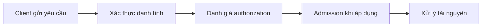
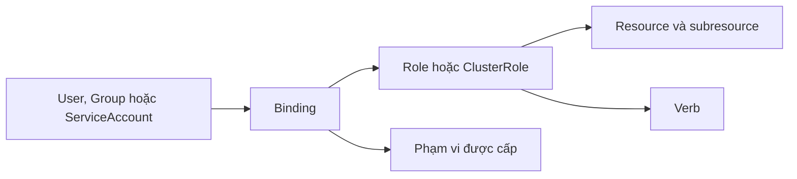

# Kubernetes RBAC

## 1. RBAC trong bài toán quản lý truy cập đặc quyền

Kubernetes RBAC là cơ chế phân quyền theo vai trò cho các yêu cầu tới Kubernetes API. Nó mô tả danh tính nào được thực hiện những hành động nào trên loại tài nguyên nào, trong phạm vi phù hợp.

Trong PAM, RBAC là một phần quan trọng để chuyển yêu cầu nghiệp vụ thành quyền thực thi cụ thể. Ví dụ, kỹ sư trực ca cần xem trạng thái ứng dụng trong một namespace; kỹ sư đó không nhất thiết cần quyền mở shell trong container, đọc Secret hoặc quản trị toàn cluster.

Một bản cấp quyền tốt phải trả lời được:

- Principal nào được cấp quyền?
- Đang thao tác trên cluster nào?
- Quyền có hiệu lực trong namespace nào hoặc trên toàn cluster?
- Những resource, subresource và verb nào được phép?
- Có đường khác làm principal nhận thêm quyền không?
- Quyền tồn tại trong bao lâu và ai chịu trách nhiệm thu hồi?
- Làm thế nào liên kết hoạt động với người yêu cầu và phê duyệt?

RBAC không thay thế toàn bộ PAM. Còn cần xác thực danh tính, quản lý credential, phê duyệt, giới hạn thời gian, audit và kiểm chứng việc kết thúc quyền.

### Mục tiêu học tập

Sau bài này, người học có thể:

1. Phân biệt Role, ClusterRole, RoleBinding và ClusterRoleBinding.
2. Đọc một rule theo API group, resource, subresource, verb và tên đối tượng.
3. Thiết kế quyền hẹp cho người vận hành và service account.
4. Nhận diện những đường tới đặc quyền qua workload và quản trị RBAC.
5. Triển khai quy trình JIT có readback, audit và thu hồi phù hợp.

## 2. RBAC nằm ở đâu trong luồng xử lý yêu cầu?

Một luồng đơn giản hóa:



Xác thực cho biết yêu cầu thuộc danh tính nào. Authorization đánh giá danh tính đó có được thực hiện hành động yêu cầu hay không. Admission có thể kiểm tra hoặc xử lý những điều kiện liên quan nội dung đối tượng trong các yêu cầu phù hợp.

Ví dụ, được phép tạo Pod không có nghĩa Pod với mọi cấu hình đều được chấp nhận. Một kiểm soát admission có thể từ chối cấu hình đặc quyền.

Ngược lại, admission cho phép một cấu hình Pod không tự cấp quyền tạo Pod cho người gọi. Hai lớp giải quyết những câu hỏi khác nhau. [Kubernetes — Authorization](https://kubernetes.io/docs/reference/access-authn-authz/authorization/).

### 2.1. RBAC không phải nơi lưu danh tính người dùng

Trong cấu hình thông thường, username và groups đến từ cơ chế xác thực được cluster sử dụng. Khai báo subject loại User trong binding không tạo một tài khoản đăng nhập mới.

Tên subject phải khớp danh tính mà API server thực sự nhận diện. Tên trong màn hình SSO hoặc tên profile kubeconfig không bảo đảm là username trong Kubernetes.

Đối với cụm được quản lý, còn có thể có lớp ánh xạ hoặc phân quyền của nhà cung cấp. Cần kiểm kê mô hình thực tế của cụm trước khi kết luận toàn bộ quyền đều đến từ RBAC. [Kubernetes — Authentication](https://kubernetes.io/docs/reference/access-authn-authz/authentication/).

### 2.2. Không suy ra quyền từ namespace đang chọn

Namespace trong context chỉ giúp công cụ xác định đích mặc định cho một số thao tác. Người gọi có thể yêu cầu namespace khác nếu biết tên.

Ranh giới phải được thực thi bằng quyền và các kiểm soát liên quan tại server, không phải bằng việc đặt namespace mặc định trong kubeconfig.

## 3. Bốn đối tượng nền tảng

| Đối tượng | Phạm vi tồn tại | Chức năng |
|---|---|---|
| Role | Một namespace | Gom các rule cho tài nguyên namespaced |
| ClusterRole | Cấp cluster | Định nghĩa rule dùng lại hoặc quyền phù hợp phạm vi cluster |
| RoleBinding | Một namespace | Gắn Role cùng namespace hoặc ClusterRole cho subjects trong phạm vi namespace |
| ClusterRoleBinding | Cấp cluster | Gắn ClusterRole cho subjects ở phạm vi cluster |

Một role định nghĩa quyền; binding xác định ai nhận quyền đó. Tạo một role không tự cấp quyền cho một người dùng.

### 3.1. Role

Role là đối tượng namespaced. Nếu Role nằm trong namespace `checkout`, nó không phải cách cấp quyền quản trị một namespace khác hoặc cấp quyền trên Node.

Có thể có nhiều Role cùng tên ở các namespace khác nhau. Vì vậy, tên Role phải được đọc cùng namespace và cluster. [Kubernetes API — Role](https://kubernetes.io/docs/reference/kubernetes-api/rbac/role-v1/).

### 3.2. ClusterRole

ClusterRole không có namespace. Nó có thể định nghĩa quyền cho tài nguyên cluster-scoped, hoặc làm bộ quyền namespaced có thể dùng lại.

Tên ClusterRole không cho biết quyền thực tế. Một ClusterRole tên `observer` vẫn phải được đọc phần rules; không được tin tên để phân loại rủi ro. [Kubernetes API — ClusterRole](https://kubernetes.io/docs/reference/kubernetes-api/rbac/cluster-role-v1/).

### 3.3. RoleBinding

RoleBinding tham chiếu Role trong cùng namespace hoặc một ClusterRole. Khi tham chiếu ClusterRole, binding chỉ cấp phần quyền thích hợp trong namespace của RoleBinding; nó không biến mọi rule cluster-scoped thành quyền namespaced.

Ví dụ, dùng RoleBinding trong `checkout` để tham chiếu một ClusterRole đọc Pod không làm subject được đọc Pod ở mọi namespace.

Trường `roleRef` là bất biến. Nếu cần đổi role được tham chiếu, phải có quy trình thay binding thích hợp; không sửa trực tiếp trường này như một cấu hình thông thường. [Kubernetes API — RoleBinding](https://kubernetes.io/docs/reference/kubernetes-api/rbac/role-binding-v1/).

### 3.4. ClusterRoleBinding

ClusterRoleBinding tham chiếu ClusterRole. Với các rule namespaced trong ClusterRole, việc cấp quyền có phạm vi toàn cluster, không chỉ namespace của một service account được nhắc trong subjects.

Namespace của subject ServiceAccount xác định danh tính service account, không giới hạn phạm vi của ClusterRoleBinding.

Không có nghĩa mọi ClusterRoleBinding đều là cluster-admin; tập quyền vẫn phụ thuộc ClusterRole được tham chiếu. [Kubernetes API — ClusterRoleBinding](https://kubernetes.io/docs/reference/kubernetes-api/rbac/cluster-role-binding-v1/).

### 3.5. Quan hệ giữa subject, binding và role



Khi rà soát, phải đọc cả hai đầu binding và role. Chỉ đọc role bỏ sót ai được cấp; chỉ đọc binding bỏ sót nội dung quyền.

## 4. Cách đọc một rule RBAC

Một rule namespaced minh họa:

```yaml
apiGroups: ["apps"]
resources: ["deployments"]
verbs: ["get", "list", "watch"]
```

Cần đọc theo ba chiều:

- API group: nhóm API của tài nguyên.
- Resource: tên tài nguyên theo API.
- Verb: thao tác logic được kiểm tra.

### 4.1. API group

Core API group được biểu diễn bằng chuỗi rỗng `""`, không phải chữ `core`.

Ví dụ thường gặp:

| Loại tài nguyên | API group |
|---|---|
| Pod, Service, Secret, ConfigMap | `""` |
| Deployment, ReplicaSet, StatefulSet | `apps` |
| Job, CronJob | `batch` |
| Role, RoleBinding, ClusterRole, ClusterRoleBinding | `rbac.authorization.k8s.io` |

API version trong manifest của tài nguyên và giá trị apiGroups trong rule là hai thông tin khác nhau. Rule dùng group, không viết `apps/v1` vào trường apiGroups.

### 4.2. Resource và subresource

Tên resource thường là dạng số nhiều theo API, chẳng hạn `pods` hoặc `deployments`.

Một subresource được biểu diễn bằng dấu gạch chéo:

- `pods/log`: truy cập log Pod.
- `pods/exec`: thực hiện kết nối exec.
- `deployments/scale`: thao tác qua scale subresource.

Quyền trên resource gốc không nên được hiểu là tự cho mọi subresource. Cần khai báo đúng các yêu cầu mà client thực sự gửi.

### 4.3. Verb

Các verb như `get`, `list`, `watch`, `create`, `update`, `patch`, `delete` và `deletecollection` là những quyền khác nhau.

Đặc biệt:

- `get` một đối tượng khác với `list` tập đối tượng.
- `watch` có thể theo dõi thay đổi theo thời gian.
- `update` không tự đồng nghĩa `patch`.
- Một thao tác giao diện hoặc lệnh kubectl có thể gọi nhiều API.
- Cách client mở một subresource kết nối có thể ảnh hưởng verb được kiểm tra.

Không cấp toàn bộ verb chỉ để tránh phân tích những API phụ trợ.

### 4.4. resourceNames và giới hạn theo tên

Có thể giới hạn một số yêu cầu tới các tên đối tượng cụ thể bằng `resourceNames`.

Ví dụ: người vận hành chỉ cần đọc một ConfigMap đã xác định, không cần liệt kê mọi ConfigMap.

RBAC không cung cấp label selector tổng quát để nói “được phép trên mọi Pod có nhãn team=A”. Giới hạn theo nội dung hoặc trường đối tượng cần cơ chế khác phù hợp.

Đối với `list` hoặc `watch` bị giới hạn theo tên, client cần gửi field selector tên tương ứng. Không dùng resourceNames như cách giới hạn tên cho top-level `create` hoặc `deletecollection`; cần phân biệt với create trên subresource. [Kubernetes — Using RBAC Authorization](https://kubernetes.io/docs/reference/access-authn-authz/rbac/).

## 5. Quyền cộng dồn và những giới hạn của Role hẹp

### 5.1. Không có rule deny trong RBAC

Các rule RBAC là rule cho phép. Một Role không chứa quyền đọc Secret không thu hồi quyền đọc Secret đã được cấp qua binding khác.

Trong phạm vi RBAC, có thể hình dung một yêu cầu được phép khi có đường cấp quyền phù hợp từ subject hoặc groups tới rule cho phép. Không có ưu tiên “Role cục bộ thắng ClusterRole rộng”.

Nếu cluster còn dùng các authorizer khác, kết quả cuối phải được đánh giá theo cấu hình authorization thực tế. Không coi một kết quả rà soát RBAC đơn lẻ là toàn bộ quyết định truy cập. [Kubernetes — Authorization](https://kubernetes.io/docs/reference/access-authn-authz/authorization/).

### 5.2. Ví dụ về quyền ngoài dự kiến

Lan nhận RoleBinding vào `checkout-observer`, chỉ cho xem trạng thái. Nhưng Lan cũng thuộc một group đang được gắn quyền quản trị rộng.

Việc thêm RoleBinding quan sát không làm quyền của group biến mất. Nếu thử và thấy Lan vẫn mở được exec, cần kiểm tra các đường cấp quyền khác trước khi kết luận Role quan sát đã tự cho exec.

Khi nghiệm thu least privilege, phải kiểm tra quyền thực tế của principal cùng các group hiện hành.

### 5.3. Quyền có thể thay đổi khi role được sửa

Binding không chứa một bản sao cố định của rules. Nếu Role hoặc ClusterRole được tham chiếu thay đổi, quyền của các subject đang được bind có thể thay đổi theo.

Vì vậy, người sửa role dùng chung là một phần của đường quản trị đặc quyền. Một RoleBinding không thay đổi vẫn có thể dẫn tới quyền rộng hơn sau khi role được sửa.

### 5.4. Aggregated ClusterRole

ClusterRole có thể dùng aggregation để tập hợp rules từ những ClusterRole được chọn theo label. Với loại role này, cần kiểm tra cả selector và những role đóng góp.

Không chỉ xem nội dung rules ở một thời điểm. Thay đổi role hoặc label đóng góp có thể làm tập quyền thay đổi. Phần rules được aggregation controller quản lý cũng không nên được sửa thủ công như một nguồn cấu hình độc lập. [Kubernetes API — ClusterRole aggregation](https://kubernetes.io/docs/reference/kubernetes-api/rbac/cluster-role-v1/).

## 6. Ví dụ: quyền quan sát ứng dụng theo namespace

Giả sử một cluster thử nghiệm đã có namespace `checkout`. Nhóm cần quan sát Pod và Deployment khi xử lý sự cố.

Các manifest trong bài là nội dung học tập cho môi trường được phép. Không có lệnh nào được chạy vào cluster trong quá trình soạn bài.

### 6.1. Role quan sát

```yaml
apiVersion: rbac.authorization.k8s.io/v1
kind: Role
metadata:
  name: checkout-observer
  namespace: checkout
rules:
  - apiGroups: [""]
    resources: ["pods"]
    verbs: ["get", "list", "watch"]

  - apiGroups: ["apps"]
    resources: ["deployments", "replicasets"]
    verbs: ["get", "list", "watch"]
```

Role này không khai báo quyền đọc Secret, đọc log, exec hoặc sửa workload.

Tuy nhiên, quyền đọc đối tượng Pod hoặc Deployment vẫn có thể làm lộ những thông tin mà người tạo đã đưa vào cấu hình, chẳng hạn giá trị môi trường ghi trực tiếp. Vì vậy, “không đọc Secret object” không có nghĩa mọi dữ liệu đọc được đều không nhạy cảm.

Cần đánh giá nội dung tài nguyên mà công việc được phép xem.

### 6.2. RoleBinding tới group được xác thực

```yaml
apiVersion: rbac.authorization.k8s.io/v1
kind: RoleBinding
metadata:
  name: checkout-observers
  namespace: checkout
subjects:
  - kind: Group
    name: pam:checkout-observers
    apiGroup: rbac.authorization.k8s.io
roleRef:
  kind: Role
  name: checkout-observer
  apiGroup: rbac.authorization.k8s.io
```

Group trong ví dụ phải tồn tại trong ngữ cảnh danh tính mà cluster nhận được. Manifest không tạo group trong IdP.

Nếu quyền được quản lý qua membership của group, cần biết ai có thể thêm thành viên và việc cập nhật membership được phản ánh vào credential hiện hành như thế nào.

### 6.3. Đọc log là một nhu cầu cấp riêng

Nếu công việc cần log, có thể đánh giá và cấp thêm một Role hẹp:

```yaml
apiVersion: rbac.authorization.k8s.io/v1
kind: Role
metadata:
  name: checkout-log-reader
  namespace: checkout
rules:
  - apiGroups: [""]
    resources: ["pods/log"]
    verbs: ["get"]
```

Role này cũng cần binding phù hợp mới có tác dụng.

Log có thể chứa token, dữ liệu người dùng hoặc thông tin nội bộ. Không tự xem quyền đọc log là an toàn chỉ vì không cho sửa Pod.

Không thêm `pods/exec` vào role này để tiện xử lý lỗi. Exec là khả năng thực thi trong môi trường workload và cần được đánh giá riêng.

## 7. Ví dụ: service account với quyền đọc một ConfigMap

Workload `config-checker` trong namespace `ops-tools` cần đọc một ConfigMap tên `runtime-public-config` thuộc namespace `checkout`.

### 7.1. ServiceAccount

```yaml
apiVersion: v1
kind: ServiceAccount
metadata:
  name: config-checker
  namespace: ops-tools
automountServiceAccountToken: false
```

ServiceAccount là danh tính namespaced. Cùng tên ở namespace khác là một danh tính khác.

Trong ví dụ, tắt tự động mount token là lựa chọn rõ ràng; workload cần một cơ chế cấp và trình bày credential phù hợp để gọi API. Việc tạo ServiceAccount không tự cung cấp đầy đủ cấu hình workload hoặc token cho ứng dụng. [Kubernetes — Service Accounts](https://kubernetes.io/docs/concepts/security/service-accounts/).

### 7.2. Role trong namespace chứa tài nguyên

```yaml
apiVersion: rbac.authorization.k8s.io/v1
kind: Role
metadata:
  name: runtime-config-reader
  namespace: checkout
rules:
  - apiGroups: [""]
    resources: ["configmaps"]
    resourceNames: ["runtime-public-config"]
    verbs: ["get"]
```

Ở đây không cấp `list`, vì workload đã biết tên cần đọc.

### 7.3. Binding tới service account ở namespace khác

```yaml
apiVersion: rbac.authorization.k8s.io/v1
kind: RoleBinding
metadata:
  name: config-checker-read-runtime-config
  namespace: checkout
subjects:
  - kind: ServiceAccount
    name: config-checker
    namespace: ops-tools
roleRef:
  kind: Role
  name: runtime-config-reader
  apiGroup: rbac.authorization.k8s.io
```

Cần phân biệt hai namespace:

- `metadata.namespace: checkout` là nơi quyền được cấp và nơi Role tồn tại.
- `subjects[].namespace: ops-tools` xác định service account nhận quyền.

Không cần ClusterRoleBinding chỉ vì subject ở namespace khác. Chọn scope theo tài nguyên được phép truy cập, không theo vị trí của client.

### 7.4. Danh tính Kubernetes và danh tính cloud

Nếu workload còn nhận quyền trên API cloud, đó là một miền phân quyền cần kiểm kê riêng.

Role đọc ConfigMap không tự cấp quyền đọc object storage hoặc vault của cloud. Ngược lại, một identity binding trên cloud có thể tạo khả năng ngoài Kubernetes mà chỉ đọc RBAC không thấy.

Cần giữ rõ các quan hệ giữa workload, Kubernetes ServiceAccount và principal ở hệ thống bên ngoài.

## 8. Những quyền cần đánh giá như đặc quyền

### 8.1. Secret không chỉ nhạy cảm ở verb get

Quyền list hoặc watch Secret cũng có thể làm lộ nội dung. Không phân loại chúng thành quyền đọc metadata thuần túy.

Tương tự, không giải quyết quyền quá rộng bằng việc dặn người dùng đừng thêm tùy chọn xuất YAML. Quyền API đã cho phép trả về dữ liệu thì cách hiển thị CLI không tạo ranh giới.

### 8.2. Tạo hoặc sửa workload

Khả năng tạo Pod hoặc sửa workload có thể tạo đường tới dữ liệu và danh tính có sẵn trong namespace, tùy các kiểm soát thực thi.

Ví dụ, khi thiết kế cho phép chọn service account mạnh hơn hoặc mount dữ liệu nhạy cảm, một principal không có quyền đọc trực tiếp vẫn có thể tiếp cận thông qua workload.

Cần kiểm soát cả nội dung workload và danh tính được phép sử dụng, không chỉ danh sách resource trong role.

### 8.3. Exec, attach, port-forward và đường quản trị phụ trợ

Những subresource hoặc API kết nối có thể cho phép tương tác với workload hay mạng nội bộ.

Quyền này cần được đánh giá theo tác động thực tế, bao gồm danh tính tiến trình, dữ liệu mount và những dịch vụ có thể truy cập. Không chỉ nhìn tên verb để kết luận “đây là quyền đọc”.

### 8.4. Quản lý role và binding

Kubernetes có kiểm tra chống tạo hoặc gắn quyền vượt tập quyền hiện có trong những thao tác quản lý RBAC. Các verb đặc biệt như `escalate` và `bind` có thể mở khả năng vượt các kiểm tra tương ứng.

Vì vậy, có quyền tạo RoleBinding không tự đồng nghĩa có thể gắn bất kỳ role nào. Đồng thời, cấp quyền quản trị RBAC cùng những verb đặc biệt cần được xem xét như một đường đặc quyền.

### 8.5. Impersonation và tạo credential

Quyền impersonation hoặc quyền tạo token cho service account có thể dẫn tới sử dụng quyền của danh tính khác.

Những quyền này cần gắn với đích cụ thể và công việc rõ ràng. Không cấp rộng chỉ để hỗ trợ kiểm tra quyền thuận tiện.

Tài liệu chính thức liệt kê các nhóm rủi ro như Secret, workload, `bind`, `escalate`, impersonation và TokenRequest. Phân tích thực tế cần xét cả tổ hợp quyền và các kiểm soát bổ sung trong cluster. [Kubernetes — RBAC Good Practices](https://kubernetes.io/docs/concepts/security/rbac-good-practices/).

## 9. RBAC không thể tự giới hạn mọi nội dung thay đổi

### 9.1. Quyền patch Deployment có phạm vi rộng hơn đổi một trường

Một nhiệm vụ chỉ cần đổi số replica không nên tự động được ánh xạ thành quyền patch toàn bộ Deployment.

Nếu cấp patch resource gốc, cần xét những trường khác mà principal có thể thay đổi. Để chỉ cho thao tác qua scale subresource, có thể thiết kế rule cho đúng subresource và tên mục tiêu.

Ví dụ:

```yaml
apiVersion: rbac.authorization.k8s.io/v1
kind: Role
metadata:
  name: checkout-api-scaler
  namespace: checkout
rules:
  - apiGroups: ["apps"]
    resources: ["deployments/scale"]
    resourceNames: ["checkout-api"]
    verbs: ["get", "patch", "update"]
```

Ví dụ này không đặt giới hạn số replica. Nếu chính sách chỉ cho phép một khoảng giá trị, cần một lớp kiểm tra nội dung hoặc workflow bắt buộc thực thi giới hạn đó.

Client cụ thể có thể cần thêm API đọc phụ trợ. Cần xác minh thay vì tự mở quyền sửa toàn bộ Deployment.

### 9.2. Không dùng resourceNames để giới hạn trường

Giới hạn tên `checkout-api` chỉ chọn đối tượng, không giới hạn được image, service account hoặc trường cấu hình khác nếu đã cấp quyền sửa resource gốc.

Tên tài nguyên, nội dung tài nguyên và loại thao tác là các chiều khác nhau.

### 9.3. Namespace là một phần của phân tách

Namespace giúp đặt scope cho nhiều tài nguyên và quyền. Nó không tự cung cấp toàn bộ cách ly mạng, node, dữ liệu hoặc danh tính.

Khi một namespace chứa nhiều workload có mức tin cậy khác nhau, quyền sửa workload trong namespace cần được đánh giá cẩn thận.

Thiết kế tenancy cần phối hợp nhiều kiểm soát phù hợp, không coi RoleBinding theo namespace là bằng chứng đã có cách ly hoàn chỉnh.

## 10. Kiểm tra quyền bằng kubectl auth can-i

Các lệnh dưới đây là ví dụ kiểm chứng trong lab. Context `pam-lab`, namespace và danh tính cần được chuẩn bị đúng bởi người quản trị môi trường.

### 10.1. Kiểm tra bằng credential của người đang được cấp

```bash
kubectl --context=pam-lab auth can-i get pods --namespace=checkout

kubectl --context=pam-lab auth can-i get pods --subresource=log --namespace=checkout

kubectl --context=pam-lab auth can-i create pods --subresource=exec --namespace=checkout

kubectl --context=pam-lab auth can-i patch deployments.apps --namespace=checkout

kubectl --context=pam-lab auth can-i get secrets --namespace=checkout
```

Với principal chỉ nhận Role quan sát ở phần 6 và không có đường cấp quyền khác, kỳ vọng là được đọc Pod, còn các thao tác log, exec, patch Deployment và đọc Secret chưa được cấp.

Nếu kết quả khác, cần kiểm tra principal, groups và các binding khác.

### 10.2. Kiểm tra đúng resource và namespace

Kiểm tra được `get pods` trong `checkout` không chứng minh quyền đó tồn tại trong namespace khác.

Kiểm tra `patch deployments` cũng không thay thế kiểm tra `deployments/scale`. Cần mô tả đúng API operation mà công cụ thực hiện.

### 10.3. Impersonation khi kiểm tra

Tùy chọn `--as` hoặc `--as-group` cần quyền impersonation thích hợp. Nếu kiểm tra dưới danh tính mô phỏng, phải dùng username và groups phản ánh đúng ngữ cảnh cần đánh giá.

Một lần kiểm tra chỉ với username nhưng bỏ sót group không phải mô phỏng đầy đủ người dùng thực tế. Không cấp impersonation rộng chỉ để một người kiểm tra quyền của chính mình. [Kubernetes — kubectl auth can-i](https://kubernetes.io/docs/reference/kubectl/generated/kubectl_auth/kubectl_auth_can-i/).

### 10.4. can-i không phải kiểm thử toàn bộ workflow

Kết quả yes nói về kiểm tra authorization tương ứng. Nó không chứng minh:

- Admission sẽ chấp nhận nội dung đối tượng.
- Đối tượng tồn tại hoặc đang ở trạng thái cho phép thao tác.
- Công cụ không gọi thêm API khác.
- Cấu hình runtime không có lỗi.
- Người gọi không có quyền thừa qua đường khác.

Cần kết hợp kiểm tra quyền với thao tác đại diện có tác động thấp và đọc lại trạng thái khi phù hợp.

## 11. Thiết kế JIT cho quyền Kubernetes

RBAC mô tả quyền, nhưng các RoleBinding tiêu chuẩn không tự có thời hạn phiên PAM chỉ vì thêm một annotation.

Cần một thành phần thực sự quản lý kích hoạt và thu hồi, chẳng hạn controller hoặc broker được thiết kế cho nhiệm vụ đó.

### 11.1. Yêu cầu JIT phải có phạm vi cụ thể

```yaml
request_reference: PAM-K8S-DEMO-203
requester_reference: oidc:engineer-lan

target:
  cluster_reference: production-cluster-demo
  namespace: checkout

capability:
  role_reference: checkout-observer
  role_kind: Role
  allowed_task: inspect-checkout-deployment

approval_reference: APPROVAL-DEMO-813

window:
  not_before: "2030-06-18T02:00:00Z"
  expires_at: "2030-06-18T02:20:00Z"

ownership:
  controller_reference: pam-access-controller-demo
  grant_reference: GRANT-DEMO-341
```

Schema này là dữ liệu quản trị minh họa, không phải Kubernetes RBAC object.

### 11.2. Binding do controller quản lý

Controller có thể tạo một RoleBinding riêng cho grant:

```yaml
apiVersion: rbac.authorization.k8s.io/v1
kind: RoleBinding
metadata:
  name: pam-observer-grant-341
  namespace: checkout
  labels:
    pam.example.net/managed-by: access-controller
  annotations:
    pam.example.net/grant-reference: GRANT-DEMO-341
    pam.example.net/expires-at: "2030-06-18T02:20:00Z"
subjects:
  - kind: User
    name: oidc:engineer-lan
    apiGroup: rbac.authorization.k8s.io
roleRef:
  kind: Role
  name: checkout-observer
  apiGroup: rbac.authorization.k8s.io
```

Các annotation trong ví dụ chỉ là metadata. API server không tự xóa hoặc vô hiệu hóa binding theo thời điểm đó. Controller phải thực thi vòng đời và phát hiện lỗi thu hồi.

Tên miền annotation là ví dụ, không chỉ một sản phẩm PAM có thật.

### 11.3. Controller cũng là principal đặc quyền

Cần giới hạn controller theo phạm vi có thể quản lý, loại role được phép gắn và những subject được phép nhận.

Nếu controller có quyền tạo mọi ClusterRoleBinding hoặc sửa role tùy ý, đó là một đường quản trị cần được bảo vệ riêng.

Phê duyệt phải ràng buộc requester, cluster, namespace, role và thời hạn. Thay một trường làm mở rộng quyền cần được đánh giá lại.

### 11.4. Quản lý ownership và thay đổi đồng thời

Binding tạm nên có định danh rõ ràng và liên kết tới grant. Khi thu hồi, controller cần xác minh đúng đối tượng mình quản lý, bao gồm UID hoặc cơ chế điều kiện thích hợp nếu thiết kế sử dụng.

Không xóa một binding dùng chung chỉ vì trong đó có người hết hạn quyền. Việc sửa subjects dùng chung cũng cần tránh ghi đè thay đổi của tác vụ khác.

Một thiết kế an toàn về vận hành cần có hành vi khi controller restart, mất kết nối hoặc xử lý lại cùng grant.

## 12. Hết hạn quyền, credential và phiên kết nối

### 12.1. Xóa binding khác với vô hiệu hóa danh tính

Xóa RoleBinding gỡ một đường cấp quyền. Principal có thể vẫn xác thực thành công và còn quyền từ những binding hoặc group khác.

Do đó, kiểm chứng thu hồi phải xem khả năng thực hiện thao tác mục tiêu, không chỉ kiểm tra binding đã biến mất.

### 12.2. Các đường quyền khác vẫn cần rà soát

Một người có thể còn:

- RoleBinding khác trong cùng namespace.
- ClusterRoleBinding cấp quyền rộng.
- Group cấp quyền qua nguồn xác thực.
- Quyền từ cơ chế authorization khác của cluster.
- Credential hoặc danh tính khác có cùng khả năng.

Không kết luận “đã thu hồi hoàn toàn” khi chỉ xóa một object.

### 12.3. Kết nối đã mở cần được xét riêng

Một watch, exec hoặc kết nối đang hoạt động không nên được giả định sẽ tự đóng ngay khi xóa binding.

Quy trình PAM cần xác định cách quản lý các kết nối đó và kiểm chứng hành vi của phiên bản, client và đường truy cập đang dùng.

Tương tự, workload hoặc job đã được tạo trước thu hồi có thể tiếp tục hoạt động. Kết thúc quyền gọi API không tự hoàn tác mọi đối tượng và tác động đã tạo.

### 12.4. Danh tính thuộc system:masters là trường hợp đặc biệt

Không thiết kế JIT thông thường bằng cách thêm người vào `system:masters`. Đây là nhóm có quyền đặc biệt vượt cơ chế kiểm tra authorization thông thường; chỉ xóa binding không phải cách thu hồi tương đương.

Thiết kế phải hiểu rõ nguồn credential và cơ chế xác thực khi xử lý nhóm này. [Kubernetes — Authorization and system:masters](https://kubernetes.io/docs/reference/access-authn-authz/authorization/).

### 12.5. GitOps có thể tạo lại quyền

Nếu một binding đã bị xóa khỏi cluster nhưng vẫn còn trong desired state, một controller khác có thể tạo lại nó.

Thu hồi cần phối hợp với đúng nguồn cấu hình. Không xem việc object tạm thời không tồn tại là bằng chứng vòng đời quyền đã được xử lý bền vững.

## 13. Audit và bằng chứng cho quyền RBAC

### 13.1. Những thay đổi cần quan sát

Có thể cần theo dõi:

- Tạo, sửa hoặc xóa Role và ClusterRole.
- Tạo, sửa hoặc xóa binding.
- Thay subjects hoặc nội dung rules.
- Thay role hoặc label ảnh hưởng aggregation.
- Yêu cầu tới subresource nhạy cảm.
- Sử dụng impersonation hoặc tạo token theo phạm vi cần quản trị.

Những sự kiện này cần liên kết tới yêu cầu và người thực hiện phù hợp.

### 13.2. Không chỉ ghi lại lệnh terminal

Người dùng có thể gọi API bằng SDK hoặc công cụ khác. Ghi hình terminal không thay thế audit tại API server.

Audit policy quyết định mức và loại sự kiện được lưu. Nội dung request hoặc response có thể chứa dữ liệu nhạy cảm, đặc biệt với Secret và credential, nên không ghi toàn bộ mọi payload chỉ để tăng bằng chứng.

Audit cho exec cũng không nên được coi là bản ghi đầy đủ mọi lệnh và dữ liệu trong luồng tương tác. Nếu cần khả năng đó, phải có cơ chế ghi phiên phù hợp và kiểm chứng riêng. [Kubernetes — Auditing](https://kubernetes.io/docs/tasks/debug/debug-cluster/audit/).

### 13.3. Sự kiện chuẩn hóa minh họa

```yaml
evidence_reference: K8S-EVIDENCE-DEMO-108
source_reference: kube-apiserver-audit-demo
source_event_reference: AUDIT-EVENT-DEMO-902

actor:
  username: oidc:engineer-lan
  attribution_source: authenticated-request

request:
  cluster_reference: production-cluster-demo
  namespace: checkout
  api_group: ""
  resource: pods
  subresource: log
  verb: get
  resource_name: checkout-api-demo

result:
  response_code: 200

correlation:
  pam_grant_reference: GRANT-DEMO-341
  grant_link_method: trusted-identity-and-time-correlation
```

Đây là bản chuẩn hóa minh họa, không phải cam kết sự kiện audit gốc tự có trường PAM grant.

Nếu phép nối chỉ dựa trên danh tính và khoảng thời gian, cần ghi rõ giới hạn. Hai phiên cùng danh tính trong cùng khoảng có thể làm việc quy nguồn kém chắc chắn hơn.

### 13.4. Giữ trạng thái trước và sau thay đổi

Đối với một thay đổi RBAC, cần biết:

- Object nào đã đổi.
- Trước đó có subjects và rules nào.
- Nội dung mới có đúng bản được phê duyệt không.
- Ai thực hiện và bằng danh tính nào.
- Những principal nào chịu ảnh hưởng.
- Kết quả đọc lại và thử quyền sau thay đổi.

Không đưa credential hoặc dữ liệu Secret vào báo cáo chỉ để chứng minh thao tác đọc đã thành công.

## 14. Quy trình vận hành một thay đổi RBAC

### Bước 1: Xác định đúng đích

Ghi nhận cluster, namespace, principal và công việc. Không chỉ dùng tên context quen thuộc mà không xác định cluster thực tế.

### Bước 2: Đọc baseline quyền

Đọc role, binding và những đường group hoặc quyền rộng liên quan. Xác định ai quản lý những đối tượng đó.

Không sửa role mặc định hoặc cấu hình hệ thống chỉ vì tên gần giống role cần dùng.

### Bước 3: Soạn bản cấp quyền hẹp

Chọn resource, subresource và verb theo công việc. Đánh giá quyền dữ liệu và đường gián tiếp qua workload.

Tránh wildcard vì API có thể mở rộng thêm resource hoặc khả năng mới. Với role dùng chung, phân tích mọi subject đang được bind trước khi sửa.

### Bước 4: Phê duyệt đúng nội dung

Ràng buộc bản thay đổi với role, scope, subjects và thời hạn. Người duyệt cần nhìn được tác động, không chỉ một mô tả “cấp quyền xử lý sự cố”.

### Bước 5: Áp dụng qua đường được quản lý

Dùng danh tính được phép quản lý RBAC và giữ bằng chứng. Nếu có thay đổi đồng thời, không ghi đè baseline cũ một cách mù quáng.

### Bước 6: Đọc lại và thử cả chiều cho phép lẫn từ chối

Kiểm tra những thao tác cần làm thành công và những thao tác ngoài phạm vi bị chặn.

Việc tạo manifest hợp lệ chưa chứng minh quyền hiệu lực đúng ý định.

### Bước 7: Thu hồi và đối soát

Kết thúc grant, xử lý đúng binding do grant quản lý, kiểm tra đường cấp khác và kết nối liên quan.

Nếu đã tạo workload, credential hoặc quyền mới, đối soát chúng với nội dung phê duyệt.

## 15. Ma trận kiểm chứng cho một phiên quan sát

Giả sử Lan chỉ được cấp Role quan sát trong `checkout`, chưa nhận role đọc log và không có đường quyền khác.

| Thử nghiệm | Kỳ vọng | Điều cần kiểm chứng |
|---|---|---|
| Get Pod trong checkout | Cho phép | Đúng principal và namespace |
| List Deployment trong checkout | Cho phép | Rule API group apps có hiệu lực |
| Get Pod ở namespace khác | Không được cấp từ grant này | Không có đường binding rộng khác |
| Get Secret trong checkout | Không được cấp | Không dùng credential đặc quyền để thử thay |
| Get pods/log | Không được cấp | Quyền log được quản lý riêng |
| Create kết nối pods/exec | Không được cấp | Kiểm tra đúng subresource và client |
| Patch Deployment gốc | Không được cấp | Không nhầm với quyền đọc hoặc scale |
| Tạo RoleBinding mới | Không được cấp | Người quan sát không quản lý việc cấp quyền |
| Sau khi grant bị thu hồi | Không còn quyền từ binding tạm | Kiểm tra khả năng thực thi thực tế |
| Kết nối mở trước thu hồi | Theo hành vi đã kiểm chứng và kiểm soát phiên | Không mặc định bị đóng ngay |

Kỳ vọng “không được cấp” ở đây nói về grant minh họa. Nếu principal có thêm quyền khác, cần đánh giá và xử lý chúng để đạt mục tiêu least privilege.

Kiểm thử trong môi trường được phép với dữ liệu phù hợp. Không đọc Secret thật hoặc mở shell production chỉ để chứng minh một permission đang tồn tại.

## 16. Những lỗi thiết kế thường gặp

### 16.1. Gắn cluster-admin để tránh lỗi

Cách này che đi nhu cầu quyền thật và làm mọi lỗi ứng dụng có thể đi kèm phạm vi tác động lớn hơn.

Cần phân tích yêu cầu API bị thiếu thay vì biến một nhiệm vụ namespaced thành quản trị cluster.

### 16.2. Tin tên view, edit hoặc tên role nội bộ

Tên role không thay thế nội dung rules, aggregation và binding. Một role có thể được thay đổi hoặc mở rộng theo cơ chế quản lý hiện hành.

### 16.3. Xem quyền sửa workload như quyền triển khai vô hại

Thay image, service account, volume hoặc cấu hình có thể tạo đường tới đặc quyền và dữ liệu.

Cần phối hợp giới hạn quyền với kiểm soát nội dung và ranh giới tin cậy của namespace.

### 16.4. Tạo annotation expires-at rồi coi như đã có TTL

Nếu không có controller thực thi, binding vẫn là binding thông thường.

Cần phát hiện trường hợp controller lỗi, grant quá hạn nhưng binding còn và binding bị tái tạo bởi một nguồn khác.

### 16.5. Chỉ kiểm tra manifest thay vì quyền người dùng

Một manifest đúng cú pháp vẫn có thể chọn sai subject, sai namespace hoặc cộng thêm quyền trên nền một binding rộng đang tồn tại.

### 16.6. Thu hồi xong nhưng không đối soát tác động

Xóa binding không hoàn tác workload đã tạo, dữ liệu đã đọc hoặc quyền khác đã được thiết lập.

Kết thúc quyền cần bao phủ đúng những thay đổi phát sinh trong phiên.

## 17. Bài tập phân tích

Một nhóm được cấp RoleBinding trong namespace `checkout` tới role mang tên `deployment-helper`.

Role cho phép tạo Pod và sửa Deployment. Nhóm không có quyền get Secret. Trong cùng namespace có một service account phục vụ controller với quyền rộng hơn. Hệ thống chỉ dùng annotation hết hạn trên binding, chưa có controller thu hồi.

Một quản trị viên kết luận nhóm đã an toàn vì quyền chỉ trong namespace, không đọc Secret và có thời hạn.

Hãy phân tích:

1. Những kết luận nào chưa được chứng minh?
2. Quyền tạo hoặc sửa workload có thể mở đường nào?
3. Có thể dựa vào việc không có get Secret để kết luận không tiếp cận được dữ liệu bí mật không?
4. Annotation hết hạn có làm binding ngừng hiệu lực không?
5. Cần kiểm tra gì trước khi đổi role thành chỉ quan sát?
6. Nếu thu hồi binding, những thành phần nào vẫn cần được đối soát?

### Hướng phân tích

Phạm vi namespace không tự giới hạn mọi tác động của nội dung workload. Cần xét khả năng chọn service account, mount dữ liệu và những kiểm soát admission đang thực thi.

Không có get Secret không đủ để loại trừ đường tiếp cận qua workload. Cần đánh giá tổ hợp quyền và những đối tượng thực tế trong namespace.

Annotation chỉ là metadata nếu không có thành phần thực thi vòng đời. Cần một cơ chế quản lý grant và bằng chứng thu hồi ở API server.

Đổi sang role quan sát cần kiểm tra các subject đang dùng role, các binding khác của nhóm và quyền thực tế sau thay đổi. Nếu role dùng chung, không sửa mà bỏ qua những nhiệm vụ hợp lệ khác.

Sau thu hồi cần rà soát workload, credential, kết nối và quyền phát sinh. Cũng cần xác minh nguồn cấu hình không tái tạo binding.

## 18. Những điểm cần nhớ

Kubernetes RBAC nối subject với rules thông qua binding. Muốn hiểu quyền thực tế phải đọc đúng principal, group, cluster, namespace, role và những đường cấp quyền khác.

RoleBinding có thể dùng ClusterRole mà vẫn giữ phạm vi namespaced. ClusterRoleBinding có phạm vi rộng hơn nhưng quyền cụ thể vẫn do ClusterRole định nghĩa.

RBAC cộng dồn quyền và không có rule deny. Quyền hẹp mới không tự thu hồi quyền rộng cũ.

Trong PAM, RBAC cần đi cùng xác thực, credential phù hợp, phê duyệt, JIT, audit và readback. Một annotation, tên role hoặc kết quả can-i riêng lẻ không thay thế được bằng chứng quyền đã được cấp và kết thúc đúng phạm vi.
