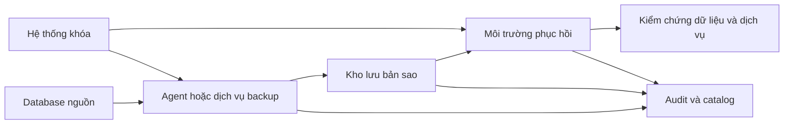

# Backup administrator

## 1. Vì sao quản trị backup là một vai trò đặc quyền?

Backup administrator là người hoặc danh tính tự động vận hành quy trình sao lưu, quản lý bản sao và hỗ trợ phục hồi cơ sở dữ liệu theo trách nhiệm được giao.

Tên vai trò này không đồng nghĩa với một role kỹ thuật có cùng quyền trên mọi hệ quản trị. Có hệ thống tách riêng quyền tạo backup, đọc file backup, phục hồi, thay retention và sử dụng khóa; cũng có sản phẩm gom nhiều khả năng vào một tài khoản quản trị rộng.

Trong Database PAM, quyền backup cần được xem xét ở cả hai chiều:

- **Bảo mật dữ liệu:** bản sao có thể chứa dữ liệu nhạy cảm, cấu trúc, cấu hình hoặc thông tin khác cần bảo vệ.
- **Khả năng phục hồi:** thay lịch backup, xóa bản sao, làm mất chuỗi log hoặc vô hiệu hóa khóa có thể khiến tổ chức không phục hồi được khi có sự cố.

Một tài khoản không được truy vấn trực tiếp bảng nghiệp vụ vẫn có thể có đường tiếp cận dữ liệu nếu đồng thời lấy được bản sao, sử dụng khóa cần thiết và phục hồi ở nơi mình kiểm soát. Đây là phân tích về tổ hợp khả năng, không phải khẳng định mọi quyền backup tự động cho quyền đọc plaintext.

Do đó, “chỉ là tài khoản backup” không phải lý do để bỏ qua kiểm kê, least privilege, giám sát và thu hồi quyền.

### Mục tiêu học tập

Sau bài này, người học có thể:

1. Phân biệt quyền tạo backup với quyền lấy bản sao, giải mã, phục hồi và xóa.
2. Chia quyền giữa con người, agent, storage và hệ thống khóa.
3. Thiết kế truy cập có phạm vi và thời hạn cho các tác vụ backup, restore.
4. Thu thập bằng chứng về tính toàn vẹn và khả năng phục hồi.
5. Đánh giá quyền phát sinh và rủi ro khi kết thúc một phiên đặc quyền.

## 2. Bản đồ quyền từ database tới bản phục hồi

Một luồng khái quát:



Sơ đồ mô tả các miền quản trị cần đánh giá. Không phải mọi sản phẩm đều truyền dữ liệu hoặc dùng khóa theo đúng một kiến trúc này.

### 2.1. Quyền ở database nguồn

Tùy cơ chế backup, principal có thể cần quyền thực hiện thao tác backup, đọc dữ liệu, dùng giao thức replication hoặc gọi API dịch vụ quản lý.

Cần xác định phạm vi là một database, một nhóm đối tượng hay toàn instance hoặc cluster. Không suy luận từ tên job rằng chỉ dữ liệu của một ứng dụng được sao lưu.

### 2.2. Quyền của tiến trình thực thi

Tài khoản đăng nhập database và tài khoản hệ điều hành chạy engine hoặc agent có thể khác nhau.

Một thao tác có đủ quyền SQL vẫn có thể thất bại vì tiến trình thực thi không ghi được đường dẫn đích. Ngược lại, quyền hệ điều hành đọc được toàn bộ vùng dữ liệu có thể tạo đường truy cập ngoài quyền SQL đang rà soát.

### 2.3. Quyền ở kho backup

Cần tách các khả năng:

- Tạo đối tượng mới.
- Liệt kê catalog hoặc metadata.
- Đọc và tải bản sao.
- Ghi đè hoặc tạo phiên bản khác.
- Xóa bản sao.
- Thay retention, lifecycle hoặc khóa bảo vệ.
- Chia sẻ hoặc sao chép sang miền khác.

“Có quyền ghi backup” phải được ánh xạ tới những permission cụ thể. Một số công cụ cần thêm quyền để kiểm tra, hoàn tất hoặc xử lý phần truyền dữ liệu chưa xong; cần cấp đúng nhu cầu, không mở rộng thành quản trị toàn kho.

### 2.4. Quyền với khóa

Phải phân biệt sử dụng khóa cho hoạt động hợp lệ với quyền quản trị khóa.

Tùy kiến trúc, một công việc có thể cần mã hóa, giải mã, unwrap hoặc một cơ chế do dịch vụ thực hiện. Không mặc định mọi người chạy backup đều cần xuất hoặc quản trị vật liệu khóa.

### 2.5. Quyền ở môi trường phục hồi

Restore có thể cần tạo database, quản lý file, dùng khóa hoặc cấu hình dịch vụ. Những quyền đó không nên tự động đi kèm tài khoản chạy backup định kỳ.

Một môi trường restore có quyền truy cập dữ liệu thật cũng là một môi trường chứa dữ liệu nhạy cảm, dù không phục vụ người dùng production.

## 3. Kiểm kê theo công việc và phương thức backup

### 3.1. Những thông tin cần biết

| Nhóm thông tin | Câu hỏi cần trả lời |
|---|---|
| Nguồn | Database hoặc instance nào, môi trường nào? |
| Phương thức | Logical export, physical backup, snapshot hay dịch vụ quản lý? |
| Phạm vi dữ liệu | Có chứa cấu hình, tài khoản hoặc dữ liệu ngoài dự kiến không? |
| Principal | Ai yêu cầu, agent nào chạy, danh tính nào có hiệu lực? |
| Nơi lưu | Kho, đường dẫn hoặc recovery point nào? |
| Mã hóa | Cơ chế nào, khóa hoặc certificate tham chiếu nào? |
| Phụ thuộc | Có base backup, log hoặc metadata cần đi cùng không? |
| Vòng đời | Ai quy định retention, ai được xóa, ai có quyền ngoại lệ? |
| Phục hồi | Đích nào được phép, cần quyền và tài nguyên gì? |
| Bằng chứng | Catalog, audit và kết quả restore test ở đâu? |

Không lưu password hoặc nội dung khóa trong bảng kiểm kê.

### 3.2. Logical và physical không có cùng phạm vi

Logical backup thường biểu diễn dữ liệu và cấu trúc ở mức đối tượng logic. Physical backup liên quan những file hoặc khối dữ liệu và cơ chế phục hồi của engine.

Cần hiểu khả năng và giới hạn của công cụ đang dùng, bao gồm đối tượng nào được chứa, đối tượng nào không được chứa và cách tái tạo trạng thái nhất quán.

Không coi một file export của một database là bản sao đầy đủ mọi thành phần phục hồi của cả hệ thống.

### 3.3. Snapshot không tự chứng minh tính nhất quán ứng dụng

Một snapshot cần được đánh giá theo cơ chế phối hợp với database, transaction log và storage.

Cần xác định mức nhất quán được đảm bảo, những phụ thuộc phải khôi phục cùng nhau và quy trình engine sử dụng khi mở lại dữ liệu.

Không chỉ thấy snapshot hoàn thành rồi kết luận đã đạt mọi mục tiêu phục hồi.

### 3.4. Replication không tự thay backup

Bản sao đồng bộ có thể nhận cả thay đổi sai, xóa dữ liệu hoặc tác động của sự cố logic.

Một hệ thống có replica vẫn cần xác định khả năng quay về trạng thái trước một sự kiện và khả năng bảo vệ các điểm phục hồi độc lập.

Các bản sao cần được phân tích theo miền lỗi và miền quản trị, không chỉ đếm số instance đang chạy.

## 4. Đối chiếu quyền trên hệ quản trị thực tế

### 4.1. PostgreSQL base backup

Tài liệu PostgreSQL mô tả pg_basebackup dùng giao thức replication và yêu cầu danh tính có quyền REPLICATION hoặc superuser, cùng điều kiện kết nối phù hợp.

Công cụ lấy base backup ở phạm vi database cluster, không chọn riêng một bảng hoặc database như một logical export. Vì vậy, scope của principal và dữ liệu nhận được cần được đánh giá đúng với cơ chế này. [PostgreSQL — pg_basebackup](https://www.postgresql.org/docs/18/app-pgbasebackup.html).

Không cấp superuser chỉ vì đó là một phương án kỹ thuật có thể chạy công cụ. Cần đánh giá quyền tối thiểu theo phiên bản và cách triển khai thực tế.

### 4.2. SQL Server backup

SQL Server có các quyền BACKUP DATABASE, BACKUP LOG và những role được cấp quyền tương ứng theo mặc định, trong đó có db_backupoperator ở cấp database.

Quyền SQL và quyền truy cập file đích là hai lớp khác nhau; tài khoản dịch vụ thực thi còn cần quyền trên thiết bị hoặc thư mục backup phù hợp. [Microsoft Learn — BACKUP permissions](https://learn.microsoft.com/en-us/sql/t-sql/statements/backup-transact-sql?view=sql-server-ver17).

Role backup không nên được diễn giải thành quyền restore mọi database vào mọi đích. Cần đối chiếu các điều kiện và quyền của RESTORE riêng. [Microsoft Learn — RESTORE](https://learn.microsoft.com/en-us/sql/t-sql/statements/restore-statements-transact-sql?view=sql-server-ver17).

### 4.3. Database được cloud quản lý

Với dịch vụ được quản lý, thao tác snapshot hoặc restore có thể được điều khiển bằng cloud IAM thay vì một lệnh SQL từ người vận hành.

Cần kiểm kê riêng danh tính quản trị dịch vụ, quyền đọc hoặc copy recovery point, quyền sử dụng khóa và quyền tạo instance đích.

Không kết luận một người không có database login thì không có đường tiếp cận dữ liệu thông qua snapshot hoặc restore.

### 4.4. Không dùng một mẫu grant chung

Cùng tên backup administrator nhưng permission, phạm vi và hành vi có thể khác theo engine, phiên bản, công cụ và dịch vụ.

Mẫu vai trò nội bộ cần được ánh xạ và kiểm chứng trên hệ thống đích. Không sao chép một tập quyền của hệ quản trị này sang hệ khác.

## 5. Phân chia trách nhiệm và tách nhiệm vụ

Một mô hình phân công minh họa:

| Chức năng | Quyền chính cần xem xét | Quyền không mặc định đi kèm |
|---|---|---|
| Theo dõi backup | Xem trạng thái và metadata được phép | Tải dữ liệu, giải mã, xóa |
| Chạy backup định kỳ | Đọc nguồn hoặc gọi cơ chế backup, ghi đích được duyệt | Restore tùy ý, đổi retention |
| Quản lý lịch và chính sách | Sửa kế hoạch theo phê duyệt | Tự xuất dữ liệu hoặc vô hiệu hóa khóa |
| Thực thi restore | Đọc bản được chọn, dùng khóa theo luồng, ghi đích được duyệt | Restore sang mọi tài khoản hoặc mạng |
| Quản trị storage | Quản lý hạ tầng kho theo phạm vi | Tự giải mã hoặc thay yêu cầu bảo vệ dữ liệu |
| Quản trị khóa | Quản lý vòng đời và chính sách khóa | Tự lấy mọi bản sao để đọc dữ liệu |
| Kiểm chứng phục hồi | Kiểm tra kết quả và chỉ tiêu | Giữ bản dữ liệu thật vô thời hạn |
| Phê duyệt xóa | Chấp thuận đúng đối tượng đủ điều kiện | Xóa toàn bộ kho hoặc sửa audit |

Đây là mô hình trách nhiệm, không phải permission set có thể áp dụng trực tiếp vào sản phẩm.

### 5.1. Tách người yêu cầu và người phê duyệt

Những việc như restore dữ liệu nhạy cảm ra môi trường mới, đổi retention hoặc xóa recovery point quan trọng có thể cần phê duyệt độc lập.

Phê duyệt phải gắn với đúng nguồn, bản sao, đích và mục đích. Một ticket “kiểm tra backup” không tự cho phép restore production sang máy cá nhân.

### 5.2. Kiểm tra quyền quản trị upstream

Tách role chỉ có ý nghĩa khi một người không dễ dàng tự cấp cả hai phía qua một đường quản trị khác.

Cần xem ai sửa được:

- Nhóm có quyền backup hoặc restore.
- Policy của kho lưu trữ.
- Quyền sử dụng và quản trị khóa.
- Cấu hình broker PAM.
- Pipeline chạy backup.
- Danh sách approver.
- Đường audit.

### 5.3. Con người và agent nên có danh tính riêng

Job backup định kỳ không nên phụ thuộc credential cá nhân của một nhân viên.

Dùng danh tính workload phù hợp giúp xác định owner, vòng đời, lịch hoạt động và phạm vi quyền. Người vận hành quản lý job bằng danh tính cá nhân được xác thực, còn agent thực thi bằng danh tính riêng được kiểm soát.

Không dùng một service account quản trị chung cho backup mọi ứng dụng nếu có thể phân chia hợp lý theo nhiệm vụ và miền dữ liệu.

## 6. Bản backup là một tài sản dữ liệu

### 6.1. Phân loại theo nội dung thực tế

Bản sao có thể chứa:

- Dữ liệu khách hàng và giao dịch.
- Cấu trúc, stored procedure hoặc chức năng database.
- Thông tin tài khoản hoặc quyền, tùy phương thức.
- Cấu hình và metadata hệ thống.
- Dữ liệu đã bị xóa khỏi nguồn sau thời điểm backup.
- Những giá trị nhạy cảm mà ứng dụng đã lưu trong database.

Không hạ mức bảo vệ chỉ vì file được nén, đổi đuôi hoặc không dễ mở bằng công cụ thông thường.

### 6.2. Phân quyền nguồn không tự giữ nguyên trên mọi đích

Một bản restore có thể mang theo một phần cấu hình quyền của database, nhưng môi trường đích còn có administrator, cloud policy, mạng và credential riêng.

Nếu người kiểm soát đích có khả năng quản trị dữ liệu phục hồi, không thể mặc định hạn chế truy vấn của tài khoản trên nguồn sẽ tiếp tục bảo vệ dữ liệu theo cùng cách.

Cần đánh giá quyền ở đích như một hệ thống riêng.

### 6.3. Masking và dữ liệu phục vụ thử nghiệm

Nếu mục đích chỉ cần kiểm thử chức năng, cần xem có thể dùng dữ liệu tổng hợp hoặc bản đã xử lý phù hợp hay không.

Khi phải restore dữ liệu thật để thực hiện masking, giai đoạn trước masking vẫn chứa dữ liệu nhạy cảm. Cần cô lập và giới hạn truy cập từ trước khi dữ liệu được mở.

Không coi “sẽ masking sau” là lý do để mở rộng quyền ngay từ lúc restore.

### 6.4. Chia sẻ, copy và liên kết tải

Khả năng copy backup sang kho khác hoặc tạo liên kết tải có thể mở rộng phạm vi tiếp cận dữ liệu.

Quyền này cần được kiểm soát riêng với quyền tạo backup. Không đưa liên kết còn hiệu lực hoặc credential truy cập kho vào ticket và log dùng chung.

## 7. Mã hóa và vòng đời khóa

### 7.1. Mã hóa cần đi cùng phân quyền

Nếu một principal vừa tải được backup vừa tự sử dụng mọi khóa để giải mã ở đích tùy ý, mã hóa không tạo ra ranh giới trách nhiệm như mong muốn.

Cần xác định ai được dùng khóa, cho công việc gì, với loại tài nguyên hoặc điều kiện nào mà nền tảng hỗ trợ.

Không cần cấp quyền xuất private key khi công việc chỉ cần một dịch vụ thực hiện thao tác được kiểm soát.

### 7.2. Phải phục hồi được cả phụ thuộc khóa

SQL Server lưu ý rằng bản backup được mã hóa cần certificate hoặc asymmetric key liên quan sẵn có tại instance phục hồi; mất phụ thuộc này có thể làm bản sao không sử dụng được. Tài liệu cũng phân biệt mã hóa backup với các phụ thuộc của TDE. [Microsoft Learn — Backup encryption](https://learn.microsoft.com/en-us/sql/relational-databases/backup-restore/backup-encryption?view=sql-server-ver17).

Vì vậy, kế hoạch phục hồi cần kiểm chứng đường lấy hoặc sử dụng đúng khóa, không chỉ kiểm tra file backup còn tồn tại.

### 7.3. Rotation không được làm mất khả năng mở bản cũ

Bản sao cũ có thể còn phụ thuộc một phiên bản khóa hoặc certificate trước đó.

Khi rotate, cần biết cơ chế có tự hỗ trợ đọc dữ liệu cũ, cần giữ phiên bản khóa nào và khi nào có thể kết thúc phụ thuộc.

Không xóa khóa cũ chỉ vì database đang dùng khóa mới. Cần đối chiếu các bản sao, thời hạn lưu và kết quả kiểm chứng phục hồi.

### 7.4. Khóa và bản sao không nên cùng một điểm thất bại

Cần phân tích trường hợp mất vùng, tài khoản, máy quản trị, vault hoặc identity provider.

Giữ file backup ở nơi khác nhưng mọi phương tiện mở nó chỉ nằm trong thành phần đã mất có thể khiến phục hồi không thực hiện được.

Tách miền bảo vệ cần đi cùng khả năng truy cập khẩn cấp có kiểm soát, owner và diễn tập; không đồng nghĩa sao chép khóa rộng rãi.

## 8. Bảo vệ retention và bản sao trước hành động phá hoại

### 8.1. Xóa dữ liệu nguồn không phải rủi ro duy nhất

Người có quyền quản trị backup có thể gây mất khả năng phục hồi bằng cách:

- Dừng lịch hoặc bỏ nguồn khỏi kế hoạch.
- Chuyển bản sao tới đích không được bảo vệ.
- Rút ngắn retention.
- Xóa base backup hoặc phần log phụ thuộc.
- Làm mất catalog hoặc thông tin cần khôi phục.
- Vô hiệu hóa khóa.
- Làm đầy kho hoặc tạo lỗi khiến job mới không hoàn tất.

Phải theo dõi cả cấu hình và kết quả, không chỉ sự kiện xóa file.

### 8.2. Immutability có phạm vi cụ thể

Một cơ chế không cho sửa hoặc xóa recovery point trong thời hạn không tự bảo đảm:

- Backup mới vẫn được tạo.
- Nội dung backup không bị hỏng trước khi lưu.
- Chuỗi phục hồi đầy đủ.
- Khóa luôn dùng được.
- Bản sao không bị tải hoặc chia sẻ.
- Ứng dụng phục hồi đúng.
- Mọi miền quản trị đều bị giới hạn giống nhau.

Cần đọc chính xác đối tượng được bảo vệ và những quyền quản trị có thể thay điều kiện.

### 8.3. Ví dụ về chế độ khóa trên dịch vụ

AWS Backup Vault Lock phân biệt Governance mode và Compliance mode. Governance mode có thể được gỡ bởi người có đủ quyền; Compliance mode sau thời gian chờ có những ràng buộc không thể thay đổi hoặc gỡ khi còn recovery point theo điều kiện dịch vụ.

Điều này cho thấy không thể chỉ ghi “đã bật khóa” rồi suy ra mọi chế độ có cùng khả năng bảo vệ. [AWS — Backup Vault Lock](https://docs.aws.amazon.com/aws-backup/latest/devguide/vault-lock.html).

Khi thiết kế cần đánh giá phạm vi, thời điểm hiệu lực và retention trước khi áp dụng. Bài học này không yêu cầu thực hiện thay đổi khóa thực tế.

### 8.4. Xóa phải xét cả dependency

Một artifact không còn là bản mới nhất vẫn có thể cần cho chuỗi phục hồi.

Quy trình xóa cần kiểm tra recovery set, các phụ thuộc, retention và các yêu cầu giữ lại đã được chủ sở hữu xác định. Không chỉ dựa vào tuổi file hoặc tên thư mục.

Cleanup không phải ngoại lệ cho việc xóa rộng ngoài phạm vi đã được phê duyệt.

## 9. Thiết kế một job backup có kiểm soát

### 9.1. Đầu vào phải ràng buộc đúng nguồn và đích

```yaml
backup_job_reference: BACKUP-JOB-DEMO-417

source:
  environment: production
  database_reference: orders-db-demo
  instance_reference: instance-demo-a

execution:
  workload_identity_reference: backup-writer-orders-demo
  approved_plan_reference: BACKUP-PLAN-DEMO-06
  tool_configuration_reference: TOOL-CONFIG-DEMO-18

destination:
  repository_reference: protected-backup-repository-demo
  artifact_namespace_reference: orders-production-demo

protection:
  encryption_profile_reference: ENCRYPTION-PROFILE-DEMO-03
  retention_policy_reference: RETENTION-POLICY-DEMO-08

verification:
  integrity_check_required: true
  recovery_set_check_required: true
  restore_test_schedule_reference: RESTORE-TEST-PLAN-DEMO

ownership:
  service_owner_reference: orders-platform
  backup_owner_reference: database-recovery-team
```

Đây là dữ liệu quản trị minh họa. Các tên trong schema không phải permission thật của một engine hoặc cloud.

### 9.2. Principal chạy job chỉ nhận quyền cần thiết

Cần ánh xạ công việc sang quyền tại database, agent, storage và khóa.

Nếu công cụ cần liệt kê metadata hoặc đọc một phần để kiểm tra, cấp đúng phạm vi đã xác minh. Không gọi cấu hình “write-only” nếu thực tế có quyền đọc dữ liệu và xóa tùy ý.

Các đường dẫn, endpoint và lựa chọn khóa phải được ràng buộc. Không để người chỉ được chạy job đổi đích thành kho cá nhân qua một tham số không kiểm tra.

### 9.3. Quản lý credential theo từng lần chạy

Có thể dùng credential ngắn hạn hoặc lấy bí mật qua vault theo khả năng của hệ thống.

Cần xác định:

- Danh tính nào được nhận credential.
- Credential có quyền gì và đích nào.
- Thời hạn có phù hợp công việc không.
- Có thể cấp lại trong khi job chạy hay không.
- Khi grant bị thu hồi, job và kết nối hiện tại được xử lý thế nào.
- Có bản sao credential trong cache, biến môi trường hoặc log không.

Đổi password hoặc hết hạn lease không tự chứng minh mọi kết nối database đã mở đều bị đóng. Cần kiểm chứng hành vi engine và công cụ.

### 9.4. Tách hoàn tất truyền dữ liệu và hoàn tất backup

Một artifact đã có kích thước lớn không chứng minh đầy đủ hoặc nhất quán.

Quy trình cần trạng thái rõ ràng như đang tạo, hoàn tất truyền, kiểm tra toàn vẹn, đủ recovery set và sẵn sàng theo mức kiểm chứng tương ứng.

Artifact chưa hoàn tất không được đưa vào catalog như một điểm phục hồi đã xác nhận.

### 9.5. Retry phải tránh ghi đè bản hợp lệ

Khi job timeout hoặc mất kết nối, cần đối soát job và artifact hiện có trước khi chạy lại.

Dùng cơ chế định danh và chống lặp phù hợp với công cụ. Không mặc định cùng tên job khiến mọi lần gọi được coi là một lần thực thi.

Xử lý phần chưa hoàn tất phải giữ đúng ownership và dependency, không xóa những bản khác chỉ để làm sạch thư mục.

## 10. Metadata và catalog phục hồi

Một bản catalog có thể như sau:

```yaml
backup_reference: BACKUP-DEMO-417

source:
  database_reference: orders-db-demo
  source_identity_reference: SOURCE-ID-DEMO-18
  engine_profile_reference: ENGINE-PROFILE-DEMO

artifact:
  repository_reference: protected-backup-repository-demo
  object_reference: object-demo-417
  object_version_reference: version-demo-02
  integrity_record_reference: INTEGRITY-DEMO-71

recovery:
  backup_method_reference: approved-method-demo
  consistency_record_reference: CONSISTENCY-DEMO-04
  base_backup_reference: BASE-DEMO-390
  log_set_reference: LOG-SET-DEMO-52
  coverage_record_reference: COVERAGE-DEMO-21

cryptography:
  key_reference: protected-key-reference-demo
  recovery_dependency_record: KEY-RECOVERY-DEMO-05

status:
  transfer: complete
  integrity_check: passed
  recovery_set_check: passed
  last_restore_test_reference: RESTORE-TEST-DEMO-102
```

Catalog không chứa vật liệu khóa, token hoặc dữ liệu nghiệp vụ.

### 10.1. Định danh bản sao phải ổn định

Tên file “latest.bak” hoặc một đường dẫn có thể bị thay đổi không đủ để xác định chính xác bản đã kiểm tra.

Cần giữ định danh recovery point, phiên bản object hoặc cơ chế tương ứng. Khi test restore, phải biết đã dùng đúng artifact nào.

### 10.2. Checksum không tự chứng minh mọi thuộc tính

Checksum giúp phát hiện sự thay đổi so với giá trị đối chiếu đáng tin cậy.

Nếu cùng một người có thể thay cả dữ liệu và checksum trong catalog, phép so khớp không tự chứng minh nguồn gốc hay không có sửa đổi trái phép. Cần bảo vệ metadata và cơ chế xác thực nguồn phù hợp.

Checksum đúng cũng không chứng minh dữ liệu nghiệp vụ đúng, chuỗi log đầy đủ hoặc ứng dụng phục hồi được.

### 10.3. Backup cần có khả năng được tìm thấy

Một file còn tồn tại nhưng không tìm được, không biết khóa, không biết thứ tự phục hồi hoặc không biết phiên bản tương thích có thể không sử dụng kịp khi sự cố.

Catalog và runbook cũng cần được bảo vệ, sao lưu và kiểm chứng khả năng truy cập trong điều kiện khôi phục.

## 11. RPO, RTO và recovery set

### 11.1. RPO là mục tiêu về dữ liệu có thể mất

Recovery Point Objective xác định mức mất dữ liệu chấp nhận được theo thời gian.

Khi đánh giá, cần biết điểm dữ liệu gần nhất thực sự có thể phục hồi, không chỉ thời điểm job cuối cùng đổi sang màu xanh.

Ví dụ giả định:

- Sự cố tại 12:00.
- Recovery point có thể sử dụng gần nhất tương ứng 11:40.
- Mục tiêu RPO là 15 phút.

Khoảng mất dữ liệu theo những mốc này là 20 phút, nên chưa đạt mục tiêu, dù một job có thể vừa hoàn tất lúc 11:55.

### 11.2. RTO là mục tiêu khôi phục dịch vụ

Recovery Time Objective liên quan thời gian để đưa dịch vụ cần thiết trở lại theo tiêu chí đã xác định.

Không chỉ đo thời gian một lệnh restore chạy. Thời gian có thể gồm nhận quyền, dựng đích, tìm backup, lấy khóa, truyền dữ liệu, replay, kiểm chứng và đưa dịch vụ vào hoạt động.

Mốc bắt đầu và kết thúc phải được định nghĩa nhất quán với yêu cầu nghiệp vụ. Không loại bỏ thời gian chờ phê duyệt hoặc lấy khóa rồi báo đạt mục tiêu cho toàn bộ dịch vụ.

### 11.3. Có file mới nhất chưa chắc có chuỗi phục hồi

Một phương thức phục hồi có thể cần base backup cùng các bản phụ thuộc hoặc log liên tục.

Ví dụ, PostgreSQL continuous archiving sử dụng base backup và WAL phù hợp; logical dump không thể thay cho filesystem-level backup trong chính cơ chế WAL replay đó. [PostgreSQL — Continuous Archiving and PITR](https://www.postgresql.org/docs/18/continuous-archiving.html).

Không ghép các phương thức khác nhau bằng giả định rằng mọi file mang nhãn backup đều thay thế được nhau.

### 11.4. Có thể cần nhiều hệ thống nhất quán

Dịch vụ có thể phụ thuộc nhiều database, hàng đợi, object storage hoặc hệ thống danh tính.

Phục hồi một database về một thời điểm không tự bảo đảm toàn bộ nghiệp vụ nhất quán với những thành phần còn lại.

Backup administrator cần phối hợp với owner ứng dụng để xác định tiêu chí phục hồi, thay vì chỉ kiểm tra engine mở được dữ liệu.

## 12. Restore test là công việc đặc quyền riêng

### 12.1. Chuẩn bị đích trước khi mở dữ liệu

Môi trường test cần được chuẩn bị trước:

- Đúng tài khoản, mạng và vị trí được duyệt.
- Quyền truy cập giới hạn.
- Có đủ khả năng sử dụng khóa.
- Không tự kết nối tới production.
- Không tự gửi email, thanh toán hoặc gọi dịch vụ ngoài theo cấu hình phục hồi.
- Có log và kế hoạch giữ hoặc xóa dữ liệu sau thử nghiệm.

Không chờ restore xong rồi mới cô lập mạng, vì một số hành vi hoặc tác vụ có thể bắt đầu khi môi trường mở.

### 12.2. Kiểm tra nguồn backup đáng tin cậy

Artifact có thể chứa nhiều hơn dữ liệu thuần. Với logical dump, quá trình restore còn có thể thực thi SQL và những đối tượng do nguồn định nghĩa.

PostgreSQL cảnh báo restore dump có thể thực thi mã do superuser ở nguồn lựa chọn; partial restore không tự loại bỏ rủi ro này. Vì thế cần kiểm tra độ tin cậy và dùng môi trường phục hồi phù hợp. [PostgreSQL — pg_dump](https://www.postgresql.org/docs/18/app-pgdump.html).

Không phục hồi một artifact không rõ nguồn vào môi trường có credential hoặc kết nối đặc quyền không cần thiết.

### 12.3. Các mức kiểm chứng

| Mức | Câu hỏi |
|---|---|
| Tồn tại | Có đúng artifact và phiên bản không? |
| Truy cập | Có thể đọc bằng principal được phép không? |
| Toàn vẹn | Nội dung khớp giá trị đối chiếu và định dạng kỳ vọng không? |
| Phụ thuộc | Có đủ base, log, khóa và metadata không? |
| Engine | Có thể phục hồi và mở database theo quy trình không? |
| Dữ liệu | Những kiểm tra nội dung có kiểm soát có đúng không? |
| Dịch vụ | Workflow đại diện hoạt động không? |
| Thời gian | Có đáp ứng mục tiêu được xác định không? |
| Kết thúc | Quyền và dữ liệu thử đã được xử lý đúng chưa? |

### 12.4. Công cụ verify không thay thế mọi restore test

PostgreSQL nêu rõ pg_verifybackup không thực hiện được mọi kiểm tra mà server chạy thật sẽ thực hiện; vẫn cần test restore và xác minh database hoạt động đúng. [PostgreSQL — pg_verifybackup](https://www.postgresql.org/docs/18/app-pgverifybackup.html).

Tương tự, cần đọc giới hạn của từng công cụ kiểm tra trên hệ thống đang dùng. Không đổi một kết quả kiểm tra file thành kết luận toàn bộ dịch vụ phục hồi thành công.

### 12.5. Không công bố dữ liệu thật trong bằng chứng

Có thể dùng kết quả kiểm tra có kiểm soát như trạng thái bất biến nghiệp vụ, số lượng ở mức phù hợp hoặc những xác nhận được owner chấp nhận.

Không chụp bảng dữ liệu khách hàng hoặc in bản ghi nhạy cảm chỉ để chứng minh restore có dữ liệu.

## 13. JIT cho một yêu cầu phục hồi

### 13.1. Hợp đồng quyền cần ràng buộc nguồn và đích

```yaml
restore_request_reference: RESTORE-REQUEST-DEMO-091

actor_reference: engineer-demo-minh
source_backup_reference: BACKUP-DEMO-417

destination:
  environment: isolated-recovery-test
  instance_reference: recovery-instance-demo-09
  network_profile_reference: isolated-network-demo

purpose:
  task: verify-orders-recovery
  change_reference: CHANGE-DEMO-612
  data_use_reference: APPROVED-DATA-USE-DEMO

capabilities:
  allowed_actions:
    - read-selected-backup
    - use-approved-key-through-controlled-path
    - restore-to-selected-target
    - run-approved-verification

approval:
  data_owner_reference: orders-data-owner
  recovery_owner_reference: database-recovery-lead

window:
  not_before: "2030-08-17T02:00:00Z"
  expires_at: "2030-08-17T04:00:00Z"

closure:
  target_retention_reference: TEST-RETENTION-DEMO-07
  access_cleanup_required: true
  verification_record_required: true
```

Những action trong ví dụ là ngôn ngữ quản trị nội bộ, không phải permission của một engine.

### 13.2. Thực thi ở đúng nơi có thẩm quyền

Broker phải ánh xạ grant sang các quyền cụ thể ở database, storage, khóa và đích.

Nếu một trường destination chỉ nằm trong ticket nhưng principal vẫn có thể restore sang mọi đích, giới hạn chưa được thực thi đầy đủ.

Có thể dùng quyền hẹp, điều kiện nền tảng hoặc workflow bắt buộc chỉ thực hiện bản được duyệt. Cần kiểm tra đường gọi trực tiếp ngoài workflow.

### 13.3. Thời hạn grant và công việc đang chạy

Một job restore dài có thể chưa kết thúc khi grant hết hạn. Cần định nghĩa từ đầu:

- Hết hạn ngăn công việc mới hay phải dừng cả job?
- Job đang chạy bằng danh tính nào?
- Có thể cấp lại credential trong điều kiện nào?
- Ai được giám sát và hủy?
- Quyền đọc dữ liệu phục hồi kết thúc lúc nào?

Không tự kéo dài quyền quản trị chỉ vì job chưa xong. Cũng không giả định token hết hạn sẽ tự hủy mọi công việc đã được engine hoặc dịch vụ nhận.

## 14. Audit từ yêu cầu tới kết quả

### 14.1. Những sự kiện cần liên kết

- Tạo hoặc thay kế hoạch backup.
- Chạy job hoặc dừng job.
- Cấp và sử dụng credential.
- Ghi, đọc, copy, chia sẻ hoặc xóa artifact.
- Sử dụng và thay chính sách khóa.
- Yêu cầu restore và đích thực tế.
- Kết quả kiểm tra toàn vẹn, chuỗi phục hồi và ứng dụng.
- Thu hồi quyền, xử lý đích test và ngoại lệ.

Mỗi nguồn log có phạm vi khác nhau. Một sự kiện cấp credential không chứng minh đã đọc backup; một log tải file không chứng minh đã restore.

### 14.2. Sự kiện chuẩn hóa minh họa

```yaml
event_reference: BACKUP-EVIDENCE-DEMO-214
event_type: restore-verification-completed

actor:
  original_principal_reference: engineer-demo-minh
  execution_principal_reference: restore-worker-demo

authorization:
  grant_reference: GRANT-DEMO-883
  request_reference: RESTORE-REQUEST-DEMO-091
  approval_reference: APPROVAL-DEMO-144

data_scope:
  source_backup_reference: BACKUP-DEMO-417
  source_version_reference: version-demo-02
  destination_reference: recovery-instance-demo-09

verification:
  engine_recovery: passed
  approved_data_checks: passed
  service_check: passed
  timing_record_reference: TIMING-DEMO-31

closure:
  access_cleanup: pending
  target_cleanup_or_retention: pending
```

Kết quả test có thể PASS trong khi bước đóng quyền vẫn pending. Không gộp hai trạng thái thành “hoàn tất” trước khi xử lý vòng đời.

### 14.3. Bảo vệ audit

Người chạy backup hoặc restore không nên tự xóa mọi bằng chứng của công việc.

Cần kiểm soát cấu hình nguồn log, nơi lưu, quyền sửa retention và những đường quản trị upstream.

Không đưa password, key, token hoặc URL tải dữ liệu còn hiệu lực vào audit.

### 14.4. Chuẩn hóa thời gian và định danh

Giữ rõ thời gian sự kiện và thời gian nhận log. Một sự kiện xuất hiện muộn không tự chứng minh hành động xảy ra sau thu hồi.

Tên hiển thị của database, instance hoặc artifact cũng cần đi cùng định danh ổn định để tránh nhầm nguồn và đích.

## 15. Kết thúc quyền và vòng đời dữ liệu phục hồi

### 15.1. Thu hồi quyền mới và quyền đang dùng

Cần kiểm tra riêng:

- Khả năng xin credential mới.
- Grant hoặc assignment đang active.
- Phiên database còn mở.
- Job backup hoặc restore đang chạy.
- Quyền storage và khóa còn hiệu lực.
- Credential hoặc assignment phát sinh trong phiên.

Xóa một assignment không tự chứng minh mọi lớp đã ngừng.

### 15.2. Đích test không được trở thành bản sao bị bỏ quên

Một database phục hồi có thể tồn tại lâu hơn mục đích thử nghiệm và vẫn chứa dữ liệu thật.

Cần owner, thời hạn, quyền truy cập và cách xử lý sau test. Nếu được giữ lại, phải có lý do và phê duyệt phù hợp thay vì để mặc định.

### 15.3. Cleanup phải chọn đúng đối tượng

Trước khi xóa artifact test, instance hoặc credential tạm, cần xác định chính xác đối tượng do nhiệm vụ tạo và những phụ thuộc.

Không xóa recovery point nguồn hoặc key dùng chung chỉ vì muốn dọn môi trường restore.

Nếu tổ chức yêu cầu giữ bằng chứng, chỉ lưu phần cần thiết và bảo vệ theo phân loại; không biến toàn bộ dữ liệu phục hồi thành “bằng chứng” giữ vô thời hạn.

### 15.4. Xác minh việc đóng

Đọc lại cấu hình và thử những đường truy cập phù hợp, có tác động thấp.

Kết quả cần chỉ rõ quyền nào đã mất, job nào đã kết thúc, đích nào còn tồn tại và ai sở hữu phần còn lại. Nếu một bước chưa hoàn tất, báo đúng trạng thái thay vì chỉ ghi “logout”.

## 16. Phát hiện và ứng phó sử dụng bất thường

### 16.1. Những tín hiệu đáng điều tra

- Backup hoặc export ngoài lịch và ngoài yêu cầu được duyệt.
- Đích lưu mới hoặc tài khoản nhận bản sao chưa được phép.
- Tải nhiều artifact không phù hợp nhiệm vụ.
- Restore production sang môi trường không được chấp thuận.
- Đổi retention, gỡ khóa hoặc thay lifecycle.
- Dừng kế hoạch hoặc bỏ database khỏi phạm vi bảo vệ.
- Sử dụng khóa khác thường.
- Xóa base backup hoặc thành phần chuỗi log.
- Thay đổi audit cùng thời điểm thao tác dữ liệu.
- Quyền được dùng sau thời điểm dự kiến đã kết thúc.

Một đợt diễn tập có thể tạo nhiều hoạt động hợp lệ. Cần đối chiếu nguồn, đích, principal và bản phê duyệt, không chỉ số lượng sự kiện.

### 16.2. Khi principal backup nghi bị xâm nhập

Có thể cần:

1. Ngăn nhận quyền mới qua các nguồn liên quan.
2. Xác định phiên, job và artifact đang được sử dụng.
3. Bảo quản log, catalog và trạng thái quan trọng.
4. Chặn các hành động trái phép theo cơ chế được hỗ trợ.
5. Rà soát bản sao đã tải, copy, chia sẻ hoặc restore.
6. Rà soát retention, khóa và kế hoạch backup bị thay.
7. Đánh giá recovery set còn tin cậy.
8. Khôi phục công việc hợp lệ bằng danh tính và môi trường đã xác minh.

Không tự xóa bản sao nghi vấn hoặc toàn bộ kho để “làm sạch”, vì có thể phá hủy bằng chứng và khả năng phục hồi còn lại.

### 16.3. Availability và confidentiality cần xử lý song song

Một sự cố có thể vừa làm lộ dữ liệu vừa làm mất bản phục hồi.

Cần phối hợp owner dữ liệu, đội database, storage, khóa và ứng phó sự cố. Đổi credential ban đầu không xử lý được dữ liệu đã ra ngoài hoặc khóa đã bị vô hiệu hóa.

## 17. Tình huống xuyên suốt: backup xanh nhưng phục hồi chưa đạt

Dịch vụ đặt hàng có mục tiêu RPO 15 phút và RTO 45 phút theo tiêu chí đã được owner xác định.

Job gần nhất hoàn tất thành công. Tuy nhiên:

- Một phần log cần cho điểm phục hồi mới nhất chưa có trong kho.
- Bản sao được mã hóa nhưng quyền sử dụng khóa chỉ cấp qua một quy trình chưa diễn tập.
- Người vận hành có quyền đọc mọi backup và restore sang môi trường tùy ý.
- Đích test vẫn có cấu hình gọi các dịch vụ production.
- Quy trình chỉ đo thời gian engine restore, chưa tính dựng đích và kiểm chứng.

### 17.1. Phân tích

Màu xanh của job chỉ phản ánh điều kiện hoàn tất của job đó. Nó chưa chứng minh đủ recovery set, khóa khả dụng, đích được kiểm soát hoặc dịch vụ đạt mục tiêu thời gian.

Quyền restore tùy ý mở đường tiếp cận dữ liệu ngoài nhiệm vụ. Cần ràng buộc artifact, đích và quyền dùng khóa theo công việc.

Mạng và tích hợp của đích phải được xử lý trước khi restore, không đợi ứng dụng chạy rồi mới cô lập.

### 17.2. Minh họa thời gian đo

Giả sử diễn tập ghi nhận:

| Giai đoạn | Thời gian |
|---|---:|
| Nhận quyền và chuẩn bị đích | 10 phút |
| Lấy đúng artifact và khả năng sử dụng khóa | 10 phút |
| Restore và replay | 20 phút |
| Kiểm chứng và đưa workflow đại diện vào hoạt động | 10 phút |
| Tổng | 50 phút |

Lệnh restore chỉ mất 20 phút, nhưng toàn quy trình minh họa mất 50 phút. Với cách đo đã xác định bao gồm các giai đoạn này, chưa đạt RTO 45 phút.

Cần cải thiện quy trình hoặc năng lực dựa trên nút thắt thực tế, không đổi cách báo cáo để che thời gian còn lại.

### 17.3. Những việc cần khép lại

- Xác minh và sửa vấn đề chuỗi phục hồi.
- Diễn tập đường sử dụng khóa.
- Thu hẹp quyền lấy bản sao và restore.
- Chuẩn bị đích cô lập.
- Đo end-to-end theo tiêu chí nghiệp vụ.
- Kết thúc quyền và dữ liệu test theo đúng vòng đời.

## 18. Ma trận kiểm chứng quyền backup administrator

Các kiểm chứng sau dùng môi trường và dữ liệu được phép.

| Nội dung | Tình huống | Bằng chứng cần có |
|---|---|---|
| Phạm vi nguồn | Principal thử backup nguồn ngoài nhiệm vụ | Bị chặn theo mô hình quyền |
| Phạm vi đích | Thay kho nhận sang đích chưa duyệt | Không tạo được bản sao ngoài phạm vi |
| Đọc artifact | Người chỉ theo dõi yêu cầu tải dữ liệu | Bị từ chối |
| Khóa | Người ghi backup yêu cầu giải mã ngoài nhiệm vụ | Không tự nhận quyền rộng |
| Restore | Thử chọn đích khác trong workflow | Grant cũ không cho mở rộng đích |
| Retention | Operator thử giảm thời hạn bảo vệ | Bị chặn hoặc đi đúng luồng ngoại lệ |
| Phụ thuộc | Chọn recovery point thiếu thành phần bắt buộc | Phát hiện trước khi báo phục hồi sẵn sàng |
| Toàn vẹn | Artifact thử bị thay đổi có kiểm soát | Kiểm tra tương ứng phát hiện lỗi |
| Phục hồi | Restore vào môi trường cô lập | Engine và kiểm tra được duyệt hoạt động |
| Thời gian | Đo cả quy trình | So sánh đúng RPO/RTO đã xác định |
| Thu hồi | Kết thúc grant khi còn phiên hoặc job | Quan sát được hành vi tại đích |
| Cleanup | Đóng môi trường test | Đúng đối tượng, quyền và dữ liệu còn lại có owner |

Không dùng việc xóa bản sao thật hoặc vô hiệu hóa khóa dùng chung làm bài thử không kiểm soát.

## 19. Bài tập phân tích

Một công ty cấp cho tài khoản backup quyền quản trị database, toàn bộ kho lưu trữ và khóa mã hóa. Tài khoản này được dùng bởi agent định kỳ và người vận hành.

Bản sao được mã hóa, nhưng cùng tài khoản có thể tải file, giải mã, đổi retention và restore sang instance mới. Nhóm chưa test restore; dashboard chỉ hiển thị job thành công.

Một nhân viên cho rằng hệ thống đã an toàn vì có backup mã hóa và password được rotate mỗi tháng.

Hãy trả lời:

1. Những miền quyền nào đang bị gộp?
2. Mã hóa đang tạo ranh giới bảo vệ nào và chưa tạo được ranh giới nào?
3. Vì sao rotation password chưa đủ?
4. Cần chứng minh những gì trước khi báo khả năng phục hồi?
5. Làm thế nào tách người vận hành và agent?
6. Cần kiểm chứng gì khi kết thúc một yêu cầu restore?

### Hướng phân tích

Danh tính đang có quyền trên nguồn, storage, khóa và đích restore. Một principal có thể vừa tiếp cận dữ liệu vừa làm mất khả năng phục hồi.

Mã hóa có thể bảo vệ trước một số đường đọc không có khóa, nhưng không hạn chế được đầy đủ principal đồng thời được phép lấy bản sao và dùng khóa ở đích tùy ý.

Rotation password không tự thu hẹp quyền, xử lý mọi phiên đang mở hoặc hoàn tác bản sao đã tải. Cần quản lý vòng đời và kiểm chứng hiệu lực của từng loại credential.

Trước khi báo phục hồi sẵn sàng, cần kiểm tra artifact, dependency, khóa, engine, dữ liệu, workflow và thời gian theo tiêu chí đã xác định.

Agent nên có danh tính workload riêng và phạm vi theo kế hoạch; người vận hành dùng danh tính cá nhân và quyền theo nhiệm vụ. Những khả năng như restore, đổi retention và quản trị khóa cần được đánh giá tách biệt.

Kết thúc restore cần xử lý grant, phiên, job, quyền storage và khóa, đích chứa dữ liệu thật và những quyền phát sinh. Bằng chứng đóng phải phản ánh phần đã hoàn tất và phần còn chờ.

## 20. Những điểm cần nhớ

Backup administrator là vai trò đặc quyền vì có thể tác động tới dữ liệu và khả năng phục hồi của tổ chức.

Quyền tạo backup, đọc bản sao, sử dụng khóa, restore, xóa và thay retention cần được kiểm kê riêng rồi ánh xạ sang cơ chế thật của từng hệ thống.

Một job thành công, checksum đúng hoặc bản sao được mã hóa đều chưa tự chứng minh dịch vụ phục hồi được trong mục tiêu đã đặt ra.

PAM hiệu quả giữ rõ danh tính, phạm vi nguồn–đích, phê duyệt, thời hạn, bằng chứng và cách kết thúc. Quy trình chỉ hoàn tất khi quyền, công việc và dữ liệu phục hồi đã được xử lý đúng vòng đời.
