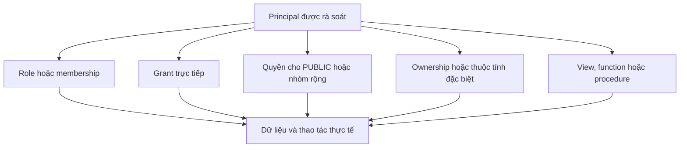

# Review query privilege

## 1. Rà soát quyền truy vấn là rà soát khả năng tiếp cận dữ liệu

Review query privilege là quá trình đối chiếu quyền thực thi truy vấn của một danh tính với nhiệm vụ, phạm vi dữ liệu và điều kiện sử dụng đã được chấp thuận.

Trong Database PAM, công việc này không chỉ là liệt kê những câu lệnh GRANT. Cần xác định danh tính thực sự có thể đọc, sửa hoặc tác động tới dữ liệu bằng những đường nào, rồi quyết định giữ, thu hẹp, thu hồi hoặc giới hạn thời gian.

Ví dụ, ứng dụng chỉ cần xem trạng thái đơn hàng qua một view đã giới hạn trường dữ liệu. Nhưng tài khoản ứng dụng còn thuộc một role có quyền đọc toàn bộ bảng gốc. Việc cấp quyền trên view không làm đường đọc bảng gốc biến mất.

Một lượt rà soát có ích cần trả lời:

- Danh tính nào đang được đánh giá?
- Quyền đến từ đâu và có thể được kích hoạt bằng cách nào?
- Dữ liệu, hàng, cột và thao tác nào thực sự tiếp cận được?
- Quyền có phục vụ một nhiệm vụ hiện hành không?
- Có quyền gián tiếp qua view, function, procedure hoặc ownership không?
- Bằng chứng có đủ để kết luận hay còn thiếu khả năng quan sát?
- Thay đổi quyền sẽ ảnh hưởng tới workflow nào?
- Làm thế nào chứng minh trạng thái sau xử lý đúng với quyết định?

Mục tiêu là quyền phù hợp công việc, không phải một báo cáo có ít dòng GRANT hơn.

### Mục tiêu học tập

Sau bài này, người học có thể:

1. Phân biệt quyền khai báo, quyền có thể sử dụng và truy vấn đã quan sát.
2. Lập bản đồ quyền trực tiếp, role, PUBLIC, ownership và đường thực thi gián tiếp.
3. Kiểm tra quyền cấp bảng, cột và chính sách hàng.
4. Thiết kế kiểm chứng có tác động thấp và không phát tán dữ liệu thật.
5. Ghi quyết định và xác minh việc xử lý quyền theo quy trình PAM.

## 2. Xác định phạm vi trước khi đọc quyền

### 2.1. Principal, endpoint và database

Cần xác định tối thiểu:

| Thành phần | Điều cần xác minh |
|---|---|
| Principal | Định danh ổn định, loại người dùng hoặc workload |
| Nguồn xác thực | Password, federation, certificate hoặc cơ chế khác |
| Endpoint | Đúng instance, cluster, tenant và môi trường |
| Database | Đúng cơ sở dữ liệu đang chứa đối tượng |
| Phiên | Danh tính đăng nhập và danh tính thực thi hiện tại |
| Công cụ | Client, pool, proxy hoặc dịch vụ trung gian |
| Owner | Người chịu trách nhiệm nghiệp vụ và kỹ thuật |
| Mục đích | Workflow cụ thể cần quyền |

Tên hiển thị như reporting hoặc app-user không đủ. Hai môi trường có thể dùng cùng tên nhưng khác dữ liệu và role.

### 2.2. Danh tính đăng nhập khác danh tính thực thi

Một phiên có thể thay đổi role hoặc thực thi module dưới ngữ cảnh khác.

Khi kiểm tra bằng một tài khoản reviewer, kết quả của phiên reviewer không tự mô tả quyền của ứng dụng. Khi kiểm tra bên trong một function có ngữ cảnh đặc biệt, cần biết ngữ cảnh đó ảnh hưởng kết quả ra sao.

Mỗi bằng chứng phải ghi rõ được thu thập dưới danh tính nào.

### 2.3. Con người và workload có nhu cầu khác nhau

Một kỹ sư cần quyền tạm thời để xử lý sự cố. Một ứng dụng có thể cần một tập thao tác lặp lại thường xuyên.

Không dùng quyền quản trị của con người làm tài khoản runtime. Cũng không dùng credential ứng dụng cho mọi lượt hỗ trợ thủ công, vì sẽ khó phân biệt trách nhiệm và vòng đời.

## 3. Ba loại thông tin phải giữ riêng

### 3.1. Quyền khai báo

Đây là những grant, membership, thuộc tính hoặc policy được cấu hình.

Nó cho biết các đầu vào của mô hình quyền nhưng chưa luôn trả lời toàn bộ khả năng sử dụng.

### 3.2. Quyền có hiệu lực trong ngữ cảnh

Đây là khả năng thực hiện thao tác khi xét ngữ cảnh liên quan: role đang hoạt động, ownership, điều kiện, hàng, cột và đường thực thi.

Một principal có thể không có SELECT trực tiếp trên bảng nhưng vẫn đọc một phần dữ liệu qua view hoặc routine được cấp quyền.

### 3.3. Hoạt động quan sát được

Audit hoặc telemetry cho biết những truy vấn đã được ghi nhận trong phạm vi quan sát.

Không thấy sử dụng có thể do:

- Quyền thật sự không còn cần.
- Workflow chạy theo tháng, quý hoặc mùa vụ.
- Đường dự phòng chưa được dùng trong kỳ.
- Có dùng nhưng nguồn log không ghi hoặc không còn lưu.
- Truy vấn chạy qua module hoặc principal trung gian.
- Cách nhóm truy vấn không ánh xạ được tới đối tượng.

Ba loại thông tin này bổ sung cho nhau, không thay thế nhau.

## 4. Lập bản đồ các đường nhận quyền



Sơ đồ là cách tổ chức phân tích. Cơ chế tính quyền cụ thể phải theo đúng engine và phiên bản.

### 4.1. Grant trực tiếp

Đọc đúng đối tượng, loại permission, người cấp và khả năng cấp tiếp.

Cần phân biệt quyền ở một object với quyền ở schema, database hoặc phạm vi rộng hơn.

### 4.2. Membership và role có thể kích hoạt

Một principal có thể nhận quyền qua role trực tiếp hoặc qua chuỗi membership.

Trong một số hệ thống, là thành viên, nhận quyền ngay và được chuyển sang role là những khả năng khác nhau. Cần kiểm tra đường mà công cụ hoặc ứng dụng có thể sử dụng, không chỉ trạng thái role tại thời điểm mở phiên.

### 4.3. PUBLIC và những nhóm rộng

Quyền dành cho một tập danh tính rộng có thể tạo đường mà báo cáo chỉ lọc tên user bỏ sót.

Trong PostgreSQL, PUBLIC là một pseudo-role đại diện mọi role. Phải xét những quyền qua đường này khi đánh giá khả năng truy cập. [PostgreSQL — Privileges](https://www.postgresql.org/docs/18/ddl-priv.html).

Không đồng nhất nó với schema có tên public; hai khái niệm khác nhau.

### 4.4. Ownership và quyền quản trị

Object owner hoặc principal có đặc quyền cao có thể có khả năng vượt những hạn chế mà tài khoản thông thường phải tuân thủ.

Tài khoản runtime làm owner dữ liệu cần được đánh giá như một thiết kế đặc quyền, không chỉ như một tài khoản có vài grant.

### 4.5. Khả năng tạo hoặc thay đường cấp quyền

Người có thể sửa role, thay routine được nhiều người gọi hoặc quản trị nguồn danh tính có thể tác động tới quyền truy vấn dù không có SELECT hiện tại.

Rà soát PAM cần ghi nhận những đường quản trị đó bên cạnh các quyền đọc dữ liệu.

## 5. Phạm vi quyền không chỉ là SELECT trên bảng

| Chiều | Ví dụ câu hỏi |
|---|---|
| Database và schema | Có thể kết nối và phân giải đối tượng cần dùng không? |
| Object | Có quyền trên bảng, view, sequence hoặc routine nào? |
| Cột | Có thể đọc trường nhạy cảm hay chỉ những trường được phép? |
| Hàng | Có giới hạn theo tenant, đơn vị hoặc phạm vi nghiệp vụ không? |
| Thao tác | Đọc, thêm, sửa, xóa, thực thi, xuất dữ liệu hay quản trị? |
| Context | Quyền được dùng trực tiếp, qua role hay qua module? |
| Thời gian | Thường trực hay chỉ khi có grant được kích hoạt? |
| Tài nguyên vận hành | Truy vấn có thể ảnh hưởng tải, lock hoặc dung lượng không? |

### 5.1. SELECT không đồng nghĩa tác động thấp

Quyền đọc có thể cho phép lấy dữ liệu nhạy cảm hoặc truy vấn với chi phí lớn.

Một truy vấn trả về ít hàng chưa chắc xử lý ít dữ liệu. LIMIT cũng không tự bảo đảm toàn bộ kế hoạch có chi phí thấp.

Rà soát quyền dữ liệu và kiểm soát hiệu năng cần phối hợp, nhưng không dùng một giới hạn thời gian chạy làm thay thế cho quyền truy cập đúng.

### 5.2. Từ khóa đầu tiên không đủ phân loại

Một câu SELECT có thể gọi function. Function có thể đọc thêm dữ liệu hoặc có tác động khác theo định nghĩa và quyền.

Không phân loại mọi câu bắt đầu bằng SELECT là “chỉ đọc an toàn”. Cần hiểu những routine và dependency được thực thi.

### 5.3. Quyền cột và quyền bảng

Một principal không có SELECT ở cấp bảng vẫn có thể có quyền trên một số cột, tùy engine.

Ngược lại, quyền SELECT rộng ở cấp bảng có thể làm một thiết kế grant cột hẹp không đạt mục tiêu hạn chế.

Cần thử cả thao tác được phép và trường nhạy cảm bị cấm bằng dữ liệu kiểm thử phù hợp.

## 6. View, function và procedure là những đường quyền riêng

### 6.1. View không phải chỉ là một tên thay thế

Khi dùng view làm ranh giới, cần xem:

- Cột và hàng nào được trả.
- Có function hoặc dependency nhạy cảm không.
- Quyền trên dữ liệu nền được kiểm tra theo ngữ cảnh nào.
- Có đường đọc trực tiếp bảng nguồn không.
- Ai có thể sửa view hoặc đối tượng mà view phụ thuộc.
- View có khả năng cập nhật hay chỉ được dùng để đọc theo quyền hiện có.

Trong PostgreSQL, security_invoker ảnh hưởng việc dùng quyền của người gọi thay vì owner khi kiểm tra quan hệ nền. Vì vậy, phải đọc cấu hình thật thay vì mặc định mọi view có cùng cách đánh giá quyền. [PostgreSQL — CREATE VIEW](https://www.postgresql.org/docs/18/sql-createview.html).

### 6.2. Routine chạy với quyền mạnh hơn người gọi

Một function SECURITY DEFINER trong PostgreSQL thực thi theo quyền của owner.

Cần rà soát owner, quyền EXECUTE, tham số, nội dung và những đối tượng mà function phân giải. Tài liệu nhấn mạnh việc quản lý search_path để tránh phân giải đối tượng từ schema không đáng tin. [PostgreSQL — CREATE FUNCTION](https://www.postgresql.org/docs/18/sql-createfunction.html).

Không kết luận principal không thể đọc dữ liệu chỉ vì không có quyền bảng trực tiếp, khi nó vẫn gọi được routine trả dữ liệu đó.

### 6.3. Dynamic SQL và đầu vào

Một routine có quyền cao cần kiểm soát cách đầu vào được dùng để chọn object hoặc tạo câu lệnh.

Tham số hóa bảo vệ một số ranh giới cú pháp khi dùng đúng, nhưng không tự xác định người gọi có được chọn tenant, bảng hoặc phạm vi dữ liệu nào.

Cần đánh giá authorization cho cả giá trị đầu vào và đối tượng đích.

### 6.4. Module có thể là cách cấp quyền hẹp hợp lệ

Không phải mọi truy cập gián tiếp đều là lỗi. Một routine hoặc view được thiết kế đúng có thể cung cấp một chức năng hẹp mà không mở quyền bảng tổng quát.

Mục tiêu review là xác minh nó chỉ cho khả năng đã được chấp thuận và người gọi không có đường khác rộng hơn.

## 7. Chính sách hàng, tenant và danh tính phiên

### 7.1. Quyền object không mô tả đầy đủ hàng nhìn thấy

Có SELECT trên bảng chưa chắc nhìn được mọi hàng nếu có cơ chế row-level security phù hợp. Nhưng sự tồn tại của policy cũng chưa chứng minh mọi principal đều chịu policy đó.

PostgreSQL phân biệt principal thông thường với superuser, role BYPASSRLS và owner; owner thường có hành vi đặc biệt, còn FORCE ROW LEVEL SECURITY có vai trò riêng. [PostgreSQL — Row Security Policies](https://www.postgresql.org/docs/18/ddl-rowsecurity.html).

Cần kiểm tra bằng đúng ngữ cảnh cần bảo vệ, không dùng một phiên quản trị rồi suy ra kết quả cho người dùng thông thường.

### 7.2. Bộ lọc trong ứng dụng không tự là ranh giới database

Ứng dụng có thể luôn thêm điều kiện tenant vào truy vấn. Điều này không tự hạn chế tài khoản database nếu tài khoản đó có thể gửi một truy vấn khác qua đường trực tiếp.

Nếu dùng policy dựa trên session context, cần xác định ai được thiết lập giá trị, nguồn giá trị có đáng tin không và client có thể tự đổi sang tenant khác hay không.

Một biến chứa tenant_id không trở thành bằng chứng thẩm quyền chỉ vì tên biến hợp lý.

### 7.3. Connection pool có thể làm rò ngữ cảnh

Nếu một kết nối được dùng cho tenant A rồi trả về pool mà không khôi phục đúng trạng thái, yêu cầu tenant B có thể nhận ngữ cảnh sai.

Cần thiết kế cơ chế đặt, giới hạn phạm vi và làm sạch context phù hợp với framework và transaction model.

Không chỉ kiểm thử từng truy vấn độc lập. Cần có tình huống xen kẽ nhiều người dùng và tái sử dụng kết nối.

### 7.4. Không ghi dữ liệu thật vào bằng chứng hàng–cột

Có thể dùng fixture gồm những hàng tổng hợp của hai tenant và các cột giả lập nhạy cảm.

Bằng chứng chỉ cần cho biết ranh giới đúng hay sai cùng tham chiếu kiểm thử. Không cần xuất dữ liệu khách hàng thật để chứng minh policy đang hoạt động.

## 8. Ví dụ rà soát bằng metadata trên PostgreSQL

Các câu SQL dưới đây dành cho lab PostgreSQL 18 hoặc môi trường tương thích đã được cho phép. Chúng chưa được chạy vào database trong quá trình soạn bài.

Giả sử lab đã có:

- Principal app_runtime_demo.
- Role report_reader_demo.
- Schema reporting và sales.
- View reporting.order_summary_demo.
- Bảng sales.orders_demo với cột order_id và customer_email.

Nếu đối tượng không tồn tại, cần chuẩn bị fixture đúng trước khi sử dụng. Không tự thay tên thành object production rồi chạy khi chưa xác định phạm vi.

### 8.1. Ghi nhận ngữ cảnh phiên reviewer

```sql
SELECT
    session_user AS login_identity,
    current_user AS effective_identity,
    current_database() AS database_name;
```

Kết quả mô tả phiên đang chạy câu lệnh. Nó không tự chứng minh một truy vấn kiểm tra tiếp theo đã thực thi dưới app_runtime_demo.

### 8.2. Kiểm tra những quyền liên quan trực tiếp

```sql
SELECT
    has_schema_privilege(
        'app_runtime_demo',
        'reporting',
        'USAGE'
    ) AS can_use_reporting_schema,

    has_table_privilege(
        'app_runtime_demo',
        'reporting.order_summary_demo',
        'SELECT'
    ) AS can_select_summary,

    has_table_privilege(
        'app_runtime_demo',
        'sales.orders_demo',
        'SELECT'
    ) AS has_table_level_select_on_source;
```

Đây là kiểm tra permission theo những đối tượng được chọn, không phải phép chứng minh mọi query workflow đều chạy được.

Còn cần xem quyền cột, quyền schema liên quan, policy hàng, role có thể kích hoạt và các đường qua module.

### 8.3. Không bỏ qua quyền cột

```sql
SELECT
    has_any_column_privilege(
        'app_runtime_demo',
        'sales.orders_demo',
        'SELECT'
    ) AS has_select_on_any_source_column,

    has_column_privilege(
        'app_runtime_demo',
        'sales.orders_demo',
        'order_id',
        'SELECT'
    ) AS can_select_order_id,

    has_column_privilege(
        'app_runtime_demo',
        'sales.orders_demo',
        'customer_email',
        'SELECT'
    ) AS can_select_customer_email;
```

Có quyền trên một cột không đồng nghĩa được SELECT mọi cột. Quyền ở cấp bảng cũng được các hàm kiểm tra cột tính tới theo mô hình của PostgreSQL.

Không xem một kết quả table-level false là bằng chứng hoàn toàn không đọc được bảng.

### 8.4. Phân biệt membership, sử dụng ngay và chuyển role

```sql
SELECT
    pg_has_role(
        'app_runtime_demo',
        'report_reader_demo',
        'MEMBER'
    ) AS is_member,

    pg_has_role(
        'app_runtime_demo',
        'report_reader_demo',
        'USAGE'
    ) AS privileges_available_without_set_role,

    pg_has_role(
        'app_runtime_demo',
        'report_reader_demo',
        'SET'
    ) AS can_set_role;
```

Các phép kiểm tra này trả lời những câu hỏi khác nhau. Một lượt review phải xét cả các ngữ cảnh mà principal được phép chuyển tới, không chỉ tập quyền ngay tại phiên ban đầu.

Các hàm được mô tả trong tài liệu chính thức; khi dùng phiên bản khác cần kiểm tra khả năng và ngữ nghĩa tương ứng. [PostgreSQL — Access Privilege Inquiry Functions](https://www.postgresql.org/docs/18/functions-info.html).

### 8.5. Liệt kê grant nhìn thấy trong phạm vi

```sql
SELECT
    grantor,
    grantee,
    table_schema,
    table_name,
    privilege_type,
    is_grantable
FROM information_schema.table_privileges
WHERE table_schema IN ('sales', 'reporting')
ORDER BY
    table_schema,
    table_name,
    grantee,
    privilege_type;
```

Cần lưu ý khả năng nhìn thấy metadata của phiên reviewer. Một kết quả trống không tự chứng minh không có quyền trên toàn hệ thống.

Trong PostgreSQL, role_table_grants còn bỏ qua đường truy cập qua PUBLIC so với table_privileges theo ngữ cảnh được mô tả. Không dùng một view này làm danh mục đầy đủ mọi quyền có thể có. [PostgreSQL — role_table_grants](https://www.postgresql.org/docs/18/infoschema-role-table-grants.html).

### 8.6. Kiểm tra policy hàng trong đúng ngữ cảnh

```sql
SELECT row_security_active('sales.orders_demo');
```

Kết quả của hàm này phụ thuộc user và môi trường hiện tại. Nếu chạy bằng reviewer hoặc administrator, không được ghi như thể đó là kết quả của ứng dụng.

Cần kết hợp với kiểm tra policy, thuộc tính principal và fixture hàng–cột dưới ngữ cảnh được phép.

## 9. Điều cần chú ý khi rà soát SQL Server

### 9.1. Catalog không luôn liệt kê toàn bộ quyền hiệu lực

sys.database_permissions hữu ích để đọc permission được khai báo, nhưng quyền của fixed database roles không xuất hiện đầy đủ trong view đó. Metadata còn chịu giới hạn về khả năng nhìn thấy của người gọi.

Vì vậy, báo cáo chỉ đọc view này có thể bỏ sót quyền của principal. [Microsoft Learn — sys.database_permissions](https://learn.microsoft.com/en-us/sql/relational-databases/system-catalog-views/sys-database-permissions-transact-sql?view=sql-server-ver17).

### 9.2. Dùng công cụ đánh giá đúng ngữ cảnh

SQL Server cung cấp sys.fn_my_permissions để xem permission hiệu lực trên securable trong ngữ cảnh phù hợp. Khi đánh giá principal khác, cần một cách chuyển hoặc mô phỏng ngữ cảnh được cho phép, không mặc định phiên reviewer là phiên mục tiêu. [Microsoft Learn — sys.fn_my_permissions](https://learn.microsoft.com/en-us/sql/relational-databases/system-functions/sys-fn-my-permissions-transact-sql?view=sql-server-ver17).

Cần phối hợp server role, database role, object, module và cơ chế thực thi của sản phẩm đang dùng.

### 9.3. Không chuyển quy tắc giữa các engine

Không áp ngữ nghĩa PUBLIC, ownership, inheritance hoặc deny của một engine sang engine khác.

Một công cụ rà soát nhiều hệ quản trị cần adapter và bằng chứng riêng cho từng loại, thay vì gom mọi grant thành một bảng rồi tính quyền bằng một công thức chung.

## 10. Quyền hiện tại và quyền trên đối tượng tương lai

### 10.1. Thu hẹp object hiện tại chưa xử lý nguồn cấp lại

Một migration hoặc pipeline có thể cấp quyền rộng cho các object mới. Nếu chỉ sửa một bảng hiện có, các bảng sau vẫn có thể tạo đường truy cập ngoài ý định.

Cần rà soát role tạo object, template migration và những cơ chế cấp quyền tự động.

### 10.2. Default privileges trên PostgreSQL

ALTER DEFAULT PRIVILEGES ảnh hưởng quyền của object được tạo trong tương lai; nó không tự sửa quyền của object đã tồn tại.

Cần xác định đúng role tạo object và phạm vi cấu hình, thay vì sửa một default rồi báo mọi quyền cũ đã thay đổi. [PostgreSQL — ALTER DEFAULT PRIVILEGES](https://www.postgresql.org/docs/18/sql-alterdefaultprivileges.html).

### 10.3. Vai trò của owner và pipeline

Runtime role không nên vô tình làm owner mọi object chỉ vì nó được dùng để chạy migration.

Nếu một pipeline có thể tạo routine quyền cao hoặc thay view mà runtime được gọi, pipeline cũng là một đường tác động tới quyền truy vấn.

Review cần phối hợp với quản lý mã và thay đổi, không chỉ tài khoản đăng nhập database.

## 11. Đối chiếu với nhu cầu và lịch sử sử dụng

### 11.1. Xây ma trận công việc–quyền

Ví dụ cho một ứng dụng chỉ hiển thị trạng thái đơn hàng:

| Công việc | Dữ liệu cần | Quyền có thể phù hợp | Phần cần kiểm chứng |
|---|---|---|---|
| Xem trạng thái | order_id, status | Đọc view giới hạn | Không có đường đọc bảng gốc rộng |
| Tra cứu một đơn | Đơn thuộc đúng phạm vi | View hoặc routine có kiểm tra | Không chọn đơn của tenant khác |
| Tạo đơn | Những trường được nhập | Routine hoặc DML theo thiết kế | Không tự sửa trường quản trị |
| Chẩn đoán lỗi | Metadata hoặc log cần thiết | Quyền tạm theo nhiệm vụ | Không mở toàn bộ dữ liệu khách hàng |
| Migration | Thay cấu trúc đã duyệt | Danh tính triển khai riêng | Không giữ quyền đó ở runtime |

Đây là phân tích thiết kế. Tập permission cụ thể phải được ánh xạ theo engine và ứng dụng.

### 11.2. Khoảng quan sát phải bao phủ chu kỳ thật

Một tài khoản không truy vấn trong vài ngày có thể vẫn phục vụ chốt sổ, đối soát hoặc phục hồi dự phòng.

Cần xác định chu kỳ, owner và bằng chứng bổ sung. Các khoảng như 30 hoặc 90 ngày chỉ là lựa chọn vận hành minh họa, không phải tiêu chuẩn đủ cho mọi dịch vụ.

### 11.3. Một truy vấn thành công chưa chứng minh quyền hợp lệ

Hoạt động đã diễn ra chỉ cho biết khả năng hoặc hành vi quan sát. Nó không tự chứng minh được phê duyệt.

Tương tự, “ứng dụng hiện đang dùng” không phải lý do giữ mọi quyền nếu có thể thay bằng đường hẹp hơn theo kế hoạch.

### 11.4. Không dùng log thiếu như bằng chứng không dùng

Cần biết audit ghi loại sự kiện nào, có sampling không, có che hoặc chuẩn hóa câu lệnh không và retention còn bao phủ khoảng nào.

Khi có pooling hoặc shared login, cần đánh giá khả năng quy truy vấn về workload hoặc người dùng gốc. application_name hoặc nhãn do client tự đặt không tự là bằng chứng xác thực.

## 12. Kiểm thử quyền mà không tạo kết luận sai

### 12.1. Chuẩn bị fixture và kế hoạch

Chọn dữ liệu tổng hợp, principal đại diện và các trường hợp được owner chấp thuận.

Cần có cả:

- Đúng thao tác được phép.
- Sai loại thao tác.
- Sai object.
- Sai cột nhạy cảm.
- Sai tenant hoặc hàng.
- Role được kích hoạt và chưa được kích hoạt.
- Tái sử dụng kết nối trong pool.
- Sau khi quyền tạm bị thu hồi.

Không dùng dữ liệu thật để thực hiện một truy vấn rộng chỉ nhằm xem có bị chặn hay không.

### 12.2. Kiểm tra dưới danh tính thực sự

Nếu dùng cơ chế mô phỏng hoặc chuyển ngữ cảnh, phải biết nó mô phỏng được phần nào.

Một phép kiểm tra quyền object có thể không mô phỏng đầy đủ login, mapping danh tính, policy dựa trên session hoặc cấu hình proxy.

Ghi rõ đâu là kiểm tra metadata, đâu là thử nghiệm trực tiếp với credential được phép.

### 12.3. Permission check không thay kiểm tra dữ liệu trả về

Một helper trả true chưa chứng minh RLS, view hoặc masking tạo đúng kết quả nghiệp vụ.

Cần kiểm tra ranh giới bằng fixture. Ví dụ, user tenant A chỉ nhận hàng của A, cột nhạy cảm không xuất hiện và đường gọi routine không mở rộng phạm vi.

### 12.4. Không dùng EXPLAIN ANALYZE như một phép kiểm tra vô tác động

Trong PostgreSQL, EXPLAIN với ANALYZE thực sự chạy câu lệnh. Vì vậy, có thể phát sinh thay đổi hoặc tác động của routine được gọi.

Không dùng nó như một cách thử quyền an toàn mặc định cho mọi SQL. Cần xem loại câu lệnh, đối tượng và môi trường trước khi lựa chọn công cụ kiểm chứng. [PostgreSQL — EXPLAIN](https://www.postgresql.org/docs/18/sql-explain.html).

### 12.5. Phân biệt permission denied với nguyên nhân khác

Truy vấn thất bại có thể do object không tồn tại, sai schema, thiếu dependency, timeout, lỗi function hoặc lỗi dữ liệu.

Không ghi quyền đã bị chặn nếu chưa xác định lỗi thật sự đến từ kiểm soát nào. Một test fail vì kết nối hỏng không chứng minh authorization đúng.

## 13. Quyết định sau review

Có thể dùng những trạng thái quyết định sau:

| Quyết định | Khi phù hợp | Bằng chứng cần |
|---|---|---|
| KEEP | Quyền phù hợp nhiệm vụ hiện hành | Owner, phạm vi và kiểm chứng |
| NARROW | Nhu cầu có thật nhưng quyền rộng | Đường thay thế, dependency, kế hoạch |
| REVOKE | Không còn nhu cầu hoặc cấp sai | Xác nhận phạm vi, tác động và thực thi |
| TIME_BOUND | Chỉ cần theo từng công việc | Điều kiện, thời hạn và cách thu hồi |
| INVESTIGATE | Chưa đủ dữ liệu hoặc có mâu thuẫn | Khoảng trống, owner và hạn xử lý |

### 13.1. Quyết định phải nêu lý do

Không chỉ ghi “owner approved”. Cần biết owner đã chấp thuận công việc và dữ liệu nào.

Ví dụ:

> Giữ quyền đọc view trạng thái cho runtime; thu hẹp đường đọc bảng gốc chứa email; quyền chẩn đoán đặc biệt chuyển sang grant có thời hạn.

Đây là một quyết định có thể ánh xạ thành thay đổi và kiểm chứng.

### 13.2. Phân biệt giảm quyền và sửa ứng dụng

Một quyền rộng có thể đang che dependency của ứng dụng. Nếu thu hồi ngay, workflow hợp lệ có thể hỏng.

Cần chuẩn bị đường thay thế, kiểm thử và lịch triển khai phù hợp. Không dùng rủi ro gián đoạn làm lý do giữ quyền vô hạn mà không có owner và kế hoạch.

### 13.3. Không áp REVOKE theo danh sách mù

Thu hồi một grant có thể ảnh hưởng role dùng chung hoặc quan hệ cấp tiếp.

Cần biết chính xác object, grantee, grantor và dependency. Nếu engine có lựa chọn về tác động dây chuyền, phải đánh giá trước khi thực thi.

Bài này mô tả quy trình review, không thực hiện thay đổi quyền trên database thật.

## 14. Hồ sơ review và bằng chứng

Một hồ sơ nội bộ có thể như sau:

```yaml
review_reference: QUERY-PRIVILEGE-REVIEW-DEMO-052

scope:
  engine_profile_reference: postgresql-18-demo
  instance_reference: orders-instance-demo
  database_reference: orders-db-demo
  principal_reference: app-runtime-demo

business_need:
  owner_reference: orders-platform-owner
  task_reference: show-order-status
  data_scope_reference: order-summary-only

observations:
  metadata_record_reference: METADATA-DEMO-161
  role_path_record_reference: ROLE-PATH-DEMO-29
  activity_window_reference: ACTIVITY-WINDOW-DEMO-08
  runtime_test_reference: PRIVILEGE-TEST-DEMO-36

finding:
  type: broader-source-table-access-than-approved
  affected_object_reference: sales-orders-demo
  access_path_reference: legacy-reporting-role-demo

decision:
  action: NARROW
  approved_target_reference: summary-view-access-demo
  reviewer_reference: database-security-reviewer
  owner_approval_reference: APPROVAL-DEMO-490

follow_up:
  change_reference: CHANGE-DEMO-913
  verification_state: pending
  next_review_reference: TRACKED-REVIEW-DEMO
```

Các giá trị là minh họa. Schema này không phải cấu hình IAM và không tự thay đổi quyền.

### 14.1. Ghi provenance của kết luận

Cần giữ:

- Nguồn metadata và thời điểm thu thập.
- Danh tính reviewer và khả năng nhìn thấy.
- Principal hoặc context dùng trong test.
- Phiên bản engine.
- Phạm vi log đã quan sát.
- Những kiểm tra chưa thực hiện.
- Giới hạn hoặc mâu thuẫn còn tồn tại.

Một báo cáo không nêu giới hạn có thể bị dùng để kết luận rộng hơn bằng chứng.

### 14.2. Chỉ giữ dữ liệu cần thiết

Không đưa password, token, connection string chứa bí mật hoặc kết quả dữ liệu thật vào hồ sơ.

Nếu câu SQL chứa literal nhạy cảm, cần xử lý phù hợp trước khi lưu làm bằng chứng dùng chung. Việc chuẩn hóa không được làm mất thông tin cần để xác định object và loại thao tác.

### 14.3. Bảo vệ người có quyền review

Reviewer thường cần metadata và quyền kiểm tra hẹp, không mặc định cần superuser.

Nếu phải dùng quyền cao cho một kiểm chứng cụ thể, cần grant riêng, thời hạn, phê duyệt và kết thúc. Không để tài khoản rà soát trở thành một đường đọc mọi dữ liệu thường trực.

## 15. Xác minh sau khi xử lý quyền

### 15.1. Đọc lại đường quyền

Cần xác nhận đúng grant hoặc membership đã thay đổi, đồng thời kiểm tra các đường thay thế như role khác, PUBLIC, owner hoặc routine.

Xóa một dòng grant nhưng principal vẫn có cùng khả năng qua role khác chưa đạt mục tiêu.

### 15.2. Thử cả chiều cho phép và từ chối

Workflow hợp lệ phải tiếp tục hoạt động. Thao tác ngoài phạm vi phải bị chặn vì đúng kiểm soát mong muốn.

Nếu truy vấn ngoài phạm vi thất bại do thiếu dữ liệu fixture, không dùng đó làm bằng chứng thu hồi thành công.

### 15.3. Kết nối và cache cần được xét riêng

Thay membership hoặc quyền có thể được phản ánh khác nhau tùy engine, loại phiên và cơ chế xác thực.

Cần kiểm chứng cả phiên mới và những kết nối đang được pool quản lý khi liên quan. Không mặc định hết hạn grant PAM hoặc đổi password sẽ đóng mọi phiên database hiện có.

### 15.4. Quyền tạm có thể tạo quyền khác

Một người được cấp khả năng quản trị trong thời gian ngắn có thể tạo grant, routine hoặc principal tồn tại lâu hơn.

Kết thúc phiên review hoặc xử lý quyền cần đối soát những thay đổi trong phạm vi nhiệm vụ, không chỉ kiểm tra tài khoản ban đầu đã logout.

### 15.5. Nguồn cấu hình có thể cấp lại quyền

Migration, configuration management hoặc pipeline có thể tái tạo grant cũ.

Cần sửa đúng nguồn được quản lý, rồi kiểm tra sau một lần triển khai hoặc tái tạo đại diện khi phù hợp. Một trạng thái tạm thời đúng chưa chứng minh quyền được giữ đúng bền vững.

## 16. Tình huống xuyên suốt: runtime chỉ cần view trạng thái

Ứng dụng Checkout sử dụng principal app_runtime_demo. Nhu cầu được owner chấp thuận là hiển thị mã đơn và trạng thái qua view reporting.order_summary_demo.

Trong review phát hiện:

- Principal có SELECT trên view.
- Nó còn có đường đọc bảng sales.orders_demo qua role cũ.
- Bảng có cột customer_email không thuộc nhu cầu.
- Một routine chẩn đoán có thể trả dữ liệu rộng hơn.
- Log gần đây chỉ ghi nhận truy vấn view.
- Runtime có thể chuyển sang một role khác trong một số điều kiện.

### 16.1. Những kết luận chưa đủ

Không thể kết luận quyền đúng chỉ vì:

- Màn hình ứng dụng chỉ hiển thị hai trường.
- Không có grant trực tiếp trên bảng.
- Trong vài tuần không thấy đọc bảng gốc.
- Truy vấn view đã thành công.
- Principal được đặt tên readonly.

Cần xem mọi đường sử dụng có thể đạt được.

### 16.2. Hướng quyết định

Một phương án cần được owner và reviewer đánh giá là:

1. Giữ đường đọc view nếu nó đúng phạm vi.
2. Thu hẹp membership cho phép đọc bảng gốc.
3. Rà soát routine chẩn đoán và quyền gọi.
4. Xử lý khả năng chuyển role ngoài nhiệm vụ.
5. Kiểm tra policy hàng và nội dung view.
6. Cập nhật nguồn cấp quyền tự động.
7. Kiểm thử workflow và các đường bị cấm.

Không nhất thiết thu hồi mọi quyền rồi cấp lại từ đầu. Chọn thay đổi có phạm vi rõ ràng và đủ bằng chứng.

### 16.3. Bằng chứng hoàn thành

Cần chứng minh ứng dụng vẫn đọc được view dưới danh tính đúng, không đọc được dữ liệu ngoài phạm vi qua những đường đã xác định và không bị nguồn cấu hình cấp lại quyền cũ.

Nếu vẫn còn đường chưa kiểm chứng, giữ trạng thái điều tra hoặc giới hạn kết luận theo phần đã làm.

## 17. Ma trận kiểm chứng

Các trường hợp dưới đây sử dụng fixture tổng hợp trong môi trường được phép.

| Kiểm tra | Kỳ vọng | Bằng chứng |
|---|---|---|
| Đọc view được duyệt | Thành công đúng trường dữ liệu | Context và kết quả kiểm thử không chứa dữ liệu thật |
| Đọc trực tiếp bảng nguồn ngoài phạm vi | Bị chặn | Lỗi do kiểm soát quyền tương ứng |
| Đọc cột nhạy cảm | Không tiếp cận được theo thiết kế | Test riêng cho cột |
| Đọc hàng của tenant khác | Không trả dữ liệu ngoài phạm vi | Fixture hai tenant và ngữ cảnh đáng tin |
| Gọi routine được duyệt | Chỉ có chức năng đã chấp thuận | Kiểm tra tham số, dữ liệu và tác động |
| Gọi routine ngoài nhiệm vụ | Bị chặn | Quyền EXECUTE và ngữ cảnh thực tế |
| Chuyển sang role mạnh hơn | Không được nếu ngoài nhiệm vụ | Kiểm tra đường SET ROLE hoặc cơ chế tương ứng |
| Quyền qua PUBLIC hoặc nhóm rộng | Không tạo đường ngoài ý định | Metadata cùng kiểm thử |
| Phiên mới và pool hiện hành | Phản ánh trạng thái theo thiết kế | Test vòng đời kết nối |
| Object tạo sau migration | Có quyền đúng baseline | Kiểm tra nguồn tạo và cấu hình tương lai |
| Audit | Truy được principal và thao tác phù hợp | Phạm vi log và chất lượng liên kết |
| Thu hồi quyền tạm | Không còn khả năng ngoài thời hạn | Quan sát tại database và đường cấp mới |

Không đánh dấu PASS cho mọi mục chỉ vì một công cụ tính quyền trả về một kết quả tổng quát.

## 18. Những lỗi review thường gặp

### 18.1. Chỉ lọc GRANT theo username

Cách này bỏ sót role, membership, PUBLIC, ownership và đường qua module.

### 18.2. Dùng reviewer đặc quyền để thử dữ liệu

Kết quả của administrator không đại diện cho tài khoản runtime hoặc người dùng thông thường.

### 18.3. Coi không có log là không dùng

Cần biết coverage và chu kỳ nghiệp vụ. Thiếu bằng chứng phải được giữ là thiếu bằng chứng.

### 18.4. Chỉ sửa grant trên object hiện tại

Nguồn migration hoặc default privileges có thể tiếp tục cấp quyền ngoài phạm vi cho object mới.

### 18.5. Tin tên readonly

Tên role hoặc nhãn trong ticket không mô tả đầy đủ quyền thực tế, routine được gọi và dữ liệu tiếp cận được.

### 18.6. Review chỉ có quyết định, chưa có readback

Một bảng đã ký nhưng quyền ở database chưa đổi là công việc chưa được thực thi hoàn chỉnh.

Cần tách quyết định, thay đổi và xác minh để trạng thái phản ánh đúng tiến độ.

## 19. Bài tập phân tích

Một dịch vụ dùng chung tài khoản database cho nhiều tenant. Nhóm vận hành khẳng định tài khoản chỉ đọc vì:

- Tên role là report_readonly.
- Ứng dụng luôn thêm tenant_id vào câu SQL.
- Không có grant trực tiếp trên bảng nhạy cảm trong báo cáo.
- Báo cáo lấy từ một catalog bằng tài khoản reviewer hạn chế.
- Tài khoản có thể gọi một function do owner mạnh sở hữu.
- Pool kết nối chưa có kiểm thử đổi tenant.
- Sau review, nhóm chỉ xóa một grant cũ trong database, chưa sửa migration.

Hãy trả lời:

1. Những đường quyền nào có thể bị bỏ sót?
2. Tên role và bộ lọc tenant ở ứng dụng chứng minh được điều gì?
3. Cần kiểm tra function và ownership thế nào?
4. Kết quả catalog trống có đủ để kết luận không có quyền không?
5. Cần những kiểm thử nào cho pool và hàng–cột?
6. Làm thế nào xác nhận quyền không được cấp lại?

### Hướng phân tích

Cần xem role, khả năng kích hoạt role, quyền rộng, ownership và đường thực thi qua function. Một báo cáo thiếu metadata có thể bỏ sót thông tin, nên phải nêu giới hạn của reviewer.

Tên role không chứng minh quyền. Bộ lọc tenant có thể là hành vi của ứng dụng nhưng không tự ràng buộc mọi câu SQL mà principal có thể gửi.

Function cần được đánh giá owner, ngữ cảnh thực thi, quyền EXECUTE, tham số và dependency. Không có quyền bảng trực tiếp chưa loại bỏ được khả năng tiếp cận dữ liệu qua nó.

Test cần dùng danh tính đúng, fixture nhiều tenant, cột nhạy cảm và tình huống tái sử dụng kết nối. Không dùng dữ liệu thật hoặc phiên administrator để thay cho các test này.

Cuối cùng, cần xử lý migration và những nguồn cấp quyền tự động, rồi đọc lại trạng thái và kiểm chứng sau triển khai phù hợp. Nếu chỉ xóa grant thủ công, công việc chưa chắc bền vững.

## 20. Những điểm cần nhớ

Review query privilege là đối chiếu nhiệm vụ với khả năng truy cập dữ liệu thực tế, không chỉ kiểm đếm GRANT.

Phải phân biệt metadata quyền, quyền trong từng ngữ cảnh và hoạt động đã quan sát. Mỗi nguồn có giới hạn và cần được ghi rõ.

Role, ownership, view, function, policy hàng, quyền cột và nguồn cấu hình tương lai đều có thể ảnh hưởng kết luận.

Một lượt review hoàn chỉnh có quyết định cụ thể, thay đổi được kiểm soát, kiểm chứng dưới danh tính phù hợp và bằng chứng rằng các đường ngoài phạm vi đã được xử lý.
