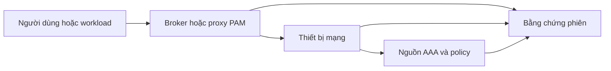

# Command allowlist

## 1. Command allowlist giải quyết vấn đề gì?

Command allowlist là danh sách những thao tác quản trị được phép thực hiện trong một phạm vi xác định. Trong Network PAM, nó thường được dùng để giới hạn lệnh mà người dùng hoặc hệ thống tự động có thể chạy trên router, switch, firewall và những thành phần mạng khác.

Một tài khoản đăng nhập được vào thiết bị không nhất thiết cần quyền thay cấu hình, mở shell hệ điều hành, tải file hoặc chuyển sang thiết bị khác.

Ví dụ, nhân viên trực mạng cần xem trạng thái hai cổng uplink. Nhu cầu đó có thể được đáp ứng bằng một tập thao tác quan sát có tham số giới hạn, thay vì cấp toàn bộ quyền quản trị thiết bị.

Allowlist tốt phải trả lời được:

- Ai được thực hiện thao tác?
- Trên thiết bị và môi trường nào?
- Trong chế độ hoặc ngữ cảnh CLI nào?
- Lệnh, subcommand và tham số nào được phép?
- Có giới hạn dữ liệu trả về hoặc tác động vận hành không?
- Kiểm soát được thực thi ở thiết bị, AAA hay proxy?
- Khi policy lỗi hoặc AAA không khả dụng thì hành vi ra sao?
- Làm thế nào truy vết và kết thúc quyền?

Mục tiêu là cho phép đúng công việc, không chỉ tạo một biểu thức khớp vài chuỗi văn bản.

### Mục tiêu học tập

Sau bài này, người học có thể:

1. Phân biệt command authorization với đăng nhập và ghi nhật ký.
2. Thiết kế allowlist theo thao tác, tham số, thiết bị và ngữ cảnh.
3. Nhận diện rủi ro từ wildcard, viết tắt và các đường quản trị khác.
4. Kiểm chứng hành vi từ chối, lỗi AAA, cache và thu hồi quyền.
5. Quản lý policy có phiên bản và bằng chứng theo quy trình PAM.

## 2. Đăng nhập, cấp quyền lệnh và accounting là các việc khác nhau

### 2.1. Authentication

Authentication xác định danh tính khi truy cập. Nó có thể bao gồm xác thực cá nhân, MFA ở lớp truy cập phù hợp hoặc cơ chế cho workload.

Đăng nhập thành công không chứng minh người dùng được chạy mọi lệnh trong CLI.

### 2.2. Authorization

Authorization quyết định một yêu cầu cụ thể có được phép hay không.

Có thiết kế cấp một lớp quyền cho cả phiên; có thiết kế đánh giá từng lệnh. Phải biết mô hình thực tế, vì một role cấp lúc đăng nhập có thể không kiểm tra lại trạng thái grant ở mỗi thao tác.

TACACS+ phân biệt các chức năng authentication, authorization và accounting; tài liệu giao thức cũng mô tả authorization theo phiên hoặc theo từng lệnh. [RFC 8907 — TACACS+](https://www.rfc-editor.org/rfc/rfc8907.html).

### 2.3. Accounting

Accounting ghi nhận những sự kiện được hệ thống hỗ trợ và cấu hình, chẳng hạn yêu cầu lệnh, thời điểm hoặc trạng thái liên quan.

Ghi log không tự ngăn lệnh ngoài phạm vi. Ngược lại, một lệnh bị policy ở proxy chặn trước khi tới thiết bị có thể không tạo cùng loại sự kiện tại thiết bị.

Cần kết hợp các nguồn bằng chứng thay vì mặc định một nguồn có toàn bộ chuỗi.

### 2.4. Command authorization không phải network firewall rule

Một ACL mạng kiểm soát đường kết nối. Nó không tự hiểu người dùng vừa đăng nhập SSH đang chạy thao tác gì trong CLI.

Allowlist lệnh và kiểm soát mạng bổ sung cho nhau: một lớp giới hạn đường truy cập, lớp khác giới hạn công việc trên đường đó.

## 3. Xác định vị trí thực thi kiểm soát



Sơ đồ là kiến trúc khái quát. Có hệ thống chỉ dùng một phần các thành phần này.

### 3.1. Thực thi tại thiết bị

Thiết bị dùng role, login class, privilege hoặc cơ chế authorization để đánh giá thao tác.

Ưu điểm về ranh giới là quyết định gắn gần nơi lệnh được thực thi. Nhưng hiệu lực phụ thuộc loại thiết bị, phiên bản, chế độ, kênh truy cập và cấu hình cụ thể.

Một policy có trong AAA nhưng không được áp dụng tới đúng đường quản trị chưa tạo kiểm soát đầy đủ.

### 3.2. Thực thi tại proxy

Proxy có thể giữ credential, kiểm tra yêu cầu và giới hạn những thao tác được chuyển tiếp.

Cần xác định proxy hiểu lệnh theo mô hình nào. Một bộ lọc chỉ nhìn chuỗi nhập hoặc nội dung màn hình có thể không hiểu đầy đủ mode, tham số hay cú pháp mà thiết bị thực thi.

Nếu người dùng có credential đủ mạnh và gọi trực tiếp thiết bị qua đường khác, policy ở proxy tùy chọn không kiểm soát đường đó.

### 3.3. Kết hợp nhiều lớp

Có thể dùng cả proxy và device-side authorization.

Tuy nhiên, phải xác định khi hai lớp có phiên bản policy khác nhau thì lớp nào chặn, log thể hiện quyết định nào và làm thế nào phát hiện lệch cấu hình.

Không dùng nhiều lớp như lý do bỏ kiểm chứng từng lớp.

### 3.4. Nơi ra quyết định phải có đủ ngữ cảnh

Một yêu cầu nên được đánh giá cùng:

- Danh tính được xác thực.
- Thiết bị đích ổn định.
- Loại phần mềm và phiên bản tương thích.
- Đường truy cập.
- Chế độ CLI hoặc ngữ cảnh cấu hình.
- Lệnh và thứ tự tham số.
- Grant và thời hạn.
- Phiên bản policy đang áp dụng.

Nếu không xác định được ngữ cảnh cần thiết, không được tự đoán một ngữ cảnh ít rủi ro rồi cho phép.

## 4. Từ yêu cầu nghiệp vụ tới thao tác được cấp

### 4.1. Bắt đầu từ công việc

Yêu cầu “được dùng show” quá rộng so với một công việc như:

> Xem trạng thái và số liệu lỗi của hai cổng uplink đã xác định trên một nhóm thiết bị trong thời gian trực sự cố.

Cần xác định dữ liệu nào đủ cho công việc và dữ liệu nào không cần cung cấp.

### 4.2. Phân loại theo tác động

| Nhóm thao tác | Ví dụ chức năng | Điểm cần kiểm tra |
|---|---|---|
| Quan sát trạng thái | Xem một interface hoặc adjacency | Đúng đích, dữ liệu và mức chi tiết |
| Chẩn đoán chủ động | Kiểm tra kết nối | Đích, nguồn, VRF, số lần và tải |
| Thay đổi cấu hình | Sửa tham số đã duyệt | Phạm vi diff và trạng thái trước–sau |
| Tác động vận hành | Reset, clear hoặc chuyển trạng thái | Gián đoạn và tác động dây chuyền |
| Truy cập file hoặc shell | Đọc, ghi, chạy công cụ khác | Đường tới hệ điều hành và dữ liệu |
| Quản trị bảo mật | Sửa AAA, user, policy hoặc logging | Khả năng mở rộng quyền và che dấu hoạt động |

Tên lệnh có vẻ chỉ đọc không tự chứng minh đầu ra không nhạy cảm. Một chức năng chẩn đoán tổng hợp có thể thu nhiều thông tin hơn công việc cần.

### 4.3. Cần giới hạn cả đối tượng và tham số

Một thao tác xem interface có thể cần giới hạn tập cổng. Một thao tác kiểm tra kết nối có thể cần giới hạn đích và tham số tải.

Không cấp wildcard cho mọi tham số chỉ vì tên lệnh nằm trong danh sách an toàn.

### 4.4. Tách quan sát và bảo trì

Vai trò quan sát không nên tự có quyền chuyển sang cấu hình hoặc thực hiện bảo trì.

Nếu cần xử lý sự cố bằng thao tác thay đổi, nên có grant khác với phạm vi, người phê duyệt và thời hạn phù hợp.

## 5. Mô hình policy có cấu trúc

Ví dụ sau mô tả ý định cấp quyền nội bộ. Nó không phải cấu hình có thể nạp trực tiếp vào router, TACACS+ server hoặc một sản phẩm PAM.

```yaml
policy_reference: NETWORK-OBSERVE-DEMO-12
policy_version: "4"

subjects:
  approved_group_references:
    - network-observers-demo

targets:
  device_group_reference: edge-devices-demo
  software_profile_reference: approved-cli-profile-demo
  access_path_reference: managed-pam-cli

default_decision: DENY

rules:
  - action_reference: interface.read-state
    cli_mode_reference: operational
    parameters:
      interface_reference:
        type: enumeration
        allowed_values:
          - uplink-demo-1
          - uplink-demo-2
      detail_level:
        type: enumeration
        allowed_values:
          - summary

conditions:
  active_grant_required: true
  target_match_required: true
  verified_command_mapping_required: true

evidence:
  decision_record_required: true
  execution_correlation_required: true
```

### 5.1. Tách ý định khỏi cú pháp thiết bị

Hành động interface.read-state cần được ánh xạ tới lệnh thật theo nền tảng.

Một hành động có thể có cú pháp khác trên hai hệ điều hành mạng. Cần quản lý mapping và kiểm thử riêng, không thay tên lệnh bằng một mẫu chuỗi gần giống rồi coi là tương đương.

### 5.2. Mỗi rule phải khép kín phạm vi

Cần biết rule cho phép:

- Chế độ nào.
- Thiết bị nào.
- Đối tượng nào.
- Mức chi tiết nào.
- Biến thể cú pháp nào.
- Những tùy chọn phụ nào.

Nếu rule không định nghĩa một tùy chọn có thể làm mở rộng tác động, không nên tự coi tùy chọn đó là được phép.

### 5.3. Default deny cần được hiện thực thật

Trường default_decision trong ví dụ chỉ mô tả ý định.

Hệ thống thực thi phải có hành vi từ chối khi không có rule cho phép phù hợp và xử lý rõ trường hợp không hiểu được yêu cầu.

Không gọi một policy là allowlist nếu thực tế mọi lệnh không khớp đều được chuyển sang một quyền mặc định rộng.

## 6. So khớp toàn bộ thao tác thay vì tiền tố

### 6.1. Vấn đề của tiền tố

Một kiểm tra “chuỗi bắt đầu bằng show” không phân biệt:

- Đối tượng nào được xem.
- Đầu ra có chứa cấu hình hoặc dữ liệu nhạy cảm không.
- Những phần mở rộng cú pháp có tác động gì.
- Có thêm thao tác được parser nhận diện trên cùng đầu vào không.
- Lệnh thuộc mode và context nào.

Không dùng tên đầu tiên của lệnh như toàn bộ quyết định.

### 6.2. Regex có thể hữu ích nhưng cần đúng ngữ nghĩa

Giả sử một ngữ pháp lab tự định nghĩa chỉ có dạng:

```text
inspect interface uplink-demo-1
inspect interface uplink-demo-2
```

Đây là câu lệnh giả định để giải thích mô hình, không phải cú pháp của một vendor.

Một biểu thức minh họa có thể viết:

```text
^inspect interface (uplink-demo-1|uplink-demo-2)$
```

Ngay cả ở ví dụ đơn giản này, phải xác minh regex engine dùng full match hay tìm một đoạn khớp, cách xử lý cuối dòng và đầu vào nhiều dòng.

Không coi việc có dấu ^ và $ là bằng chứng đã xử lý đúng mọi trường hợp trên mọi engine.

### 6.3. Không chuẩn hóa làm thay đổi ý nghĩa

Một bộ chuẩn hóa không nên tùy ý:

- Chuyển mọi tham số sang chữ thường.
- Xóa dấu ngoặc hoặc dấu nháy.
- Gộp nhiều dòng thành một dòng.
- Bỏ ký tự mà thiết bị thực sự diễn giải.
- Cắt phần đầu hoặc cuối vì cho là “không quan trọng”.

Tên đối tượng và giá trị có thể phân biệt hoa–thường hoặc phụ thuộc cách quote. Cần bảo toàn ngữ nghĩa theo parser đích.

### 6.4. Biến thể cú pháp cần được kiểm chứng

Thiết bị có thể hỗ trợ viết tắt, completion, alias hoặc những dạng biểu diễn khác.

Phải xác minh nơi thực thi gửi hoặc đánh giá dạng nào: đầu vào gốc, tên lệnh đã mở rộng hay các trường tham số riêng.

Không tự giả định bộ lọc và parser thiết bị nhìn cùng một chuỗi.

### 6.5. Thứ tự tham số có thể quan trọng

TACACS+ mô tả cmd và cmd-arg cho lệnh và đối số; nhiều cmd-arg có thứ tự. Vì vậy, đánh giá chỉ tên lệnh mà bỏ đối số hoặc thứ tự có thể không phản ánh yêu cầu thực tế. [RFC 8907 — Authorization Arguments](https://www.rfc-editor.org/rfc/rfc8907.html).

Khi tích hợp cần đọc những gì thiết bị cụ thể gửi, không chỉ xem mẫu policy ở server.

## 7. Chế độ CLI và ngữ cảnh cấu hình

### 7.1. Cùng từ khóa có thể có ý nghĩa khác

Một hệ điều hành mạng có thể có operational mode, configuration mode, những context theo interface, routing instance hoặc đối tượng khác.

Lệnh được phép ở một context không tự được phép ở context khác.

Nếu proxy chỉ đoán mode qua ký tự prompt, cần đánh giá độ tin cậy của cách nhận biết đó. Một prompt quan sát được không luôn là dữ liệu trạng thái có thẩm quyền.

### 7.2. Chuyển mode cũng là một quyền

Nếu một vai trò chỉ được quan sát, cần kiểm tra khả năng vào cấu hình, nâng privilege, mở shell hoặc gọi một cơ chế quản trị khác.

Không chỉ chặn các lệnh thay đổi đã biết mà vẫn cho phép một đường chuyển tới môi trường có khả năng rộng hơn.

### 7.3. Candidate configuration và commit

Với nền tảng có cấu hình candidate hoặc cơ chế tương tự, cấp quyền sửa một đối tượng và cấp quyền commit cần được phân tích cùng nhau.

Cần xác định một lần commit có thể áp dụng những thay đổi nào, kể cả thay đổi không thuộc công việc đang xét.

Được phép gõ một lệnh commit không tự chứng minh nội dung cuối chỉ chứa diff đã được duyệt.

### 7.4. Không sao chép mặc định giữa các dòng thiết bị

Ví dụ, tài liệu Cisco Catalyst 1300 mô tả điều kiện riêng để configuration commands được đưa vào authorization. Điều đó cho thấy phải kiểm tra phạm vi coverage của cấu hình thực tế, không suy luận từ việc đã bật một dạng command authorization. [Cisco — Catalyst 1300 AAA Commands](https://www.cisco.com/c/en/us/td/docs/switches/campus-lan-switches-access/Catalyst-1200-and-1300-Switches/cli/C1300-cli/aaa_commands.html).

Cú pháp và mặc định của ví dụ này không được áp như quy tắc chung cho mọi thiết bị Cisco hoặc vendor khác.

## 8. Dữ liệu đầu ra và tác động phụ

### 8.1. Lệnh quan sát có thể làm lộ dữ liệu

Đầu ra có thể chứa:

- Cấu hình xác thực hoặc tham chiếu bí mật.
- Địa chỉ quản trị và cấu trúc mạng.
- Thông tin session, người dùng hoặc kết nối.
- Chính sách firewall hoặc routing.
- Dữ liệu chẩn đoán liên quan khách hàng.

Cần phân loại đầu ra và giới hạn theo nhu cầu. Một lệnh đã được cho chạy không tự làm đầu ra trở thành thông tin được chia sẻ rộng.

### 8.2. Tùy chọn detail hoặc export cần đánh giá riêng

Một biến thể tổng hợp hoặc chi tiết có thể trả nhiều dữ liệu hơn biến thể summary.

Các cơ chế lưu, tải hoặc chuyển đầu ra tới đích khác cần được xem như khả năng dữ liệu riêng, theo cú pháp mà nền tảng hỗ trợ.

Không giả định mọi toán tử hoặc ký tự đặc biệt hoạt động như shell Unix. Phải kiểm tra ngữ pháp thật của thiết bị.

### 8.3. Lệnh chẩn đoán chủ động tạo lưu lượng

Chức năng kiểm tra kết nối có thể gửi traffic. Cần giới hạn những tham số phù hợp như đích, nguồn, context mạng, số lần và kích thước theo công việc.

Một allowlist cho phép mọi đích và mọi mức tải có thể vượt nhu cầu quan sát thông thường.

### 8.4. Một số thao tác nhỏ vẫn thay đổi trạng thái

Clear counter, reset session hoặc thao tác tương tự có thể ảnh hưởng điều tra hoặc dịch vụ, tùy loại.

Phải phân loại theo tác động thật thay vì xem mọi lệnh chẩn đoán là chỉ đọc.

## 9. Hành vi khi từ chối, lỗi hoặc mất AAA

### 9.1. DENY khác ERROR

Một quyết định từ chối có nghĩa policy đã đánh giá và không cho phép.

Một lỗi hoặc timeout có nghĩa không nhận được quyết định hợp lệ theo đường dự kiến.

Hai trường hợp không nên bị gộp thành “AAA thất bại” rồi tự chuyển sang một quyền cục bộ rộng.

### 9.2. Phải biết method list và fallback thực tế

Tài liệu Cisco IOS mô tả authorization method list có phân biệt trường hợp không nhận phản hồi với trường hợp nguồn authorization trả về từ chối. Các method như if-authenticated hoặc none cũng không tương đương một allowlist theo từng lệnh. [Cisco — Configuring Authorization](https://www.cisco.com/c/en/us/td/docs/ios-xml/ios/sec_usr_aaa/configuration/15-mt/sec-usr-aaa-15-mt-book/configuring_authorization.html).

Khi vận hành cần kiểm tra đúng sản phẩm và phiên bản; không lấy một mẫu fallback của dòng khác rồi áp vào thiết bị đang dùng.

### 9.3. Chính sách lỗi phải được định nghĩa trước

Một thiết kế cho vai trò quan sát có thể yêu cầu từ chối lệnh nếu không xác minh được grant hoặc policy.

Những công việc khẩn cấp cần đường break-glass riêng, có danh tính, phạm vi, cảnh báo và hậu kiểm rõ ràng.

Không biến việc central AAA không khả dụng thành quyền quản trị thường trực cho mọi phiên đã đăng nhập.

### 9.4. Cache cần có vòng đời

Nếu thiết bị hoặc proxy cache quyền, cần biết:

- Cache chứa dữ liệu nào.
- Thời hạn bao lâu.
- Policy mới được nhận khi nào.
- Thu hồi ảnh hưởng phiên đang mở ra sao.
- Có thể vô hiệu hóa cache theo cơ chế nào.
- Làm thế nào phát hiện thiết bị đang dùng policy cũ.

Không hứa thu hồi tức thời nếu kiến trúc thực tế còn cửa sổ cache.

### 9.5. Kiểm chứng lỗi trong lab

Cần thử riêng:

- Quyết định cho phép hợp lệ.
- Quyết định từ chối hợp lệ.
- Server không phản hồi.
- Kết nối bị gián đoạn.
- Policy không có hoặc sai phiên bản.
- Thiết bị không hỗ trợ thuộc tính cần dùng.
- Cache còn hạn và đã hết hạn.

Không tạo lỗi AAA trên production chỉ để thử mà chưa có kế hoạch vận hành và đường phục hồi phù hợp.

## 10. Những đường quản trị ngoài CLI

### 10.1. API không tự chịu regex CLI

Thiết bị có thể có NETCONF, RESTCONF, API riêng, giao diện web hoặc giao thức quản trị khác.

Một allowlist CLI không tự chứng minh các đường này có cùng giới hạn.

NACM là mô hình kiểm soát truy cập cho những hoạt động và dữ liệu mạng theo giao thức, với khái niệm khác việc khớp một chuỗi CLI. Cần ánh xạ từng đường quản trị theo cơ chế thực tế. [RFC 8341 — Network Configuration Access Control Model](https://www.rfc-editor.org/rfc/rfc8341.html).

### 10.2. Tài khoản cục bộ và console

Local user, console hoặc cổng quản trị ngoài băng có thể dùng policy khác đường SSH thông thường.

Cần kiểm kê ai có credential, scope và cách sử dụng. Tài khoản khẩn cấp phải được quản lý như một đường đặc quyền riêng, không là ngoại lệ vô chủ.

### 10.3. Shell, script và tác vụ tự động

Nếu một lệnh cho phép chạy script, gọi công cụ khác hoặc thay job tự động, cần đánh giá khả năng mà đường đó mở ra.

Chỉ giới hạn lệnh khởi động không đủ nếu nội dung script hoặc nguồn tải vẫn do người dùng tùy ý kiểm soát.

### 10.4. Controller hoặc orchestrator

Một người có thể không gọi trực tiếp thiết bị nhưng có quyền sửa template hoặc pipeline đang thực thi bằng tài khoản mạnh.

Do đó, người sửa mã, tham số và danh tính thực thi của automation cũng nằm trong đường quản trị cần PAM kiểm soát.

## 11. Đối chiếu với mô hình vendor

### 11.1. Junos login class

Junos có login class, permission flags và các cơ chế allow/deny cho lệnh hoặc hierarchy cấu hình.

Tài liệu cũng phân biệt các dạng statement có cách tìm và khớp khác nhau. Không chuyển nguyên regex giữa các dạng rồi mặc định kết quả không đổi. [Juniper — Defining Login Classes](https://www.juniper.net/documentation/us/en/software/junos/cli-reference/topics/ref/statement/class-edit-system-login.html).

### 11.2. Quy tắc kết hợp phải theo đúng cấu hình

Cần đọc cách quyền nền, allow, deny, exact match và regex được kết hợp trên phiên bản đang dùng.

Không áp một quy tắc “deny luôn thắng” hoặc “allow luôn thu hẹp” chung cho mọi nền tảng và mọi loại statement.

### 11.3. Bản hỗ trợ lệnh thay đổi theo phần mềm

Một phiên bản mới có thể bổ sung subcommand, alias hoặc tùy chọn.

Nếu policy dùng wildcard, khả năng mới có thể nằm trong vùng khớp ngoài ý định. Cần kiểm thử hồi quy khi nâng phần mềm hoặc đổi mapping lệnh.

### 11.4. Không có một cấu hình chung cho mọi thiết bị

Các ví dụ trong bài là mô hình thiết kế, không phải một bộ lệnh AAA áp dụng trực tiếp.

Trước khi thay cấu hình quản trị cần có baseline, phạm vi tác động, đường phục hồi và kiểm chứng trên thiết bị đại diện.

## 12. Quy trình JIT cho một nhiệm vụ quan sát

### 12.1. Hợp đồng grant minh họa

```yaml
grant_reference: NETWORK-GRANT-DEMO-208

actor_reference: engineer-demo-lan

target:
  device_group_reference: edge-devices-demo
  allowed_device_references:
    - edge-device-demo-a

task:
  reference: inspect-uplink-errors
  incident_reference: INCIDENT-DEMO-319
  action_profile_reference: NETWORK-OBSERVE-DEMO-12
  policy_version: "4"

parameters:
  allowed_interface_references:
    - uplink-demo-1
    - uplink-demo-2
  allowed_detail_level: summary

validity:
  not_before: "2030-09-10T02:00:00Z"
  expires_at: "2030-09-10T02:20:00Z"

approval:
  decision_reference: APPROVAL-DEMO-81
  owner_reference: network-operations-lead
```

Đây là dữ liệu quản trị, không phải một resource thiết bị tự thực thi thời hạn.

### 12.2. Kiểm tra trước từng quyết định cần thiết

Một mô hình logic minh họa:

```text
function authorizeCommand(authenticatedSession, deviceContext, rawRequest):
    actor = trustedIdentity(authenticatedSession)
    grant = loadGrantFromTrustedSource(authenticatedSession.grantReference)

    require grant.isActiveAt(trustedNow())
    require grant.actorReference == actor.reference
    require grant.allowsDevice(deviceContext.stableReference)
    require grant.allowsAccessPath(authenticatedSession.accessPath)

    mapping = loadApprovedMapping(
        deviceContext.platform,
        deviceContext.softwareProfile,
        grant.policyVersion
    )

    parsed = mapping.parseCompleteRequest(rawRequest, deviceContext.mode)

    if parsed.isUnknown or parsed.isAmbiguous:
        return DENY

    require grant.allowsAction(parsed.action)
    require grant.allowsAllParameters(parsed.parameters)
    require contextPolicy.allows(actor, deviceContext, parsed)

    recordAuthorizationDecision(
        actor,
        grant.reference,
        deviceContext,
        parsed,
        ALLOW
    )

    return ALLOW
```

Các hàm chỉ mô tả những kiểm soát cần hiện thực. Chúng không bảo đảm một proxy bất kỳ có thể parse chính xác mọi CLI.

### 12.3. Đánh giá và thực thi phải gắn cùng yêu cầu

Sau khi được duyệt, không được đổi thiết bị, mode hoặc tham số mà vẫn dùng quyết định cũ.

Hệ thống cần bảo đảm chính thao tác đã được đánh giá là thao tác được chuyển tới nơi thực thi.

Nếu có prompt xác nhận làm thay đổi hoặc hoàn tất tác động, cần quản lý trạng thái đó theo đúng cơ chế, không tự động trả lời mọi prompt bằng một mẫu chung.

### 12.4. Khi nhu cầu vượt allowlist

Một lệnh bị chặn có thể cho thấy công việc cần capability khác. Khi đó ghi rõ thao tác, đích và lý do rồi đi qua luồng phê duyệt phù hợp.

Không tự chuyển sang tài khoản quản trị chung hoặc thêm wildcard để hoàn tất nhanh nhiệm vụ.

## 13. Audit: quyết định cho phép khác kết quả thực thi

### 13.1. Chuỗi bằng chứng

Cần liên kết được:

1. Actor được xác thực.
2. Grant và phê duyệt.
3. Thiết bị và phiên.
4. Policy cùng phiên bản.
5. Thao tác đã được đánh giá.
6. Quyết định cho phép hoặc từ chối.
7. Việc thiết bị nhận và thực thi yêu cầu theo bằng chứng có được.
8. Kết quả đọc lại nếu có thay đổi.
9. Kết thúc quyền.

Một quyết định ALLOW không chứng minh lệnh đã chạy. Một accounting record cũng cần được hiểu theo loại sự kiện và khả năng sản phẩm.

### 13.2. Bản ghi chuẩn hóa minh họa

```yaml
event_reference: COMMAND-EVENT-DEMO-701
event_type: command-authorization

actor:
  original_principal_reference: engineer-demo-lan
  device_account_reference: network-session-account-demo

context:
  device_reference: edge-device-demo-a
  software_profile_reference: approved-cli-profile-demo
  mode_reference: operational
  session_reference: SESSION-DEMO-109

authorization:
  grant_reference: NETWORK-GRANT-DEMO-208
  policy_reference: NETWORK-OBSERVE-DEMO-12
  policy_version: "4"
  action_reference: interface.read-state
  parameter_reference: approved-interface-parameter-record-demo
  decision: ALLOW

execution:
  state: not-yet-confirmed
  correlation_reference: EXECUTION-DEMO-104
```

Nếu actor được liên kết từ broker thay vì thiết bị trực tiếp xác nhận, cần giữ nguồn và độ tin cậy của phép nối.

### 13.3. Bảo vệ nội dung lệnh và đầu ra

Một lệnh có thể chứa giá trị nhạy cảm; đầu ra cũng có thể chứa cấu hình hoặc dữ liệu cần hạn chế.

Cần quy định cách bảo vệ bản gốc và bản dùng cho vận hành, quyền đọc, thời gian lưu và xử lý giá trị bí mật.

Không bỏ toàn bộ bằng chứng cần thiết chỉ để tránh dữ liệu nhạy cảm, nhưng cũng không ghi password, token hoặc nội dung cấu hình mật vào báo cáo phổ biến.

### 13.4. Accounting không phải bản ghi đầy đủ màn hình

Tùy sản phẩm, accounting có thể ghi thông tin lệnh và sự kiện mà không lưu toàn bộ output.

Session recording có thể bổ sung, nhưng không tự chứng minh mọi kênh API hoặc automation đều được bao phủ.

Cần biết nguồn nào ghi điều gì và phần nào chưa quan sát.

## 14. Vòng đời policy và quyền quản trị policy

### 14.1. Policy là mã có ảnh hưởng đặc quyền

Cần quản lý phiên bản, review và thử nghiệm cho:

- Rule cho phép.
- Mapping lệnh.
- Regex.
- Thứ tự và cách kết hợp rule.
- Phạm vi thiết bị.
- Thuộc tính nhận từ AAA.
- Hành vi lỗi và fallback.

Một thay đổi một ký tự trong regex có thể mở rộng phạm vi lớn hơn mô tả change.

### 14.2. Tách người sử dụng và người sửa allowlist

Nếu người bị giới hạn có thể sửa policy hoặc nhóm được cấp quyền, ranh giới dễ bị vượt qua qua đường quản trị.

Cần kiểm kê repository, pipeline, AAA server và tài khoản quản trị thiết bị như các đường đặc quyền liên quan.

### 14.3. Phát hành theo nhóm đại diện

Thử trên những nền tảng, phiên bản và mode thực tế nằm trong phạm vi.

Không kết luận “đã test trên switch” nếu cả hệ thống còn router, firewall hoặc dòng phần mềm khác có parser và authorization khác.

### 14.4. Đọc lại và phát hiện drift

Sau triển khai, xác minh policy hoặc mapping thực tế ở các điểm thực thi.

Một thay đổi đúng trên server trung tâm chưa chứng minh mọi thiết bị đã nhận, không còn cache cũ hoặc không có cấu hình local mở rộng quyền.

### 14.5. Rollback phải bảo toàn thay đổi hợp lệ khác

Nếu cần phục hồi policy, phải xác định đúng revision và phạm vi.

Không lấy toàn bộ snapshot cũ rồi ghi đè những thay đổi khác đã được phê duyệt mà không đối chiếu. Giữ rõ trạng thái mong muốn và nguồn cấu hình có thẩm quyền.

## 15. Kiểm chứng allowlist trong lab

### 15.1. Kiểm tra đường được phép

Dùng principal thật hoặc cách mô phỏng được xác minh đúng, thiết bị đại diện và grant có phạm vi.

Thử đầy đủ những thao tác hợp lệ mà công việc cần, không chỉ một lệnh đầu tiên.

### 15.2. Kiểm tra đường bị cấm

Cần chọn những thao tác hợp lệ trên thiết bị nhưng ngoài phạm vi grant để chứng minh policy từ chối.

Một chuỗi sai cú pháp bị CLI báo lỗi không chứng minh allowlist đã chặn đúng quyền.

### 15.3. Kiểm tra parser và tham số

Bao gồm những biến thể mà nền tảng hỗ trợ:

- Khoảng trắng và cách quote.
- Viết tắt hoặc tên lệnh đã mở rộng.
- Tham số theo thứ tự khác nếu có.
- Tùy chọn mức chi tiết.
- Context mạng hoặc đối tượng khác.
- Đầu vào nhiều dòng hoặc nhóm thao tác khi được giao thức hỗ trợ.
- Những phần mở rộng cú pháp liên quan.

Không cần thực hiện tác động nguy hiểm trên production. Có thể dùng tài nguyên lab và chức năng có tác động thấp.

### 15.4. Ma trận đại diện

| Trường hợp | Kỳ vọng | Bằng chứng cần |
|---|---|---|
| Đúng action, cổng và thiết bị | Cho phép | Quyết định cùng kết quả phù hợp |
| Đúng action nhưng cổng ngoài danh sách | Từ chối | Rule phạm vi tham số có hiệu lực |
| Đúng cổng nhưng mức chi tiết chưa duyệt | Từ chối hoặc theo policy đã định | Không được mở rộng ngầm |
| Đúng lệnh nhưng sai thiết bị | Từ chối | Grant ràng buộc đích |
| Chuyển sang mode ngoài nhiệm vụ | Không tạo quyền mới | Trạng thái và quyết định |
| Lệnh thay đổi dưới vai trò quan sát | Từ chối | Đúng nguyên nhân authorization |
| Parser không hiểu yêu cầu | Từ chối theo thiết kế | Không tự chuyển tiếp |
| AAA trả DENY | Giữ kết quả từ chối | Không fallback thành quyền rộng |
| AAA không phản hồi | Theo chính sách lỗi đã duyệt | Không nhầm với trường hợp DENY |
| Policy cache cũ | Phát hiện hoặc xử lý đúng thiết kế | Phiên bản và độ trễ thực tế |
| API ngoài CLI | Có kiểm soát riêng hoặc bị chặn | Kiểm kê đúng đường truy cập |
| Hết hạn grant | Không tiếp tục quyền ngoài cửa sổ theo cơ chế công bố | Thử tại nơi thực thi |

### 15.5. Đánh giá coverage

Báo cáo cần nêu nền tảng, phiên bản, kênh, mode, principal và những trường hợp chưa thử.

Không dùng một kết quả PASS tổng quát để che những đường chưa được kiểm chứng.

## 16. Kết thúc grant và phiên quản trị

### 16.1. Hết hạn không tự có cùng hiệu lực ở mọi nơi

Cần xác định điều gì kết thúc khi grant hết hạn:

- Khả năng mở phiên mới.
- Khả năng xin credential.
- Quyền chạy lệnh tiếp theo.
- Kết nối CLI đang tồn tại.
- Cache authorization.
- Tác vụ nền đã được tạo.
- Credential hoặc quyền khác phát sinh.

Nếu thiết bị chỉ nhận role lúc đăng nhập, phải có cơ chế phù hợp để xử lý phiên đang mở theo yêu cầu.

### 16.2. Không coi đóng proxy là toàn bộ containment

Nếu một credential có thể được dùng trực tiếp ngoài proxy, cần xử lý đường đó.

Đổi credential cũng cần được kiểm chứng với phiên hiện tại và loại tài khoản đang dùng, không mặc định mọi thiết bị đều hủy ngay kết nối đã xác thực.

### 16.3. Thay đổi cấu hình tồn tại sau phiên

Kết thúc quyền không hoàn tác cấu hình đã commit hoặc tác vụ đã tạo.

Cần đối soát diff, candidate, job hoặc thay đổi liên quan với nội dung phê duyệt. Nếu cần phục hồi, thực hiện theo phạm vi và trạng thái thực tế.

### 16.4. Break-glass phải có hồi kết

Một tài khoản khẩn cấp cần có bằng chứng sử dụng, người chịu trách nhiệm và kế hoạch đưa hoạt động trở lại đường quản trị chuẩn.

Không để fallback tạm trở thành một đường thường trực có toàn quyền nhưng không được theo dõi.

## 17. Tình huống: nhóm NOC xem lỗi uplink

Nhóm NOC được giao xem trạng thái hai uplink trên một thiết bị edge trong 20 phút.

Thiết kế ban đầu:

- Người dùng xác thực qua hệ thống tập trung.
- Proxy cho phép mọi dòng bắt đầu bằng một tiền tố lệnh quan sát.
- Không kiểm tra tham số interface hoặc mức chi tiết.
- Thiết bị có tài khoản cục bộ với quyền rộng.
- AAA không phản hồi thì dùng một phương án fallback chưa được kiểm chứng.
- Chưa kiểm kê API quản trị.
- Báo cáo chỉ ghi đăng nhập thành công.

### 17.1. Những thiếu sót

Đăng nhập chưa kiểm soát thao tác. Tiền tố không giới hạn đối tượng, dữ liệu và tùy chọn.

Tài khoản local và API có thể là các đường khác ngoài proxy. Fallback chưa rõ làm hành vi khi mất AAA không có bằng chứng.

Log đăng nhập không cho biết đã chạy lệnh gì và trên cổng nào.

### 17.2. Thiết kế theo nhiệm vụ

Cần xác định action quan sát, hai cổng, thiết bị, mức chi tiết và thời hạn.

Mapping sang CLI được kiểm thử trên đúng phần mềm. Những đường API hoặc local được kiểm soát theo cùng mục tiêu, với break-glass tách riêng.

Mỗi quyết định liên kết actor, grant, policy và tham số; kết quả thực thi được đối soát theo khả năng nguồn log.

### 17.3. Nhu cầu thay đổi vượt phạm vi

Trong lúc kiểm tra, NOC nhận thấy cần một thao tác tác động trạng thái.

Vai trò quan sát không tự mở quyền đó. Cần một yêu cầu bảo trì riêng với cổng, tác động, thời điểm và kế hoạch kiểm chứng phù hợp.

Không sửa allowlist chung của toàn nhóm chỉ để xử lý một tình huống đơn lẻ.

## 18. Phát hiện sử dụng bất thường

Có thể theo dõi:

- Nhiều yêu cầu ngoài allowlist trong một phiên.
- Chọn thiết bị hoặc interface ngoài công việc.
- Thử chuyển mode, mở shell hoặc đường thực thi khác.
- Sử dụng API hoặc tài khoản local không khớp quy trình.
- Tăng mức chi tiết hoặc xuất dữ liệu ngoài nhu cầu.
- Thay policy, AAA hoặc logging trong phiên quan sát.
- Thiết bị liên tục dùng cache hoặc fallback.
- Hoạt động sau thu hồi theo thời gian sự kiện thực tế.
- Policy version không khớp bản đã duyệt.

Một yêu cầu bị chặn có thể là lỗi thao tác hoặc nhu cầu chưa được mô hình hóa. Cần đối chiếu ngữ cảnh thay vì xem mọi deny là xâm nhập.

Ngược lại, một loạt thao tác thành công cũng cần được kiểm tra nếu đi qua một đường không nằm trong baseline.

## 19. Bài tập phân tích

Một công ty dùng command allowlist cho tài khoản vận hành. Nhóm triển khai cho rằng hệ thống đã đạt JEA vì:

- Có MFA khi vào cổng PAM.
- Policy cho phép một tiền tố CLI rộng.
- Người dùng không có quyền sửa policy trên giao diện.
- Tài khoản device có thể mở một cơ chế thực thi script.
- Cùng credential còn được dùng qua API quản trị.
- Khi AAA timeout, thiết bị có thể dùng quyền từ nguồn khác.
- Hết thời hạn chỉ ngăn mở phiên mới.
- Người dùng vẫn sửa được repository pipeline phát hành allowlist.

Hãy phân tích:

1. MFA đang kiểm soát phần nào?
2. Vì sao tiền tố chưa mô tả đủ quyền?
3. Những đường quản trị nào có thể làm vượt phạm vi JEA?
4. Có thể coi không sửa được giao diện policy là đã tách nhiệm vụ không?
5. Cần thử gì khi AAA từ chối và khi không phản hồi?
6. Làm thế nào xác nhận quyền đã kết thúc trong phiên đang mở?

### Hướng phân tích

MFA là kiểm soát xác thực, không tự quyết định từng thao tác.

Policy cần hiểu lệnh, tham số, context và đích. Khả năng thực thi script cùng API riêng cần được kiểm kê và ràng buộc theo cơ chế của từng đường.

Người sửa repository phát hành vẫn có khả năng tác động tới allowlist. Tách nhiệm vụ phải bao phủ nguồn cấu hình và pipeline, không chỉ giao diện quản trị.

DENY và timeout phải được thử riêng, với bằng chứng về method list, fallback và cache thực tế.

Nếu hết hạn chỉ ngăn phiên mới, cần một cơ chế xử lý quyền trong phiên hiện tại theo yêu cầu. Cũng cần đối soát tác vụ và thay đổi đã tạo, không chỉ đóng trạng thái trong PAM.

## 20. Những điểm cần nhớ

Command allowlist giới hạn công việc quản trị bằng một tập thao tác có phạm vi, tham số và ngữ cảnh rõ ràng.

Authentication, command authorization và accounting là các kiểm soát khác nhau. Một phiên đăng nhập được ghi log chưa chứng minh lệnh đã được giới hạn.

Cần kiểm chứng parser, wildcard, mode, tham số, lỗi AAA, fallback, cache và những đường quản trị ngoài CLI trên đúng nền tảng.

Trong PAM, JEA chỉ có ý nghĩa khi giới hạn được thực thi trên mọi đường nằm trong phạm vi; JIT chỉ hoàn tất khi đã xác minh vòng đời quyền và phiên theo cơ chế thực tế.
