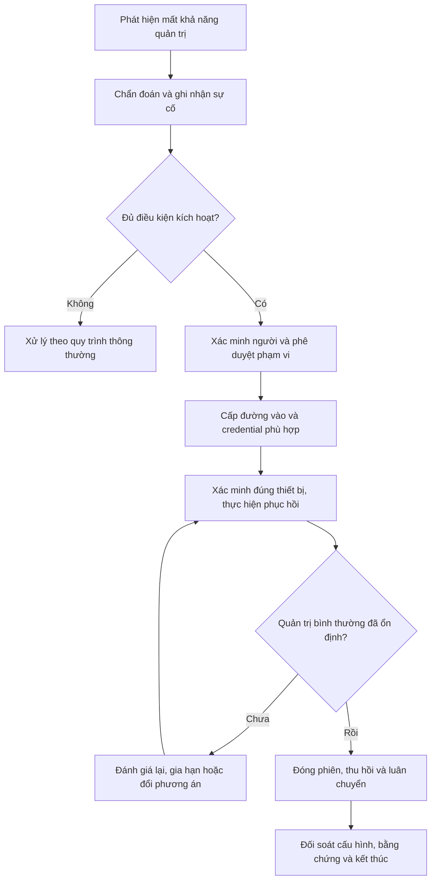

# Emergency network access: truy cập mạng khẩn cấp có kiểm soát

## 1. Vì sao cần một đường truy cập khẩn cấp?

Một hệ thống PAM bảo vệ tài khoản quản trị mạng bằng cách kiểm soát ai được truy cập thiết bị, vào thời điểm nào, với quyền gì và để làm nhiệm vụ nào. Trong điều kiện bình thường, người quản trị xác thực bằng danh tính cá nhân, nhận phê duyệt, đi qua gateway hoặc bastion, rồi truy cập router, switch, firewall hay bộ cân bằng tải bằng một phiên được theo dõi.

Nhưng chính hạ tầng mạng có thể làm hỏng chuỗi truy cập này. Một thay đổi định tuyến khiến thiết bị không tới được máy chủ AAA; một rule firewall chặn đường từ PAM đến mạng quản trị; một lỗi DNS làm gateway không tìm thấy dịch vụ xác thực. Khi đó, yêu cầu “hãy đăng nhập qua PAM để sửa mạng” có thể trở thành vòng phụ thuộc không thể thực hiện.

**Emergency network access** là khả năng truy cập quản trị trong tình huống khẩn cấp theo một cơ chế đã chuẩn bị, nhằm khôi phục dịch vụ hoặc đưa hệ thống về trạng thái an toàn. Nó không đồng nghĩa với mở mọi cổng quản trị hay cấp toàn quyền vĩnh viễn cho đội vận hành.

Trong phạm vi Privileged Access Management, cơ chế này phải giải quyết đồng thời bốn vấn đề:

- Người thực hiện vẫn được nhận diện và chịu trách nhiệm.
- Quyền khẩn cấp có phạm vi, lý do và thời hạn rõ ràng.
- Đường kết nối còn hoạt động khi một phần hạ tầng chính bị lỗi.
- Credential, cấu hình và bằng chứng được kiểm soát sau khi sử dụng.

Ví dụ xuyên suốt bài học: một doanh nghiệp có trung tâm dữ liệu DC-A, cặp firewall biên và các switch lõi. Một thay đổi trên firewall làm mất đường từ mạng quản trị đến cụm AAA. Lưu lượng ứng dụng hiện còn hoạt động, nhưng phiên quản trị mới qua PAM thất bại. Đội ứng cứu phải sửa đúng đường quản trị mà không làm gián đoạn thêm data plane.

## 2. Phân biệt mất quyền, mất đường và mất hệ thống cấp quyền

Một lỗi đăng nhập không đủ để kết luận cần kích hoạt tài khoản khẩn cấp. Trước hết phải xác định điều gì đang hỏng.

| Hiện tượng | Khả năng cần kiểm tra | Hướng xử lý ban đầu |
|---|---|---|
| Không mở được kết nối quản trị tới thiết bị | Route, ACL, firewall, interface quản trị, dịch vụ quản trị | Kiểm tra đường đi từ điểm quản trị được phép |
| Kết nối tới thiết bị được nhưng AAA timeout | Reachability của AAA, route hồi đáp, dịch vụ AAA, cấu hình server | Đối chiếu lỗi và trạng thái máy chủ từ một nguồn độc lập |
| AAA trả về từ chối rõ ràng | Sai credential, tài khoản khóa, thiếu quyền hoặc chính sách từ chối | Xử lý theo quy trình danh tính; không mặc định chuyển sang tài khoản khẩn cấp |
| PAM gateway không mở được phiên nhưng AAA còn hoạt động | Sự cố gateway, connector, policy hoặc kết nối gateway–thiết bị | Xem xét đường quản trị dự phòng đã được phê duyệt |
| Đăng nhập được nhưng không chạy được lệnh cần thiết | Authorization, command policy, role hoặc privilege level | Xác định quyền tối thiểu cần bổ sung |
| Không truy cập được cả mạng quản trị chính và mạng dự phòng | Mất điện, lỗi vật lý, lỗi chung của nhiều lớp hạ tầng | Chuyển sang console tại chỗ nếu khả dụng và có thẩm quyền |

Điểm quan trọng là phân biệt **không nhận được phản hồi xác thực** với **nhận được phản hồi từ chối xác thực**. Cách một thiết bị chuyển từ AAA tập trung sang xác thực cục bộ phụ thuộc sản phẩm, phiên bản và cấu hình. Không được giả định thiết bị sẽ fallback trong mọi loại lỗi.

Nếu chỉ cần sai mật khẩu tập trung là hệ thống tự cho thử một tài khoản cục bộ toàn quyền, đường khẩn cấp có thể làm suy yếu chính sách kiểm soát truy cập. Điều kiện fallback phải được kiểm chứng trong môi trường thử nghiệm và ghi rõ trong runbook của từng họ thiết bị.

Tương tự, không lấy việc người dùng thiếu quyền làm lý do tự động cấp quyền khẩn cấp. Emergency access là một ngoại lệ vận hành có kiểm soát, không phải cơ chế thay thế yêu cầu cấp quyền thông thường.

## 3. Ba lớp phải còn hoạt động

Một thiết kế emergency access chỉ khả dụng khi cả kết nối, danh tính và khả năng thao tác đều được giải quyết.

### 3.1. Lớp kết nối

Người ứng cứu cần tới được giao diện quản trị: SSH trên interface quản trị, console nối tiếp qua console server, console vật lý tại chỗ hoặc cơ chế quản trị phần cứng được hỗ trợ.

Có credential đúng nhưng route quản trị đã mất vẫn không đăng nhập được. Bởi vậy, “đã tạo tài khoản break-glass” chưa phải là hoàn thành thiết kế.

### 3.2. Lớp xác thực và cấp quyền

Thiết bị cần chấp nhận một danh tính hoặc credential dự phòng theo chính sách. Credential này phải lấy được ngay cả khi một số thành phần bình thường không hoạt động.

Nếu bản thân vault chỉ truy cập được qua firewall đang lỗi, việc cất mật khẩu khẩn cấp duy nhất trong vault đó tạo ra một vòng phụ thuộc. Cần một phương án dự phòng phù hợp với mức độ sẵn sàng yêu cầu, chẳng hạn một điểm truy xuất độc lập hoặc bản escrow ngoại tuyến được bảo quản và kiểm kê.

Không nhất thiết mọi credential phải được sao chép ngoại tuyến. Tập hợp cần dự phòng phải được chọn theo mức độ trọng yếu, phụ thuộc thực tế và khả năng bảo vệ bản sao.

### 3.3. Lớp thao tác và khôi phục

Đăng nhập được chưa chắc sửa được sự cố. Người ứng cứu cần có quyền chạy đúng lệnh, có bản cấu hình tốt đã biết, hiểu cơ chế commit hoặc lưu cấu hình, và có phương án quay lui.

Một tài khoản được phép xem trạng thái nhưng không được sửa route có thể đủ cho chẩn đoán, nhưng không đủ cho bước phục hồi. Ngược lại, một tài khoản toàn quyền không giới hạn thời gian tạo ra rủi ro quá lớn nếu chỉ cần kiểm tra trạng thái interface.

Với thiết bị không hỗ trợ quyền chi tiết trong chế độ khẩn cấp, phải ghi nhận hạn chế đó và bổ sung kiểm soát bằng phạm vi thiết bị, đường kết nối, người giám sát và thời gian sử dụng.

## 4. In-band, out-of-band và console tại chỗ

**In-band management** sử dụng đường mạng có phụ thuộc đáng kể vào hạ tầng đang vận hành dịch vụ. **Out-of-band management**, thường viết là OOB, cung cấp một đường quản trị được thiết kế để giảm phụ thuộc vào đường chính. Mức độc lập thực tế có thể khác nhau giữa các hệ thống.

| Đường truy cập | Vai trò phù hợp | Điểm cần kiểm chứng |
|---|---|---|
| PAM qua mạng quản trị chính | Lựa chọn bình thường | Gateway, AAA, DNS, route, chứng thư và policy |
| Gateway dự phòng qua mạng quản trị | Khi một thành phần PAM chính lỗi | Có thật sự độc lập với thành phần đang lỗi không |
| SSH qua mạng OOB | Khi đường quản trị chính không dùng được | Interface, route, ACL, nguồn điện và xác thực của OOB |
| Console server qua OOB | Khi cấu hình IP quản trị hoặc SSH trên thiết bị lỗi | Console server còn truy cập được và đã map đúng cổng thiết bị |
| Console vật lý tại chỗ | Khi cả các đường từ xa đều mất | Người trực, quyền vào phòng máy, cáp, máy trạm và thủ tục xác minh |

Một VRF quản trị riêng có thể giúp phân tách lưu lượng, nhưng không tự động tạo ra một đường OOB độc lập về vật lý. Nếu nó đi qua cùng cặp switch, cùng nguồn điện và cùng firewall đang lỗi, nhiều nguyên nhân chung vẫn có thể làm mất cả hai đường.

Console server cũng không mặc nhiên an toàn hơn SSH. Nó có thể mở ra quyền thao tác mạnh, kể cả các chức năng ngoài hệ điều hành mạng thông thường tùy thiết bị. Bản thân console server cần được quản lý như một tài sản đặc quyền: danh tính riêng, cập nhật phù hợp, giới hạn nguồn truy cập, ghi nhật ký và bảo vệ cổng vật lý.

Một modem hoặc kết nối di động dự phòng không nên trở thành cổng quản trị mở trực tiếp ra Internet. Nếu dùng phương án này, phải có thiết kế truy cập được xác thực, mã hóa và giới hạn đích rõ ràng. Cũng cần tính đến vùng phủ sóng, nguồn điện, hạn dùng dịch vụ và khả năng truy cập khi hệ thống trung tâm không hoạt động.

## 5. Tách dependency để tránh đường dự phòng chỉ tồn tại trên sơ đồ

Hãy xem xét chuỗi phụ thuộc sau:

```text
Người quản trị
  -> VPN doanh nghiệp
  -> nhà cung cấp danh tính
  -> PAM gateway
  -> DNS nội bộ
  -> firewall quản trị
  -> AAA
  -> thiết bị mạng
```

Nếu một rule trên firewall quản trị làm mất đường đến AAA và DNS, nhiều thành phần trong chuỗi có thể cùng lỗi. Thêm một gateway nhưng vẫn đặt sau firewall đó chưa giải quyết được nguyên nhân chung.

Một thiết kế dự phòng có thể có dạng:

```text
Đường bình thường:
Máy trạm quản trị -> PAM gateway -> mạng quản trị -> thiết bị

Đường khẩn cấp:
Máy trạm ứng cứu được chỉ định
  -> điểm truy cập OOB có kiểm soát
  -> console server hoặc interface quản trị dự phòng
  -> đúng thiết bị cần phục hồi

Nguồn credential dự phòng:
Điểm truy xuất hoặc escrow được bảo vệ
  -> người được phép nhận
  -> credential khẩn cấp của đúng thiết bị
```

Sơ đồ chỉ có ý nghĩa khi kèm bảng dependency cụ thể.

| Thành phần | Câu hỏi cần trả lời |
|---|---|
| Nguồn điện | OOB có dùng chung nguồn có thể làm hỏng cả đường chính không? |
| Đường truyền | OOB có đi qua chính thiết bị đang cần phục hồi không? |
| Danh tính | Nếu IdP hoặc MFA chính lỗi, ai được xác minh người yêu cầu và bằng cách nào? |
| Vault | Nếu vault chính không truy cập được, lấy credential được phép ở đâu? |
| DNS | Có thông tin địa chỉ và định danh dự phòng được bảo vệ, cập nhật không? |
| Thời gian | Thiết bị, console server và hệ thống lưu bằng chứng có sai lệch đồng hồ không? |
| Phê duyệt | Người phê duyệt có liên lạc được bằng một kênh độc lập không? |
| Runbook | Hướng dẫn và cấu hình phục hồi có đọc được khi mạng nội bộ mất không? |

Dùng địa chỉ IP trực tiếp có thể giảm phụ thuộc DNS, nhưng không loại bỏ yêu cầu xác minh đúng thiết bị. Với SSH, cần đối chiếu khóa máy chủ bằng nguồn tin cậy đã chuẩn bị. Với giao thức dùng chứng thư, vẫn phải kiểm tra danh tính đích theo thiết kế của hệ thống. Không giải quyết lỗi DNS bằng cách tắt mọi kiểm tra danh tính máy chủ.

## 6. Xác định điều kiện kích hoạt

Một tiêu chí kích hoạt tốt phải gắn với sự cố và mục tiêu phục hồi, không chỉ với mức độ sốt ruột của người yêu cầu.

Ví dụ các trường hợp có thể xem xét:

- Đường quản trị bình thường không hoạt động, khiến không thể thực hiện tác vụ cần thiết để phục hồi sự cố đang diễn ra.
- AAA hoặc PAM bị lỗi và thời gian chờ phục hồi vượt ngưỡng tác động đã được tổ chức xác định.
- Một thay đổi mạng cần được quay lui khẩn cấp để ngăn gián đoạn lan rộng.
- Có bằng chứng đáng tin cậy cho thấy đường quản trị bình thường không còn đáng tin, cần sử dụng đường ứng cứu đã tách biệt.

Các trường hợp như quên đăng ký quyền, muốn làm nhanh hơn quy trình thay đổi, hoặc tài khoản cá nhân bị từ chối mà chưa rõ nguyên nhân không tự động đáp ứng điều kiện.

Mỗi lần kích hoạt cần xác định tối thiểu:

| Thuộc tính | Ví dụ minh họa |
|---|---|
| Sự cố liên quan | INC-2026-0412 |
| Đích | Firewall biên DC-A, đúng thiết bị và cổng console |
| Lý do | Không mở được phiên mới vì AAA không tới được |
| Mục tiêu | Khôi phục đường quản trị đến AAA |
| Người thực hiện | Một kỹ sư mạng được chỉ định theo danh tính cá nhân |
| Người phê duyệt | Người trực có thẩm quyền xử lý sự cố |
| Quyền cần dùng | Xem trạng thái và sửa đúng nhóm cấu hình liên quan |
| Thời hạn | Cửa sổ ngắn đủ thực hiện và đánh giá lại |
| Phương án quay lui | Khôi phục phần cấu hình quản trị từ bản tốt đã biết |

Các con số thời hạn và ngưỡng tác động phải do tổ chức lựa chọn theo khả năng phản ứng. Không có một thời hạn cố định phù hợp cho mọi firewall, mọi trung tâm dữ liệu và mọi kiểu sự cố.

Nếu nguy cơ lạm dụng hoặc xâm nhập đang hiện hữu, cần phối hợp với người điều phối ứng cứu an ninh. Không đưa credential khẩn cấp lên một máy trạm nghi bị kiểm soát chỉ vì máy đó còn kết nối được.

## 7. Quyền khẩn cấp phải nhỏ nhất có thể

Least privilege vẫn áp dụng trong sự cố. Điểm khác là cơ chế thực thi có thể bị giới hạn bởi trạng thái của hạ tầng.

Trong điều kiện đầy đủ, có thể cấp quyền **JIT** theo một cửa sổ ngắn và **JEA** theo tập thao tác cần thiết. Khi hệ thống cấp quyền động gặp lỗi, thiết bị có thể phải dùng một tài khoản cục bộ đã chuẩn bị. Lúc này, một phần giới hạn có thể cần thực hiện ở gateway OOB, console server hoặc quy trình điều phối.

Có thể giới hạn theo nhiều chiều:

- **Đích:** một firewall hoặc một nhóm thiết bị cụ thể, thay vì toàn bộ mạng.
- **Đường vào:** chỉ từ máy trạm ứng cứu qua điểm truy cập được chỉ định.
- **Danh tính:** một người trực chịu trách nhiệm cho phiên.
- **Tác vụ:** chẩn đoán và phục hồi phần quản trị liên quan.
- **Thời gian:** hết cửa sổ phải đánh giá lại trước khi tiếp tục.
- **Số phiên:** tránh nhiều người đồng thời thay đổi cùng thiết bị.
- **Credential:** ưu tiên riêng cho từng thiết bị hoặc phạm vi nhỏ được quản lý rõ ràng.

Không nên dùng một mật khẩu khẩn cấp chung cho mọi switch, router và firewall. Khi mật khẩu bị lộ, phạm vi ảnh hưởng sẽ rất lớn và việc luân chuyển cũng khó kiểm soát.

Tuy nhiên, việc tạo hàng nghìn credential riêng mà không thể truy xuất, kiểm kê hoặc luân chuyển đáng tin cậy cũng không tạo ra khả năng phục hồi thực tế. Thiết kế cần cân bằng phạm vi ảnh hưởng với khả năng vận hành, rồi diễn tập để chứng minh rằng credential đúng có thể được lấy và sử dụng trong thời gian cần thiết.

Nếu thiết bị chỉ hỗ trợ tài khoản khẩn cấp toàn quyền, phải nói rõ đây là quyền rộng. Không gọi đó là JEA chỉ vì tài khoản có tên “emergency-readonly”.

## 8. Quản lý credential và dual control

Credential khẩn cấp có thể là mật khẩu cục bộ, khóa riêng, credential của console server hoặc một cơ chế được sản phẩm hỗ trợ. Mỗi loại có vòng đời khác nhau, nhưng đều cần kiểm soát việc cấp phát, sử dụng và thu hồi.

### 8.1. Chuẩn bị trước sự cố

Credential phải được tạo theo chính sách của tổ chức, gắn với owner và có thông tin ánh xạ tới đúng thiết bị. Bản escrow cần được bảo vệ khỏi việc đọc trái phép, sửa đổi và thất lạc.

Với bản ngoại tuyến, cần quản lý vị trí lưu giữ, quyền tiếp cận, tình trạng niêm phong hoặc kiểm tra toàn vẹn, ngày kiểm thử và quy trình thay bản sau luân chuyển. Mã hóa chỉ hữu ích khi cách lấy khóa giải mã không phụ thuộc hoàn toàn vào hệ thống đã mất.

Không ghi credential vào ticket, trang runbook chung, cuộc trò chuyện sự cố hoặc file cấu hình minh họa.

### 8.2. Xác minh người yêu cầu

Nếu kênh danh tính chính không hoạt động, quy trình dự phòng phải xác minh người yêu cầu bằng nguồn đã đăng ký trước. Một cuộc gọi tự xưng là quản trị viên hoặc một tin nhắn từ địa chỉ quen thuộc chưa đủ làm bằng chứng độc lập.

Có thể dùng cơ chế xác minh được tổ chức phê duyệt qua danh sách trực và kênh liên lạc dự phòng. Chi tiết cần được chuẩn bị trước; không sáng tạo một phương pháp nhận dạng mới giữa sự cố.

### 8.3. Hai người kiểm soát

Dual control giúp tách người yêu cầu, người phê duyệt và người mở credential theo khả năng của tổ chức. Nó không nhất thiết có nghĩa hai người đều nhìn thấy toàn bộ mật khẩu.

Ví dụ, một người phê duyệt việc checkout, hệ thống cấp credential cho người thao tác và ghi nhận đầy đủ danh tính. Với escrow vật lý, hai người có thể cùng xác nhận đúng phong bì hoặc kho lưu trữ trước khi mở.

Cần tránh thiết kế mà cả hai người giữ quyền đều không thể liên lạc khi sự cố lớn xảy ra. Nếu tổ chức chấp nhận một ngoại lệ một người trong tình huống đặc biệt, ngoại lệ phải được xác định trước, có điều kiện kích hoạt, thông báo và rà soát sau sự cố. Không mặc định bỏ dual control chỉ vì người phê duyệt phản hồi chậm.

### 8.4. Sau khi credential được mở

Credential đã được tiết lộ hoặc có khả năng bị sao chép phải được đưa vào quy trình luân chuyển phù hợp. Chỉ xóa tin nhắn chứa mật khẩu không làm credential trở lại trạng thái bí mật.

Cũng không nên xoay mật khẩu ngay lập tức nếu thao tác đó có thể cắt đường phục hồi duy nhất mà chưa có kiểm thử thay thế. Thứ tự luân chuyển phải đi cùng việc xác nhận một đường truy cập còn hoạt động và kế hoạch tiếp tục ứng cứu.

## 9. Vòng đời một lần truy cập khẩn cấp

Một mô hình trạng thái giúp tránh việc “đăng nhập được” bị coi là kết thúc quy trình.



Trong thực tế, một phiên có thể bị gián đoạn, phải đổi người hoặc cần gia hạn. Mỗi chuyển tiếp cần được ghi nhận thay vì tiếp tục dùng quyền cũ một cách ngầm định.

Nếu kỹ sư đầu tiên phải bàn giao, người nhận không nên chỉ được chuyển một mật khẩu qua chat rồi tiếp tục dưới danh tính của người trước. Cần cấp hoặc xác nhận quyền cho người nhận, ghi mốc bàn giao và xác định trách nhiệm cho các thao tác tiếp theo.

Nếu hết thời hạn nhưng chưa phục hồi xong, việc gia hạn cần dựa trên tình trạng hiện tại và phạm vi còn cần thiết. Không tự động chuyển quyền tạm thời thành quyền thường trực.

## 10. Runbook trước, trong và sau phiên

### 10.1. Trước phiên

Người điều phối ghi nhận hiện tượng, tác động và những thành phần còn hoạt động. Trong ví dụ DC-A, cần xác định data plane vẫn chuyển tiếp lưu lượng hay đã mất dịch vụ. Điều này ảnh hưởng trực tiếp đến lựa chọn thao tác.

Tiếp theo, xác nhận đúng tài sản: tên, vị trí, số nhận dạng phù hợp, cổng console hoặc địa chỉ quản trị và vai trò trong cặp dự phòng. Không chỉ dựa vào một hostname hiển thị trên terminal, vì cấu hình hoặc ánh xạ cổng có thể đã cũ.

Phê duyệt phải chỉ rõ mục tiêu. “Sửa mạng” là phạm vi quá rộng. “Khôi phục đường từ firewall DC-A đến hai máy chủ AAA đã xác định” đủ cụ thể để kiểm tra và đối soát.

Trước khi bắt đầu thay đổi, chuẩn bị bản cấu hình hoặc phần cấu hình tốt đã biết, cách quay lui, người quan sát và điều kiện dừng.

### 10.2. Trong phiên

Ưu tiên quan sát trước thay đổi: kiểm tra trạng thái interface quản trị, route, log liên quan và trạng thái AAA. Ghi nhận thông tin cần thiết nhưng không thu thập tràn lan credential hoặc dữ liệu nhạy cảm.

Mỗi thay đổi nên gắn với một giả thuyết cụ thể. Ví dụ: rule quản trị mới chặn đúng luồng đến AAA. Sau khi sửa phần liên quan, kiểm tra lại giả thuyết bằng kết quả kết nối và một phiên thử được phép.

Tránh nhiều người cùng nhập lệnh trên một thiết bị. Nếu cần phối hợp, chỉ định người thao tác và người đối chiếu. Với console server hỗ trợ nhiều người xem, cần phân biệt rõ người quan sát với người được quyền gửi dữ liệu.

Không reload một firewall đang chuyển tiếp tốt chỉ vì phiên quản trị mới thất bại, nếu chưa có cơ sở và phê duyệt cho tác động đó. Tương tự, không tắt toàn bộ authorization, mở ACL “any any” hoặc xóa cấu hình AAA như một bước thử mặc định.

### 10.3. Sau phiên

Xác nhận đường quản trị bình thường hoạt động từ đúng điểm truy cập được thiết kế. Một phiên cũ còn sống không chứng minh rằng đăng nhập mới đã phục hồi.

Đối chiếu cấu hình cuối với phạm vi được phê duyệt. Nếu có thay đổi tạm thời như ACL nguồn ứng cứu, route quản trị dự phòng hoặc policy checkout, cần thu hồi theo đúng thứ tự.

Kết thúc phiên khẩn cấp, xác nhận không còn session dư và thực hiện luân chuyển credential khi cần. Sau đó kiểm tra lại khả năng truy cập dự phòng theo cách không làm lộ credential mới và cập nhật escrow nếu có.

Chỉ đóng hoạt động emergency access khi các phần còn tồn đọng đã được xử lý hoặc được bàn giao rõ ràng cho một owner. Nếu vì vận hành mà chưa thể thu hồi ngay một ngoại lệ, phải ghi rõ ngoại lệ nào còn mở, ai chịu trách nhiệm và khi nào kiểm tra lại.

## 11. Ví dụ cấu trúc policy và biên bản phiên

Đoạn YAML sau chỉ minh họa cách diễn đạt chính sách; đây không phải cấu hình dùng trực tiếp cho PAM hay thiết bị mạng.

```yaml
emergencyNetworkAccess:
  purpose: restore-management-connectivity
  assets:
    - dc-a-edge-firewall
  entryPath: approved-oob-console
  requesterIdentity: named-oncall-engineer
  approval:
    required: true
    authority: incident-commander
    independentVerification: required
  access:
    durationMinutes: 30
    extensionRequiresReapproval: true
    concurrentWriters: 1
    credentialScope: per-device
  evidence:
    incidentReference: required
    sessionRecording: preferred-when-available
    commandTimeline: required
    recordingGapMustBeDeclared: true
  closure:
    verifyNormalLogin: required
    revokeTemporaryPath: required
    assessAndRotateExposedCredential: required
    reconcileConfiguration: required
```

Thời hạn 30 phút trong ví dụ là một lựa chọn minh họa. Tổ chức có thể đặt thời hạn khác theo kiểu sự cố và khả năng thực thi của hệ thống.

Biên bản một phiên có thể giữ các trường sau, không chứa giá trị credential:

```text
Incident: INC-2026-0412
Asset: dc-a-edge-firewall
Operator: net-oncall-07
Approver: incident-commander-02
Entry path: OOB -> console-server-a -> mapped-port-12
Purpose: Restore approved management connectivity to AAA
Access window: 09:10-09:40, local time UTC+07:00
Session reference: oob-session-1842
Credential checkout reference: checkout-5521
Recording: available / partial / unavailable, with reason
Actions: timestamped command and decision timeline
Validation: new normal login, authorization, connectivity, service impact
Closure: session ended, temporary access revoked, rotation evidence attached
```

Reference của bản ghi cũng là dữ liệu cần kiểm soát, nhưng không nên trở thành nơi nhúng bí mật. Bằng chứng phải cho phép người được phân quyền tìm lại phiên và cấu hình, không cho phép bất kỳ người xem ticket nào lấy credential.

## 12. Tình huống DC-A: khôi phục AAA qua console OOB

Giả sử một thay đổi lúc 09:00 làm thiết bị không tới được AAA. Các phiên quản trị mới lỗi; một số phiên cũ còn hoạt động. Ứng dụng vẫn truy cập được từ bên ngoài.

### 12.1. Quyết định kích hoạt

Đội trực kiểm tra từ một điểm quan sát độc lập và xác nhận AAA còn phục vụ cho thiết bị ở vùng khác. Dấu hiệu tập trung vào đường quản trị DC-A, chưa có cơ sở kết luận toàn bộ AAA đã hỏng.

Một phiên cũ nếu còn hoạt động và đáng tin có thể hỗ trợ chẩn đoán theo phạm vi được phép, nhưng không nên dựa vào việc giữ phiên đó vô thời hạn. Đội điều phối kích hoạt đường OOB đã chuẩn bị để có khả năng phục hồi nếu phiên cũ mất.

Người phê duyệt cho phép một kỹ sư vào đúng console firewall, với mục tiêu khôi phục luồng quản trị. Đây chưa phải là quyền thay đổi chính sách truy cập ứng dụng.

### 12.2. Xác minh trước thay đổi

Kỹ sư đối chiếu cổng console, định danh thiết bị và vai trò active/standby. Nếu cấu hình được đồng bộ giữa hai thiết bị, cần xác định thay đổi cục bộ hay thay đổi trên cụm sẽ có hiệu lực ra sao.

Kỹ sư thu thập trạng thái liên quan và so sánh phần cấu hình vừa thay đổi với bản trước đó. Người quan sát xác nhận giả thuyết: một policy quản trị đã thiếu đúng ngoại lệ cho luồng AAA.

Không sao chép nguyên toàn bộ cấu hình cũ lên thiết bị chỉ để sửa một ngoại lệ, vì cấu hình đó có thể chưa chứa các thay đổi hợp lệ khác.

### 12.3. Phục hồi có giới hạn

Kỹ sư điều chỉnh đúng phần cấu hình được phê duyệt theo cơ chế của thiết bị. Trước thao tác có thể ngắt quản trị, phải bảo đảm console hiện tại còn dùng được và có cách quay lui đã kiểm chứng.

Nếu thiết bị hỗ trợ cơ chế xác nhận thay đổi hoặc quay lui theo thời gian, có thể sử dụng sau khi đã hiểu và thử đúng hành vi của phiên bản đó. Không mặc định mọi thiết bị đều hỗ trợ cùng một lệnh hoặc cùng cách lưu cấu hình.

Sau thay đổi, đội trực thử kết nối AAA và mở một phiên mới qua đường PAM bình thường bằng danh tính cá nhân. Phiên thử cần kiểm tra cả quyền được phép và một thao tác ngoài quyền bị từ chối, khi việc thử đó an toàn và được phép.

### 12.4. Kết thúc

Đội trực xác nhận ứng dụng vẫn hoạt động, các luồng quản trị đã ổn định và không có rule rộng hơn dự kiến. Sau đó đóng phiên khẩn cấp, thu hồi các quyền tạm, luân chuyển credential đã tiết lộ theo trình tự an toàn và cập nhật bản escrow.

Timeline, phê duyệt, diff cấu hình và kết quả thử đăng nhập mới được liên kết vào biên bản. Nếu một đoạn console không được ghi hình, phải nêu rõ khoảng thiếu và nguồn bằng chứng thay thế.

Kết quả tốt không chỉ là “đã login được”, mà là đã phục hồi quản trị, giữ tác động trong giới hạn và đưa quyền khẩn cấp trở lại trạng thái kiểm soát.

## 13. Thu thập bằng chứng khi đường ghi hình bình thường bị mất

Không phải mọi sự cố đều cho phép duy trì ghi hình tập trung. Một thiết kế trưởng thành cần biết cách xử lý thiếu bằng chứng mà không giả vờ mọi thứ đã được ghi đầy đủ.

Các nguồn có thể kết hợp gồm:

- Nhật ký checkout hoặc mở escrow.
- Nhật ký truy cập gateway OOB và console server.
- Bản ghi terminal được bảo vệ trên máy trạm ứng cứu, nếu chính sách cho phép.
- Nhật ký trên thiết bị và log chuyển về hệ thống tập trung khi kết nối phục hồi.
- Biên bản của người quan sát, timeline quyết định và diff cấu hình.
- Kết quả kiểm thử trước và sau thay đổi.

Nhật ký terminal có thể chứa bí mật hiển thị trên màn hình hoặc dữ liệu cấu hình nhạy cảm. Phải giới hạn người xem, bảo vệ nơi lưu và xử lý thông tin nhạy cảm theo chính sách. Không đưa bản ghi thô vào một ticket có phạm vi người xem rộng.

Nếu không ghi được phiên, cần ghi rõ lý do, thời gian thiếu, người có mặt và bằng chứng thay thế. Một biên bản viết lại sau sự cố có giá trị hỗ trợ, nhưng không tương đương bản ghi đầy đủ tại thời điểm thao tác.

Đồng hồ cũng cần được xem xét. Khi NTP không hoạt động, timestamp từ thiết bị, console server và máy trạm có thể lệch nhau. Hãy ghi lại múi giờ, nguồn thời gian tham chiếu và sai lệch quan sát được; không sửa timestamp cũ để làm timeline trông khớp nhau. Có thể xây dựng timeline đối chiếu riêng và giữ bản gốc.

## 14. Thu hồi và luân chuyển mà không tự khóa mình

Một sai lầm thường gặp là tập trung vào lúc mở quyền mà bỏ qua lúc đóng quyền. Với thiết bị mạng, đóng quyền sai thứ tự có thể tạo ra một sự cố truy cập thứ hai.

Trình tự cần được điều chỉnh theo thiết bị, nhưng thường bao gồm:

1. Xác nhận một phiên đăng nhập mới qua đường quản trị bình thường hoạt động.
2. Kiểm tra quyền cần thiết và khả năng quay lại đường dự phòng theo kế hoạch.
3. Hoàn tất các thay đổi cấu hình và quyết định lưu hoặc commit theo quy trình.
4. Kết thúc các phiên khẩn cấp còn tồn tại.
5. Thu hồi quyền checkout, lease, khóa tạm hoặc rule nguồn tạm đã mở.
6. Luân chuyển credential bị tiết lộ bằng cơ chế phù hợp.
7. Kiểm tra credential mới và cập nhật vault hoặc escrow cần thiết.
8. Đối chiếu rằng cấu hình cuối không còn ngoại lệ ngoài ý muốn.

Đây là các mục tiêu cần hoàn thành, không phải thứ tự cứng cho mọi hệ thống. Một số thiết bị có thể giữ phiên đã đăng nhập sau khi đổi mật khẩu, trong khi hệ thống khác có hành vi khác. Đổi credential không luôn đồng nghĩa kết thúc phiên, và đóng phiên không luôn đồng nghĩa thu hồi credential.

Với cặp thiết bị dự phòng, cần kiểm chứng việc đồng bộ credential, tài khoản cục bộ và cấu hình quản trị. Không giả định đổi ở một node sẽ đổi ở node còn lại, cũng không giả định chúng luôn độc lập.

Nếu mạng chỉ vừa phục hồi và vault chưa thể quản lý lại thiết bị, không đánh dấu “rotation completed” chỉ vì đã tạo một mật khẩu mới ở nơi lưu trữ. Phải xác minh credential đã có hiệu lực đúng đích và các bản tham chiếu hợp lệ đã được cập nhật.

## 15. Diễn tập để kiểm chứng khả năng phục hồi

Một đường emergency access không được sử dụng hoặc kiểm thử trong thời gian dài có thể hỏng âm thầm: credential không còn đúng, cổng console bị đổi, người giữ escrow đã chuyển nhóm, hoặc kết nối OOB bị đưa qua một firewall mới.

Diễn tập nên có phạm vi, môi trường và kế hoạch quay lui phù hợp. Không gây mất AAA trên production chỉ để kiểm tra một giả thuyết chưa được đánh giá.

| Kịch bản | Điều cần chứng minh |
|---|---|
| PAM gateway chính không hoạt động | Đường thay thế được phê duyệt vẫn dùng được |
| AAA không phản hồi | Hành vi fallback đúng như thiết kế của thiết bị |
| AAA trả về từ chối | Không biến một lần bị từ chối thành quyền khẩn cấp tự động |
| DNS nội bộ không khả dụng | Định vị và xác minh đích bằng phương án dự phòng |
| Mạng quản trị chính mất route | OOB không phụ thuộc vào route vừa mất |
| Console server chính lỗi | Có phương án thay thế cho tài sản cần mức sẵn sàng cao |
| Không dùng được vault chính | Lấy đúng credential qua cơ chế dự phòng được phép |
| Không có ghi hình tập trung | Khai báo và thu thập bằng chứng thay thế |
| Hết thời hạn giữa phiên | Quy trình gia hạn hoặc dừng được thực hiện rõ ràng |
| Credential đã sử dụng | Luân chuyển, kiểm thử và cập nhật escrow thành công |

Cần kiểm tra cả khả năng vào và khả năng đóng. Một cuộc diễn tập mở console thành công nhưng để lại rule tạm hoặc credential đã lộ chưa phải là hoàn tất.

Tần suất diễn tập nên dựa vào mức độ trọng yếu và tốc độ thay đổi của hạ tầng. Ngoài lịch định kỳ, các thay đổi lớn về AAA, PAM, topology OOB, console mapping hoặc quy trình trực có thể tạo ra nhu cầu kiểm thử lại.

## 16. Chỉ số đánh giá và cách đọc đúng

Có thể theo dõi một số chỉ số để biết cơ chế khẩn cấp có thực sự vận hành được hay không.

| Chỉ số | Ý nghĩa | Cách hiểu cần tránh |
|---|---|---|
| Thời gian đến khi có phiên khẩn cấp được phép | Khả năng huy động người, phê duyệt, credential và đường vào | Càng ngắn càng tốt mà bỏ qua việc xác minh danh tính |
| Tỷ lệ tài sản trọng yếu có đường dự phòng đã kiểm thử | Mức bao phủ khả năng phục hồi | Có tên trong inventory nghĩa là đã thử thành công |
| Tỷ lệ phiên gắn với danh tính cá nhân và sự cố | Khả năng quy trách nhiệm | Chỉ có tên tài khoản cục bộ chung là đủ |
| Tỷ lệ hoàn tất thu hồi và luân chuyển đúng hạn | Khả năng đóng quyền sau sử dụng | Đổi mật khẩu trong vault nghĩa là thiết bị đã đổi |
| Tỷ lệ phiên có khoảng trống bằng chứng | Độ liên tục của giám sát | Không có log đồng nghĩa không có thao tác |
| Số lần kích hoạt vì thiếu cấp quyền thông thường | Dấu hiệu quy trình bị dùng sai mục đích | Mọi lần emergency access đều là sự cố hợp lệ |

Ví dụ, tỷ lệ bao phủ phải có mẫu số rõ ràng:

```text
Tỷ lệ bao phủ đường dự phòng =
  số tài sản trọng yếu có đường truy cập dự phòng đã kiểm thử còn hiệu lực
  / tổng số tài sản trọng yếu thuộc phạm vi đánh giá
```

Nếu chưa kiểm thử một thiết bị, không đưa nó vào tử số chỉ vì cùng model với thiết bị đã thử. Có thể áp dụng cách lấy mẫu nếu tổ chức chấp nhận, nhưng báo cáo phải mô tả phương pháp và giới hạn của kết luận.

Tương tự, không dùng một chỉ số thời gian duy nhất để đánh giá toàn bộ chất lượng. Một phiên được mở rất nhanh nhưng không rõ người thực hiện, không có mục tiêu và không được thu hồi vẫn là một điểm yếu PAM.

## 17. Những lỗi thiết kế dễ gặp

### 17.1. Tài khoản khẩn cấp thành tài khoản dùng hằng ngày

Nếu đội vận hành dùng tài khoản cục bộ chung vì tiện hơn PAM, việc truy vết theo cá nhân và giới hạn thời gian sẽ suy yếu. Cần xem xét nguyên nhân khiến quy trình thông thường khó dùng, đồng thời phát hiện các lần dùng emergency credential ngoài sự cố được phép.

### 17.2. Đường dự phòng phụ thuộc cùng một điểm lỗi

Một VPN OOB nhưng xác thực hoàn toàn qua IdP đang bị mất kết nối có thể không cung cấp khả năng ứng cứu như kỳ vọng. Tương tự, console server đặt trong mạng chỉ tới được qua firewall đang cần sửa tạo ra vòng phụ thuộc.

### 17.3. Runbook chứa bí mật hoặc không đọc được khi mất mạng

Runbook cần chứa cách xác minh đích, cách lấy quyền và trình tự xử lý, không chứa mật khẩu thực. Bản hướng dẫn chỉ nằm trên một wiki bị cô lập trong sự cố cũng có thể làm chậm phục hồi. Cần phương án đọc dự phòng có kiểm soát và bảo đảm bản đó còn được cập nhật.

### 17.4. Tắt kiểm soát trên phạm vi quá rộng

Tắt toàn bộ AAA, bỏ authorization hoặc mở mọi nguồn tới cổng quản trị có thể khiến phạm vi rủi ro vượt xa sự cố ban đầu. Chỉ điều chỉnh phần cần thiết, có bằng chứng và có phương án quay lui.

### 17.5. Coi console là quyền bỏ qua mọi bảo vệ

Console không cấp phép cho việc reset thiết bị, xóa cấu hình, bỏ kiểm tra danh tính hay thay đổi cơ chế bảo vệ khởi động. Những hành động đó có tác động riêng và cần runbook, thẩm quyền, bằng chứng tương ứng.

### 17.6. Đóng sự cố nhưng để lại quyền

Một credential đã mở, một phiên còn sống hoặc một ACL tạm còn tồn tại có thể tiếp tục tạo rủi ro sau khi ứng dụng đã phục hồi. Phần đóng quyền cần có owner và bằng chứng hoàn thành, thay vì chỉ là một dòng “sẽ xử lý sau”.

## 18. Bài tập vận dụng

### Tình huống 1: AAA trả về từ chối

Một kỹ sư đăng nhập vào router bằng tài khoản cá nhân và nhận thông báo từ chối. Kỹ sư đề nghị dùng ngay tài khoản local emergency.

Cách phân tích: chưa có bằng chứng AAA không hoạt động. Cần kiểm tra danh tính, trạng thái tài khoản và quyền được cấp. Nếu đúng là thiếu quyền cho một tác vụ thông thường, hãy xử lý qua quy trình cấp quyền. Chỉ xem xét emergency access khi có điều kiện sự cố và thẩm quyền phù hợp, không dùng fallback để né một quyết định từ chối.

### Tình huống 2: OOB có đường nhưng không có credential

Console server hoạt động, nhưng credential thiết bị chỉ nằm trong vault đang không truy cập được.

Cách phân tích: lớp kết nối đã có khả năng dự phòng, lớp danh tính chưa có. Không giải quyết bằng cách tìm mật khẩu trong chat cũ hoặc sao chép bí mật từ một máy không rõ nguồn. Cần kích hoạt cơ chế escrow đã phê duyệt nếu có, hoặc chuyển sang phương án phục hồi khác theo thẩm quyền. Sau sự cố, sửa dependency của nguồn credential.

### Tình huống 3: Hệ thống đã phục hồi nhưng không ghi được phiên

Kỹ sư đã sửa đúng rule qua console tại chỗ. Bộ ghi phiên không hoạt động trong khoảng thao tác.

Cách phân tích: ghi nhận khoảng thiếu bằng chứng, giữ log và cấu hình còn có thể thu thập, liên kết phê duyệt và biên bản người quan sát. Không tuyên bố có bản ghi đầy đủ. Sau đó hoàn tất thu hồi, luân chuyển và cải thiện khả năng thu thập bằng chứng cho lần sau.

### Tình huống 4: Muốn xoay credential ngay trong lúc đang phục hồi

Một nhóm bảo mật yêu cầu đổi ngay mật khẩu local vừa mở, trong khi đó là đường truy cập duy nhất còn dùng được và sự cố chưa kết thúc.

Cách phân tích: credential đã tiết lộ cần được xử lý, nhưng thời điểm và thứ tự luân chuyển phải xét khả năng tự khóa. Người điều phối thống nhất cách giữ một đường phục hồi đáng tin, xác minh credential mới và đóng các phiên liên quan. Nếu credential có dấu hiệu đã bị lộ ra ngoài phạm vi kiểm soát, phải đánh giá lại mức khẩn cấp và phương án cô lập thay vì áp dụng máy móc trình tự thông thường.

## 19. Điều cần đạt sau bài học

Một thiết kế emergency network access tốt phải trả lời được: ai có quyền kích hoạt, trong điều kiện nào, đi qua đường nào, nhận quyền gì, thao tác trên thiết bị nào, để lại bằng chứng ở đâu và kết thúc quyền bằng cách nào.

Khả năng phục hồi không đến từ một tài khoản toàn quyền được cất kín. Nó đến từ việc kết hợp đường quản trị dự phòng, cơ chế lấy credential còn hoạt động khi có lỗi, thẩm quyền rõ ràng, thao tác có giới hạn và quy trình thu hồi đã được kiểm thử.

Với PAM cho thiết bị mạng, điểm cần giữ xuyên suốt là đưa hệ thống trở lại trạng thái quản trị bình thường sau sự cố. Đường khẩn cấp phải luôn sẵn sàng khi cần, còn mỗi lần sử dụng phải có điểm bắt đầu, mục tiêu và điểm kết thúc có thể kiểm chứng.
