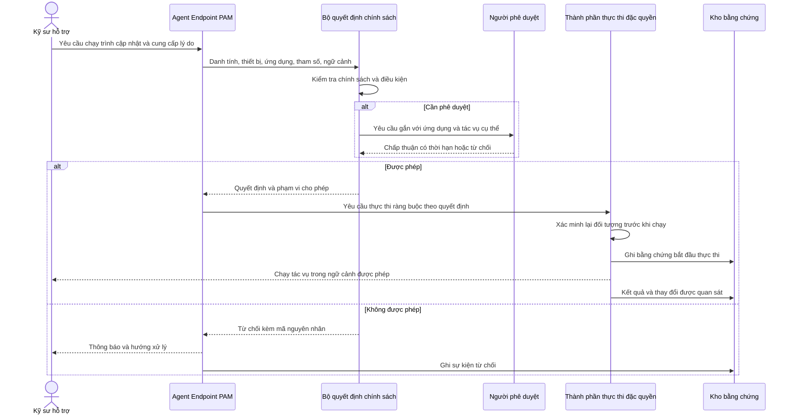

# Application elevation trong Endpoint PAM

## 1. Bài toán: tác vụ cần quyền cao, người dùng không cần quyền quản trị thường trực

Một kỹ sư hỗ trợ cần cài bản cập nhật của phần mềm đo đạc trên máy trạm. Tài khoản làm việc hằng ngày của họ là tài khoản tiêu chuẩn. Trình cập nhật phải ghi vào thư mục cài đặt được bảo vệ và thay đổi một dịch vụ cục bộ, nên tác vụ không chạy được với quyền hiện tại.

Nếu thêm kỹ sư vào nhóm quản trị viên cục bộ, tổ chức đã cấp quyền rộng hơn yêu cầu: từ việc cập nhật một ứng dụng thành khả năng thay đổi nhiều thành phần của máy. Nếu chia sẻ mật khẩu quản trị để người dùng tự nhập, tổ chức lại phải giải quyết vấn đề lộ credential, luân chuyển mật khẩu và truy trách nhiệm.

**Application elevation** là cơ chế cho phép một ứng dụng hoặc một lần thực thi được xác định chạy với quyền cao hơn quyền thông thường, theo chính sách được kiểm soát. Trong Endpoint PAM, mục tiêu là cấp đủ quyền cho tác vụ được phép, trong thời gian và phạm vi phù hợp, đồng thời giữ tài khoản làm việc hằng ngày ở quyền tiêu chuẩn.

Điểm phải nhớ: hệ điều hành trao quyền cho tiến trình, không hiểu ý định kinh doanh của người bấm nút. Chính sách “cho ứng dụng này chạy nâng quyền” chỉ an toàn khi tổ chức biết ứng dụng có thể làm gì, nhận đầu vào nào và tạo ra những tiến trình nào.

Sau bài học, người học có thể:

- Phân biệt nâng quyền theo ứng dụng với cấp quyền quản trị thường trực hoặc chỉ hiện hộp thoại xác nhận.
- Xác định một ứng dụng bằng nhiều thuộc tính tin cậy thay vì chỉ dựa vào tên hoặc đường dẫn.
- Thiết kế chính sách cho ứng dụng, tham số, nguồn khởi chạy và tiến trình con.
- Xử lý các đường vòng như script, plugin, DLL, tệp cấu hình và trình cập nhật.
- Xây dựng quy trình yêu cầu, phê duyệt, thực thi, ghi nhận và thu hồi quyền nâng cao.

## 2. Application elevation nằm ở đâu trong PAM?

PAM quản lý quyền đặc biệt đối với tài khoản, dịch vụ và hạ tầng nhạy cảm. Endpoint PAM áp dụng tư duy đó cho máy trạm hoặc máy chủ đầu cuối: giảm quyền quản trị thường trực, kiểm soát thao tác cần đặc quyền và ghi bằng chứng đủ để điều tra.

Application elevation là một công cụ để thực hiện least privilege, nhưng không tự tạo ra least privilege. Nếu chính sách cho phép nâng quyền mọi trình thông dịch lệnh, phạm vi thực tế có thể gần với cấp quyền quản trị đầy đủ.

| Cơ chế | Đối tượng được cấp thêm quyền | Câu hỏi cần kiểm soát |
|---|---|---|
| Thành viên nhóm quản trị cục bộ | Tài khoản và các phiên/tiến trình sử dụng quyền đó | Vì sao người này cần quyền rộng và kéo dài như vậy? |
| JIT cho vai trò quản trị cục bộ | Tài khoản hoặc phiên trong một khoảng thời gian | Trong cửa sổ JIT, những tác vụ nào còn có thể thực hiện? |
| Application elevation | Một tiến trình hoặc một cây thực thi theo chính sách | Binary nào, đầu vào nào, tiến trình con nào được phép? |
| Broker thực hiện tác vụ hẹp | Thành phần đặc quyền thực hiện một thao tác được định nghĩa | Ai được yêu cầu, trên tài nguyên nào, với tham số nào? |
| Vault credential | Bí mật dùng để xác thực hoặc chạy tác vụ | Credential được cung cấp, sử dụng và luân chuyển ra sao? |

Các cơ chế có thể kết hợp. Chẳng hạn, hệ thống chỉ cho kỹ sư hỗ trợ yêu cầu nâng quyền trình cập nhật trong ca trực; broker thực thi mà không cung cấp mật khẩu quản trị cho kỹ sư; mọi lần thực thi được liên kết với yêu cầu hỗ trợ.

Tuy nhiên, không phải giải pháp nào cũng có broker, chế độ chạy không lộ credential, giới hạn tham số hoặc khả năng kiểm soát tiến trình con. Khi thiết kế, phải phân biệt **yêu cầu kiểm soát** với **khả năng thực tế của sản phẩm và hệ điều hành**.

## 3. Mô hình quyền: danh tính, tiến trình và tài nguyên

Một quyết định nâng quyền có ít nhất ba chủ thể cần tách rõ:

1. **Người yêu cầu**: người đăng nhập, danh tính doanh nghiệp, nhóm nghiệp vụ và trạng thái xác thực của họ.
2. **Danh tính/ngữ cảnh thực thi**: tài khoản, token hoặc tập quyền mà tiến trình thực sự sử dụng.
3. **Tiến trình và tài nguyên đích**: chương trình được chạy, hành động được yêu cầu và tài nguyên bị thay đổi.

Người yêu cầu và danh tính thực thi có thể khác nhau. Một tiến trình do dịch vụ quản lý tạo ra không nhất thiết chạy dưới danh tính người đang ngồi trước màn hình. Vì vậy, log chỉ ghi tài khoản thực thi là chưa đủ để truy trách nhiệm.

Trên Windows, một hộp thoại UAC không tương đương một hệ thống chính sách Endpoint PAM. Tùy loại tài khoản và cấu hình, trải nghiệm có thể là xác nhận nâng quyền hoặc yêu cầu credential. Bản thân việc người dùng chấp nhận hộp thoại không chứng minh rằng ứng dụng, tham số và mục đích đã được tổ chức phê duyệt.

Tương tự, “chạy với quyền quản trị cục bộ” không tự cấp mọi quyền trên cơ sở dữ liệu, dịch vụ đám mây hay tài nguyên mạng. Quyền truy cập từ xa còn phụ thuộc danh tính thực thi, credential sẵn có, cơ chế xác thực và chính sách của tài nguyên đích. Dù vậy, quyền cục bộ cao có thể làm tăng khả năng tiếp cận dữ liệu hoặc bí mật trên endpoint; không được xem đó là rủi ro chỉ giới hạn ở một cửa sổ ứng dụng.

### 3.1. Nâng quyền ứng dụng không phải sandbox

Nếu một trình chỉnh sửa văn bản chạy với quyền cao và cho phép mở, sửa, lưu tệp tùy ý, người dùng có thể tác động đến nhiều tệp được bảo vệ. Việc giao diện chỉ có vài nút không làm giảm quyền của tiến trình.

Nếu một ứng dụng cho phép tải plugin hoặc gọi chương trình ngoài, mã được tải hay chương trình được gọi có thể sử dụng ngữ cảnh đặc quyền, tùy cách tạo tiến trình và thực thi. Phải kiểm tra hành vi thực tế thay vì suy ra từ giao diện.

Do đó, phạm vi quyền hiệu lực được quyết định bởi tổ hợp:

> Quyền tiến trình + chức năng có thể gọi + đầu vào có thể kiểm soát + mã phụ thuộc + hành vi tạo tiến trình con.

Tổ chức càng khó thu hẹp tổ hợp này, càng nên xem xét một broker chỉ làm tác vụ cụ thể, gói triển khai được quản trị hoặc một quy trình hỗ trợ khác.

## 4. Luồng yêu cầu và thực thi

Một luồng tham khảo cho việc cập nhật ứng dụng nội bộ:



Đây là mô hình chức năng, không phải sơ đồ triển khai bắt buộc của một sản phẩm. Bộ quyết định và broker có thể được tổ chức khác nhau, nhưng cần giữ các nguyên tắc:

- Yêu cầu phải được ràng buộc với đối tượng sẽ chạy, không chỉ với một chuỗi tên hiển thị.
- Phê duyệt phải gắn với phạm vi cụ thể; một phiếu hỗ trợ hợp lệ không cho phép mọi ứng dụng.
- Cần kiểm tra lại tại thời điểm thực thi để giảm nguy cơ đổi tệp sau lúc đánh giá.
- Ghi nhận quyết định cho phép chưa chứng minh tiến trình đã chạy hoặc tác vụ đã thành công.

## 5. Nhận diện ứng dụng: tên tệp chỉ là điểm bắt đầu

Giả sử tổ chức muốn cho phép `DeviceUpdater.exe`. Chính sách chỉ so khớp tên này có thể cho phép một tệp hoàn toàn khác được đổi tên. Chính sách chỉ so khớp đường dẫn cũng có thể gặp vấn đề nếu người dùng ghi được vào thư mục đó.

### 5.1. Các thuộc tính thường phải xét

| Thuộc tính | Giá trị kiểm soát | Giới hạn cần nhớ |
|---|---|---|
| Hash nội dung | Ràng buộc với một phiên bản tệp cụ thể | Thay đổi tệp hợp lệ cũng làm đổi hash; cần quy trình cập nhật |
| Chữ ký và nhà phát hành | Kiểm tra nguồn gốc và tính toàn vẹn theo cơ chế ký | Mã có chữ ký vẫn có thể có chức năng nguy hiểm hoặc lỗ hổng |
| Sản phẩm/tên binary/phiên bản | Thu hẹp phạm vi của rule theo publisher | Metadata riêng lẻ không đủ chứng minh tính tin cậy |
| Đường dẫn chuẩn hóa | Xác định vị trí triển khai mong đợi | Phải xét quyền ghi, liên kết và cách phân giải đường dẫn |
| Nguồn gói cài đặt | Liên kết với kênh phân phối đã quản lý | Nhãn nguồn trong yêu cầu không thay thế xác minh gói thực tế |
| Tham số và tài nguyên đích | Giới hạn hành động mà ứng dụng được phép làm | Phải hiểu cách ứng dụng phân tích và diễn giải đầu vào |
| Tiến trình cha và chuỗi khởi chạy | Bổ sung ngữ cảnh thực thi | Tên tiến trình cha không phải bằng chứng duy nhất để cho phép |

Không có thuộc tính nào là câu trả lời cho mọi trường hợp. Một công cụ nhỏ ít thay đổi có thể phù hợp với rule theo hash. Một sản phẩm cập nhật thường xuyên có thể cần rule kết hợp publisher, sản phẩm, phiên bản đã kiểm thử và đường dẫn được bảo vệ.

Không nên dùng “mọi tệp có chữ ký của nhà cung cấp A”. Cùng nhà cung cấp có thể phát hành trình thông dịch, công cụ quản trị và tiện ích cho phép thực thi mã tùy ý. Cần ràng buộc đúng ứng dụng và đúng hành vi.

### 5.2. Quyền ghi và chuỗi cung ứng mã thực thi

Kiểm tra thư mục chứa binary chưa đủ nếu ứng dụng tải DLL, script, plugin, tệp cấu hình hoặc gói cập nhật từ nơi người dùng có thể sửa. Một tệp thực thi được bảo vệ vẫn có thể nạp nội dung ít tin cậy hơn vào cùng tiến trình đặc quyền.

Khi đánh giá ứng dụng, cần trả lời:

- Ai được sửa binary, thư mục cha và vị trí mà đường dẫn trỏ đến?
- Ứng dụng tìm thư viện, plugin và cấu hình ở đâu?
- Người dùng có điều khiển thư mục làm việc hoặc biến môi trường ảnh hưởng đến việc tìm mã không?
- Gói cập nhật được kiểm tra tính toàn vẹn và nguồn gốc ở bước nào?
- Có chức năng chọn một tệp script, một gói hoặc một chương trình tùy ý để chạy không?

Nếu các câu trả lời cho thấy người dùng có thể đưa mã tùy ý vào tiến trình đặc quyền, rule nâng quyền phải được thiết kế lại. Chỉ thêm một dòng yêu cầu phê duyệt không giải quyết được ranh giới tin cậy đó.

## 6. Tham số, tệp đầu vào và nguy cơ thay đổi sau khi kiểm tra

### 6.1. Cùng binary, hành động khác nhau

Một trình cài đặt có thể hỗ trợ cả “cập nhật gói đã quản lý” và “chạy hành động từ gói do người dùng cung cấp”. Nếu rule chỉ nhận diện binary, cả hai hành động đều có thể được nâng quyền.

Vì vậy, chính sách nên mô tả hành động được phép bằng cấu trúc rõ ràng. Ví dụ: chỉ cho phép cập nhật sản phẩm `DeviceTool`, từ gói đã duyệt trong kho triển khai được bảo vệ, không nhận đường dẫn gói tùy ý từ thư mục tải xuống.

Tránh coi việc so khớp chuỗi command line là đủ trong mọi tình huống. Dấu nháy, khoảng trắng, cách chuẩn hóa đường dẫn, tham số lặp lại, tệp phản hồi và thứ tự ưu tiên có thể làm ứng dụng hiểu đầu vào khác với bộ lọc chính sách. Bộ kiểm soát phải phù hợp với ngữ nghĩa của chương trình đích.

Nếu sản phẩm PAM chỉ có bộ lọc tham số hạn chế, không nên giả định nó thực hiện một bộ phân tích cú pháp hoàn chỉnh. Có thể cần dùng gói triển khai cố định hoặc broker nhận các tham số đã định kiểu.

### 6.2. Ràng buộc phê duyệt với đối tượng thực tế

Ví dụ, người dùng yêu cầu nâng quyền `C:\Deploy\DeviceUpdater.exe`, hệ thống kiểm tra hash rồi chờ người quản lý duyệt. Trong lúc chờ, tệp bị thay thế. Nếu thành phần thực thi chỉ mở lại đường dẫn và chạy mà không xác minh đối tượng, quyết định ban đầu không còn ràng buộc với mã sẽ chạy.

Đây là vấn đề **time-of-check/time-of-use**: đối tượng có thể thay đổi giữa lúc kiểm tra và lúc sử dụng. Kiểm tra lại hash trước khi chạy giúp giảm nguy cơ nhưng tự nó chưa bảo đảm xử lý hết mọi cuộc đua. Cơ chế bảo vệ cần phù hợp với hệ điều hành và sản phẩm: bảo vệ quyền ghi, quản lý vòng đời tệp/gói, xác minh sát thời điểm thực thi và sử dụng phương thức ràng buộc đối tượng đáng tin cậy khi được hỗ trợ.

Cần áp dụng cùng tư duy cho gói cài đặt, script và tệp đầu vào có thể thay đổi hành vi. Không chỉ bảo vệ tên đường dẫn trong biểu mẫu yêu cầu.

## 7. Tiến trình con, shell và thành phần mở rộng

Nâng quyền cho một ứng dụng có thể mở rộng thành nâng quyền cho cả chuỗi thực thi nếu ứng dụng tạo tiến trình con trong ngữ cảnh đặc quyền. Tuy nhiên, không được mặc định mọi tiến trình con đều kế thừa cùng quyền hoặc sản phẩm PAM sẽ tự chặn chúng. Cần kiểm tra từng cơ chế khởi chạy và khả năng kiểm soát của giải pháp.

### 7.1. Những ứng dụng cần đánh giá kỹ

- Shell và trình thông dịch có khả năng thực thi lệnh hoặc script tùy ý.
- Trình chỉnh sửa hỗ trợ chạy tác vụ, terminal tích hợp hoặc plugin.
- Trình quản lý tệp có chức năng mở chương trình ngoài.
- Trình cài đặt cho phép chạy custom action từ gói do người dùng chọn.
- Công cụ phát triển nhận mã nguồn, build script hoặc cấu hình từ dự án chưa tin cậy.
- Công cụ quản trị có chức năng tải extension hoặc gọi tiện ích hệ thống.

Các công cụ này không nhất thiết bị cấm trong mọi môi trường, nhưng phạm vi quyền của chúng thường rộng hơn tên tác vụ ban đầu. Một nhu cầu hợp lệ phải được chuyển thành rule có ranh giới thực thi và bằng chứng phù hợp.

### 7.2. Kiểm soát cây tiến trình

Một chính sách có thể yêu cầu ứng dụng chỉ được tạo một helper cụ thể từ vị trí được bảo vệ. Nếu helper cần đặc quyền riêng, phải xác định rõ nó được cho phép bởi rule nào. Nếu sản phẩm không thể giới hạn cây tiến trình ở mức cần thiết, phải coi đó là khoảng trống thiết kế.

Ngăn khởi chạy một shell đã biết cũng chưa đủ để hạn chế mọi hành vi nguy hiểm. Ứng dụng có thể tự sửa tệp, nạp mã trong cùng tiến trình hoặc sử dụng một đường thực thi khác. Chính sách tiến trình con phải đi cùng đánh giá chức năng, đầu vào và phụ thuộc.

Trên máy có nhiều phiên đăng nhập, cần kiểm tra ứng dụng hiện giao diện ở phiên nào và ai có thể tương tác. Không để một quyết định của người A vô tình tạo cửa sổ đặc quyền mà người B có thể điều khiển.

## 8. Thiết kế chính sách theo tác vụ

Một rule tốt bắt đầu từ nhu cầu nghiệp vụ: “kỹ sư nhóm hỗ trợ thiết bị cập nhật phần mềm đo đạc đã được duyệt trên nhóm máy phòng thí nghiệm”. Sau đó mới chuyển nhu cầu thành điều kiện kỹ thuật.

### 8.1. Các chiều cần xác định

| Chiều chính sách | Ví dụ yêu cầu |
|---|---|
| Người yêu cầu | Thành viên nhóm hỗ trợ thiết bị còn hiệu lực |
| Endpoint | Máy thuộc nhóm phòng thí nghiệm, đáp ứng điều kiện quản lý đã định |
| Ứng dụng | Binary và gói cập nhật đã duyệt, được nhận diện đủ chặt |
| Hành động | Cập nhật đúng sản phẩm; không nhận mã hoặc gói tùy ý |
| Ngữ cảnh | Có phiếu công việc, trong khoảng thời gian được phép |
| Phê duyệt | Tự động cho tình huống rủi ro thấp, duyệt thủ công cho ngoại lệ đã định |
| Phạm vi hiệu lực | Một lần chạy hoặc số lần hữu hạn, thời hạn rõ ràng |
| Bằng chứng | Quyết định, thực thi, danh tính, phiên bản rule và kết quả |
| Kết thúc | Xử lý hết hạn, tiến trình đang chạy và những thay đổi để lại |

MFA hoặc xác thực lại có thể là điều kiện cho yêu cầu nhạy cảm. Nó củng cố niềm tin vào người yêu cầu, nhưng không chứng minh binary và đầu vào là an toàn.

### 8.2. Ví dụ mô tả chính sách

Khối dưới đây là **mã giả mô tả yêu cầu**, không phải cú pháp của một sản phẩm PAM và không thể dùng trực tiếp để triển khai:

```yaml
policy_id: lab-device-updater
policy_revision: 7
requester:
  group: endpoint-device-support
device:
  managed_group: lab-workstations
application:
  identity: approved-device-updater-release
  executable_location: protected-deployment-location
  package_source: approved-internal-repository
operation:
  allowed_action: update-approved-device-tool
  arbitrary_package_path: denied
  arbitrary_script: denied
execution:
  privilege_profile: minimum-profile-supported-for-operation
  child_processes: reviewed-helper-set-only
approval:
  binding: requester-device-executable-package-operation
  maximum_launches: 1
  validity_minutes: 15
evidence:
  record_policy_decision: true
  record_execution_start_and_end: true
  protect_sensitive_arguments: true
```

Giá trị `validity_minutes: 15` chỉ minh họa thời hạn cho phép khởi chạy. Hết thời hạn không có nghĩa một tiến trình đã chạy sẽ bị chấm dứt hoặc một dịch vụ đã cài sẽ bị gỡ. Cần định nghĩa ba vòng đời riêng:

1. **Vòng đời quyết định**: quyết định còn được dùng để bắt đầu bao nhiêu lần và đến khi nào?
2. **Vòng đời tiến trình**: tiến trình được chạy bao lâu; quá hạn thì cảnh báo, dừng có kiểm soát hay xử lý thế nào?
3. **Vòng đời thay đổi**: tệp, dịch vụ, lịch tác vụ và cấu hình được tạo ra tồn tại bao lâu, thuộc ai và được quản lý tiếp ra sao?

Không đặt tên một quyền cấp là “JIT” rồi giả định cả ba vòng đời đều được giải quyết.

## 9. Hai tình huống thiết kế

### 9.1. Cập nhật ứng dụng có thể chuẩn hóa

**Yêu cầu:** nhóm hỗ trợ cần cập nhật phần mềm thiết bị, không cần sử dụng công cụ quản trị tương tác.

**Phương án:** đóng gói bản cập nhật từ nguồn đã duyệt; triển khai gói vào vị trí được bảo vệ; rule chỉ cho phép đúng tác vụ cập nhật; kiểm tra helper, nguồn cấu hình và dịch vụ liên quan; liên kết mỗi lần chạy với phiếu công việc.

**Bằng chứng cần có:** định danh gói, phiên bản trước/sau nếu công cụ thu thập được, người yêu cầu, endpoint, thời gian, revision chính sách, tiến trình thực thi và kết quả xác minh sau cập nhật.

Mã thoát bằng không là một tín hiệu, không phải bằng chứng đầy đủ rằng máy đã ở trạng thái mong muốn. Có thể cần kiểm tra phiên bản ứng dụng hoặc trạng thái dịch vụ. Nếu hệ thống yêu cầu khởi động lại, trạng thái tác vụ phải thể hiện điều đó thay vì báo hoàn tất quá sớm.

Nếu tổ chức có công cụ quản lý triển khai gói phù hợp, có thể sử dụng nó để xử lý cập nhật mà người dùng không cần trực tiếp nâng quyền. Application elevation không phải lựa chọn mặc định cho mọi yêu cầu cài đặt.

### 9.2. Công cụ phát triển có đầu vào tùy ý

**Yêu cầu:** lập trình viên muốn chạy toàn bộ môi trường phát triển với quyền cao để một dự án sửa được cấu hình hệ thống.

**Đánh giá:** môi trường phát triển có thể chạy build script, extension và terminal. Nội dung dự án là đầu vào có thể thực thi mã. Nâng quyền cả môi trường có thể trao quyền rộng cho mọi mã mà dự án hoặc extension đưa vào.

**Thiết kế lại tác vụ:** tách thao tác cần quyền cao thành hành động hẹp, chẳng hạn cập nhật một cấu hình đã định bằng broker kiểm tra giá trị và tài nguyên đích; giữ quá trình biên dịch và chạy mã dự án ở quyền tiêu chuẩn. Với thao tác không thể thu hẹp, có thể cần môi trường thử nghiệm được quản lý riêng và quy trình ngoại lệ có thời hạn.

Điểm quyết định không phải chức danh người yêu cầu mà là phạm vi thực thi. Một công cụ đáng tin trong tay người dùng hợp lệ vẫn có thể chạy đầu vào chưa được kiểm soát.

## 10. Chế độ phê duyệt và ngoại lệ

Có thể tổ chức các yêu cầu thành ba luồng:

- **Tác vụ đã chuẩn hóa:** rule được chủ ứng dụng và đội endpoint duyệt trước; người dùng đủ điều kiện được thực thi trong phạm vi xác định.
- **Tác vụ cần xem xét:** người duyệt nhận thông tin kỹ thuật đủ để đánh giá binary, đầu vào và tác động; phê duyệt cho một phạm vi và thời hạn cụ thể.
- **Tác vụ bị từ chối:** có đường liên hệ hỗ trợ và mã nguyên nhân; không biến việc nhập lý do thành quyền tự phê duyệt.

Một phê duyệt có giá trị cần cho người duyệt biết họ đang chấp thuận điều gì. Chỉ hiển thị “người dùng cần admin để làm việc” sẽ tạo quyết định khó kiểm chứng. Biểu mẫu nên thể hiện ứng dụng, tác vụ, thiết bị, nguồn gói và phạm vi quyền theo cách có thể hiểu được.

Ngoại lệ phải có owner, lý do, thời hạn, tiêu chí đóng và lịch rà soát. Không biến rule theo hash tạm thời thành một rule publisher rộng chỉ vì bản cập nhật làm hash cũ không còn khớp.

Nếu nền tảng cho phép nhiều rule cùng khớp, phải hiểu thứ tự ưu tiên và cách xử lý xung đột. Một rule hẹp không có ý nghĩa khi rule khác cho phép mọi ứng dụng trong cùng nhóm người dùng. Hành vi này cần được kiểm thử theo sản phẩm thực tế.

## 11. Mất kết nối, hết hạn và thu hồi

### 11.1. Endpoint không liên lạc được với bộ điều khiển

Thiết kế phải xác định rõ tác vụ nào được dùng chính sách đã lưu cục bộ và tác vụ nào bắt buộc có phê duyệt trực tuyến. Nếu cho phép offline, cần ràng buộc thời hạn, phạm vi và tính toàn vẹn của quyết định theo khả năng của sản phẩm.

Không được suy diễn “máy mất mạng” thành “cho người dùng quyền quản trị tạm thời”. Một yêu cầu mới chưa được duyệt phải đi theo quy tắc đã xác định cho trạng thái offline, kèm cách hỗ trợ khi người dùng bị chặn.

Quyền đã thu hồi trên hệ thống trung tâm có thể chưa được endpoint offline nhận ngay. Đây là giới hạn vận hành cần được ghi nhận trong thiết kế, không phải một trạng thái đồng bộ tức thời mặc định.

### 11.2. Thu hồi có nhiều mức

| Hành động | Tác dụng trực tiếp | Điều không tự được bảo đảm |
|---|---|---|
| Vô hiệu hóa rule | Ngăn quyết định cho phép mới khi thay đổi có hiệu lực | Không tự dừng mọi tiến trình đã chạy |
| Hủy phê duyệt chưa dùng | Ngăn lần khởi chạy được ràng buộc với phê duyệt đó | Không hoàn tác tác vụ đã thực thi |
| Dừng tiến trình | Chấm dứt thực thi đang diễn ra nếu thao tác thành công | Không tự xóa persistence hoặc phục hồi dữ liệu |
| Hoàn tác thay đổi | Khôi phục những thay đổi đã được xác định | Không bảo đảm có thể hoàn tác an toàn mọi tác động |
| Luân chuyển credential | Thay bí mật đã được dùng hoặc nghi bị lộ | Không thay thế điều tra những hành động đã xảy ra |

Khi một ứng dụng nâng quyền bị nghi xâm phạm, cần phối hợp Endpoint PAM với công cụ giám sát endpoint và quy trình ứng phó sự cố. Quyết định cách ly, dừng tiến trình hay phục hồi phải xét tác động nghiệp vụ và mức độ bằng chứng hiện có.

## 12. Audit: nối được người yêu cầu với tác vụ thực tế

Một chuỗi bằng chứng hữu ích phải trả lời được: ai yêu cầu, chính sách nào cho phép, ứng dụng nào thực sự chạy, quyền nào được sử dụng và kết quả quan sát được là gì.

Các trường thường cần thiết gồm:

- Mã yêu cầu và mã quyết định để nối yêu cầu, phê duyệt và lần thực thi.
- Danh tính người yêu cầu, người duyệt nếu có và danh tính thực thi.
- Định danh endpoint và phiên đăng nhập liên quan.
- Thuộc tính ứng dụng đã kiểm chứng: hash, thông tin chữ ký hoặc phiên bản theo cơ chế triển khai.
- Tác vụ được phép, revision chính sách và lý do cho phép/từ chối.
- Thời gian yêu cầu, quyết định, bắt đầu, kết thúc và thời gian hệ thống nhận sự kiện.
- Định danh tiến trình và quan hệ cha/con khi thu thập được; không dùng PID đơn lẻ làm khóa lâu dài vì PID có thể được tái sử dụng.
- Kết quả tác vụ, lỗi và trạng thái xác minh sau thực thi.

Ví dụ sự kiện dưới đây minh họa cấu trúc, không phải schema bắt buộc của một nền tảng:

```json
{
  "event_type": "elevation_execution_finished",
  "request_id": "REQ-LAB-0427",
  "decision_id": "DEC-LAB-0427-1",
  "execution_id": "EXEC-LAB-0427-1",
  "requester_id": "user-support-17",
  "execution_identity": "managed-privileged-context",
  "device_id": "lab-ws-031",
  "policy_id": "lab-device-updater",
  "policy_revision": 7,
  "artifact_id": "approved-device-updater-release",
  "operation": "update-approved-device-tool",
  "result": "completed_pending_restart",
  "sensitive_arguments_recorded": false
}
```

Không ghi mật khẩu, access token hay toàn bộ biến môi trường vào audit log. Command line, đường dẫn và lý do người dùng nhập cũng có thể chứa dữ liệu nhạy cảm. Cần chọn dữ liệu đủ để điều tra, có quy tắc che thông tin và phân quyền truy cập bằng chứng.

Nếu không gửi được sự kiện ngay, có thể cần bộ đệm cục bộ được bảo vệ và cơ chế chuyển tiếp lại theo khả năng hệ thống. Phải phân biệt thời gian sự kiện xảy ra với thời gian thu nhận, đồng thời giám sát khoảng trống telemetry. Không giả định log cục bộ chống được mọi hình thức can thiệp chỉ vì agent chạy bằng quyền cao.

Ghi hình phiên hoặc session recording, nếu có, có thể bổ sung ngữ cảnh. Nó không thay thế bằng chứng về binary, policy và ngữ cảnh thực thi; cũng không phải khả năng mặc định của mọi giải pháp Application elevation.

## 13. Triển khai và kiểm thử trong môi trường lab

Không nên bắt đầu bằng việc gỡ quyền quản trị của toàn bộ người dùng rồi chờ yêu cầu phát sinh. Trước tiên cần hiểu các tác vụ đang phụ thuộc quyền cao và phân loại chúng thành: có thể sửa quyền tài nguyên, có thể triển khai tập trung, có thể nâng quyền hẹp hoặc phải xử lý theo ngoại lệ.

### 13.1. Kế hoạch thực hành

Sử dụng máy ảo thử nghiệm có snapshot, tài khoản tiêu chuẩn và một ứng dụng thử nghiệm không chứa dữ liệu thật. Mục tiêu là kiểm tra ranh giới của rule, không thử nghiệm trên máy sản xuất.

1. Xác định một tác vụ cụ thể cần đặc quyền và ghi tiêu chí thành công quan sát được.
2. Liệt kê binary, gói, cấu hình, thư viện, helper và tài nguyên mà tác vụ sử dụng.
3. Tạo chính sách hẹp bằng tính năng thực tế của giải pháp đang dùng.
4. Chạy tình huống được phép và xác nhận tài khoản hằng ngày vẫn là tài khoản tiêu chuẩn.
5. Kiểm thử các biến thể đầu vào và nguồn khởi chạy có thể vượt phạm vi.
6. Kiểm tra log có nối được yêu cầu, quyết định, thực thi và kết quả.
7. Thu hồi rule, kiểm tra lần chạy mới và cách xử lý tiến trình/thay đổi đã tồn tại.
8. Ghi các giới hạn sản phẩm chưa đáp ứng và quyết định xử lý trước khi mở rộng triển khai.

### 13.2. Ma trận tình huống

| Tình huống lab | Kỳ vọng thiết kế |
|---|---|
| Người và thiết bị đủ điều kiện, ứng dụng và gói đúng | Chạy đúng tác vụ, sinh đủ bằng chứng |
| Tệp khác được đổi thành tên ứng dụng cho phép | Không được cấp quyền chỉ nhờ tên tệp |
| Binary đúng nhưng gói đầu vào chưa được duyệt | Từ chối hoặc đi theo luồng xét duyệt đã định |
| Chạy từ vị trí người dùng có quyền sửa | Không được tin cậy chỉ vì đường dẫn trông quen thuộc |
| Thay đối tượng sau khi phê duyệt | Cơ chế ràng buộc/kiểm tra ngăn đối tượng khác dùng quyết định cũ |
| Ứng dụng gọi helper ngoài phạm vi | Hành vi được chặn hoặc được phát hiện là khoảng trống cần xử lý |
| Dùng lại quyết định chỉ cho phép một lần | Không tạo thêm lần thực thi ngoài phạm vi |
| Phê duyệt hết hạn trước khi khởi chạy | Không cho bắt đầu tác vụ bằng quyết định hết hạn |
| Rule bị vô hiệu hóa khi tiến trình đang chạy | Hành vi phù hợp thiết kế vòng đời đã công bố |
| Mất kết nối hoặc không gửi được log | Đi đúng chính sách offline và cơ chế lưu/chuyển tiếp bằng chứng |

Không xem một tình huống bị chặn là bằng chứng rằng mọi đường thực thi khác cũng bị chặn. Kiểm thử phải xuất phát từ chức năng và đầu vào của ứng dụng, đồng thời ghi rõ phạm vi đã quan sát.

## 14. Vận hành sau khi triển khai

Application elevation cần được bảo trì như một tập chính sách an ninh có owner, không phải một danh sách cho phép bất biến.

Khi ứng dụng có bản cập nhật, cần đánh giá lại định danh binary, nguồn gói, helper và hành vi mới. Một thay đổi từ trình cập nhật đơn giản sang trình chạy script có thể làm thay đổi toàn bộ phạm vi rủi ro dù tên sản phẩm giữ nguyên.

Đội vận hành nên theo dõi những tín hiệu gắn với hành động cụ thể:

| Chỉ số/tín hiệu | Cách sử dụng |
|---|---|
| Số tài khoản còn quyền quản trị thường trực | Theo dõi mục tiêu giảm quyền nền, kèm các ngoại lệ có owner |
| Số lần nâng quyền theo ứng dụng và nhóm người dùng | Phát hiện nhu cầu tăng đột biến hoặc rule bị dùng ngoài dự kiến |
| Tỷ lệ từ chối và nguyên nhân | Phân biệt bảo vệ đúng với quy trình gây gián đoạn công việc |
| Số rule rộng hoặc ngoại lệ hết hạn | Ưu tiên thu hẹp và dọn quyền tồn đọng |
| Tỷ lệ lần chạy có chuỗi bằng chứng đầy đủ | Phát hiện khoảng trống audit và lỗi đồng bộ |
| Thời gian đáp ứng yêu cầu hợp lệ | Đánh giá khả năng hỗ trợ nghiệp vụ của quy trình |
| Phiên bản rule thực tế trên endpoint | Phát hiện thiết bị chưa nhận thay đổi hoặc còn chính sách cũ |

Tỷ lệ cho phép cao không tự chứng minh hệ thống tốt; có thể rule quá rộng. Tỷ lệ từ chối cao cũng không tự chứng minh hệ thống an toàn; có thể người dùng bị buộc tìm đường vòng. Cần đọc số liệu cùng nhu cầu nghiệp vụ và bằng chứng thực thi.

Phân công trách nhiệm tối thiểu: chủ ứng dụng xác nhận hành vi hợp lệ; đội endpoint triển khai và quan sát; đội an ninh đánh giá ranh giới quyền; người quản lý nghiệp vụ xác nhận nhu cầu; bộ phận audit có quyền đọc bằng chứng phù hợp. Không để người yêu cầu tự tạo và tự duyệt một ngoại lệ nhạy cảm nếu mô hình kiểm soát yêu cầu phân tách trách nhiệm.

## 15. Những lỗi thiết kế thường gặp

### Chỉ kiểm tra ứng dụng có chữ ký

Chữ ký là một phần của định danh tin cậy, không phải giấy phép cho mọi chức năng. Thu hẹp theo sản phẩm, phiên bản, vị trí, đầu vào và tác vụ; đánh giá cả tính năng mở rộng.

### Cho phép mọi thứ trong một thư mục

Nếu người dùng ghi được vào thư mục hoặc một vị trí mà ứng dụng dùng để nạp mã, rule có thể trở thành đường đưa mã tùy ý vào ngữ cảnh đặc quyền. Đánh giá quyền ghi trên toàn bộ chuỗi phụ thuộc.

### Duyệt một shell để xử lý mọi yêu cầu hỗ trợ

Một shell nâng quyền có thể thực hiện nhiều hành động ngoài tác vụ đã duyệt. Tách các thao tác lặp lại thành tác vụ hẹp; nếu cần phiên quản trị rộng, quản lý nó đúng với phạm vi đó và quy trình tương ứng.

### Coi lý do người dùng nhập là phê duyệt

Lý do phục vụ giải trình, không chứng minh tính đúng đắn kỹ thuật. Quyết định còn phải dựa trên danh tính, thiết bị, ứng dụng, đầu vào và điều kiện chính sách.

### Đánh đồng hết hạn với hoàn tác

Phê duyệt hết hạn có thể chỉ ngăn lần khởi chạy tiếp theo. Dịch vụ, tệp và cấu hình đã tạo vẫn có thể tồn tại. Quản lý riêng vòng đời quyết định, tiến trình và thay đổi.

### Dùng tài khoản dịch vụ quá mạnh cho broker

Không nên mặc định mọi tác vụ đều cần danh tính có quyền lớn nhất. Chọn cơ chế thực thi và quyền phù hợp với yêu cầu cũng như khả năng nền tảng; bảo vệ IPC/API của broker, xác thực bên gọi và kiểm tra đầu vào. Một broker nhận tùy ý đường dẫn chương trình để chạy đặc quyền là một ranh giới kiểm soát rất yếu.

### Chỉ ghi quyết định cho phép

Quyết định có thể không được sử dụng, tác vụ có thể thất bại hoặc sinh ra thay đổi kéo dài. Nối sự kiện quyết định với lần thực thi và kết quả quan sát được.

## 16. Câu hỏi tự kiểm tra

**1. Vì sao không thể kết luận một rule an toàn chỉ vì binary có chữ ký hợp lệ?**

Vì chữ ký không giới hạn chức năng của ứng dụng. Binary có thể nhận script, plugin, gói cài đặt hoặc tham số cho phép thực hiện hành động rộng. Cần kiểm tra hành vi và chuỗi đầu vào/phụ thuộc trong ngữ cảnh đặc quyền.

**2. Một phê duyệt cho phép khởi chạy trong 15 phút có bảo đảm tác vụ dừng sau 15 phút không?**

Không. Thời hạn khởi chạy, thời gian sống của tiến trình và thời gian tồn tại của thay đổi là ba vấn đề riêng. Chính sách phải định nghĩa từng vấn đề và kiểm tra khả năng thực thi của sản phẩm.

**3. Người dùng tiêu chuẩn có thể thay binary ở đường dẫn đã được duyệt. Phần nào của thiết kế đang có vấn đề?**

Đường dẫn đang được dùng như một định danh tin cậy trong khi đối tượng tại đó có thể bị thay đổi. Cần bảo vệ quyền ghi, xác minh nội dung và ràng buộc quyết định với đối tượng thực sự chạy, kể cả khoảng thời gian giữa kiểm tra và thực thi.

**4. Vì sao log cần cả người yêu cầu và danh tính thực thi?**

Vì broker hoặc dịch vụ có thể chạy tác vụ dưới danh tính khác. Chỉ ghi tài khoản đặc quyền sẽ không đủ biết người nào đã yêu cầu và cơ chế nào cho phép hành động đó.

**5. Khi ứng dụng cần quyền cao chỉ để sửa một cấu hình cố định, hướng thiết kế nào nên được xem xét?**

Tách thao tác sửa cấu hình thành tác vụ hẹp với tài nguyên và đầu vào được kiểm tra. Cách này có thể giảm nhu cầu nâng quyền cả ứng dụng đa năng, nhưng vẫn phải đánh giá ranh giới broker và quyền thực thi.

Application elevation đạt mục tiêu khi một nhu cầu nghiệp vụ cụ thể được chuyển thành quyền thực thi có ranh giới rõ, có bằng chứng và có cách kết thúc. Tiêu chuẩn đánh giá là người dùng hoàn thành đúng tác vụ cần thiết mà tài khoản hằng ngày vẫn giữ quyền tiêu chuẩn, và tổ chức giải thích được mọi lần sử dụng đặc quyền.
