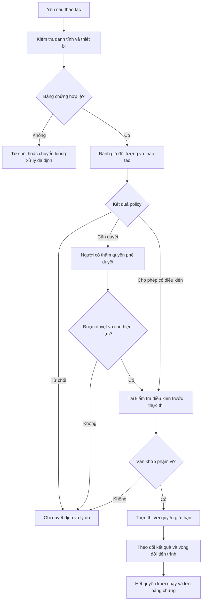

# Endpoint elevation policy

## 1. Mục tiêu và phạm vi

**Endpoint elevation policy** là tập quy tắc quyết định một người dùng có được chạy một thao tác hoặc ứng dụng với quyền cao hơn trên một endpoint hay không, trong điều kiện nào và cần lưu lại bằng chứng gì. Endpoint có thể là máy trạm, laptop hoặc máy chủ được đưa vào phạm vi quản lý tương ứng; bài này tập trung vào thao tác tương tác trên máy trạm.

Trong Privileged Access Management (PAM), mục tiêu không phải chuyển người dùng vào nhóm quản trị lâu dài. Mục tiêu là cho phép **đúng công việc cần quyền, trên đúng thiết bị, trong đúng khoảng thời gian**, đồng thời hạn chế khả năng dùng quyền đó cho công việc khác.

Ví dụ, một nhân viên cần cài phiên bản đã được duyệt của phần mềm thiết kế. Nhu cầu nghiệp vụ là hoàn thành việc cài đặt, không phải có một terminal quản trị để tự chạy mọi lệnh. Một chính sách phù hợp có thể cho dịch vụ quản lý phần mềm thực hiện gói cài đã xác minh, thay vì cấp toàn bộ quyền quản trị cho phiên đăng nhập của nhân viên.

Sau bài học, bạn có thể:

- Phân biệt cấp quyền cho tài khoản với nâng quyền cho tiến trình hoặc tác vụ.
- Xây dựng quy tắc dựa trên người dùng, thiết bị, ứng dụng, thao tác và ngữ cảnh.
- Nhận diện các điều kiện tin cậy yếu như đường dẫn do người dùng kiểm soát.
- Thiết kế phê duyệt, thời hạn, thu hồi và lưu bằng chứng.
- Kiểm thử chính sách trước khi triển khai và xử lý tình huống endpoint mất kết nối.

Tên sản phẩm, cú pháp cấu hình và khả năng kiểm soát phụ thuộc nền tảng. Các cấu hình trong bài là mô hình minh họa, không phải schema có thể nhập trực tiếp vào một sản phẩm PAM.

## 2. Nâng quyền nào đang được cấp?

### 2.1. Tài khoản, tiến trình và tác vụ là ba phạm vi khác nhau

| Phạm vi | Điều gì được thay đổi? | Rủi ro cần kiểm soát |
|---|---|---|
| Tài khoản hoặc nhóm | Người dùng được thêm vào vai trò hay nhóm quản trị | Quyền có thể được dùng cho nhiều ứng dụng trong thời gian được cấp; việc gỡ nhóm không nhất thiết làm mất quyền của token hoặc phiên đã tồn tại |
| Tiến trình | Một tiến trình được khởi chạy với danh tính hoặc mức quyền cao hơn | Tiến trình có thể mở shell, sinh tiến trình con hoặc nạp thành phần có thể bị thay đổi |
| Tác vụ cụ thể | Một dịch vụ có quyền thực hiện thao tác đã giới hạn thay người dùng | Giao diện tác vụ phải kiểm tra đầu vào và tránh trở thành cơ chế thực thi lệnh tùy ý |

Một giải pháp có thể hỗ trợ nhiều phạm vi. Cần xác định rõ nó thực sự kiểm soát được gì, thay vì gọi mọi cơ chế là “nâng quyền theo ứng dụng”.

Trên Windows, quyền của tiến trình gắn với access token và các cơ chế bảo vệ của hệ điều hành. Trên hệ Unix, định danh thực thi, nhóm và cơ chế như sudo có vai trò liên quan. Hai môi trường có cách triển khai khác nhau; không thể sao chép nguyên quy tắc giữa chúng chỉ bằng cách đổi tên tài khoản.

### 2.2. Thời hạn yêu cầu không đồng nghĩa thời hạn quyền thực thi

Giả sử một yêu cầu được duyệt trong 15 phút. Cần trả lời riêng:

1. Trong 15 phút đó, người dùng được khởi chạy bao nhiêu lần?
2. Hết 15 phút thì chỉ chặn lần khởi chạy mới hay còn kết thúc tiến trình đang chạy?
3. Các tiến trình con đã được tạo sẽ ra sao?
4. Thay đổi mà ứng dụng đã thực hiện có cần được hoàn tác không?

Một tiến trình đã chạy với quyền cao thường không tự mất quyền chỉ vì bản ghi phê duyệt hết hạn. Khả năng kết thúc tiến trình, quản lý cây tiến trình hoặc thay đổi quyền giữa chừng phụ thuộc giải pháp và ứng dụng. Chính sách phải ghi rõ hành vi đã được kiểm chứng.

Tương tự, thu hồi quyền không tự khôi phục tệp đã bị sửa, tài khoản đã được tạo hoặc cấu hình hệ thống đã bị thay đổi.

## 3. Mô hình ra quyết định

Có thể mô tả một yêu cầu nâng quyền bằng năm thành phần:

> Ai yêu cầu + trên thiết bị nào + chạy thành phần nào + làm thao tác gì + trong ngữ cảnh nào?

### 3.1. Chủ thể yêu cầu

Chính sách có thể dùng định danh người dùng, nhóm công việc, trạng thái xác thực và quyền yêu cầu nâng quyền. Một nhóm như “nhân viên kỹ thuật” chỉ là đầu vào để xét chính sách, không phải lý do đủ để cho phép tất cả ứng dụng.

Cần phân biệt:

- Người yêu cầu thực hiện công việc.
- Người hoặc hệ thống phê duyệt.
- Danh tính có quyền mà tiến trình thực thi sử dụng.
- Chủ sở hữu nghiệp vụ của quy tắc.

Nếu yêu cầu có mức rủi ro cao, người yêu cầu không nên tự phê duyệt ngoại lệ của chính mình. Không đưa mật khẩu của tài khoản đặc quyền cho người dùng chỉ để họ hoàn thành luồng nâng quyền.

### 3.2. Thiết bị và trạng thái quản lý

Một quy tắc có thể chỉ áp dụng cho thiết bị thuộc nhóm xác định, có agent khỏe, chính sách còn hiệu lực và đáp ứng điều kiện bảo vệ bắt buộc.

Các điều kiện phải kiểm chứng được. “Máy an toàn” là mô tả quá mơ hồ; “thiết bị thuộc nhóm Engineering-Laptops, agent xác thực thành công và dữ liệu trạng thái không cũ quá ngưỡng đã quy định” có thể kiểm thử.

Không nên biến tín hiệu do người dùng tự gửi thành bằng chứng duy nhất. Nhãn thiết bị hoặc trạng thái bảo vệ phải đến từ nguồn đáng tin cậy và có quy tắc xử lý dữ liệu thiếu hoặc quá cũ.

### 3.3. Đối tượng thực thi

Đối tượng không chỉ là tên tệp. Nó có thể gồm:

- Định danh gói phần mềm hoặc tác vụ đã được duyệt.
- Chữ ký số và chuỗi tin cậy được kiểm tra đúng cách.
- Hash của phiên bản cụ thể.
- Phiên bản, thuộc tính sản phẩm hoặc nguồn phân phối được kiểm soát.
- Vị trí cài đặt và quyền ghi đối với tệp, thư mục, cấu hình liên quan.
- Bộ cài, updater, plugin, thư viện và script mà chương trình sẽ sử dụng.

Một tệp có chữ ký hợp lệ vẫn có thể chứa lỗ hổng hoặc cung cấp chức năng quá rộng. Chữ ký chứng minh một quan hệ về nguồn phát hành và tính toàn vẹn theo cơ chế xác minh, không chứng minh chương trình an toàn cho mọi trường hợp nâng quyền.

### 3.4. Thao tác và ngữ cảnh

Thao tác có thể là cài một gói đã phê duyệt, khởi động lại một dịch vụ được chỉ định hoặc sửa một cấu hình giới hạn. Ngữ cảnh bổ sung gồm thời gian, ticket, lý do, mức rủi ro, số lần dùng và điều kiện xác thực lại.

Ticket là bằng chứng liên hệ với công việc, không phải một cơ chế kiểm soát kỹ thuật. Người dùng gắn ticket hợp lệ nhưng yêu cầu chạy một shell tùy ý vẫn là yêu cầu rộng.

### 3.5. Kết quả quyết định

Một mô hình quyết định rõ ràng có thể trả về:

- **Allow constrained:** cho phép trong phạm vi và điều kiện đã xác định.
- **Require approval:** cần người hoặc hệ thống có thẩm quyền duyệt.
- **Deny:** từ chối yêu cầu.
- **Unable to evaluate:** thiếu dữ liệu hoặc không thể xác minh; áp dụng hành vi dự phòng đã được quy định, không tự coi là cho phép.

Tất cả kết quả cần có mã lý do. Thông báo cho người dùng có thể ngắn, còn sự kiện kiểm toán phải đủ để giải thích quy tắc và phiên bản chính sách nào đã tạo ra quyết định.

## 4. Xây dựng một quy tắc đủ chặt

Một quy tắc hữu ích cần trả lời được các câu hỏi sau:

| Thành phần | Ví dụ mô tả |
|---|---|
| Mục đích | Cho nhóm thiết kế cài một gói ứng dụng đã được duyệt |
| Chủ sở hữu | Nhóm quản lý endpoint chịu trách nhiệm kỹ thuật; bộ phận thiết kế xác nhận nhu cầu |
| Chủ thể | Thành viên nhóm Design-StandardUsers |
| Phạm vi thiết bị | Laptop doanh nghiệp trong nhóm Design-Managed |
| Đối tượng | Gói cài theo mã phát hành và manifest đã xác minh |
| Thao tác | Cài gói qua tác vụ của dịch vụ quản lý phần mềm |
| Ràng buộc | Không nhận script, URL tải hoặc đường dẫn đầu vào tùy ý |
| Phê duyệt | Tự động nếu khớp danh mục; ngoại lệ cần phê duyệt riêng |
| Thời hạn | Quyền khởi chạy một lần trong cửa sổ ngắn đã định |
| Kết thúc | Tiến trình và kết quả cài đặt được theo dõi; hành vi khi quá hạn được ghi rõ |
| Bằng chứng | Người yêu cầu, thiết bị, manifest, phiên bản policy, kết quả thực thi |
| Rà soát | Có ngày xem xét lại, tiêu chí thu hồi và người chịu trách nhiệm |

Không phải mọi sản phẩm đều có trường cấu hình tương ứng với từng dòng. Nếu công cụ không thực thi được một ràng buộc quan trọng, cần đổi cách thực hiện tác vụ hoặc thu hẹp phạm vi; không để tài liệu mô tả một mức bảo vệ mà hệ thống không cung cấp.

### Ví dụ mô hình chính sách

```yaml
# MÔ HÌNH MINH HỌA — không phải cấu hình của một sản phẩm cụ thể.
policy:
  id: EP-INSTALL-DESIGN-TOOL
  version: 7
  owner: endpoint-platform
  reviewDate: "2027-02-01"

  subject:
    group: Design-StandardUsers
    requireFreshAuthentication: true

  device:
    group: Design-Managed
    requireHealthyAgent: true
    requireValidLocalPolicy: true

  operation:
    type: managed-package-install
    packageId: design-tool-approved
    releaseManifest: design-tool-release-42
    rejectUserSuppliedExecutable: true
    rejectUserSuppliedScript: true

  grant:
    maxLaunches: 1
    launchWindowMinutes: 15
    elevationScope: managed-task
    runningTaskOnExpiry: follow-approved-task-lifecycle

  decision:
    onMatch: allow-constrained
    onMissingEvidence: deny
    onNoMatch: deny

  audit:
    recordDecision: true
    recordExecutionResult: true
    includeSecrets: false
```

Ví dụ này diễn đạt mục đích: dịch vụ quản lý thực hiện một gói đã duyệt. Nó không cho người dùng chọn một tệp bất kỳ rồi chạy tệp đó bằng tài khoản đặc quyền.

Giá trị ngày và cửa sổ thời gian chỉ phục vụ minh họa. Khi triển khai, thời hạn phải dựa trên thời lượng công việc, khả năng thu hồi thực tế và yêu cầu vận hành.

## 5. Chọn điều kiện tin cậy cho ứng dụng

### 5.1. Tên tệp và đường dẫn không đủ

Quy tắc “cho phép nâng quyền mọi tệp tên setup.exe trong Downloads” không xác định được nhà phát hành, nội dung hay phiên bản. Người dùng có thể đổi tên một tệp khác thành setup.exe.

Ngay cả một đường dẫn cố định cũng chưa đủ nếu người dùng có thể sửa tệp, thay thế thư mục cha, điều khiển liên kết hoặc thay đổi nội dung sau khi hệ thống kiểm tra. Cần đánh giá quyền ghi trên cả chuỗi phụ thuộc và cơ chế mở tệp của hệ điều hành.

Một khoảng trống thường gặp là **time-of-check to time-of-use**: tệp được kiểm tra ở một thời điểm, nhưng nội dung hoặc đích thực thi đã thay đổi trước khi được dùng. Việc xác minh phải gắn với đúng đối tượng được thực thi, thông qua cơ chế phù hợp của giải pháp; không chỉ kiểm tra đường dẫn rồi tin rằng nó sẽ giữ nguyên.

### 5.2. Hash phù hợp với đối tượng bất biến

Hash cho phép ràng buộc một bản nội dung cụ thể. Đổi một byte có thể làm đối tượng không còn khớp quy tắc.

Ưu điểm là phạm vi rõ. Nhược điểm là mỗi phiên bản cập nhật có thể cần một bản ghi mới. Nếu quy trình cập nhật hash quá chậm, người vận hành có thể tạo ngoại lệ rộng để khắc phục; vì vậy cần tự động hóa việc tiếp nhận bản phát hành đã được kiểm tra.

Hash của tệp thực thi cũng không bao phủ toàn bộ hành vi nếu chương trình nạp script, plugin, thư viện hay cấu hình do người dùng kiểm soát.

### 5.3. Publisher giúp quản lý thay đổi nhưng có phạm vi lớn

Quy tắc dựa trên publisher có thể thuận tiện khi phần mềm thường xuyên cập nhật. Tuy nhiên, một nhà phát hành có thể cung cấp nhiều chương trình với chức năng khác nhau. Cho phép toàn bộ chương trình của publisher có thể vô tình bao gồm công cụ quản trị, trình chạy script hoặc phiên bản cũ có lỗ hổng.

Khi công cụ hỗ trợ, kết hợp publisher với định danh sản phẩm, phiên bản cho phép, nguồn phân phối, điều kiện thiết bị và phạm vi thao tác. Quy định rõ phản ứng khi chứng thư, trạng thái xác minh hoặc dữ liệu tin cậy không còn đáp ứng yêu cầu.

Không tự xây dựng thuật toán xác minh chữ ký từ vài thuộc tính chuỗi. Sử dụng cơ chế xác minh phù hợp nền tảng và kiểm thử kết quả thực tế.

### 5.4. Installer và updater là các đối tượng cần chính sách riêng

Một updater chạy đặc quyền có thể tải và cài thêm thành phần. Nếu updater nhận URL hoặc đường dẫn từ người dùng mà không ràng buộc nguồn và nội dung, việc tin cậy tệp updater ban đầu không đủ.

Cần xác định:

- Ai kiểm soát nguồn tải và manifest?
- Gói tải về được xác minh thế nào trước khi dùng?
- Thư mục tạm có thể bị người dùng sửa không?
- Script trước và sau cài đặt đến từ đâu?
- Sau cập nhật, quy tắc cũ có còn cần thiết không?

Nếu có thể triển khai phần mềm qua hệ thống quản lý tập trung đã kiểm soát, đây thường là cách giảm nhu cầu nâng quyền tương tác cho người dùng.

## 6. Kiểm soát tham số, tiến trình con và nội dung được nạp

### 6.1. Một chương trình hẹp có thể mở ra chức năng rộng

Trình soạn thảo chạy đặc quyền có thể sửa tệp hệ thống. Trình quản lý tệp có thể thay thế chương trình hoặc cấu hình quan trọng. Một công cụ chẩn đoán có thể cung cấp nút mở terminal hoặc chạy script.

Vì thế, cho phép một executable không đồng nghĩa chỉ cho phép mục đích được viết trong tên quy tắc. Cần xem xét chức năng có thể đạt tới từ ứng dụng, bao gồm plugin, console tích hợp và thao tác mở chương trình khác.

### 6.2. Shell và trình thông dịch cần được xem là đối tượng rủi ro cao

Cho phép PowerShell, một shell Unix hoặc trình thông dịch chạy đặc quyền với tham số tùy ý có thể tương đương cấp môi trường thực thi tổng quát.

Nếu nhu cầu là chạy một thao tác cố định, ưu tiên tác vụ được quản lý với đầu vào có kiểu và danh sách giá trị hợp lệ. Nếu buộc phải chạy script, cần ràng buộc script và các phụ thuộc, quyền ghi, nguồn phát hành, tham số cùng cơ chế thực thi thực tế.

Không chỉ kiểm tra rằng command line “có chứa tên script được duyệt”. Phép ghép chuỗi, cú pháp trình thông dịch, kiểu trích dẫn, ký tự đặc biệt và cơ chế mở rộng tham số có thể làm ý nghĩa thực thi khác dự kiến.

### 6.3. Tham số phải được hiểu theo ngữ nghĩa

Giả sử công cụ được duyệt có tham số chọn tệp cấu hình. Tệp thực thi hợp lệ nhưng người dùng truyền một cấu hình cho phép chạy hook tùy ý thì phạm vi nâng quyền đã bị mở rộng.

Thay vì một biểu thức so khớp chuỗi quá rộng, cần xác định:

- Những tham số nào được phép xuất hiện?
- Giá trị có thuộc tập hợp hoặc cấu trúc hợp lệ không?
- Đường dẫn có trỏ đến đúng đối tượng được bảo vệ không?
- Có tùy chọn nào cho phép chỉ định executable, script, plugin hoặc lệnh khác không?
- Hành vi thực thi có khác theo phiên bản không?

Nếu sản phẩm không phân tích hoặc ràng buộc được các điều kiện này một cách đáng tin cậy, không nên dựa vào một mẫu command line để tuyên bố đã giới hạn hoàn toàn tác vụ.

### 6.4. Tiến trình con không mặc nhiên an toàn

Một tiến trình cha được duyệt có thể tạo tiến trình con với quyền cao tùy cơ chế thực thi. Cần biết công cụ nâng quyền:

- Cho quyền cao tiếp tục lan theo cây tiến trình hay áp dụng quy tắc cho từng lần khởi chạy?
- Có chặn được tiến trình con ngoài phạm vi không?
- Có theo dõi được quan hệ cha con và thời điểm tạo không?
- Xử lý thế nào khi tiến trình cha kết thúc nhưng con vẫn chạy?

Chặn tiến trình con có thể làm hỏng bộ cài hoặc ứng dụng hợp lệ. Phải kiểm thử luồng thực tế, rồi thiết kế tập cho phép cần thiết. Không sử dụng một ngoại lệ “mọi tiến trình con đều được phép” chỉ để làm cho thử nghiệm thành công.

### 6.5. Thư viện, cấu hình và môi trường cũng thuộc bề mặt tấn công

Một executable trong thư mục bảo vệ vẫn có thể nạp thành phần từ vị trí người dùng có quyền ghi. Thư mục làm việc, đường dẫn tìm kiếm thư viện, biến môi trường, plugin và tệp cấu hình đều có thể ảnh hưởng hành vi.

Trong hệ Unix, việc giữ lại môi trường của người gọi khi chạy đặc quyền cần được đánh giá cẩn thận. Trên Windows, cơ chế nạp thư viện và thành phần mở rộng cũng phải được xem xét theo ứng dụng cụ thể. Không suy ra rằng “binary được bảo vệ” đồng nghĩa “mọi đầu vào của binary đã được bảo vệ”.

## 7. Xử lý nhiều quy tắc cùng khớp

Một yêu cầu có thể đồng thời khớp quy tắc của nhóm người dùng, nhóm thiết bị, ứng dụng và ngoại lệ khẩn cấp. Nếu không xác định ưu tiên, người vận hành khó giải thích vì sao yêu cầu được phép.

Có thể chọn mô hình như từ chối tường minh ưu tiên hơn cho phép thông thường. Tuy nhiên, đó phải là quy tắc đã cấu hình hoặc đã kiểm chứng của hệ thống, không phải giả định chung cho mọi sản phẩm.

Thiết kế cần quy định:

1. Cách chọn quy tắc khi nhiều điều kiện cùng khớp.
2. Cách xử lý quy tắc đặc biệt so với quy tắc tổng quát.
3. Hành vi khi thuộc tính người dùng hoặc thiết bị thiếu.
4. Cách giải quyết ngoại lệ khẩn cấp với điều kiện chặn bắt buộc.
5. Phiên bản và nguồn chính sách có hiệu lực tại endpoint.

Không gộp các phần “cho phép” từ nhiều quy tắc thành một quyền rộng hơn nếu mô hình không chủ đích hỗ trợ điều đó. Ví dụ, quy tắc A cho cài phần mềm trên laptop thiết kế và quy tắc B cho chẩn đoán trên laptop hỗ trợ không nên tạo ra quyền cài mọi phần mềm trên cả hai nhóm.

Mỗi quyết định cần ghi mã quy tắc thắng hoặc lý do xung đột. Bộ kiểm thử phải có tình huống chồng lấn, thay vì chỉ kiểm tra từng quy tắc độc lập.

## 8. Vòng đời một yêu cầu nâng quyền



### 8.1. Phê duyệt phải ràng buộc vào yêu cầu cụ thể

Một bản phê duyệt nên liên kết với người dùng, thiết bị, đối tượng, thao tác, phạm vi, số lần và cửa sổ thời gian. Không dùng một mã “đã duyệt” để mở quyền cho một yêu cầu khác.

Sau khi người duyệt chấp thuận, điều kiện có thể đã thay đổi: gói phần mềm được thay thế, người dùng rời nhóm, thiết bị bị cách ly hoặc policy được thu hồi. Do đó cần kiểm tra lại những điều kiện có liên quan ngay trước khi thực thi.

Nếu công cụ không hỗ trợ ràng buộc tự động, thiết kế quy trình phải thể hiện giới hạn này và lựa chọn phương án phù hợp cho tác vụ rủi ro cao.

### 8.2. Xác thực lại không thay thế phê duyệt

Xác thực lại giúp tăng độ tin cậy về chủ thể yêu cầu. Nó không chứng minh rằng một chương trình được phép chạy đặc quyền.

Một người dùng xác thực thành công vẫn có thể yêu cầu sai tác vụ; một tài khoản hợp lệ cũng có thể bị điều khiển trong phiên đã đăng nhập. Cần kết hợp xác thực với điều kiện của đối tượng và hành vi được cấp.

### 8.3. Kết thúc và thu hồi

Cần phân biệt ba hành động:

- Thu hồi khả năng tạo yêu cầu hoặc khởi chạy mới.
- Kết thúc tiến trình hay phiên đang hoạt động, nếu giải pháp hỗ trợ và tình huống cho phép.
- Xử lý hậu quả đã tạo ra, như kiểm tra cấu hình, gỡ quyền phát sinh hoặc điều tra sự cố.

Không kết thúc cưỡng bức một bộ cài đang thay đổi hệ thống mà chưa đánh giá khả năng làm hỏng trạng thái máy. Với tác vụ như vậy, có thể cần cơ chế chạy đến trạng thái an toàn, theo dõi và khắc phục riêng.

## 9. Endpoint offline và lỗi hệ thống

Laptop có thể mất mạng trong khi người dùng đang đi công tác. Chính sách phải phân biệt mất kết nối đến máy chủ với mất khả năng xác minh tại endpoint.

Một thiết kế có thể cho phép một tập tác vụ offline đã định, nếu agent còn khỏe, chính sách cục bộ được xác thực, còn trong hạn dùng và không cần phê duyệt trực tuyến mới. Phạm vi này cần hẹp và được đánh giá rủi ro trước.

Không thể bảo đảm nhận thu hồi mới ngay lập tức khi thiết bị không liên lạc được. Vì vậy thời hạn hiệu lực của dữ liệu cục bộ, khả năng bảo vệ đồng hồ, cơ chế chống phát lại và yêu cầu kết nối lại đều ảnh hưởng đến rủi ro.

| Tình huống | Hướng xử lý có thể thiết kế |
|---|---|
| Mất mạng, policy cục bộ hợp lệ | Chỉ cho phép tập tác vụ offline đã được duyệt từ trước |
| Cần phê duyệt mới nhưng máy chủ không truy cập được | Giữ yêu cầu ở trạng thái chưa được phép; dùng luồng hỗ trợ hoặc khẩn cấp đã quy định |
| Chữ ký policy không hợp lệ hoặc policy hết hạn | Không dựa vào policy đó để cho phép nâng quyền |
| Không xác minh được đối tượng thực thi | Áp dụng kết quả thiếu bằng chứng đã quy định |
| Hàng đợi log gần đầy | Áp dụng ngưỡng và phương án bảo toàn bằng chứng đã thiết kế, có cảnh báo |
| Agent hỏng hoặc bị can thiệp | Phát hiện, cảnh báo và đưa thiết bị vào quy trình phục hồi có kiểm soát |

Một lỗi mạng không nên âm thầm biến thành cấp toàn bộ quyền quản trị. Nếu có nhu cầu khẩn cấp, sử dụng luồng break-glass riêng với phạm vi, thời hạn, danh tính, bằng chứng và rà soát sau sử dụng rõ ràng.

Chính sách nâng quyền cũng không thay thế việc bảo vệ agent, dịch vụ đặc quyền hoặc hệ điều hành khỏi can thiệp. Các cơ chế này là điều kiện nền tảng của mô hình tin cậy.

## 10. Bằng chứng kiểm toán và giám sát

Mục tiêu của log là trả lời: ai yêu cầu, yêu cầu điều gì, vì sao được phép hoặc bị từ chối, quyền đã được dùng thế nào và kết quả ra sao.

### 10.1. Trường dữ liệu cần thiết

Một sự kiện quyết định có thể gồm:

```json
{
  "eventType": "endpoint.elevation.decision",
  "requestId": "req-example-1042",
  "userId": "user-example-18",
  "deviceId": "device-example-07",
  "policyId": "EP-INSTALL-DESIGN-TOOL",
  "policyVersion": 7,
  "operation": "managed-package-install",
  "packageManifestId": "design-tool-release-42",
  "decision": "allow-constrained",
  "reasonCode": "APPROVED_MANAGED_PACKAGE",
  "approvalReference": "catalog-preapproved",
  "launchLimit": 1,
  "launchWindowMinutes": 15
}
```

Đây chỉ là ví dụ trường dữ liệu; khi triển khai cần thêm thời điểm, múi giờ hoặc quy ước UTC, nguồn sự kiện và thông tin xác minh phù hợp. Request ID liên kết quyết định với lần thực thi, cây tiến trình, kết quả và sự kiện thu hồi.

Không coi “đã cho phép” là “đã thực thi thành công”. Cần tách sự kiện quyết định, bắt đầu, kết thúc và lỗi. Một yêu cầu có thể được cho phép nhưng gói cài thất bại trước khi hoàn thành.

### 10.2. Ghi đủ nhưng không làm lộ bí mật

Command line, biến môi trường và nội dung script có thể chứa mật khẩu, token hoặc dữ liệu cá nhân. Thiết kế log phải giảm thiểu và che dữ liệu nhạy cảm theo từng loại sự kiện.

Hash, định danh gói, mã quy tắc và tham chiếu ticket thường hữu ích để truy vết mà không cần ghi toàn bộ nội dung nhạy cảm. Tuy vậy, việc thu thập trường nào và thời gian lưu bao lâu vẫn cần phù hợp với quy định của tổ chức.

Nếu ghi phiên hoặc thu hình màn hình được sử dụng, phải quy định riêng quyền truy cập, phạm vi dữ liệu, thời gian lưu và thông báo cần thiết. Không phải mọi cơ chế endpoint elevation đều cung cấp session recording.

### 10.3. Bảo vệ và sử dụng bằng chứng

Log tại endpoint cần được bảo vệ khỏi sửa xóa trái phép và chuyển về nơi lưu trữ tập trung khi có thể. Với log gửi trễ do offline, giữ cả thời điểm sự kiện tại nguồn và thời điểm tiếp nhận để phân biệt độ trễ.

Giám sát nên chú ý các mẫu như:

- Nhiều yêu cầu bị từ chối với các executable khác nhau trong thời gian ngắn.
- Một đối tượng có hash mới nhưng cố dùng quy tắc của phiên bản cũ.
- Tác vụ được duyệt tạo tiến trình con ngoài tập dự kiến.
- Nhu cầu ngoại lệ tăng sau một bản cập nhật ứng dụng.
- Agent ngừng báo cáo hoặc policy bị hạ về phiên bản cũ ngoài quy trình.

Một tín hiệu bất thường cần được điều tra theo ngữ cảnh, không tự động đồng nghĩa đã có xâm nhập.

## 11. Kiểm thử trước khi triển khai

Không chỉ chạy trường hợp hợp lệ rồi kết luận chính sách đạt yêu cầu. Bộ kiểm thử cần chứng minh cả tác vụ cần thiết hoạt động và những biến thể vượt phạm vi bị xử lý đúng.

| Ca kiểm thử | Kết quả mong đợi theo thiết kế |
|---|---|
| Người đúng nhóm, máy đúng nhóm, gói đúng manifest | Được chạy đúng tác vụ và ghi đủ quyết định, thực thi |
| Người ngoài nhóm yêu cầu cùng tác vụ | Bị từ chối hoặc đi qua luồng khác đã định |
| Tệp cùng tên nhưng khác nội dung | Không được kế thừa quyền chỉ vì trùng tên |
| Ứng dụng hợp lệ nhưng phiên bản ngoài phạm vi | Không tự được cho phép nếu policy chưa duyệt phiên bản đó |
| Tệp nằm ở vị trí người dùng có thể thay thế | Không được tin cậy chỉ dựa trên đường dẫn |
| Tham số trỏ đến script hoặc cấu hình không được duyệt | Bị chặn theo ràng buộc tác vụ |
| Gói thay đổi sau phê duyệt | Bị đánh giá lại trước thực thi |
| Quy tắc cho phép và từ chối cùng khớp | Kết quả đúng cơ chế ưu tiên đã công bố |
| Yêu cầu phát lại sau khi đã dùng hết số lần | Không tạo thêm lần thực thi được phép |
| Hết cửa sổ khởi chạy | Không khởi chạy mới; tiến trình đang chạy theo đúng quy tắc vòng đời |
| Thiết bị offline với policy hợp lệ hoặc hết hạn | Hai trường hợp được xử lý khác nhau theo thiết kế |
| Hệ thống thu log tạm thời không truy cập được | Bộ đệm, ngưỡng cảnh báo và chuyển tiếp hoạt động như dự kiến |
| Thu hồi policy trong lúc ứng dụng đang chạy | Kết quả phù hợp khả năng thu hồi thực tế đã ghi nhận |
| Ứng dụng cập nhật và thay đổi tiến trình con | Phát hiện thay đổi; không tự mở rộng quyền ngoài phạm vi |

Các ca kiểm thử có khả năng thay đổi cấu hình hệ thống nên thực hiện trong môi trường kiểm thử được phép và có phương án phục hồi. Mục đích là xác minh ranh giới chính sách, không thực nghiệm bằng quyền rộng trên máy người dùng.

### Chế độ quan sát có giới hạn

Một số giải pháp có chế độ audit hoặc simulation. Nó có thể giúp phát hiện yêu cầu thường gặp và dự đoán quyết định.

Kết quả quan sát không chứng minh rằng cơ chế chặn khi bật enforcement sẽ hoạt động đúng trong mọi tình huống. Cần thử cả thực thi thật trong nhóm pilot, bao gồm tác động đến người dùng và cách khắc phục khi một tác vụ hợp lệ bị chặn.

Không tự chuyển toàn bộ dữ liệu quan sát thành allowlist. Một hoạt động đã từng xảy ra chưa chắc là hoạt động cần được tiếp tục cho phép.

## 12. Triển khai và quản trị thay đổi

### 12.1. Bắt đầu từ công việc phổ biến, phạm vi nhỏ

Thu thập các nhu cầu thực tế, xác định tác vụ nào có thể chuyển sang triển khai tập trung, tác vụ nào cần nâng quyền tương tác và tác vụ nào không nên được cho phép trên endpoint.

Chọn nhóm pilot đại diện cho ứng dụng, phiên bản hệ điều hành và mô hình kết nối. Tránh pilot chỉ gồm máy của nhóm xây dựng policy vì các máy này có thể không phản ánh điều kiện sử dụng thực tế.

### 12.2. Chính sách cũng là một thành phần cần quản lý phiên bản

Mỗi thay đổi cần có chủ sở hữu, lý do, phạm vi ảnh hưởng, kiểm thử và phiên bản. Khi chuyển policy đến endpoint, phải bảo đảm tính xác thực, toàn vẹn và có cách xác nhận phiên bản đã được áp dụng.

Rollback cũng phải có kiểm soát. Khôi phục một phiên bản cũ có thể vô tình mở lại quyền đã bị thu hồi. Vì vậy, rollback không đồng nghĩa bỏ qua kiểm tra bảo mật; cần đánh giá chính xác những quyền sẽ trở lại.

Cần phân biệt rollback cấu hình policy với rollback tác động của ứng dụng. Hạ phiên bản policy không tự gỡ phần mềm hay khôi phục dữ liệu đã bị tác vụ thay đổi.

### 12.3. Ngoại lệ phải có vòng đời

Một ngoại lệ nên có:

- Yêu cầu nghiệp vụ và chủ sở hữu rõ ràng.
- Đối tượng, thiết bị và người dùng cụ thể.
- Điều kiện giám sát và mức phê duyệt.
- Ngày hết hạn hoặc điều kiện tự đóng.
- Kế hoạch chuyển sang phương án chuẩn nếu nhu cầu lặp lại.

Ngoại lệ “cho cả phòng ban toàn quyền vì một ứng dụng lỗi” dễ trở thành quyền thường trực. Nếu nhiều người cần cùng một thao tác, xem lại thiết kế phân phối ứng dụng hoặc tác vụ thay vì duy trì nhiều phê duyệt thủ công.

## 13. Tình huống thực tế: cài tiện ích chẩn đoán

### 13.1. Yêu cầu ban đầu

Nhóm hỗ trợ cần chạy tiện ích chẩn đoán mạng trên laptop của doanh nghiệp. Tiện ích có một số chức năng cần quyền cao để truy cập thành phần hệ thống. Người dùng thông thường vẫn cần giữ tài khoản không có quyền quản trị thường trực.

Đề xuất đầu tiên là cho nâng quyền mọi tệp có tên NetDiag.exe. Đề xuất này không ràng buộc nội dung, nguồn và phạm vi hành vi nên chưa đáp ứng yêu cầu.

### 13.2. Phân tích ranh giới

Nhóm endpoint xác định:

- Chỉ một bản phát hành được duyệt và phân phối từ kho phần mềm quản lý.
- Người dùng không được thay thế executable hoặc các phụ thuộc được sử dụng với quyền cao.
- Chức năng chẩn đoán đọc thông tin được tách khỏi chức năng thay đổi cấu hình.
- Công cụ không được nhận lệnh hoặc script tùy ý qua tham số.
- Việc mở terminal hay tiến trình con ngoài luồng đã duyệt phải được kiểm thử và kiểm soát.
- Kết quả chẩn đoán có thể chứa thông tin mạng nội bộ nên việc thu thập và lưu log cần giới hạn.

Nếu không thể giới hạn chức năng thay đổi cấu hình bằng policy của công cụ, có thể cần dùng tác vụ quản lý riêng hoặc một phiên hỗ trợ được phê duyệt với phạm vi rõ hơn.

### 13.3. Quy tắc đề xuất

Quy tắc chỉ áp dụng cho nhóm hỗ trợ được phân công, trên thiết bị được quản lý. Người dùng chọn tác vụ “thu thập chẩn đoán”; hệ thống thực thi đối tượng đã xác minh với đầu vào được giới hạn.

Việc thay đổi cấu hình mạng không tự được bao gồm. Nếu cần thực hiện, tạo yêu cầu riêng theo loại tác vụ, mức tác động và cơ chế phục hồi thích hợp.

Thời hạn 15 phút trong một ví dụ phê duyệt chỉ giới hạn cửa sổ được khởi chạy. Hành vi của tiến trình còn chạy sau thời hạn phải được kiểm thử và ghi trong thiết kế, thay vì mặc định rằng quyền sẽ biến mất.

### 13.4. Bằng chứng để kết luận tác vụ thành công

Có quyết định allow chưa đủ. Cần có bản ghi khởi chạy gắn với request ID, đối tượng thực tế đã chạy, phiên bản policy, kết quả và thông tin về tiến trình con theo khả năng giải pháp.

Nếu công cụ tạo một tiến trình ngoài dự kiến, đó là dấu hiệu cần xem lại quy tắc và hành vi ứng dụng. Không nới toàn bộ chính sách cho đến khi luồng thực thi được hiểu rõ.

## 14. Chỉ số vận hành và cách đọc

Chỉ số giúp tìm quy tắc quá rộng, tác vụ bị chặn sai hoặc nhu cầu chưa được đưa vào danh mục chuẩn.

| Chỉ số | Cách định nghĩa | Cách sử dụng |
|---|---|---|
| Tỷ lệ yêu cầu được cho phép | Số yêu cầu có quyết định cho phép chia cho số yêu cầu đã đánh giá trong cùng kỳ | Theo dõi thay đổi; không xem tỷ lệ cao là thành công tự thân |
| Tỷ lệ thực thi thành công | Số lần thực thi hoàn tất thành công chia cho số lần thực thi đã có kết quả cuối trong kỳ xác định | Phân biệt lỗi ứng dụng với quyết định policy |
| Tỷ lệ có đủ bằng chứng | Số lần nâng quyền có đủ tập trường bắt buộc chia cho tổng số lần nâng quyền quan sát được theo nguồn đã định | Phát hiện khoảng trống kiểm toán; ghi rõ giới hạn quan sát |
| Số ngoại lệ còn hiệu lực | Số ngoại lệ chưa hết hạn hoặc chưa đóng tại thời điểm đo | Tìm quyền tạm thời đang trở thành thường trực |
| Độ trễ phê duyệt | Khoảng thời gian từ yêu cầu đến quyết định; xem trung vị và các phân vị phù hợp | Nhận diện điểm nghẽn vận hành |
| Mức phủ policy hợp lệ | Số endpoint trong phạm vi đang báo policy hợp lệ chia cho tổng endpoint dự kiến quản lý | Phát hiện thiết bị mất liên lạc, chưa áp dụng hoặc có trạng thái quá cũ |

Khi so sánh theo thời gian, giữ ổn định phạm vi thiết bị, cửa sổ đo và cách đếm. Một lượt thử lại có thể tạo yêu cầu mới; cần quy định rõ để tránh làm méo tỷ lệ.

Số lần bị từ chối tăng có thể do policy quá chặt, ứng dụng vừa cập nhật hoặc hành vi bất thường. Phải xem mã lý do và ngữ cảnh trước khi kết luận.

## 15. Bài tập thiết kế

Một công ty có 200 laptop được quản lý. Nhóm phát triển cần cài SDK đã duyệt, nhóm hỗ trợ cần chạy công cụ chẩn đoán, và một số nhân viên thường xuyên làm việc offline.

Hãy thiết kế ba quy tắc tương ứng và trả lời:

1. Tác vụ nào nên được phân phối tập trung để người dùng không cần yêu cầu nâng quyền?
2. Với tác vụ tương tác còn lại, quyền được cấp cho tài khoản, tiến trình hay tác vụ?
3. Những bằng chứng nào xác định đúng phần mềm và phiên bản?
4. Đầu vào, script, plugin và tiến trình con nào cần giới hạn?
5. Những quy tắc nào được dùng offline, dữ liệu tin cậy có hiệu lực bao lâu?
6. Thời hạn yêu cầu ảnh hưởng thế nào đến khởi chạy mới và tiến trình đang chạy?
7. Khi hai quy tắc cùng khớp, kết quả được chọn ra sao?
8. Những sự kiện nào đủ để giải thích một lần thực thi sau này?

Một phương án hợp lý có thể dùng hệ thống quản lý phần mềm cho SDK, một tác vụ chẩn đoán có đầu vào giới hạn cho nhóm hỗ trợ và một tập offline nhỏ đã được duyệt trước. Mỗi lựa chọn vẫn cần được kiểm tra với khả năng thật của công cụ, quy trình cập nhật và nhu cầu vận hành.

### Tự kiểm tra

- Vì sao đường dẫn cố định vẫn có thể là điều kiện tin cậy yếu?
- Vì sao chữ ký hợp lệ không đồng nghĩa được phép chạy mọi chức năng với quyền cao?
- Một executable được duyệt nhưng nạp plugin do người dùng sửa có vấn đề gì?
- Thu hồi phê duyệt có làm tiến trình đang chạy tự mất quyền không?
- Làm sao phân biệt yêu cầu được cho phép với tác vụ hoàn tất thành công?
- Khi mất kết nối, thông tin nào không thể nhận được ngay từ máy chủ?

Bạn đã nắm được chủ đề khi có thể giải thích một lần nâng quyền bằng đầy đủ chủ thể, thiết bị, đối tượng, thao tác, điều kiện và bằng chứng; đồng thời chỉ ra quyền đó kết thúc ở đâu và trường hợp nào cần cơ chế xử lý riêng.
