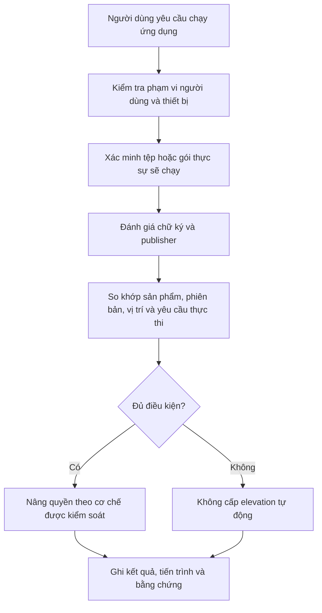

# Elevation by publisher: nâng quyền theo nhà phát hành trên endpoint

## 1. Bối cảnh và mục tiêu

Một kỹ thuật viên hỗ trợ cần chạy công cụ chẩn đoán do nhà cung cấp phần cứng phát hành. Công cụ phải đọc một số trạng thái thiết bị và thực hiện một thao tác bảo trì cần quyền quản trị. Nếu cấp local administrator thường trực cho kỹ thuật viên, quyền đó tồn tại cả khi họ dùng trình duyệt, nhận tệp hoặc chạy phần mềm không liên quan. Nếu bắt helpdesk nhập mật khẩu quản trị cho mọi lần chạy, quy trình có thể chậm và tạo thêm cơ hội lộ credential.

Endpoint PAM có thể cho phép nâng quyền cho một ứng dụng thỏa mãn chính sách. **Elevation by publisher** dùng danh tính nhà phát hành được xác minh từ chữ ký số của tệp hoặc gói phần mềm làm một điều kiện để quyết định việc nâng quyền.

Điều quan trọng là chữ ký chỉ trả lời một phần câu hỏi. Một tệp có chữ ký hợp lệ chưa chắc là tệp được phép chạy với quyền cao, và nhà phát hành đáng tin không khiến mọi sản phẩm, phiên bản hay tham số của họ trở nên phù hợp với nhiệm vụ đang xét.

Sau bài học, người học có thể:

- Phân biệt publisher, thông tin mô tả của tệp và danh tính người yêu cầu nâng quyền.
- Xây dựng điều kiện nâng quyền kết hợp publisher với sản phẩm, tệp, phiên bản, vị trí và phạm vi người dùng.
- Nhận diện nguy cơ từ thư mục có quyền ghi, command line, tiến trình con, plug-in và bộ cài.
- Thiết kế kiểm thử, ghi log, thu hồi và xử lý khi chứng thư hoặc hệ thống kiểm tra gặp sự cố.

Trong phạm vi PAM, mục tiêu là cho phép hoàn thành một tác vụ cụ thể với đặc quyền tối thiểu, có thời hạn hoặc có phạm vi rõ ràng, đồng thời không phát mật khẩu quản trị cho người dùng.

## 2. Publisher là gì và không phải là gì?

### 2.1. Ba loại danh tính cần tách biệt

| Danh tính | Câu hỏi được trả lời | Ví dụ |
|---|---|---|
| Người yêu cầu | Ai đang xin nâng quyền? | Kỹ thuật viên thuộc nhóm hỗ trợ thiết bị |
| Nhà phát hành được xác minh | Ai ký thành phần đang được đánh giá? | Pháp nhân sở hữu chứng thư ký mã được chấp nhận |
| Ứng dụng hoặc tác vụ | Thành phần nào, phiên bản nào, thực hiện việc gì? | Công cụ kiểm tra thiết bị với chế độ chẩn đoán được duyệt |

Tên công ty trong cửa sổ About, trường mô tả sản phẩm hoặc tên tệp không tự chứng minh publisher. Một chương trình có thể tự ghi tên một nhà cung cấp nổi tiếng trong metadata. Điều kiện publisher phải dựa trên kết quả xác minh chữ ký mà cơ chế kiểm soát thực sự sử dụng, không dựa trên một chuỗi hiển thị do người tạo tệp tự khai báo.

Ngay cả metadata nằm trong nội dung đã ký cũng chỉ phản ánh điều người ký khai báo. Nó có thể giúp thu hẹp lựa chọn tệp, nhưng không thay thế việc đánh giá chức năng và nguồn gốc của ứng dụng.

### 2.2. Chữ ký số cung cấp điều gì?

Với cơ chế ký mã phù hợp, việc xác minh thường liên quan đến:

1. Kiểm tra nội dung thuộc phạm vi được ký có khớp với chữ ký.
2. Xác định chứng thư ký và chuỗi tin cậy tương ứng.
3. Đánh giá mục đích sử dụng chứng thư, hiệu lực và các điều kiện tin cậy.
4. Áp dụng quy tắc về dấu thời gian, thu hồi và trạng thái xác minh theo nền tảng.

Không nên diễn giải kết quả thành “toàn bộ thứ ứng dụng có thể chạy đều đã được nhà phát hành ký”. Tệp cấu hình, thư viện nạp động, plug-in, script tải về hoặc gói dữ liệu đi kèm có thể nằm ngoài phạm vi chữ ký của tệp thực thi ban đầu.

Có thể hình dung:

```text
Chữ ký hợp lệ
    └── cung cấp bằng chứng về người ký và tính toàn vẹn
        của nội dung thuộc phạm vi ký

Quyền được nâng
    └── là quyết định của chính sách PAM
        dựa trên chữ ký và các điều kiện nghiệp vụ, kỹ thuật khác
```

### 2.3. Signed không đồng nghĩa với safe

Một chương trình được ký hợp lệ vẫn có thể:

- Chứa lỗ hổng đã biết hoặc lỗi thiết kế.
- Cho người dùng mở một shell hay chạy một lệnh tùy ý.
- Nạp thư viện hoặc plug-in từ vị trí người dùng có thể sửa.
- Cài thành phần do người dùng chọn với quyền hệ thống.
- Bị sử dụng sai mục đích thông qua tham số.
- Được phát hành trong một sự cố chuỗi cung ứng.
- Mang chữ ký tạo bằng khóa ký bị đánh cắp.

Vì vậy, “cho phép nâng quyền mọi tệp của publisher X” thường rộng hơn nhiều so với nhu cầu thực tế.

## 3. Vì sao dùng publisher thay vì chỉ dùng hash hoặc đường dẫn?

Ba cách nhận diện này giải quyết những vấn đề khác nhau.

| Điều kiện | Điểm mạnh | Giới hạn khi đứng một mình |
|---|---|---|
| Hash của tệp | Xác định một nội dung tệp cụ thể | Bản cập nhật hợp lệ thường có hash mới |
| Đường dẫn | Gắn với vị trí triển khai dự kiến | Tệp ở vị trí đó có thể bị thay nếu quyền ghi không được bảo vệ |
| Publisher đã xác minh | Có thể giữ tính liên tục qua nhiều bản phát hành | Một publisher có thể ký rất nhiều công cụ với mức rủi ro khác nhau |
| Tên sản phẩm, tên tệp, phiên bản | Thu hẹp họ ứng dụng và phiên bản | Metadata cần được đánh giá cùng chữ ký và khả năng so khớp của sản phẩm PAM |

Publisher hữu ích khi công cụ được cập nhật đều đặn và việc duyệt từng hash gây chi phí vận hành lớn. Tuy nhiên, giảm chi phí cập nhật không có nghĩa là bỏ kiểm soát phiên bản hoặc cho phép mọi sản phẩm cùng người ký.

Một chính sách thực tế có thể kết hợp publisher và đường dẫn triển khai do hệ thống quản lý. Với ứng dụng nhạy cảm hoặc bản phát hành chưa đủ độ tin cậy, tổ chức có thể bổ sung hash hay chỉ định phiên bản đã kiểm thử.

Cần phân biệt **các điều kiện kết hợp trong một rule** với **nhiều rule riêng biệt**. Nếu sản phẩm cho phép nâng quyền khi bất kỳ rule nào khớp, một rule hash rất chặt không thể bù cho một rule publisher khác đang quá rộng.

## 4. Mô hình quyết định nâng quyền

### 4.1. Kết hợp điều kiện thay vì chỉ xác nhận người ký

Một mô hình tối thiểu có thể được diễn đạt như sau:

```text
ALLOW_ELEVATION =
    người dùng và thiết bị thuộc phạm vi
    AND ứng dụng có nguồn triển khai được chấp nhận
    AND chữ ký được xác minh theo chính sách tin cậy
    AND publisher thuộc danh sách được duyệt
    AND đúng sản phẩm và đúng thành phần thực thi
    AND phiên bản được phép
    AND vị trí cùng các thành phần phụ thuộc đáp ứng yêu cầu bảo vệ
    AND yêu cầu thực thi nằm trong phạm vi chức năng cho phép
    AND trạng thái agent và chính sách còn đáp ứng điều kiện vận hành
```

Đây là mô hình tư duy, không phải cú pháp cấu hình dùng chung cho mọi giải pháp Endpoint PAM. Sản phẩm khác nhau có thể dùng cách nhận diện publisher, thuật toán ưu tiên rule, xử lý package và kiểm soát tiến trình con khác nhau.

Trước khi triển khai, phải xác nhận sản phẩm có thể thực thi từng điều kiện hay không. Nếu công cụ không kiểm soát được một thuộc tính quan trọng, điều kiện đó chưa tồn tại chỉ vì nó xuất hiện trong tài liệu thiết kế.

### 4.2. Chuỗi xử lý tham khảo



“Không cấp elevation tự động” không nhất thiết là cấm chạy ứng dụng ở quyền thường. Trạng thái đó cần được phân biệt với chính sách application control chặn hẳn chương trình.

Cũng không nên thiết kế fallback tự động cấp toàn bộ quyền administrator khi rule không khớp. Ngoại lệ nghiệp vụ nên đi qua một quy trình riêng có phê duyệt, giới hạn thời gian và bằng chứng sử dụng.

## 5. Thiết kế một rule đủ hẹp

### 5.1. Bắt đầu từ tác vụ nghiệp vụ

Ví dụ giả định: nhóm hỗ trợ thiết bị cần chạy `DeviceDiag.exe` của nhà phát hành `Example Devices` trên các máy trạm được quản lý. Tác vụ được duyệt là chẩn đoán thiết bị và một thao tác bảo trì đã xác định.

Những câu hỏi cần trả lời trước khi tạo rule:

- Quyền thường có thực sự không đủ, hay ứng dụng chỉ yêu cầu quyền cao vì thiết kế cũ?
- Có thể tách phần cần đặc quyền vào một dịch vụ có giao diện hẹp hay không?
- Thành phần nào cần được nâng: giao diện chính, helper, bộ cài hay updater?
- Người dùng có chọn được chương trình, thư viện, đường dẫn xuất hoặc gói cài mà ứng dụng sẽ xử lý không?
- Ứng dụng có thể mở terminal, chạy script hoặc gọi lệnh bên ngoài không?
- Cơ chế PAM có kiểm soát các hành vi đó hay cần thay đổi cách đóng gói và triển khai?

Nếu ứng dụng cung cấp khả năng thực thi tùy ý bằng quyền quản trị, chỉ thêm publisher vào rule không biến nó thành công cụ least privilege.

### 5.2. Ví dụ chính sách mô tả

Đoạn dưới là đặc tả để thảo luận và kiểm thử, **không phải schema có thể nhập trực tiếp vào một sản phẩm PAM**.

```yaml
policyIntent:
  id: EPM-DEVICE-DIAG-01
  purpose: "Chẩn đoán thiết bị trên máy trạm do tổ chức quản lý"
  requesters: "Nhóm hỗ trợ thiết bị"
  devices: "Nhóm máy trạm đã triển khai gói được duyệt"

application:
  signature: "Phải được xác minh thành công theo chính sách tin cậy"
  publisher: "Danh tính người ký đã được duyệt, so khớp theo cơ chế của sản phẩm"
  product: "Example Device Diagnostics"
  originalFile: "DeviceDiag.exe"
  versions: "Chỉ các phiên bản nằm trong tập đã duyệt"
  deployment: "Qua kênh quản lý phần mềm của tổ chức"
  location: "Thư mục cài đặt được bảo vệ khỏi ghi bởi người dùng thường"

execution:
  function: "Chỉ tác vụ chẩn đoán và bảo trì đã xác định"
  arbitraryCommandExecution: "Không được tạo đường thực thi tùy ý với quyền cao"
  childProcesses: "Được đánh giá và kiểm thử theo cơ chế thực tế"
  dependencies: "Không nạp thành phần có thể bị người dùng thường thay thế"

operations:
  onUnverifiableSignature: "Không cấp elevation tự động"
  onPolicyExpiry: "Áp dụng xử lý đã xác định trước; không mở rộng đặc quyền"
  audit: "Ghi quyết định, rule, tệp, người yêu cầu và kết quả"
  review: "Khi phát hành mới, đổi người ký hoặc xuất hiện sự cố"
```

Những dòng mô tả trên chỉ có hiệu lực nếu được chuyển thành các kiểm soát thực thi hoặc quy trình triển khai cụ thể và đã được kiểm thử. “Không được thực thi tùy ý” là yêu cầu cần chứng minh, không phải một cờ cấu hình có sẵn trong mọi công cụ.

### 5.3. Nhận diện publisher đủ chính xác

Không xây dựng điều kiện như `publisher contains "Example"` khi sản phẩm có thể so khớp danh tính được xác minh một cách chặt chẽ hơn.

Tùy giải pháp, publisher có thể được biểu diễn bằng thuộc tính chứng thư, danh tính người ký đã chuẩn hóa hoặc một tập điều kiện signer. Cần biết:

- Trường nào được so khớp và phép so khớp có phân biệt các giá trị gần giống không.
- Chứng thư nào hoặc chuỗi tin cậy nào được chấp nhận.
- Có chấp nhận người ký khác chỉ vì họ có tên hiển thị giống nhau không.
- Khi nhà cung cấp gia hạn chứng thư, rule còn khớp hay cần duyệt lại.
- Có sự khác biệt giữa chữ ký nhúng, chữ ký catalog và chữ ký package không.

Khóa vào một thumbprint có thể cho phạm vi hẹp nhưng làm tăng công việc khi đổi chứng thư. Chỉ dựa vào tên subject có thể thuận tiện hơn nhưng chưa chắc đủ chặt. Tổ chức cần chọn thuộc tính phù hợp với cơ chế của sản phẩm và có kế hoạch chuyển đổi chứng thư.

## 6. Những ranh giới kỹ thuật thường bị bỏ sót

### 6.1. Tệp hợp lệ nằm trong một thư mục không an toàn

Một tệp có chữ ký đúng có thể bị người dùng chép vào thư mục Downloads. Chữ ký có thể vẫn hợp lệ, nhưng môi trường thực thi ở đó có thể chứa DLL, plug-in hoặc cấu hình do người dùng kiểm soát.

Ngay cả thư mục có tên giống vị trí cài đặt chuẩn cũng chưa đủ. Cần xét quyền trên tệp, thư mục cha, đường cập nhật và thành phần được nạp. Chính sách dựa trên đường dẫn chỉ hữu ích khi đường dẫn đó được bảo vệ thực sự.

Một ví dụ cần thử trong môi trường kiểm thử:

```text
C:\Program Files\Example Devices\DeviceDiag\DeviceDiag.exe
    Người dùng thường: chỉ đọc và thực thi
    Kênh triển khai: quản lý tập trung
    Cấu hình và thư viện ảnh hưởng đến thực thi: được bảo vệ

C:\Users\demo\Downloads\DeviceDiag.exe
    Tệp chính: có thể vẫn có chữ ký hợp lệ
    Thư mục xung quanh: người dùng có thể thay đổi
    Kết luận: không tự động tương đương với bản triển khai đã duyệt
```

Đường dẫn là một điều kiện bổ sung; không nên giả định ứng dụng luôn nạp mọi phụ thuộc từ thư mục của nó. Cách tìm DLL, plug-in, cấu hình và nội dung tải về phải được khảo sát theo hành vi thật của ứng dụng.

### 6.2. Tham số có thể thay đổi hoàn toàn ý nghĩa nâng quyền

Hai lần chạy cùng một tệp có thể mang rủi ro khác nhau:

```text
DeviceDiag.exe <chế độ chẩn đoán đã duyệt>
DeviceDiag.exe <chức năng chạy thành phần bên ngoài do người dùng chọn>
```

Đây là ký hiệu minh họa, không phải tham số thật của công cụ nào.

Một rule publisher rộng có thể cho phép cả hai nếu không có kiểm soát khác. Với ứng dụng hỗ trợ thực thi lệnh hoặc xử lý gói do người dùng chọn, phải xét:

- Cách ứng dụng phân tích tham số.
- Khả năng dùng response file hoặc file cấu hình để truyền thêm lựa chọn.
- Đường dẫn tương đối, liên kết hoặc biến môi trường ảnh hưởng đến mục tiêu.
- Cách xử lý nhiều dạng biểu diễn tương đương của cùng một yêu cầu.
- Khả năng chuyển từ giao diện đồ họa sang một chức năng không thể giới hạn bằng command line.

Chỉ kiểm tra chuỗi tham số ở launcher không đủ nếu ứng dụng sau đó nhận lệnh tùy ý qua giao diện, tệp hoặc IPC.

### 6.3. Tiến trình con và quyền kế thừa

Nâng quyền cho một chương trình có thể làm phát sinh tiến trình con với quyền cao tùy cơ chế tạo tiến trình và cách Endpoint PAM can thiệp.

Cần trả lời bằng kiểm thử:

1. Chương trình có tạo tiến trình con nào trong luồng bình thường?
2. Tiến trình con có giữ token đặc quyền không?
3. Quyết định nâng quyền cho tiến trình con có được đánh giá riêng không?
4. Có thể giới hạn danh tính, chức năng hoặc quyền của tiến trình con bằng giải pháp đang dùng không?
5. Nếu người dùng mở file dialog, plug-in manager hoặc chức năng hỗ trợ, có tạo thêm đường thực thi quyền cao không?

Không mặc định một nút “elevate application” chỉ nâng đúng một tệp rồi kết thúc. Cũng không mặc định mọi công cụ PAM đều hỗ trợ loại bỏ quyền kế thừa cho tiến trình con. Nếu không thể duy trì ranh giới cần thiết, nên đổi cách cung cấp tác vụ, chẳng hạn một dịch vụ có API hẹp hoặc một quy trình do quản trị viên vận hành.

### 6.4. Bộ cài và trình thông dịch là trường hợp đặc biệt

Bộ cài, updater, trình thông dịch và công cụ quản trị tổng quát có thể xử lý nội dung do người khác cung cấp. Người ký chương trình chủ không nhất thiết là người ký nội dung mà nó chạy.

Ví dụ, việc tin tưởng chương trình cài đặt không tự xác minh mọi package nó được yêu cầu cài. Việc tin tưởng một trình thông dịch không tự xác minh mọi script đầu vào. Việc nâng quyền cho công cụ hỗ trợ không đảm bảo mọi module tải bổ sung đều đã được duyệt.

Với các thành phần này, cần xác định đối tượng mà sản phẩm PAM thực sự đánh giá: host executable, package, script, nội dung tải về hay nhiều thành phần cùng lúc. Nếu sản phẩm chỉ kiểm tra host, rule phải được thiết kế với giới hạn đó hoặc không dùng để cấp elevation tự động cho nội dung tùy ý.

### 6.5. Khoảng cách giữa lúc kiểm tra và lúc thực thi

Đọc thuộc tính một tệp, kiểm tra chữ ký rồi sau đó chạy bằng quyền cao là hai hành động khác nhau. Nếu tệp hoặc đường dẫn có thể bị thay trong khoảng giữa, kết quả kiểm tra ban đầu có thể không còn gắn với đối tượng thực thi.

Đây là một lý do phải dùng cơ chế elevation được thiết kế để đánh giá và thực thi an toàn, kết hợp bảo vệ đường triển khai. Một script tự gọi công cụ kiểm tra chữ ký rồi gọi lệnh chạy administrator không tự trở thành giải pháp PAM an toàn.

## 7. Chữ ký, dấu thời gian, thu hồi và trạng thái không xác minh được

### 7.1. Không dùng ngày hết hạn làm quy tắc đơn giản duy nhất

Kết quả xác minh chữ ký có thể phụ thuộc vào dấu thời gian đáng tin, trạng thái chứng thư ở thời điểm ký, chính sách thu hồi và cách nền tảng xây dựng chuỗi tin cậy.

Vì vậy, hai suy luận sau đều không đủ:

- “Chứng thư đã hết hạn hôm nay, nên mọi tệp từng ký bằng nó đều vô hiệu.”
- “Có dấu thời gian, nên tệp luôn đáng tin bất kể sự cố sau này.”

Cần dựa trên bộ xác minh của nền tảng và chính sách tổ chức, sau đó chuyển kết quả thành quyết định elevation. Dấu thời gian không thay thế danh sách phiên bản bị cấm hoặc lệnh thu hồi quyền chạy do tổ chức ban hành.

### 7.2. Phân biệt invalid với unknown

Các trạng thái không có ý nghĩa như nhau:

| Tình huống | Ý nghĩa đối với quyết định |
|---|---|
| Không có chữ ký phù hợp | Không đạt điều kiện publisher yêu cầu chữ ký |
| Chữ ký không khớp nội dung | Không đạt kiểm tra tính toàn vẹn |
| Chuỗi không được tin cậy | Không đạt điều kiện tin cậy đang áp dụng |
| Không đủ dữ liệu để xác minh | Không thể kết luận đạt điều kiện bằng bằng chứng hiện có |
| Xác minh thành công nhưng phiên bản bị cấm | Vẫn không được nâng theo rule đã duyệt |

Trạng thái không xác minh được có thể xuất hiện do mạng, dữ liệu thu hồi, trust store hoặc môi trường của endpoint. Chính sách phải quy định trước việc xử lý; không biến lỗi xác minh thành một điều kiện cho phép.

Nếu có nhu cầu vận hành offline, tổ chức cần xác định dữ liệu tin cậy nào được cache, thời gian sử dụng, cách cập nhật và giới hạn của kết quả cache. Không thể vừa yêu cầu thông tin thu hồi tức thời vừa hứa đảm bảo quyết định đó khi endpoint hoàn toàn không có kênh nhận thông tin mới.

### 7.3. Đổi chứng thư và sự cố khóa ký

Gia hạn hoặc đổi chứng thư là sự kiện vận hành bình thường nhưng cần được kiểm soát. Quy trình có thể gồm:

1. Nhận thông tin thay đổi từ kênh nhà cung cấp đã được xác thực.
2. Thu thập bản phát hành mới qua kênh phân phối được duyệt.
3. Xác minh người ký, sản phẩm và hành vi.
4. Kiểm thử rule cập nhật trên nhóm nhỏ.
5. Phân phối chính sách và theo dõi kết quả.
6. Loại bỏ điều kiện cũ theo kế hoạch và nhu cầu hỗ trợ.

Nếu nghi ngờ khóa ký bị lộ, không chỉ đợi bộ xác minh hệ điều hành thay đổi kết quả. Tổ chức có thể cần vô hiệu rule, chặn hash hoặc phiên bản cụ thể, thu thập bằng chứng và triển khai bản thay thế. Hiệu lực của biện pháp phụ thuộc việc endpoint đã nhận và áp dụng chính sách mới.

## 8. Khảo sát chữ ký và quyền truy cập một cách chỉ đọc

Trên một máy Windows kiểm thử, có thể dùng PowerShell để quan sát chữ ký của tệp cụ thể:

```powershell
$applicationPath = 'C:\Program Files\Example Devices\DeviceDiag\DeviceDiag.exe'

$signature = Get-AuthenticodeSignature -LiteralPath $applicationPath
$signature | Select-Object Status, StatusMessage, SignatureType

if ($null -ne $signature.SignerCertificate) {
    $signature.SignerCertificate |
        Select-Object Subject, Issuer, Thumbprint, NotBefore, NotAfter
}

if ($null -ne $signature.TimeStamperCertificate) {
    $signature.TimeStamperCertificate |
        Select-Object Subject, Issuer, NotBefore, NotAfter
}

Get-FileHash -LiteralPath $applicationPath -Algorithm SHA256
(Get-Acl -LiteralPath $applicationPath).Access |
    Select-Object IdentityReference, FileSystemRights, AccessControlType, IsInherited

$installationDirectory = [System.IO.Path]::GetDirectoryName($applicationPath)
(Get-Acl -LiteralPath $installationDirectory).Access |
    Select-Object IdentityReference, FileSystemRights, AccessControlType, IsInherited
```

Đoạn lệnh chỉ đọc, không nâng quyền và không thay đổi chính sách. Cần thay đường dẫn minh họa bằng đúng tệp trong môi trường kiểm thử; nếu tệp không tồn tại, dừng và xác định lại đối tượng.

Giới hạn của kết quả:

- `Status` là quan sát từ cơ chế xác minh mà lệnh sử dụng trong môi trường đó; không bảo đảm trùng mọi quyết định của agent PAM.
- Chứng thư hiển thị giúp điều tra, không tự chứng minh ứng dụng được duyệt cho tác vụ.
- Hash hỗ trợ định danh hiện vật đã quan sát, không bảo đảm nó là đối tượng agent sẽ nâng ở một lần chạy khác.
- Danh sách ACE không tự là phân tích effective access đầy đủ; còn có nhóm, quyền kế thừa, thư mục cha và các đường ghi khác.
- Chưa khảo sát toàn bộ phụ thuộc, cập nhật, tiến trình con hay giao diện điều khiển của ứng dụng.

Không biến đoạn khảo sát này thành launcher có quyền cao. Việc cấp elevation cần do cơ chế kiểm soát được triển khai và kiểm thử đảm nhiệm.

## 9. Kế hoạch triển khai từ thử nghiệm đến vận hành

### 9.1. Lập hồ sơ ứng dụng

Hồ sơ tối thiểu nên có mục đích, owner nghiệp vụ, owner kỹ thuật, nguồn phân phối, thành phần thực thi, người ký được chấp nhận, phiên bản được duyệt và lý do cần elevation.

Cần ghi rõ cả đường tác động: ứng dụng sửa tài nguyên gì, có cài service hoặc driver không, có tác động lâu dài sau khi tiến trình kết thúc không. Một lần chạy ngắn vẫn có thể tạo thay đổi đặc quyền tồn tại lâu.

### 9.2. Quan sát và kiểm thử ở nhóm nhỏ

Chạy chế độ quan sát nếu sản phẩm hỗ trợ và thu thập luồng sử dụng thật. Quan sát giúp tìm rule phù hợp nhưng không tự chứng minh an toàn; một thời gian không có sự cố không thay cho kiểm thử đường lạm dụng.

Sau đó áp dụng cho nhóm pilot có khả năng hỗ trợ và rollback. Xác nhận người dùng hoàn thành công việc bằng tài khoản thường, không cần nhận mật khẩu quản trị và không xuất hiện đường thực thi quyền cao ngoài phạm vi.

### 9.3. Mở rộng có điều kiện

Chỉ mở rộng sau khi các kiểm thử bắt buộc đã có kết quả. Tách vòng triển khai theo nhóm thiết bị, phiên bản hệ điều hành hoặc phiên bản ứng dụng nếu môi trường khác nhau có thể ảnh hưởng đến hành vi.

Với mỗi lần thay đổi rule hoặc cập nhật ứng dụng, ghi phiên bản chính sách, hiện vật kiểm thử và kết quả. Điều này giúp phân biệt một lỗi ứng dụng với một thay đổi signer hoặc một rule được phân phối sai.

### 9.4. Rollback và thu hồi

Rollback không có nghĩa là cấp local admin cho toàn bộ người dùng. Phương án có thể là tạm dừng tác vụ, quay về gói đã kiểm thử còn được hỗ trợ hoặc chuyển tác vụ sang quy trình hỗ trợ có kiểm soát.

Thu hồi rule thường ảnh hưởng đến yêu cầu elevation mới sau khi endpoint nhận chính sách. Nó không tự đảm bảo đã dừng mọi tiến trình được nâng trước đó, gỡ service vừa cài hoặc đảo ngược thay đổi hệ thống. Cần có các bước riêng cho những tác động đó.

## 10. Ma trận kiểm thử có bằng chứng

Mỗi ca thử phải ghi rõ bản tệp, người dùng, endpoint, phiên bản policy, hành động thực hiện, kết quả dự kiến và kết quả quan sát. Không chỉ kiểm tra có xuất hiện hộp thoại hay không; cần xác minh quyền thực tế của tiến trình và tác động lên tài nguyên.

| Ca thử | Điều kiện chính | Kết quả mong đợi |
|---|---|---|
| Tác vụ hợp lệ | Đúng nhóm, đúng bản triển khai, đúng thành phần | Hoàn thành tác vụ với phạm vi elevation đã thiết kế |
| Người dùng ngoài phạm vi | Cùng tệp nhưng không thuộc nhóm được duyệt | Không được elevation theo rule này |
| Thiết bị ngoài phạm vi | Cùng người dùng và tệp | Không được elevation theo rule này |
| Cùng publisher, sản phẩm khác | Chữ ký hợp lệ nhưng không đúng công cụ | Không được elevation theo rule này |
| Tên gần giống | Metadata hoặc tên hiển thị giống, signer không đúng | Không khớp danh tính đã duyệt |
| Tệp bị sửa | Nội dung thuộc phạm vi ký bị thay đổi | Không được elevation dựa trên chữ ký đó |
| Bản cũ bị cấm | Chữ ký hợp lệ, phiên bản ngoài tập duyệt | Không được elevation theo rule |
| Bản mới chưa duyệt | Thay đổi chưa qua quy trình phát hành | Đi theo quy trình duyệt, không mặc định được phép |
| Chép vào Downloads | Tệp chính vẫn hợp lệ, vị trí không đáp ứng | Không được elevation tự động theo đặc tả |
| Đầu vào thực thi tùy ý | Tác vụ khác ngoài phạm vi được duyệt | Không tạo đường thực thi tùy ý bằng quyền cao |
| Tiến trình con | Ứng dụng tạo helper hoặc mở công cụ khác | Đáp ứng đúng ranh giới quyền đã được chứng minh |
| Không xác minh được chữ ký | Thiếu dữ liệu tin cậy cần thiết | Xử lý theo quy tắc đã định, không tự mở rộng quyền |
| Đổi signer | Gói hợp lệ theo nhà cung cấp nhưng signer mới | Kiểm tra quy trình chuyển đổi và điều kiện rule |
| Thu hồi policy | Endpoint đã nhận bản thu hồi | Yêu cầu mới không còn được cấp theo rule đã thu hồi |

Các tình huống có thể gây hỏng ứng dụng hoặc thay đổi hệ thống phải thực hiện trong môi trường thử nghiệm phù hợp, bằng bản sao và dữ liệu thử. Không sửa hiện vật sản xuất để tạo ca chữ ký lỗi.

Một lỗi kiểm thử quan trọng là chỉ thấy thao tác bị chặn nhưng không biết rule nào gây chặn. Cần đối chiếu log quyết định để đảm bảo ca thử đang kiểm tra đúng rule publisher và không bị che bởi một kiểm soát khác.

## 11. Ghi log phục vụ kiểm toán và điều tra

Một sự kiện elevation nên giúp trả lời được ai đã yêu cầu, đối tượng nào được nâng, vì sao được phép và kết quả ra sao.

Các trường hữu ích gồm:

- Thời điểm, định danh endpoint và phiên bản agent.
- Định danh người yêu cầu, nhóm hoặc phạm vi đã dùng trong quyết định.
- Rule ID, phiên bản chính sách và nguồn phân phối.
- Đường dẫn, hash, sản phẩm và phiên bản tệp được đánh giá.
- Danh tính người ký cùng kết quả xác minh liên quan.
- Quyết định cho phép hoặc từ chối và lý do.
- Tương quan với tiến trình cha, tiến trình con hoặc phiên thực thi nếu sản phẩm hỗ trợ.
- Kết quả thực thi hoặc mã kết thúc nếu có.

Ví dụ sự kiện mô tả:

```json
{
  "eventType": "endpoint_elevation_decision",
  "deviceId": "WS-LAB-042",
  "requester": "support.user",
  "ruleId": "EPM-DEVICE-DIAG-01",
  "policyVersion": "pilot-03",
  "application": {
    "fileName": "DeviceDiag.exe",
    "publisherIdentity": "approved-signer-reference",
    "version": "approved-release-reference",
    "artifactHashReference": "sha256-record-in-evidence-store"
  },
  "decision": "allow",
  "reason": "all_required_conditions_matched",
  "correlationId": "lab-run-042"
}
```

Đây là cấu trúc minh họa, không phải cam kết về schema của bất kỳ sản phẩm nào. Trong bằng chứng thực tế, hash và định danh signer phải là giá trị thật hoặc tham chiếu phân giải được.

Command line, tên đường dẫn và log ứng dụng có thể chứa dữ liệu cá nhân hoặc bí mật. Chỉ thu thập phần cần thiết, che thông tin nhạy cảm theo chính sách và kiểm soát người được đọc log. Việc che dữ liệu phải giữ đủ khả năng xác định chức năng đã được gọi và liên kết hiện vật liên quan.

Cần cảnh báo khi xuất hiện các mẫu như số lần elevation tăng đột biến, bản mới bất thường, signer thay đổi, ứng dụng chạy từ vị trí lạ hoặc tiến trình con không thuộc hồ sơ đã duyệt. Một sự kiện hợp lệ về chữ ký vẫn có thể là tín hiệu điều tra nếu hành vi khác thường.

## 12. Tình huống thực hành: công cụ đúng publisher nhưng rule quá rộng

### 12.1. Thiết kế ban đầu

Một nhóm triển khai rule:

```text
Người dùng: nhóm hỗ trợ
Điều kiện ứng dụng: chữ ký hợp lệ của Example Devices
Hành động: elevation tự động
```

Nhà cung cấp này phát hành cả công cụ chẩn đoán, công cụ cài firmware và một tiện ích hỗ trợ có chức năng chạy thành phần bên ngoài. Các tệp đều có cùng danh tính người ký được rule chấp nhận.

Trong thử nghiệm, kỹ thuật viên chạy được công cụ chẩn đoán. Kết quả đó chỉ chứng minh luồng hợp lệ hoạt động; chưa chứng minh phạm vi của rule chỉ bao phủ công cụ này.

### 12.2. Phát hiện

Một thành viên khác chạy tiện ích hỗ trợ cùng publisher và nhận elevation. Rule không có điều kiện về sản phẩm hoặc tệp, nên hành vi này có thể hoàn toàn đúng với cấu hình nhưng sai với yêu cầu nghiệp vụ.

Khi điều tra cần tách:

- Lỗi thực thi: agent không làm đúng policy.
- Lỗi chính sách: policy cho phép rộng hơn tác vụ được duyệt.
- Lỗi ứng dụng: công cụ được duyệt cung cấp đường tác động vượt phạm vi mong muốn.

Ở tình huống này, bằng chứng ban đầu chỉ ra lỗi chính sách. Tuy nhiên, vẫn cần đánh giá công cụ chẩn đoán vì thu hẹp tên tệp không loại bỏ mọi rủi ro từ đầu vào và phụ thuộc của chính nó.

### 12.3. Điều chỉnh

Nhóm triển khai thu hẹp rule đến đúng thành phần, tập phiên bản được duyệt, vị trí triển khai được bảo vệ và phạm vi thiết bị. Họ đánh giá các tiến trình con, nguồn cấu hình và chức năng nhập dữ liệu của ứng dụng.

Nếu một chức năng cần thiết vẫn cho phép thực thi tùy ý và không thể kiểm soát phù hợp bằng sản phẩm hiện có, họ không tuyên bố rule đã đạt least privilege. Tác vụ được chuyển sang một cơ chế hẹp hơn hoặc một quy trình hỗ trợ có phê duyệt.

Sau điều chỉnh, nhóm chạy lại cả ca hợp lệ và ca cùng publisher nhưng khác sản phẩm. Log phải chỉ ra đúng rule, đúng đối tượng và kết quả từ chối phù hợp.

## 13. Bài tập thiết kế

Giả sử một nhà cung cấp có hai công cụ ký bằng cùng một chứng thư:

- `HardwareCheck.exe` chỉ phục vụ chẩn đoán theo hồ sơ được cung cấp.
- `SupportRunner.exe` có khả năng chạy module do người dùng chỉ định.

Tổ chức muốn nhóm hỗ trợ chạy `HardwareCheck.exe` để xử lý sự cố trên một nhóm máy trạm.

Hãy viết một đặc tả ngắn gồm:

1. Tác vụ nào thực sự cần quyền cao và bằng chứng cần thu thập để xác nhận.
2. Danh tính publisher và các điều kiện bổ sung để giới hạn rule.
3. Yêu cầu với vị trí triển khai, cấu hình và phụ thuộc.
4. Các ca thử chống việc dùng `SupportRunner.exe` hoặc đầu vào khác để mở rộng quyền.
5. Cách xử lý khi signer đổi, phiên bản cũ bị cấm hoặc không xác minh được chữ ký.
6. Cách xác nhận thu hồi đã đến endpoint và cách xử lý tiến trình đã chạy trước khi thu hồi.

Một hướng giải phù hợp phải làm rõ rằng cùng chứng thư không đồng nghĩa cùng quyền. Đồng thời, không được chỉ tin lời mô tả rằng `HardwareCheck.exe` “chỉ chẩn đoán”; cần kiểm tra hành vi thực tế, nguồn đầu vào và các thành phần nó có thể gọi.

Tiêu chí đánh giá thiết kế là ranh giới quyền có thể thực thi và có bằng chứng, chứ không phải số lượng điều kiện được viết trong đặc tả.

## 14. Các ngộ nhận cần tránh

| Ngộ nhận | Cách hiểu đúng |
|---|---|
| Có chữ ký hợp lệ là được nâng quyền | Chữ ký chỉ là một điều kiện của quyết định PAM |
| Tên công ty trong metadata là publisher đã xác minh | Cần dùng danh tính người ký từ kết quả xác minh phù hợp |
| Cùng publisher thì mọi công cụ đều tương đương | Mỗi công cụ có chức năng, đầu vào và mức rủi ro riêng |
| Đúng đường dẫn là không thể thay thế | Phải xét quyền ghi, cập nhật và các đường tác động khác |
| Chặn command line là đã chặn mọi chức năng | GUI, file cấu hình, IPC hoặc plug-in vẫn có thể đổi hành vi |
| Nâng một chương trình chỉ tác động đến một tiến trình | Tiến trình con và thay đổi lâu dài cần được đánh giá |
| Thu hồi rule lập tức hoàn tác mọi tác động | Cần xác nhận đồng bộ policy và xử lý riêng tiến trình, service, thay đổi hệ thống |
| Một script kiểm tra chữ ký rồi chạy admin là đủ | Cần bảo vệ cả quyết định, đối tượng thực thi và vòng đời elevation |

## 15. Điểm cần ghi nhớ

Elevation by publisher giúp duy trì khả năng nhận diện ứng dụng qua các bản phát hành, giảm phụ thuộc vào việc duyệt từng hash. Giá trị này chỉ hữu ích khi chính sách vẫn bám vào tác vụ cụ thể.

Một thiết kế tốt kết hợp người ký được xác minh với đúng thành phần, phiên bản, nguồn triển khai, phạm vi người dùng và hành vi thực thi. Nó cũng kiểm soát hoặc thay thế những đường làm quyền cao lan sang tiến trình con, nội dung đầu vào hay phụ thuộc không được bảo vệ.

Khi vận hành, cần theo dõi thay đổi signer, duy trì bằng chứng kiểm thử và có khả năng thu hồi đã được xác nhận trên endpoint. Kết quả cần đạt là người dùng làm được công việc đã duyệt mà không sở hữu quyền quản trị thường trực hoặc một đường thực thi tùy ý có đặc quyền.
