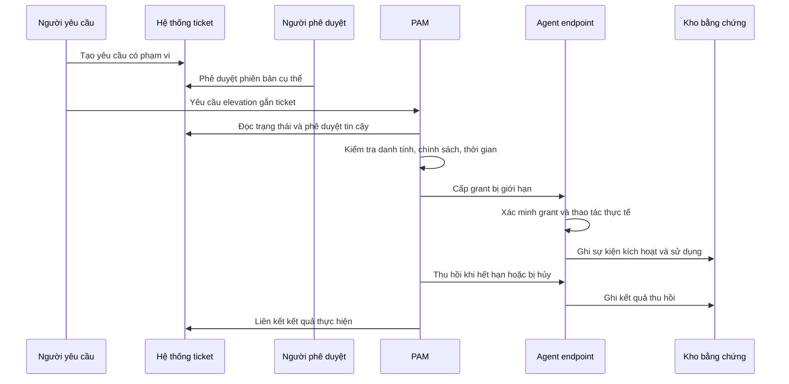

# Elevation by ticket

## 1. Mục tiêu và bối cảnh

Trong Endpoint PAM, **elevation by ticket** là cách cấp quyền nâng đặc quyền có thời hạn dựa trên một yêu cầu công việc đã được kiểm tra. Ticket cung cấp lý do nghiệp vụ và ngữ cảnh; hệ thống PAM quyết định có cấp quyền hay không, cấp cho ai, trên endpoint nào, đối với thao tác nào và trong bao lâu.

Ví dụ, kỹ sư cần cài một trình điều khiển đã được kiểm thử trên máy trạm dành cho phòng thí nghiệm. Tài khoản thông thường không có quyền cài đặt. Kỹ sư mở ticket, ghi rõ máy đích, gói cài đặt và cửa sổ thực hiện. Sau khi yêu cầu được phê duyệt theo chính sách, agent Endpoint PAM cho phép chạy đúng trình cài đặt với quyền cần thiết trong một khoảng thời gian ngắn.

Điểm quan trọng là **ticket không tự trở thành quyền quản trị**. Một mã ticket hợp lệ hoặc một dòng mô tả “đã được duyệt” chưa đủ để cho phép elevation. Quyết định cấp quyền phải dựa trên nguồn phê duyệt đáng tin cậy và các ràng buộc mà PAM có thể thực thi.

Sau bài học, người học có thể:

- Phân biệt ticket, phê duyệt nghiệp vụ và quyền elevation.
- Thiết kế yêu cầu nâng quyền gắn với người dùng, endpoint, thao tác và thời hạn.
- Xử lý thay đổi ticket, yêu cầu lặp, mất kết nối và tình huống khẩn cấp.
- Xác định bằng chứng cần lưu để điều tra và kiểm toán.
- Đánh giá một quy trình elevation có thực sự đáp ứng least privilege, JIT và JEA hay không.

Bài học tập trung vào endpoint do tổ chức quản lý. Các tên trạng thái, trường dữ liệu và mã giả bên dưới là mô hình minh họa, không phải API hay cấu hình của một sản phẩm cụ thể.

## 2. Ticket giải quyết vấn đề gì?

### 2.1. Khoảng trống giữa nhu cầu công việc và quyền hệ thống

Một yêu cầu quyền thường xuất hiện dưới dạng: “Cho tôi quyền admin để xử lý sự cố”. Câu này chưa đủ thông tin để quyết định an toàn:

- Sự cố nào cần xử lý?
- Có đúng người đang phụ trách công việc không?
- Máy nào cần can thiệp?
- Thao tác cụ thể nào đòi hỏi quyền cao?
- Công cụ hoặc gói cài đặt nào được sử dụng?
- Bao giờ quyền phải hết hiệu lực?
- Ai chịu trách nhiệm phê duyệt và kiểm tra kết quả?

Ticket giúp tập hợp những thông tin này thành một hồ sơ có vòng đời. PAM sử dụng hồ sơ đó làm một đầu vào để áp chính sách truy cập, đồng thời tạo liên kết giữa thay đổi trên endpoint và công việc được cho phép.

### 2.2. Ba lớp cần tách biệt

| Lớp | Câu hỏi cần trả lời | Ví dụ |
|---|---|---|
| Yêu cầu công việc | Vì sao cần thao tác? | Khắc phục lỗi thiết bị theo incident |
| Phê duyệt | Ai chấp nhận việc gì, trong phạm vi nào? | Chủ sở hữu endpoint duyệt cài gói đã xác định |
| Thực thi elevation | Endpoint cho phép hành động nào? | Agent cho chạy một installer cụ thể với quyền cao trong 20 phút |

Một ticket đang mở chỉ chứng minh rằng có hồ sơ công việc. Nó không chứng minh yêu cầu đã được duyệt. Một phê duyệt nghiệp vụ cũng chưa đảm bảo endpoint thực thi đúng phạm vi: nếu PAM chỉ thêm người dùng vào nhóm quản trị cục bộ, người đó có thể thực hiện nhiều hành động hơn thao tác ghi trong ticket.

Vì vậy, chất lượng của elevation by ticket phụ thuộc đồng thời vào quy trình phê duyệt và khả năng giới hạn quyền tại endpoint.

## 3. Mô hình thành phần và trách nhiệm

Một triển khai điển hình có các thành phần sau:

| Thành phần hoặc vai trò | Trách nhiệm |
|---|---|
| Người yêu cầu | Mô tả công việc, chọn endpoint và thao tác, cung cấp thời gian dự kiến |
| Người phê duyệt | Xác nhận nhu cầu, phạm vi và rủi ro trong giới hạn thẩm quyền |
| Hệ thống ticket | Lưu hồ sơ, trạng thái, phiên bản và lịch sử phê duyệt |
| Bộ quyết định PAM | Kiểm tra chính sách, danh tính, phạm vi và thời hạn; cấp hoặc từ chối grant |
| Agent trên endpoint | Kiểm tra grant và thực thi elevation theo giới hạn được hỗ trợ |
| Hệ thống thu thập bằng chứng | Liên kết sự kiện từ ticket, PAM và endpoint để tra cứu |
| Nhóm vận hành hoặc an ninh | Theo dõi bất thường, xử lý lỗi thu hồi và rà soát ngoại lệ |

**Grant** trong bài này là một quyết định cho phép đã được PAM tạo ra và có phạm vi xác định. Nó không nhất thiết là mật khẩu quản trị, cũng không nhất thiết là một token được gửi trực tiếp cho người dùng.

Các vai trò không nên bị gộp một cách mặc định. Người yêu cầu tự viết “approved” vào phần mô tả không được xem là người phê duyệt. Đối với thao tác rủi ro cao, chính sách có thể yêu cầu phê duyệt độc lập hoặc hai bên phê duyệt. Không phải mọi thao tác đều cần cùng một số cấp duyệt; mức kiểm soát phải phù hợp với rủi ro và khả năng thực thi.

## 4. Một yêu cầu elevation cần chứa những gì?

### 4.1. Ràng buộc bắt buộc

Một yêu cầu tốt mô tả được tối thiểu sáu chiều:

1. **Chủ thể:** người nào hoặc danh tính nào được phép thực hiện.
2. **Tài nguyên:** endpoint nào nằm trong phạm vi.
3. **Hành động:** ứng dụng, gói cài đặt hoặc tác vụ nào được nâng quyền.
4. **Đặc quyền:** mức quyền hoặc hồ sơ elevation nào được áp dụng.
5. **Thời gian:** khi nào được bắt đầu và khi nào phải kết thúc.
6. **Ngữ cảnh:** lý do, ticket, phê duyệt và điều kiện kiểm soát liên quan.

Chỉ ghi “cài phần mềm” hoặc “máy của người dùng” sẽ để lại quá nhiều cách diễn giải. Nên sử dụng định danh endpoint ổn định trong hệ thống quản lý thay vì chỉ dựa vào tên máy có thể đổi hoặc được tái sử dụng.

Danh tính cũng cần được ràng buộc với định danh của tổ chức. Địa chỉ email hiển thị và tên người dùng trong mô tả ticket không nên là căn cứ duy nhất để cấp quyền.

### 4.2. Ví dụ yêu cầu có cấu trúc

```yaml
request:
  ticketId: "INC-EXAMPLE-1042"
  requesterId: "user-042"
  endpointId: "device-lab-017"
  purpose: "Cài lại driver cho thiết bị đo tại phòng lab"
  requestedAction:
    type: "RUN_APPROVED_INSTALLER"
    packageId: "lab-device-driver"
    packageVersion: "4.2-approved"
    artifactDigestRef: "artifact-catalog/lab-driver-4.2"
    elevationProfile: "installer-only"
  requestedWindow:
    notBefore: "2026-12-01T02:00:00Z"
    notAfter: "2026-12-01T03:00:00Z"
  requestedDurationMinutes: 20
  approvalPolicyId: "endpoint-driver-maintenance"
```

Đây là dữ liệu yêu cầu, chưa phải bằng chứng đã được phê duyệt. Trường `approvalPolicyId` do người yêu cầu gửi không được tự quyết định chính sách áp dụng. PAM phải ánh xạ yêu cầu sang chính sách có thẩm quyền, kiểm tra các trường được phép và lấy bản ghi phê duyệt từ phía máy chủ.

Các mốc thời gian dùng định dạng có múi giờ rõ ràng để tránh nhầm lẫn giữa hệ thống ticket, PAM và endpoint.

### 4.3. Ràng buộc ứng dụng cần thực thi được

“Cho phép đúng ứng dụng” có thể dựa trên nhiều thuộc tính: chữ ký, nhà phát hành, digest của tệp, phiên bản, đường dẫn bảo vệ, nguồn gói cài đặt và tham số được phép.

Không thuộc tính nào nên bị diễn giải quá rộng:

- Đường dẫn trong thư mục người dùng có thể bị thay nội dung.
- Cho phép toàn bộ tệp của một nhà phát hành có thể bao gồm công cụ mạnh hơn nhu cầu.
- Digest xác định một artifact cụ thể nhưng cần cập nhật khi artifact thay đổi hợp lệ.
- Trình cài đặt có thể khởi chạy tiến trình con; cần hiểu chính sách đối với tiến trình con.
- Cho phép shell, trình thông dịch hoặc công cụ chạy mã tùy ý có thể làm mất ý nghĩa của giới hạn theo ứng dụng.

Nếu agent không thực thi được giới hạn cần thiết, phải thể hiện rõ khoảng quyền thực tế được cấp. Không mô tả một grant quản trị toàn máy là “chỉ cài ứng dụng” chỉ vì ticket ghi như vậy.

## 5. Vòng đời từ ticket đến thu hồi quyền

### 5.1. Các bước chính



Sơ đồ mô tả luồng logic. Trong sản phẩm thực tế, agent có thể chủ động lấy grant, PAM có thể dùng cơ chế đồng bộ sự kiện, và việc cập nhật ticket có thể diễn ra bất đồng bộ.

### 5.2. Kiểm tra trước khi cấp grant

PAM cần kiểm tra ít nhất:

- Người dùng đã xác thực và đủ điều kiện yêu cầu elevation.
- Ticket tồn tại trong đúng hệ thống, đúng phạm vi tổ chức.
- Ticket thuộc loại hoặc trạng thái được chính sách cho phép.
- Phê duyệt còn hiệu lực và gắn với phạm vi hiện tại.
- Người phê duyệt có thẩm quyền đối với endpoint và hành động.
- Người yêu cầu, người thực hiện và người được phê duyệt khớp quy định.
- Endpoint nằm trong phạm vi và đáp ứng yêu cầu quản lý, sức khỏe hoặc kết nối.
- Thao tác yêu cầu không vượt quá điều được duyệt.
- Thời gian hiện tại nằm trong cửa sổ hợp lệ.
- Giới hạn số lần sử dụng, yêu cầu đồng thời và chính sách rủi ro đều được đáp ứng.

Việc bắt người dùng xác thực lại hoặc sử dụng MFA có thể là điều kiện của chính sách. MFA chứng minh thêm về danh tính ở thời điểm đó; nó không thay thế phê duyệt hay giới hạn phạm vi.

### 5.3. Trạng thái ticket và trạng thái grant

Hai vòng đời có liên quan nhưng không đồng nhất:

| Sự kiện | Trạng thái công việc có thể có | Hành vi PAM cần xác định |
|---|---|---|
| Yêu cầu mới | Đang chờ duyệt | Chưa cấp quyền |
| Được duyệt | Sẵn sàng thực hiện | Có thể cấp nếu các điều kiện khác đạt |
| Đang xử lý | Công việc đang diễn ra | Theo dõi grant còn hiệu lực |
| Hủy yêu cầu | Không tiếp tục | Chặn cấp mới và yêu cầu thu hồi grant liên quan |
| Hoàn thành | Chờ đóng hoặc đã đóng | Kết thúc quyền theo chính sách, lưu kết quả |
| Mở lại | Cần xử lý tiếp | Đánh giá lại; không tự hồi sinh grant cũ |

Không hardcode rằng mọi ticket “Open” đều được phép hoặc mọi ticket “Closed” đã đồng nghĩa với thu hồi thành công. Cần ánh xạ các trạng thái cụ thể của hệ thống ticket sang quyết định PAM và kiểm chứng kết quả tại endpoint.

## 6. Phê duyệt phải gắn với phiên bản và phạm vi

### 6.1. Vì sao chỉ kiểm tra mã ticket là không đủ?

Giả sử ticket ban đầu xin cài gói A trên máy X. Sau khi được duyệt, người yêu cầu sửa thành chạy shell quản trị trên máy Y. Nếu PAM chỉ kiểm tra “ticket này từng được duyệt”, phê duyệt cũ bị dùng cho phạm vi mới.

Một bản ghi phê duyệt cần tham chiếu đến yêu cầu đã được duyệt, chẳng hạn qua:

- Phiên bản ticket chứa các trường quan trọng.
- Bản chụp phạm vi được phê duyệt.
- Digest của tập trường nhạy cảm sau khi chuẩn hóa.
- Một approval record bất biến do hệ thống có thẩm quyền quản lý.

Không nhất thiết mọi thay đổi đều hủy phê duyệt. Sửa lỗi chính tả trong ghi chú có thể khác với đổi endpoint, người thực hiện, artifact, tham số hoặc thời hạn. Chính sách cần quy định rõ trường nào thay đổi sẽ buộc duyệt lại.

### 6.2. Mô hình phạm vi được phê duyệt

```yaml
approval:
  approvalId: "approval-example-728"
  ticketId: "INC-EXAMPLE-1042"
  approvedRequestRevision: 7
  approvedScopeRef: "scope-snapshot-example-728"
  approverId: "owner-lab-003"
  approvedAt: "2026-12-01T01:40:00Z"
  validUntil: "2026-12-01T03:00:00Z"
  decision: "APPROVED"
```

Bản ghi trên phải đến từ nguồn mà PAM tin cậy. Không nhận nguyên khối YAML do client gửi rồi xem đó là phê duyệt.

Nếu một người dùng có thể sửa `approverId`, `decision` hoặc `validUntil` trong yêu cầu và PAM làm theo, hệ thống mới chỉ kiểm tra dữ liệu tự khai.

### 6.3. Thu hẹp quyền được phép, mở rộng phải duyệt lại

Một nguyên tắc hữu ích là grant thực tế không được rộng hơn phạm vi đã duyệt:

```text
Chủ thể được cấp       thuộc tập chủ thể đã duyệt
Endpoint được cấp      thuộc tập endpoint đã duyệt
Hành động được cấp     thuộc tập hành động đã duyệt
Quyền được cấp         không vượt hồ sơ đã duyệt
Khoảng hiệu lực grant  nằm trong cửa sổ đã duyệt
```

PAM có thể cấp 15 phút trong khi yêu cầu được duyệt tối đa 30 phút. PAM không nên tự kéo dài sang 60 phút vì công việc chưa xong. Yêu cầu gia hạn phải đi qua chính sách tương ứng.

## 7. Kết hợp least privilege, JIT và JEA

### 7.1. JIT: chỉ cấp khi cần và có thời hạn

Một ticket được duyệt hôm nay không có nghĩa người dùng phải có quyền từ lúc duyệt đến hết tuần. JIT tách việc phê duyệt khỏi thời điểm kích hoạt quyền.

Ví dụ:

- Cửa sổ được duyệt: từ 09:00 đến 10:00.
- Người dùng kích hoạt lúc 09:20.
- Giới hạn mỗi grant: 20 phút.
- Grant phải hết hiệu lực chậm nhất lúc 09:40, hoặc sớm hơn khi có điều kiện thu hồi.

Thời điểm hết hạn nên được tính từ nhiều giới hạn:

```text
expiresAt = min(
    thời điểm kích hoạt + thời lượng tối đa theo chính sách,
    thời điểm kết thúc cửa sổ công việc,
    thời điểm hết hiệu lực phê duyệt,
    thời điểm hết hiệu lực ticket theo chính sách
)
```

Chính sách có thể đặt thêm giới hạn tổng thời gian hoặc số lần kích hoạt cho một yêu cầu. Nếu không có giới hạn này, người dùng có thể tạo nhiều grant ngắn liên tiếp để duy trì quyền gần như thường trực.

### 7.2. JEA: chỉ cấp đủ khả năng thực hiện tác vụ

JEA hướng đến giới hạn hành động được thực hiện, ví dụ chỉ cho phép chạy installer được quản lý hoặc một tác vụ bảo trì đã được định nghĩa.

Khi đánh giá phạm vi, phải xét khả năng thực tế:

- Installer có thể gọi shell hoặc đọc các tệp ngoài nhu cầu không?
- Đường dẫn đầu vào có thể trỏ đến tệp người dùng kiểm soát không?
- Tham số có cho phép tải và chạy nội dung tùy ý không?
- Tiến trình con có thừa hưởng quyền quá rộng không?
- Người dùng có thể thay artifact giữa lúc phê duyệt và lúc chạy không?

Đối với tác vụ không thể thu hẹp bằng sản phẩm đang dùng, có thể cần một hồ sơ quản trị rộng hơn trong thời gian ngắn, phê duyệt chặt hơn và theo dõi phù hợp. Cần ghi nhận đây là ngoại lệ về phạm vi quyền.

### 7.3. Không cần trao mật khẩu quản trị cho người dùng

Một triển khai có thể cho agent thực hiện elevation theo quyết định của PAM mà không hiển thị credential quản trị. Nếu kiến trúc cần dùng credential, việc lưu trữ, truy xuất và luân chuyển phải theo cơ chế vault và quản lý bí mật tương ứng.

Không ghi mật khẩu, token hoặc credential vào ticket để “tiện hỗ trợ”. Ticket thường có phạm vi đọc rộng và thời gian lưu dài hơn cần thiết cho một bí mật.

## 8. Kiểm tra tại thời điểm sử dụng

### 8.1. Phân biệt quyết định cấp và quyết định thực thi

Giữa lúc PAM chấp nhận yêu cầu và lúc endpoint chạy tiến trình có thể có thay đổi:

- Ticket bị hủy.
- Endpoint bị cô lập.
- Artifact bị thay.
- Người dùng đổi phiên đăng nhập.
- Chính sách mới cấm thao tác.
- Grant đã hết hạn.

Vì vậy, agent cần xác minh các điều kiện mà thiết kế yêu cầu ngay trước khi kích hoạt. Với hệ thống phân tán, không nên giả định mọi thay đổi ở ticket có hiệu lực tức thì trên endpoint.

Thiết kế cần công bố giới hạn trễ đồng bộ và lựa chọn cách giảm khoảng trống này: thời hạn grant ngắn, kiểm tra trực tuyến lúc kích hoạt, cơ chế thu hồi hoặc các biện pháp tương đương.

### 8.2. Mã giả kiểm tra phía PAM

```text
function requestElevation(authenticatedUser, input):
    request = validateAndNormalize(input)
    ticket = trustedTicketConnector.read(request.ticketId)

    require ticket.organization == authenticatedUser.organization
    require policyAllowsTicketState(ticket.state)

    scope = trustedApprovalService.getApprovedScope(ticket)
    require approvalStillValid(scope.approval)
    require approverHasAuthority(scope.approval, scope)
    require scope.bindsUser(authenticatedUser.id)
    require requestedScopeIsSubsetOfApprovedScope(request, scope)
    require endpointIsEligible(request.endpointId)
    require currentTimeIsAllowed(scope)
    require noConflictingGrantOrUsageLimitViolation(request)

    grant = createBoundGrant(
        user = authenticatedUser.id,
        endpoint = request.endpointId,
        action = constrainedAction(request, scope),
        expiresAt = calculateEarliestExpiry(scope, policy),
        ticketId = ticket.id,
        approvedScopeRef = scope.reference
    )

    persistDecisionAndAudit(grant)
    return deliverThroughTrustedChannel(grant)
```

Mã giả thể hiện các bước ra quyết định, không phải một triển khai bảo mật đầy đủ. Một hệ thống thực tế còn cần xác thực kết nối, bảo vệ dữ liệu, xử lý giao dịch, giới hạn tốc độ và các cơ chế chống giả mạo phù hợp.

### 8.3. Mã giả kiểm tra phía endpoint

```text
function activateElevation(grant, actualRequest):
    verifyGrantAuthenticityAndIntendedRecipient(grant)
    require grant.endpointId == thisEndpoint.id
    require grant.userId == actualRequest.authenticatedUserId
    require grantIsWithinValidTime(grant)
    require grantIsNotRevokedUnderConfiguredFreshnessPolicy(grant)
    require actualRequest.matchesAllowedAction(grant)
    require artifactAndParametersMatchPolicy(actualRequest, grant)

    reservePermittedUseAtomically(grant)
    launch = startConstrainedElevatedAction(actualRequest, grant)

    recordActivationOutcome(grant, launch)
    return launch
```

Việc kiểm tra và đặt chỗ lượt sử dụng phải chống được các yêu cầu đồng thời. Nếu grant dùng một lần, hai tiến trình gửi cùng lúc không được đều vượt qua kiểm tra “chưa dùng”.

Nếu khởi chạy lỗi sau khi đã đặt chỗ, hệ thống phải lưu kết quả và có quy tắc phục hồi cụ thể. Không tự trả lại lượt dùng trong khi một tiến trình có thể đã thực sự chạy nhưng phản hồi bị mất.

## 9. Yêu cầu lặp, webhook và tính nhất quán

### 9.1. Retry không được tạo thêm quyền ngoài ý muốn

Kết nối mạng có thể làm client không nhận được kết quả dù PAM đã tạo grant. Khi client gửi lại, hệ thống cần nhận biết đây là cùng yêu cầu.

Một khóa chống xử lý lặp có thể gắn với định danh yêu cầu, người dùng, endpoint và phạm vi. Phạm vi bảo vệ của khóa phải rõ ràng và được kiểm tra ở phía máy chủ. Client không được dùng cùng một khóa để tráo sang nội dung khác.

Cần tách hai khái niệm:

- **Idempotency của yêu cầu cấp grant:** retry cùng yêu cầu trả lại cùng kết quả hoặc trạng thái đã biết.
- **Giới hạn số lần dùng grant:** mỗi lần chạy tiến trình phải tuân theo chính sách sử dụng.

Có idempotency không tự tạo ra khả năng thực thi đúng một lần trên endpoint. Cần thiết kế riêng cho tình huống mất phản hồi, agent khởi động lại và tiến trình đã chạy.

### 9.2. Webhook là tín hiệu cần xác minh

Webhook “ticket approved” có thể giúp giảm độ trễ tích hợp. Tuy nhiên, cần xử lý:

- Xác thực nguồn gửi và tính toàn vẹn thông điệp.
- Thông điệp lặp hoặc được phát lại.
- Sự kiện đến sai thứ tự.
- Sự kiện cũ đến sau khi ticket đã bị hủy.
- Sự kiện thiếu trường cần quyết định.
- Đồng bộ thất bại hoặc mất một phần sự kiện.

Một cách tiếp cận là dùng webhook để kích hoạt việc đọc lại trạng thái hiện tại từ nguồn tin cậy, thay vì cấp quyền trực tiếp từ một payload tự chứa. Cách triển khai cụ thể phụ thuộc giao diện và mức đảm bảo mà hệ thống ticket cung cấp.

### 9.3. Không đồng nhất tên hiển thị với định danh

Tên endpoint, email, tên nhóm và tên người phê duyệt có thể thay đổi. Nếu tích hợp ghép bản ghi chỉ bằng tên hiển thị, có thể cấp quyền cho nhầm chủ thể hoặc máy được tái sử dụng tên.

Nên sử dụng định danh ổn định và lưu đủ thông tin hiển thị để điều tra. Khi thiết bị được cài lại hoặc đăng ký lại, cần kiểm tra định danh và trạng thái quản lý theo mô hình của tổ chức.

## 10. Hết hạn và thu hồi: phải kiểm chứng điều gì?

### 10.1. Có nhiều mức kết thúc quyền

Câu “đã thu hồi” có thể che giấu nhiều trạng thái khác nhau:

| Mức | Ý nghĩa |
|---|---|
| Chặn cấp mới | Không tạo grant mới theo ticket |
| Chặn kích hoạt mới | Grant cũ không được bắt đầu hành động tiếp |
| Gỡ cấu hình quyền tạm | Xóa tư cách nhóm hoặc chính sách tạm đã cấp |
| Xử lý tiến trình đang chạy | Chấm dứt, cô lập hoặc kiểm soát tiến trình đã có quyền theo khả năng sản phẩm |
| Xác nhận tại endpoint | Agent báo trạng thái thực tế sau khi xử lý |

Xóa người dùng khỏi một nhóm không nhất thiết loại bỏ ngay mọi quyền của tiến trình đã chạy hoặc mọi phiên đã hình thành. Tác động cụ thể phụ thuộc hệ điều hành, cách elevation và sản phẩm. Thiết kế cần phân biệt quyền cho hành động tương lai với ảnh hưởng đang tồn tại.

### 10.2. Hết hạn không hoàn tác thay đổi đã thực hiện

Nếu người dùng đã cài phần mềm hoặc thay cấu hình trong thời gian có quyền, hết hạn grant không tự gỡ phần mềm hay khôi phục cấu hình.

Quy trình cần tách:

- Kết thúc khả năng sử dụng đặc quyền.
- Kiểm tra kết quả công việc.
- Phát hiện thay đổi ngoài phạm vi.
- Khôi phục hoặc xử lý hậu quả khi cần.

Tương tự, luân chuyển credential không tự chấm dứt mọi phiên đang tồn tại. Luân chuyển, thu hồi grant, gỡ quyền và kết thúc phiên là các biện pháp liên quan nhưng có tác dụng khác nhau.

### 10.3. Khi endpoint không phản hồi

Nếu PAM gửi lệnh thu hồi nhưng endpoint mất kết nối, trạng thái đúng là “đã yêu cầu thu hồi, chưa xác nhận”, không phải “thu hồi thành công”.

Có thể thiết kế để agent thực thi thời hạn cục bộ bằng cơ chế được bảo vệ và đã kiểm thử. Cần đánh giá thêm hành vi khi đồng hồ sai lệch, agent dừng, máy ngủ, khởi động lại hoặc người dùng can thiệp vào thành phần thực thi.

Với khoảng quyền chưa xác nhận kết thúc, hệ thống phải có thời hạn cảnh báo, người chịu trách nhiệm và cách xử lý. Không đóng sự kiện như thành công chỉ vì phía máy chủ đã cập nhật trạng thái.

## 11. Khi hệ thống ticket hoặc PAM gián đoạn

### 11.1. Yêu cầu mới

Nếu không thể kiểm tra phê duyệt, hệ thống không nên tự suy ra rằng yêu cầu đã được duyệt. Mặc định từ chối yêu cầu mới thường phù hợp khi thiếu bằng chứng cấp quyền.

Tuy nhiên, tổ chức có thể cần quy trình khẩn cấp cho công việc ảnh hưởng đến khả năng vận hành. Quy trình đó phải được định nghĩa trước, có phạm vi và bằng chứng riêng, không xuất hiện dưới dạng một nút bỏ qua kiểm tra không kiểm soát.

### 11.2. Grant đã tồn tại

Đối với grant đã được cấp, cần quyết định rõ:

- Grant có tiếp tục hoạt động đến hết TTL không?
- Mỗi lần kích hoạt có bắt buộc kiểm tra trực tuyến không?
- Dữ liệu thu hồi cục bộ được phép cũ tối đa bao lâu?
- Hết thời gian không kết nối thì agent chặn hành động nào?
- Agent lưu bằng chứng cục bộ và gửi bù như thế nào?

Nếu cho phép sử dụng ngoại tuyến, cần có thời hạn chặt, ràng buộc endpoint và cơ chế bảo vệ grant tương ứng. Không dùng bản sao ticket cũ vô thời hạn làm quyền quản trị dự phòng.

### 11.3. Break-glass là luồng ngoại lệ được thiết kế

Một luồng khẩn cấp có thể yêu cầu xác thực mạnh hơn, người phê duyệt dự phòng, phạm vi hẹp, thời hạn ngắn và thông báo tức thời. Sau khi khôi phục dịch vụ, cần liên kết bằng chứng vào hồ sơ công việc và rà soát việc sử dụng.

Việc tạo ticket sau sự kiện để lưu hồ sơ không được mô tả thành phê duyệt trước đó. Bằng chứng phải phản ánh trung thực thời điểm và căn cứ đã dùng để cấp quyền.

## 12. Bằng chứng cần lưu và cách bảo vệ

### 12.1. Liên kết được toàn bộ chuỗi quyết định

Một người rà soát cần trả lời được:

- Ai yêu cầu và ai thực hiện?
- Ticket nào và phiên bản phạm vi nào đã được duyệt?
- Ai phê duyệt, khi nào và theo thẩm quyền nào?
- PAM áp chính sách phiên bản nào?
- Grant nào được tạo, thời hạn bao lâu?
- Endpoint thực sự chạy hành động nào?
- Grant kết thúc theo nguyên nhân nào?
- Có xác nhận thu hồi hay còn khoảng trống bằng chứng?

Một bộ sự kiện minh họa:

```yaml
event:
  eventId: "event-example-9831"
  eventType: "ELEVATION_ACTIVATED"
  occurredAt: "2026-12-01T02:21:05Z"
  receivedAt: "2026-12-01T02:21:07Z"
  ticketId: "INC-EXAMPLE-1042"
  approvedScopeRef: "scope-snapshot-example-728"
  grantId: "grant-example-552"
  userId: "user-042"
  endpointId: "device-lab-017"
  policyVersion: "endpoint-policy-example-12"
  actionRef: "artifact-catalog/lab-driver-4.2"
  decision: "ALLOW"
  expiresAt: "2026-12-01T02:41:05Z"
  correlationId: "operation-example-440"
```

Thời điểm sự kiện phát sinh và thời điểm máy chủ nhận sự kiện nên được phân biệt. Endpoint có thể gửi bù sau một khoảng mất kết nối.

### 12.2. Không thu thập bí mật chỉ để có log

Không đưa mật khẩu, token, khóa riêng hoặc toàn bộ dữ liệu nhạy cảm vào sự kiện. Dòng lệnh và bản ghi tiến trình có thể chứa thông tin cá nhân hoặc bí mật; cần có cơ chế giảm thiểu, che dữ liệu và phân quyền phù hợp.

Session recording có thể hữu ích trong một số hồ sơ rủi ro, nhưng không thay thế log quyết định và log endpoint. Một bản ghi hình không tự chứng minh artifact, phạm vi phê duyệt hoặc kết quả thu hồi.

### 12.3. Đảm bảo khả năng sử dụng bằng chứng

Bằng chứng cần được bảo vệ khỏi sửa đổi trái phép, có chính sách lưu trữ và quyền truy cập rõ ràng. Đồng bộ thời gian, định danh nhất quán và correlation ID giúp ghép sự kiện giữa các hệ thống.

Nếu một sự kiện bị thiếu, báo cáo cần thể hiện trạng thái chưa biết. Không suy ra “không có hành vi bất thường” chỉ vì không nhận được log.

## 13. Tình huống thực hành: cài driver tại phòng lab

### 13.1. Yêu cầu ban đầu

Một kỹ sư xin quyền admin cho cả buổi chiều để xử lý lỗi thiết bị đo. Qua kiểm tra, nhu cầu thực tế chỉ là cài lại driver trên một endpoint.

Yêu cầu sau khi làm rõ:

| Thuộc tính | Giá trị minh họa |
|---|---|
| Người thực hiện | Kỹ sư phụ trách thiết bị |
| Máy đích | Một endpoint phòng lab có định danh ổn định |
| Hành động | Chạy installer driver đã được quản lý |
| Phạm vi quyền | Hồ sơ elevation cho installer |
| Cửa sổ | Một giờ bảo trì |
| Mỗi lần cấp | Tối đa 20 phút |
| Điều kiện kết thúc | Hết hạn, ticket bị hủy hoặc có quyết định thu hồi |

### 13.2. Quy trình thực hiện

1. Kỹ sư chọn artifact từ kho gói được quản lý và ghi thông tin vào ticket.
2. Chủ sở hữu endpoint kiểm tra nhu cầu, thời gian và ảnh hưởng.
3. Phê duyệt được gắn với phạm vi đã xác định.
4. Kỹ sư đăng nhập bằng tài khoản thông thường và yêu cầu kích hoạt.
5. PAM xác minh trạng thái hiện tại, người dùng, endpoint và chính sách.
6. Agent kiểm tra artifact và chạy installer theo grant.
7. Kỹ sư kiểm tra hoạt động của thiết bị, ghi kết quả.
8. PAM và agent kết thúc grant, lưu bằng chứng thực thi và trạng thái thu hồi.
9. Ticket được đóng theo quy trình sau khi kết quả đã được xác nhận.

### 13.3. Các thay đổi giữa chừng

**Tải installer khác:** Artifact mới không thuộc phạm vi đã duyệt. Agent từ chối; người dùng cần cập nhật yêu cầu và được đánh giá lại.

**Chuyển sang máy khác:** Grant ràng buộc endpoint không dùng được cho máy mới. Cần yêu cầu có phạm vi mới.

**Công việc vượt 20 phút:** Không tự động kéo dài quyền. Có thể xin grant mới hoặc gia hạn theo chính sách, trong giới hạn cửa sổ và phê duyệt.

**Ticket bị hủy khi installer đang chạy:** Chặn kích hoạt tiếp và thực hiện chính sách xử lý tiến trình hiện hữu. Kết quả phải phản ánh việc dừng được hay không, cùng ảnh hưởng của thao tác cài đặt đang dang dở.

**Mất mạng sau khi khởi chạy:** Agent xử lý theo chính sách đã định; bằng chứng có thể gửi bù. PAM giữ rõ trạng thái chưa xác nhận thay vì kết luận quyền đã được thu hồi.

## 14. Những thiết kế dễ tạo cảm giác kiểm soát nhưng vẫn cấp quyền rộng

| Thiết kế | Khoảng trống | Hướng cải thiện |
|---|---|---|
| Nhập bất kỳ mã ticket nào để lấy admin | Không kiểm tra phê duyệt, chủ thể hoặc phạm vi | Đọc trạng thái và approval từ nguồn tin cậy |
| Người dùng dán ảnh chụp “đã duyệt” | Ảnh không bảo đảm trạng thái hiện tại hoặc tính toàn vẹn | Dùng bản ghi phê duyệt có thẩm quyền |
| Duyệt một lần rồi mở ticket cả tháng | Tạo nền cho quyền tồn tại dài | Tách cửa sổ, TTL, số lần dùng và điều kiện duyệt lại |
| Cho phép ứng dụng theo tên tệp | Có thể tráo nội dung | Ràng buộc artifact và các thuộc tính thực thi phù hợp |
| Cho shell admin để “cài một driver” | Quyền thực tế vượt tác vụ | Dùng tác vụ hoặc installer bị giới hạn khi khả thi |
| Đóng ticket nhưng không liên kết grant | Quyền tạm có thể tiếp tục tồn tại | Theo dõi các grant liên quan và xác nhận kết thúc |
| Ghi thu hồi thành công ngay khi gửi lệnh | Che giấu endpoint chưa nhận lệnh | Phân biệt yêu cầu, phản hồi và kết quả thực tế |
| Cho retry tạo grant mới vô hạn | Vượt giới hạn sử dụng và duy trì quyền liên tục | Idempotency, giới hạn đồng thời và giới hạn tổng |
| Tự cho phép khi connector lỗi | Gián đoạn tích hợp trở thành đường cấp quyền | Chính sách khi lỗi và break-glass đã được phê duyệt |

## 15. Bộ tình huống để đánh giá thiết kế

Có thể dùng các tình huống sau để thảo luận hoặc kiểm chứng trong môi trường thử nghiệm:

1. **Yêu cầu hợp lệ:** Đúng người, endpoint, artifact và thời gian; elevation được cấp trong phạm vi.
2. **Sai người:** Người khác dùng mã ticket đã duyệt; hệ thống từ chối.
3. **Sai endpoint:** Cùng người dùng, cùng ticket nhưng máy khác; hệ thống từ chối.
4. **Đổi artifact:** Installer bị thay sau phê duyệt; chính sách phát hiện hoặc từ chối.
5. **Đổi trường nhạy cảm:** Ticket đổi phạm vi; approval cũ không được sử dụng cho phạm vi mới.
6. **Hết hạn:** Không bắt đầu được hành động mới sau hạn; tác động đến tiến trình cũ được xử lý và ghi rõ.
7. **Hủy ticket:** Grant liên quan được chặn hoặc thu hồi theo thời gian đáp ứng đã định.
8. **Retry đồng thời:** Không tạo nhiều grant hoặc nhiều lượt dùng vượt giới hạn.
9. **Webhook cũ:** Sự kiện duyệt đến sau sự kiện hủy không làm sống lại quyền.
10. **Endpoint ngoại tuyến:** Hệ thống tuân theo chính sách ngoại tuyến và thể hiện thiếu xác nhận.
11. **Grant sai đối tượng nhận:** Không kích hoạt được trên máy hoặc danh tính khác.
12. **Đóng rồi mở lại ticket:** Không tự tái sử dụng grant đã kết thúc.
13. **Mất phản hồi khi chạy:** Có thể xác định trạng thái chưa biết và đối soát, không chạy lặp mù.
14. **Thu hồi thất bại:** Có cảnh báo, chủ thể xử lý và bằng chứng về khoảng quyền còn tồn tại.

Các tình huống này kiểm tra cả quyết định cấp quyền lẫn khả năng thực thi trên endpoint. Việc thấy nút “Approved” trên giao diện không đủ để kết luận toàn bộ cơ chế đã đúng.

## 16. Theo dõi hiệu quả vận hành

Một số chỉ số giúp phát hiện thiết kế đang tạo trở ngại hoặc cấp quyền quá rộng:

- Thời gian từ lúc yêu cầu đầy đủ đến lúc được quyết định.
- Tỷ lệ yêu cầu bị từ chối do sai hoặc thiếu phạm vi.
- Tỷ lệ grant cấp theo ứng dụng so với grant quản trị rộng.
- Số lần gia hạn hoặc kích hoạt lại trên cùng ticket.
- Số grant chưa có xác nhận thu hồi đúng thời hạn.
- Số endpoint thiếu log thực thi hoặc thường xuyên ngoại tuyến.
- Tỷ lệ elevation khẩn cấp và nguyên nhân.
- Số trường hợp ticket đã kết thúc nhưng grant còn hiệu lực.
- Tỷ lệ bản ghi nối đủ ticket, approval, grant và endpoint event.

Không tối ưu duy nhất tốc độ duyệt. Nếu mọi yêu cầu đều được duyệt tự động nhưng chỉ có phạm vi “admin toàn máy”, quy trình có thể nhanh mà vẫn thiếu least privilege.

Ngược lại, nếu kỹ sư phải xin cùng một tác vụ an toàn nhiều lần mỗi ngày, cần xem xét tạo tác vụ được quản lý hoặc chính sách tự phê duyệt có ràng buộc. Tự động hóa vẫn phải giữ phạm vi, thời hạn và bằng chứng đủ rõ.

## 17. Ghi nhớ

Elevation by ticket liên kết nhu cầu công việc với quyết định cấp quyền có thể kiểm tra và truy vết. Ticket cung cấp ngữ cảnh; phê duyệt xác nhận phạm vi; PAM và agent chịu trách nhiệm biến phạm vi đó thành hành động được phép trên endpoint.

Một thiết kế tốt ràng buộc được người thực hiện, endpoint, tác vụ và thời hạn; đánh giá lại khi phạm vi thay đổi; xử lý retry và gián đoạn có chủ đích; đồng thời chứng minh được quyền đã bắt đầu và kết thúc như thế nào.

Câu hỏi quan trọng khi đánh giá quy trình là: **từ một ticket đã được duyệt, hệ thống có cấp đúng quyền cần thiết, cho đúng chủ thể, trong đúng khoảng thời gian và có đủ bằng chứng về kết quả thực tế hay không?**
