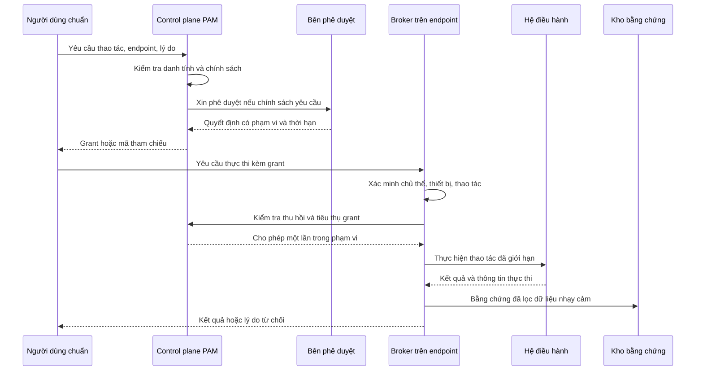

# Temporary admin token

## 1. Quyền quản trị tạm thời cần tạm thời ở đâu?

Trong Endpoint PAM, **temporary admin token** là một khái niệm thiết kế: cấp bằng chứng cho phép một chủ thể thực hiện tác vụ cần đặc quyền trên endpoint trong phạm vi và thời gian xác định. Nó không có một định dạng hay cơ chế thực thi chung cho mọi hệ điều hành và sản phẩm.

Một kỹ sư hỗ trợ cần cập nhật tác nhân giám sát trên máy người dùng. Cấp quyền quản trị thường trực sẽ mở quyền rộng hơn tác vụ cần làm. Một thiết kế chặt hơn cho phép kỹ sư yêu cầu cập nhật một gói đã được xác minh, nhận phê duyệt cho đúng máy, rồi để broker đặc quyền trên máy thực hiện thao tác. Người dùng tiếp tục làm việc bằng tài khoản thông thường.

Tuy nhiên, dòng mô tả “token có hiệu lực 10 phút” chưa chứng minh quyền quản trị chỉ tồn tại 10 phút. Token có thể chỉ kiểm soát thời điểm bắt đầu thao tác; tiến trình đã nâng quyền có thể tiếp tục chạy, sinh tiến trình con hoặc tạo thay đổi lâu dài.

Muốn đánh giá cơ chế này phải trả lời riêng bốn câu hỏi:

1. Đến lúc nào bằng chứng cấp quyền còn được chấp nhận?
2. Đến lúc nào có thể tạo một hành động đặc quyền mới?
3. Hành động đang chạy có thể tiếp tục đến lúc nào?
4. Những thay đổi đã thực hiện còn tồn tại sau đó hay không?

Trong module quản trị truy cập đặc quyền, mục tiêu không chỉ là rút ngắn thời gian cấp quyền. Cần kết hợp kiểm kê chủ thể và endpoint, least privilege, JIT/JEA, quản lý credential, theo dõi phiên hoặc hành động, và bằng chứng phục vụ kiểm toán, ứng phó sự cố.

## 2. Mục tiêu học tập

Sau bài này, người học có thể:

- Phân biệt grant cấp quyền, thông tin xác thực và access token của hệ điều hành.
- Chọn giữa thực thi một thao tác đặc quyền, nâng quyền một ứng dụng và cấp quyền quản trị rộng trong thời gian ngắn.
- Thiết kế phạm vi, ràng buộc thiết bị, chống phát lại và thời hạn cho một grant tạm thời.
- Giải thích vì sao token hết hạn hoặc bị thu hồi không tự động dừng mọi quyền đã phát sinh.
- Xác định bằng chứng cần lưu để chứng minh ai đã làm gì, trên máy nào, bằng quyền nào.

## 3. Phân biệt các loại “token”

### 3.1. Grant do hệ thống PAM cấp

Grant là quyết định cấp quyền có thể được biểu diễn bằng một bản ghi phía máy chủ, một mã tham chiếu ngẫu nhiên, hoặc thông điệp có chữ ký. Nó thường gắn với người yêu cầu, endpoint, thao tác, chính sách và thời hạn.

Grant không nhất thiết chứa password quản trị. Broker có thể dùng danh tính dịch vụ riêng để thực hiện hành động mà không tiết lộ credential cho người dùng.

Chữ ký chứng minh dữ liệu đến từ bên ký hợp lệ và chưa bị sửa sau khi ký. Chữ ký không tự chứng minh endpoint còn an toàn, người dùng hiện tại đúng là người được cấp quyền, hay grant chưa bị dùng trước đó.

### 3.2. Access token hoặc ngữ cảnh quyền của hệ điều hành

Trên Windows, access token của tiến trình hoặc luồng chứa thông tin phục vụ kiểm tra truy cập, như định danh và các đặc quyền liên quan. Đây là đối tượng thực thi quyền của hệ điều hành, không phải cùng đối tượng với grant do PAM phát hành.

Trên các hệ thống kiểu Unix, tiến trình có danh tính và ngữ cảnh quyền theo cơ chế của hệ điều hành. Việc broker chạy một tác vụ dưới danh tính đặc quyền cũng không đồng nghĩa tồn tại một “PAM token TTL” được kernel tự động áp dụng cho toàn bộ vòng đời tiến trình.

PAM phải chuyển quyết định cấp quyền thành một cơ chế thực thi cụ thể. Khoảng cách giữa quyết định và thực thi là nơi nhiều thiết kế mắc lỗi.

### 3.3. Token phiên đăng nhập, cache xác thực và credential

Token phiên web có thể chứng minh người dùng đã đăng nhập vào cổng PAM. Password hoặc khóa quản trị có thể cho phép truy cập độc lập với cổng PAM. Cache xác thực giúp giảm số lần nhập lại thông tin xác thực nhưng không phải bản thân một chính sách least privilege.

Ví dụ, thời gian cache của `sudo` liên quan đến việc yêu cầu xác thực lại theo cấu hình; không nên coi đó là đồng hồ bắt buộc dừng tất cả lệnh đã chạy bằng quyền cao.

| Đối tượng | Vai trò chính | Không được mặc định suy ra |
|---|---|---|
| Phiên đăng nhập vào PAM | Gắn tương tác với danh tính đã xác thực | Mọi thao tác quản trị đều đã được phê duyệt |
| Grant của PAM | Cho phép một phạm vi hành động xác định | Tiến trình sẽ tự kết thúc khi grant hết hạn |
| Ngữ cảnh quyền của tiến trình | Được hệ điều hành dùng khi kiểm tra truy cập | Thay đổi group sau đó sẽ lập tức sửa mọi tiến trình đang chạy |
| Credential quản trị | Cho phép xác thực theo cơ chế của tài khoản | Credential chỉ dùng được qua đường PAM |

## 4. Ba mô hình thực thi thường gặp

### 4.1. Broker thực hiện một thao tác đã định nghĩa

Người dùng yêu cầu thao tác `update-managed-agent`. Broker kiểm tra gói, endpoint và phê duyệt rồi cập nhật đúng tác nhân được quản lý. Người dùng không nhận shell quản trị hay quyền chọn lệnh bất kỳ.

Đây thường là mô hình phù hợp khi tác vụ có thể định nghĩa rõ đầu vào, kết quả và quyền cần thiết. Phạm vi hẹp giúp kiểm tra được hành vi, nhưng broker vẫn phải xử lý an toàn dữ liệu đầu vào và hành vi của bộ cài.

### 4.2. Nâng quyền một ứng dụng cụ thể

Broker khởi chạy một ứng dụng bằng ngữ cảnh quyền cao hơn. Phạm vi lúc này phụ thuộc mạnh vào khả năng của ứng dụng.

Một trình soạn thảo, trình quản lý file hoặc công cụ cho phép gọi chương trình khác có thể trở thành đường mở rộng quyền. Chỉ giới hạn tên file thực thi chưa đủ nếu ứng dụng hỗ trợ plugin, script, tham số nguy hiểm hoặc tải thư viện từ vị trí người dùng có thể ghi.

### 4.3. Cho phép quyền quản trị rộng trong một cửa sổ thời gian

Một số cơ chế cấp quyền bằng cách tạm thêm tài khoản vào nhóm quản trị hoặc cho phép nhiều hành động nâng quyền trong một khoảng thời gian. Mô hình này có thể phục vụ tác vụ chưa chuẩn hóa nhưng làm tăng đáng kể phạm vi kiểm soát.

Thu hồi thành viên nhóm không tự động đảo ngược mọi quyền đã hình thành trong phiên hoặc tiến trình trước đó. Một người có quyền rộng còn có thể tạo tài khoản, dịch vụ hoặc tác vụ định kỳ tồn tại sau khi cửa sổ kết thúc.

| Tiêu chí | Thao tác qua broker | Nâng quyền ứng dụng | Quyền quản trị rộng tạm thời |
|---|---|---|---|
| Phạm vi cần mô tả | Một hành động nghiệp vụ | Ứng dụng cùng khả năng thực tế | Nhiều hành động trên endpoint |
| Khả năng giới hạn đầu vào | Thường rõ nếu thiết kế tốt | Phụ thuộc giao diện và tính năng | Khó giới hạn toàn diện |
| Rủi ro duy trì quyền | Vẫn có qua tác động của thao tác | Có qua ứng dụng và tiến trình con | Cao vì có thể thay đổi cấu hình hệ thống |
| Bằng chứng phù hợp | Yêu cầu, quyết định, kết quả thao tác | Thêm thông tin thực thi ứng dụng | Cần theo dõi phạm vi hoạt động rộng hơn |

Nguyên tắc chọn mô hình là cấp mức quyền đủ hoàn thành công việc. “Tạm thời” không thay thế cho “đúng phạm vi”.

## 5. Kiến trúc cấp quyền và thực thi



Đây là kiến trúc minh họa cho một hệ thống có kết nối trực tuyến. Triển khai thực tế có thể chuyển grant trực tiếp đến broker hoặc giữ toàn bộ grant ở máy chủ.

### 5.1. Control plane

Control plane quyết định ai được yêu cầu quyền, chính sách nào áp dụng, có cần phê duyệt và xác thực bổ sung hay không. Một người dùng đã xác thực vẫn có thể bị từ chối vì endpoint không thuộc phạm vi, tác vụ ngoài giờ được phép, hoặc yêu cầu có rủi ro vượt chính sách.

### 5.2. Broker đặc quyền trên endpoint

Broker là thành phần có thể gây tác động thật. Nó phải coi yêu cầu đến từ tiến trình người dùng là dữ liệu không đáng tin cho đến khi kiểm tra đủ điều kiện.

Broker cần xác minh danh tính người gọi qua cơ chế hệ điều hành và kênh IPC được kiểm soát; không tin trường `user` do client tự gửi. Khi mô hình đe dọa yêu cầu, còn cần ràng buộc với phiên tương tác hoặc yêu cầu xác thực bổ sung. Các ràng buộc này không bảo đảm tuyệt đối trước mã độc đã chạy trong cùng ngữ cảnh người dùng.

Broker không nên cung cấp API kiểu “chạy chuỗi lệnh bất kỳ bằng quyền cao”. Giao diện nên mô tả hành động có cấu trúc, kiểm tra được, với tập tham số hữu hạn.

### 5.3. Kênh bằng chứng

Nhật ký cần nối được yêu cầu, phê duyệt, grant, hành động thực thi và kết quả. Nếu endpoint bị xâm nhập, nhật ký chỉ nằm tại máy đó có thể bị sửa hoặc xóa. Cần thiết kế chuyển bằng chứng và kiểm soát truy cập độc lập theo mức rủi ro.

## 6. Phạm vi một grant phải diễn đạt được

Một grant hữu ích cần trả lời: **ai, trên máy nào, làm thao tác gì, trong điều kiện nào, dùng bao nhiêu lần và đến lúc nào**.

Ví dụ dưới đây là mô hình dữ liệu minh họa, không phải cấu hình của sản phẩm cụ thể. Các giá trị thời gian là lựa chọn ví dụ cho bài học, không phải chuẩn bắt buộc.

```yaml
grant_id: grant-demo-084
subject_id: support-engineer-demo
device_id: endpoint-demo-021
audience: endpoint-privilege-broker
action: update-managed-agent
resource_id: monitoring-agent-demo
artifact:
  catalog_entry: approved-release-demo
  sha256: "<digest của artifact đã được duyệt>"
policy_revision: endpoint-policy-demo-r7
approval_id: approval-demo-418
not_before: "2026-11-27T02:00:00Z"
redeem_before: "2026-11-27T02:10:00Z"
max_uses: 1
execution_limit_seconds: 180
child_process_policy: managed-installer-tree
network_policy: managed-update-destination
revocation_check: required-online
```

Trong mô hình này:

- `subject_id` và `device_id` là định danh được hệ thống quản lý, không chỉ là tên hiển thị có thể sửa.
- `audience` giới hạn nơi được phép chấp nhận grant.
- `action` và `resource_id` giới hạn thao tác và đối tượng tác động.
- `artifact` buộc bộ cài trùng với bản đã duyệt; broker còn phải bảo đảm file không bị thay giữa lúc kiểm tra và lúc dùng.
- `policy_revision` giúp giải thích quyết định theo chính sách nào. Hệ thống phải quy định cách xử lý grant cũ khi chính sách thay đổi khẩn cấp.
- `redeem_before` là hạn nhận thực thi, không tự mang nghĩa tiến trình sẽ bị dừng ở thời điểm đó.
- `execution_limit_seconds` cần cơ chế giám sát riêng và chính sách kết thúc an toàn.
- `max_uses` cần bộ đếm hoặc bản ghi tiêu thụ có tính nguyên tử; một trường trong payload không tự chống được phát lại.

Nếu dùng token có chữ ký, định dạng, thuật toán, khóa tin cậy, đối tượng nhận và xử lý thu hồi đều phải được quy định. Không mặc định một chuỗi giống JWT là grant an toàn.

## 7. Vòng đời và các mốc thời gian

### 7.1. Vòng đời tối thiểu

```text
REQUESTED -> APPROVED -> ISSUED -> REDEEMED -> EXECUTING -> FINISHED
     |           |          |
     v           v          v
   DENIED      REVOKED     EXPIRED
```

Sơ đồ tách trạng thái grant khỏi trạng thái thực thi nhưng chưa liệt kê mọi nhánh lỗi. Khi grant đã được tiêu thụ, thu hồi cần tác động theo chính sách đến hành động đang chạy; không chỉ sửa trạng thái grant thành `REVOKED` rồi coi công việc đã kết thúc.

Mỗi lần thực thi nên có `execution_id` riêng. Khi broker khởi động lại, hệ thống dùng bản ghi bền vững để xác định lần thực thi đã nhận, đã bắt đầu hay chưa rõ kết quả. Không tự động chạy lại một thao tác có tác động chỉ vì client chưa nhận được phản hồi.

### 7.2. Cửa sổ nhận thực thi khác thời lượng chạy

Giả sử grant cho phép nhận thực thi trước 09:10, còn giới hạn thời lượng chạy là ba phút.

| Mốc | Diễn biến | Quyết định cần có |
|---|---|---|
| 09:00 | Phát hành grant | Chưa tạo tiến trình đặc quyền |
| 09:08 | Broker nhận yêu cầu hợp lệ | Tiêu thụ một lần và gắn `execution_id` |
| 09:08:05 | Chuẩn bị khởi chạy | Kiểm tra quyền còn hiệu lực ở ranh giới khởi chạy |
| 09:10 | Hết cửa sổ nhận thực thi | Từ chối yêu cầu mới bằng grant này |
| Khoảng 09:11 | Đạt giới hạn chạy tính từ lúc bắt đầu | Áp dụng chính sách kết thúc hoặc xử lý quá hạn |

Đối với tác vụ phải hoàn thành trước một giờ tuyệt đối, cần thêm hạn kết thúc tuyệt đối và quy tắc kết hợp với giới hạn thời lượng. Ví dụ, hạn chạy thực tế có thể là mốc sớm hơn giữa hai giới hạn đó. Không để người dùng và vận hành tự suy diễn ý nghĩa của TTL.

### 7.3. Độ tin cậy của đồng hồ

Kiểm tra thời điểm tuyệt đối phụ thuộc vào đồng hồ được tin cậy và dung sai được quy định. Đo thời lượng trong một lần chạy nên dùng nguồn thời gian đơn điệu khi phù hợp để tránh việc chỉnh đồng hồ hệ thống làm kéo dài quyền.

Nguồn thời gian đơn điệu thông thường không tự giải quyết khởi động lại, khôi phục snapshot hoặc rollback trạng thái. Nếu endpoint không thể xác định thời hạn một cách đáng tin, broker phải áp dụng chính sách rõ ràng, thường từ chối cấp mới thay vì âm thầm gia hạn.

## 8. Các kiểm tra tại ranh giới đặc quyền

### 8.1. Danh tính người gọi và thiết bị

Grant cho kỹ sư A trên máy X không được dùng bởi kỹ sư B hoặc trên máy Y. Endpoint gửi tên máy và tên người dùng trong JSON không đủ để chứng minh ràng buộc đó.

Cần đối chiếu người gọi với thông tin xác thực của kênh, phiên hoặc cơ chế IPC; đối chiếu thiết bị với định danh đã đăng ký và khóa thiết bị khi thiết kế sử dụng khóa. Thông tin posture, trạng thái agent và tuổi của lần kiểm tra cũng cần nằm trong chính sách chấp nhận.

Với grant dạng bearer, ai lấy được grant có thể tìm cách sử dụng nó. Ràng buộc khóa hoặc kênh có thể giảm khả năng chuyển grant sang nơi khác, nhưng không loại bỏ nguy cơ mã độc điều khiển chính endpoint đã được cấp quyền.

### 8.2. Thao tác và đầu vào thực tế

Không chỉ kiểm tra tên thao tác rồi chuyển toàn bộ tham số do người dùng nhập vào lệnh đặc quyền. Cần kiểm tra đúng tập tham số, kiểu dữ liệu, giá trị cho phép và tài nguyên cuối cùng mà broker sẽ tác động.

Ví dụ, yêu cầu cập nhật một dịch vụ cố định không được cho phép người dùng đổi đường dẫn file thực thi của dịch vụ sang thư mục cá nhân. Một bộ cài có chữ ký hợp lệ cũng không tự trở nên an toàn với mọi tùy chọn dòng lệnh.

### 8.3. File, đường dẫn và khoảng trống giữa kiểm tra với sử dụng

Broker xác minh hash rồi chạy file từ thư mục người dùng có thể ghi sẽ có rủi ro file bị thay thế trước lúc thực thi. Đường dẫn còn có thể bị chuyển hướng qua liên kết, điểm gắn hoặc cơ chế tương tự trên nền tảng.

Biện pháp cần phù hợp nền tảng: đưa artifact vào vùng được bảo vệ, kiểm soát quyền ghi, dùng định danh file và cách mở file an toàn, kiểm tra lại khi cần, và tránh tái phân giải một đường dẫn không đáng tin sau bước xác minh.

Hash chỉ xác định nội dung đã kiểm tra. Nó không tự bảo đảm quá trình thực thi sẽ không tải thêm script, plugin, thư viện hoặc cấu hình từ vị trí khác.

### 8.4. Phát lại và yêu cầu đồng thời

Hai yêu cầu dùng cùng một grant có thể đến gần như đồng thời. Cách làm “đọc trạng thái chưa dùng, chạy tác vụ, rồi đánh dấu đã dùng” cho phép cả hai vượt qua bước đầu.

Việc chuyển grant từ `ISSUED` sang `REDEEMED` phải là thao tác nguyên tử ở nơi quản lý trạng thái có thẩm quyền. Đồng thời cần xử lý trường hợp đã tiêu thụ grant nhưng phản hồi mạng bị mất.

Một retry có cùng định danh yêu cầu có thể nhận lại trạng thái lần thực thi cũ, thay vì khởi chạy tác vụ thứ hai. Không được hứa “exactly once” chỉ nhờ một trường `max_uses`; cần thiết kế giao dịch, lưu bền và tính lặp an toàn của hành động.

### 8.5. Tiến trình con và môi trường thực thi

Cho phép một chương trình có quyền cao có thể kéo theo tiến trình con có quyền cao, tùy cơ chế khởi chạy và nền tảng. Broker cần biết hành vi bình thường của tác vụ: bộ cài nào được sinh tiến trình nào, có cần tương tác hay không, và kết quả nào được chấp nhận.

Giới hạn chỉ dựa vào quan hệ cha-con có thể không đủ vì tác vụ có thể chuyển công việc sang dịch vụ hoặc cơ chế thực thi khác. Cần xét các kênh thực thi thực tế và khả năng quan sát của sản phẩm.

Biến môi trường, thư mục làm việc, đường tìm thư viện và file cấu hình cũng là đầu vào. Chạy đúng file thực thi nhưng để nó đọc cấu hình do người dùng tùy ý sửa vẫn có thể phá vỡ phạm vi cấp quyền.

## 9. Vì sao thu hồi token không đồng nghĩa thu hồi toàn bộ quyền?

Thu hồi có nhiều lớp với hiệu lực khác nhau:

| Lớp thu hồi | Tác động mong muốn | Giới hạn cần kiểm tra |
|---|---|---|
| Thu hồi grant chưa dùng | Chặn nhận thực thi mới | Broker phải biết quyết định thu hồi |
| Chặn yêu cầu mới trên endpoint | Không tạo hành động đặc quyền mới | Không dừng tự động hành động đã chạy |
| Xử lý tiến trình đang chạy | Kết thúc hoặc giảm quyền theo khả năng thực tế | Không phải mọi nền tảng đều cho phép hạ quyền một tiến trình đang chạy an toàn |
| Xóa quyền thành viên tạm thời | Loại quyền khỏi cấu hình nhóm/tài khoản | Phiên và tiến trình hiện hữu có thể giữ ngữ cảnh cũ |
| Xử lý credential đã lộ | Thu hồi hoặc xoay vòng thông tin xác thực | Cần đánh giá phạm vi sử dụng ngoài endpoint ban đầu |
| Khắc phục thay đổi bền vững | Gỡ cấu hình, dịch vụ hoặc tác vụ trái phép | Dừng tiến trình không hoàn tác các thay đổi đã ghi |

Ví dụ, một tiến trình nâng quyền tạo dịch vụ mới rồi kết thúc. Hết TTL không tự xóa dịch vụ đó. Khi có dấu hiệu lạm dụng, xử lý sự cố cần đánh giá cả persistence, dữ liệu bị truy cập và khả năng di chuyển sang hệ thống khác.

Tương tự, token có chữ ký được xác minh ngoại tuyến vẫn có thể vượt qua bước kiểm tra chữ ký sau khi control plane đã thu hồi quyền. Muốn thu hồi có hiệu lực sớm hơn hạn token phải có một cơ chế bổ sung, như kiểm tra trạng thái trực tuyến hoặc thông tin thu hồi được phân phối đáng tin. Hiệu lực thực tế phụ thuộc độ trễ và khả năng kết nối.

## 10. Luồng xử lý mẫu của broker

Pseudocode dưới đây mô tả ý tưởng kiểm soát. Đây không phải mã triển khai, không mô tả đầy đủ giao dịch phân tán hay API của hệ điều hành.

```text
handle_privileged_request(channel, request):
    caller = authenticate_local_caller(channel)
    grant = resolve_and_validate_grant(request.grant_reference)

    require grant.audience == this_broker_audience
    require grant.subject_id == caller.managed_identity
    require grant.device_id == this_managed_device
    require trusted_time_is_within_redemption_window(grant)
    require current_policy_accepts(grant, caller, device_posture)
    require request.matches_exact_action_and_resources(grant)

    prepared_action = prepare_action_in_protected_context(request, grant)
    require prepared_action.matches_approved_artifact_and_inputs

    execution = atomically_redeem_or_get_existing_execution(
        grant.id, request.idempotency_key
    )

    if execution.is_existing:
        return execution.current_status

    require grant_still_permits_launch(execution)
    persist_launch_intent(execution, prepared_action)
    result = execute_with_supervision(prepared_action, execution)
    persist_result_and_evidence(execution, result)
    return result.public_summary
```

Các hàm có tên như `grant_still_permits_launch` chứa những quyết định quan trọng: grant có bị thu hồi trong lúc chuẩn bị không, hạn nhận có cho phép khởi chạy sau đó không, và broker làm gì khi không thể kiểm tra trạng thái.

Các bước chuẩn bị cũng phải tránh tác động đặc quyền không được phê duyệt. Nếu bước chuẩn bị cần quyền cao, chính bước đó phải nằm trong phạm vi được cấp và được ghi nhận.

Việc lưu ý định khởi chạy hỗ trợ điều tra trạng thái sau lỗi, nhưng không làm hệ điều hành và cơ sở dữ liệu tự nhiên trở thành một giao dịch duy nhất. Sau crash có thể tồn tại trường hợp chưa rõ tác vụ đã bắt đầu hay chưa. Cần đối soát và quy tắc phục hồi phù hợp từng hành động.

## 11. Hành vi khi có lỗi hoặc mất kết nối

### 11.1. Control plane không truy cập được

Với chính sách yêu cầu kiểm tra thu hồi trực tuyến, mất kết nối phải dẫn đến từ chối nhận thực thi mới. Không được tự chuyển sang cho phép mọi hành động vì “người dùng đã từng được duyệt”.

Nếu tổ chức cần chế độ ngoại tuyến, phải thiết kế và phê duyệt riêng: grant ngắn hạn đã phát trước, phạm vi hẹp, ràng buộc thiết bị, số lần dùng được bảo vệ và cách lưu bằng chứng. Khả năng chống chỉnh đồng hồ, rollback và clone thiết bị quyết định độ tin cậy của chế độ này. Không hỗ trợ được ràng buộc thì không coi ngoại tuyến là tương đương trực tuyến.

### 11.2. Kho bằng chứng tạm gián đoạn

Chính sách cần xác định có cho phép chạy với hàng đợi cục bộ được bảo vệ hay phải từ chối. Hàng đợi phải có giới hạn dung lượng, kiểm soát truy cập và cơ chế gửi lại.

Không coi “đã gọi hàm ghi log” là bằng chứng đã được nhận bền vững ở nơi lưu trữ. Đồng thời không nên retry tác vụ đặc quyền chỉ vì việc gửi log chưa thành công.

### 11.3. Hết hạn trong lúc cập nhật

Dừng đột ngột một bộ cài hoặc thao tác sửa cấu hình có thể làm endpoint hỏng. Vì vậy giới hạn thời lượng phải được thiết kế theo loại tác vụ: có timeout cứng hay mềm, có điểm hủy an toàn, có cơ chế rollback, và khi nào cần người vận hành can thiệp.

Nếu chính sách cho tác vụ đã bắt đầu được hoàn tất sau hạn nhận, phải nói rõ điều đó và vẫn giới hạn thời lượng chạy. Không gọi hành vi ấy là “thu hồi tức thì”.

### 11.4. Agent hoặc broker gặp lỗi

Không tự cấp password quản trị thường trực để thay thế đường broker khi lỗi. Nếu có đường break-glass, nó là luồng được quản trị riêng với danh tính, phê duyệt, giới hạn và hậu kiểm phù hợp.

Broker khởi động lại không được làm grant một lần trở thành grant chưa dùng. Cần phục hồi trạng thái tiêu thụ và đối soát các hành động đang chạy từ dữ liệu được bảo vệ.

## 12. Bằng chứng và giám sát

Một bản ghi thực thi nên nối được các nhóm thông tin sau:

| Nhóm | Trường ví dụ | Câu hỏi được giải đáp |
|---|---|---|
| Chủ thể | Định danh người dùng, phiên, kết quả xác thực bổ sung | Ai yêu cầu và ai thực sự gửi lệnh? |
| Thiết bị | Định danh endpoint, trạng thái quản lý, phiên bản broker | Quyền được dùng ở đâu? |
| Quyết định | Grant ID, approval ID, phiên bản chính sách, lý do | Dựa vào căn cứ nào để cấp? |
| Thực thi | Execution ID, hành động, artifact digest, tham số đã lọc | Đã làm gì trong phạm vi nào? |
| Thời gian | Thời điểm nhận, bắt đầu, kết thúc, hạn quyền | Có dùng đúng cửa sổ cho phép không? |
| Kết quả | Thành công, từ chối, quá hạn, lỗi, tình trạng thu hồi | Quyền và tác vụ kết thúc ra sao? |

Không ghi toàn bộ bearer token, password, khóa riêng hoặc tham số có bí mật vào log. Dùng định danh grant để liên kết bằng chứng; các trường nhạy cảm cần được loại bỏ hoặc xử lý theo chính sách dữ liệu.

Nhật ký cấp quyền, nhật ký tiến trình, ghi hình phiên và bằng chứng kết quả là các nguồn khác nhau. Có một nguồn không đồng nghĩa tự động có các nguồn còn lại. Với tác vụ chạy nền, kết quả thao tác và sự kiện thực thi thường hữu ích hơn một video không thể hiện rõ hành động.

Các tín hiệu cần quan sát gồm:

- Grant được trình từ người dùng hoặc thiết bị không khớp.
- Nhiều yêu cầu dùng lại grant đã tiêu thụ.
- Ứng dụng đặc quyền sinh shell hoặc tiến trình ngoài hành vi được phép.
- Endpoint liên tục xin quyền ngoại tuyến hoặc có đồng hồ bất thường.
- Tác vụ đã quá hạn nhưng chưa xác định được trạng thái cuối.
- Thay đổi thành viên quản trị, dịch vụ hoặc tác vụ định kỳ ngoài luồng được phép.

Các chỉ số như tỷ lệ tác vụ hoàn thành qua thao tác hẹp, thời gian từ thu hồi đến broker xác nhận, số grant đã hết hạn nhưng hành động còn chạy và số lần phải dùng break-glass giúp đánh giá chất lượng kiểm soát. Không chỉ đếm tổng số grant đã phát hành.

## 13. Tình huống thực hành: cập nhật tác nhân giám sát

### 13.1. Bối cảnh

Nhóm hỗ trợ cần cập nhật tác nhân giám sát trên endpoint của một nhân viên. Người hỗ trợ dùng tài khoản thường. Tác vụ cập nhật cần quyền cao, lấy gói từ kho phát hành được quản lý, và có thể khởi động lại đúng dịch vụ liên quan.

Yêu cầu kinh doanh là hoàn thành cập nhật và giữ bằng chứng để điều tra nếu máy gặp lỗi. Yêu cầu đó không bao gồm quyền đọc dữ liệu của mọi người dùng hoặc thay đổi cấu hình mạng tùy ý.

### 13.2. Chính sách minh họa

- Cho phép hành động cập nhật đúng tác nhân trên đúng endpoint đã đăng ký.
- Chỉ chấp nhận artifact đã được duyệt trong danh mục; broker kiểm tra và dùng artifact từ vùng được bảo vệ.
- Grant được nhận thực thi một lần trong cửa sổ mười phút.
- Có giới hạn thời lượng chạy riêng, dựa trên hành vi cập nhật đã kiểm thử.
- Không cho người yêu cầu tùy chọn đường dẫn dịch vụ, file script hoặc chuỗi lệnh tùy ý.
- Kiểm tra thu hồi trực tuyến trước khởi chạy; lưu liên kết từ ticket đến kết quả.

Các giá trị trên phục vụ ví dụ. Trước triển khai phải xác định giới hạn phù hợp kích thước gói, hiệu năng endpoint, khả năng hoàn tác và yêu cầu vận hành.

### 13.3. Các lần thử cần quan sát

| Lần thử | Kết quả mong đợi |
|---|---|
| Đúng người, đúng máy, đúng artifact và còn hạn | Thực thi một lần, có kết quả và bằng chứng |
| Đưa cùng grant sang máy khác | Từ chối do ràng buộc thiết bị |
| Đổi file cài đặt sau khi phê duyệt | Từ chối do artifact không khớp hoặc không bảo đảm tính toàn vẹn |
| Gửi lại khi client chưa nhận phản hồi lần đầu | Trả trạng thái lần thực thi cũ, không chạy lần hai |
| Thêm tham số gọi script cá nhân | Từ chối vì đầu vào ngoài phạm vi |
| Thu hồi trước khi bắt đầu | Chặn khởi chạy theo kiểm tra thu hồi |
| Hết cửa sổ nhận khi cập nhật đang chạy | Không nhận thêm; xử lý lần đang chạy theo chính sách thời lượng |
| Bộ cài cố tạo tác vụ định kỳ không nằm trong hành vi được duyệt | Chặn hoặc phát hiện theo năng lực thực thi đã được xác minh |

Trường hợp cuối cần bằng chứng từ khả năng kiểm soát thật của nền tảng. Không chỉ thêm một dòng chính sách rồi khẳng định mọi tác động của bộ cài đều bị chặn.

### 13.4. Điều kiện đóng yêu cầu

Yêu cầu chỉ được đóng khi biết trạng thái tác vụ, có bằng chứng kết quả, grant không còn dùng được để tạo hành động mới, và không còn trạng thái đặc quyền tạm thời ngoài dự kiến. Nếu kết quả chưa rõ sau mất kết nối hoặc crash, cần ghi nhận trạng thái chưa xác định và đối soát.

Đóng ticket không phải bằng chứng thu hồi quyền. Ngược lại, thu hồi grant cũng không phải bằng chứng cập nhật đã thành công.

## 14. Kiểm thử thiết kế trước khi áp dụng rộng

Đây là các kiểm thử cho cơ chế kiểm soát, nên thực hiện trên môi trường thử nghiệm được phép và có phương án phục hồi endpoint.

### 14.1. Kiểm thử danh tính và phạm vi

Thử grant sai người dùng, sai thiết bị, sai đối tượng nhận, sai tài nguyên, sai thao tác và sai tham số. Kiểm tra broker dùng danh tính xác thực của người gọi thay vì tin dữ liệu client tự khai.

Thử ứng dụng được phép với plugin, cấu hình và thư mục làm việc khác nhau. Mục tiêu là xác nhận ranh giới tác vụ, không chỉ xác nhận tên file chạy đúng.

### 14.2. Kiểm thử thời gian, phát lại và thu hồi

Thử trước thời điểm bắt đầu, sát hạn nhận, sau hạn nhận, hai yêu cầu đồng thời, retry sau mất phản hồi và thu hồi trong lúc chuẩn bị. Quan sát cả trạng thái grant lẫn trạng thái tiến trình.

Thử chỉnh đồng hồ hoặc khởi động lại trong môi trường thử nghiệm để xem cơ chế có vô tình gia hạn hay cho dùng lại grant không. Với chế độ ngoại tuyến, cần đánh giá thêm cách bảo vệ trạng thái trước rollback.

### 14.3. Kiểm thử gián đoạn và kết quả

Làm gián đoạn kết nối đến control plane hoặc kho bằng chứng, khởi động lại broker và mô phỏng bộ cài không kết thúc đúng hạn. Xác nhận hệ thống có trạng thái cuối rõ ràng hoặc trạng thái chưa xác định được xử lý, thay vì báo thành công mặc định.

Kiểm tra nhật ký không chứa grant bí mật hay credential, và người vận hành có thể nối một yêu cầu với đúng hành động thực tế. Không chỉ kiểm tra giao diện hiển thị “approved”.

## 15. Các sai lầm cần tránh

**Đánh đồng hạn grant với hạn tiến trình.** Tách thời điểm được bắt đầu, thời lượng được chạy và cách xử lý tác động tồn tại sau chạy.

**Cấp quyền quản trị toàn máy cho thao tác đã biết rõ.** Đánh giá khả năng dùng thao tác qua broker hoặc cơ chế nâng quyền hẹp trước khi cấp một cửa sổ quản trị rộng.

**Chỉ kiểm tra chữ ký token.** Còn phải kiểm tra chủ thể, thiết bị, audience, thời gian, trạng thái thu hồi, phạm vi và số lần dùng.

**Chỉ allowlist tên file hoặc nhà phát hành.** Xét artifact thực tế, quyền ghi, tham số, cấu hình, khả năng tải mã bổ sung và hành vi tiến trình con.

**Tin rằng xóa khỏi nhóm quản trị sẽ thu hồi mọi quyền ngay lập tức.** Kiểm tra ảnh hưởng đến phiên và tiến trình đang tồn tại trên nền tảng thật.

**Cho phép lại mọi thứ khi dịch vụ PAM mất kết nối.** Quy định chế độ lỗi và ngoại tuyến thành chính sách cụ thể, có phạm vi và bằng chứng.

**Retry thao tác đặc quyền để sửa lỗi gửi log.** Tách trạng thái hành động khỏi việc chuyển bằng chứng và dùng định danh tương quan để đối soát.

**Coi token ngắn hạn là bằng chứng endpoint sạch.** Quyền mạnh dù tồn tại ngắn vẫn có thể tạo thay đổi bền vững. Giám sát và ứng phó sự cố phải xét cả hậu quả của lần thực thi.

## 16. Câu hỏi tự đánh giá

1. Một grant hết hạn lúc 10:00 nhưng tiến trình được khởi chạy lúc 09:59. Cần thông tin gì để biết đến 10:01 tiến trình còn được chạy hay không?
2. Vì sao `max_uses: 1` trong thông điệp có chữ ký chưa đủ chống hai lần thực thi đồng thời?
3. Broker kiểm tra hash đúng rồi chạy bộ cài từ thư mục người dùng có thể ghi. Rủi ro nằm ở đâu?
4. Thu hồi grant có xử lý được một dịch vụ trái phép đã được tạo trước đó không? Cần thêm hành động gì?
5. Khi control plane mất kết nối, điều gì khiến một thiết kế ngoại tuyến có thể được chấp nhận cho một thao tác hẹp nhưng không phù hợp với quyền quản trị rộng?
6. Bằng chứng nào chứng minh người dùng đã dùng quyền trên đúng endpoint, thay vì chỉ chứng minh yêu cầu đã được phê duyệt?

Gợi ý trả lời: lần lượt xem chính sách thời lượng thực thi; bản ghi tiêu thụ nguyên tử và xử lý retry; khoảng trống giữa kiểm tra và sử dụng; tác động bền vững cùng xử lý sự cố; ràng buộc ngoại tuyến và giới hạn thu hồi; chuỗi tương quan từ yêu cầu đến sự kiện thực thi và kết quả.

## 17. Kết luận thực hành

Temporary admin token chỉ có ý nghĩa khi quyết định cấp quyền được chuyển thành ranh giới thực thi rõ ràng trên endpoint. Một thiết kế tốt xác định đúng chủ thể, thiết bị, thao tác, đầu vào, thời hạn nhận và thời lượng chạy; chống phát lại; quy định cách thu hồi; và lưu được bằng chứng về kết quả thật.

Khi rà soát một cơ chế, hãy lần theo một yêu cầu từ lúc phát hành grant đến khi không còn khả năng tạo hành động mới, rồi tiếp tục kiểm tra tiến trình và thay đổi mà nó để lại. Chính chuỗi đó cho biết quyền quản trị có được kiểm soát tạm thời trong thực tế hay chỉ mang nhãn tạm thời trên giao diện.
