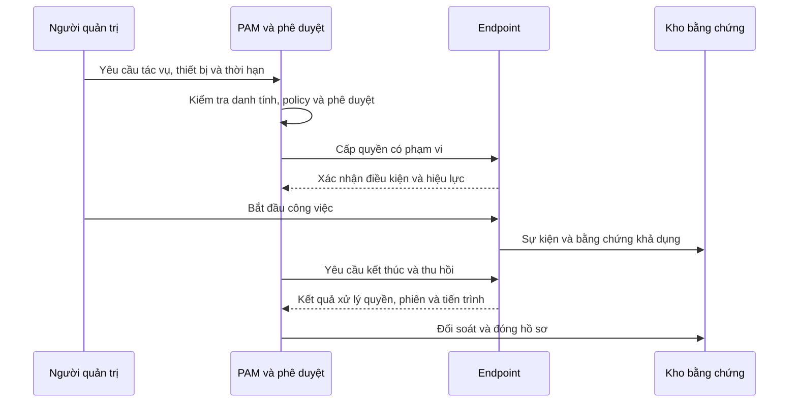

# Endpoint admin session

## 1. Phiên quản trị trên endpoint là gì?

**Endpoint admin session** là một khoảng hoạt động quản trị có thể quy trách nhiệm trên máy trạm hoặc máy chủ thuộc phạm vi endpoint PAM. Phiên gắn người thực hiện với thiết bị đích, mục đích công việc, quyền được cấp, thời gian cho phép và bằng chứng về những hành động đã thực hiện.

Ví dụ, kỹ thuật viên cần sửa một dịch vụ trên máy trạm tài chính. Yêu cầu thực tế không phải là “cho người này làm local administrator”, mà là:

> Cho kỹ thuật viên có danh tính xác định sửa đúng dịch vụ trên đúng máy, trong khoảng thời gian đã duyệt; ghi nhận việc cấp quyền, các hành động có thể quan sát và kết quả thu hồi.

Một phiên có thể là tiến trình được nâng quyền tại chỗ, công cụ hỗ trợ từ xa, kết nối vào terminal hoặc một phiên desktop phục vụ bảo trì. Khả năng kiểm soát và quan sát phụ thuộc hệ điều hành, agent endpoint, đường kết nối và sản phẩm triển khai. Không phải mọi hệ thống đều có một đối tượng “admin session” giống nhau hoặc hỗ trợ đầy đủ mọi biện pháp trong bài.

Trong module Privileged Access Management, phiên endpoint là điểm nối giữa:

- **Least privilege:** giới hạn quyền theo tác vụ, ứng dụng và thiết bị.
- **JIT/JEA:** cấp quyền đúng lúc và giới hạn hành động khi nền tảng hỗ trợ.
- **Vault và credential management:** sử dụng, bảo vệ và luân chuyển thông tin xác thực quản trị.
- **Session monitoring:** theo dõi hoạt động đặc quyền với mức độ quan sát đã công bố.
- **Audit và ứng phó sự cố:** dựng lại ai đã làm gì, ở đâu, trong khoảng thời gian nào.

Không nên hiểu “có PAM” đồng nghĩa với “mọi hoạt động admin đều được kiểm soát”. Một công cụ có thể kiểm soát tốt tiến trình do agent khởi chạy nhưng không kiểm soát được phiên đã mở trước đó hoặc đường quản trị khác chưa tích hợp.

## 2. Mục tiêu học tập và phạm vi

Sau bài này, người học có thể:

1. Mô tả vòng đời phiên quản trị endpoint từ yêu cầu đến đóng phiên.
2. Phân biệt danh tính người thao tác, tài khoản đặc quyền, phiên đăng nhập và tiến trình mang quyền.
3. Chọn phạm vi cấp quyền phù hợp với một nhiệm vụ hỗ trợ.
4. Giải thích vì sao hết thời gian phê duyệt chưa bảo đảm mọi quyền đang hoạt động đã biến mất.
5. Xác định bằng chứng cần có để kết luận phiên được đóng và quyền được thu hồi.
6. Xử lý tình huống agent mất kết nối, phiên vượt phạm vi hoặc bản ghi bị thiếu.

Bài tập trung vào việc tổ chức và kiểm soát phiên. Cấu hình policy theo publisher, hash, ticket hay cơ chế cấp token tạm thời là những công cụ có thể tham gia vòng đời này, không thay thế cho quản lý toàn bộ phiên.

Ví dụ trong bài dùng dữ liệu giả và mô hình trung lập với nhà cung cấp. Các khối YAML, JSON và giả mã minh họa thiết kế; không phải cấu hình có thể đưa trực tiếp vào một sản phẩm.

## 3. Bốn lớp cần phân biệt

Nhầm lẫn giữa tài khoản, phiên và tiến trình thường dẫn đến kết luận sai về khả năng thu hồi.

| Lớp | Câu hỏi cần trả lời | Ví dụ |
| --- | --- | --- |
| Danh tính con người | Ai chịu trách nhiệm cho công việc? | Kỹ thuật viên `tech-an` đã xác thực |
| Tài khoản hoặc danh tính thực thi | Hệ điều hành thấy tác vụ chạy dưới danh tính nào? | Tài khoản admin riêng hoặc cơ chế elevation được quản lý |
| Phiên tương tác | Người đó làm việc qua kênh nào, bắt đầu và kết thúc lúc nào? | Phiên hỗ trợ từ xa có mã liên kết |
| Tiến trình và quyền hiệu lực | Tiến trình nào thực sự có quyền gì? | Một trình cài đặt hoặc công cụ quản trị chạy với quyền cao |

Một người có thể có nhiều phiên trên cùng thiết bị. Một phiên có thể tạo nhiều tiến trình. Tiến trình đặc quyền có thể tạo tiến trình con, thay đổi cấu hình hoặc khởi động dịch vụ tồn tại lâu hơn cửa sổ tương tác.

Do đó:

- Đóng cửa sổ không tự chứng minh mọi tác vụ con đã kết thúc.
- Rút người dùng khỏi nhóm đặc quyền không tự chứng minh token hoặc tiến trình hiện có đã mất quyền.
- Kết thúc phiên mạng không tự chứng minh không còn thay đổi bền vững trên máy.
- Xác thực MFA ở đầu phiên không chứng minh mọi hành động tiếp theo đều đúng mục đích.

### 3.1. Ví dụ về quyền còn hiệu lực

Giả sử một phiên được duyệt từ 09:00 đến 09:20. Lúc 09:19, người thao tác mở một shell đặc quyền. Đến 09:20, PAM ngăn yêu cầu nâng quyền mới.

Câu hỏi còn lại là shell đang chạy sẽ thế nào. Câu trả lời phụ thuộc cơ chế thực thi: hệ thống có thể chấm dứt tiến trình, đóng phiên, yêu cầu đăng xuất hoặc chỉ ngăn cấp quyền lần tiếp theo. Không được mặc định rằng thời hạn phê duyệt sẽ tự sửa quyền của mọi tiến trình đang tồn tại.

Trên Windows, quyền hiệu lực của tiến trình liên quan đến access token; thay đổi membership không đồng nghĩa với việc token đã cấp được thay thế ngay. Trên Linux, việc không cho phép gọi `sudo` lần tiếp theo cũng không tự làm một shell root đang chạy trở thành shell thường.

Đây là lý do thiết kế phiên cần mô tả riêng **thời hạn cấp quyền** và **cách xử lý quyền đã được sử dụng**.

## 4. Khi nào cần một phiên quản trị?

Trước khi cấp phiên, hãy xác định tác vụ có thực sự cần quyền quản trị hay không.

| Nhu cầu | Hướng xử lý phù hợp |
| --- | --- |
| Đọc thông tin chẩn đoán thông thường | Dùng quyền người dùng hoặc kênh thu thập đã giới hạn |
| Khởi động lại một dịch vụ được phép | Ưu tiên công cụ hoặc tác vụ giới hạn đúng dịch vụ |
| Cài gói phần mềm đã chuẩn hóa | Ưu tiên kênh phân phối phần mềm có quản trị |
| Sửa lỗi chưa biết rõ nguyên nhân | Có thể cần phiên admin tương tác, kèm phạm vi và giám sát phù hợp |
| Ứng phó sự cố nghiêm trọng | Dùng quy trình khẩn cấp được định nghĩa trước và rà soát sau |
| Bảo trì lặp lại trên nhiều máy | Cân nhắc tự động hóa có kiểm soát thay vì mở hàng loạt phiên thủ công |

Mục tiêu không phải tạo thật nhiều phiên được ghi hình. Mục tiêu là hoàn thành công việc với quyền đủ dùng, giảm thời gian đặc quyền và giữ được bằng chứng.

Ví dụ, nếu một script được phê duyệt chỉ cần thu thập log của một ứng dụng, việc cấp desktop admin đầy đủ có thể mở thêm khả năng ngoài nhu cầu. Ngược lại, cố giới hạn một sự cố phức tạp vào một công cụ thiếu chức năng có thể khiến nhân sự tìm đường vòng. Phạm vi cần khả thi và được xem xét theo rủi ro.

## 5. Mô hình kiểm soát một phiên

Một triển khai thường có các thành phần sau:

- **Người yêu cầu:** mô tả công việc, thiết bị và thời gian.
- **Bộ phận phê duyệt hoặc policy tự động:** quyết định dựa trên tác vụ, vai trò và rủi ro.
- **Dịch vụ PAM:** lưu quyết định, điều phối cấp quyền và nhận sự kiện.
- **Agent hoặc cơ chế thực thi trên endpoint:** kiểm tra điều kiện, áp dụng policy và gửi telemetry.
- **Kênh hỗ trợ hoặc proxy:** ràng buộc đường truy cập nếu có.
- **Kho bằng chứng:** lưu sự kiện và bản ghi theo chính sách bảo vệ dữ liệu.

Agent endpoint không nhất thiết trực tiếp cung cấp công cụ điều khiển từ xa. Nếu dùng hai sản phẩm riêng, cần liên kết mã phiên, danh tính và thời gian giữa chúng.



Sơ đồ thể hiện luồng mong muốn, không bảo đảm mọi thông điệp luôn đến được đích. Thiết kế phải bao gồm trường hợp endpoint mất mạng, agent lỗi hoặc lệnh thu hồi chưa được xác nhận.

## 6. Xác định phạm vi trước khi mở phiên

Một yêu cầu tốt giúp người duyệt hiểu được quyền sắp cấp và tiêu chí hoàn thành.

### 6.1. Các trường tối thiểu

| Nhóm thông tin | Nội dung cần ghi |
| --- | --- |
| Danh tính | Người yêu cầu, người thực hiện thực tế, vai trò |
| Thiết bị | Định danh endpoint ổn định, chủ sở hữu nghiệp vụ, môi trường |
| Mục đích | Lỗi hoặc thay đổi cần xử lý, ticket liên quan |
| Quyền | Công cụ, tài khoản, dịch vụ hoặc chức năng cần dùng |
| Thời gian | Thời điểm được bắt đầu, thời lượng tối đa, quy tắc gia hạn |
| Giám sát | Loại sự kiện thu được, có hay không bản ghi phiên |
| Kết thúc | Cách thu hồi, kiểm tra tiến trình và xác nhận kết quả |
| Ngoại lệ | Ai xử lý khi endpoint offline hoặc tác vụ chưa thể dừng |

Không dùng tên hiển thị của máy làm khóa duy nhất nếu tên có thể thay đổi hoặc trùng. Định danh cần gắn với bản ghi quản lý thiết bị mà tổ chức có thể đối chiếu.

### 6.2. Ví dụ yêu cầu có phạm vi

```yaml
# Minh họa dữ liệu yêu cầu, không phải policy của sản phẩm.
request:
  id: PAM-REQ-0042
  operator: tech-an
  endpoint_id: ep-lab-017
  ticket: INC-LAB-238
  purpose: "Khôi phục dịch vụ in trong môi trường thực hành"
  requested_start: "2026-11-27T09:00:00+07:00"
  max_duration_minutes: 20
  allowed_task: "Chẩn đoán và khởi động lại dịch vụ đã được duyệt"
  access_mode: "Phiên hỗ trợ được quản lý"
  closure:
    prevent_new_elevation: true
    handle_active_privileged_processes: "Theo chính sách đã kiểm thử"
    verify_endpoint_response: true
```

Các trường mô tả ý định cần được ánh xạ sang biện pháp thực thi. Viết `allowed_task` trong hồ sơ không tự ngăn người dùng chạy một lệnh khác. Nếu hệ thống không thực thi được hạn chế tác vụ, hồ sơ phải nói rõ mức quyền thực cấp và biện pháp bù đắp.

## 7. Vòng đời phiên: từ yêu cầu đến đóng

Một mô hình trạng thái rõ ràng giúp tránh coi một thao tác trên giao diện là bằng chứng hoàn thành.

```text
REQUESTED -> APPROVED -> READY -> ACTIVE -> ENDING -> CLOSED
     |           |          |         |         |
     +-> DENIED  +-> EXPIRED +-> FAILED         +-> RECONCILIATION_REQUIRED
```

Đây là mô hình minh họa. Tổ chức có thể dùng tên khác, nhưng cần phân biệt yêu cầu được chấp thuận, quyền đã có hiệu lực, phiên đang hoạt động và việc thu hồi đã được xác nhận.

### 7.1. REQUESTED: ghi nhận yêu cầu

Lưu danh tính, phạm vi công việc và thiết bị. Một ticket có thể chứa nhiều tác vụ, nhưng mỗi lần cấp phiên nên có mã liên kết riêng để phân biệt lần thử, gia hạn và chuyển người thực hiện.

### 7.2. APPROVED: có quyết định cho phép

Phê duyệt không đồng nghĩa với quyền đã được cấp. Quyết định cần có hạn dùng và điều kiện. Nếu thiết bị hoặc mục tiêu công việc đổi đáng kể, hệ thống phải đánh giá lại thay vì tái sử dụng phê duyệt một cách máy móc.

Với tác vụ nhạy cảm, có thể cần người duyệt độc lập hoặc hai bên kiểm soát. Những yêu cầu này phải theo chính sách của tổ chức; không phải mọi phiên đều cần cùng một mức phê duyệt.

### 7.3. READY: đủ điều kiện bắt đầu

Kiểm tra endpoint đúng đích, agent hoạt động, policy đã áp dụng và kênh bằng chứng đáp ứng yêu cầu. Nếu policy chỉ mới nằm trong hàng chờ, chưa nên mô tả quyền là đang được kiểm soát đầy đủ trên máy.

### 7.4. ACTIVE: đang thực hiện công việc

Đưa người thao tác vào đúng kênh quản trị. Ghi nhận thời điểm bắt đầu thực tế, quyền đã sử dụng và các sự kiện quan sát được. Đánh giá lại khi có dấu hiệu vượt phạm vi hoặc thay đổi trạng thái thiết bị.

### 7.5. ENDING: đang kết thúc

Ngăn cấp quyền mới, xử lý phiên và tiến trình theo chính sách, thu hồi credential hoặc quyền tạm thời cần thu hồi. Đây có thể là một quá trình gồm nhiều bước, không phải một cờ bật/tắt.

### 7.6. CLOSED: đã đối soát kết quả

Chỉ ghi đóng khi các điều kiện bắt buộc được xác nhận hoặc ngoại lệ được ghi nhận theo quy trình có người chịu trách nhiệm. Nếu thiếu xác nhận thu hồi, dùng trạng thái phản ánh việc cần đối soát, thay vì đưa ra kết luận an toàn không có bằng chứng.

## 8. Điều kiện bắt đầu phiên

Một quyết định mở phiên nên kiểm tra cả con người và thiết bị.

### 8.1. Danh tính và xác thực

- Người thao tác dùng danh tính cá nhân để truy vết trách nhiệm.
- Áp dụng xác thực mạnh phù hợp chính sách.
- Nếu dùng tài khoản đặc quyền dùng chung ở phía hệ điều hành, phải có ánh xạ đáng tin cậy từ người thực hiện đến lần sử dụng tài khoản đó.
- Thay người điều khiển cần tạo sự kiện bàn giao hoặc phiên mới theo quy trình; không chuyển thông tin xác thực qua chat.

Một phiên hỗ trợ mà nhiều kỹ thuật viên thay nhau điều khiển nhưng chỉ ghi tên người mở đầu sẽ làm yếu khả năng quy trách nhiệm.

### 8.2. Thiết bị và đường truy cập

Kiểm tra thiết bị có đúng phạm vi quản lý, còn nhận policy và có trạng thái phù hợp hay không. Nếu có nhiều đường truy cập như console, RDP, SSH hoặc công cụ hỗ trợ riêng, cần xác định đường nào thuộc phạm vi kiểm soát của phiên.

Không được kết luận “chỉ có một phiên admin” chỉ vì bảng điều khiển của một công cụ hiển thị một phiên. Những kênh ngoài công cụ đó có thể cần nguồn dữ liệu khác để kiểm tra.

### 8.3. Thời gian và giám sát

Thời điểm phê duyệt, cấp quyền và mở tương tác cần được ghi riêng. Đối với hệ thống phân tán, nên lưu thời gian sự kiện tại nguồn, thời gian nhận sự kiện và thông tin về chất lượng đồng bộ giờ.

Quy định về ghi hình, nội dung lệnh và dữ liệu nhạy cảm cần được thiết lập trước khi phiên bắt đầu. Nếu bản ghi là điều kiện bắt buộc mà thành phần ghi không hoạt động, phải áp dụng nhánh xử lý đã định nghĩa.

## 9. Kiểm soát trong khi phiên hoạt động

### 9.1. Giới hạn công cụ và hành động

Ưu tiên cơ chế có khả năng giới hạn đúng nhu cầu: tác vụ được môi giới, công cụ chuyên dụng hoặc tiến trình được nâng quyền có ràng buộc. Mở shell admin tổng quát thường mở rộng khả năng vượt xa một tác vụ đơn lẻ.

Khi xét một công cụ, cần nhìn cả khả năng gọi chương trình khác, nạp phần mở rộng, chạy script hoặc ghi vào vị trí có thể ảnh hưởng tiến trình đặc quyền. Tên ứng dụng quen thuộc không tự bảo đảm phạm vi an toàn.

### 9.2. Thời gian hoạt động và nhàn rỗi

Phân biệt:

- **Thời hạn cấp quyền:** khoảng được phép yêu cầu hoặc bắt đầu tác vụ đặc quyền.
- **Thời lượng phiên tối đa:** giới hạn tổng thời gian của một phiên.
- **Thời gian nhàn rỗi:** khoảng không có hoạt động tương tác theo tiêu chí của hệ thống.
- **Thời gian chờ kết thúc:** khoảng cho phép tác vụ đang chạy hoàn tất an toàn.

Một tiến trình nền có thể còn hoạt động dù người dùng không tương tác. Tiêu chí nhàn rỗi cần có ý nghĩa với loại phiên, không chỉ dựa trên việc cửa sổ hỗ trợ có đang mở.

### 9.3. Gia hạn

Gia hạn là một quyết định có bằng chứng, không phải thao tác kéo dài vô hạn. Cần ghi lý do, thời lượng thêm và người hoặc policy chấp thuận. Khi thay đổi phạm vi, có thể cần yêu cầu mới thay vì gia hạn phiên cũ.

Cảnh báo sắp hết hạn giúp người thực hiện lưu công việc và tránh để tác vụ dở dang. Mức cảnh báo và khả năng trì hoãn kết thúc phải được thiết kế theo rủi ro vận hành.

### 9.4. Phát hiện vượt phạm vi

Một số tín hiệu cần xem xét:

- Mở công cụ hoặc tài nguyên không thuộc nhiệm vụ.
- Tạo tài khoản hay cơ chế tự khởi động không có trong thay đổi đã duyệt.
- Truy cập nhiều endpoint trong khi chỉ được duyệt một thiết bị.
- Tắt hoặc làm suy yếu thành phần ghi nhận.
- Tạo tiến trình đặc quyền tồn tại ngoài thời hạn dự kiến.
- Thay đổi mạng hoặc cấu hình khiến kênh quản lý bị mất.

Tín hiệu không tự chứng minh hành vi độc hại. Phản ứng có thể gồm yêu cầu giải thích, giữ bằng chứng, hạn chế quyền mới hoặc kết thúc phiên theo mức độ và quy trình.

## 10. Bằng chứng: quan sát được gì và còn thiếu gì?

Không nên dùng một từ “recording” để mô tả mọi loại bằng chứng. Các nguồn dữ liệu có giới hạn khác nhau.

| Nguồn | Có thể giúp biết | Giới hạn cần công bố |
| --- | --- | --- |
| Sự kiện phê duyệt | Ai cho phép quyền nào, khi nào | Không chứng minh hành động thực tế |
| Sự kiện cấp hoặc thu hồi quyền | Cơ chế PAM đã xử lý điều gì | Cần phân biệt yêu cầu với xác nhận từ endpoint |
| Log đăng nhập và phiên | Danh tính thực thi, thời gian, kênh vào | Có thể thiếu chi tiết tác vụ |
| Telemetry tiến trình | Tiến trình, người tạo, quan hệ cha con nếu có | Chất lượng phụ thuộc nguồn và cấu hình |
| Ghi lệnh hoặc terminal | Một phần hoạt động dòng lệnh | Không bao quát mọi thao tác GUI hoặc hành vi nội bộ |
| Ghi hình | Ngữ cảnh thao tác trên màn hình được ghi | Không chứng minh mọi tiến trình nền hay thay đổi hệ thống |
| Nhật ký thay đổi cấu hình | Một số thay đổi trên tài nguyên | Có thể cần kết hợp nhiều nguồn để quy trách nhiệm |

Bản ghi có video nhưng không có danh tính đáng tin cậy vẫn khó quy trách nhiệm. Log có danh tính nhưng mất đoạn giữa phiên vẫn cần được đánh dấu thiếu.

### 10.1. Bộ trường liên kết gợi ý

```json
{
  "event_id": "evt-lab-0186",
  "event_type": "privileged_process_started",
  "session_id": "pam-session-lab-0042",
  "grant_id": "grant-lab-0081",
  "request_id": "PAM-REQ-0042",
  "ticket_id": "INC-LAB-238",
  "operator_id": "tech-an",
  "endpoint_id": "ep-lab-017",
  "execution_identity": "managed-admin-lab",
  "occurred_at": "2026-11-27T09:04:10+07:00",
  "received_at": "2026-11-27T09:04:12+07:00",
  "source": "endpoint-agent",
  "process_instance_id": "proc-instance-lab-112",
  "policy_revision": "lab-policy-r7"
}
```

Định danh instance tiến trình nên phân biệt được các lần tái sử dụng PID; chỉ dùng PID có thể gây nhầm khi đối soát lịch sử.

### 10.2. Bảo vệ dữ liệu thu thập

Bản ghi có thể chứa dữ liệu người dùng, đường dẫn nội bộ hoặc thông tin nhạy cảm. Cần giới hạn người được xem, ghi nhận việc xem hoặc xuất, đặt thời hạn lưu giữ phù hợp và bảo vệ dữ liệu khi lưu, truyền.

Không mặc định thu toàn bộ clipboard, nội dung bàn phím hoặc mọi bí mật để tăng khả năng kiểm toán. Chọn mức thu thập có mục đích, áp dụng che dữ liệu khi phù hợp và nêu rõ phần không được quan sát.

Checksum có thể giúp kiểm tra dữ liệu không đổi so với một giá trị tin cậy, nhưng tự nó không chứng minh nguồn gốc hay ngăn người có quyền sửa cả dữ liệu lẫn checksum. Cần kết hợp kiểm soát truy cập và cơ chế lưu trữ đáp ứng yêu cầu bảo toàn bằng chứng.

## 11. Kết thúc và thu hồi: bước thường bị đánh giá thiếu

Một quy trình kết thúc có thể gồm các lớp sau:

1. Ngăn mở phiên hoặc yêu cầu elevation mới từ quyền cấp tạm.
2. Thu hồi membership, entitlement hoặc credential lease theo cơ chế đã chọn.
3. Đóng kênh tương tác hoặc yêu cầu đăng xuất nếu cần.
4. Xác định các tiến trình đặc quyền thuộc phiên và xử lý theo chính sách.
5. Xác minh kết quả từ endpoint.
6. Đối soát thay đổi, bằng chứng và ngoại lệ còn lại.

Thứ tự cụ thể phụ thuộc tác vụ. Ví dụ, dừng một tiến trình đang cập nhật thành phần hệ thống có thể gây lỗi; thiết kế cần có bước kết thúc có kiểm soát và đường xử lý nếu tác vụ không hoàn tất trong thời gian cho phép.

Không được kéo dài vô hạn chỉ vì “đang có việc”. Nếu cần thời gian bổ sung, phải dùng cơ chế gia hạn hoặc ngoại lệ đã định nghĩa.

### 11.1. Tiêu chí đóng có thể kiểm chứng

| Điều kiện | Ví dụ bằng chứng |
| --- | --- |
| Không còn được mở quyền mới từ grant cũ | Kết quả từ chối yêu cầu mới hoặc trạng thái grant đã thu hồi |
| Đã xử lý phiên tương tác | Xác nhận đóng hoặc đăng xuất từ thành phần kiểm soát |
| Đã xử lý tiến trình liên quan | Kết quả kiểm tra hoặc hành động xử lý có mã tham chiếu |
| Đã thu hồi quyền tạm trên máy | Xác nhận áp dụng thay đổi từ endpoint |
| Bằng chứng đã được tiếp nhận | Danh mục sự kiện hoặc bản ghi, khoảng thời gian và khoảng trống |
| Thay đổi có người chịu trách nhiệm | Ghi chú kết quả và liên kết ticket |
| Ngoại lệ được xử lý | Hồ sơ có chủ sở hữu, hạn xử lý và trạng thái rõ ràng |

Không phải hệ thống nào cũng tự xác nhận được từng điều kiện. Khi thiếu khả năng kỹ thuật, cần nêu rõ bằng chứng thay thế và mức chắc chắn; không biến một trường “CLOSED” thành khẳng định mạnh hơn dữ liệu.

### 11.2. Thu hồi không phải hoàn tác

Thu hồi quyền ngăn hoặc giảm khả năng tiếp tục thao tác đặc quyền. Nó không tự:

- Gỡ một tài khoản đã được tạo.
- Xóa một tác vụ tự khởi động hoặc dịch vụ đã cài.
- Hoàn nguyên cấu hình đã thay đổi.
- Khôi phục dữ liệu đã bị sửa hoặc sao chép.
- Hủy bỏ bí mật đã bị lộ trong phiên.

Các thay đổi cần được đối chiếu với phạm vi đã duyệt. Nếu có nghi vấn xâm nhập, chuyển sang quy trình ứng phó sự cố; việc kết thúc phiên chỉ là một phần của xử lý.

### 11.3. Thông tin xác thực đã được sử dụng

Nếu phiên sử dụng credential được cấp từ vault, cần xác định credential có từng được tiết lộ cho người dùng hay chỉ được hệ thống chèn vào kênh kết nối.

Dù không hiển thị bí mật trên giao diện, không nên tự suy luận rằng mọi rủi ro trên endpoint đã được loại bỏ. Áp dụng luân chuyển hoặc vô hiệu hóa theo loại credential, cơ chế lease và chính sách. Không luân chuyển máy móc một credential dùng chung cho dịch vụ mà chưa đánh giá phụ thuộc vận hành.

## 12. Endpoint offline và các nhánh lỗi

### 12.1. Mất kết nối với trung tâm

Phân biệt hai câu hỏi: endpoint còn thực thi được thời hạn và policy đã có ở cục bộ hay không; trung tâm còn quan sát và ra lệnh mới được hay không.

Một thiết kế có thể dùng lease cục bộ có hạn. Khi mạng mất, agent tiếp tục thi hành những điều kiện đã nhận. Tuy nhiên, khả năng này phải được kiểm thử trên triển khai thực tế; không được giả định agent nào cũng làm vậy.

Nếu lệnh thu hồi chỉ nằm ở hàng chờ trung tâm, trạng thái chính xác là “đã yêu cầu, chưa xác nhận”. Cần có người chịu trách nhiệm theo dõi đến khi endpoint kết nối lại hoặc xử lý theo kênh được phê duyệt.

### 12.2. Agent dừng hoặc không đáng tin cậy

Khi người có quyền cao trên máy có thể tác động agent, phải coi dữ liệu vắng mặt là khoảng trống quan sát, không phải bằng chứng không có hoạt động.

Biện pháp bảo vệ agent, giám sát từ nguồn khác và xử lý thiết bị nghi bị can thiệp cần nằm trong thiết kế tổng thể. Mức kiểm soát còn lại phải được ghi rõ.

### 12.3. Hỏng thành phần ghi phiên

Nếu recording là điều kiện bắt buộc, có thể cần ngăn bắt đầu hoặc kết thúc phiên khi bản ghi mất. Nếu công việc khẩn cấp cho phép tiếp tục, ngoại lệ phải có lý do, người chịu trách nhiệm, thời hạn và nguồn bằng chứng thay thế.

Không tạo hồ sơ “recording hoàn chỉnh” từ một tệp chỉ chứa vài phút đầu. Cần thể hiện thời gian bao phủ và đoạn bị thiếu.

### 12.4. Người dùng ngắt cửa sổ

Ngắt kết nối có thể chỉ làm phiên chuyển sang trạng thái disconnected. Tùy công nghệ, phiên đăng nhập và tiến trình vẫn tồn tại. Quy trình phải phân biệt disconnect, logoff và termination.

### 12.5. Thu hồi một phần

Ví dụ: membership đã gỡ, nhưng shell đặc quyền còn chạy và endpoint không trả lời lệnh kết thúc. Đây là kết quả thu hồi một phần. Cần giữ trạng thái cần xử lý, giới hạn quyền mới và chuyển cấp theo quy trình; không đóng thành công chỉ vì một bước đã hoàn tất.

## 13. Tình huống thực hành: hỗ trợ một máy trạm

### 13.1. Bối cảnh

Máy `ep-lab-017` trong phòng thực hành gặp lỗi dịch vụ in. Người dùng thường không có local admin. Kỹ thuật viên `tech-an` cần chẩn đoán trong tối đa 20 phút.

Phạm vi được duyệt gồm xem trạng thái dịch vụ, đọc log liên quan và thực hiện thao tác khôi phục đã thống nhất. Việc tạo tài khoản, tắt thành phần bảo vệ hoặc truy cập dữ liệu nghiệp vụ không nằm trong nhiệm vụ.

### 13.2. Chuẩn bị

Dùng máy thử nghiệm có khả năng khôi phục. Xác định trước cách thu hồi quyền và kênh dự phòng nếu agent mất kết nối. Không thực hành thay đổi quyền trên máy sản xuất khi chưa có quy trình phù hợp.

Lập một hồ sơ phiên gồm yêu cầu, người duyệt, thiết bị, hạn dùng, policy và nguồn bằng chứng. Chọn công cụ có phạm vi đủ cho tác vụ. Nếu phải dùng phiên admin tổng quát, ghi rõ mức quyền thực tế và áp dụng giám sát tương ứng.

### 13.3. Thực hiện phiên bình thường

1. Đăng nhập bằng danh tính người dùng thông thường.
2. Gửi yêu cầu gắn ticket và thiết bị.
3. Hoàn tất phê duyệt và kiểm tra điều kiện endpoint.
4. Bắt đầu phiên qua kênh đã chỉ định.
5. Thực hiện tác vụ được duyệt, ghi nhận kết quả.
6. Kết thúc sớm khi công việc hoàn tất.
7. Đối chiếu việc ngăn quyền mới, đóng phiên, xử lý quyền hiện có và thu thập bằng chứng.

Kết quả mong muốn không chỉ là dịch vụ hoạt động trở lại. Hồ sơ phải giải thích được quyền đã cấp khi nào, ai dùng, làm trên máy nào, và điều kiện đóng nào đã được xác nhận.

### 13.4. Thử thời hạn và tiến trình đang chạy

Trong môi trường lab, chuẩn bị một tiến trình quản trị vô hại được phép theo policy. Giữ nó chạy qua thời điểm hết hạn và quan sát:

- Có mở thêm tác vụ đặc quyền được không?
- Tiến trình đang tồn tại có còn quyền không?
- PAM nhận được sự kiện hết hạn hay chỉ có thay đổi trạng thái ở trung tâm?
- Cơ chế đóng có thực thi trên endpoint không?
- Kết quả có khớp mô tả của policy không?

Nếu tiến trình vẫn có quyền, ghi đúng hành vi đó và điều chỉnh thiết kế kết thúc. Không coi thử nghiệm là đạt chỉ vì đồng hồ trên giao diện đã về không.

### 13.5. Thử mất kết nối

Tạo một lần thử riêng để tránh trộn kết quả. Mô phỏng mất kênh quản lý trong điều kiện có đường khôi phục an toàn.

Quan sát hiệu lực của policy cục bộ, thời hạn quyền, cách lưu sự kiện tạm thời và trạng thái trung tâm. Khi kết nối lại, kiểm tra sự kiện có được gửi bù, có trùng lặp và có thể phân biệt thời gian xảy ra với thời gian tiếp nhận hay không.

### 13.6. Hồ sơ nộp sau thực hành

Hồ sơ gồm sơ đồ vòng đời thực tế, bảng quyền được cấp, timeline sự kiện, kết quả kiểm tra thu hồi và danh sách khoảng trống quan sát. Không chèn mật khẩu, token hay dữ liệu người dùng vào báo cáo.

Một kết quả “không đáp ứng” có giá trị nếu chỉ rõ bước nào chưa có biện pháp hoặc bằng chứng. Mục tiêu là hiểu mức bảo đảm thực tế của triển khai.

## 14. Timeline đối soát mẫu

| Thời điểm | Sự kiện | Cách diễn giải |
| --- | --- | --- |
| 09:00 | Yêu cầu được duyệt 20 phút | Có quyết định cho phép, chưa chứng minh quyền đã hoạt động |
| 09:01 | Endpoint xác nhận policy | Thiết bị đã nhận điều kiện cần áp dụng |
| 09:03 | Phiên tương tác bắt đầu | Bắt đầu khoảng hoạt động quan sát được |
| 09:04 | Công cụ quản trị chạy | Quyền đã được sử dụng cho tiến trình xác định |
| 09:12 | Tác vụ hoàn tất | Có thể bắt đầu đóng sớm |
| 09:13 | PAM yêu cầu thu hồi | Mới là ý định thu hồi |
| 09:13:02 | Endpoint xác nhận xử lý quyền | Có bằng chứng thực thi tương ứng với nội dung xác nhận |
| 09:14 | Đối soát bản ghi và thay đổi | Kiểm tra độ bao phủ, kết quả và ngoại lệ |
| 09:15 | Đóng hồ sơ | Đạt tiêu chí đóng đã định nghĩa |

Nếu thiếu sự kiện lúc 09:13:02, không tự điền nó bằng thời điểm gửi lệnh. Nếu bằng chứng đến muộn, giữ cả thời gian tại nguồn và thời gian nhận để tránh dựng sai thứ tự.

## 15. Các lỗi thiết kế thường gặp

### 15.1. Cấp local admin rồi gọi đó là phiên có kiểm soát

Nếu chỉ thêm người dùng vào nhóm và không quản lý quyền hiện có, đường vào, thời hạn hay bằng chứng thì mức kiểm soát còn hạn chế.

Cần mô tả chính xác biện pháp thực thi và các phần chưa quản lý được. Một giải pháp tạm thời vẫn cần chủ sở hữu và kế hoạch xử lý khoảng trống.

### 15.2. Gộp hết hạn quyền với kết thúc hoạt động

Thời hạn có thể chặn lần cấp quyền mới nhưng không dừng tiến trình đã có. Khắc phục bằng cách kiểm thử cả hai hướng và định nghĩa điều kiện đóng tương ứng.

### 15.3. Dùng tài khoản chung mà không ánh xạ người thực hiện

Log hệ điều hành chỉ ghi tài khoản chung sẽ không đủ để phân biệt người thao tác. Cần liên kết tin cậy với phiên và sự kiện xác thực cá nhân.

### 15.4. Dựa hoàn toàn vào video

Video hỗ trợ điều tra nhưng không tự cho biết mọi thay đổi hệ thống. Kết hợp các nguồn phù hợp và đánh dấu nguồn nào thiếu.

### 15.5. Tự động đóng khi endpoint im lặng

Im lặng có thể do mất mạng, lỗi agent hoặc can thiệp. Cần trạng thái chưa đối soát và quy trình theo dõi, không suy ra “đã thu hồi”.

### 15.6. Dừng toàn bộ tiến trình đặc quyền một cách thiếu chọn lọc

Tiến trình hệ thống có thể không thuộc phiên đang xử lý. Cần liên kết đáng tin cậy, đánh giá tác động và chính sách kết thúc phù hợp. Không dùng một tiêu chí rộng như “mọi tiến trình admin trên máy” cho tất cả tình huống.

### 15.7. Quên thay đổi bền vững

Một phiên có thể kết thúc đúng mà máy vẫn còn cấu hình ngoài phạm vi. Kết quả phiên cần được đối chiếu với ticket và quy trình quản lý thay đổi.

## 16. Chỉ số vận hành và cách đọc

Các chỉ số nên giúp phát hiện vấn đề, không tạo động lực đóng phiên nhanh bằng mọi giá.

| Chỉ số | Câu hỏi vận hành |
| --- | --- |
| Thời gian từ yêu cầu đến quyền có hiệu lực | Quy trình có gây chậm công việc và tạo nhu cầu đi đường vòng không? |
| Thời lượng quyền thực tế | Có nhiều thời gian đặc quyền sau khi công việc đã xong không? |
| Tỷ lệ gia hạn | Phạm vi ban đầu hoặc thời hạn có thường không sát thực tế không? |
| Độ trễ thu hồi được xác nhận | Từ lúc yêu cầu đến lúc có bằng chứng thực thi mất bao lâu? |
| Số phiên chưa đối soát | Có tồn đọng do endpoint offline hoặc dữ liệu thiếu không? |
| Độ bao phủ bằng chứng | Những loại phiên nào thường thiếu nguồn quan sát bắt buộc? |
| Tỷ lệ sử dụng đường ngoại lệ | Quy trình chuẩn có đáp ứng nhu cầu hỗ trợ thực tế không? |
| Số lần phát hiện quyền còn tồn tại | Cơ chế thu hồi có khoảng trống nào cần xử lý? |

Khi đo thời lượng, phải nêu rõ điểm bắt đầu và kết thúc. “Thời gian từ phê duyệt đến hết hạn” khác với “thời gian tiến trình đặc quyền thực sự tồn tại”.

Đặt ngưỡng theo loại thiết bị, tác vụ và khả năng kỹ thuật. Không lấy một con số trung bình để che đi những phiên có thời gian thu hồi rất dài.

## 17. Mẫu ghi nhận kết quả phiên

```yaml
# Mẫu báo cáo minh họa, cần điều chỉnh theo triển khai.
session_review:
  session_id: pam-session-lab-0042
  endpoint_id: ep-lab-017
  operator_id: tech-an
  ticket_id: INC-LAB-238
  outcome: "Dịch vụ trong lab đã hoạt động trở lại"
  authorization:
    scope_matched: true
    extension_used: false
  closure:
    new_elevation_blocked: confirmed
    temporary_entitlement_removed: confirmed
    interactive_channel_closed: confirmed
    related_privileged_processes: checked_and_handled
    credential_follow_up: "Theo cơ chế credential sử dụng trong lab"
  evidence:
    approval_event: present
    endpoint_events: present
    recording: "Theo policy của lần thử"
    gaps: []
  changes:
    matched_ticket: true
    unexpected_persistence: "Không phát hiện trong phạm vi kiểm tra"
  remaining_actions: []
  final_state: closed
```

Các giá trị “confirmed” phải dẫn tới bằng chứng có thể truy xuất trong hệ thống thực tế. Câu “không phát hiện trong phạm vi kiểm tra” cũng cần được hiểu đúng: nó không khẳng định đã chứng minh mọi khả năng ngoài phạm vi đó.

Nếu còn hành động chưa xong, ghi rõ người phụ trách và hạn xử lý. Trạng thái cuối phải phản ánh tiêu chí đóng của tổ chức, không chỉ dựa trên việc người thao tác bấm nút kết thúc.

## 18. Điểm cần ghi nhớ

Một endpoint admin session được quản lý tốt có phạm vi rõ, danh tính có thể quy trách nhiệm, quyền thực cấp phù hợp với tác vụ và điều kiện kết thúc có thể kiểm chứng.

Cần quản lý cả quyết định cấp quyền lẫn những gì đã được tạo ra khi quyền có hiệu lực: phiên đăng nhập, tiến trình, credential và thay đổi trên thiết bị. Hết thời hạn, ngắt cửa sổ và thu hồi membership là các sự kiện khác nhau.

Bằng chứng phải mô tả mức quan sát thực tế. Khi endpoint chưa xác nhận hoặc dữ liệu bị thiếu, hãy giữ trạng thái phản ánh khoảng trống đó và tiếp tục đối soát. Giá trị của PAM nằm ở khả năng giải thích và kiểm soát vòng đời quyền trên thiết bị, từ lúc có nhu cầu đến khi công việc cùng các quyền liên quan đã được xử lý.
