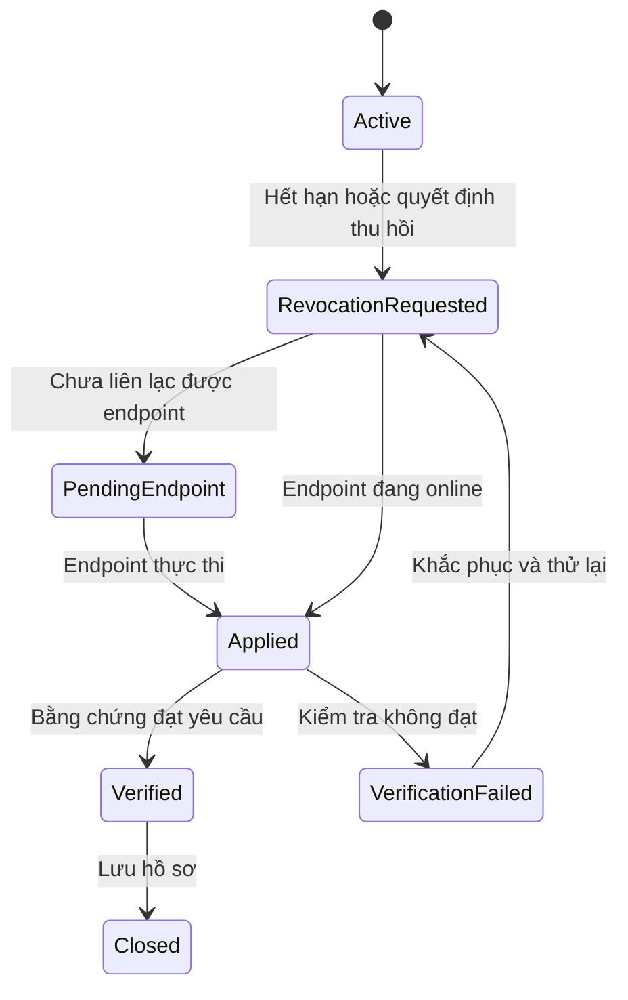

# Revoke local admin

## 1. Thu hồi local admin là thu hồi khả năng sử dụng quyền

Một kỹ thuật viên được cấp quyền quản trị trên máy trạm trong 30 phút để cài driver. Khi hết hạn, hệ thống xóa tài khoản khỏi nhóm Administrators và ghi nhận yêu cầu đã hoàn thành. Tuy nhiên, cửa sổ PowerShell chạy với quyền cao từ trước vẫn mở; một tác vụ đã được tạo bằng tài khoản SYSTEM cũng tiếp tục hoạt động.

Trong tình huống này, một thay đổi về **thành viên nhóm** đã xảy ra, nhưng kết luận “người dùng không còn sử dụng được quyền quản trị” chưa có đủ bằng chứng.

Trong Endpoint PAM, **revoke local admin** là quá trình chấm dứt một quyền quản trị đã được cấp trên endpoint, đồng thời xử lý những đường sử dụng quyền còn tồn tại trong phạm vi đã xác định. Quá trình đó có thể bao gồm:

- Kết thúc một grant JIT hoặc quyền nâng đặc quyền tạm thời.
- Gỡ membership trực tiếp hoặc thay đổi nhóm cấp quyền theo đúng nguồn quản lý.
- Ngăn chính sách, tác vụ hoặc hệ thống quản trị cấp lại quyền ngoài ý muốn.
- Xử lý phiên đăng nhập, token và tiến trình còn giữ quyền.
- Vô hiệu hóa hoặc thay đổi credential khi credential đó thuộc phạm vi cần thu hồi.
- Kiểm chứng và lưu bằng chứng về trạng thái thực tế trên endpoint.

Bài học tập trung vào **thu hồi một quyền đã tồn tại**. Việc xác định danh sách local administrator hợp lệ là nền tảng; thu hồi còn cần xử lý thời điểm hết hạn, phạm vi ảnh hưởng và trạng thái chạy thực tế.

### Sau bài học, bạn có thể

1. Phân biệt thu hồi membership, grant, credential và phiên sử dụng quyền.
2. Lập kế hoạch thu hồi có owner, phạm vi, thời hạn và điều kiện hoàn tất.
3. Giải thích khác biệt giữa thay đổi cấu hình và token đang hoạt động.
4. Tổ chức thu hồi trên endpoint trực tuyến, ngoại tuyến hoặc có dấu hiệu bị xâm nhập.
5. Thiết kế bằng chứng để tránh báo hoàn thành khi mới gửi lệnh.
6. Giảm rủi ro cấp lại quyền do chính sách hoặc tác vụ tự động.

## 2. Xác định chính xác đối tượng cần thu hồi

“Thu hồi quyền admin của An” chưa đủ để thực thi. Một người có thể dùng nhiều tài khoản; một tài khoản có thể được cấp quyền bằng nhiều cơ chế và trên nhiều máy.

Cần mô tả một grant bằng các thuộc tính đủ rõ:

| Thuộc tính | Câu hỏi cần trả lời |
| --- | --- |
| Subject | Tài khoản hay nhóm nào nhận quyền? Dùng SID hoặc định danh ổn định nào? |
| Endpoint | Máy nào, tenant/site nào, định danh thiết bị nào? |
| Capability | Full local admin, nâng quyền theo ứng dụng hay một thao tác cụ thể? |
| Grant source | JIT, nhóm directory, chính sách endpoint, thao tác trực tiếp hay ngoại lệ? |
| Grant identifier | Yêu cầu cấp quyền hoặc lease nào tạo ra quyền? |
| Validity | Quyền có hiệu lực từ khi nào và hết hạn lúc nào? |
| Owner | Ai chịu trách nhiệm quyền, endpoint và quyết định ngoại lệ? |
| Revocation condition | Hết giờ, hoàn thành công việc, nghỉ việc, vi phạm hay sự cố? |

Ví dụ dữ liệu mô phỏng:

```yaml
grant_id: jit-ep-2026-0142
subject:
  principal_id: 'S-1-5-21-111111111-222222222-333333333-1107'
  display_name: 'EXAMPLE\an.support'
target:
  device_id: device-7b38
  hostname: WS-FIN-042
capability: local_administrator
source: endpoint_pam_jit
reason: install_approved_driver
expires_at: '2026-11-27T10:00:00+07:00'
revoke_mode: normal_expiry
owner: endpoint_operations
```

Định danh từ hệ thống quản lý phải được đối chiếu với endpoint thực tế trước khi thay đổi. Không dùng riêng tên hiển thị làm khóa thu hồi: hai tài khoản ở hai domain có thể trùng tên; tài khoản bị xóa rồi tạo lại có thể giữ tên nhưng mang định danh khác.

Hostname cũng có thể được tái sử dụng sau khi cài lại máy. Ghi nhận cả định danh thiết bị và định danh principal giúp hạn chế thu hồi nhầm.

## 3. Bốn lớp cần kiểm tra

### 3.1. Entitlement: ai được phép nhận quyền?

Entitlement là điều kiện cho phép principal sử dụng hoặc yêu cầu quyền. Ví dụ:

- Người dùng thuộc nhóm directory được gán làm local administrator.
- Policy cho phép một nhóm hỗ trợ xin nâng quyền.
- Nhóm vận hành được phép checkout tài khoản quản trị cục bộ.

Thu hồi entitlement có thể ngăn yêu cầu mới, nhưng không tự chứng minh grant đã cấp hoặc phiên đã mở đã kết thúc.

### 3.2. Grant: quyền nào đã được cấp?

Grant là lần cấp quyền cụ thể: một lease JIT, membership tạm thời hoặc lần nâng quyền ứng dụng.

Nếu chỉ xóa membership trên máy nhưng grant trung tâm còn hiệu lực, agent hoặc policy có thể thêm lại membership. Ngược lại, nếu chỉ đóng grant ở máy chủ mà endpoint chưa nhận được thay đổi, quyền trên máy có thể còn tồn tại.

Thu hồi phải cập nhật nguồn cấp quyền và trạng thái áp dụng tại endpoint theo thiết kế của giải pháp. Với nâng quyền theo ứng dụng, có thể không tồn tại membership Administrators nào để gỡ; phải thu hồi đúng lease hoặc cơ chế nâng quyền đó.

### 3.3. Runtime: quyền nào còn nằm trong token hoặc tiến trình?

Trên Windows, access token mô tả ngữ cảnh bảo mật của tiến trình hoặc thread, trong đó có định danh, nhóm và đặc quyền. Token được tạo trong quá trình đăng nhập và được dùng khi hệ thống kiểm tra truy cập. Xem [Microsoft Learn: Access tokens](https://learn.microsoft.com/en-us/windows/win32/secauthz/access-tokens).

Hệ quả vận hành là phải kiểm tra riêng token đang tồn tại. Gỡ membership không tự sửa hồi tố mọi token đã được tạo. Một tiến trình elevated chạy trước khi thu hồi có thể tiếp tục mang quyền.

Trên Linux, tiến trình cũng có thông tin danh tính và nhóm đang được sử dụng. Thay đổi cơ sở dữ liệu nhóm không tự biến shell root đã mở thành shell không đặc quyền.

Cần phân biệt:

- Cấu hình cấp quyền hiện tại.
- Phiên đăng nhập mới sau khi cấu hình đã được áp dụng.
- Phiên hoặc tiến trình đã tồn tại trước thời điểm thay đổi.

### 3.4. Credential và dấu vết duy trì quyền

Nếu người dùng biết mật khẩu local administrator dùng chung, gỡ membership của tài khoản cá nhân không làm mật khẩu đó mất hiệu lực.

Nếu phiên có quyền đã tạo tài khoản khác, dịch vụ hoặc scheduled task, quyền có thể được sử dụng qua đối tượng mới. Những thay đổi này cần được xem xét theo phạm vi grant và mức độ tin cậy của endpoint.

Không phải mọi lần hết hạn JIT đều cần điều tra pháp chứng. Tuy nhiên, khi có dấu hiệu xâm nhập, kiểm tra nhóm Administrators không đủ để kết luận endpoint đã an toàn.

## 4. Chọn mức thu hồi theo lý do

| Tình huống | Mục tiêu | Hành động cần xem xét |
| --- | --- | --- |
| Hết hạn JIT bình thường | Dừng sử dụng quyền sau cửa sổ được duyệt | Đóng grant, gỡ quyền, xử lý runtime theo policy, kiểm chứng |
| Hoàn thành công việc sớm | Chấm dứt quyền không còn cần | Revoke trước hạn, xác nhận công việc và phiên liên quan |
| Chuyển vai trò | Loại bỏ đường nhận quyền cũ | Thu hồi entitlement, grant đang mở và ngoại lệ liên quan |
| Nghỉ việc hoặc đình chỉ tài khoản | Ngăn người cũ tiếp tục sử dụng quyền | Kết hợp lifecycle danh tính, phiên, credential và endpoint |
| Credential bị lộ | Chặn đường xác thực bị lộ | Thu hồi/rotate credential, chặn grant mới, xử lý phiên |
| Nghi endpoint bị xâm nhập | Kiềm chế sử dụng và duy trì quyền | Phối hợp ứng phó sự cố, cô lập phù hợp, thu bằng chứng, phục hồi tin cậy |

Hết hạn bình thường có thể có thông báo trước và khoảng kết thúc công việc hữu hạn nếu policy đã quy định. Thu hồi do sự cố có thể cần ngăn hoạt động ngay lập tức.

Không để người bị thu hồi tự kéo dài quyền vô hạn. Gia hạn phải là quyết định riêng, có lý do và thời điểm hết hạn mới; không âm thầm sửa thời hạn grant để che việc quá hạn.

## 5. Điều kiện tiên quyết

### 5.1. Có đường quản trị dự phòng hợp lệ

Trước khi thu hồi quyền có thể là đường truy cập quản trị cuối cùng, cần xác nhận còn phương án quản trị được kiểm soát, chẳng hạn tài khoản phục hồi do vault quản lý hoặc cơ chế break-glass đã được kiểm thử.

Đường dự phòng phải có owner, kiểm soát truy cập và dấu vết sử dụng. Không tạo tài khoản admin bí mật để thuận tiện cho thao tác thu hồi.

### 5.2. Biết nguồn cấu hình có thẩm quyền

Membership trên endpoint có thể do GPO, MDM, công cụ cấu hình, agent PAM, script hoặc tác vụ tự động quản lý. Cần biết hệ thống nào quyết định trạng thái cuối.

Ví dụ, thao tác gỡ thành viên thành công lúc 09:00 có thể bị policy cũ thêm lại lúc 09:05. Thu hồi bền vững cần sửa đường cấp quyền tại nguồn phù hợp, rồi đồng bộ và kiểm chứng.

### 5.3. Đánh giá phụ thuộc nghiệp vụ

Người dùng có thể đã cấu hình tác vụ bằng tài khoản cá nhân hoặc cài dịch vụ sử dụng credential họ biết. Cần ghi nhận và chuyển phụ thuộc sang cơ chế hợp lệ.

Không duy trì quyền cá nhân vô thời hạn vì một tác vụ nền đang phụ thuộc vào nó. Cũng không ngắt hàng loạt dịch vụ chưa xác định owner trong đợt hết hạn thông thường. Owner nghiệp vụ và vận hành phải có phương án xử lý với thời hạn rõ ràng.

### 5.4. Quy định trước cách xử lý runtime

Policy cần trả lời:

- Có chặn tạo phiên elevated mới ngay khi grant hết hạn không?
- Phiên đang mở bị đóng ngay hay có khoảng kết thúc công việc?
- Có bắt buộc sign-out, khởi động lại hoặc hành động cưỡng chế nào khác không?
- Ai quyết định ngoại lệ khi công việc ở bước nhạy cảm?
- Sau mốc nào phải cảnh báo vi phạm thời hạn thu hồi?

Khả năng cụ thể phụ thuộc sản phẩm và hệ điều hành. Không suy ra agent có thể thu hồi mọi token chỉ vì giao diện có nút Revoke.

## 6. Quy trình thu hồi có thể kiểm chứng

### Bước 1 — Ghi nhận trạng thái trước thay đổi

Thu thập thông tin tối thiểu phục vụ đối chiếu:

- Grant và ticket liên quan.
- Subject, endpoint, nguồn quyền và thời điểm hết hạn.
- Membership hoặc policy đang cấp quyền.
- Phiên, tiến trình đặc quyền đã biết trong phạm vi xử lý.
- Trạng thái online và lần liên lạc gần nhất của endpoint.
- Đường phục hồi được phê duyệt.

Không đưa mật khẩu, private key hay token xác thực vào log thu hồi.

### Bước 2 — Ngăn cấp mới hoặc cấp lại

Đóng grant hoặc đánh dấu revoke tại nguồn có thẩm quyền. Với thay đổi vai trò, điều chỉnh entitlement liên quan. Kiểm tra yêu cầu gia hạn, grant trùng và policy có thể cấp lại cùng quyền.

Nếu có nhiều grant hợp lệ cho cùng principal trên cùng máy, cần quyết định rõ đang thu hồi một grant hay toàn bộ capability. Xóa membership dùng chung mà không xét grant còn hiệu lực có thể làm gián đoạn một quyền đã được duyệt khác.

Thiết kế tốt duy trì quan hệ giữa capability thực tế và các grant còn hợp lệ, thay vì coi mọi lần thêm/gỡ nhóm là thao tác độc lập không có nguồn gốc.

### Bước 3 — Áp dụng thay đổi lên endpoint

Thực hiện hành động tương ứng với nguồn quyền:

- Gỡ membership trực tiếp do grant tạo ra.
- Điều chỉnh nhóm hoặc policy cấp gián tiếp trong đúng phạm vi.
- Thu hồi lease nâng quyền theo ứng dụng.
- Chặn checkout credential hoặc điều chỉnh quyền truy cập vault khi đó là đường cấp quyền liên quan.

Không xóa toàn bộ thành viên Administrators để thu hồi một người dùng. Không gỡ nhóm hỗ trợ toàn tổ chức khỏi hàng nghìn máy chỉ vì một thành viên cần bị thu hồi trên một endpoint.

### Bước 4 — Xử lý runtime

Theo policy, lựa chọn kết thúc phiên liên quan, dừng tiến trình đã xác định, yêu cầu đăng xuất hoặc khởi động lại có kiểm soát.

Dừng một tiến trình không đồng nghĩa đã tìm được mọi tiến trình con, dịch vụ hoặc tác vụ mà nó tạo ra. Cần biết độ bao phủ của cơ chế đang dùng.

Khởi động lại có thể giúp loại bỏ token của các phiên tương tác cũ, nhưng không tự xóa scheduled task, dịch vụ hoặc tài khoản được tạo để duy trì quyền. Vì vậy, reboot không phải bằng chứng đầy đủ về tính sạch của endpoint trong tình huống xâm nhập.

### Bước 5 — Xử lý credential khi cần

Nếu credential bị lộ, đã được checkout hoặc còn là đường xác thực ngoài ý muốn, thực hiện vô hiệu hóa hoặc rotate theo phạm vi được duyệt.

Cơ chế quản lý mật khẩu local administrator, chẳng hạn LAPS, giải quyết quản lý/luân chuyển mật khẩu. Đổi mật khẩu không tự thu hồi mọi token hoặc phiên đã tạo trước đó. Luân chuyển credential và xử lý runtime giải quyết những phần khác nhau của vấn đề.

### Bước 6 — Kiểm chứng nguồn quản lý và endpoint

Cần hai loại bằng chứng:

1. **Nguồn quản lý:** grant hết hiệu lực, trạng thái mong muốn đúng, không còn đường cấp mới ngoài ý muốn trong phạm vi.
2. **Endpoint:** thay đổi đã áp dụng, runtime liên quan được xử lý theo policy, kiểm tra sau thu hồi đạt yêu cầu.

Nếu endpoint chưa nhận lệnh, chỉ có thể kết luận “đã yêu cầu thu hồi”, chưa thể kết luận “đã thu hồi trên endpoint”.

### Bước 7 — Đóng hồ sơ

Ghi riêng thời điểm yêu cầu, áp dụng và xác minh. Chỉ đóng hoàn tất khi các điều kiện bắt buộc đều đạt.

Nếu còn ngoại lệ, nêu ngoại lệ, owner, biện pháp giảm thiểu và hạn xử lý. Không dùng trạng thái thành công để che một phiên admin vẫn còn mở.

## 7. Minh họa Windows: gỡ đúng membership trực tiếp

Ví dụ minh họa việc tìm nhóm bằng SID, chọn một thành viên trực tiếp theo SID và xem trước thao tác gỡ. Nó không xử lý nhóm lồng nhau, policy tập trung, grant trung tâm hay token.

Ví dụ cần Windows với module `Microsoft.PowerShell.LocalAccounts` và phiên quản trị phù hợp. Trên Windows 64-bit, dùng PowerShell 64-bit vì module không khả dụng trong tiến trình PowerShell 32-bit. Cú pháp và giới hạn module được mô tả trong [Remove-LocalGroupMember](https://learn.microsoft.com/en-us/powershell/module/microsoft.powershell.localaccounts/remove-localgroupmember).

```powershell
# Chỉ chạy trên endpoint đã đối chiếu đúng định danh.
# Thay SID mô phỏng bằng SID trong hồ sơ grant được duyệt.
$principalSid = 'S-1-5-21-111111111-222222222-333333333-1107'

$adminGroup = Get-LocalGroup -SID 'S-1-5-32-544' -ErrorAction Stop
$membersBefore = @(
    Get-LocalGroupMember -Group $adminGroup -ErrorAction Stop
)

$targetMember = @(
    $membersBefore | Where-Object {
        $_.SID.Value -eq $principalSid
    }
)

if ($targetMember.Count -eq 0) {
    Write-Output 'Không tìm thấy membership trực tiếp tương ứng.'
    Write-Output 'Cần kiểm tra quyền gián tiếp và policy.'
}
elseif ($targetMember.Count -ne 1) {
    throw 'Kết quả không duy nhất; dừng để đối chiếu định danh.'
}
else {
    $targetMember |
        Select-Object Name, SID, ObjectClass, PrincipalSource

    # Chỉ xem trước, chưa thay đổi membership.
    $previewParameters = @{
        Group       = $adminGroup
        Member      = $targetMember[0]
        WhatIf      = $true
        ErrorAction = 'Stop'
    }
    Remove-LocalGroupMember @previewParameters
}
```

SID `S-1-5-32-544` xác định nhóm Administrators tích hợp, giúp tránh phụ thuộc tên nhóm theo ngôn ngữ. `Get-LocalGroup` hỗ trợ chọn nhóm bằng SID; xem [tài liệu Get-LocalGroup](https://learn.microsoft.com/en-us/powershell/module/microsoft.powershell.localaccounts/get-localgroup).

Sau khi đối chiếu endpoint, subject, nguồn quyền và đường phục hồi, bước thực thi trong quy trình được duyệt có thể là:

```powershell
# Dùng các biến từ bước kiểm tra trên, trong cùng phiên thực thi.
if ($targetMember.Count -ne 1) {
    throw 'Chưa xác định duy nhất thành viên trực tiếp cần gỡ.'
}

$removeParameters = @{
    Group       = $adminGroup
    Member      = $targetMember[0]
    Confirm     = $true
    ErrorAction = 'Stop'
}
Remove-LocalGroupMember @removeParameters

$membersAfter = @(
    Get-LocalGroupMember -Group $adminGroup -ErrorAction Stop
)

$stillDirectMember = @(
    $membersAfter | Where-Object {
        $_.SID.Value -eq $principalSid
    }
).Count -gt 0

if ($stillDirectMember) {
    throw 'Membership trực tiếp vẫn tồn tại sau thao tác.'
}

Write-Output 'DIRECT_MEMBERSHIP_REMOVAL_VERIFIED'
```

Lưu ý: `-Confirm` có thể được người vận hành từ chối; chỉ bước readback mới cho biết membership còn hay đã mất. Không lấy việc cmdlet kết thúc làm bằng chứng duy nhất.

Kết quả `DIRECT_MEMBERSHIP_REMOVAL_VERIFIED` chỉ có nghĩa không thấy membership trực tiếp đó ở lần đọc lại. Nó chưa chứng minh principal hết quyền qua nhóm khác hoặc hết token có quyền.

`Get-LocalGroupMember` trả về thành viên của nhóm cục bộ; đây không phải công cụ suy diễn toàn bộ quyền hiệu lực. Xem [tài liệu Get-LocalGroupMember](https://learn.microsoft.com/en-us/powershell/module/microsoft.powershell.localaccounts/get-localgroupmember).

Nếu liệt kê nhóm thất bại, phải ghi nhận lỗi kiểm chứng. Không dùng cơ chế bỏ qua lỗi để biến một truy vấn thất bại thành danh sách rỗng rồi báo thành công.

### Quyền qua nhóm gián tiếp

Giả sử Administrators chứa `EXAMPLE\Endpoint-Support`, còn An thuộc nhóm đó:

- Không thấy tài khoản An trong danh sách trực tiếp là điều có thể dự đoán.
- Gỡ membership trực tiếp của An, nếu có, vẫn chưa loại bỏ đường quyền qua nhóm.
- Thay đổi nhóm directory cần xét những endpoint và dịch vụ khác đang dùng nhóm.
- Policy có thể thêm lại nhóm hỗ trợ nếu chỉ gỡ nhóm trên máy.

Truy vết đường cấp quyền phải dựa trên mô hình danh tính và policy thực tế.

### Kiểm chứng token

Trong phiên mới theo quy trình kiểm thử, có thể khảo sát token:

```powershell
whoami
whoami /groups
whoami /priv
```

Không dùng cửa sổ mở từ trước làm bằng chứng duy nhất cho trạng thái sau thu hồi. Khi xem SID Administrators trong token, cần xem cả thuộc tính nhóm; token UAC bị lọc có thể thể hiện nhóm ở trạng thái deny-only.

Microsoft mô tả sự khác nhau giữa token chuẩn, token quản trị và hành vi nâng quyền trong [How User Account Control works](https://learn.microsoft.com/en-us/windows/security/application-security/application-control/user-account-control/how-it-works). Vì vậy, một bài kiểm tra cần xét cả token và đường nâng quyền, không chỉ giao diện ứng dụng.

Hộp thoại UAC yêu cầu credential không tự chứng minh người dùng vẫn là admin: credential quản trị khác được nhập có thể thuộc principal khác. Bằng chứng phải nêu ai thực sự được xác thực.

Chỉ dùng thao tác kiểm thử quản trị đã được thiết kế cho lab hoặc môi trường được duyệt; không thử bằng cách tắt bảo vệ hay thay đổi dữ liệu nghiệp vụ.

## 8. Đối chiếu Linux: sudo và phiên root

Trên Linux, quyền quản trị có thể đến từ nhóm như `sudo` hoặc `wheel`, quy tắc sudoers, identity provider hoặc cơ chế cấp quyền khác. Tên nhóm và cấu hình phụ thuộc hệ thống.

Các lệnh sau hỗ trợ khảo sát, không phải thủ tục thu hồi hoàn chỉnh:

```bash
id example-user
getent group sudo
getent group wheel

# Có thể cần quyền quản trị để xem quyền của người dùng khác.
sudo -l -U example-user
```

Cần phân biệt:

- `id example-user` truy vấn thông tin danh tính theo cơ chế phân giải hiện tại, không liệt kê credential của mọi tiến trình đang chạy.
- Danh sách thành viên nhóm không thay thế việc kiểm tra toàn bộ quy tắc sudo.
- Gỡ người dùng khỏi nhóm không xóa quy tắc sudo cấp trực tiếp cho họ.
- Shell root mở từ trước vẫn cần được xử lý.
- Xóa cache xác thực sudo không hạ đặc quyền của tiến trình đã chạy bằng root.

Thay đổi sudoers phải đi qua quy trình cấu hình và kiểm tra cú pháp bằng công cụ thích hợp, chẳng hạn `visudo`, trước khi coi cấu hình mới hợp lệ.

Phiên mới và phép kiểm tra quyền thích hợp giúp xác minh trạng thái sau thay đổi. Nếu identity provider hoặc policy có cache, cần biết điều kiện làm mới và thời gian hội tụ; không mặc định thay đổi directory có hiệu lực ngay ở mọi máy.

## 9. Endpoint ngoại tuyến: hàng đợi khác với thực thi

Grant hết hạn lúc 10:00 nhưng laptop mất mạng từ 09:50. Console ghi grant đã đóng; laptop có thể chưa nhận lệnh gỡ membership.

Cần theo dõi riêng các trạng thái:



Tên trạng thái mang tính minh họa. Điểm quan trọng là không gộp `RevocationRequested`, `Applied` và `Verified`.

Thiết kế thu hồi ngoại tuyến cần trả lời:

1. Grant có cơ chế hết hạn cục bộ được thiết kế và kiểm thử không?
2. Khi thiếu kết nối, có cho phép cấp quyền mới không?
3. Việc hết hạn dựa vào nguồn thời gian và thành phần nào có thể tin cậy?
4. Agent bị dừng, policy bị sửa hoặc đồng hồ bị can thiệp tạo ra tín hiệu gì?
5. Endpoint quá hạn thu hồi bị hạn chế truy cập tài nguyên nào khi kết nối lại?
6. Ai xử lý máy không quay lại trong thời hạn?

TTL ở trung tâm không tự tạo ra thu hồi trên máy ngoại tuyến. Cơ chế hết hạn cục bộ cũng cần đánh giá khả năng chống can thiệp khi người dùng đang có full local admin.

Nếu máy chưa được xác minh, giữ trạng thái chưa hoàn tất và độ tuổi tồn đọng. Không dùng thời điểm đóng grant làm thời điểm hoàn tất trên endpoint.

## 10. Tránh cạnh tranh và quyền bị thêm lại

### 10.1. Nhiều grant cùng dựa vào một membership

Grant A hết hạn lúc 10:00; grant B hợp lệ đến 11:00 cho cùng principal trên cùng máy. Nếu thu hồi A bằng cách xóa membership mà không xét B, hệ thống có thể ngắt một quyền đang được duyệt.

Ngược lại, nếu luôn giữ membership khi còn bất kỳ dấu vết grant nào, một grant hết hiệu lực chưa được dọn có thể giữ quyền vô hạn.

Cần tính trạng thái mong muốn từ tập grant thực sự còn hiệu lực. Hành động revoke phải gắn với định danh hoặc phiên bản grant để xử lý đúng yêu cầu cũ đến muộn.

### 10.2. Lệnh cũ đến sau một lần cấp mới

Laptop mất mạng khi thu hồi A. Sau đó grant B được duyệt. Khi máy online, lệnh cũ và policy mới có thể cùng đến.

Hệ thống phải phân biệt thu hồi riêng A, thu hồi capability trên endpoint và thu hồi khẩn cấp toàn bộ quyền trong phạm vi. Thông điệp chỉ có “remove user X” thiếu ngữ cảnh để quyết định đúng trong mọi trường hợp.

### 10.3. Tính lặp an toàn

Tác vụ thu hồi có thể phải retry. Lặp lại không được xóa thêm principal ngoài mục tiêu hoặc ghi đè policy mới hợp lệ.

“Membership mục tiêu đã không còn” có thể là trạng thái phù hợp cho bước gỡ trực tiếp. Tuy nhiên, quy trình chỉ hoàn tất khi các lớp grant, runtime và kiểm chứng cũng đạt yêu cầu.

### 10.4. Xung đột nguồn cấu hình

Nếu PAM gỡ quyền nhưng GPO hoặc MDM thêm lại, cần sửa xung đột ở nguồn có thẩm quyền. Chạy script gỡ liên tục có thể tạo vòng cấp/gỡ khó kiểm soát.

Sau thu hồi, kiểm tra lại sau chu kỳ đồng bộ policy phù hợp. Thời gian chờ phải dựa vào cơ chế thực tế, không áp dụng một con số cho mọi endpoint.

## 11. Bằng chứng và điều kiện hoàn tất

Hồ sơ thu hồi phải cho biết ai bị thu hồi, trên máy nào, vì sao, khi nào, đã kiểm tra điều gì và còn giới hạn nào.

Ví dụ dữ liệu mô phỏng:

```json
{
  "revocationId": "revoke-2026-0271",
  "grantId": "jit-ep-2026-0142",
  "deviceId": "device-7b38",
  "principalId": "S-1-5-21-111111111-222222222-333333333-1107",
  "reason": "normal_expiry",
  "requestedAt": "2026-11-27T10:00:00+07:00",
  "appliedAt": "2026-11-27T10:00:18+07:00",
  "verifiedAt": "2026-11-27T10:01:02+07:00",
  "checks": {
    "grantInactive": "PASS",
    "directMembershipAbsent": "PASS",
    "indirectGrantPathsReviewed": "PASS",
    "runtimeHandledPerPolicy": "PASS",
    "freshSessionValidation": "PASS",
    "policyReapplicationCheck": "PASS"
  },
  "result": "VERIFIED",
  "evidenceRefs": [
    "evidence://revoke-2026-0271/endpoint-readback",
    "evidence://revoke-2026-0271/session-validation"
  ]
}
```

Một giá trị `PASS` chỉ có ý nghĩa khi gắn với kiểm tra thực tế, thời điểm, nguồn bằng chứng và phạm vi rõ ràng. Không điền sẵn PASS vì lệnh thực thi trả exit code thành công. Nếu một kiểm tra không áp dụng, phải ghi lý do; không biến “không biết” thành “không áp dụng”.

### Tiêu chí tối thiểu trong thu hồi bình thường

- Grant mục tiêu hết hiệu lực; không còn cơ chế cấp lại ngoài ý muốn trong phạm vi.
- Cấu hình quyền trên endpoint đáp ứng trạng thái mong muốn.
- Các đường cấp trực tiếp và gián tiếp liên quan đã được xem xét.
- Runtime được xử lý theo policy công bố cho loại grant đó.
- Kiểm tra sau thu hồi đạt yêu cầu, có thời điểm và bằng chứng.
- Không còn bước bắt buộc ở trạng thái chưa biết hoặc chưa thực hiện.

Trong tình huống xâm nhập, cần đáp ứng thêm tiêu chí của quy trình ứng phó sự cố. “Đã thu hồi grant PAM” không đồng nghĩa “endpoint đã sạch và có thể vận hành trở lại”.

### Chỉ số vận hành

| Chỉ số | Ý nghĩa |
| --- | --- |
| Thời gian yêu cầu đến áp dụng | Tốc độ thay đổi thực tế trên endpoint |
| Thời gian yêu cầu đến xác minh | Thời gian đạt kết luận có bằng chứng |
| Endpoint chờ thu hồi và độ tuổi | Tồn đọng do offline hoặc lỗi agent |
| Số lần quyền xuất hiện lại | Dấu hiệu policy xung đột hoặc cấp lại ngoài ý muốn |
| Số lỗi xác minh runtime | Khoảng cách giữa cấu hình và phiên đang chạy |
| Ngoại lệ quá hạn | Quyền được giữ vượt điều kiện đã duyệt |

Khi so sánh thời gian endpoint và máy chủ, cần biết chất lượng đồng bộ đồng hồ. Sai lệch timestamp có thể tạo độ trễ âm hoặc kết luận sai thứ tự sự kiện.

## 12. Các lỗi phổ biến

### Gỡ thành viên nhóm rồi đóng ticket

**Vấn đề:** còn đường cấp lại, quyền gián tiếp hoặc token cũ.

**Cách sửa:** tách thay đổi membership khỏi điều kiện hoàn tất; kiểm chứng nguồn quyền và runtime theo policy.

### Disable tài khoản rồi coi mọi phiên đã kết thúc

**Vấn đề:** trạng thái tài khoản và vòng đời phiên không phải một cơ chế duy nhất. Tác dụng của disable phụ thuộc hệ thống xác thực và kết nối; token hoặc tiến trình đang tồn tại cần được đánh giá riêng.

**Cách sửa:** kết hợp lifecycle danh tính với xử lý phiên, credential và endpoint.

### Đổi mật khẩu nhưng bỏ qua phiên đang mở

**Vấn đề:** credential mới không tự hủy mọi token cũ.

**Cách sửa:** xác định riêng nhu cầu rotate credential và kết thúc runtime.

### Gỡ quyền tại endpoint nhưng quên policy

**Vấn đề:** cấu hình tập trung có thể khôi phục quyền.

**Cách sửa:** điều chỉnh nguồn cấp phù hợp, theo dõi đồng bộ và phát hiện quyền tái xuất hiện.

### Coi máy offline là đã thu hồi

**Vấn đề:** không có bằng chứng quyền thực tế đã thay đổi.

**Cách sửa:** giữ trạng thái chờ endpoint, quản lý độ tuổi và áp dụng hạn chế truy cập phù hợp.

### Giữ quyền mãi để tránh ảnh hưởng công việc

**Vấn đề:** ngoại lệ mất giới hạn thời gian và làm mất ý nghĩa JIT.

**Cách sửa:** chuyển phụ thuộc sang cơ chế hợp lệ, gia hạn theo quyết định mới và theo dõi deadline.

### Reboot rồi coi việc xử lý xâm nhập đã xong

**Vấn đề:** cấu hình duy trì quyền có thể tồn tại qua reboot.

**Cách sửa:** phối hợp điều tra và phục hồi tin cậy theo quy trình sự cố.

## 13. Thực hành: máy trạm bộ phận tài chính

### Bối cảnh

An được cấp full local admin trên `WS-FIN-042` từ 09:30 đến 10:00 để cài driver đã duyệt. Lúc 09:55, An hoàn thành nhưng vẫn để terminal elevated mở.

Policy cũ cũng chứa nhóm hỗ trợ trong Administrators. Máy mất mạng lúc 09:58. Lúc 10:00, console đóng grant JIT nhưng agent chưa phản hồi.

### Phân tích

Có ba khoảng trống:

1. **Kết nối:** chưa biết endpoint đã áp dụng thu hồi hay chưa.
2. **Runtime:** terminal elevated có thể tiếp tục mang quyền.
3. **Nguồn quyền khác:** nhóm hỗ trợ có thể giữ cho An đường nhận quyền.

Kết luận hợp lệ lúc 10:00 là “grant hết hiệu lực ở trung tâm; thu hồi trên endpoint đang chờ xác minh”.

### Cách xử lý

- Ghi trạng thái chờ endpoint và hạn xử lý.
- Xác định An có thuộc nhóm hỗ trợ được policy cấp quyền không.
- Điều chỉnh đường cấp cũ theo owner và phạm vi; tránh gỡ nhóm diện rộng tùy tiện.
- Khi máy online, áp dụng thay đổi và nhận readback.
- Xử lý terminal/phiên theo policy hết hạn đã công bố.
- Kiểm tra phiên mới và kiểm tra lại sau đồng bộ policy.
- Đóng hồ sơ khi không còn đường cấp quyền ngoài ý muốn trong phạm vi xác minh.

Nếu phát hiện dịch vụ SYSTEM mới không thuộc công việc đã duyệt, cần đánh giá theo quy trình sự cố; không chỉ gỡ membership rồi bỏ qua dịch vụ.

### Bài tập

Lập bảng bằng chứng với các cột:

`Điều kiện cần đạt | Nguồn bằng chứng | Thời điểm | Kết quả | Owner nếu chưa đạt`.

Bảng phải thể hiện riêng trạng thái grant, endpoint, quyền gián tiếp và runtime.

Thêm biến thể: An có grant B hợp lệ đến 10:30. Xác định việc thu hồi A thay đổi capability nào, membership nào còn cần tồn tại và thông tin nào phải lưu để lần revoke cũ không làm hỏng grant mới.

## 14. Câu hỏi tự kiểm tra

**1. Lệnh gỡ khỏi Administrators thành công. Có thể đóng yêu cầu chưa?**

Chưa đủ. Cần kiểm tra nguồn cấp quyền, quyền gián tiếp, runtime theo policy và bằng chứng endpoint.

**2. Terminal elevated cũ vẫn hoạt động có mâu thuẫn với readback membership không?**

Không. Membership hiện tại và token của tiến trình đã tồn tại là những trạng thái khác nhau.

**3. Vì sao dùng principal ID thay vì chỉ tên tài khoản?**

Tên có thể trùng hoặc được tái sử dụng. Định danh ổn định giúp đối chiếu đúng đối tượng nhận grant.

**4. Grant hết hạn nhưng endpoint offline được ghi nhận ra sao?**

Ghi nhận grant hết hiệu lực ở trung tâm; áp dụng và xác minh trên endpoint vẫn là trạng thái riêng chưa hoàn tất.

**5. Vì sao rotate mật khẩu không thay thế xử lý phiên?**

Mật khẩu phục vụ xác thực; token và tiến trình đã được tạo có vòng đời riêng.

**6. Khi nào cần phối hợp ứng phó sự cố?**

Khi có dấu hiệu credential bị lộ, sử dụng quyền trái phép, agent bị can thiệp hoặc cơ chế duy trì quyền ngoài phạm vi được duyệt.

## 15. Checklist cho một lần thu hồi

- [ ] Đối chiếu grant, principal và endpoint bằng định danh phù hợp.
- [ ] Xác định lý do và mức khẩn cấp.
- [ ] Xác nhận đường quản trị dự phòng được kiểm soát.
- [ ] Kiểm tra grant trùng, quyền gián tiếp và policy có thể cấp lại.
- [ ] Thu hồi grant tại nguồn có thẩm quyền.
- [ ] Áp dụng thay đổi lên endpoint và đọc lại.
- [ ] Xử lý token, phiên và tiến trình theo policy.
- [ ] Xử lý credential nếu còn đường xác thực cần thu hồi.
- [ ] Kiểm chứng phiên mới và hành vi đồng bộ policy.
- [ ] Giữ trạng thái chờ cho endpoint hoặc phép kiểm tra chưa có kết quả.
- [ ] Lưu bằng chứng, thời điểm, owner và giới hạn kết luận.
- [ ] Chỉ đóng hoàn tất khi mọi điều kiện bắt buộc trong phạm vi đều đạt.

Một lệnh gỡ nhóm là bước thực thi. Hồ sơ thu hồi hoàn tất phải cho thấy quyền mục tiêu đã được loại bỏ ở nguồn cấp và endpoint, runtime đã được xử lý theo policy, và kết luận được hỗ trợ bằng bằng chứng có phạm vi rõ ràng.
