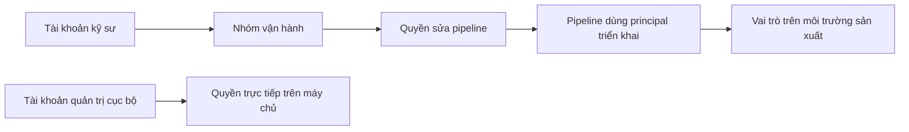

# Inventory privileged account

## 1. Kiểm kê tài khoản đặc quyền là gì?

**Inventory privileged account** là hoạt động xác định, ghi nhận và duy trì thông tin về các tài khoản có thể sử dụng đặc quyền trong một phạm vi hệ thống. Đặc quyền có thể cho phép quản trị tài nguyên, cấp quyền cho chủ thể khác, thay đổi cơ chế bảo vệ, truy xuất bí mật hoặc tác động lớn đến dữ liệu và dịch vụ.

Một inventory có ích không chỉ là danh sách tên tài khoản. Nó phải giúp trả lời:

- Tài khoản tồn tại ở đâu, thuộc nguồn danh tính nào và có định danh gì?
- Ai hoặc workload nào sử dụng tài khoản, ai chịu trách nhiệm quản lý?
- Tài khoản có quyền gì trên tài nguyên nào, qua đường trực tiếp hay gián tiếp?
- Quyền đang có hiệu lực, chỉ đủ điều kiện kích hoạt hay đã hết hiệu lực?
- Credential và đường truy cập được quản lý thế nào?
- Thông tin được quan sát khi nào, từ nguồn nào và còn khoảng trống nào?

Trong PAM, kiểm kê tạo nền tảng cho least privilege, cấp quyền JIT/JEA, đưa credential vào vault, luân chuyển bí mật, giám sát phiên và thu hồi quyền. Không biết tài khoản nào tồn tại và ai phụ thuộc vào nó thì khó áp dụng các kiểm soát đó một cách đầy đủ, an toàn.

**Inventory là dữ liệu được duy trì liên tục, không phải một lần xuất danh sách rồi kết thúc.** Một bản xuất chính xác tại thời điểm thu thập vẫn có thể nhanh chóng lỗi thời khi tài khoản, nhóm, workload hoặc quyền thay đổi.

## 2. Phân biệt các đối tượng trước khi kiểm kê

### 2.1. Danh tính, tài khoản, quyền và credential

| Đối tượng | Ý nghĩa | Ví dụ |
|---|---|---|
| Danh tính | Chủ thể được đại diện trong hệ thống | Một kỹ sư vận hành hoặc một ứng dụng sao lưu |
| Tài khoản hoặc principal | Biểu diễn của chủ thể trong một nguồn xác thực hay nền tảng | Tài khoản quản trị cục bộ hoặc service principal |
| Quyền và quan hệ cấp quyền | Những hành động chủ thể được phép thực hiện trong phạm vi cụ thể | Được khởi động lại dịch vụ hoặc quản lý vai trò |
| Credential | Phương tiện dùng để xác thực | Mật khẩu, khóa, chứng thư hoặc token |
| Tài nguyên | Đối tượng chịu tác động | Máy chủ, cơ sở dữ liệu, tài khoản cloud hoặc kho bí mật |
| Phiên hoặc lần chạy | Một lần sử dụng danh tính và quyền | Phiên quản trị hoặc một pipeline run |

Một tài khoản có thể có nhiều credential. Một người có thể có nhiều tài khoản. Một vai trò có thể được nhiều principal sử dụng. Đếm các đối tượng này như cùng một loại sẽ làm sai kết quả kiểm kê và chỉ số bao phủ.

Ví dụ, ba khóa SSH của cùng một tài khoản không phải ba tài khoản đặc quyền. Ngược lại, ba máy chủ cùng có tài khoản tên `root` thường phải được ghi nhận thành các tài khoản theo từng phạm vi máy, không gộp thành một dòng chỉ vì trùng tên.

### 2.2. Tài khoản đặc quyền được nhận diện bằng khả năng tác động

Không nên chỉ tìm tên chứa `admin`, `root` hoặc `svc`. Một tài khoản tên bình thường vẫn có thể:

- Thay đổi thành viên nhóm quản trị.
- Sửa pipeline triển khai có quyền trên môi trường sản xuất.
- Đọc credential của một tài khoản mạnh hơn.
- Sửa cấu hình mà một tiến trình đặc quyền sẽ sử dụng.
- Thực hiện sao lưu, xuất hoặc khôi phục dữ liệu với phạm vi rất rộng.

Tên tài khoản có thể hỗ trợ tìm kiếm ban đầu nhưng không chứng minh mức quyền. Cần đối chiếu với quyền thực tế, cơ chế ủy quyền và khả năng điều khiển tài nguyên.

Cũng cần phân biệt quyền kỹ thuật cao với độ nhạy cảm nghiệp vụ. Một tài khoản chỉ đọc dữ liệu trên diện rộng có thể cần ưu tiên rất cao dù không được sửa cấu hình. Quy tắc phân loại phải nêu rõ tiêu chí và lý do đưa tài khoản vào phạm vi PAM.

## 3. Chốt phạm vi và mẫu số kiểm kê

### 3.1. Bắt đầu từ tài nguyên và nguồn danh tính

Một chương trình kiểm kê cần biết những miền nào đang được khảo sát. Có thể bắt đầu từ hệ thống sản xuất quan trọng, sau đó mở rộng theo kế hoạch.

| Miền khảo sát | Đối tượng cần xem xét | Điểm dễ bỏ sót |
|---|---|---|
| Hệ điều hành | Tài khoản cục bộ, nhóm quản trị, quyền ủy quyền | Tài khoản ngoài thư mục tập trung và quyền trên từng máy |
| Thư mục danh tính và IdP | Tài khoản quản trị, nhóm, vai trò, quan hệ liên kết | Nhóm lồng nhau, tài khoản cũ, quyền quản trị hệ thống định danh |
| Cơ sở dữ liệu | Tài khoản quản trị, dịch vụ, vai trò và quyền trên dữ liệu | Tài khoản chỉ tồn tại trong database, quyền kế thừa |
| Cloud và nền tảng hạ tầng | Principal, vai trò, quan hệ tin cậy và phạm vi tài nguyên | Quyền tạm thời, ủy quyền và điều kiện sử dụng |
| Container và nền tảng điều phối | Danh tính workload, quyền quản trị, quyền điều khiển runtime | Quyền gián tiếp qua cấu hình triển khai hoặc tài nguyên host |
| CI/CD và công cụ tự động | Tài khoản triển khai, agent, công cụ sao lưu | Credential nhúng trong cấu hình, người điều khiển tác vụ |
| Thiết bị và dịch vụ quản trị | Tài khoản thiết bị, console, nền tảng quản lý từ xa | Tài khoản mặc định, tài khoản nhà cung cấp và đường khôi phục |
| Kho bí mật và PAM | Tài khoản đã quản lý, tham chiếu credential, đường truy cập | Nhầm danh sách trong vault với toàn bộ tài khoản thực sự tồn tại |

Inventory tài nguyên giúp xác định nơi cần kiểm tra. Kết quả khám phá tài khoản cũng có thể làm lộ ra tài nguyên chưa có trong danh sách ban đầu. Vì vậy, cần đối soát hai chiều thay vì giả định nguồn tài nguyên ban đầu luôn đầy đủ.

### 3.2. Ghi rõ phần chưa khảo sát

Phạm vi nên có môi trường, nhóm tài nguyên, nguồn dữ liệu, thời điểm, phương pháp và ngoại lệ. Nếu chưa khảo sát một hệ thống, ghi là chưa khảo sát; không diễn giải việc chưa có dữ liệu thành không có tài khoản đặc quyền.

Ví dụ:

> Đợt kiểm kê này bao phủ 40 máy chủ sản xuất đã xác định. Có 36 máy thu thập thành công, hai máy không kết nối được và hai máy cần lịch bảo trì để xác minh. Số tài khoản hiện có chỉ phản ánh 36 máy đã thu thập.

Nếu chỉ báo “100% tài khoản phát hiện đã có chủ sở hữu”, người đọc có thể hiểu nhầm rằng cả 40 máy đã được kiểm tra. Các chỉ số tài khoản phải đi cùng chỉ số bao phủ tài nguyên và nguồn dữ liệu.

## 4. Mô hình dữ liệu cho một inventory có thể sử dụng

### 4.1. Các trường cốt lõi

| Nhóm | Trường nên có | Mục đích |
|---|---|---|
| Định danh | ID bản ghi, định danh principal tại nguồn, nguồn danh tính, phạm vi | Phân biệt các tài khoản trùng tên |
| Vị trí | Tài nguyên, môi trường, miền hoặc nền tảng | Biết quyền tác động ở đâu |
| Phân loại | Người dùng, dịch vụ, workload, dùng chung, khẩn cấp hoặc chưa xác định | Áp dụng vòng đời và kiểm soát phù hợp |
| Trách nhiệm | Người hoặc nhóm sử dụng, chủ sở hữu, nhóm vận hành | Biết ai xác nhận và xử lý thay đổi |
| Mục đích | Nhiệm vụ, dịch vụ phụ thuộc, cơ sở cấp quyền | Đánh giá nhu cầu duy trì |
| Quyền | Vai trò, hành động, phạm vi, quan hệ kế thừa, điều kiện | Xác định đặc quyền trực tiếp và gián tiếp |
| Thời hạn | Quyền thường trực, đủ điều kiện kích hoạt, quyền tạm thời và thời điểm kết thúc | Phân biệt các trạng thái hiệu lực |
| Truy cập | Phương thức xác thực, đường truy cập, điều kiện bổ sung | Nhận diện đường ngoài kiểm soát |
| Credential | Loại và tham chiếu quản lý, không ghi giá trị bí mật | Hỗ trợ vault, luân chuyển và thu hồi |
| Phụ thuộc | Ứng dụng, agent, job hoặc pipeline đang dùng | Tránh gián đoạn khi thay đổi |
| Bằng chứng | Nguồn quan sát, thời điểm, tham chiếu dữ liệu và giới hạn thu thập | Cho phép kiểm tra lại kết luận |
| Quản trị inventory | Lần xác nhận gần nhất, việc cần xử lý, ngoại lệ và hạn rà soát | Duy trì dữ liệu có trách nhiệm |

Một số thuộc tính là nhiều giá trị. Một tài khoản có thể có nhiều vai trò, credential và đường truy cập. Mô hình dữ liệu nên giữ được các quan hệ đó thay vì ép vào một chuỗi ghi chú khó đối soát.

### 4.2. Không dùng tên tài khoản làm khóa duy nhất

Khóa đối soát nên dựa trên định danh ổn định tại nguồn, đi kèm nguồn và phạm vi cần thiết. Tên hiển thị phục vụ con người, không nên là căn cứ duy nhất để gộp bản ghi.

Cần xử lý các trường hợp:

- Hai tài khoản cùng tên ở hai máy hoặc hai miền khác nhau.
- Một tài khoản đổi tên nhưng giữ định danh gốc.
- Tài khoản bị xóa rồi tạo lại với cùng tên.
- Định danh số có thể được tái sử dụng trong vòng đời của hệ thống.
- Nhiều quan sát từ các nguồn khác nhau cùng nói về một principal.

Nếu không có định danh ổn định đủ tin cậy, ghi rõ khóa thay thế và giới hạn của nó. Không âm thầm gộp những mục chưa xác nhận chỉ vì chúng giống tên.

### 4.3. Ví dụ bản ghi minh họa

Dữ liệu sau minh họa một bản ghi inventory, không phải cấu hình thực thi quyền hoặc cấu trúc bắt buộc của sản phẩm:

```json
{
  "inventory_id": "PA-0184",
  "source": {
    "authority": "host-local-accounts",
    "scope_id": "asset-0042",
    "principal_id": "local-account-27"
  },
  "display_name": "svc-backup",
  "identity_type": "service",
  "environment": "production",
  "owner_team": "platform-operations",
  "purpose": "Run the approved backup job",
  "privilege_relationships": [
    {
      "resource_id": "database-orders-prod",
      "role": "backup-operator",
      "activation": "standing",
      "conditions_reference": "POL-BACKUP-02"
    }
  ],
  "credential_references": [
    {
      "type": "managed-secret",
      "management_reference": "secret-record-0184"
    }
  ],
  "dependencies": ["backup-job-12"],
  "observed_at": "2026-11-26T02:00:00Z",
  "owner_confirmed_at": "2026-11-26T04:00:00Z",
  "management_state": "pending-validation",
  "evidence_references": ["OBS-6201", "ENT-3304"]
}
```

Các ID trong ví dụ là giả định. Tham chiếu quản lý bí mật không phải bí mật hoặc thông tin đủ để lấy quyền truy cập. Trạng thái `pending-validation` cho biết còn bước xác minh; một bản ghi đã được tạo chưa có nghĩa quyền và phụ thuộc đã được kiểm chứng đầy đủ.

## 5. Thu thập dữ liệu từ nhiều nguồn

### 5.1. Phân biệt khám phá, đối soát và xác nhận

- **Khám phá:** tìm các tài khoản và quan hệ quyền có thể thuộc phạm vi.
- **Đối soát:** liên kết quan sát từ nhiều nguồn, xác định khác biệt và phần thiếu.
- **Xác nhận:** kiểm tra chủ sở hữu, mục đích, quyền và phụ thuộc bằng bằng chứng phù hợp.

Một công cụ khám phá có thể nhận diện một tài khoản trong nhóm quản trị nhưng không biết tài khoản đó phục vụ ứng dụng nào. Chủ ứng dụng có thể xác nhận mục đích nhưng không nắm toàn bộ quyền kế thừa. Hai nguồn bổ sung cho nhau và vẫn cần đối chiếu.

### 5.2. Nguồn cấu hình cho biết quyền, log cho biết hoạt động quan sát được

Nguồn cấu hình có thể cho biết tài khoản tồn tại và vai trò được gán. Log xác thực, log hoạt động hoặc sự kiện PAM có thể cho biết tài khoản đã được sử dụng trong khoảng thời gian quan sát.

Hai loại dữ liệu không thay thế nhau:

- Không có log sử dụng không chứng minh tài khoản không tồn tại hoặc không có quyền.
- Có log đăng nhập không chứng minh toàn bộ quyền được cấp vẫn hợp lý.
- Tài khoản chưa từng sử dụng trong thời gian lưu log vẫn có thể là tài khoản khẩn cấp hợp lệ.
- Tài khoản xuất hiện trong log nhưng không còn trong cấu hình hiện tại cần được xem theo thời điểm, không mặc định là lỗi.

Ghi rõ cửa sổ quan sát và thời hạn lưu nguồn. Trường “last used” chỉ có ý nghĩa trong mức bao phủ của hệ thống thu thập, không nên được trình bày như sự thật tuyệt đối về toàn bộ lịch sử.

### 5.3. Thu thập có kiểm soát

Phương pháp thu thập có thể là truy vấn API, đọc cấu hình qua cơ chế quản trị được cho phép, xuất báo cáo hoặc dùng công cụ khám phá. Mỗi phương pháp cần phạm vi và quyền thu thập phù hợp.

Ưu tiên quyền đọc cần thiết, kiểm soát tốc độ và xử lý lỗi để không gây tải bất ngờ cho hệ thống. Nếu cần quyền cao hoặc tác động vận hành, sử dụng quy trình thay đổi phù hợp. Mục tiêu kiểm kê không tự cấp quyền quét mọi nơi hoặc thử credential trên các hệ thống ngoài phạm vi.

Không đưa mật khẩu, token, khóa riêng hay nội dung bí mật vào bản xuất inventory. Cũng không cần giải mã hoặc lấy bí mật chỉ để ghi nhận loại credential và nơi nó được quản lý.

## 6. Tìm đặc quyền trực tiếp và gián tiếp

### 6.1. Quyền trực tiếp chỉ là điểm bắt đầu

Một tài khoản nằm trực tiếp trong nhóm quản trị là trường hợp dễ nhận diện. Nhưng quyền mạnh còn có thể đến từ nhóm lồng nhau, vai trò được ủy quyền, quan hệ tin cậy hoặc khả năng điều khiển một thành phần đặc quyền.

Ví dụ:



Nhánh đầu cho thấy một đường có khả năng dẫn tới đặc quyền dù tài khoản kỹ sư không trực tiếp mang vai trò quản trị sản xuất. Nhánh thứ hai cho thấy quyền cục bộ có thể nằm ngoài nguồn IAM tập trung.

Mỗi quan hệ cần được kiểm tra theo điều kiện thực thi. Một đường trên sơ đồ là căn cứ phân tích, chưa tự chứng minh chủ thể có thể hoàn thành toàn bộ chuỗi: có thể còn kiểm soát phê duyệt, chính sách từ chối, điều kiện nguồn hoặc giới hạn tài nguyên.

### 6.2. Tách quyền được gán, quyền có thể kích hoạt và quyền hiệu lực

Ba trạng thái thường gặp:

| Trạng thái | Ý nghĩa | Cần ghi nhận thêm |
|---|---|---|
| Quyền đang được gán thường trực | Quan hệ quyền tồn tại liên tục theo cấu hình | Phạm vi, điều kiện và nhu cầu duy trì |
| Đủ điều kiện kích hoạt | Chủ thể có thể yêu cầu hoặc kích hoạt quyền theo chính sách | Điều kiện, cơ chế cấp và giới hạn thời gian |
| Quyền đang được kích hoạt tạm thời | Quyền đã được mở cho một khoảng thời gian hoặc nhiệm vụ | Thời điểm bắt đầu, hết hạn và kết quả kết thúc |

Tất cả có thể cần xuất hiện trong inventory, nhưng không nên báo cáo chúng như cùng một lượng quyền đang hoạt động. Đồng thời, quyền hiệu lực tại một thời điểm còn phụ thuộc nhiều chính sách; một phép cộng danh sách vai trò không đảm bảo phản ánh đủ kết quả cấp quyền.

Với principal hoặc credential ngắn hạn, nên giữ quan hệ với danh tính nguồn, workload và cơ chế phát hành. Có thể lưu sự kiện phát hành và sử dụng ở lớp bằng chứng thay vì tạo một tài khoản lâu dài mới cho mọi token. Cách mô hình hóa phải bảo toàn khả năng truy vết và phù hợp vòng đời thực tế.

## 7. Quy trình lập inventory từ dữ liệu thô

### Bước 1: Xác định phạm vi và tiêu chí đặc quyền

Chốt các tài nguyên, nguồn danh tính và loại quyền cần khảo sát. Nêu rõ tiêu chí như quản trị hệ thống, quản lý quyền, đọc kho bí mật hoặc tác động dữ liệu trên diện rộng.

Đồng thời xác định chủ sở hữu chương trình kiểm kê, người xác nhận dữ liệu và cách xử lý các hệ thống chưa thu thập được. Việc này tạo cơ sở để đọc các kết quả “không tìm thấy” một cách đúng đắn.

### Bước 2: Thu thập quan sát có dấu thời gian

Ghi nhận tài khoản, quyền và đường truy cập từ từng nguồn. Mỗi quan sát cần nguồn, phạm vi, thời điểm và trạng thái thu thập: đầy đủ trong phạm vi đã định, một phần hoặc thất bại.

Không bỏ qua lỗi phân trang, giới hạn API hoặc đối tượng mà tài khoản thu thập không được phép đọc. Các lỗi này có thể làm kết quả thiếu dù tác vụ kết thúc mà không có lỗi kết nối.

### Bước 3: Chuẩn hóa và liên kết các đối tượng

Chuẩn hóa môi trường, định danh tài nguyên và loại principal. Liên kết các quan sát về cùng một tài khoản bằng khóa phù hợp; giữ tham chiếu về nguồn để có thể kiểm tra.

Tách dữ liệu về tài khoản, credential, quyền và phiên. Nếu hai nguồn mâu thuẫn, ghi nhận sự khác biệt cùng thời điểm thay vì ghi đè nguồn này bằng nguồn kia mà không có căn cứ.

### Bước 4: Phân tích đặc quyền và các đường gián tiếp

Xác định quyền trực tiếp, nhóm và vai trò kế thừa, khả năng kích hoạt quyền và quan hệ điều khiển workload. Với mỗi kết luận quan trọng, giữ bằng chứng và điều kiện áp dụng.

Nếu một đường chưa thể xác minh, đánh dấu là cần xác nhận. Không biến một khả năng suy đoán thành quyền hiệu lực đã được chứng minh.

### Bước 5: Xác nhận chủ sở hữu, mục đích và phụ thuộc

Chủ hệ thống hoặc chủ dịch vụ kiểm tra tài khoản còn cần không, thuộc ai và có ứng dụng nào sử dụng. Với tài khoản cá nhân, đối chiếu vòng đời nhân sự hoặc nhà thầu bằng nguồn phù hợp.

Tên giống tên một đội hoặc lời ghi chú cũ không đủ để coi đã có chủ sở hữu. Cần một người hoặc nhóm có trách nhiệm và có khả năng đưa ra quyết định về tài khoản.

### Bước 6: Phân loại rủi ro và lập việc cần xử lý

Phân biệt những mục cần đưa vào PAM, cần thu hẹp quyền, cần tìm chủ sở hữu hoặc cần điều tra. Mỗi việc có người phụ trách, thời hạn và kết quả mong đợi.

Không tự động vô hiệu hóa tài khoản chỉ vì chưa xác định được chủ sở hữu. Tài khoản có thể đang phục vụ tác vụ quan trọng; phải kiểm tra phụ thuộc, tác động và quy trình thay đổi.

### Bước 7: Cập nhật theo thay đổi và đối soát lại

Nhận sự kiện tạo, sửa, xóa tài khoản và thay đổi quyền khi nguồn hỗ trợ. Kết hợp với đối soát định kỳ để phát hiện sự kiện bị mất, cấu hình ngoài luồng hoặc nguồn không có sự kiện đầy đủ.

Một inventory tốt vừa phản ánh trạng thái gần hiện tại vừa giữ được lịch sử cần thiết để giải thích ai có quyền tại thời điểm xảy ra sự cố.

## 8. Xử lý dữ liệu thiếu, mâu thuẫn và tài khoản không rõ chủ

### 8.1. Phân biệt các loại vấn đề

| Tình trạng | Ý nghĩa | Hướng xử lý |
|---|---|---|
| Chưa xác định chủ sở hữu | Chưa có căn cứ gán trách nhiệm | Tìm chủ hệ thống, dịch vụ hoặc nguồn tạo tài khoản |
| Chủ sở hữu cũ không còn phù hợp | Thông tin trách nhiệm đã lỗi thời | Chỉ định người hoặc nhóm tiếp nhận và xác nhận nhu cầu |
| Không thấy hoạt động trong cửa sổ quan sát | Nguồn đang có chưa ghi nhận sử dụng | Kiểm tra độ bao phủ log, lịch chạy và mục đích khẩn cấp |
| Tài khoản có ở đích nhưng không có trong IAM | Có danh tính ngoài nguồn tập trung | Xác định là tài khoản cục bộ hợp lệ, ngoại lệ hay tạo ngoài quy trình |
| Tài khoản có trong PAM nhưng không thấy ở đích | Có thể là dữ liệu cũ, đích không truy cập được hoặc thay đổi định danh | Kiểm tra nguồn và thời điểm trước khi kết luận đã bị xóa |
| Có log sử dụng nhưng không nối được tài khoản | Thiếu hoặc sai khóa liên kết, hoặc tài khoản có vòng đời ngắn | Kiểm tra nguồn danh tính, phạm vi và lịch sử tại thời điểm sự kiện |
| Thu thập thất bại | Không có dữ liệu đủ tin cậy từ nguồn | Ghi nhận khoảng trống và lên lịch khắc phục |

Các trạng thái này khác nhau và không nên gộp tất cả thành “tài khoản rác”. Mỗi loại đòi hỏi một cách xác minh và quản lý rủi ro riêng.

### 8.2. Tài khoản mồ côi và tài khoản không hoạt động

Một tài khoản có thể bị coi là mồ côi khi không còn chủ thể hoặc trách nhiệm sở hữu phù hợp theo mô hình của tổ chức. Nhưng cần nêu rõ căn cứ: tài khoản cá nhân của người đã nghỉ việc khác với tài khoản dịch vụ chưa tìm được nhóm nhận trách nhiệm.

Tài khoản ít hoạt động cũng chưa chắc không cần thiết. Tài khoản khẩn cấp, tác vụ cuối kỳ hoặc job khôi phục có thể chỉ dùng rất hiếm. Quyết định giữ hay loại bỏ phải xét mục đích, mức quyền và kết quả kiểm tra phụ thuộc.

Nếu không còn nhu cầu, thu hồi theo quy trình có kiểm chứng, bao gồm quyền, credential và các phiên liên quan khi áp dụng. Không chỉ xóa dòng khỏi inventory rồi coi tài khoản đã được xử lý.

### 8.3. Không đồng nhất các trạng thái

Nên tách ít nhất ba lớp trạng thái:

- **Trạng thái tại nền tảng:** tài khoản đang bật, bị khóa, bị xóa hoặc chưa xác định.
- **Trạng thái xác minh inventory:** mới phát hiện, đang đối soát, đã xác nhận hoặc cần xác nhận lại.
- **Trạng thái quản lý PAM:** chưa quản lý, đang đưa vào quản lý, đã áp dụng kiểm soát hoặc có ngoại lệ.

Một tài khoản đã xác nhận tồn tại có thể chưa được đưa vào PAM. Một tài khoản đã đưa vào vault vẫn có thể chưa được kiểm soát đầy đủ về đường truy cập hoặc quyền thường trực. Tách các trạng thái giúp tránh báo cáo thành công quá sớm.

## 9. Ưu tiên rủi ro và chuyển inventory thành hành động

### 9.1. Các yếu tố nên đánh giá

Rủi ro không chỉ phụ thuộc tên vai trò. Có thể xem xét:

- Mức quan trọng của tài nguyên và phạm vi tác động.
- Khả năng cấp quyền, tắt bảo vệ, đọc bí mật hoặc điều khiển nhiều hệ thống.
- Quyền thường trực hay tạm thời và khả năng thu hồi thực tế.
- Mức chia sẻ credential, đường truy cập và khả năng quy trách nhiệm.
- Chủ sở hữu, phụ thuộc và độ tin cậy của dữ liệu hiện có.
- Dấu hiệu bị lạm dụng hoặc credential đã lộ, nếu có bằng chứng.
- Kiểm soát hiện tại và ngoại lệ đang được chấp nhận.

Có thể dùng thang điểm nội bộ, nhưng kết luận cần giải thích bằng các yếu tố cụ thể. Một con số không nên che đi việc chưa biết chủ sở hữu hoặc chưa thu thập được quyền tại đích.

### 9.2. Các nhóm hành động thường gặp

| Phát hiện | Hành động phù hợp cần xem xét |
|---|---|
| Quyền mạnh không có nhu cầu rõ ràng | Xác minh với chủ hệ thống rồi thu hẹp hoặc thu hồi |
| Nhiều người dùng chung credential | Cải thiện định danh cá nhân, liên kết phiên và quản lý bí mật |
| Credential tĩnh chưa quản lý | Xác định phụ thuộc, đưa vào quản lý và thiết kế luân chuyển |
| Quyền chỉ cần cho một nhiệm vụ ngắn | Đánh giá JIT và giới hạn thao tác theo JEA |
| Có đường đăng nhập ngoài cơ chế kiểm soát | Kiểm kê lý do, hạn chế hoặc đưa vào giám sát theo thiết kế |
| Tài khoản dịch vụ có quyền quá rộng | Thu hẹp phạm vi và xem khả năng dùng danh tính workload phù hợp |
| Không có bằng chứng sử dụng hoặc thu hồi | Bổ sung nguồn quan sát và kiểm tra tại điểm thực thi |
| Ngoại lệ vận hành hợp lệ | Ghi lý do, kiểm soát bổ sung, người chịu trách nhiệm và hạn rà soát |

Đưa tài khoản vào vault là một hành động trong số nhiều hành động. Nếu tài khoản vẫn có quyền quá rộng và có đường truy cập không được giám sát, chỉ số “đã vào vault” không phản ánh đầy đủ mức bảo vệ.

## 10. Ví dụ xuyên suốt: kiểm kê hệ thống đơn hàng

### 10.1. Phạm vi và kết quả ban đầu

Một nhóm chọn kiểm kê 12 máy chủ, một cơ sở dữ liệu và pipeline triển khai của hệ thống đơn hàng. Sau đợt thu thập đầu, 11 máy chủ được quan sát thành công; một máy chưa kết nối được và phải theo dõi như khoảng trống.

Các mục sau minh họa một phần kết quả:

| Mục | Quan sát ban đầu | Điều cần xác minh |
|---|---|---|
| `lan.ops` | Tài khoản cá nhân thuộc nhóm vận hành | Quyền kế thừa và điều kiện sử dụng trên sản xuất |
| `root` trên máy A | Tài khoản cục bộ có đặc quyền | Người giữ credential, các đường truy cập và mục đích dùng |
| `svc-backup` | Tài khoản dịch vụ có quyền sao lưu | Chủ sở hữu, lịch chạy, phạm vi dữ liệu và phụ thuộc |
| Principal triển khai | Nhận vai trò tạm thời từ pipeline | Ai điều khiển pipeline và phạm vi quyền ở đích |
| `legacy-admin` | Không có hoạt động trong 60 ngày log hiện có | Còn tác vụ phụ thuộc không, có log ngoài nguồn hiện tại không |
| Tài khoản khẩn cấp | Ít sử dụng, được giữ cho khôi phục | Cách bảo quản, điều kiện sử dụng và kết quả kiểm thử |

Các hàng không phải cùng một loại rủi ro và không có cùng cách xử lý. Ví dụ, tài khoản khẩn cấp ít dùng là điều có thể dự kiến; một principal triển khai dùng liên tục vẫn có thể được kiểm soát tốt bằng quyền ngắn hạn và phạm vi hẹp.

### 10.2. Đối soát phát hiện một đường quyền bị bỏ sót

Nguồn IAM không cho thấy Lan có vai trò quản trị sản xuất trực tiếp. Nhưng dữ liệu từ hệ thống quản lý mã cho thấy nhóm của Lan được sửa pipeline; pipeline dùng principal có quyền triển khai.

Nhóm cần kiểm tra điều kiện bảo vệ thay đổi pipeline, phê duyệt, phạm vi principal và đường phát hành. Kết luận phù hợp là đã phát hiện một quan hệ có thể tạo ảnh hưởng đặc quyền và cần xác minh các điểm thực thi, thay vì đơn giản đổi nhãn tài khoản Lan thành quản trị toàn hệ thống.

Đồng thời, tài khoản root trên từng máy cần được đối chiếu riêng. Một tài khoản đã có credential trong vault không chứng minh tất cả các máy hoặc mọi phương thức xác thực của nó đã được bao phủ.

### 10.3. Hành động sau xác nhận

Sau khi có chủ sở hữu và dữ liệu quyền, nhóm có thể lập các thay đổi cụ thể: giảm quyền của `svc-backup` nếu vượt nhu cầu, đưa credential chưa quản lý vào quy trình luân chuyển, thu hồi tài khoản không còn dùng sau khi kiểm tra phụ thuộc và cải thiện liên kết danh tính cho đường truy cập root.

Máy chưa thu thập được vẫn nằm trong danh sách cần xử lý. Báo cáo kết quả phải giữ khoảng trống đó cho tới khi có dữ liệu phù hợp, không xóa máy khỏi mẫu số để đạt tỷ lệ đẹp hơn.

## 11. Duy trì inventory theo vòng đời

### 11.1. Khi tạo hoặc cấp thêm quyền

Quy trình tạo tài khoản nên ghi mục đích, chủ sở hữu, phạm vi, credential và hạn rà soát ngay từ đầu. Khi cấp thêm quyền, cập nhật quan hệ quyền và cơ sở cấp, không chỉ giữ thông tin tài khoản ban đầu.

Với JIT, theo dõi cả điều kiện đủ để yêu cầu quyền và sự kiện kích hoạt. Nếu chỉ chụp trạng thái ngoài cửa sổ kích hoạt, có thể bỏ sót khả năng nhận quyền đặc biệt.

### 11.2. Khi thay đổi chủ sở hữu hoặc ứng dụng

Tài khoản cá nhân thay đổi theo vòng đời người dùng. Tài khoản dịch vụ thay đổi theo vòng đời ứng dụng, môi trường và nhóm vận hành. Một dịch vụ được bàn giao sang đội khác cần bàn giao cả trách nhiệm tài khoản, credential và lịch rà soát.

Không coi người tạo tài khoản ban đầu luôn là chủ sở hữu hiện tại. Cũng không mặc định tài khoản dịch vụ phải bị xóa khi một cá nhân chuyển bộ phận; trước hết cần chuyển trách nhiệm và xử lý quyền của cá nhân đó.

### 11.3. Khi ngừng sử dụng

Xác minh tài khoản hoặc quyền đã được thu hồi tại đích, credential được xử lý và phụ thuộc không còn hoạt động ngoài dự kiến. Giữ lịch sử cần thiết thay vì xóa mọi dấu vết khỏi inventory.

Nếu chỉ không thấy tài khoản trong một đợt thu thập, chưa đủ xác nhận tài khoản đã bị xóa: nguồn có thể thiếu dữ liệu hoặc phạm vi truy vấn đã thay đổi. Cần căn cứ đáng tin cậy trước khi ghi trạng thái kết thúc.

### 11.4. Khi xảy ra sự cố

Inventory giúp tìm các hệ thống mà một tài khoản, credential hoặc workload có thể ảnh hưởng. Đội ứng phó cần biết chủ sở hữu, quan hệ quyền, nguồn bằng chứng và các phụ thuộc để khoanh vùng.

Dữ liệu inventory vẫn có độ trễ. Trong sự cố, phải kết hợp trạng thái hiện tại, lịch sử quyền và log hoạt động theo thời điểm. Không mặc định một ảnh chụp hiện tại thể hiện chính xác quyền tại thời điểm bị xâm nhập.

## 12. Bảo vệ dữ liệu inventory

Một inventory chi tiết có thể cho thấy đường quản trị, tài khoản mạnh, tài nguyên quan trọng và nơi quản lý credential. Bản thân dữ liệu này cần được kiểm soát truy cập, dù không chứa bí mật.

Cần giới hạn quyền xem, sửa và xuất theo nhiệm vụ; ghi nhận thay đổi quan trọng; bảo vệ khi truyền và lưu trữ; quản lý các bản xuất và thời hạn lưu. Người sửa chủ sở hữu hoặc trạng thái quản lý có thể làm sai báo cáo, nên các thay đổi đó cần truy vết.

Lưu tham chiếu bí mật thay vì giá trị bí mật. Với dữ liệu cá nhân, địa chỉ nguồn hoặc thông tin nội bộ, chỉ giữ mức cần thiết để kiểm kê và điều tra. Các báo cáo tổng hợp có thể dùng định danh hoặc dữ liệu rút gọn phù hợp thay vì phát tán toàn bộ bảng chi tiết.

Quyền quản trị inventory không tự động nên bao gồm quyền lấy credential trong vault. Tách quyền theo nhiệm vụ giúp giảm việc một công cụ tổng hợp thông tin trở thành đường lấy bí mật ngoài dự kiến.

## 13. Đo chất lượng và độ bao phủ

| Chỉ số | Cách hiểu hữu ích | Giới hạn cần công bố |
|---|---|---|
| Bao phủ tài nguyên | Số tài nguyên thu thập thành công trên tổng tài nguyên trong phạm vi | Tài nguyên chưa biết hoặc danh sách nguồn chưa đầy đủ |
| Bao phủ nguồn dữ liệu | Nguồn và loại quyền đã thu thập so với kế hoạch | API bị giới hạn, lỗi phân trang, quyền đọc không đủ |
| Có chủ sở hữu được xác nhận | Tỷ lệ tài khoản đã được người hoặc nhóm phù hợp xác nhận | Tài khoản mới phát hiện và phần chưa kiểm kê |
| Độ mới dữ liệu | Khoảng thời gian từ lần quan sát hoặc xác nhận gần nhất | Mỗi hệ thống có tốc độ thay đổi khác nhau |
| Đã áp dụng kiểm soát PAM | Tỷ lệ đáp ứng những kiểm soát đã định nghĩa rõ | Có vault chưa chắc có JIT, giám sát hoặc thu hồi đầy đủ |
| Xử lý chênh lệch | Số lượng, mức rủi ro và thời gian tồn tại của việc cần xử lý | Số lượng thấp có thể do chưa phát hiện được |

Ví dụ, “95% tài khoản đã có chủ sở hữu” cần nói rõ mẫu số là các tài khoản đặc quyền đã phát hiện trong phạm vi nào và tại thời điểm nào. Không nên diễn giải thành 95% toàn bộ tài khoản đặc quyền của tổ chức nếu còn hệ thống chưa khảo sát.

Có thể dùng mẫu đối soát trên tài nguyên và tài khoản để kiểm tra chất lượng dữ liệu: mục có trong inventory còn tồn tại không, quyền ghi nhận có khớp không và mục quan sát tại đích có được phản ánh không. Việc này giúp phát hiện cả dữ liệu thừa lẫn dữ liệu thiếu.

## 14. Những nhầm lẫn thường gặp

| Nhầm lẫn | Cách hiểu đúng |
|---|---|
| Danh sách tài khoản trong vault là inventory đầy đủ | Vault chỉ phản ánh những mục đã được đưa vào quản lý hoặc phát hiện qua phạm vi của nó |
| Có danh sách nhóm admin là đã kiểm kê xong | Cần xem tài khoản cục bộ, quyền kế thừa, workload và các đường gián tiếp |
| Tài khoản không có log là không còn dùng | Chỉ biết chưa thấy hoạt động trong nguồn và khoảng thời gian đang có |
| Tên giống nhau thì gộp một tài khoản | Cần định danh nguồn và phạm vi, đồng thời xét vòng đời |
| Mỗi khóa hoặc token là một tài khoản mới | Credential và principal là các đối tượng khác nhau |
| Không có chủ sở hữu thì xóa ngay | Cần kiểm tra phụ thuộc, tác động và xử lý theo quy trình |
| Cứ thu thập nhiều trường là dữ liệu tốt | Cần dữ liệu có nguồn gốc, có thể xác nhận, liên kết và bảo vệ |
| Quyền cloud được gán chính là mọi quyền hiệu lực | Phải xét điều kiện, chính sách và các quan hệ ủy quyền liên quan |
| Một lần quét thành công nghĩa là dữ liệu đầy đủ | Cần xác định phạm vi, nguồn, lỗi một phần và giới hạn phương pháp |

## 15. Ghi nhớ cốt lõi

Kiểm kê tài khoản đặc quyền là xây dựng một bức tranh có thể xác minh về **tài khoản, quyền, tài nguyên, chủ sở hữu, credential và đường sử dụng đặc quyền**. Tài khoản quản trị, tài khoản dịch vụ và workload cần được nhìn cùng nhau nhưng vẫn giữ đúng mô hình và vòng đời của từng loại.

Giá trị của inventory nằm ở khả năng dẫn tới hành động: thu hẹp quyền, cấp JIT/JEA, quản lý và luân chuyển credential, giám sát hoạt động, lưu bằng chứng và thu hồi có kiểm chứng. Những phần chưa khảo sát hoặc chưa xác nhận phải được thể hiện rõ để tổ chức biết rủi ro nào còn nằm ngoài tầm quan sát.
