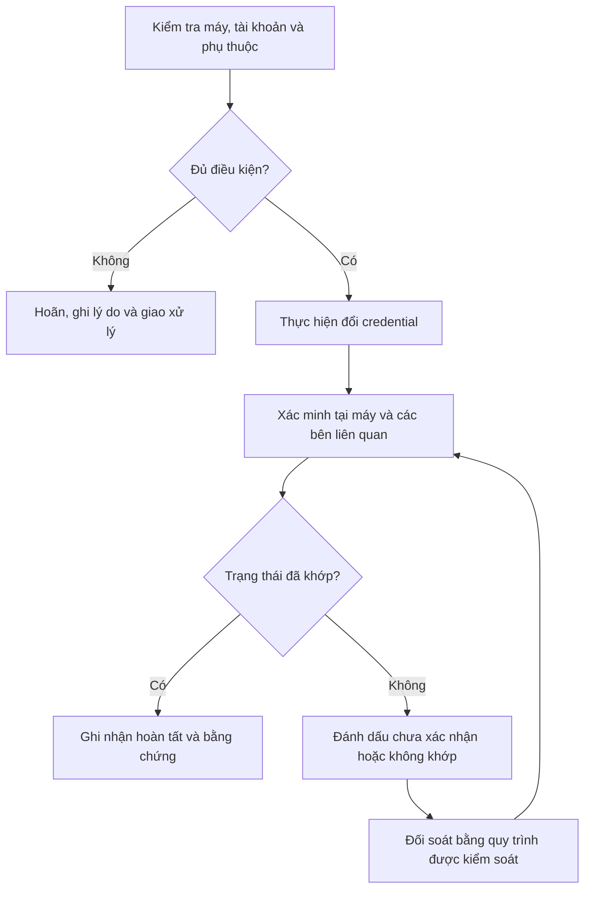

# Local privileged account

## 1. Tài khoản đặc quyền cục bộ là gì?

**Local privileged account**, hay **tài khoản đặc quyền cục bộ**, là tài khoản được quản lý trong phạm vi một hệ thống đích và có quyền quản trị đáng kể trên hệ thống đó. Trong bài học này, hệ thống đích chủ yếu là máy chủ hoặc máy trạm; nguyên tắc quản lý cũng có thể áp dụng cho tài khoản quản trị được lưu riêng trên một thiết bị.

Ví dụ thường gặp là tài khoản `root` trên hệ điều hành kiểu Unix và tài khoản người dùng cục bộ thuộc nhóm quản trị trên Windows. Một tài khoản có tên thông thường vẫn có thể là tài khoản đặc quyền nếu được nâng quyền, sửa cấu hình nhạy cảm hoặc điều khiển một tiến trình chạy với quyền cao.

Trong quản lý truy cập đặc quyền (Privileged Access Management — PAM), chữ “local” mô tả **nơi quản lý danh tính**, không có nghĩa tài khoản chỉ được dùng khi ngồi trước máy. Tùy cấu hình, một tài khoản cục bộ vẫn có thể đăng nhập từ xa, thực hiện quản trị qua mạng hoặc được dùng bởi dịch vụ.

Vấn đề cần giải quyết là xác định mỗi tài khoản thuộc máy nào, ai chịu trách nhiệm, nó thực sự làm được gì, credential được quản lý ra sao và làm thế nào kết thúc khả năng truy cập khi không còn nhu cầu.

Sau bài học trong chương Tài khoản đặc quyền, người học có thể:

- Phân biệt tài khoản cục bộ với tài khoản miền hoặc danh tính liên kết có quyền trên máy.
- Kiểm kê đặc quyền trực tiếp và các đường nâng quyền gián tiếp.
- Quản lý credential riêng theo máy, vault và luân chuyển có kiểm chứng.
- Kết hợp tài khoản cá nhân, JIT, JEA và giám sát phiên.
- Thiết kế truy cập khẩn cấp, thu hồi và xử lý sự cố liên quan đến tài khoản cục bộ.

## 2. Phân biệt nơi quản lý tài khoản và nơi có quyền

Một tài khoản có quyền quản trị trên máy không nhất thiết là tài khoản cục bộ của máy đó. Cần tách hai câu hỏi: “danh tính được quản lý ở đâu?” và “danh tính có quyền ở đâu?”.

| Trường hợp | Nơi quản lý danh tính | Nơi thực thi quyền | Cách hiểu |
| --- | --- | --- | --- |
| Người dùng cục bộ thuộc nhóm quản trị của máy | Hệ thống cục bộ | Máy đó | Tài khoản đặc quyền cục bộ |
| Tài khoản miền được thêm vào nhóm quản trị trên máy | Hệ thống danh tính miền | Máy đó | Danh tính miền có quyền quản trị cục bộ |
| Tài khoản cá nhân được phép nâng quyền trên máy | Có thể là nguồn cục bộ hoặc tập trung | Máy đó | Phải xác định nguồn danh tính và cơ chế nâng quyền |
| Tài khoản cloud quản lý vòng đời máy ảo | Nền tảng cloud | Lớp quản trị cloud | Không tự đồng nghĩa với tài khoản cục bộ bên trong máy |
| Tài khoản cục bộ chạy dịch vụ với quyền cao | Hệ thống cục bộ | Dịch vụ và tài nguyên được cấp | Danh tính máy hoặc dịch vụ cần được quản lý riêng |

Một máy có thể chấp nhận cả danh tính cục bộ và danh tính tập trung. Việc máy được đưa vào quản lý miền không chứng minh các tài khoản cục bộ đã biến mất hoặc mất quyền.

Tương tự, khả năng đăng nhập khi không kết nối được hệ thống nhận dạng trung tâm có thể liên quan đến cơ chế xác thực được lưu đệm. Không nên chỉ dựa vào hiện tượng đăng nhập ngoại tuyến để kết luận đó là tài khoản cục bộ.

### 2.1. Không định danh chỉ bằng tên tài khoản

Hai máy cùng có tài khoản `ops-admin` không có nghĩa đó là một danh tính duy nhất. Mỗi tài khoản có bản ghi, credential, quyền và vòng đời riêng tại hệ thống chứa nó.

Một hồ sơ nên gắn tài khoản với mã định danh ổn định của máy và định danh tài khoản do nền tảng cung cấp. UID hoặc SID có thể hỗ trợ nhận diện trong ngữ cảnh phù hợp; cần hiểu phạm vi của chúng và không dùng riêng một giá trị để định danh toàn bộ tài khoản trên mọi máy.

Tên máy hoặc địa chỉ IP cũng có thể đổi hoặc được tái sử dụng. Nếu máy bị cài lại, cần xác nhận bản ghi PAM còn trỏ đúng hệ thống và tài khoản dự kiến.

## 3. Tài khoản cục bộ trở thành đặc quyền bằng cách nào?

### 3.1. Quyền quản trị trực tiếp

Một tài khoản có thể có quyền quản trị thông qua cơ chế của hệ điều hành, nhóm quản trị hoặc định danh đặc biệt. Trên hệ điều hành kiểu Unix, danh tính có UID bằng 0 cần được xem xét như quyền rất cao, kể cả khi tên không phải `root`.

Trên Windows, thành viên của nhóm quản trị cục bộ cần được đưa vào phạm vi kiểm kê. Quyền hiệu lực của một thao tác còn phụ thuộc vào token, chính sách và ngữ cảnh phiên; tên nhóm không mô tả đầy đủ mọi hành vi thực thi.

### 3.2. Quyền nâng lên danh tính khác

Tài khoản ban đầu có thể đăng nhập với quyền thông thường nhưng được phép chạy một số hoặc mọi tác vụ dưới danh tính đặc quyền. Khả năng này phải được ghi nhận trong PAM, không chỉ quyền tại thời điểm vừa đăng nhập.

Giới hạn nâng quyền cần xem cả hành động, tham số, tài nguyên đích và thành phần phụ thuộc. Cho phép một lệnh quản trị nhưng để người dùng thay script mà lệnh thực thi có thể tạo đường chạy mã tùy ý với quyền cao.

### 3.3. Quyền gián tiếp qua cấu hình, dịch vụ và bí mật

Một tài khoản có thể đạt khả năng tác động đặc quyền nếu được:

- Sửa tệp thực thi, script hoặc cấu hình mà dịch vụ đặc quyền sử dụng.
- Thay tác vụ chạy theo lịch với danh tính có quyền cao.
- Đọc khóa, token hoặc credential của tài khoản quản trị khác.
- Thay cấu hình xác thực hoặc cơ chế cho phép nâng quyền.
- Sửa nơi lưu hoặc thành phần thu thập bằng chứng về hoạt động quản trị.

Không phải mọi quyền ghi tệp đều dẫn tới nâng quyền. Cần xác định tiến trình nào dùng tệp, danh tính thực thi, điều kiện kích hoạt và các biện pháp bảo vệ. Mục tiêu là đánh giá đường tác động cụ thể thay vì kết luận chỉ từ tên quyền.

### 3.4. Tài khoản cục bộ không đồng nghĩa phạm vi ảnh hưởng nhỏ

Một tài khoản quản trị trên một máy có thể tiếp cận dữ liệu, secret, phiên hoặc tài nguyên mạng mà máy đó được phép sử dụng. Nếu credential giống nhau trên nhiều máy, việc lộ một credential còn có thể mở rộng ảnh hưởng sang các máy khác.

Ranh giới tài khoản cục bộ cần được đánh giá cùng các quan hệ tin cậy và tài nguyên mà hệ thống kết nối tới.

## 4. Vì sao tài khoản cục bộ dễ bị bỏ sót?

Tài khoản cục bộ thường phát sinh trong quá trình cài đặt, xử lý sự cố, triển khai phần mềm hoặc hỗ trợ của nhà cung cấp. Chúng có thể không nằm trong luồng cấp và thu hồi danh tính tập trung.

| Nguồn phát sinh | Rủi ro cần chú ý |
| --- | --- |
| Tài khoản được tạo khi cài máy | Credential ban đầu không được thay hoặc không có chủ sở hữu |
| Ảnh hệ thống dùng để nhân bản | Nhiều máy giữ cùng secret hoặc cấu hình đặc quyền ngoài ý muốn |
| Tài khoản hỗ trợ tạm thời | Vẫn tồn tại sau khi nhiệm vụ hoặc hợp đồng kết thúc |
| Tài khoản dùng chung của nhóm vận hành | Khó quy trách nhiệm cho một cá nhân |
| Tài khoản chạy dịch vụ hoặc tác vụ lịch | Việc đổi credential có thể làm hỏng bên phụ thuộc |
| Tài khoản dự phòng | Bị bỏ quên vì ít sử dụng, hoặc được dùng như tài khoản hằng ngày |
| Máy không thường xuyên kết nối mạng | Khó đồng bộ chính sách, luân chuyển và xác nhận thu hồi |
| Máy được khôi phục hoặc cài lại | Bản ghi PAM và trạng thái credential có thể không còn khớp |

Một danh sách máy “đã được quản lý” không đủ chứng minh mọi tài khoản đặc quyền cục bộ trên các máy đó đã được kiểm kê. Cần biết loại tài khoản nào được phát hiện, quyền nào được xem xét và thời điểm dữ liệu được cập nhật.

## 5. Kiểm kê theo bộ ba máy, tài khoản và credential

### 5.1. Hồ sơ tối thiểu

| Thông tin | Mục đích |
| --- | --- |
| Định danh máy và môi trường | Tránh nhầm máy cùng tên hoặc địa chỉ được tái sử dụng |
| Định danh và tên tài khoản | Liên kết bản ghi đúng đối tượng trong hệ điều hành |
| Nguồn danh tính | Phân biệt cục bộ, miền hoặc nguồn nhận dạng khác |
| Loại sử dụng | Quản trị cá nhân, dùng chung, dịch vụ hoặc khẩn cấp |
| Chủ sở hữu và người xác nhận nhu cầu | Xác định trách nhiệm và quyết định vòng đời |
| Quyền trực tiếp và đường nâng quyền | Biết khả năng tác động thực tế |
| Phương thức truy cập | Console, giao thức từ xa, nâng quyền hoặc tác vụ tự động |
| Credential và nơi quản lý | Biết secret nào cần bảo vệ, đổi hoặc thu hồi |
| Các bên phụ thuộc | Tránh làm hỏng dịch vụ khi thay đổi tài khoản |
| Trạng thái và thời điểm kiểm tra | Phân biệt dữ liệu hiện tại với bản ghi đã cũ |
| Log và khả năng quy trách nhiệm | Biết hoạt động có thể được đối chiếu đến người yêu cầu không |

Không lưu giá trị mật khẩu hoặc khóa riêng trực tiếp trong bảng kiểm kê. Bảng có thể giữ mã tham chiếu tới đối tượng được quản lý trong vault, với quyền đọc được kiểm soát.

### 5.2. Đối chiếu nhiều nguồn

Kết quả phát hiện tại máy, danh sách trong PAM, dữ liệu vault và nhu cầu từ chủ sở hữu có thể khác nhau. Ví dụ, PAM vẫn giữ bản ghi cho một tài khoản đã bị xóa, trong khi máy vừa có thêm tài khoản hỗ trợ chưa được đăng ký.

Cần có cách phát hiện sai lệch, xác nhận nguyên nhân và cập nhật theo quy trình. Không tự động coi một tài khoản lạ là hợp lệ chỉ vì nó có trên máy, cũng không xóa ngay một tài khoản chưa rõ mục đích nếu chưa đánh giá ảnh hưởng vận hành.

### 5.3. Xác định điều kiện hoàn tất kiểm kê

Một tài khoản được xem là có hồ sơ quản lý khi biết được:

1. Nó thuộc đúng hệ thống nào.
2. Ai chịu trách nhiệm và vì sao còn cần.
3. Nó có những quyền nào, kể cả gián tiếp.
4. Ai hoặc dịch vụ nào sử dụng credential.
5. Cách truy cập, quan sát và kết thúc quyền.
6. Lần gần nhất thông tin được xác nhận.

Nếu chỉ biết tên và mật khẩu đang nằm trong vault, hồ sơ vẫn thiếu nhiều phần của quản lý đặc quyền.

## 6. Chọn mô hình sử dụng tài khoản

### 6.1. Danh tính cá nhân và nâng quyền theo nhiệm vụ

Khi nền tảng cho phép, người quản trị nên bắt đầu từ danh tính cá nhân có thể quy trách nhiệm rồi nhận quyền phù hợp nhiệm vụ. Tài khoản cá nhân không cần luôn mang quyền quản trị toàn máy.

JIT có thể cấp quyền khi có yêu cầu và kết thúc sau thời gian xác định. JEA giới hạn tác vụ được thực hiện, chẳng hạn chỉ xem trạng thái và khởi động lại một dịch vụ.

Nếu nhiệm vụ đòi hỏi quyền rộng hơn, cần làm rõ lý do, phạm vi, thời hạn và bằng chứng. Không nên dùng một ngoại lệ không có hạn để thay cho thiết kế quyền.

### 6.2. Tài khoản quản trị đích dùng chung

Một số hệ thống hoặc công cụ vẫn cần tài khoản quản trị đích dùng chung. PAM có thể môi giới truy cập để liên kết từng yêu cầu với người dùng cá nhân và giảm nhu cầu tiết lộ credential.

Tuy nhiên, nếu mọi người vẫn biết mật khẩu và đăng nhập trực tiếp ngoài PAM, bản ghi “ai đã mở phiên PAM” không chứng minh được ai đã thực hiện mọi hành động của tài khoản đích. Cần kiểm soát đường truy cập thay thế, việc xem secret và thời gian credential còn hiệu lực.

### 6.3. Tài khoản dịch vụ

Tài khoản cục bộ dùng bởi dịch vụ nên có danh tính và quyền dành cho tác vụ đó. Không dùng cùng một credential cho cả dịch vụ nền và quản trị tương tác nếu có thể tách trách nhiệm.

Đối với dịch vụ, phải kiểm kê phụ thuộc trước khi đổi credential hoặc khóa tài khoản. Luồng xin quyền của con người không nên được sao chép nguyên trạng thành yêu cầu phê duyệt thủ công cho mọi lần dịch vụ chạy.

### 6.4. Tài khoản khẩn cấp

Tài khoản dự phòng phục vụ khôi phục cần được phân loại riêng với tài khoản hằng ngày. Nó cần điều kiện sử dụng, chủ sở hữu, phương án bảo quản và bằng chứng sau sử dụng; không nên để credential dự phòng trở thành bí mật được chia sẻ rộng trong nhóm vận hành.

## 7. Quản lý credential riêng theo máy

### 7.1. Tránh dùng một secret cho cả nhóm máy

Nếu nhiều tài khoản quản trị cục bộ dùng cùng mật khẩu, việc lộ một secret có thể ảnh hưởng đến nhiều hệ thống. Khi cần thay đổi, tổ chức cũng phải phối hợp đổi ở nhiều nơi và khó xác định nơi còn dùng secret cũ.

Nguyên tắc thực tế là quản lý credential riêng cho từng tài khoản trên từng máy, trong phạm vi cơ chế được nền tảng hỗ trợ. Hai tài khoản cùng tên trên hai máy vẫn cần hai đối tượng quản lý rõ ràng.

Đổi tên tài khoản không thay thế việc bảo vệ credential và quyền. Danh tính có thể vẫn được nhận diện theo định danh của hệ điều hành hoặc được phát hiện qua cấu hình và hành vi.

### 7.2. Không chỉ có mật khẩu

Một tài khoản có thể được truy cập bằng mật khẩu, khóa công khai, chứng chỉ hoặc cơ chế khác. Nếu chỉ đổi mật khẩu mà bỏ qua khóa đăng nhập còn được cho phép, khả năng truy cập có thể vẫn tồn tại.

Hồ sơ cần ghi nhận các phương thức đang được chấp nhận và người hoặc công cụ kiểm soát phương tiện xác thực tương ứng. Với khóa hoặc chứng chỉ, cần xác định cách loại bỏ quyền sử dụng và cách xử lý phiên đã được thiết lập.

Vật liệu xác thực có thể bị lạm dụng mà người tấn công không cần biết giá trị mật khẩu dưới dạng rõ, tùy cơ chế. Vì vậy, bảo vệ credential bao gồm cả nơi lưu, bộ nhớ, tệp cấu hình và thiết bị quản trị, không chỉ màn hình hiển thị mật khẩu.

### 7.3. Vault bảo quản và kiểm soát truy cập

Vault có thể hỗ trợ:

- Lưu bí mật với quyền truy cập và nhật ký phù hợp.
- Liên kết credential với đúng máy và tài khoản.
- Cấp credential hoặc đưa credential vào luồng kết nối theo cách triển khai.
- Đổi credential và kiểm tra lại theo chính sách.
- Ghi nhận ai yêu cầu, xem hoặc sử dụng đối tượng quản lý.

Cần giới hạn quyền quản trị vault và quyền lấy credential trên nhiều máy. Một danh tính được đọc mọi secret cục bộ có thể tạo phạm vi ảnh hưởng rất lớn, dù từng tài khoản đích chỉ thuộc một máy.

## 8. Luân chuyển credential là một quy trình có trạng thái

### 8.1. Hai nơi cần đồng bộ

Khi PAM quản lý mật khẩu tài khoản cục bộ, ít nhất có hai trạng thái liên quan: giá trị được máy đích chấp nhận và giá trị mà vault quản lý. Việc thay đổi có thể thành công ở một nơi nhưng thất bại hoặc chưa được xác nhận ở nơi còn lại.

Vì vậy, kết quả “đã gửi lệnh đổi” không đủ để kết luận luân chuyển thành công. Cần có bước xác minh đúng tài khoản, đúng máy và đúng trạng thái credential.

### 8.2. Trình tự minh họa

1. **Kiểm tra điều kiện:** xác nhận máy đích, tài khoản, kết nối và quyền thực hiện thay đổi.
2. **Đánh giá phụ thuộc:** xác định dịch vụ, tác vụ lịch hoặc công cụ đang dùng credential.
3. **Chuẩn bị thay đổi:** tạo và xử lý secret theo cơ chế bảo vệ của hệ thống quản lý.
4. **Đổi tại đích:** áp dụng credential mới bằng luồng được hỗ trợ.
5. **Xác minh:** kiểm tra khả năng sử dụng credential theo cách không làm lộ secret hoặc gây khóa tài khoản không cần thiết.
6. **Đồng bộ các bên liên quan:** cập nhật bên phụ thuộc và xác nhận hoạt động nếu có.
7. **Kết thúc:** ghi nhận credential đang được quản lý, kết quả và thời điểm xác minh.

Trình tự nội bộ và cơ chế khôi phục có thể khác nhau giữa sản phẩm. Điều cần đạt là trạng thái nhất quán được kiểm chứng, không phải áp dụng nguyên một chuỗi thao tác cho mọi nền tảng.



### 8.3. Đối soát khi vault và máy đích không khớp

Các nguyên nhân có thể gồm máy mất mạng, người quản trị đổi ngoài PAM, máy được khôi phục từ ảnh cũ hoặc công cụ chưa hoàn tất cập nhật. Trạng thái chưa xác nhận cần được hiển thị riêng, không ghi thành thành công.

Quy trình đối soát cần xác định ai được phép đặt lại credential, dùng danh tính nào và làm thế nào tránh ảnh hưởng dịch vụ. Tài khoản hoặc connector có quyền đặt lại credential cũng là một tài sản đặc quyền cần giới hạn và giám sát.

Không nên tự động quay về một secret cũ đã bị nghi lộ chỉ để làm cho hai bên “khớp”. Khi cần khôi phục khả năng quản lý, phải dùng một giá trị và quy trình phù hợp với tình trạng an toàn của hệ thống.

### 8.4. Không nhầm đổi mật khẩu với kết thúc mọi truy cập

Đổi mật khẩu có thể ngăn lần xác thực tiếp theo bằng mật khẩu cũ. Nó không bảo đảm đóng mọi phiên, dừng mọi tiến trình hoặc vô hiệu hóa khóa và token đã được sử dụng.

Nếu mục tiêu là kết thúc truy cập sau phiên quản trị hoặc sau sự cố, cần xử lý cả những trạng thái đó bằng cơ chế thích hợp của hệ điều hành và hệ thống liên quan.

## 9. Ví dụ: một tài khoản quản trị cục bộ cho máy ứng dụng

### 9.1. Bối cảnh

Máy `app-07` có tài khoản cục bộ `local-ops` với quyền quản trị. Trước đây nhóm hỗ trợ dùng chung mật khẩu, và cùng mật khẩu này còn xuất hiện trên một số máy khác. Khi một kỹ sư nghỉ việc, tổ chức không biết người đó còn giữ bản sao credential ở đâu.

Mục tiêu quản lý gồm tách credential theo máy, gắn truy cập với cá nhân và kiểm soát thời gian sử dụng đặc quyền.

### 9.2. Hồ sơ thiết kế

| Thành phần | Quyết định minh họa |
| --- | --- |
| Hệ thống | `app-07`, có định danh tài sản ổn định trong kiểm kê |
| Tài khoản đích | `local-ops`, được xác nhận là tài khoản cục bộ |
| Chủ sở hữu | Nhóm vận hành ứng dụng |
| Mục đích | Các thao tác quản trị đã được xác định trên máy |
| Credential | Riêng cho tài khoản trên máy này, được quản lý trong vault |
| Người yêu cầu | Xác thực bằng danh tính cá nhân tại PAM |
| Phạm vi | Ưu tiên tác vụ đủ dùng; quyền rộng là ngoại lệ có lý do |
| Thời hạn | Ví dụ phiên được duyệt tối đa 30 phút |
| Đường truy cập | Luồng được kiểm soát; các đường trực tiếp được rà soát riêng |
| Bằng chứng | Người yêu cầu, ticket, tài khoản đích, phiên, hành động và kết thúc |

Thời lượng 30 phút chỉ minh họa. Quyền cần thiết và thời gian phải được chọn theo nhiệm vụ. Một phiên toàn quyền ngắn vẫn có tác động lớn, nên không thể dùng thời hạn để thay thế việc thu hẹp hành động.

### 9.3. Mô hình đối tượng quản lý

Đoạn JSON dưới đây diễn đạt thông tin cần liên kết. Đây là **mô hình minh họa**, không phải cấu hình thực thi của một sản phẩm PAM và không chứa giá trị secret.

```json
{
  "assetId": "asset-app-07",
  "account": {
    "name": "local-ops",
    "identitySource": "local",
    "purpose": "host-administration"
  },
  "owner": "application-operations",
  "credential": {
    "vaultObjectRef": "managed-credential-app-07-local-ops",
    "uniqueToAccountAndHost": true
  },
  "access": {
    "requesterAttribution": "individual",
    "requireApprovedTask": true,
    "maxSessionMinutes": 30
  },
  "evidence": [
    "request",
    "targetIdentity",
    "session",
    "rotationResult",
    "revocationResult"
  ]
}
```

Tên máy và tài khoản không đủ để bảo đảm ánh xạ đúng. Khi triển khai, cần đối chiếu định danh thực tế, nhất là sau khi máy được cài lại hoặc tên được tái sử dụng.

### 9.4. Luồng vận hành

Kỹ sư gửi yêu cầu gắn với ticket và nhiệm vụ. PAM kiểm tra điều kiện, rồi mở luồng quản trị được hỗ trợ. Nếu có thể thực hiện tác vụ bằng quyền hẹp hơn, nên cấp theo tác vụ thay vì mặc nhiên dùng toàn quyền của `local-ops`.

Khi kết thúc, hệ thống xử lý phiên, quyền tạm và credential theo chính sách. Nếu credential đã được tiết lộ, cần xem xét thay đổi nó vì người dùng có thể đã giữ bản sao. Việc thay đổi phải qua quy trình xác minh, không chỉ dựa vào thao tác “trả credential” trên giao diện.

Cuối cùng, đối chiếu bằng chứng từ PAM và máy đích để xác nhận người thao tác, hành động và kết quả. Nếu còn đường đăng nhập trực tiếp bằng credential khác, phải xử lý đường đó trong phạm vi kiểm soát.

## 10. Thu hồi đặc quyền phải xét cả quyền gán và phiên

### 10.1. Cấp quyền không phải lúc nào cũng có hiệu lực ngay

Một số quyền được đưa vào ngữ cảnh đăng nhập hoặc token khi phiên bắt đầu. Thay đổi thành viên nhóm có thể cần một phiên mới hoặc cơ chế làm mới để được phản ánh đầy đủ.

Khi cấp JIT bằng cách thêm người dùng vào nhóm quản trị, cần kiểm chứng tác vụ thực tế đã nhận đúng quyền và không nhận nhiều quyền hơn yêu cầu.

### 10.2. Gỡ quyền không phải lúc nào cũng kết thúc quyền đã dùng

Tương tự, gỡ nhóm hoặc xóa một quy tắc nâng quyền có thể không làm mọi tiến trình đang chạy mất quyền ngay. Một tiến trình đã được khởi chạy với quyền cao có thể tiếp tục tồn tại theo hành vi của hệ điều hành.

| Thay đổi | Điều cần kiểm chứng thêm |
| --- | --- |
| Gỡ thành viên nhóm quản trị | Các phiên hiện có còn mang ngữ cảnh quyền cũ không? |
| Thu hồi quyền nâng lên danh tính khác | Có tiến trình đã nâng quyền còn chạy không? |
| Khóa tài khoản | Có chặn mọi phương thức đăng nhập dự kiến không, phiên cũ xử lý ra sao? |
| Đổi mật khẩu | Khóa, chứng chỉ hoặc phiên đang dùng còn hiệu lực không? |
| Ngắt phiên PAM | Có phiên trực tiếp hoặc tác vụ nền ngoài phạm vi PAM không? |

Không có một thao tác chung bảo đảm kết thúc mọi dạng truy cập trên mọi hệ điều hành. Thiết kế cần liệt kê khả năng đang tồn tại và cách xác nhận hiệu lực tại máy đích.

### 10.3. Giới hạn hành động phải thực thi được

Nếu chính sách chỉ cho khởi động lại một dịch vụ nhưng cơ chế triển khai lại cấp shell toàn quyền, giới hạn mới tồn tại trên giấy. Cần một endpoint, công cụ hoặc cơ chế hệ điều hành có thể thực thi đúng phạm vi.

Đồng thời kiểm soát tham số, quyền sửa script, đường dẫn thực thi và cấu hình phụ thuộc. Một thao tác được đặt tên “an toàn” vẫn có thể quá rộng nếu người gọi điều khiển được những thành phần đó.

## 11. Máy ngoại tuyến và truy cập khẩn cấp

### 11.1. Không đồng nhất mất mạng với mất mọi khả năng truy cập

Máy có thể không liên lạc được với PAM hoặc hệ thống nhận dạng trung tâm nhưng vẫn cho đăng nhập cục bộ theo cấu hình. Điều này có thể hữu ích cho khôi phục, đồng thời làm cho việc đổi credential hoặc thu hồi từ xa chưa có hiệu lực.

Bản ghi quản lý cần phân biệt máy không kết nối được, tài khoản bị khóa và trạng thái chưa xác minh. Không được báo luân chuyển thành công chỉ vì công việc đã được đưa vào hàng đợi.

### 11.2. Chuẩn bị đường khôi phục

Phương án khẩn cấp cần xác định:

- Ai được phép sử dụng và trong tình huống nào.
- Cách lấy phương tiện truy cập khi dịch vụ chính không hoạt động.
- Credential thuộc đúng máy và trạng thái gần nhất đã xác nhận.
- Cách thu thập bằng chứng còn khả dụng khi mất kết nối.
- Cách đưa máy về luồng quản lý, đối soát credential và kết thúc quyền sau sự cố.

Không nên tạo một credential dự phòng chung cho toàn bộ nhóm máy chỉ để đơn giản hóa khôi phục. Cũng không nên đặt toàn bộ thông tin khôi phục vào một nơi chỉ có thể mở bằng chính hệ thống đang bị lỗi.

Nếu log chỉ được lưu cục bộ trong thời gian ngoại tuyến, cần đánh giá khả năng bị sửa khi tài khoản quản trị toàn máy được sử dụng. Khi kết nối trở lại, việc chuyển log không tự chứng minh các bản ghi chưa từng bị can thiệp.

## 12. Quản lý từ khi tạo máy đến khi loại bỏ

### 12.1. Khi triển khai máy mới

Ảnh mẫu không nên làm phát tán một secret quản trị cố định sang mọi máy. Quy trình triển khai cần tạo hoặc thiết lập credential riêng, đăng ký đúng máy và xác nhận trạng thái quản lý trước khi đưa vào sử dụng theo yêu cầu vận hành.

Các cơ chế khởi tạo, script và quyền được phép đọc secret ban đầu cũng cần được bảo vệ. Chỉ đưa secret ra khỏi ảnh mẫu nhưng ghi nó vào log triển khai vẫn tạo điểm lộ khác.

### 12.2. Khi thay đổi người hoặc nhóm vận hành

Thu hồi quyền yêu cầu phiên, quyền xem secret và quyền quản trị vault của người không còn nhiệm vụ. Nếu họ từng biết credential dùng chung, cần xử lý khả năng họ vẫn giữ bản sao, không chỉ xóa tên khỏi danh sách phê duyệt.

Đồng thời chuyển giao chủ sở hữu và xác nhận các tác vụ dịch vụ còn cần thiết.

### 12.3. Khi cài lại hoặc khôi phục máy

Máy được khôi phục có thể mang trạng thái tài khoản và secret từ thời điểm cũ. Cần đối chiếu lại định danh, quyền và credential với PAM trước khi coi trạng thái trước đó vẫn đúng.

Việc cài lại một máy rồi dùng lại tên cũ không bảo đảm các bản ghi và quyền truy cập đã tự ánh xạ đúng.

### 12.4. Khi loại bỏ hệ thống

Ngừng các đường truy cập, xử lý tài khoản và đối tượng credential theo quy trình loại bỏ. Bằng chứng lịch sử và thông tin cần cho khôi phục được lưu theo chính sách phù hợp, với quyền xem được giới hạn.

Không xóa vội đối tượng vault khi vẫn còn nhu cầu khôi phục được phê duyệt; cũng không giữ secret hoạt động vô thời hạn chỉ vì “có thể cần sau này”.

## 13. Ứng phó khi credential hoặc tài khoản bị lạm dụng

Đầu tiên xác định đúng máy, tài khoản, thời điểm, các phương thức xác thực và nơi có thể đang dùng credential. Nếu secret được dùng lại, phạm vi điều tra phải tính đến những máy khác có cùng secret.

Biện pháp ngăn chặn có thể gồm chặn truy cập mới, xử lý phiên đang tồn tại, đổi hoặc vô hiệu hóa credential và cô lập hệ thống theo nhu cầu ứng phó. Cần đánh giá tác động tới dịch vụ và sử dụng đường quản trị tin cậy.

Nếu kẻ tấn công đã có quyền quản trị toàn máy, không nên cho rằng đổi mật khẩu là đủ để khôi phục sự tin cậy. Cần kiểm tra:

- Tài khoản, nhóm hoặc phương thức đăng nhập mới.
- Quy tắc nâng quyền, dịch vụ và tác vụ lịch bị thay đổi.
- Khóa, secret hoặc credential khác có thể đã bị lấy.
- Mã và cấu hình đặc quyền bị sửa.
- Log hoặc công cụ giám sát bị can thiệp.
- Tài nguyên ngoài máy mà danh tính trên máy có thể tiếp cận.

Tùy mức độ xâm nhập, có thể cần phục hồi hoặc xây dựng lại từ nguồn được xác minh, cùng việc thay các bí mật liên quan. Thu thập và bảo vệ bằng chứng trước các thao tác có thể làm mất dữ liệu cần điều tra, theo quy trình ứng phó của tổ chức.

Sau khắc phục, xác nhận lại quyền thực tế, các phiên còn sống, trạng thái credential và kết nối với PAM. Kết luận hoàn tất phải dựa trên kết quả đã kiểm chứng, không chỉ danh sách lệnh đã gửi.

## 14. Bằng chứng và chỉ số theo dõi

### 14.1. Chuỗi bằng chứng cần nối được

**Danh tính người hoặc workload yêu cầu → máy và tài khoản đích → quyết định cấp → phiên hoặc tác vụ → hành động → thu hồi hoặc luân chuyển.**

Bằng chứng cần có mã định danh, thời gian có thể đối chiếu, phạm vi và kết quả. Nếu PAM ghi ai mở phiên nhưng máy chỉ ghi một tài khoản dùng chung, cần có thuộc tính giúp liên kết hai nguồn.

Giới hạn người được đọc, xuất hoặc xóa bằng chứng. Log và bản ghi phiên có thể chứa dữ liệu nhạy cảm; không nên lưu giá trị secret rõ chỉ để chứng minh rằng một thao tác đã xảy ra.

### 14.2. Chỉ số có thể sử dụng

| Chỉ số | Ý nghĩa |
| --- | --- |
| Tài khoản đặc quyền cục bộ chưa có chủ sở hữu | Khoảng trống trách nhiệm |
| Tài khoản dùng credential trùng trên nhiều máy | Phạm vi có thể bị ảnh hưởng khi một secret lộ |
| Credential quá hạn theo chính sách hoặc chưa xác minh | Khoảng trống trong vòng đời secret |
| Lần đổi bị lỗi hoặc trạng thái vault và máy không khớp | Chất lượng đồng bộ và đối soát |
| Phiên không gắn được với cá nhân hoặc workload | Khả năng quy trách nhiệm chưa đầy đủ |
| Đường truy cập trực tiếp ngoài luồng được kiểm soát | Khả năng bỏ qua PAM |
| Thời gian từ quyết định thu hồi đến khi mất quyền thực tế | Hiệu quả kết thúc truy cập |
| Tác vụ dịch vụ bị ảnh hưởng bởi đổi credential | Mức đầy đủ của kiểm kê phụ thuộc |
| Lần sử dụng tài khoản khẩn cấp và kết quả rà soát | Mức phụ thuộc vào ngoại lệ |

Tỷ lệ cần kèm phạm vi và mẫu số rõ ràng. Một máy đã đăng ký PAM không đồng nghĩa mọi tài khoản cục bộ trên máy đã được quản lý hoặc mọi phiên đều có thể thu hồi ngay.

## 15. Sai lầm cần tránh

| Cách làm | Vì sao chưa đủ | Hướng xử lý |
| --- | --- | --- |
| Dùng một mật khẩu quản trị cho cả nhóm máy | Lộ một secret có thể ảnh hưởng nhiều máy | Credential riêng theo máy và tài khoản |
| Chỉ đổi tên tài khoản đặc biệt | Quyền và vật liệu xác thực vẫn còn | Quản lý quyền, credential và đường sử dụng |
| Khóa đăng nhập bằng mật khẩu rồi coi là hết mọi truy cập | Khóa, phiên hoặc tiến trình khác có thể tồn tại | Kiểm kê mọi phương thức và xác nhận thu hồi |
| Đổi credential mà không tìm bên phụ thuộc | Dịch vụ hoặc tác vụ lịch có thể ngừng hoạt động | Kiểm kê, phối hợp cập nhật và kiểm tra kết quả |
| Cất secret vào vault rồi giữ nguyên mọi quyền | Bảo quản tốt hơn nhưng phạm vi tác động vẫn rộng | Thu hẹp quyền, JIT và kiểm soát hành động |
| Chỉ xóa tài khoản nhân sự khỏi PAM | Người đó có thể đã biết secret đích | Xử lý credential đã lộ và các đường đăng nhập khác |
| Báo đổi mật khẩu thành công khi máy đang ngoại tuyến | Chưa xác minh trạng thái tại đích | Phân biệt đã yêu cầu, chưa xác nhận và hoàn tất |
| Ghi hình phiên thay cho giới hạn quyền | Hành động nguy hiểm vẫn có thể được thực hiện | Thực thi quyền tại đích và dùng bằng chứng để bổ sung |

## 16. Thực hành lập hồ sơ và vòng đời

Giả sử có ba máy ứng dụng cùng tài khoản cục bộ `support-admin`, một máy chạy tác vụ sao lưu bằng tài khoản đó, và nhà cung cấp đang giữ mật khẩu để hỗ trợ.

Hãy đề xuất:

1. Cách tách ba danh tính theo máy và xác nhận định danh.
2. Chủ sở hữu, nhu cầu và quyền đủ dùng của từng tài khoản.
3. Cách thay credential dùng chung bằng credential riêng.
4. Phương án tách tác vụ sao lưu và kiểm tra phụ thuộc trước thay đổi.
5. Luồng truy cập của nhà cung cấp có thời hạn và khả năng quy trách nhiệm.
6. Cách thu hồi khi kết thúc hỗ trợ, kể cả credential đã được tiết lộ.
7. Phương án xử lý một máy ngoại tuyến và việc đối soát khi máy kết nối lại.
8. Bằng chứng để xác nhận trạng thái cuối cùng.

Nếu không biết dịch vụ nào dùng credential hoặc phiên nào còn sống, hãy ghi nhận đó là phần chưa kiểm kê được. Không dùng trạng thái “đã đưa vào vault” để thay cho việc trả lời những câu hỏi này.

## 17. Ghi nhớ

Tài khoản đặc quyền cục bộ được quản lý tại hệ thống đích nhưng có thể được dùng từ xa và ảnh hưởng tới tài nguyên ngoài máy. Quản lý PAM cần gắn rõ máy, tài khoản, chủ sở hữu, quyền và mọi phương thức truy cập.

Credential riêng, vault, JIT, JEA và giám sát chỉ có giá trị khi kết hợp với kiểm kê phụ thuộc, kiểm soát đường truy cập và xác nhận thu hồi tại đích. Việc đổi một mật khẩu hoặc gỡ một nhóm không tự chứng minh mọi phiên và khả năng sử dụng đặc quyền đã kết thúc.
