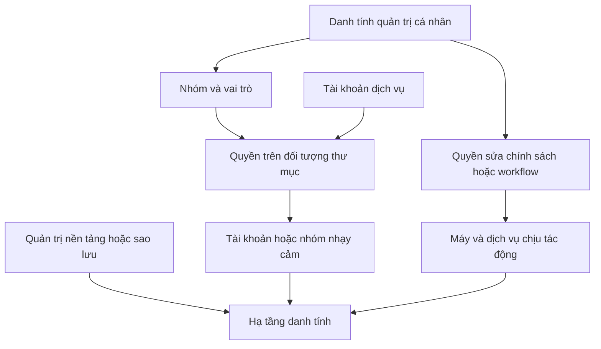

# Domain privileged account

## Mục tiêu bài học

Trong chương **Tài khoản đặc quyền**, bài học này giải thích tài khoản đặc quyền trong một miền quản trị danh tính, với **Active Directory Domain Services — AD DS** làm ví dụ chính. Nội dung thuộc module `SECURITY_IDENTITY_ACCESS_MANAGEMENT_PRIVILEGED_ACCESS_MANAGEMENT`, tập trung kiểm soát quyền quản trị, tài khoản dịch vụ và hạ tầng nhạy cảm.

Sau bài học, bạn có thể:

- Phân biệt tài khoản domain thông thường, tài khoản quản trị cục bộ và tài khoản có đặc quyền trong domain.
- Nhận diện quyền trực tiếp, quyền được ủy quyền và đường tác động gián tiếp tới tầng danh tính.
- Xác định phạm vi kiểm kê vượt ra ngoài một nhóm có tên quản trị.
- Thiết kế truy cập theo least privilege, JIT/JEA, vault và giám sát phù hợp.
- Giải thích vì sao đổi mật khẩu hoặc xóa thành viên nhóm chưa đủ để kết luận truy cập đã bị thu hồi.

## 1. Domain privileged account là gì?

**Domain privileged account** là tài khoản có khả năng quản trị hoặc tác động đáng kể đến các đối tượng, chính sách, dịch vụ hoặc tài nguyên trong một domain. Tài khoản có thể nhận đặc quyền trực tiếp qua nhóm, được ủy quyền trên một tập đối tượng, hoặc có khả năng điều khiển một thành phần nắm quyền cao hơn.

Trong AD DS, domain là một miền của hệ thống thư mục và quản trị danh tính. Nó không chỉ là tên DNS. Tài khoản có tên dạng domain không tự có nghĩa là tài khoản đó có quyền quản trị.

Ví dụ:

- Tài khoản nhân viên dùng để đăng nhập vào ứng dụng nội bộ có thể là tài khoản domain thông thường.
- Tài khoản được ủy quyền đặt lại mật khẩu cho một nhóm người dùng có đặc quyền trong phạm vi được ủy quyền.
- Tài khoản có quyền sửa chính sách áp dụng lên nhiều máy có thể tác động gián tiếp đến các máy đó.
- Tài khoản quản trị domain controller hoặc kiểm soát thành phần phục hồi tầng danh tính có mức nhạy cảm rất cao.

Câu hỏi quyết định là **tài khoản có thể làm gì và tác động tới đâu**, thay vì tên tài khoản có hậu tố `admin` hay không.

## 2. Phân biệt những khái niệm dễ nhầm

| Khái niệm | Phạm vi ý nghĩa | Điểm cần chú ý |
|---|---|---|
| Domain account | Tài khoản được quản lý trong domain | Có thể là người dùng thông thường hoặc có đặc quyền |
| Local administrative account | Tài khoản hoặc chủ thể có quyền quản trị trên một máy cụ thể | Quyền trên máy có thể tạo đường tiếp cận credential hoặc phiên của người khác |
| Domain privileged account | Tài khoản có quyền nhạy cảm trong domain hoặc trên tài nguyên do domain quản lý | Phải đánh giá quyền hiệu lực và đường tác động |
| Domain Admins | Một nhóm đặc quyền trong AD DS | Thành viên nhóm không phải là toàn bộ tập danh tính có rủi ro đặc quyền |
| Forest-level administrative account | Tài khoản có quyền ở tầng forest, chẳng hạn qua vai trò quản trị forest | Phạm vi khác với công việc quản trị một tập đối tượng trong một domain |
| Domain controller — DC | Máy chủ thực hiện các chức năng thư mục và xác thực của AD DS | Quyền kiểm soát DC gắn với an toàn của tầng danh tính |

Một tài khoản domain có thể được cấp quyền quản trị cục bộ trên một nhóm máy mà không phải thành viên Domain Admins. Ngược lại, một tài khoản có quyền quản trị đối tượng thư mục không nhất thiết cần quyền quản trị mọi máy chủ ứng dụng.

Với AD DS, không nên xem các domain trong cùng forest là những vùng cô lập bảo mật tuyệt đối. Thiết kế cần xét quyền cấp forest, quan hệ tin cậy và các thành phần quản trị chung. Việc phân chia domain không tự chứng minh một sự cố đã bị giới hạn trong một vùng.

## 3. Vì sao loại tài khoản này cần kiểm soát chặt?

Một domain thường kết nối danh tính với nhiều hệ thống. Nếu một tài khoản có thể thay đổi nhóm, chính sách hoặc credential của tài khoản khác, tác động của nó có thể lớn hơn quyền trên một ứng dụng đơn lẻ.

Các nhóm khả năng có tác động lớn gồm:

- Thay đổi danh tính: tạo tài khoản, đặt lại credential hoặc sửa thuộc tính nhạy cảm.
- Thay đổi quyền: quản lý nhóm đặc quyền, chỉnh quyền trên đối tượng hoặc cơ chế ủy quyền.
- Thay đổi chính sách: sửa cấu hình có hiệu lực trên người dùng hoặc máy tính.
- Điều khiển hạ tầng danh tính: quản trị DC, hệ thống quản lý, bản sao lưu hoặc nền tảng chạy DC.
- Tiếp cận dữ liệu nhạy cảm: đọc dữ liệu thư mục, bản sao lưu hoặc vật liệu xác thực ngoài nhu cầu.
- Tạo đường duy trì truy cập: thêm danh tính, credential hoặc cấu hình cho phép tiếp tục truy cập sau khi tài khoản ban đầu bị xử lý.

Mức tác động tùy quyền và kiến trúc thực tế. Không phải mọi tài khoản được ủy quyền trên một OU đều có thể kiểm soát toàn domain. Tuy nhiên, cũng không nên đánh giá thấp một quyền có phạm vi hẹp nếu nó chạm tới một danh tính hoặc thành phần rất quan trọng.

## 4. Các dạng đặc quyền cần đưa vào phạm vi

### 4.1. Thành viên nhóm đặc quyền

Đây là nhóm dễ nhận diện nhất: tài khoản nhận quyền qua một nhóm quản trị hoặc vai trò có tác động lớn. Cần xét cả thành viên trực tiếp và các quan hệ nhóm lồng nhau được hệ thống áp dụng.

Tên nhóm giúp định hướng kiểm kê, nhưng quyền mặc định có thể đã bị thay đổi. Một nhóm do tổ chức tự tạo cũng có thể nắm quyền tương đương hoặc tạo đường tới nhóm quản trị khác.

### 4.2. Quyền được ủy quyền trên đối tượng thư mục

Một nhóm hỗ trợ có thể được phép đặt lại mật khẩu hoặc quản lý một số đối tượng trong một Organizational Unit — OU. Đây là cách giảm nhu cầu cấp quản trị toàn domain.

Tuy nhiên, cần kiểm tra chính xác:

- Những đối tượng nào thuộc phạm vi hiệu lực?
- Quyền được thừa kế theo cách nào và có ngoại lệ nào?
- Có thể sửa thành viên nhóm nhạy cảm hoặc thông tin phục hồi của tài khoản quản trị không?
- Có thể đổi chủ sở hữu hoặc quyền truy cập của đối tượng để mở rộng quyền không?
- Khi di chuyển đối tượng hoặc thay đổi cấu trúc OU, phạm vi ủy quyền có thay đổi không?

Không nên giả định mọi đối tượng trong một OU đều tuân theo cùng một cơ chế thừa kế. Cần xác minh quyền hiệu lực của đối tượng nhạy cảm theo cấu hình thực tế.

### 4.3. Quyền quản lý chính sách và công cụ tự động hóa

Group Policy Object — GPO có thể ảnh hưởng đến nhiều người dùng hoặc máy tính khi được liên kết và áp dụng. Khả năng sửa nội dung GPO và khả năng quản lý liên kết/phạm vi là những quyền cần được xem xét riêng.

Một GPO không được áp dụng không tự tạo cùng tác động như một GPO đang có hiệu lực trên tài nguyên quan trọng. Ngược lại, quyền sửa một GPO có hiệu lực trên hệ thống nhạy cảm có thể tạo đường tác động lớn mà không cần gán trực tiếp nhóm quản trị domain.

Script, phần mềm quản lý và workflow chạy dưới danh tính có quyền cao cũng cần được bảo vệ tương tự. Tài khoản sửa được đầu vào hoặc mã thực thi có thể ảnh hưởng đến hành động của danh tính thực thi.

### 4.4. Tài khoản dịch vụ

Tài khoản đồng bộ, sao lưu hoặc quản lý hệ thống có thể giữ quyền cao để thực hiện công việc. Việc chúng không có người đăng nhập trực tiếp không làm giảm mức nhạy cảm.

Cần xác định quyền thật sự cần cho dịch vụ, chủ sở hữu, máy được phép sử dụng, cơ chế cấp credential và khả năng đăng nhập tương tác. Không cấp quyền quản trị domain cho tài khoản dịch vụ chỉ để tránh xử lý một lỗi phân quyền chưa được chẩn đoán.

### 4.5. Quyền kiểm soát hạ tầng hỗ trợ

Tài khoản không có nhóm đặc quyền trong AD vẫn có thể ảnh hưởng đến tầng danh tính nếu nó quản trị nền tảng chạy DC, hệ thống quản lý máy, bản sao lưu hoặc công cụ chứa credential quản trị.

Đây là lý do kiểm kê PAM phải theo cả **quyền trên thư mục** và **đường điều khiển các thành phần liên quan**. Với môi trường hybrid, cần xem thêm công cụ đồng bộ, danh tính kết nối và luồng quản trị nối giữa các miền hệ thống.

## 5. Mô hình hóa đường tác động thay vì chỉ đếm tài khoản

Một sơ đồ đơn giản giúp thấy các quan hệ đặc quyền:



Mỗi cạnh là một khả năng cần được chứng minh theo cấu hình thực tế. Sơ đồ không có nghĩa mọi quyền sửa chính sách đều tự động dẫn tới kiểm soát DC.

Ví dụ, một tài khoản hỗ trợ chỉ được quản lý người dùng thường trong OU A có phạm vi hẹp hơn tài khoản quản lý mọi người dùng. Nhưng nếu một danh tính dịch vụ rất mạnh được đặt vào OU A và chịu đúng quyền ủy quyền đó, mức rủi ro có thể thay đổi.

Do đó, rà soát phải bao gồm cả đối tượng được quản trị, quyền kết hợp và những thay đổi cấu trúc có thể làm dịch chuyển ranh giới.

## 6. Kiểm kê: cần ghi những gì?

Một hồ sơ hữu ích nên nối danh tính, quyền, mục đích và tài nguyên:

| Trường thông tin | Nội dung cần ghi |
|---|---|
| Mã danh tính | Định danh ổn định và domain/miền quản lý |
| Loại chủ thể | Người dùng, tài khoản dịch vụ, tài khoản dùng chung hoặc khẩn cấp |
| Chủ sở hữu | Người hoặc nhóm chịu trách nhiệm, đầu mối thay thế |
| Nhiệm vụ | Lý do cần quyền và công việc được giao |
| Nguồn quyền | Nhóm, vai trò, ACL, ủy quyền, chính sách và đường điều khiển khác |
| Phạm vi | Đối tượng, OU, máy, môi trường và tầng quản trị |
| Credential | Loại và tham chiếu nguồn quản lý, không ghi secret |
| Nguồn đăng nhập | Thiết bị, cổng hoặc hệ thống được phép sử dụng |
| Phụ thuộc | Dịch vụ, workflow hoặc cấu hình cần cập nhật khi thay đổi |
| Vòng đời | Cấp, kích hoạt, rà soát, thu hồi và xử lý phiên/token |

Ví dụ hồ sơ minh họa:

```text
Danh tính: ops-directory-users
Loại: tài khoản quản trị cá nhân theo vai trò
Chủ sở hữu nghiệp vụ: nhóm hỗ trợ danh tính
Nhiệm vụ: hỗ trợ người dùng thường thuộc phạm vi được giao
Quyền: các thao tác được ủy quyền đã xác định trên tập đối tượng phù hợp
Giới hạn: không quản lý danh tính quản trị hoặc thành viên nhóm đặc quyền
Nguồn truy cập: môi trường quản trị được chấp thuận
Credential: theo chính sách xác thực và quản lý secret tương ứng
Bằng chứng: yêu cầu công việc, danh tính nguồn, thay đổi đối tượng và kết quả
Rà soát: khi đổi nhiệm vụ, đổi cấu trúc OU và theo lịch của chủ sở hữu
```

Bản kiểm kê không nên chứa mật khẩu, khóa hoặc bản sao token. Dữ liệu về quyền và cấu trúc quản trị cũng cần được hạn chế truy cập vì có thể tiết lộ các đường tác động nhạy cảm.

## 7. Áp dụng least privilege và tách danh tính

Một kỹ sư quản trị domain nên có danh tính làm việc thường ngày riêng với danh tính dùng cho công việc đặc quyền theo thiết kế của tổ chức. Danh tính quản trị không nên được dùng để đọc email hoặc mở nội dung không phục vụ quản trị.

Việc tách cần bao phủ:

- Quyền trên domain và tài nguyên đích.
- Credential và cơ chế phục hồi danh tính.
- Thiết bị hoặc môi trường sử dụng.
- Phiên truy cập và nơi credential có thể xuất hiện.
- Hồ sơ sở hữu và thu hồi khi thay đổi công việc.

Cùng mật khẩu hoặc khả năng đặt lại credential quản trị chỉ bằng hộp thư thường có thể làm suy yếu ranh giới. Cần kiểm tra cả người có quyền khôi phục danh tính quản trị và người quản lý máy trạm dùng để quản trị.

### Ủy quyền theo nhiệm vụ

Ví dụ, nhóm hỗ trợ có thể chỉ cần quản lý một tập người dùng thường, còn nhóm vận hành cần quyền trên một nhóm máy chủ ứng dụng. Hai nhiệm vụ này không mặc nhiên cần cùng một tài khoản quản trị toàn domain.

Quyền quản trị tầng danh tính cần được bảo vệ khác với quyền vận hành máy chủ ứng dụng. Nếu cùng một danh tính có quyền trên cả hai và thường đăng nhập vào máy chủ ứng dụng, một sự cố ở máy đó có thể ảnh hưởng đến phương tiện quản trị tầng danh tính.

Không nên để tài khoản có đặc quyền cao đăng nhập vào nhiều hệ thống có mức tin cậy thấp hơn chỉ vì tiện. Cần xác định đường quản trị và kiểu đăng nhập phù hợp, đồng thời kiểm tra hành vi xác thực cụ thể của hệ thống.

## 8. JIT và JEA: thu hẹp thời gian lẫn hành động

**JIT** giới hạn thời gian cấp hoặc kích hoạt quyền. **JEA**, hoặc một cơ chế quản trị tác vụ giới hạn, thu hẹp những thao tác có thể thực hiện. Hai chiều kiểm soát này bổ sung cho việc tách tài khoản.

Ví dụ:

| Nhiệm vụ | Thiết kế nên xem xét |
|---|---|
| Hỗ trợ mở khóa một người dùng thường | Giao diện tác vụ có giới hạn đối tượng, điều kiện và bằng chứng |
| Sửa cấu hình của một nhóm máy ứng dụng | Vai trò chuyên biệt cho đúng tài nguyên, thời hạn và thay đổi |
| Quản trị chính sách danh tính quan trọng | Danh tính chuyên biệt, điều kiện mạnh hơn, phê duyệt theo rủi ro |
| Phục hồi khi luồng PAM bị lỗi | Danh tính khẩn cấp được chuẩn bị và tránh phụ thuộc vòng |

Cấp Domain Admins trong một thời gian ngắn có thể giảm thời gian giữ quyền nhưng chưa chứng minh phạm vi quyền phù hợp nhiệm vụ. Nếu một tác vụ có thể được ủy quyền hẹp hơn, cần đánh giá lựa chọn đó.

Cũng không nên mặc định cơ chế JIT của một nền tảng áp dụng được trực tiếp cho mọi domain hoặc mọi kiểu đăng nhập. Phải xác định cách cấp quyền, độ trễ truyền thay đổi và hành vi của phiên hiện hữu trong hạ tầng thực tế.

Nếu giao diện tác vụ chạy dưới danh tính mạnh, cần bảo vệ mã, cấu hình và tham số của nó. Người yêu cầu không được tự sửa công cụ để biến một thao tác giới hạn thành khả năng thực thi tùy ý.

## 9. Credential, vault và luân chuyển

Vault hỗ trợ quản lý credential, kiểm soát việc cấp phát, ghi nhận sử dụng và tích hợp luân chuyển khi hệ thống hỗ trợ. Với tài khoản đặc quyền domain, cần xem cả phạm vi quyền của tài khoản lẫn phạm vi người được lấy secret.

Hai mô hình thường gặp:

- Người dùng nhận credential theo chính sách. Cần kiểm soát việc tiết lộ, sao chép và thời gian còn hiệu lực.
- Hệ thống môi giới kết nối bằng credential mà người dùng không cần biết. Vẫn cần giới hạn quyền và giám sát hoạt động tại đích.

Đưa một mật khẩu vào vault không làm mất các bản sao trong script hoặc cấu hình. Cũng không ngăn truy cập trực tiếp nếu người dùng vẫn có credential và đường mạng tới tài nguyên.

### Luân chuyển cần xét phụ thuộc

Một tài khoản dịch vụ có thể được dùng trên nhiều máy, tác vụ và ứng dụng. Đổi mật khẩu mà không biết các nơi sử dụng có thể làm gián đoạn dịch vụ.

Một kế hoạch phù hợp cần xác định:

1. Credential được những thành phần nào sử dụng.
2. Công nghệ có hỗ trợ cơ chế quản lý tự động hoặc credential ngắn hạn phù hợp hay không.
3. Thứ tự cập nhật, kiểm tra chức năng và xử lý thất bại.
4. Cách xác nhận credential cũ không còn được chấp nhận theo thiết kế.
5. Cách xử lý phiên hoặc token đã tồn tại.

Tài khoản dịch vụ được quản lý tự động, nếu phù hợp hạ tầng, có thể giảm nhu cầu con người xử lý mật khẩu. Khả năng đó không tự làm giảm quyền của tài khoản hoặc loại bỏ yêu cầu kiểm soát máy được phép sử dụng nó.

Không thay đổi credential của các danh tính hệ thống đặc biệt theo một quy trình mật khẩu thông thường nếu chưa hiểu tác động. Những thao tác khôi phục liên quan đến vật liệu xác thực của domain cần kế hoạch riêng, xác định phụ thuộc và được thực hiện bởi người có thẩm quyền.

## 10. Kiểm soát nguồn truy cập và phiên quản trị

Một tài khoản mạnh được bảo vệ tốt vẫn có thể gặp rủi ro nếu sử dụng trên thiết bị đã bị chiếm. Thiết kế cần xác định môi trường quản trị đáng tin cậy và các đường kết nối được chấp thuận.

Có thể xem xét:

- Máy trạm hoặc môi trường quản trị được bảo vệ và giới hạn hoạt động.
- Cổng quản trị, bastion hoặc cơ chế môi giới phiên khi phù hợp.
- Giới hạn các kiểu đăng nhập và đích truy cập theo nhu cầu thực tế.
- Bảo vệ cơ chế xác thực, yếu tố bổ sung và công cụ quản lý credential.
- Ghi nhận hoạt động tại điểm truy cập và tài nguyên đích.

MFA tại một cổng không tự có nghĩa mọi đường xác thực phía sau đều được kiểm soát tương đương. Cần kiểm kê các đường trực tiếp, giao thức quản trị, tác vụ nền và khả năng sử dụng credential ngoài cổng.

Bản ghi hình phiên chỉ là một loại bằng chứng. Hoạt động thực hiện qua API, công cụ từ xa hoặc tiến trình nền có thể cần nhật ký từ DC, máy đích và hệ thống quản lý tương ứng. Khả năng ghi lại và khả năng ngăn hành động là hai chức năng phải được đánh giá riêng.

## 11. Vòng đời quyền và vấn đề phiên còn hiệu lực

Một vòng đời kiểm soát có thể gồm:

```text
Nhiệm vụ và chủ sở hữu
    -> xác định vai trò/ủy quyền cần thiết
    -> phê duyệt và cấp hoặc kích hoạt quyền
    -> xác thực từ môi trường được chấp thuận
    -> thực hiện, giám sát và ghi nhận thay đổi
    -> kết thúc công việc và thu hồi quyền
    -> xử lý phiên/token/credential liên quan
    -> rà soát và lưu bằng chứng
```

Trong môi trường domain, thông tin quyền có thể được đưa vào token hoặc vé xác thực tại thời điểm tạo ngữ cảnh. Thay đổi nhóm hoặc chính sách không nên được hiểu là mọi phiên cũ lập tức đổi khả năng truy cập theo cùng một cách.

Ngoài ra, thay đổi trong hạ tầng phân tán có thể cần thời gian để được quan sát nhất quán. Vì vậy, thiết kế phải xác định những điểm cần kiểm tra và cơ chế xử lý phiên trên từng loại tài nguyên.

Ví dụ sau khi thu hồi một vai trò:

| Câu hỏi | Điều cần xác minh |
|---|---|
| Tài khoản còn có thể nhận quyền mới không? | Thành viên nhóm, vai trò, điều kiện và trạng thái tài khoản |
| Phiên cũ còn thao tác được không? | Ngữ cảnh đăng nhập, kết nối và cơ chế kết thúc trên đích |
| Credential đã lộ còn sử dụng được không? | Thay thế/vô hiệu hóa đúng loại credential và kiểm tra phù hợp |
| Có đường truy cập khác được tạo ra không? | Danh tính mới, khóa, nhóm, ACL, chính sách hoặc tác vụ đã thay đổi |

Đổi mật khẩu, khóa tài khoản hoặc xóa nhóm là các biện pháp có giá trị nhưng không thể thay thế việc đánh giá toàn bộ trạng thái truy cập đang tồn tại.

## 12. Bằng chứng kiểm toán cần liên kết tới hoạt động thực tế

Một hồ sơ kiểm toán nên trả lời được ai được quyền, vì sao có quyền, quyền có phạm vi gì và đã được sử dụng như thế nào.

| Câu hỏi | Bằng chứng minh họa |
|---|---|
| Tài khoản thuộc ai hoặc workload nào? | Hồ sơ sở hữu và mã định danh liên kết |
| Vì sao cần quyền? | Nhiệm vụ, quyết định chủ sở hữu và điều kiện cấp |
| Quyền đến từ đâu? | Nhóm, vai trò, ACL, ủy quyền và thay đổi liên quan |
| Đã truy cập từ đâu? | Nguồn thiết bị, hệ thống trung gian và thời điểm |
| Đã thay đổi gì? | Hoạt động trên đối tượng, chính sách và tài nguyên đích |
| Quyền đã kết thúc chưa? | Thu hồi cùng kết quả xử lý phiên/token và credential khi có áp dụng |

Giám sát nên xem cả hoạt động đăng nhập lẫn thay đổi quyền: thêm thành viên nhóm, sửa ACL, thay chính sách, thay phương tiện xác thực hoặc tạo danh tính mới. Một sự kiện có hợp lệ hay không phải được đối chiếu với nhiệm vụ và thẩm quyền, không chỉ dựa vào tên tài khoản.

Cần cấu hình thu thập phù hợp; không nên mặc định mọi thay đổi nhạy cảm đều đã được ghi đầy đủ. Bảo vệ log khỏi sửa/xóa trái phép, duy trì thời gian đủ nhất quán và dùng mã yêu cầu hoặc mã phiên để nối dữ liệu giữa các nguồn.

Log và bản ghi phiên có thể chứa thông tin nhạy cảm. Quyền xem, xuất và lưu giữ bằng chứng cũng phải được kiểm soát. Không ghi giá trị secret thật để làm bằng chứng luân chuyển.

## 13. Ví dụ: hỗ trợ người dùng mà không cấp quản trị toàn domain

### Bối cảnh

Nhóm hỗ trợ cần mở khóa và đặt lại mật khẩu cho người dùng thường trong OU `Branch-Users`. Trước đây, cả nhóm được thêm vào một nhóm quản trị rộng để tránh lỗi phân quyền.

### Thiết kế đề xuất

1. Chủ sở hữu danh tính xác định tập người dùng và các thao tác hỗ trợ thực sự cần thiết.
2. Tạo vai trò hoặc nhóm nhận ủy quyền theo phạm vi được xác định, không dùng quyền quản trị toàn domain làm mặc định.
3. Tách danh tính hỗ trợ có đặc quyền khỏi tài khoản email thường ngày theo mô hình áp dụng.
4. Bảo vệ quyền sửa thành viên nhóm hỗ trợ và cấu hình ủy quyền.
5. Sử dụng môi trường hoặc giao diện quản trị phù hợp, có mã yêu cầu và liên kết người thực hiện.
6. Loại quyền rộng trước đây sau khi kiểm chứng công việc hợp lệ vẫn hoạt động.
7. Rà soát lại khi di chuyển đối tượng, đổi cấu trúc OU hoặc thêm loại danh tính mới.

### Các điểm cần kiểm chứng

| Trường hợp | Kết quả mong đợi |
|---|---|
| Hỗ trợ một người dùng thường nằm trong phạm vi | Được phép theo quy trình xác minh người dùng |
| Tác động người dùng ngoài phạm vi | Bị từ chối |
| Đặt lại credential của danh tính quản trị không thuộc phạm vi | Bị từ chối theo thiết kế |
| Sửa thành viên nhóm đặc quyền hoặc quyền ủy quyền | Bị từ chối nếu không thuộc nhiệm vụ |
| Tự thay chính sách để mở rộng phạm vi | Bị ngăn chặn |
| Truy cập qua tài khoản thường sau khi rút quyền cũ | Không còn đặc quyền ngoài chính sách |

Nếu một thao tác bị từ chối vì cơ chế bảo vệ đặc biệt trên đối tượng, không nên lập tức giải quyết bằng cách cấp quyền toàn domain. Cần xác nhận công việc đó có thực sự thuộc nhiệm vụ hỗ trợ và có cần một luồng quản trị khác hay không.

## 14. Ứng phó khi nghi ngờ tài khoản domain đặc quyền bị chiếm

Phạm vi phản ứng phải tương xứng với quyền mà tài khoản đã có và các thành phần nó có thể kiểm soát.

Một luồng xử lý ở mức khái niệm gồm:

1. **Xác định phạm vi:** danh tính, nguồn quyền, thời điểm, tài nguyên và các phiên liên quan.
2. **Hạn chế truy cập:** ngăn cấp quyền mới, xử lý phiên và credential theo kế hoạch ứng phó.
3. **Bảo toàn bằng chứng:** giữ nhật ký, dữ liệu thay đổi và các nguồn liên quan bằng cách phù hợp.
4. **Điều tra thay đổi:** xem danh tính, nhóm, ACL, chính sách, công cụ tự động hóa và credential mới được tạo.
5. **Đánh giá tầng danh tính:** xác định liệu DC, hạ tầng quản trị hoặc vật liệu xác thực nhạy cảm có bị ảnh hưởng không.
6. **Khôi phục có kiểm soát:** thực hiện kế hoạch phù hợp với phạm vi đã xác định, xác minh độ tin cậy và chức năng.
7. **Rà soát nguyên nhân:** xử lý quyền thừa, nguồn thiết bị, đường ủy quyền và khoảng trống giám sát.

Nếu tầng danh tính đã bị kiểm soát, chỉ đổi mật khẩu tài khoản ban đầu không đủ chứng minh môi trường an toàn. Kế hoạch phục hồi có thể phải xử lý nhiều danh tính, khóa, hệ thống và chuỗi tin cậy, tùy kết quả điều tra.

Đường break-glass cần được chuẩn bị trước, tránh phụ thuộc vòng vào thành phần đang cần phục hồi. Đồng thời phải kiểm tra đường đó còn đáng tin cậy trong tình huống bị tấn công, thay vì giả định nó an toàn chỉ vì ít sử dụng.

## 15. Những sai lầm thường gặp

| Sai lầm | Hệ quả | Hướng xử lý |
|---|---|---|
| Chỉ kiểm kê Domain Admins | Bỏ sót ủy quyền, quyền chính sách và hạ tầng hỗ trợ | Kiểm kê quyền hiệu lực và đường điều khiển |
| Cấp quyền toàn domain để xử lý mọi lỗi | Tăng đặc quyền vượt nhu cầu | Chẩn đoán quyền thiếu và ủy quyền theo nhiệm vụ |
| Dùng tài khoản domain đặc quyền cho email | Tăng tiếp xúc credential/phiên ở luồng thường ngày | Tách danh tính và môi trường quản trị |
| Tài khoản dịch vụ có quyền rộng nhưng không có chủ sở hữu | Khó giảm quyền, luân chuyển và điều tra | Gắn mục đích, phụ thuộc và chủ sở hữu |
| Mật khẩu trong vault nhưng ai cũng được lấy | Vault không tạo được ranh giới truy cập cần thiết | Giới hạn quyền lấy/sử dụng credential |
| Cho sửa công cụ chạy quyền cao mà không xem đó là đặc quyền | Tạo đường tác động gián tiếp | Bảo vệ mã, cấu hình và danh tính thực thi |
| Xóa thành viên nhóm rồi kết luận mọi phiên đã hết quyền | Bỏ sót ngữ cảnh xác thực và kết nối hiện hữu | Kiểm tra cơ chế thu hồi thực tế trên đích |
| Coi mỗi domain cùng forest là vùng cô lập hoàn toàn | Đánh giá thấp đường ảnh hưởng chung | Xét quyền cấp forest và các quan hệ quản trị |
| Đổi credential mà không biết phụ thuộc | Làm gián đoạn dịch vụ hoặc để bản cũ tồn tại | Lập bản đồ sử dụng và kiểm tra chuyển đổi |

## 16. Bài tập tình huống

### Đề bài

Một công ty có ba nhóm tài khoản:

- Nhóm hỗ trợ được ủy quyền quản lý người dùng trong một OU.
- Tài khoản dịch vụ quản lý máy chủ có quyền rất rộng và mật khẩu được lưu trong script cũ.
- Nhóm hạ tầng không có thành viên Domain Admins nhưng có thể quản trị nền tảng chạy các DC.

Một thành viên hỗ trợ vừa được giao thêm quyền sửa một GPO có hiệu lực trên máy chủ quan trọng. Công ty cho rằng chỉ nhóm Domain Admins mới thuộc phạm vi PAM.

Hãy phân tích:

1. Những danh tính nào cần được đánh giá và vì sao?
2. Cần kiểm tra gì về quyền ủy quyền và phạm vi GPO?
3. Tài khoản dịch vụ cần được quản lý credential và quyền như thế nào?
4. Vì sao nhóm hạ tầng không thể bị loại khỏi đánh giá chỉ vì không có tên trong Domain Admins?
5. Cần bằng chứng nào để xác nhận các quyền rộng đã được thu hẹp?

### Gợi ý phân tích

Cả ba nhóm đều cần đánh giá theo khả năng thực tế. Ủy quyền trong OU là đặc quyền có phạm vi; GPO có hiệu lực có thể tạo đường tác động đến máy; tài khoản dịch vụ nắm quyền và secret có thể bị lộ; nhóm quản trị nền tảng có thể ảnh hưởng tới hạ tầng danh tính.

Cần xác định đối tượng chịu quyền ủy quyền, cơ chế thừa kế, danh tính nhạy cảm, quyền sửa nội dung GPO và quyền quản lý phạm vi áp dụng. Không suy mức tác động chỉ từ tên OU hoặc tên GPO.

Tài khoản dịch vụ cần chủ sở hữu, mục đích, bản đồ phụ thuộc, quyền theo nhiệm vụ và nguồn credential được quản lý. Xử lý secret trong script phải đi kèm luân chuyển phù hợp, cập nhật nơi sử dụng và kiểm tra chức năng. Chỉ chuyển một bản mật khẩu vào vault không loại bỏ bản đã bị sao chép.

Bằng chứng thu hẹp gồm quyền trước/sau, quyết định của chủ sở hữu, kết quả tác vụ hợp lệ qua luồng mới, kết quả từ chối hành động ngoài phạm vi và trạng thái truy cập sau thu hồi. Việc chỉ báo cáo số thành viên Domain Admins giảm chưa chứng minh các đường điều khiển khác đã được xử lý.

## 17. Kiến thức cần ghi nhớ

Domain privileged account được xác định bằng khả năng tác động đến domain và tài nguyên liên quan. Nhóm quản trị nổi bật chỉ là một phần của phạm vi; quyền được ủy quyền, chính sách, tài khoản dịch vụ và hạ tầng hỗ trợ cũng có thể tạo đặc quyền quan trọng.

PAM cần kiểm kê theo quyền hiệu lực, gắn chủ sở hữu, tách danh tính và môi trường quản trị, giảm quyền theo nhiệm vụ, quản lý credential và thu thập bằng chứng. Việc kết thúc quyền phải xét cả phiên, token, credential và những thay đổi đã tạo ra, đặc biệt khi có dấu hiệu tầng danh tính bị ảnh hưởng.
