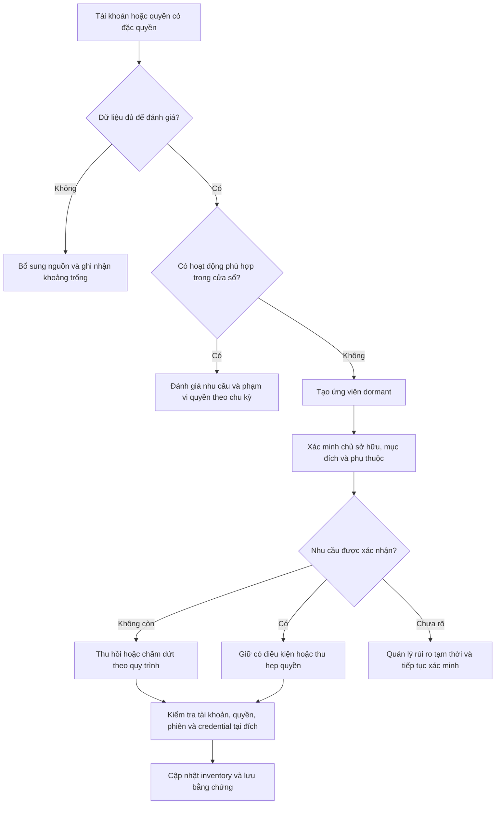

# Dormant privileged account

## 1. Tài khoản đặc quyền không hoạt động là gì?

**Dormant privileged account** là tài khoản vẫn có đặc quyền hoặc khả năng nhận đặc quyền nhưng không có hoạt động phù hợp được xác nhận trong một khoảng thời gian do tổ chức quy định. Có thể gọi đây là tài khoản đặc quyền không hoạt động hoặc tài khoản đặc quyền bị bỏ quên, tùy kết quả xác minh.

Hai ý cần tách biệt:

- **Không quan sát thấy hoạt động:** các nguồn dữ liệu hiện có chưa ghi nhận việc sử dụng.
- **Đã xác nhận không còn nhu cầu:** người có trách nhiệm cùng bằng chứng phù hợp cho thấy tài khoản hoặc quyền không còn phục vụ nhiệm vụ hợp lệ.

Ý thứ nhất là dấu hiệu để kiểm tra. Nó chưa đủ để kết luận ý thứ hai.

Trong PAM, một tài khoản không được sử dụng nhưng vẫn có quyền quản trị là một đường đặc quyền cần quản lý. Mật khẩu, khóa hoặc quan hệ ủy quyền có thể còn hiệu lực, trong khi việc ít sử dụng khiến thay đổi bất thường khó được chú ý.

Mục tiêu xử lý dormant account là giảm quyền và credential không còn cần thiết, đồng thời bảo vệ khả năng vận hành và khôi phục. Không thể áp dụng cùng một quyết định cho tài khoản quản trị cá nhân, tài khoản dịch vụ chạy theo quý và tài khoản khẩn cấp.

## 2. Phân biệt dormant với những trạng thái gần giống

| Trạng thái | Ý nghĩa | Quan hệ với dormant |
|---|---|---|
| Dormant theo tiêu chí quan sát | Chưa thấy hoạt động phù hợp trong cửa sổ đủ điều kiện đánh giá | Là căn cứ để xác minh nhu cầu và rủi ro |
| Chưa đủ dữ liệu | Thiếu log, thời gian quan sát hoặc phạm vi nguồn | Chưa thể kết luận dormant một cách đáng tin cậy |
| Orphaned — không còn chủ sở hữu phù hợp | Không có người hoặc nhóm nhận trách nhiệm, hoặc chủ thể liên quan đã rời tổ chức | Có thể đang hoạt động hoặc không hoạt động |
| Disabled — bị vô hiệu hóa | Một cơ chế tại nền tảng đã chặn hoặc hạn chế tài khoản | Không tự chứng minh mọi phiên, token hoặc credential đã hết hiệu lực |
| Expired — hết hạn | Một tài khoản, quyền hoặc credential đã qua thời hạn theo cơ chế cụ thể | Cần xác định chính xác đối tượng hết hạn |
| Quyền không được dùng | Tài khoản có hoạt động nhưng không sử dụng một quyền mạnh nào đó | Có thể thu hẹp quyền mà vẫn giữ tài khoản |
| Tài khoản dùng hiếm có chủ đích | Được giữ cho nhiệm vụ định kỳ dài hoặc khôi phục | Cần ngoại lệ có kiểm soát và rà soát, không mặc định là bỏ quên |
| Tài khoản mới chờ sử dụng | Vừa được tạo hoặc cấp quyền | Chưa đủ thời gian để kết luận theo ngưỡng thông thường |

Ví dụ, tài khoản của một kỹ sư có thể đăng nhập cổng nội bộ mỗi ngày nhưng không sử dụng quyền quản trị cơ sở dữ liệu trong sáu tháng. Tài khoản không dormant theo tiêu chí đăng nhập chung, nhưng quyền quản trị có thể đã không còn cần thiết.

Ngược lại, một tài khoản sao lưu chỉ chạy vào cuối quý có thể không có hoạt động trong 60 ngày mà vẫn đang phục vụ nhiệm vụ hợp lệ. Cần xem lịch công việc, bằng chứng thực thi và chủ sở hữu trước khi quyết định.

## 3. Vì sao dormant account tạo rủi ro?

### 3.1. Quyền vẫn còn dù nhu cầu có thể đã kết thúc

Một người chuyển bộ phận nhưng giữ vai trò quản trị cũ có thể tạo ra quyền thường trực không phù hợp. Một ứng dụng đã ngừng triển khai có thể để lại tài khoản dịch vụ, khóa và quan hệ tin cậy trên nhiều hệ thống.

Việc không sử dụng không làm những quyền này tự biến mất. Nếu credential bị lấy hoặc một đường ủy quyền bị lạm dụng, tài khoản vẫn có thể trở thành điểm bắt đầu cho hoạt động đặc quyền.

### 3.2. Dễ thiếu người theo dõi

Tài khoản ít dùng có thể không còn người kiểm tra thông báo, xác nhận mục đích hoặc phát hiện thay đổi bất thường. Chủ sở hữu ghi trong inventory có thể đã chuyển nhóm, còn thông tin liên hệ thì lỗi thời.

Một tài khoản vừa có quyền mạnh, credential tồn tại lâu dài và thiếu người nhận trách nhiệm cần được ưu tiên xác minh. Đây là đánh giá dựa trên nhiều yếu tố, không chỉ số ngày không đăng nhập.

### 3.3. Credential và đường truy cập có thể bị bỏ sót

Một tài khoản có thể dùng mật khẩu, khóa SSH, chứng thư, token hoặc quan hệ liên kết danh tính. Thay một mật khẩu không tự xử lý tất cả phương thức còn lại.

Credential không được luân chuyển, bản sao không được quản lý hoặc quyền tại một hệ thống phụ thuộc có thể tiếp tục tồn tại sau khi tài khoản bị coi là không dùng. Vì vậy, xử lý dormant account phải xem cả tài khoản, quyền, credential và phiên liên quan.

### 3.4. Không hoạt động không đồng nghĩa đã bị xâm nhập

Dormant là dấu hiệu quản trị rủi ro, không phải bằng chứng tài khoản đã bị chiếm. Nếu xuất hiện đăng nhập hoặc thao tác bất thường từ một tài khoản lâu không dùng, cần đối chiếu bối cảnh và điều tra.

Việc dùng lại có thể hợp lệ, chẳng hạn kiểm thử khôi phục được lên lịch. Cũng có thể là hành vi lạm dụng. Kết luận phải dựa trên bằng chứng, không dựa riêng vào nhãn dormant.

## 4. Chọn tiêu chí hoạt động đúng với từng loại tài khoản

### 4.1. Các mốc thời gian có ý nghĩa khác nhau

| Dữ liệu | Cho biết điều gì? | Không tự chứng minh điều gì? |
|---|---|---|
| Lần xác thực thành công gần nhất | Có một lần xác thực được nguồn ghi nhận | Quyền quản trị đã được sử dụng hoặc còn cần thiết |
| Lần mở phiên quản trị gần nhất | Có phiên được thiết lập theo đường đang quan sát | Trong phiên đã có thao tác cụ thể nào |
| Lần kích hoạt vai trò gần nhất | Quyền được kích hoạt theo cơ chế tương ứng | Tác vụ đã hoàn thành |
| Lần thực hiện thao tác đặc quyền gần nhất | Có hoạt động tại tài nguyên được quan sát | Mọi đường sử dụng khác đều đã được bao phủ |
| Lần lấy bí mật gần nhất | Có chủ thể truy xuất credential từ kho quản lý | Credential đã được dùng tại đích hoặc chỉ người đó dùng |
| Lần xác nhận chủ sở hữu gần nhất | Có người hoặc nhóm xác nhận trách nhiệm | Tài khoản đã phát sinh hoạt động kỹ thuật |
| Lần thu thập inventory gần nhất | Nguồn còn thấy tài khoản hoặc cấu hình | Tài khoản đã được sử dụng |

Không nên gom tất cả các mốc này thành một trường “last active” mà không công bố cách tính. Việc một công cụ quản trị đọc metadata của tài khoản không nên tự động được coi là hoạt động nghiệp vụ của tài khoản đó.

Các lần xác thực thất bại có thể là tín hiệu an ninh nhưng không chứng minh chủ thể đã sử dụng tài khoản thành công. Chúng không nên tự động làm mất nhãn dormant theo tiêu chí hoạt động hợp lệ.

### 4.2. Tài khoản cá nhân

Với người dùng quản trị, có thể xem đăng nhập qua các đường được cho phép, kích hoạt quyền, phiên và hành động tại hệ thống đích. Đồng thời đối chiếu tình trạng làm việc, vai trò hiện tại và nhiệm vụ đã được giao.

Cần phân biệt việc tài khoản cá nhân vẫn hoạt động trong ứng dụng hằng ngày với việc quyền đặc biệt còn được sử dụng. Nếu không còn cần quyền quản trị, giải pháp có thể là bỏ vai trò hoặc chuyển sang quyền đủ điều kiện kích hoạt, không phải khóa toàn bộ danh tính làm việc.

### 4.3. Tài khoản dịch vụ và workload

Tài khoản dịch vụ có thể hoạt động qua API, kết nối cơ sở dữ liệu, agent hoặc tác vụ nền mà không có đăng nhập tương tác. Một kết nối tồn tại lâu cũng có thể tiếp tục được sử dụng mà không tạo một lần xác thực mới cho mỗi thao tác.

Nguồn đánh giá nên gồm log ứng dụng, lần chạy job, hoạt động tại đích và sự kiện cấp credential hoặc vai trò, tùy kiến trúc. Kiểm tra lịch chạy, dịch vụ phụ thuộc và chủ sở hữu workload.

Một tác vụ kiểm tra sức khỏe có thể tạo hoạt động định kỳ dù chức năng nghiệp vụ chính đã ngừng dùng. Có hoạt động máy móc không tự chứng minh toàn bộ quyền hiện tại là cần thiết.

### 4.4. Tài khoản khẩn cấp và nhiệm vụ dùng hiếm

Tài khoản break-glass hoặc tài khoản dùng cho khôi phục có thể không được dùng trong thời gian dài theo đúng thiết kế. Cần quản lý chúng bằng mục đích rõ ràng, chủ sở hữu, bảo vệ credential, cảnh báo sử dụng và kiểm thử theo kế hoạch.

Không nên tạo hoạt động giả chỉ để một tài khoản vượt qua báo cáo dormant. Kiểm thử hợp lệ nên được ghi riêng để người đọc biết đó là hoạt động xác minh khả năng khôi phục, không phải nhu cầu quản trị hằng ngày.

## 5. Thiết lập ngưỡng mà không biến ngưỡng thành kết luận

### 5.1. Không có một số ngày phù hợp với mọi tài khoản

Ngưỡng phải dựa trên loại chủ thể, tần suất nhiệm vụ, mức đặc quyền, độ quan trọng của hệ thống và độ bao phủ dữ liệu. Nếu chính sách dùng các mốc như 30, 60 hoặc 90 ngày, cần nêu rõ phạm vi áp dụng; các con số này không phải quy tắc chung cho mọi môi trường.

Ví dụ minh họa:

| Loại đối tượng | Cách xây dựng tiêu chí | Cách dùng kết quả |
|---|---|---|
| Quyền quản trị cá nhân dùng thường xuyên | Ngưỡng theo tần suất công việc và chính sách rà soát | Xác minh nhu cầu, xem xét bỏ quyền thường trực |
| Tài khoản dịch vụ chạy hằng đêm | Phát hiện bỏ lỡ số lần chạy hoặc thiếu hoạt động ngoài dự kiến | Kiểm tra dịch vụ và phụ thuộc; có thể là lỗi vận hành |
| Tài khoản cho tác vụ theo quý | Cửa sổ đủ bao phủ chu kỳ dự kiến và khoảng đệm phù hợp | Đối chiếu kỳ thực thi, không áp ngưỡng của tác vụ hằng ngày |
| Tài khoản khẩn cấp | Kiểm tra nhu cầu, bảo vệ và kiểm thử thay cho yêu cầu dùng thường xuyên | Duy trì ngoại lệ có trách nhiệm và theo dõi mọi lần sử dụng |
| Quyền vừa được cấp | Xét thời gian từ khi cấp và mục đích | Không đánh giá như một quyền đã tồn tại lâu |

Độ nhạy của cảnh báo khác với quyết định thu hồi. Có thể dùng một ngưỡng để đưa vào danh sách cần xem xét sớm, trong khi hành động vô hiệu hóa đòi hỏi xác minh và điều kiện khác.

### 5.2. Cửa sổ quan sát phải đủ dài và đủ nguồn

Giả sử tiêu chí là không có hoạt động trong 90 ngày nhưng hệ thống chỉ lưu log 30 ngày. Nếu không thấy sự kiện nào, kết luận đúng là chưa đủ dữ liệu để xác nhận trọn cửa sổ 90 ngày.

Ngoài độ dài, cần biết các đường truy cập nào đã được ghi nhận. Có log từ cổng PAM nhưng không có API trực tiếp hoặc console thì chưa thể khẳng định không có hoạt động trên tất cả các đường.

Một kết luận nên ghi rõ:

> Không quan sát thấy hoạt động đặc quyền phù hợp trong cửa sổ đã xác định, với các nguồn và giới hạn được liệt kê; cần xác minh nhu cầu trước khi xử lý.

### 5.3. Tách thiếu dữ liệu khỏi giá trị “chưa từng dùng”

Giá trị trống có thể nghĩa là chưa từng dùng trong phạm vi được ghi nhận, không thu thập được, nguồn không hỗ trợ hoặc tài khoản vừa được phát hiện. Các trường hợp này khác nhau.

Không thay mọi giá trị trống bằng một ngày rất cũ rồi tự động xếp vào nhóm dormant. Cần trạng thái chất lượng dữ liệu và lý do cụ thể. Nếu có dữ liệu đáng tin cậy cho thấy tài khoản được tạo nhưng chưa từng dùng, vẫn phải xét thời gian từ khi tạo và mục đích dự kiến.

## 6. Mô hình đánh giá có thể giải thích

### 6.1. Điều kiện để tạo ứng viên dormant

Một quy trình đánh giá có thể kiểm tra theo thứ tự:

1. Xác định tài khoản hoặc quyền nào đang được xem xét và phạm vi tài nguyên.
2. Xác nhận đối tượng còn có quyền hoặc khả năng nhận quyền đặc biệt.
3. Xác định loại chủ thể, chu kỳ nhiệm vụ và chính sách áp dụng.
4. Kiểm tra thời gian quan sát, nguồn dữ liệu và các khoảng trống.
5. Tìm hoạt động phù hợp trong cửa sổ, phân biệt hoạt động nghiệp vụ với kiểm thử hoặc theo dõi.
6. Nếu không thấy hoạt động và dữ liệu đáp ứng tiêu chí, tạo ứng viên dormant.
7. Nếu chưa đủ dữ liệu, tạo việc cần xác minh thay vì kết luận không hoạt động.
8. Đối chiếu chủ sở hữu, nhu cầu, phụ thuộc và ngoại lệ trước khi chọn hành động.

Ứng viên dormant là kết quả phát hiện, chưa phải lệnh vô hiệu hóa tài khoản.

### 6.2. Ví dụ một bản ghi đánh giá

Dữ liệu sau là ví dụ minh họa, không phải cấu hình sản phẩm hoặc chính sách mặc định:

```json
{
  "assessment_id": "DORM-028",
  "principal_reference": "account-0091",
  "scope": "orders-production",
  "identity_type": "human-admin",
  "policy_reference": "POL-ADMIN-REVIEW-03",
  "inactivity_threshold_days": 90,
  "evaluated_at": "2026-11-26T04:00:00Z",
  "observation": {
    "from": "2026-07-01T00:00:00Z",
    "through": "2026-11-26T03:00:00Z",
    "coverage": "verified-for-declared-access-paths",
    "last_successful_authentication_at": "2026-08-01T02:00:00Z",
    "last_privileged_action_at": "2026-08-01T02:10:00Z",
    "evidence_references": ["AUTH-310", "TARGET-480"]
  },
  "finding": "candidate-dormant",
  "owner_team": "platform-operations",
  "required_next_step": "validate-business-need-and-dependencies"
}
```

Trong ví dụ, ngưỡng 90 ngày chỉ phục vụ minh họa. Phần bao phủ giới hạn ở các đường truy cập đã công bố; nếu phát hiện thêm đường ngoài phạm vi, cần cập nhật đánh giá.

Bản ghi giữ nguồn bằng chứng và bước tiếp theo để giải thích được kết luận. Nó không chứa mật khẩu, khóa hoặc token, và cũng không tự thực hiện thao tác thu hồi.

## 7. Quy trình xử lý một ứng viên dormant

### Bước 1: Kiểm tra lại phát hiện

Xác nhận định danh, nguồn tài khoản, quyền và khoảng thời gian được đánh giá. Kiểm tra nguồn nào thu thập thành công, nguồn nào lỗi và sự kiện có thể đến muộn hay không.

Đối chiếu thời điểm tạo, cấp quyền và lần đổi tên hoặc tái tạo tài khoản. Một tên được tái sử dụng không có nghĩa mọi hoạt động cũ thuộc về tài khoản hiện tại.

Nếu phát hiện thông tin bất thường như sử dụng từ nguồn lạ hoặc thay đổi quyền không có cơ sở, có thể cần chuyển sang luồng ứng phó sự cố. Không tiếp tục xử lý như một việc dọn dẹp thông thường nếu đã có dấu hiệu bị lạm dụng.

### Bước 2: Xác nhận người chịu trách nhiệm và mục đích

Liên hệ đúng chủ hệ thống hoặc chủ dịch vụ theo quy trình của tổ chức. Với tài khoản cá nhân, đối chiếu vai trò công việc hiện tại; với tài khoản dịch vụ, xác định ứng dụng và nhóm vận hành.

Cần câu trả lời cụ thể: nhiệm vụ nào còn cần, quyền gì, tài nguyên nào và tần suất dự kiến. Một xác nhận chung như “để phòng khi cần” chưa đủ để giữ toàn bộ quyền thường trực nếu chưa có mục đích và kiểm soát rõ ràng.

Chủ sở hữu không phản hồi là một vấn đề cần chuyển cấp xử lý theo chính sách, không phải bằng chứng tài khoản chắc chắn không được dùng.

### Bước 3: Kiểm tra phụ thuộc và phương thức truy cập

Tìm các job, ứng dụng, agent, cấu hình kết nối, kho credential và quan hệ ủy quyền có thể liên quan. Kiểm tra cả tác vụ theo lịch dài, khôi phục và các kết nối tồn tại lâu.

Không cần lấy giá trị bí mật để lập danh sách phụ thuộc. Dùng metadata, tham chiếu quản lý và bằng chứng thực thi khi có thể.

Với tài khoản đã dùng credential tĩnh, xác định liệu credential có được nhiều bên sử dụng hay có bản sao ngoài quy trình hay không. Độ chắc chắn về điều này ảnh hưởng tới cách thu hồi và kiểm tra sau đó.

### Bước 4: Chọn cách xử lý theo nhu cầu và rủi ro

| Kết quả xác minh | Cách xử lý cần xem xét |
|---|---|
| Tài khoản không còn nhu cầu và không còn phụ thuộc hợp lệ | Vô hiệu hóa hoặc chấm dứt theo quy trình, xử lý quyền và credential |
| Tài khoản còn dùng nhưng quyền đặc biệt không còn cần | Thu hồi hoặc thu hẹp quyền, giữ phần truy cập hợp lệ |
| Chỉ cần đặc quyền theo nhiệm vụ | Chuyển từ quyền thường trực sang JIT hoặc cơ chế kích hoạt phù hợp |
| Nhiệm vụ chỉ cần một tập thao tác hẹp | Áp dụng least privilege và JEA theo khả năng nền tảng |
| Tác vụ ít chạy nhưng còn hợp lệ | Duy trì có điều kiện, ghi chu kỳ và hạn rà soát |
| Tài khoản khẩn cấp cần giữ | Ngoại lệ có chủ sở hữu, bảo vệ credential và kiểm thử |
| Không đủ dữ liệu hoặc chưa rõ phụ thuộc | Bổ sung bằng chứng, quản lý rủi ro tạm thời và hẹn xác minh |
| Có dấu hiệu xâm nhập | Thực hiện quy trình ứng phó, bảo toàn bằng chứng và ngăn chặn phù hợp |

JIT giải quyết thời điểm và thời hạn sử dụng quyền. JEA hướng đến giới hạn khả năng quản trị vào nhiệm vụ cần thiết. Hai cơ chế này không có nghĩa tài khoản sẽ biến mất, cũng không tự xử lý mọi credential còn tồn tại.

### Bước 5: Thực hiện thay đổi có kiểm soát

Với thay đổi có thể ảnh hưởng dịch vụ, xác định phạm vi, thời điểm, người thực hiện, cách kiểm tra và phương án khôi phục phù hợp. Có thể thử trên một phần phạm vi trước nếu kiến trúc cho phép.

Vô hiệu hóa trước khi xóa có thể là một bước trung gian trong một số quy trình. Tuy nhiên, không phải mọi nền tảng đều có cùng hành vi hoặc cần cùng thời gian chờ; không coi đây là công thức bắt buộc cho mọi hệ thống.

Nếu cần khôi phục sau thay đổi, thực hiện qua quy trình xác minh nhu cầu và cấp quyền lại. Khi nghi credential đã bị lộ, không khôi phục bằng cách tiếp tục tin cậy credential cũ.

### Bước 6: Xác nhận kết quả thực tế

Kiểm tra trạng thái tại nền tảng đích, tác động đến tác vụ hợp lệ và những lớp quyền còn liên quan. Ghi nhận kết quả thành công, thất bại hoặc chưa xác định theo từng phần.

Một thông báo “đã gửi lệnh khóa” từ cổng điều phối chưa đủ chứng minh tài khoản đã bị khóa ở đích. Nếu tác vụ thất bại hoặc còn khoảng trống, giữ việc cần xử lý mở và có người chịu trách nhiệm.

### Bước 7: Cập nhật inventory và theo dõi sau thay đổi

Cập nhật nhu cầu, chủ sở hữu, trạng thái quyền, credential và bằng chứng xử lý. Giữ lịch sử cần thiết để điều tra thay vì xóa mọi dấu vết khi tài khoản bị chấm dứt.

Theo dõi các lần cố sử dụng tài khoản hoặc credential đã xử lý. Một lần xác thực thất bại có thể do cấu hình cũ chưa cập nhật hoặc hành vi bất thường; cần đối chiếu nguồn và bối cảnh.

## 8. Thu hồi phải xem nhiều lớp, không chỉ nút “disable”

### 8.1. Tài khoản và quyền tại hệ thống đích

Tài khoản có thể nhận quyền từ vai trò, nhóm, cấu hình cục bộ hoặc quan hệ tin cậy. Khóa danh tính ở nguồn không luôn đồng nghĩa mọi tài khoản liên quan tại đích đã bị khóa.

Nếu chỉ một quyền không còn cần, có thể bỏ quyền đó mà không chấm dứt toàn bộ tài khoản. Cần kiểm tra quyền gián tiếp hoặc vai trò khác có tái tạo khả năng tương đương không.

### 8.2. Phiên và token

Phiên đã mở hoặc token đã phát hành có thể có cơ chế hiệu lực khác với tài khoản nguồn. Cần xác định nền tảng hỗ trợ kết thúc, thu hồi hay chỉ chờ hết hạn, cùng các giới hạn thực tế.

Không báo “đã thu hồi hoàn toàn” chỉ từ việc gỡ một vai trò nếu chưa xem các phiên đang hoạt động. Với trường hợp chưa thể kết thúc ngay, cần nêu rõ phạm vi còn hiệu lực và biện pháp quản lý rủi ro.

### 8.3. Credential tĩnh và credential ngắn hạn

Mật khẩu, khóa SSH và những bí mật tồn tại lâu dài cần được vô hiệu hóa, thay hoặc loại khỏi nơi tin cậy theo cơ chế tương ứng. Một bản ghi trong vault bị xóa không tự làm credential mất hiệu lực trên hệ thống đích.

Với credential ngắn hạn, xem khả năng thu hồi, thời gian hết hạn và ảnh hưởng tới phiên đã tạo. Không giả định có thể “luân chuyển” mọi token theo cùng cách thay mật khẩu.

### 8.4. Tự động hóa và quan hệ ủy quyền

Pipeline, agent hoặc ứng dụng khác có thể tiếp tục sử dụng một principal hoặc yêu cầu credential mới. Muốn chấm dứt đường truy cập, có thể phải cập nhật quyền phát hành, quan hệ tin cậy hoặc cấu hình của bên sử dụng.

Ngược lại, thay một bí mật mà chưa cập nhật phụ thuộc hợp lệ có thể gây gián đoạn. Cần phân biệt mục tiêu dừng sử dụng với mục tiêu chuyển sang cơ chế xác thực mới mà vẫn duy trì dịch vụ.

## 9. Ví dụ xuyên suốt: ba tài khoản cùng không có đăng nhập mới

### 9.1. Kết quả phát hiện ban đầu

Đội PAM xem xét ba tài khoản không có sự kiện đăng nhập mới trong nguồn theo dõi 90 ngày. Đây là khoảng thời gian minh họa cho đợt đánh giá, không phải ngưỡng chuẩn cho mọi tài khoản.

| Tài khoản | Quyền đang có | Quan sát ban đầu |
|---|---|---|
| `minh.db-admin` | Vai trò quản trị cơ sở dữ liệu | Không thấy đăng nhập hoặc thao tác đặc quyền trong các nguồn đã xác minh |
| `svc-quarterly-export` | Quyền xuất dữ liệu cho báo cáo cuối quý | Không có đăng nhập tương tác; hoạt động thực tế chưa đối chiếu đủ |
| `emergency-platform` | Quyền khôi phục nền tảng | Không dùng cho công việc hằng ngày; có mục đích khẩn cấp |

Một quy tắc chỉ dựa trên đăng nhập có thể xếp cả ba vào cùng một nhóm. Quyết định phù hợp cần dữ liệu bổ sung.

### 9.2. Tài khoản quản trị cá nhân đã không còn nhiệm vụ

Đối chiếu cho thấy Minh đã chuyển sang phát triển ứng dụng, không còn nhiệm vụ quản trị cơ sở dữ liệu. Chủ hệ thống xác nhận vai trò cũ không cần duy trì.

Hành động hợp lý có thể là thu hồi quyền quản trị và các tài khoản quản trị riêng không còn nhu cầu, trong khi giữ danh tính làm việc hằng ngày. Kiểm tra phiên, token và credential liên quan theo kiến trúc, rồi xác nhận kết quả tại cơ sở dữ liệu.

Không cần khóa mọi truy cập của Minh chỉ để xử lý một quyền quản trị cũ.

### 9.3. Tài khoản dịch vụ có chu kỳ dài

Log job cho thấy `svc-quarterly-export` được dùng bằng kết nối không tương tác vào kỳ báo cáo. Nguồn “đăng nhập người dùng” ban đầu không phản ánh đường sử dụng này.

Đội vận hành xác nhận lịch, chủ sở hữu, phạm vi dữ liệu và các phụ thuộc. Tài khoản không được coi là bỏ quên chỉ từ việc thiếu đăng nhập tương tác, nhưng vẫn cần xem quyền xuất dữ liệu có vượt nhiệm vụ không.

Nếu chức năng chỉ chạy trong cửa sổ ngắn, có thể đánh giá quyền và credential theo thời hạn thay cho quyền rộng tồn tại liên tục. Cần kiểm tra khả năng nền tảng và độ tin cậy của quy trình cấp quyền trước khi thay đổi.

### 9.4. Tài khoản khẩn cấp được duy trì có kiểm soát

`emergency-platform` có mục đích khôi phục khi đường danh tính chính không hoạt động. Tài khoản được giữ theo ngoại lệ có chủ sở hữu, cơ chế bảo vệ credential, theo dõi sử dụng và lịch kiểm thử.

Kết quả đúng không phải “hoạt động bình thường”, vì tài khoản thực sự ít dùng. Có thể ghi rõ: không có hoạt động vận hành trong cửa sổ; nhu cầu khẩn cấp đã được xác nhận; ngoại lệ còn hiệu lực tới lần rà soát tiếp theo.

Mọi lần dùng ngoài kế hoạch cần được xác minh, kể cả khi sau đó tài khoản không còn đáp ứng tiêu chí dormant.

## 10. Luồng ra quyết định



Luồng này không thay thế quy trình ứng phó khi có dấu hiệu bị xâm nhập. Trong trường hợp đó, ưu tiên ngăn chặn và bảo toàn bằng chứng theo mức rủi ro, đồng thời ghi nhận các quyết định và giới hạn đã biết.

## 11. Bằng chứng và trách nhiệm xử lý

### 11.1. Hồ sơ tối thiểu của một kết quả xử lý

| Nhóm bằng chứng | Nội dung cần giữ |
|---|---|
| Phát hiện | Định danh tài khoản hoặc quyền, ngưỡng, cửa sổ, nguồn và giới hạn dữ liệu |
| Xác minh | Chủ sở hữu, mục đích, phụ thuộc, kết quả đối chiếu và ngày xác nhận |
| Quyết định | Giữ, thu hẹp, chuyển sang quyền tạm thời hoặc chấm dứt; cơ sở quyết định |
| Thực hiện | Người hoặc workload thực hiện, mã thay đổi, thời gian, phạm vi |
| Kết quả | Trạng thái tại đích, phiên và credential liên quan, kiểm tra dịch vụ |
| Phần còn lại | Ngoại lệ, việc chưa hoàn tất, người phụ trách và hạn xử lý |

Log hoặc báo cáo không cần chứa giá trị bí mật. Tham chiếu credential, nguồn quan sát và mã sự kiện thường phù hợp hơn cho việc nối bằng chứng.

### 11.2. Phân chia trách nhiệm

Nhóm IAM/PAM có thể phát hiện và điều phối. Chủ hệ thống xác nhận mức tác động và quyền cần thiết. Chủ dịch vụ xác nhận ứng dụng phụ thuộc. Đội vận hành thực hiện thay đổi và kiểm tra dịch vụ; đội an ninh tham gia khi có dấu hiệu bị lạm dụng.

Người phê duyệt không thay thế việc kiểm tra kết quả tại đích. Tương tự, người sở hữu inventory không mặc nhiên có đủ thông tin để quyết định xóa tài khoản dịch vụ.

Với ngoại lệ, cần người nhận trách nhiệm, lý do, kiểm soát bổ sung và hạn rà soát. Ngoại lệ không nên trở thành một nhãn vĩnh viễn giúp tài khoản thoát khỏi mọi lần xem xét sau.

## 12. Tự động hóa phát hiện và xử lý

### 12.1. Có thể tự động hóa phần nào?

Các bước thường có thể tự động hóa gồm thu thập dữ liệu, kiểm tra độ mới, tính tiêu chí theo loại tài khoản, tạo ứng viên, gửi việc xác minh và đối chiếu kết quả thay đổi.

Tự động hóa nên giữ được nguồn gốc quyết định: phiên bản chính sách, cửa sổ dữ liệu, nguồn quan sát và lý do tài khoản được chọn. Khi dữ liệu nguồn thiếu, hệ thống cần biểu diễn trạng thái chưa xác định thay vì im lặng coi là không dùng.

Các nguồn có độ trễ khác nhau cần được xét theo chính sách. Một tác vụ đánh giá chạy lúc 10 giờ nhưng chỉ có dữ liệu đầy đủ đến 8 giờ phải công bố mốc quan sát thực tế.

### 12.2. Khi nào cần giới hạn hành động tự động?

Việc vô hiệu hóa tự động có thể phù hợp với một số nhóm đã có quy trình và điều kiện được xác định rõ. Nó cần phạm vi nhỏ, dữ liệu đủ tin cậy, xử lý ngoại lệ, kiểm tra phụ thuộc và xác nhận kết quả.

Tài khoản dịch vụ quan trọng, đường khẩn cấp và đối tượng chưa rõ chủ sở hữu đòi hỏi cách đánh giá riêng. Không dùng một quy tắc chung “quá ngưỡng thì xóa” cho toàn bộ hệ thống.

Ngay cả khi quyết định đã được tự động hóa, cần xử lý lỗi từng đích và có người nhận việc khi thay đổi không hoàn tất. Một tác vụ chạy xong không có nghĩa mọi tài khoản trong danh sách đều đã được xử lý thành công.

### 12.3. Tránh tạo động lực báo cáo sai

Không nên yêu cầu người dùng đăng nhập định kỳ chỉ để xóa cảnh báo nếu không có nhiệm vụ thật. Cách này giữ quyền không cần thiết và làm mất ý nghĩa của chỉ số.

Cũng không nên tự bỏ các tài khoản khó xác minh khỏi mẫu số. Hãy giữ chúng thành nhóm có khoảng trống dữ liệu hoặc việc đang mở để thể hiện đúng tình hình.

## 13. Chỉ số theo dõi hiệu quả

Không chỉ đo số tài khoản đã khóa. Cần biết việc xử lý có giảm đường đặc quyền dư thừa và có gây lỗi vận hành hay không.

| Chỉ số | Ý nghĩa | Điều cần công bố |
|---|---|---|
| Bao phủ đánh giá | Tỷ lệ tài khoản hoặc quyền được đánh giá bằng dữ liệu đủ điều kiện | Phạm vi inventory, nguồn và khoảng trống |
| Ứng viên dormant theo loại | Khối lượng cần xác minh ở từng nhóm | Ngưỡng, chu kỳ và thời điểm đánh giá |
| Thời gian xác nhận chủ sở hữu | Khả năng chuyển phát hiện thành quyết định | Nhóm chưa phản hồi và ngoại lệ |
| Quyền thường trực đã thu hẹp | Phần quyền không cần thiết đã được bỏ hoặc chuyển mô hình | Kết quả thực thi và nhu cầu còn lại |
| Kết quả thu hồi được xác nhận | Mức hoàn tất tại các điểm thực thi liên quan | Phiên hoặc credential chưa xử lý được |
| Tác động sau thay đổi | Lỗi job, gián đoạn hoặc yêu cầu cấp lại | Nguyên nhân và cải thiện quy trình |
| Ngoại lệ còn hiệu lực và quá hạn | Mức quản lý các trường hợp dùng hiếm | Chủ sở hữu, hạn rà soát và kiểm soát bổ sung |

Ví dụ, “đã xử lý 80% ứng viên” cần định nghĩa xử lý gồm những kết quả nào: thu hồi, giữ có căn cứ hay chỉ đóng việc. Không nên gộp chúng để tạo cảm giác 80% tài khoản đã bị loại bỏ.

Nếu tỷ lệ dormant giảm sau khi hệ thống log ngừng thu thập hoặc sau khi đổi mẫu số, đó không phải bằng chứng rủi ro giảm. Chỉ số cần đi cùng chất lượng dữ liệu và lịch sử thay đổi cách tính.

## 14. Những nhầm lẫn cần tránh

| Nhầm lẫn | Cách hiểu đúng |
|---|---|
| Không có log nghĩa là không hoạt động | Có thể thiếu nguồn, cửa sổ hoặc quyền thu thập |
| Đăng nhập gần đây nghĩa là quyền admin còn cần | Hoạt động của tài khoản và nhu cầu của từng quyền là hai vấn đề khác nhau |
| Mọi tài khoản quá 90 ngày đều phải xóa | Ngưỡng phụ thuộc chính sách và loại tài khoản; cần xác minh |
| Tài khoản dịch vụ không đăng nhập tương tác là dormant | Cần xem API, job, kết nối và hoạt động workload |
| Tài khoản khẩn cấp ít dùng là không hợp lệ | Có thể là đặc tính thiết kế, nhưng phải có kiểm soát và rà soát |
| Chủ sở hữu không trả lời nghĩa là không còn phụ thuộc | Đây là thiếu xác nhận, không phải kết luận kỹ thuật |
| Khóa tài khoản là mọi quyền đã hết | Cần xét quyền tại đích, phiên, token, credential và ủy quyền |
| Xóa bí mật khỏi vault là đã thu hồi ở đích | Hệ thống đích phải mất hiệu lực xác thực theo cơ chế phù hợp |
| Tạo đăng nhập định kỳ sẽ giải quyết dormant | Chỉ làm thay đổi số liệu nếu không có nhu cầu thật |
| Dormant có nghĩa tài khoản đã bị chiếm | Đây là dấu hiệu quản trị rủi ro, cần bằng chứng riêng cho kết luận xâm nhập |

## 15. Ghi nhớ cốt lõi

Dormant privileged account cần được đánh giá từ **nhu cầu sử dụng, quyền còn tồn tại, dữ liệu hoạt động và độ bao phủ quan sát**. Không thấy hoạt động chỉ là điểm bắt đầu; kết luận giữ hay thu hồi phải có chủ sở hữu, kiểm tra phụ thuộc và căn cứ phù hợp.

PAM giúp chuyển kết quả phát hiện thành giảm quyền thường trực, cấp quyền JIT/JEA, quản lý credential, giám sát và thu hồi có kiểm chứng. Một quy trình tốt vừa đóng những đường đặc quyền không còn cần thiết, vừa duy trì khả năng vận hành và khôi phục với bằng chứng rõ ràng.
