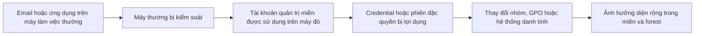
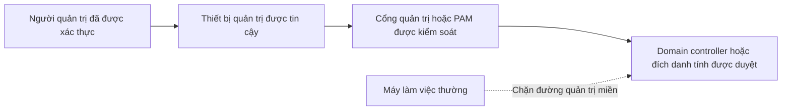

# Domain Admin separation: tách quyền quản trị miền khỏi công việc hằng ngày

## 1. Mục tiêu của việc tách Domain Admin

Trong Active Directory Domain Services, một tài khoản thuộc nhóm Domain Admins có phạm vi ảnh hưởng rất lớn đối với miền. Nếu người quản trị dùng chính tài khoản đó để đọc email, mở tài liệu, duyệt web hoặc quản trị các máy chủ thông thường, một sự cố tại thiết bị hay ứng dụng ít tin cậy có thể trở thành điểm khởi đầu để chiếm quyền miền.

**Domain Admin separation** là thiết kế và vận hành sự tách biệt giữa công việc quản trị miền với những công việc khác. Sự tách biệt này phải bao gồm danh tính, quyền, thiết bị nguồn, đích truy cập, phiên làm việc và quy trình cấp quyền. Chỉ tạo thêm một tài khoản có tên `adm-*` chưa đủ.

Trong phạm vi Privileged Access Management (PAM), mục tiêu không phải làm cho mọi quản trị viên đều trở thành Domain Admin theo một cách được ghi hình. Mục tiêu là giảm số người cần quyền đó, giảm thời gian quyền tồn tại, kiểm soát nơi sử dụng và giữ bằng chứng về từng lần cấp cũng như thu hồi quyền.

Sau bài học, người học có thể:

- Phân biệt tài khoản hằng ngày, tài khoản quản trị theo nhiệm vụ và tài khoản quản trị miền.
- Xác định công việc nào cần ủy quyền hẹp thay vì thêm vào Domain Admins.
- Thiết kế đường truy cập từ thiết bị quản trị đến hệ thống có quyền kiểm soát miền.
- Xây dựng quy trình JIT, quản lý credential và xử lý truy cập khẩn cấp cho quyền miền.
- Đọc bằng chứng để đánh giá sự tách biệt thực sự có hiệu lực hay chỉ tồn tại trên sơ đồ.

## 2. Domain Admin là quyền gì và nguy cơ nằm ở đâu?

### 2.1. Phân biệt tài khoản, nhóm và khả năng thực tế

`Domain Admins` là một nhóm đặc quyền của từng miền AD. Tài khoản người dùng là thành viên trực tiếp hoặc gián tiếp của nhóm có thể nhận quyền tương ứng khi tạo token hoặc lấy quyền truy cập trong ngữ cảnh thích hợp. Đổi tên tài khoản không thay đổi quyền; đổi tên nhóm cũng không thay đổi SID của nhóm đó.

Trong cấu hình mặc định, nhóm Domain Admins có quan hệ đặc quyền với nhóm Administrators của miền và với nhóm Administrators cục bộ trên các máy thành viên gia nhập miền. Tuy nhiên, cấu hình thực tế có thể đã được điều chỉnh. Vì vậy, khi kiểm kê phải kiểm tra cấu hình và quyền hiệu lực của môi trường, không suy ra mọi máy đều có cùng một cấu hình chỉ từ tên nhóm.

Domain Admins không phải tên gọi chung cho mọi tài khoản quản trị Windows. Một tài khoản có quyền local administrator trên máy trạm, quyền quản trị một ứng dụng hoặc quyền thao tác một OU chưa đương nhiên cần là Domain Admin.

Ngược lại, không xuất hiện trong danh sách Domain Admins cũng chưa chứng minh tài khoản ít đặc quyền. Một chủ thể có thể có quyền tương đương về mức độ ảnh hưởng nếu kiểm soát được đường khác tới miền, chẳng hạn:

- Sửa thành viên, owner hoặc ACL của nhóm đặc quyền.
- Sửa Group Policy áp dụng đến domain controller hoặc thiết bị quản trị đặc quyền.
- Thay đổi tài khoản quản trị miền, phương thức xác thực hoặc đường khôi phục của tài khoản đó.
- Điều khiển hệ thống sao lưu, nền tảng ảo hóa hoặc công cụ triển khai có thể tác động tới domain controller.
- Có quyền liên quan đến nhân bản dữ liệu thư mục hoặc cấu hình một thành phần danh tính trọng yếu.

Do đó, kiểm soát Domain Admin phải đặt trong bức tranh quản lý toàn bộ các đường kiểm soát miền.

### 2.2. Phạm vi miền và phạm vi forest

Domain Admins gắn với một miền; Enterprise Admins có phạm vi quản trị rộng hơn trong forest. Đây là các nhóm khác nhau, không được sử dụng thay thế cho nhau để giải quyết một yêu cầu vận hành.

Tuy nhiên, không nên diễn giải sự khác nhau đó thành lời hứa rằng chiếm quyền quản trị một miền sẽ được cô lập an toàn khỏi mọi miền khác trong cùng forest. Khi đánh giá rủi ro AD, forest là ranh giới bảo mật quan trọng; quyền kiểm soát một miền có thể tạo ra các đường tấn công ảnh hưởng tới toàn forest.

Một kế hoạch Domain Admin separation vì thế cần làm rõ cả miền được quản trị và các phụ thuộc có thể làm mở rộng phạm vi ảnh hưởng.

### 2.3. Chuỗi rủi ro điển hình



Loại vật liệu xác thực có thể bị lộ phụ thuộc giao thức, kiểu đăng nhập, cấu hình Windows và các lớp bảo vệ đang có. Không nên khẳng định mọi lần kết nối đều để lại cùng một loại mật khẩu hay hash. Điểm thiết kế cần nhớ là một hệ thống đã bị kiểm soát không phải nơi an toàn để sử dụng danh tính có quyền cao hơn mức tin cậy của hệ thống đó.

## 3. Sáu lớp tách biệt cần triển khai cùng nhau

| Lớp tách biệt | Câu hỏi cần trả lời | Ví dụ đạt yêu cầu |
|---|---|---|
| Danh tính | Người dùng đang làm việc dưới danh tính nào? | Tài khoản đọc email khác tài khoản quản trị miền |
| Quyền | Nhiệm vụ này thực sự cần quyền gì? | Reset mật khẩu trong OU bằng quyền đã ủy quyền |
| Nguồn truy cập | Tài khoản đặc quyền được dùng từ đâu? | Thiết bị quản trị được quản lý riêng cho mặt phẳng danh tính |
| Đích truy cập | Danh tính này được phép chạm tới hệ thống nào? | Danh tính quản trị miền bị chặn đăng nhập vào máy trạm thường |
| Thời gian và phiên | Quyền có tồn tại ngoài thời gian cần thiết không? | Kích hoạt theo ticket, hết hạn và kết thúc phiên có kiểm chứng |
| Trách nhiệm và bằng chứng | Ai đã duyệt, thực hiện, kiểm tra? | Danh tính cá nhân liên kết với ticket, phiên và sự kiện AD |

Thiếu một lớp có thể làm vô hiệu hóa nhiều lớp còn lại. Ví dụ, tài khoản Domain Admin chỉ được cấp trong 30 phút nhưng được sử dụng từ laptop đang dùng để duyệt web vẫn mang rủi ro lớn. Một phiên RDP có ghi hình cũng không sửa được việc tài khoản đó đồng thời có thể đăng nhập trực tiếp vào những máy ngoài luồng PAM.

## 4. Tách danh tính theo vai trò của cùng một con người

### 4.1. Một người có thể cần nhiều danh tính

Ví dụ, Linh thuộc đội hạ tầng Windows:

| Danh tính minh họa | Nhiệm vụ | Không dùng cho |
|---|---|---|
| `linh.nguyen` | Email, tài liệu, ticket, cộng tác | Quản trị hệ thống bằng quyền cao |
| `adm-srv-linh` | Quản trị các máy chủ ứng dụng được giao | Sửa AD hoặc truy cập domain controller |
| `adm-id-linh` | Công việc đặc quyền trên mặt phẳng danh tính khi được cấp | Đọc email, duyệt web thường, hỗ trợ desktop |

Tên tài khoản chỉ giúp nhận diện. Quyền và giới hạn đăng nhập phải được cấu hình thực tế, có kiểm thử và có giám sát.

Không nhất thiết mọi người đều phải có đủ ba tài khoản. Chỉ tạo danh tính mà vai trò thực tế cần; tránh cấp sẵn tài khoản Domain Admin cho toàn bộ đội vận hành với lý do có thể sẽ cần trong tương lai.

### 4.2. Các thuộc tính quản trị cần có

Mỗi danh tính đặc quyền cần gắn với ít nhất:

- Một người chịu trách nhiệm hoặc một cơ chế xác định người sử dụng nếu là tài khoản khẩn cấp dùng chung có kiểm soát.
- Mục đích và phạm vi hệ thống được quản trị.
- Chủ sở hữu nghiệp vụ hoặc kỹ thuật của quyền đó.
- Quy trình cấp, duyệt, thay đổi vai trò và thu hồi.
- Nguồn và đích đăng nhập được phép.
- Cơ chế xác thực, quản lý credential và khôi phục tương ứng.
- Thời hạn hoặc lịch rà soát quyền.

Không dùng mật khẩu giống nhau giữa tài khoản thường và tài khoản đặc quyền. Không cho phép việc đặt lại hoặc khôi phục tài khoản đặc quyền phụ thuộc vào một tài khoản thường có mức bảo vệ thấp hơn. Quyền quản lý vault, công cụ MFA, thiết bị quản trị và hệ thống cấp quyền cũng phải được xem là đường ảnh hưởng tới danh tính đặc quyền.

### 4.3. Tài khoản dịch vụ không thuộc mô hình tài khoản quản trị cá nhân

Ứng dụng, scheduled task, agent giám sát và dịch vụ Windows không nên chạy bằng tài khoản Domain Admin của một nhân viên. Nếu dùng tài khoản cá nhân cho dịch vụ, hoạt động máy và hoạt động người bị trộn lẫn; đổi mật khẩu hoặc thu hồi quyền nhân viên có thể làm gián đoạn dịch vụ.

Danh tính máy cần được thiết kế riêng với quyền tối thiểu, owner, phạm vi truy cập và quy trình luân chuyển credential. Có thể đánh giá managed service account hoặc group managed service account khi phần mềm và môi trường hỗ trợ. Đây là một quyết định về danh tính dịch vụ, không phải lý do để cấp Domain Admin cho dịch vụ nhằm tránh lỗi phân quyền.

## 5. Tách công việc: không phải yêu cầu Windows nào cũng cần Domain Admin

### 5.1. Bắt đầu từ tác vụ, không bắt đầu từ tên nhóm

Trước khi cấp quyền, ghi rõ thao tác cần thực hiện, đối tượng đích và thay đổi mong muốn. Câu hỏi “đội này có cần Domain Admin không?” thường quá rộng. Câu hỏi có ích hơn là “đội này cần đổi thuộc tính nào trên những đối tượng nào, bằng công cụ nào và trong khoảng thời gian nào?”.

| Yêu cầu | Hướng phân quyền ưu tiên | Điều cần kiểm tra |
|---|---|---|
| Mở khóa tài khoản nhân viên | Ủy quyền cho nhóm hỗ trợ trên OU thích hợp | Loại trừ tài khoản đặc quyền và đối tượng ngoài phạm vi |
| Join máy vào miền | Quy trình join được ủy quyền trên OU đích | Quyền tạo, sử dụng lại và quản lý computer object |
| Khởi động lại dịch vụ ứng dụng | Quyền trên dịch vụ hoặc endpoint quản trị giới hạn | Tránh biến quyền chạy lệnh thành quyền quản trị toàn máy |
| Cập nhật cấu hình một ứng dụng | Vai trò ứng dụng hoặc nhóm máy chủ được giao | Đường tác động gián tiếp đến hệ thống danh tính |
| Quản lý GPO | Phân quyền trên GPO và quyền liên kết đúng phạm vi | GPO có áp dụng đến DC hay thiết bị quản trị không |
| Thay đổi cấu hình danh tính trọng yếu | Vai trò quản trị mặt phẳng danh tính đã được duyệt | Có cần Domain Admin, quyền khác hay quy trình đặc biệt |

Các ví dụ trên là hướng thiết kế, không phải ACL mẫu có thể áp dụng nguyên xi. AD chứa nhiều quan hệ thừa kế, quyền mở rộng và đường kiểm soát gián tiếp; phải kiểm thử quyền hiệu lực trên môi trường phù hợp.

### 5.2. Không thay một nhóm rộng bằng một nhóm rộng khác

Gỡ người dùng khỏi Domain Admins rồi thêm họ vào một nhóm khác có quyền sửa toàn bộ đối tượng miền không tạo ra sự giảm quyền thực chất. Tương tự, cấp toàn quyền đối với GPO tác động đến domain controller có thể để lại một đường kiểm soát đặc biệt nguy hiểm.

Khi ủy quyền, phải kiểm tra:

1. Phạm vi đối tượng và phạm vi kế thừa.
2. Quyền thay đổi membership, owner và ACL.
3. Khả năng tạo hoặc sửa cơ chế thực thi mã.
4. Khả năng sửa tài khoản, credential hoặc thiết bị quản trị có quyền cao hơn.
5. Khả năng sử dụng công cụ trung gian để vượt ra ngoài tác vụ được giao.

JEA hoặc một endpoint quản trị giới hạn có thể giúp thu hẹp thao tác, nhưng cần đánh giá lệnh, tham số và các đường thoát của chính endpoint. Việc chỉ ẩn một nút trong giao diện quản trị không tương đương với giới hạn quyền tại phía hệ thống.

## 6. Tách thiết bị và đường truy cập quản trị

### 6.1. Mặt phẳng danh tính cần nguồn quản trị tương xứng

Domain controller và những hệ thống có thể kiểm soát miền thường được xếp vào vùng tin cậy đặc biệt, nhiều tổ chức gọi là Tier 0. Việc phân tầng phải dựa trên khả năng kiểm soát thực tế, không chỉ dựa trên loại hệ điều hành.

Một máy backup có thể khôi phục hoặc đọc dữ liệu nhạy cảm của domain controller, một nền tảng ảo hóa có thể điều khiển DC, hoặc một vault chứa credential miền có thể thuộc cùng phạm vi cần bảo vệ nghiêm ngặt. Nếu một hệ thống có thể điều khiển thành phần danh tính trọng yếu thì phải đánh giá nó như một đường quản trị của mặt phẳng đó.

Danh tính quản trị miền nên được sử dụng từ thiết bị quản trị chuyên dụng hoặc môi trường quản trị được thiết kế cho mức tin cậy này. Thiết bị đó cần có baseline, quản lý phần mềm, cập nhật, kiểm soát ứng dụng, giám sát và chính sách truy cập phù hợp.

Không dùng chính phiên đặc quyền để mở email, tải script từ nguồn không kiểm soát hoặc duyệt tài liệu trên Internet. Nếu cần tài liệu tham khảo, thiết kế kênh tra cứu và chuyển nội dung đã được kiểm tra; không biến thiết bị quản trị thành máy làm việc tổng hợp.

### 6.2. Jump host không tự động tạo ra sự tách biệt



Nếu người dùng nhập credential Domain Admin vào một máy thường rồi từ đó kết nối jump host, credential hoặc phiên có thể đã bị đe dọa trước khi đến jump host. Nếu jump host dùng chung cho quản trị server ứng dụng và quản trị miền, sự kết hợp đó cũng có thể tạo ra đường di chuyển giữa các mức tin cậy.

PAM gateway, jump host, thiết bị nguồn và đích truy cập đều là các thành phần của cùng một chuỗi. Phải đánh giá nơi xuất hiện vật liệu xác thực, ai có thể điều khiển phiên và đường nào có thể bỏ qua cổng kiểm soát.

### 6.3. Ma trận đăng nhập cần có cả chiều cho phép và chiều từ chối

| Nguồn hoặc đích | Tài khoản hằng ngày | Tài khoản quản trị máy chủ | Tài khoản quản trị miền |
|---|---|---|---|
| Máy làm việc thường | Theo chính sách người dùng | Không dùng để quản trị đặc quyền nếu không được thiết kế cho mục đích đó | Chặn các kiểu sử dụng đã xác định |
| Máy chủ ứng dụng | Theo nhu cầu ứng dụng | Chỉ trong phạm vi được giao | Không dùng cho vận hành thường |
| Thiết bị quản trị danh tính | Không dùng làm phiên làm việc hằng ngày | Tách theo thiết kế | Cho phép theo chính sách và phê duyệt |
| Domain controller | Không đăng nhập quản trị | Không cấp mặc định | Chỉ cho tác vụ cần thiết qua đường được duyệt |

Các ô trong bảng cần được chuyển thành cấu hình cụ thể. Windows có nhiều kiểu đăng nhập: tương tác tại máy, Remote Desktop, network logon, batch và service. Chặn một kiểu không có nghĩa đã chặn tất cả kiểu khác.

Ví dụ, chính sách từ chối đăng nhập cục bộ không tự nó thay thế chính sách từ chối RDP hoặc kiểm soát network logon. Mặt khác, áp dụng một chính sách từ chối network logon quá rộng lên domain controller có thể làm hỏng cả đường quản trị cần thiết. Phải xác định đúng nhóm tài khoản, kiểu đăng nhập và phạm vi máy nhận chính sách.

Quyền từ chối có thể lấn quyền cho phép tương ứng, nên triển khai nhầm có thể gây khóa truy cập. Thử nghiệm trên nhóm máy thí điểm, kiểm tra tài khoản thử và chuẩn bị đường khôi phục trước khi mở rộng. Không áp dụng một GPO đăng nhập diện rộng chỉ dựa trên bảng khái niệm.

### 6.4. Những cơ chế hỗ trợ không thay thế kiến trúc

- UAC không thay thế việc dùng tài khoản thường riêng với tài khoản quản trị miền.
- `runas` hoặc `runas /netonly` không tạo ra một thiết bị sạch hay một ranh giới tin cậy mới. Tùy chế độ, credential mạng vẫn có thể được dùng cho kết nối tiếp theo.
- MFA tại cổng PAM giúp bảo vệ bước vào cổng; cần kiểm tra xem đường đăng nhập trực tiếp đến AD hoặc máy đích còn tồn tại hay không.
- Credential Guard, các cơ chế bảo vệ tài khoản và hạn chế giao thức có thể giảm rủi ro, nhưng không cho phép tùy ý sử dụng tài khoản miền trên thiết bị kém tin cậy.
- Việc chọn Protected Users, Authentication Policies hoặc cơ chế hạn chế xác thực khác phải được đánh giá về tương thích và khả năng vận hành trước khi áp dụng.

Mỗi lớp kiểm soát cần có phạm vi được mô tả rõ và bằng chứng thử nghiệm tương ứng.

## 7. Kết hợp PAM, JIT và quản lý credential

### 7.1. Quyền đặc quyền có vòng đời

Một quy trình JIT cho công việc cần quyền miền có thể gồm:

1. Người quản trị tạo yêu cầu, nêu tác vụ, đích, thời gian và ticket thay đổi.
2. Hệ thống hoặc người duyệt xác định tác vụ có cần quyền miền hay có thể dùng quyền hẹp hơn.
3. Người có thẩm quyền duyệt theo mức độ tác động; tác vụ nhạy cảm có thể cần nguyên tắc hai người.
4. PAM hoặc cơ chế đã tích hợp cấp quyền trong thời gian giới hạn cho danh tính đã định.
5. Người quản trị sử dụng thiết bị và đường kết nối được phép; phiên gắn với yêu cầu.
6. Hết thời gian hoặc hoàn thành sớm thì thu hồi quyền, đóng phiên và xử lý credential hoặc vé theo thiết kế.
7. Hệ thống xác minh trạng thái sau thu hồi, lưu bằng chứng và đóng yêu cầu.

AD truyền thống không mặc nhiên cung cấp một quy trình JIT đầy đủ chỉ vì tổ chức có sản phẩm PAM. Cách cấp và hết hạn membership, điều kiện triển khai và việc tích hợp hệ thống phụ thuộc giải pháp cụ thể. Phải thử nghiệm cả đường thất bại: job thu hồi không chạy, một DC chưa nhận thay đổi hoặc một phiên đang tồn tại ngoài gateway.

### 7.2. Gỡ membership không bảo đảm mọi quyền biến mất ngay

Khi membership thay đổi, token của một tiến trình hoặc phiên đang chạy có thể chưa được cập nhật theo thay đổi đó. Kerberos ticket, phiên ứng dụng và thời gian nhân bản giữa các DC cũng cần được tính đến.

Vì vậy, không ghi trong runbook rằng “xóa khỏi Domain Admins là quyền đã biến mất trên mọi nơi ngay lập tức”. Điều kiện kết thúc phải xác định rõ:

- Membership trên những DC cần kiểm tra đã phản ánh trạng thái mong muốn.
- Phiên đặc quyền được đóng hoặc kết thúc bằng cơ chế đã kiểm thử.
- Vé hoặc ngữ cảnh xác thực còn hiệu lực được xử lý theo giải pháp và mức độ rủi ro.
- Không còn đường kích hoạt quyền hoặc phiên ngoài thời hạn chưa được giải thích.
- Bằng chứng đủ để đối chiếu thời gian cấp, sử dụng và thu hồi.

Một bài kiểm thử quan trọng là mở phiên trong thời gian được cấp, để yêu cầu hết hạn, rồi kiểm tra từ chính phiên đó khả năng thực hiện thao tác. Kết quả phải được dùng để hoàn thiện runbook, không chỉ kiểm tra lại membership bằng một câu lệnh.

### 7.3. Vault và luân chuyển credential

Nếu credential được quản lý trong vault, cần kiểm soát ai được lấy, ai được dùng mà không xem, ai được thay đổi chính sách và ai có khả năng khôi phục vault. Quyền quản trị vault chứa credential miền có thể là một đường tới quyền miền.

Ưu tiên danh tính cá nhân để truy vết. Với tài khoản đặc quyền dùng chung trong tình huống được chấp nhận, cần có liên kết đủ mạnh giữa người yêu cầu, phê duyệt, lần checkout và phiên sử dụng. Một dòng log chỉ có tên tài khoản chung không đủ xác định người thực hiện.

Khi có checkout, credential nên được xử lý và luân chuyển theo chính sách phù hợp, đặc biệt sau sử dụng khẩn cấp hoặc khi nghi ngờ lộ lọt. Việc đổi mật khẩu không tự động kết thúc mọi phiên hay vô hiệu hóa tức thời mọi ticket đã phát hành; phải kết hợp với xử lý phiên và xác minh.

Không cấu hình cơ chế quay vòng tự động cho một tài khoản mà chưa biết tài khoản đó có đang được dùng trong scheduled task, dịch vụ hay tích hợp khác. Sự phụ thuộc như vậy phải được loại bỏ hoặc chuyển sang danh tính dịch vụ được thiết kế riêng.

## 8. Kiểm kê Domain Admin bằng thao tác chỉ đọc

Ví dụ dưới đây hỗ trợ kiểm kê, không thay thế phân tích toàn bộ quyền hiệu lực. Chạy trong phiên quản trị được phép trên thiết bị phù hợp, có module ActiveDirectory và quyền đọc cần thiết. Không cần cấp Domain Admin chỉ để chạy truy vấn đọc nếu chính sách và ACL hiện tại đã cho phép đọc các dữ liệu này.

### 8.1. Xác định nhóm theo SID

Tên hiển thị của nhóm có thể bị đổi hoặc được bản địa hóa. Với nhóm Domain Admins của miền, có thể xác định bằng SID miền kết hợp RID `512`:

```powershell
Import-Module ActiveDirectory

# Miền mà phiên truy vấn hiện tại đang hướng tới.
$targetDomain = Get-ADDomain -ErrorAction Stop
$domainAdminSid = '{0}-512' -f $targetDomain.DomainSID.Value

$domainAdminGroup = Get-ADGroup `
    -Identity $domainAdminSid `
    -Server $targetDomain.DNSRoot `
    -Properties member, whenChanged `
    -ErrorAction Stop

$domainAdminGroup |
    Select-Object Name, SID, DistinguishedName, whenChanged
```

Trong môi trường nhiều miền, chỉ định và xác nhận miền đích một cách tường minh theo runbook của tổ chức. Một truy vấn thành công ở một miền không chứng minh các miền khác đã được kiểm kê.

### 8.2. Xem thành viên trực tiếp và mở rộng nhóm lồng nhau

```powershell
# Thành viên trực tiếp: giữ lại thông tin nhóm lồng nhau để điều tra đường cấp quyền.
Get-ADGroupMember `
    -Identity $domainAdminGroup.DistinguishedName `
    -Server $targetDomain.DNSRoot `
    -ErrorAction Stop |
    Select-Object Name, SamAccountName, ObjectClass, DistinguishedName

# Mở rộng membership để tìm các chủ thể bên trong nhóm lồng nhau.
Get-ADGroupMember `
    -Identity $domainAdminGroup.DistinguishedName `
    -Server $targetDomain.DNSRoot `
    -Recursive `
    -ErrorAction Stop |
    Select-Object Name, SamAccountName, ObjectClass, DistinguishedName
```

Giữ cả hai kết quả vì danh sách mở rộng không thể hiện đầy đủ mỗi đường cấp quyền. Nếu một nhóm trung gian được thêm vào Domain Admins, người có quyền sửa membership của nhóm trung gian cũng cần được đưa vào phân tích.

Không diễn giải lỗi truy vấn, chủ thể không phân giải được hoặc kết quả rỗng thành “không có đặc quyền”. Xử lý các đối tượng khác miền, foreign security principal và lỗi kết nối theo phạm vi môi trường thực tế.

### 8.3. Kiểm tra trường hợp primary group

Membership được biểu diễn qua `primaryGroupID` là một điểm có thể bỏ sót khi chỉ dựa vào thuộc tính `member` hoặc `memberOf`. Đối với người dùng có primary group là Domain Admins trong miền đang xét, có thể bổ sung truy vấn đọc:

```powershell
Get-ADUser `
    -LDAPFilter '(primaryGroupID=512)' `
    -Server $targetDomain.DNSRoot `
    -Properties primaryGroupID, Enabled, Description `
    -ErrorAction Stop |
    Select-Object SamAccountName, Enabled, primaryGroupID, Description
```

Đây là kiểm tra bổ sung cho một trường hợp cụ thể, không phải bộ giải mọi quyền AD. Nó không thay thế việc phân tích ACL, các đường kiểm soát gián tiếp, tài khoản ở miền khác hoặc các cơ chế cấp quyền khác.

### 8.4. Chuyển kết quả thành danh sách có trách nhiệm

Mỗi tài khoản hoặc đường membership được tìm thấy cần có một dòng kiểm kê với owner, lý do tồn tại, loại danh tính, thời hạn, nguồn đăng nhập được phép và lần sử dụng gần nhất theo nguồn dữ liệu đáng tin cậy.

Không dùng một thuộc tính đơn lẻ như thời điểm đăng nhập đã nhân bản để kết luận chính xác thời điểm sử dụng cuối cùng trên mọi DC. Dữ liệu đăng nhập, log tập trung và thông tin PAM cần được hiểu theo đặc tính của từng nguồn.

Một danh sách thành viên không có owner hoặc không có lý do công việc là đầu vào cho rà soát quyền, chưa phải bằng chứng separation đã đạt.

## 9. Giám sát và bằng chứng kiểm toán

### 9.1. Sự kiện cần gắn với câu hỏi điều tra

| Câu hỏi | Nguồn dữ liệu hữu ích | Cách diễn giải |
|---|---|---|
| Ai cấp hoặc gỡ membership Domain Admins? | Security log tại DC, sự kiện `4728` và `4729` khi audit phù hợp được bật | Đối chiếu group SID, subject, member và thời gian |
| Tài khoản đặc quyền đăng nhập ở đâu? | Sự kiện `4624`, `4625` tại hệ thống liên quan, log gateway và xác thực | Xem kiểu đăng nhập, nguồn, đích và kết quả |
| Phiên nhận đặc quyền nhạy cảm nào? | Sự kiện `4672` khi có điều kiện ghi nhận | Là tín hiệu bổ sung, không tự chứng minh tài khoản là Domain Admin |
| Có dùng credential tường minh ngoài luồng dự kiến? | Sự kiện `4648` tại nơi có ghi nhận và log liên quan | Điều tra cùng ngữ cảnh tiến trình, host và phiên |
| Có thay đổi AD hoặc cấu hình quan trọng? | Directory Service Changes, log thay đổi chính sách và công cụ quản trị | Phụ thuộc audit policy và SACL thích hợp |
| Việc cấp quyền đã được duyệt chưa? | Ticket, phê duyệt PAM, thời hạn kích hoạt | Liên kết với danh tính và thao tác thực tế |

Sự kiện thêm hoặc gỡ thành viên một nhóm trung gian có thể thuộc loại khác tùy scope của nhóm. Vì thế chỉ theo dõi `4728`/`4729` trên chính Domain Admins sẽ bỏ sót những đường cấp quyền qua nhóm lồng nhau.

Không có sự kiện không đồng nghĩa không có hành vi. Cần kiểm tra audit policy, phạm vi thu thập, SACL ở nơi cần thiết, tính liên tục của kênh chuyển log và thời gian lưu giữ.

### 9.2. Các tình huống nên cảnh báo

- Tài khoản quản trị miền đăng nhập vào máy trạm hoặc máy chủ ứng dụng ngoài phạm vi cho phép.
- Membership đặc quyền thay đổi mà không có yêu cầu được duyệt tương ứng.
- Một nhóm trung gian xuất hiện trong đường membership mới hoặc bị sửa bởi chủ thể chưa được phê duyệt.
- Tài khoản đặc quyền được dùng ngoài cửa sổ đã cấp hoặc từ nguồn khác với nguồn đăng ký.
- Tài khoản khẩn cấp được sử dụng, bất kể thao tác sau đó có thành công hay không.
- Hệ thống PAM báo quyền đã hết hạn nhưng còn phiên đặc quyền hoặc hành vi tiếp tục sau hạn.
- Có thay đổi chính sách ngăn đăng nhập, cấu hình audit hoặc đường quản trị bảo vệ chính các tài khoản đó.

Mỗi cảnh báo cần owner xử lý, tiêu chí ưu tiên và cách phân biệt thay đổi hợp lệ với bất thường. Không tạo một cảnh báo rồi mặc định rằng mọi trường hợp đã được kiểm soát.

### 9.3. Một gói bằng chứng tối thiểu

Với một lần cấp Domain Admin theo yêu cầu, gói bằng chứng nên nối được:

```text
Người chịu trách nhiệm
    -> yêu cầu và mục đích
    -> phê duyệt và phạm vi
    -> thời điểm cấp quyền
    -> nguồn, đích và phiên sử dụng
    -> thay đổi thực tế
    -> thời điểm thu hồi
    -> xác minh phiên và quyền sau thu hồi
```

Các nguồn cần đồng bộ thời gian và có định danh liên kết phù hợp. Session recording có thể bổ sung bối cảnh, nhưng không thay thế log hệ thống và không bảo đảm thấy được mọi thao tác chạy qua kênh nền. Quyền đọc, sửa và xóa bằng chứng cũng phải được bảo vệ; người thực hiện thay đổi không nên có khả năng tùy ý xóa toàn bộ dấu vết của chính mình.

## 10. Truy cập khẩn cấp mà vẫn duy trì separation

Không nên làm hệ thống phụ thuộc tuyệt đối vào một cổng PAM duy nhất đến mức khi cổng hỏng thì không còn cách khôi phục AD. Đồng thời, một tài khoản dự phòng dùng hằng ngày sẽ trở thành ngoại lệ thường trực và làm mất ý nghĩa của separation.

Thiết kế break-glass cho mặt phẳng danh tính cần xác định:

1. Điều kiện nào được coi là khẩn cấp, ai có quyền kích hoạt và ai phải được thông báo.
2. Cách lấy credential khi dịch vụ phụ thuộc bị lỗi, kể cả khả năng vault không sẵn sàng.
3. Thiết bị nguồn và đường kết nối khẩn cấp đã được kiểm thử.
4. Cách nhận diện người thực hiện, theo dõi hoạt động và lưu bằng chứng ngay cả khi công cụ thường dùng bị gián đoạn.
5. Cách thu hồi, luân chuyển credential, kiểm tra phiên và rà soát sau khi sử dụng.

Credential cho Directory Services Restore Mode phục vụ một ngữ cảnh khôi phục riêng trên domain controller; không coi nó là đồng nghĩa với tài khoản Domain Admin dùng để quản trị trực tuyến. Cả hai cần nằm trong kế hoạch phục hồi đúng mục đích.

Diễn tập phải kiểm tra đường khôi phục thực tế trong phạm vi được cho phép. Một phong bì có ghi mật khẩu chưa chứng minh tài khoản còn hoạt động, người trực biết cách truy cập hay bằng chứng sẽ được giữ lại khi PAM bị lỗi.

## 11. Ví dụ thiết kế cho một đội vận hành Windows

### 11.1. Hiện trạng

Công ty Minh An có một miền AD, hai domain controller, 60 máy chủ ứng dụng và 500 máy trạm. Sáu nhân viên hạ tầng đều có một tài khoản dùng chung cho email và công việc quản trị. Các tài khoản này nằm trong Domain Admins vì trước đây đội chưa xây dựng ủy quyền theo tác vụ.

Đội hỗ trợ thỉnh thoảng nhờ một trong sáu người reset mật khẩu hoặc join máy. Một agent cũ dùng credential của trưởng nhóm để chạy tác vụ định kỳ. Có jump host nhưng RDP trực tiếp đến máy chủ vẫn mở từ nhiều mạng.

Vấn đề không chỉ là con số sáu thành viên Domain Admins. Có ít nhất bốn đường cần xử lý: danh tính bị trộn, tác vụ được cấp quá rộng, credential người bị dùng cho máy và đường quản trị có thể bỏ qua cổng.

### 11.2. Thiết kế đích

| Hạng mục | Thiết kế |
|---|---|
| Công việc hằng ngày | Tài khoản thường không có membership quản trị miền |
| Hỗ trợ người dùng | Nhóm hỗ trợ được ủy quyền trên OU đã xác định |
| Quản trị máy chủ ứng dụng | Danh tính quản trị máy chủ, phạm vi theo nhóm đích |
| Quản trị AD | Danh tính riêng, từ thiết bị quản trị danh tính, chỉ cấp quyền cao khi cần |
| Tác vụ agent | Danh tính dịch vụ riêng, quyền tối thiểu và owner rõ ràng |
| Đường truy cập | Kiểm soát nguồn và đích, xác minh việc chặn đường ngoài quy trình |
| Khẩn cấp | Danh tính và runbook khẩn cấp có kiểm thử, cảnh báo và rà soát |

Những hệ thống hỗ trợ có thể kiểm soát DC, như nền tảng ảo hóa và backup liên quan, được đưa vào đánh giá cùng mặt phẳng danh tính. Không để một danh tính quản trị server ứng dụng có thể gián tiếp điều khiển DC qua các hệ thống này.

### 11.3. Thứ tự chuyển đổi

Trước hết kiểm kê quyền, dịch vụ phụ thuộc và đường truy cập. Tiếp theo xây dựng quyền ủy quyền, danh tính dịch vụ và thiết bị quản trị; thử nghiệm với một nhóm nhỏ. Chỉ gỡ quyền thường trực khi tác vụ hợp lệ đã có đường thực hiện thay thế và đường khôi phục đã được xác nhận.

Sau mỗi đợt, kiểm tra cả hai chiều: nhiệm vụ được duyệt vẫn làm được và hành vi ngoài phạm vi thực sự bị chặn. Nếu một nhiệm vụ lỗi, sửa quyền theo nguyên nhân cụ thể; không mặc định thêm lại Domain Admin cho toàn bộ đội.

## 12. Kiểm thử separation trước khi nghiệm thu

Các kiểm thử dưới đây cần được lên lịch và thực hiện trên tài khoản, máy và phạm vi đã được cho phép. Không cần thử kỹ thuật đánh cắp credential để chứng minh các chính sách cơ bản đã được áp dụng.

| Kiểm thử | Kết quả mong đợi | Bằng chứng |
|---|---|---|
| Tài khoản thường thực hiện tác vụ quản trị miền | Bị từ chối trong phạm vi đã xác định | Kết quả tác vụ, quyền hiệu lực và log liên quan |
| Tài khoản quản trị miền đăng nhập vào máy thường | Bị chặn theo các kiểu đăng nhập đã thiết kế | Chính sách hiệu lực và sự kiện xác thực |
| Tài khoản hỗ trợ reset đối tượng trong OU được giao | Thành công | Kết quả thao tác và audit phù hợp |
| Tài khoản hỗ trợ sửa đối tượng đặc quyền ngoài phạm vi | Bị từ chối | Kết quả từ chối và ACL liên quan |
| Quản trị viên truy cập AD từ nguồn được duyệt | Thành công khi có phê duyệt và quyền cần thiết | Ticket, log gateway, log đích |
| Yêu cầu JIT hết hạn khi phiên vẫn mở | Hành vi sau hết hạn phù hợp runbook đã thiết kế | Membership, trạng thái phiên và kiểm tra thao tác |
| Sửa membership nhóm trung gian dẫn tới quyền cao | Có giám sát và kiểm soát tương ứng | Log nhóm, cảnh báo và phản hồi |
| Công cụ PAM gián đoạn trong kịch bản đã chuẩn bị | Đường khẩn cấp hoạt động và có truy vết | Biên bản diễn tập, cảnh báo và hậu kiểm |

Kết quả “người quản trị nói rằng không dùng tài khoản đó trên laptop” là lời xác nhận quy trình, chưa phải bằng chứng cấu hình ngăn việc sử dụng. Khi nghiệm thu, phân biệt rõ quy định, cấu hình và kiểm chứng hành vi.

## 13. Sai lầm thường gặp và cách nhận biết

### Có hai tài khoản nhưng cùng sử dụng trên một laptop thường

Danh tính được tách nhưng thiết bị nguồn chưa được tách về mức tin cậy. Hệ thống bị xâm nhập vẫn có cơ hội tác động tới phiên đặc quyền. Cần xem lại nguồn quản trị và việc chặn đăng nhập tài khoản quyền cao trên máy thường.

### Tất cả quản trị viên đều có Domain Admin thường trực

Tài khoản có tên khác không giải quyết việc cấp quyền quá rộng. Phải phân tách tác vụ và ủy quyền trước, sau đó chỉ cấp quyền miền cho số người và thời gian thật sự cần.

### Đưa tài khoản vào vault rồi coi như đã xử lý xong

Vault bảo vệ một phần vòng đời credential. Nó không tự loại bỏ đường đăng nhập trực tiếp, membership thường trực, quyền quản trị vault quá rộng hoặc phiên còn tồn tại sau thu hồi.

### Chỉ theo dõi thành viên trực tiếp của Domain Admins

Nhóm lồng nhau, primary group và quyền sửa ACL có thể làm danh sách bị thiếu. Phân tích phải bao gồm cả đường cấp và đường kiểm soát, với phạm vi được ghi rõ.

### Dùng ghi hình phiên thay cho giới hạn quyền

Ghi hình giúp hậu kiểm nhưng không ngăn mọi thay đổi nguy hiểm, không thấy chắc chắn mọi kênh và không thu hồi quyền ở hệ thống đích. Cần đồng thời có phân quyền, kiểm soát đường truy cập và log hệ thống.

### Chặn đăng nhập quá rộng rồi phải mở lại toàn bộ

Thường do không phân biệt kiểu đăng nhập, phạm vi GPO và tác vụ cần thiết. Giải pháp là thí điểm, kiểm tra chính sách hiệu lực và mở đúng đường được duyệt, không duy trì một ngoại lệ toàn cục vô thời hạn.

### Tài khoản break-glass xuất hiện trong tác vụ thường xuyên

Đây là dấu hiệu quy trình thông thường chưa đáp ứng nhu cầu hoặc ngoại lệ thiếu giám sát. Điều tra nguyên nhân, khôi phục đúng luồng và xử lý credential sau sử dụng.

## 14. Bài thực hành thiết kế

### Tình huống

Một tổ chức có bốn nhóm: helpdesk, quản trị máy chủ ứng dụng, quản trị AD và backup. Mọi nhóm hiện đều có ít nhất một thành viên Domain Admin. Backup có quyền khôi phục máy ảo của DC. Helpdesk cần reset mật khẩu người dùng thường; đội ứng dụng cần restart dịch vụ; đội AD cần thay đổi cấu hình miền theo ticket.

### Yêu cầu

1. Lập ma trận danh tính, tác vụ, nguồn truy cập và đích được phép cho từng nhóm.
2. Đề xuất quyền ủy quyền cho helpdesk và đội ứng dụng, nêu rõ những đối tượng phải loại trừ.
3. Xác định vì sao quyền backup liên quan đến DC cần được đánh giá ở mức tin cậy cao.
4. Mô tả vòng đời cấp quyền cho một thay đổi AD: yêu cầu, duyệt, cấp, dùng, thu hồi và xác minh.
5. Chọn ít nhất ba bằng chứng để chứng minh tài khoản quản trị miền không được sử dụng ngoài đường được duyệt.
6. Thiết kế một kiểm thử cho phiên còn mở khi quyền JIT hết hạn và một kiểm thử cho đường khẩn cấp.

### Gợi ý tự đánh giá

Một thiết kế tốt không chỉ đổi tên nhóm hoặc thêm một gateway. Nó chỉ ra được tác vụ cụ thể, quyền hẹp thay thế, đường kiểm soát gián tiếp, cách ngăn dùng sai nguồn và điều kiện xác nhận quyền đã chấm dứt.

Nếu bản thiết kế vẫn để tài khoản thường có thể reset tài khoản quản trị miền, vẫn để server ứng dụng kiểm soát công cụ quản trị DC, hoặc không biết credential miền đang được dùng trong dịch vụ nào, separation chưa hoàn chỉnh.

## 15. Các nguyên tắc cần nhớ

Domain Admin separation bắt đầu bằng việc coi quyền quản trị miền là một khả năng có phạm vi ảnh hưởng lớn, chỉ dùng cho tác vụ thực sự cần. Danh tính đặc quyền phải đi cùng nguồn quản trị có mức tin cậy phù hợp, đích truy cập được giới hạn và quy trình có thể kiểm chứng.

Least privilege giảm phạm vi; JIT giảm thời gian; vault và luân chuyển credential quản lý bí mật; giám sát phiên cùng log hệ thống tạo khả năng truy vết. Các cơ chế này bổ sung cho nhau, không có cơ chế đơn lẻ nào thay thế toàn bộ thiết kế.

Thước đo cuối cùng là hành vi thực tế: công việc hợp lệ vẫn thực hiện được, tài khoản miền bị chặn ở nơi không được phép, quyền hết hạn được xử lý đúng và mỗi lần sử dụng đều có thể nối về một người chịu trách nhiệm cùng yêu cầu đã được phê duyệt.
