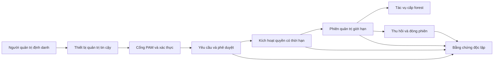

# Enterprise Admin control

## 1. Mục tiêu bài học

Enterprise Admins (EA) là nhóm đặc quyền của Active Directory Domain Services (AD DS) có tác động tới toàn bộ forest. Kiểm soát nhóm này không chỉ là giảm số người có tên trong danh sách thành viên. Một thiết kế Privileged Access Management (PAM) phải kiểm soát được ai có thể nhận quyền, ai có thể cấp quyền, quyền được dùng từ đâu, trong bao lâu và bằng chứng nào chứng minh quyền đã được thu hồi.

Sau bài học, bạn có thể:

- Phân biệt Enterprise Admins với Domain Admins, Schema Admins và vai trò quản trị Microsoft Entra ID.
- Kiểm kê thành viên trực tiếp, thành viên lồng nhau và các đường kiểm soát gián tiếp.
- Thiết kế quy trình cấp quyền theo yêu cầu, phê duyệt độc lập và giới hạn thời gian.
- Kết hợp tài khoản quản trị riêng, máy quản trị tin cậy, vault và giám sát phiên.
- Xác minh thu hồi cả membership lẫn phiên làm việc.
- Thu thập bằng chứng phục vụ kiểm toán và ứng phó sự cố cấp forest.

Phạm vi bài là AD DS do tổ chức quản lý. Ví dụ sử dụng forest giả định `corp.example`, root domain `corp.example` và child domain `vn.corp.example`.

## 2. Enterprise Admins nắm quyền gì?

### 2.1. Vị trí và danh tính của nhóm

Enterprise Admins tồn tại trong forest root domain. Trong AD DS hiện đại, đây là universal security group; RID của nhóm là `519`. SID đầy đủ được tạo từ SID của root domain cộng với RID này:

```text
<RootDomainSID>-519
```

Tên hiển thị có thể thay đổi hoặc được bản địa hóa. Hệ thống kiểm kê và cảnh báo nên nhận diện nhóm bằng SID thay vì chỉ so sánh chuỗi `Enterprise Admins`. Vị trí, phạm vi và RID được mô tả trong [tài liệu giao thức AD DS của Microsoft](https://learn.microsoft.com/en-us/openspecs/windows_protocols/ms-adts/7799841e-1963-46cd-99f3-99dfa2e4dab2).

Không lấy SID của child domain rồi thêm `-519` để tìm EA. Việc đó không xác định đúng nhóm Enterprise Admins của forest.

### 2.2. Phân biệt các nhóm và vai trò

| Nhóm hoặc vai trò | Phạm vi cần quan tâm | Ý nghĩa khi thiết kế PAM |
| --- | --- | --- |
| Enterprise Admins | Các thay đổi và khả năng quản trị cấp forest | Chỉ kích hoạt khi công việc thực sự cần quyền này |
| Domain Admins | Quyền quản trị rộng trong một domain | Không thay bằng EA chỉ để thuận tiện |
| Schema Admins | Các thao tác thay đổi schema được cấp cho nhóm | Xét riêng nhu cầu và quy trình phê duyệt |
| Administrators trong domain | Quyền mạnh đối với domain và domain controller | Kiểm tra membership và quyền thực tế |
| Local Administrators trên member server | Quản trị một máy hoặc nhóm máy | Dùng delegation hoặc server/endpoint PAM phù hợp |
| Global Administrator trong Microsoft Entra ID | Vai trò trong tenant Entra ID | Không đồng nhất với EA của AD DS |

Bảng mô tả phạm vi vận hành, không khẳng định các nhóm là những ranh giới cách ly tuyệt đối. Một quyền mạnh trong domain có thể tạo đường ảnh hưởng rộng hơn tùy cấu hình và quan hệ tin cậy.

EA được thêm mặc định vào Administrators của từng domain trong forest. Microsoft mô tả EA là nhóm dành cho một số thay đổi cấp forest; delegation đúng thiết kế giúp giảm nhu cầu dùng nhóm này. Xem [Privileged Accounts and Groups in Active Directory](https://learn.microsoft.com/en-us/windows-server/identity/ad-ds/plan/security-best-practices/appendix-b--privileged-accounts-and-groups-in-active-directory).

### 2.3. Vì sao không dùng EA cho mọi công việc?

Một kỹ sư cần khởi động lại dịch vụ trên application server không vì thế cần quyền cấp forest. Thêm người đó vào EA có thể làm thao tác thành công nhưng che khuất vấn đề phân quyền.

Câu hỏi đầu tiên của quy trình PAM phải là:

> Công việc này cần quyền cụ thể nào trên đối tượng nào, và đã loại trừ giải pháp có phạm vi nhỏ hơn chưa?

Reset mật khẩu trong một OU, quản lý nhóm nghiệp vụ, vận hành máy chủ và quản trị ứng dụng phải được đánh giá bằng delegation tương ứng. Không dùng EA như cách xử lý mọi lỗi Access Denied.

Đối với thay đổi sản phẩm tích hợp AD, hãy đọc yêu cầu quyền cho từng giai đoạn cài đặt và vận hành. Một bước chuẩn bị có thể cần quyền mạnh nhưng không có nghĩa tài khoản chạy dịch vụ sau đó cũng cần giữ quyền đó.

## 3. Mô hình rủi ro: nhìn vượt ra ngoài membership

Báo cáo “EA không có người dùng thường trực” là tín hiệu tốt, nhưng chưa chứng minh forest đã an toàn.

Có bốn lớp cần kiểm soát:

1. **Membership hiện tại:** tài khoản hoặc nhóm nào đang trực tiếp, gián tiếp nhận quyền.
2. **Khả năng thay đổi membership:** ai có thể thêm chính mình hoặc người khác.
3. **Khả năng chiếm tài khoản:** ai có thể reset mật khẩu hoặc điều khiển máy quản trị.
4. **Khả năng điều khiển hạ tầng danh tính:** ai quản trị DC, nền tảng ảo hóa, backup và các hệ thống có thể tác động tới AD.

Một nhóm hỗ trợ không nằm trong EA nhưng có thể reset mật khẩu tài khoản cấp EA vẫn là một phần của đường kiểm soát đặc quyền. Tương tự, tài khoản connector có quyền sửa membership EA phải được bảo vệ theo tác động cấp forest của nó.

### 3.1. Thành viên lồng nhau

Giả sử cấu trúc nhóm như sau:

```text
Enterprise Admins
└── Forest-Maintenance
    └── Emergency-Operators
        └── adm.linh
```

Nếu owner của `Emergency-Operators` có thể thêm người mà không qua phê duyệt cấp forest, họ có thể gián tiếp làm tăng số người có EA.

Membership lồng nhau đòi hỏi kiểm soát toàn bộ chuỗi nhóm. Một chính sách dễ đối soát là chỉ chấp nhận tài khoản quản trị định danh đã được phê duyệt, hoặc cấu trúc nhóm được thiết kế và giám sát rõ ràng. Tên nhóm có chữ “Admin” không phải bằng chứng về chất lượng kiểm soát.

### 3.2. Nhóm rỗng không xóa hậu quả của phiên trước

Một người từng có EA có thể đã tạo tài khoản, thay ACL, sửa chính sách hoặc thay đổi hạ tầng. Loại bỏ membership không tự đảo ngược các thay đổi đó.

Cần phân biệt hai kết luận:

- Hiện không có membership EA đang được cấp.
- Không phát hiện đường đặc quyền ngoài phạm vi đã phê duyệt sau phiên làm việc.

Kết luận thứ hai cần đối chiếu thay đổi và điều tra phù hợp, không thể suy ra chỉ từ kết luận thứ nhất.

## 4. Chính sách cấp quyền Enterprise Admins

Mục tiêu vận hành là không dùng EA thường trực cho công việc hằng ngày. Microsoft khuyến nghị nhóm này không chứa người dùng trong vận hành thường nhật, với ngoại lệ có điều kiện đối với Administrator của root domain được bảo vệ phù hợp. Đây không phải yêu cầu xóa tài khoản built-in hoặc loại bỏ mọi đường khôi phục. Xem [Securing Enterprise Admins Groups in Active Directory](https://learn.microsoft.com/en-us/windows-server/identity/ad-ds/plan/security-best-practices/appendix-e--securing-enterprise-admins-groups-in-active-directory).

Mẫu chính sách nội bộ:

| Nội dung | Quy định minh họa |
| --- | --- |
| Điều kiện xin EA | Tác vụ được xác định cần quyền cấp forest |
| Danh tính được cấp | Tài khoản quản trị riêng, gắn với một cá nhân |
| Phê duyệt | Người duyệt độc lập với người thực hiện |
| Thời gian | Cửa sổ ngắn theo tác vụ, ví dụ 30 phút |
| Điểm truy cập | Máy quản trị được phê duyệt cho hệ thống danh tính |
| Xác thực | Kiểm tra danh tính mạnh tại điểm truy cập và đường đăng nhập liên quan |
| Kết thúc | Thu hồi membership, đóng phiên và kiểm tra bằng chứng |
| Ngoại lệ | Có owner, lý do, hạn sử dụng và review định kỳ |

Con số 30 phút là ví dụ thiết kế, không phải thời hạn mặc định của Windows.

Yêu cầu “cần EA trong một tuần để xử lý nhiều việc” phải được tách thành hoạt động cụ thể hoặc giải quyết bằng delegation. Nếu không, quy trình JIT dễ trở thành membership thường trực có ngày hết hạn.

### 4.1. Phân vai trong quy trình

Tối thiểu cần phân biệt:

- Người yêu cầu: giải thích công việc và phạm vi.
- Người phê duyệt: xác nhận nhu cầu quyền và cửa sổ thay đổi.
- Người thực hiện: dùng tài khoản quản trị được định danh.
- Hệ thống hoặc người cấp quyền: thêm và thu hồi membership.
- Người giám sát: tiếp nhận cảnh báo, kiểm tra bằng chứng.

Không nhất thiết mỗi vai trò luôn là một người riêng. Tuy nhiên, không để cùng một cá nhân tự yêu cầu, tự duyệt, tự cấp và tự đóng bằng chứng mà không có kiểm soát bù trừ.

### 4.2. Điều kiện ngoại lệ

Một ngoại lệ phải mô tả điều kiện tồn tại, tác động, người chịu trách nhiệm và ngày đánh giá lại. “Ứng dụng cũ cần quyền” chưa đủ: phải chỉ rõ thao tác nào cần quyền và kế hoạch loại bỏ phụ thuộc.

Theo dõi ngoại lệ theo tuổi và số lần gia hạn. Một ngoại lệ được gia hạn liên tục là đầu việc thiết kế quyền chưa được xử lý, không phải trạng thái vận hành đã ổn định.

## 5. Kiểm kê bằng PowerShell chỉ đọc

Các ví dụ cần RSAT Active Directory module, kết nối AD và quyền đọc phù hợp. Script trong phần này không thay đổi AD.

### 5.1. Xác định nhóm bằng root domain SID

```powershell
Import-Module ActiveDirectory
$ErrorActionPreference = 'Stop'

$forest = Get-ADForest
$rootDomain = Get-ADDomain -Identity $forest.RootDomain
$rootPdc = $rootDomain.PDCEmulator
$eaSid = '{0}-519' -f $rootDomain.DomainSID.Value

$groupQuery = @{
    Identity = $eaSid
    Server = $rootPdc
    Properties = 'member', 'whenChanged', 'groupScope', 'groupCategory'
}
$eaGroup = Get-ADGroup @groupQuery

$eaGroup |
    Select-Object Name, DistinguishedName, SID,
                  GroupScope, GroupCategory, whenChanged
```

Chỉ định `-Server` giúp tránh tình huống phiên đang kết nối child domain nhưng tìm đối tượng root domain ở ngữ cảnh không phù hợp.

`whenChanged` là dấu mốc hỗ trợ khảo sát, không phải lịch sử đầy đủ của membership. Nó không thay thế Security log hoặc lịch sử yêu cầu PAM.

### 5.2. Thành viên trực tiếp và đệ quy

Chạy tiếp trong cùng phiên:

```powershell
$memberQuery = @{
    Identity = $eaGroup.DistinguishedName
    Server = $rootPdc
}
$directMembers = @(Get-ADGroupMember @memberQuery)
$recursiveLeafMembers = @(Get-ADGroupMember @memberQuery -Recursive)

$directMembers |
    Select-Object Name, ObjectClass, SID, DistinguishedName

$recursiveLeafMembers |
    Select-Object Name, ObjectClass, SID, DistinguishedName

[pscustomobject]@{
    EnterpriseAdminsSID = $eaSid
    DirectMemberCount = $directMembers.Count
    RecursiveLeafMemberCount = $recursiveLeafMembers.Count
    ObservedOnDC = $rootPdc
    ObservedAtUtc = [DateTime]::UtcNow
}
```

Giữ cả hai góc nhìn:

- Danh sách trực tiếp cho biết nhóm nào được lồng vào EA.
- `-Recursive` giúp thấy principal ở cuối chuỗi nhưng không trình bày đầy đủ đường đi qua các nhóm trung gian.

Không dùng số lượng kết quả đệ quy làm bằng chứng duy nhất về quyền hiệu lực. Principal không phân giải được hoặc chuỗi nhóm chưa truy vấn hết phải được ghi là phần chưa kiểm tra xong.

Nếu truy vấn thất bại, báo cáo phải thể hiện thất bại. Không thay kết quả lỗi bằng mảng rỗng rồi kết luận “không có thành viên”.

### 5.3. Kiểm tra quyền gián tiếp

Bổ sung việc xem security descriptor của EA và các đối tượng liên quan qua công cụ AD phù hợp.

Chú ý khả năng sửa thuộc tính thành viên, thay DACL, thay owner hoặc điều khiển tài khoản được cấp quyền. Phải đọc phạm vi áp dụng, ACE cho phép/từ chối, inheritance và membership của principal nhận quyền. Chỉ thấy tên một quyền trong ACL chưa đủ kết luận quyền hiệu lực.

Không mở rộng ACL trên EA cho nhóm hỗ trợ thông thường để tiện tích hợp. Nếu hệ thống PAM có thể thay đổi EA, tài khoản thực thi, máy chạy connector, cấu hình và đường cập nhật của nó đều thuộc phạm vi kiểm soát đặc quyền.

Kết quả kiểm kê nên ghi thời điểm quan sát, DC nguồn, lỗi truy vấn và người thực hiện. Một ảnh chụp không có thời gian và nguồn dữ liệu rất khó đối chiếu khi điều tra thay đổi.

## 6. Kiến trúc đường truy cập quản trị



Đây là mô hình tham chiếu; không phải sản phẩm nào cũng triển khai từng khối bằng một thành phần riêng.

### 6.1. Tài khoản và thiết bị

Dùng tài khoản thông thường cho email, duyệt web và công việc văn phòng; dùng tài khoản riêng cho quản trị danh tính. Chỉ kích hoạt quyền trong điều kiện đã kiểm tra.

Thiết bị quản trị cần hạn chế phần mềm và kết nối không phục vụ quản trị. Jump server dùng chung cho hỗ trợ desktop và thay đổi cấp forest có thể trở thành nơi hội tụ credential từ nhiều mức tin cậy.

Kiểm tra đường đi thực tế của credential. Có cổng PAM ở đầu đường không chứng minh credential không xuất hiện trên máy đích hoặc trong phiên ngoài kiểm soát.

Các đường cập nhật phần mềm, quản trị từ xa và khôi phục thiết bị quản trị cũng cần được xem xét. Nếu một nhóm quản trị máy văn phòng có thể thay toàn bộ cấu hình máy dùng EA, việc tách tài khoản chưa tạo ra mức bảo vệ mong muốn.

### 6.2. Vai trò của vault

Vault hỗ trợ lưu bí mật, checkout, giới hạn truy cập và luân chuyển theo cơ chế tích hợp. Cất mật khẩu EA thường trực trong vault vẫn để lại quyền thường trực trong AD.

Cần trả lời riêng:

1. Ai được yêu cầu hoặc lấy credential?
2. Credential có lộ trực tiếp cho người dùng không?
3. Tài khoản nhận EA khi nào?
4. Hệ thống nào đảm bảo thu hồi khi hết hạn?
5. Nếu vault hoặc connector ngừng hoạt động, đường khôi phục là gì?

Với tài khoản định danh, không tự đặt lại mật khẩu sau mọi phiên nếu thiết kế xác thực và chính sách không yêu cầu. Với bí mật dùng chung hoặc đã tiết lộ, phải có quy trình luân chuyển tương ứng. Mục tiêu là kiểm soát credential theo mô hình thực tế, không chỉ có nút Rotate trên dashboard.

Không dùng cùng một bí mật quản trị cho tất cả automation. Một lần lộ credential không nên làm mất khả năng phân biệt ai hoặc hệ thống nào đã thực hiện hoạt động.

### 6.3. MFA và phạm vi bảo vệ

MFA tại cổng PAM bảo vệ việc vào cổng đó; nó không tự áp dụng cho mọi giao thức hoặc đường đăng nhập trực tiếp vào AD.

Kiểm tra các đường ngoài cổng: máy quản trị khác, RDP trực tiếp, công cụ dòng lệnh và credential từ phiên trước. Nếu chúng vẫn dùng được ngoài chính sách mong muốn, cần giải quyết bằng kiến trúc truy cập và cấu hình xác thực phù hợp.

EA trong AD DS cũng không tự trở thành vai trò được quản trị bởi Microsoft Entra PIM. Tích hợp hybrid cần được chứng minh cụ thể; không suy ra cấu hình PIM trên tenant đã thu hồi membership EA trong AD.

## 7. Quy trình cấp quyền có thời hạn

### 7.1. Trước khi kích hoạt

Mỗi yêu cầu cần ghi:

- Ticket hoặc mã change.
- Tài khoản và người chịu trách nhiệm.
- Tác vụ, đối tượng và thành phần bị tác động.
- Vì sao delegation hoặc quyền nhỏ hơn không đáp ứng.
- Thời điểm bắt đầu, hạn tối đa và điều kiện dừng.
- Máy quản trị, đường kết nối, người duyệt.
- Cách hoàn tác và cách phục hồi nếu quản trị AD bị gián đoạn.

Không cấp EA trước rồi bổ sung ticket sau trong luồng thông thường. Khi khẩn cấp, dùng quy trình break-glass đã thiết kế với ngoại lệ và bằng chứng tương ứng.

### 7.2. Khi kích hoạt

Sau khi quyền được cấp:

1. Kiểm tra tài khoản, SID nhóm và thời hạn đúng yêu cầu.
2. Xác nhận trạng thái tại DC liên quan và replication theo nhu cầu phiên.
3. Tạo phiên đăng nhập mới theo cơ chế đã thiết kế để nhận quyền.
4. Chỉ thực hiện tác vụ được duyệt.
5. Dừng hoặc xin phê duyệt bổ sung nếu phạm vi thay đổi.

Không kỳ vọng mọi cửa sổ PowerShell mở trước khi cấp quyền tự cập nhật quyền đồng nhất. Membership trong directory và quyền trong access token đang tồn tại là hai lớp khác nhau.

Nếu một tác vụ cần thời gian dài hơn dự kiến, gia hạn phải là quyết định có ghi nhận. Không tự nối tiếp các yêu cầu ngắn để vượt giới hạn tổng thời gian.

### 7.3. Hai cách triển khai thời hạn

**Membership thông thường do PAM điều phối:** hệ thống thêm principal, ghi hạn và chủ động xóa membership. Thiết kế cần xử lý connector lỗi, hàng đợi dừng và retry. Một scheduled task đơn lẻ không đủ nếu thiếu giám sát và đối soát độc lập.

**Membership có TTL của AD:** môi trường đáp ứng điều kiện có thể dùng thành viên có thời hạn. `Add-ADGroupMember` có tham số `-MemberTimeToLive`; điều này không có nghĩa mọi forest đã sẵn sàng dùng TTL. Xem [tài liệu Add-ADGroupMember](https://learn.microsoft.com/en-us/powershell/module/activedirectory/add-adgroupmember?view=windowsserver2025-ps).

Đội nền tảng phải xác nhận forest functional level, tính năng PAM cần thiết, DC, replication và hệ thống điều phối đều phù hợp. Không bật optional feature cấp forest như bước phụ trong yêu cầu cấp EA.

Ví dụ minh họa cho lab đã chuẩn bị đủ điều kiện:

```powershell
# Lenh Add-ADGroupMember se thay doi AD neu bo -WhatIf.
# Chi dung trong lab da xac nhan dieu kien TTL.
# $eaGroup va $rootPdc duoc xac dinh o phan kiem ke.

$labAdmin = Get-ADUser -Identity 'adm.lab-change' -Server $rootPdc
$requestedDuration = New-TimeSpan -Minutes 15

$grantPreview = @{
    Identity = $eaGroup.DistinguishedName
    Members = $labAdmin
    MemberTimeToLive = $requestedDuration
    Server = $rootPdc
    WhatIf = $true
}
Add-ADGroupMember @grantPreview
```

`-WhatIf` chỉ mô phỏng tác động được cmdlet hỗ trợ, không cấp quyền và không chứng minh đường TTL hoạt động hoàn chỉnh. Không bỏ tùy chọn này chỉ để thử trên forest chưa được đánh giá.

TTL chỉ giải quyết một phần vòng đời membership. JIT vẫn cần phê duyệt, định danh, kiểm soát phiên và xác minh kết thúc.

## 8. Thu hồi quyền: nhiều hơn xóa thành viên

Khi membership bị xóa hoặc hết hạn, phiên đăng nhập và access token đã phát hành không nhất thiết biến mất ngay. Ticket Kerberos, phiên dịch vụ và trạng thái xác thực liên quan cần được xem xét theo cơ chế và đường truy cập thực tế.

Quy trình đóng phiên phải kiểm tra:

1. Không còn membership trực tiếp hoặc qua nhóm khác.
2. Thu hồi đã đến các DC mà đường truy cập sử dụng.
3. Phiên quản trị đã đóng ở cổng PAM và máy đích liên quan.
4. Không còn phiên ngoài cổng hoặc tiến trình tiếp tục chạy bằng context đã cấp.
5. Lần truy cập mới không còn nhận EA theo thiết kế.
6. Thay đổi đã thực hiện khớp với yêu cầu.

Không coi `klist purge` trên một máy là cách thu hồi toàn forest. Nó không tự đóng mọi phiên, hủy mọi access token hoặc đảo ngược thay đổi.

Đặt lại mật khẩu cũng không phải bằng chứng duy nhất rằng mọi quyền sử dụng credential đã phát hành đều kết thúc. Khi nghi bị xâm nhập, dùng quy trình ứng phó sự cố thay vì chỉ đóng ticket PAM.

### 8.1. Định nghĩa hoàn tất

```text
Approved
  -> Membership granted
  -> Authorized session started
  -> Approved operation finished
  -> Membership removed or expired
  -> Sessions closed
  -> Revocation checked
  -> Evidence reviewed
  -> Closed
```

Thu hồi thất bại phải tạo lỗi cần xử lý, không đổi thành thành công chỉ vì đồng hồ portal đã đến hạn.

Đối soát nên chạy độc lập với workflow cấp quyền. Nếu cùng một connector vừa cấp, vừa thu hồi, vừa tự tuyên bố mọi bước thành công mà không có quan sát bên ngoài, một lỗi của connector có thể che luôn sai lệch.

## 9. Giới hạn nơi được sử dụng EA

Mục tiêu là tránh đưa credential hoặc phiên cấp forest xuống máy có mức tin cậy thấp hơn.

Với workstation và member server không phục vụ quản trị danh tính, có thể thiết kế chính sách ngăn các kiểu đăng nhập EA không phù hợp. Microsoft liệt kê các quyền từ chối network, batch, service, local và Remote Desktop Services trong [hướng dẫn bảo vệ Enterprise Admins](https://learn.microsoft.com/en-us/windows-server/identity/ad-ds/plan/security-best-practices/appendix-e--securing-enterprise-admins-groups-in-active-directory).

Áp dụng phải có phạm vi OU, nhóm máy và ngoại lệ rõ ràng. Không sao chép chính sách workstation vào DC hoặc liên kết ở domain root khi chưa kiểm tra tác động.

Trong lab cần xác minh:

- Máy nào nhận GPO và máy nào không.
- Có xung đột giữa quyền cho phép và từ chối không.
- Đường quản trị danh tính hợp lệ còn hoạt động.
- Đường khôi phục dùng được đúng nơi thiết kế.
- Không có service hoặc scheduled task phụ thuộc EA.

Nếu service dùng EA, phải thiết kế lại quyền dịch vụ. Ngoại lệ vô thời hạn chỉ tiếp tục giữ nguyên phụ thuộc đó.

Không xóa EA khỏi Administrators của các domain chỉ để làm giảm con số quyền trên báo cáo. Giữ cấu trúc khôi phục có chủ đích và giảm việc cấp membership, theo [khuyến nghị Microsoft](https://learn.microsoft.com/en-us/windows-server/identity/ad-ds/plan/security-best-practices/appendix-e--securing-enterprise-admins-groups-in-active-directory).

## 10. AdminSDHolder và tài khoản từng có đặc quyền

EA thuộc các nhóm được bảo vệ trong AD DS. AdminSDHolder và SDProp có thể ảnh hưởng tới security descriptor và inheritance của principal được bảo vệ. Delegation trên OU vì vậy không nhất thiết tác động như mong đợi tới tài khoản vừa được cấp quyền quản trị.

Cần nhớ:

- Tài khoản từng thuộc nhóm được bảo vệ có thể còn `adminCount=1` sau khi rời nhóm.
- Inheritance không tự trở về trạng thái mong muốn chỉ vì membership bị xóa.
- `adminCount` không phải nguồn duy nhất để xác định ai đang có EA.
- Không sửa AdminSDHolder hoặc bật inheritance hàng loạt để xử lý nhanh lỗi quyền.

Microsoft mô tả cơ chế bảo vệ trong [Appendix C: Protected Accounts and Groups](https://learn.microsoft.com/en-us/windows-server/identity/ad-ds/plan/security-best-practices/appendix-c--protected-accounts-and-groups-in-active-directory), và trạng thái sau khi rời nhóm trong [Reducing the Active Directory Attack Surface](https://learn.microsoft.com/en-us/windows-server/identity/ad-ds/plan/security-best-practices/reducing-the-active-directory-attack-surface).

Nếu thường xuyên đưa tài khoản vào và ra EA, đội AD phải đánh giá trước tác động tới lifecycle. Khôi phục ACL cần quy trình riêng, dựa trên toàn bộ membership và mục tiêu bảo vệ tài khoản.

Không dùng sự tồn tại của adminCount như lý do giữ quyền EA. Đó là hai vấn đề khác nhau: một bên là trạng thái bảo vệ đối tượng, một bên là quyền quản trị hiện tại.

## 11. Giám sát và cảnh báo

### 11.1. Đúng nhóm, đúng sự kiện, đúng DC

Với EA là universal security group, các sự kiện đáng chú ý gồm:

| Event ID | Ý nghĩa | Cách dùng |
| --- | --- | --- |
| 4756 | Thêm thành viên vào security-enabled universal group | Đối chiếu SID nhóm, principal, actor, ticket |
| 4757 | Xóa thành viên khỏi nhóm loại trên | Kiểm tra thu hồi membership thông thường |
| 4755 | Thay đổi universal security group | Điều tra thuộc tính và actor |
| 5136 | Đối tượng directory bị sửa | Bổ sung quan sát khi audit policy và SACL phù hợp |
| 4624 | Đăng nhập thành công | Tương quan tài khoản, máy và thời gian |
| 4672 | Đặc quyền nhạy cảm được gán cho phiên mới | Dữ liệu hỗ trợ, không riêng cho EA |
| 1102 | Security audit log bị xóa | Cảnh báo tác động tới bằng chứng |

Ý nghĩa và nhóm audit được trình bày trong [Advanced Audit Policy Configuration](https://learn.microsoft.com/en-us/windows-server/identity/ad-ds/plan/security-best-practices/advanced-audit-policy-configuration). Không coi 4672 là sự kiện “người dùng vừa được thêm vào EA”.

Cần bật audit phù hợp trên DC, kiểm tra thu thập, đồng bộ thời gian và chuyển log tới nơi lưu độc lập. Sự kiện membership xuất hiện tại DC xử lý thay đổi; chỉ thu từ PDC không đảm bảo bao phủ mọi đường ghi.

Với TTL, kiểm thử tín hiệu khi membership hết hạn. Không mặc định tự hết hạn tạo cùng chuỗi sự kiện như xóa thủ công.

### 11.2. Truy vấn membership event theo SID

Ví dụ chỉ đọc dưới đây dùng biến ở phần kiểm kê:

```powershell
$rootDCs = @(
    Get-ADDomainController -Filter * -Server $rootDomain.DNSRoot
)
$startTime = (Get-Date).AddHours(-24)

$membershipEvents = foreach ($dc in $rootDCs) {
    $eventQuery = @{
        ComputerName = $dc.HostName
        FilterHashtable = @{
            LogName = 'Security'
            Id = 4756, 4757
            StartTime = $startTime
        }
        ErrorAction = 'Continue'
    }
    $events = Get-WinEvent @eventQuery

    foreach ($event in $events) {
        $eventXml = [xml]$event.ToXml()
        $fields = @{}
        foreach ($field in $eventXml.Event.EventData.Data) {
            $fields[[string]$field.Name] = [string]$field.InnerText
        }

        if ($fields['TargetSid'] -eq $eaSid) {
            [pscustomobject]@{
                TimeCreated = $event.TimeCreated
                DC = $event.MachineName
                RecordId = $event.RecordId
                EventId = $event.Id
                GroupSid = $fields['TargetSid']
                MemberSid = $fields['MemberSid']
                MemberName = $fields['MemberName']
                Actor = '{0}\{1}' -f
                    $fields['SubjectDomainName'],
                    $fields['SubjectUserName']
                SubjectLogonId = $fields['SubjectLogonId']
            }
        }
    }
}

$membershipEvents |
    Sort-Object TimeCreated |
    Format-Table -AutoSize
```

Đọc XML theo tên field tránh phụ thuộc ngôn ngữ thông điệp hiển thị.

Đây là script khảo sát, không phải bộ thu thập vận hành hoàn chỉnh. Lỗi truy cập DC, log bị ghi đè hoặc thiếu audit là khoảng trống dữ liệu. Không trả ra dòng nào chưa chứng minh không có thay đổi.

Nếu connector thêm thành viên, actor trong AD log có thể là connector. Muốn tìm người yêu cầu phải nối sự kiện với nhật ký PAM, approval và phiên.

### 11.3. Cảnh báo có ngữ cảnh nghiệp vụ

Nên phát hiện:

- Membership EA không có yêu cầu đã duyệt đang hiệu lực.
- Principal, actor hoặc thời gian khác dữ liệu ticket.
- Membership tồn tại quá hạn.
- Nhóm mới được lồng vào EA.
- Membership hoặc ACL của nhóm trung gian thay đổi.
- Tài khoản EA đăng nhập từ máy ngoài đường quản trị.
- Connector không thể thu hồi.
- Cấu hình cấp quyền hoặc audit bị sửa ngoài kế hoạch.
- Thu thập log ngừng hoạt động.

Mỗi cảnh báo cần owner và hành động. Dashboard chuyển đỏ nhưng không có người xử lý khi quyền quá hạn không tạo ra kiểm soát hiệu quả.

Các hoạt động được phê duyệt vẫn cần ghi log. Không tắt cảnh báo bằng cách bỏ hoàn toàn dữ liệu; nên đánh dấu hoạt động khớp ticket và giữ lại bằng chứng để review.

## 12. Bằng chứng cho mỗi lần dùng EA

| Nhóm bằng chứng | Trường tối thiểu minh họa |
| --- | --- |
| Yêu cầu | Ticket, lý do, tác vụ, phạm vi |
| Danh tính | Người thực hiện, tài khoản, SID |
| Phê duyệt | Người duyệt, thời gian, quyết định, hạn |
| Cấp quyền | SID nhóm, principal, DC, thời điểm, cơ chế thời hạn |
| Phiên | Máy nguồn, máy đích, mã phiên, thời gian |
| Thay đổi | Kết quả tác vụ, diff cấu hình hoặc log phù hợp |
| Thu hồi | Membership sau thu hồi, trạng thái phiên, truy cập mới |
| Kết luận | Người review, sai lệch, hành động tiếp theo |

Session recording hữu ích nhưng không nhất thiết thấy mọi tác động của script, API, tác vụ nền hoặc kết nối ngoài phiên. Cần tương quan recording với log và thay đổi đối tượng.

Lưu bằng chứng tại nơi người đang dùng EA không dễ sửa hoặc xóa toàn bộ. Chính sách lưu giữ và quyền đọc phải tính tới dữ liệu nhạy cảm trong transcript. Không ghi mật khẩu vào log để chứng minh đã dùng vault.

Đối với thay đổi cấu hình, một kết quả “command completed” chưa cho biết trạng thái cuối đúng hay sai. Cần xác định trước kết quả mong đợi và lưu quan sát sau tác vụ.

### 12.1. Chỉ số vận hành

Các chỉ số có thể theo dõi:

- Số principal có EA ngoài cửa sổ được duyệt.
- Số lần cấp quyền không nối được với ticket.
- Số lần thu hồi hoặc đóng phiên thất bại.
- Khoảng thời gian sai lệch từ khi hết hạn đến khi xử lý xong.
- Số ngoại lệ thường trực và tuổi ngoại lệ.
- Tỷ lệ phiên thiếu bằng chứng kết thúc.
- Khoảng thời gian mất thu thập log.

Không tối ưu chỉ số “số người trong nhóm” bằng cách chuyển toàn bộ quyền vào một tài khoản dùng chung. Việc đó giảm số dòng nhưng làm yếu khả năng quy trách nhiệm.

## 13. Tình huống minh họa

Công ty An Phúc có ba domain trong một forest và sáu tài khoản EA thường trực. Một kỹ sư dùng EA để vận hành ứng dụng, đôi khi đăng nhập workstation hỗ trợ.

Đội PAM kiểm kê công việc và phát hiện:

- Ba tài khoản chỉ quản trị member server.
- Hai tài khoản reset mật khẩu và quản lý nhóm trong OU nghiệp vụ.
- Một tài khoản dùng khi thay đổi hạ tầng danh tính cấp forest.
- Một scheduled task chạy bằng credential của tài khoản đầu tiên.

### 13.1. Thiết kế lại

Đội hạ tầng thiết kế quyền có phạm vi cho server và OU. Scheduled task chuyển sang danh tính dịch vụ với quyền thích hợp sau kiểm thử. Các công việc này không còn cần EA.

Với thay đổi cấp forest, tổ chức yêu cầu tài khoản riêng, ticket có lý do, người duyệt độc lập và cửa sổ minh họa 30 phút. Phiên chỉ bắt đầu từ thiết bị quản trị đã đăng ký.

Tài khoản khôi phục được quản lý bằng quy trình riêng và có diễn tập; không dùng để vượt quy trình hằng ngày.

### 13.2. Sai lệch trong lần chạy thử

Portal báo Expired, membership biến mất trên DC của connector, nhưng phiên quản trị trên máy đích vẫn mở. Đây là lỗi định nghĩa hoàn tất.

Đội PAM bổ sung đóng phiên, xác minh trên đường truy cập thực tế và kiểm tra truy cập mới. Ticket chỉ đóng khi hoàn tất hoặc chuyển thành sự cố có owner.

Sau đó một lần cấp quyền xuất hiện actor là tài khoản connector chứ không phải kỹ sư. Đội nối mã yêu cầu PAM, thời điểm cấp, SID tài khoản nhận quyền và phiên để xác định người đã yêu cầu. Không đổi tên tài khoản connector thành tên người dùng chỉ để làm đẹp log.

Tình huống cho thấy phải quan sát directory, phiên và thay đổi thực tế. Một nhãn trạng thái trên portal không thay thế được ba lớp này.

## 14. Khi nghi EA bị sử dụng trái phép

Trình tự tham chiếu:

1. Xác nhận SID nhóm, principal và DC phát sinh sự kiện.
2. Đối chiếu ticket, hoạt động khẩn cấp và actor connector.
3. Bảo toàn log DC, PAM, thiết bị quản trị và máy đích.
4. Ngăn phiên và đường truy cập trái phép theo kế hoạch ứng phó.
5. Thu hồi membership và đường cấp quyền ngoài quy trình.
6. Kiểm tra tài khoản mới, nhóm lồng nhau, ACL, chính sách và thay đổi hạ tầng trong khoảng liên quan.
7. Quyết định phạm vi khôi phục cùng đội AD và ứng phó sự cố.
8. Theo dõi sự tái xuất hiện của quyền hoặc hành vi đáng ngờ.

Không xóa principal khỏi EA rồi kết luận đã xử lý xong. Người từng có quyền có thể tạo cơ chế truy cập khác.

Khôi phục cấp forest và thay đổi bí mật quan trọng phải theo runbook chuyên biệt. Không tự động thực hiện hàng loạt thay đổi chỉ dựa trên một sự kiện membership.

Cũng không xóa log hoặc reset toàn bộ máy ngay trước khi bảo toàn bằng chứng cần thiết. Ưu tiên thực tế giữa cô lập và thu thập phải được đội ứng phó quyết định theo diễn biến sự cố.

## 15. Những lỗi thiết kế thường gặp

| Lỗi | Hậu quả | Hướng xử lý |
| --- | --- | --- |
| Dùng tên nhóm thay SID | Bỏ sót đổi tên hoặc khác ngôn ngữ | Tìm từ root domain SID và RID 519 |
| Chỉ kiểm kê user trực tiếp | Bỏ sót nhóm lồng nhau | Giữ danh sách trực tiếp và đường membership |
| Vault giữ EA thường trực | Bí mật được quản lý nhưng quyền còn dài hạn | Tách quản lý bí mật khỏi vòng đời quyền |
| Tự duyệt mọi yêu cầu | Mất kiểm soát độc lập | Phân vai và review ngoại lệ |
| Hết hạn portal là đóng ticket | Membership hoặc phiên còn tồn tại | Xác minh ở directory và đường truy cập |
| Chỉ lấy log một DC | Thiếu sự kiện thay đổi | Thu thập đủ DC liên quan |
| EA chạy service | Credential cấp forest tồn tại dài hạn | Thiết kế danh tính dịch vụ phù hợp |
| Deny logon quá rộng | Hỏng đường quản trị/khôi phục | Thử nghiệm phạm vi theo nhóm máy |
| Xóa adminCount hàng loạt | Thay đổi bảo vệ ACL thiếu căn cứ | Kiểm tra lifecycle từng đối tượng |
| MFA portal được coi là bảo vệ mọi giao thức | Đường trực tiếp còn tồn tại | Kiểm tra từng đường thực tế |

## 16. Bài thực hành trong lab

### 16.1. Chuẩn bị

Dùng forest lab tách biệt, ít nhất một DC và máy quản trị có RSAT. Nếu có điều kiện, thêm child domain để quan sát khác biệt giữa root domain và domain đang đăng nhập.

Chuẩn bị tài khoản lab, nhóm trung gian và thu thập log. Không dùng tài khoản hoặc credential sản xuất.

### 16.2. Thực hiện

1. Xác định forest root domain và SID EA bằng script chỉ đọc.
2. Chụp thành viên trực tiếp và đệ quy.
3. Trong hoạt động lab được cho phép, quan sát membership qua nhóm trung gian.
4. Tìm sự kiện theo SID; đối chiếu actor và DC.
5. Viết yêu cầu EA giả định với tác vụ, approval, hạn và máy nguồn.
6. Mô phỏng cấp và thu hồi; chỉ dùng TTL nếu lab hỗ trợ.
7. So sánh phiên mở trước và sau khi cấp quyền.
8. Sau thu hồi, kiểm tra membership, phiên đang mở và truy cập mới.
9. Lập bảng bằng chứng, ghi rõ phần đã xác minh và chưa xác minh.
10. Đưa lab về trạng thái ban đầu theo kế hoạch.

Không cần thực hiện một thay đổi nguy hiểm cấp forest để kiểm tra kỹ năng điều phối PAM. Chọn thao tác lab an toàn và tập trung vòng đời quyền.

### 16.3. Tiêu chí hoàn thành

Người học cần chứng minh:

- Đã tìm đúng nhóm của root domain.
- Không kết luận an toàn từ truy vấn lỗi hoặc thiếu dữ liệu.
- Phân biệt thành viên trực tiếp và đường lồng nhau.
- Có người yêu cầu, người duyệt và tài khoản thực hiện rõ ràng.
- Có thời hạn và cách phát hiện thu hồi thất bại.
- Không đồng nhất hết hạn membership với mọi phiên đã kết thúc.
- Có bằng chứng sau phiên và không còn thay đổi lab ngoài dự kiến.

## 17. Câu hỏi tự kiểm tra

1. Vì sao không lấy SID của child domain cộng RID 519 để tìm EA?
2. EA rỗng có chứng minh không ai tự cấp EA được không?
3. Vì sao lưu mật khẩu trong vault chưa giải quyết quyền thường trực?
4. Nhóm lồng nhau làm tăng phạm vi cần giám sát như thế nào?
5. Portal báo Expired nhưng phiên máy đích còn mở: yêu cầu hoàn tất chưa?
6. Event 4672 có chứng minh một người vừa được thêm vào EA không?
7. Vì sao chỉ thu Security log từ PDC có thể thiếu bằng chứng?
8. Có nên tự xóa adminCount sau mỗi lần rời EA không?
9. Yêu cầu kéo dài nhiều ngày cần được xem xét lại ra sao?
10. Khi actor AD là connector, cần nối dữ liệu nào để tìm người yêu cầu?

Gợi ý lập luận: bắt đầu từ tác vụ và đối tượng, rồi kiểm tra đường cấp quyền, sử dụng và thu hồi. Mỗi kết luận cần bằng chứng ở đúng lớp mà nó mô tả.

## 18. Nguyên tắc cần ghi nhớ

Enterprise Admin control là kiểm soát một năng lực tác động toàn forest. Giữ nhóm ít thành viên chỉ là điểm khởi đầu.

Thiết kế có hiệu quả khi quyền được dùng đúng tác vụ, đúng danh tính, qua đường quản trị tin cậy và trong thời gian đã duyệt. Tổ chức đồng thời phải phát hiện cấp quyền ngoài quy trình, thu hồi quyền và kiểm chứng trạng thái sau phiên.

Khi chưa chứng minh được một bước, hãy ghi khoảng trống và giao owner xử lý. Không biến truy vấn rỗng, việc không thấy cảnh báo hoặc nhãn Expired thành bằng chứng rằng quyền đã được kiểm soát đầy đủ.
