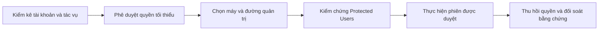

# Protected Users

## 1. Mục tiêu và tình huống sử dụng

Một tài khoản quản trị Windows có thể có mật khẩu mạnh nhưng vẫn bị lạm dụng nếu thông tin xác thực xuất hiện trên máy đã bị kiểm soát. Vì vậy, bảo vệ tài khoản đặc quyền không chỉ là giữ bí mật mật khẩu trong vault; còn phải kiểm soát cách tài khoản xác thực, nơi nó được sử dụng và những dấu vết xác thực còn lại sau phiên làm việc.

Trong Active Directory Domain Services (AD DS), **Protected Users** là nhóm bảo mật dùng để áp dụng các giới hạn xác thực cho tài khoản người dùng. Nhóm không cấp thêm quyền quản trị. Tài khoản vẫn cần được phân quyền riêng đối với máy, dịch vụ và tác vụ mà người dùng phải thực hiện. Đây là một lớp bảo vệ credential trong thiết kế PAM của Windows. [Microsoft Learn — Protected Users](https://learn.microsoft.com/en-us/windows-server/security/credentials-protection-and-management/protected-users-security-group).

Sau bài học, người học có thể:

- Phân biệt bảo vệ credential với cấp quyền và quản lý phiên.
- Đánh giá một tài khoản quản trị cá nhân có phù hợp để đưa vào nhóm hay không.
- Chuẩn bị thử nghiệm có bằng chứng, tiêu chí dừng và đường khôi phục.
- Đọc kết quả xác thực thay vì chỉ kiểm tra membership.
- Đưa thay đổi vào quy trình PAM có chủ sở hữu, phê duyệt và theo dõi ngoại lệ.

**Tình huống xuyên suốt:** doanh nghiệp sử dụng miền `corp.example`, máy quản trị `PAW01`, máy đích `SRV01` và tài khoản quản trị cá nhân `adm.pam.lab`. Đội PAM muốn bảo vệ tài khoản này mà không làm gián đoạn quy trình vận hành. Các tên máy và tài khoản trong bài chỉ là dữ liệu lab.

## 2. Cơ chế cần hiểu

### 2.1. Hai nơi thực thi

Cần đánh giá đồng thời máy đăng nhập và domain controller (DC), vì chỉ nhìn danh sách nhóm không cho biết toàn bộ đường xác thực đã được bảo vệ.

| Nơi thực thi | Hạn chế chính |
| --- | --- |
| Máy đăng nhập hỗ trợ tính năng | Hạn chế lưu credential cho WDigest, CredSSP, NTLM và khóa Kerberos dài hạn; không tạo bộ xác minh cho đăng nhập offline. |
| DC trong miền đáp ứng yêu cầu | Chặn NTLM, DES/RC4 trong Kerberos preauthentication và delegation; TGT có giới hạn ban đầu bốn giờ. |

Bảo vệ phía máy đăng nhập có hiệu lực khi người dùng đăng nhập mới. Không xem việc thêm nhóm là bằng chứng đã thay đổi các phiên cũ. [Microsoft Learn — cơ chế Protected Users](https://learn.microsoft.com/en-us/windows-server/security/credentials-protection-and-management/protected-users-security-group).

Hệ quả vận hành là phải xác định một mốc thử nghiệm rõ ràng: thay đổi membership, chờ dữ liệu miền nhất quán, đóng phiên lab cũ, đăng nhập lại rồi thực hiện tác vụ. Nếu dùng lại cửa sổ quản trị đã mở trước thay đổi, kết quả khó phản ánh đúng trạng thái cần kiểm chứng.

### 2.2. Bốn giờ không phải thời gian được cấp quyền

TGT là vé Kerberos dùng trong quá trình xin vé cho dịch vụ. Với Protected Users, giới hạn TGT và khả năng gia hạn bị ràng buộc ở mức 240 phút. [Microsoft Learn — giới hạn TGT](https://learn.microsoft.com/en-us/windows-server/security/credentials-protection-and-management/protected-users-security-group).

Không dùng giá trị này làm bộ đếm kết thúc phiên PAM. Trong thiết kế vận hành cần phân biệt:

- Thời gian được duyệt thực hiện thay đổi.
- Thời gian tài khoản có quyền đối với tài nguyên.
- Thời gian vé xác thực còn dùng được.
- Thời gian phiên hoặc kết nối ứng dụng còn tồn tại.

Nếu yêu cầu nghiệp vụ là “quyền sửa cấu hình hết hiệu lực sau 30 phút”, hãy thiết kế cơ chế thu hồi quyền và xử lý phiên tương ứng. Không suy ra điều đó từ tuổi thọ TGT.

### 2.3. Bảo vệ credential không đồng nghĩa bảo vệ mọi hành vi

Trong mô hình đe dọa của bài học, một phiên quản trị đang hoạt động vẫn là tài sản nhạy cảm. Quy trình PAM cần kiểm soát tác vụ và máy đích ngay cả khi đường xác thực đã đáp ứng yêu cầu.

Ví dụ, người vận hành được phép sửa một dịch vụ nhưng vô tình chạy script ngoài phạm vi. Membership Protected Users không phải cơ chế phê duyệt script. Cần kết hợp quyền tối thiểu, giới hạn lệnh, quản lý thay đổi và quan sát phiên theo nhu cầu thực tế.

## 3. Điều kiện và phạm vi tài khoản

### 3.1. Nền tảng và khóa AES

Trước triển khai, xác nhận domain functional level từ Windows Server 2012 R2 trở lên, thiết bị đăng nhập thuộc nền tảng được hỗ trợ và tài khoản có khóa AES dùng được. Với tài khoản cũ hoặc di chuyển miền, cần kiểm tra lịch sử đổi mật khẩu; thay đổi cờ thuật toán không tự tạo ra khóa còn thiếu. [Microsoft Learn — cấu hình tài khoản được bảo vệ](https://learn.microsoft.com/en-us/windows-server/security/windows-authentication/how-to-configure-protected-accounts).

Đây là ba câu hỏi khác nhau:

1. Chính sách cho phép thuật toán nào?
2. Tài khoản thực sự có vật liệu khóa tương ứng chưa?
3. Lần xác thực đang kiểm tra đã sử dụng gì?

Không kết luận câu thứ ba từ một ảnh chụp cấu hình. Nếu thay đổi mật khẩu là một phần của kế hoạch, phải phối hợp với vault và quy trình quản lý credential; không ghi mật khẩu vào script hoặc hồ sơ kiểm thử.

### 3.2. Chọn người dùng, không chọn mọi principal có quyền

Không đưa tài khoản dịch vụ hoặc tài khoản máy tính vào Protected Users. Microsoft cũng cảnh báo việc đưa đồng loạt tài khoản đặc quyền vào nhóm có thể khiến đội quản trị mất đường truy cập. [Microsoft Learn — lựa chọn tài khoản](https://learn.microsoft.com/en-us/windows-server/security/windows-authentication/how-to-configure-protected-accounts).

Đề xuất phân loại cho bài lab:

| Loại danh tính | Quyết định triển khai |
| --- | --- |
| Tài khoản quản trị cá nhân, tác vụ tương tác đã kiểm kê | Ứng viên cho pilot. |
| Tài khoản người dùng đang chạy dịch vụ hoặc scheduled task | Tách trách nhiệm danh tính trước khi đánh giá tiếp. |
| Tài khoản dịch vụ, gMSA hoặc máy tính | Thiết kế cơ chế bảo vệ riêng theo loại danh tính. |
| Tài khoản phục hồi khẩn cấp | Đánh giá trong thiết kế break-glass; không đưa vào đợt thay đổi hàng loạt. |
| Tài khoản quản trị chưa có chủ sở hữu hoặc mục đích rõ | Hoàn thiện kiểm kê trước khi thay đổi xác thực. |

Bảng trên là phương án tổ chức triển khai, không phải danh sách quyền mặc định của Windows. Đội PAM phải chịu trách nhiệm xác định chủ sở hữu và hậu quả nếu từng tài khoản không sử dụng được.

### 3.3. Kiểm kê đường làm việc thực tế

Với `adm.pam.lab`, hãy liệt kê cả thao tác thường dùng và thao tác hiếm nhưng quan trọng:

- Công cụ quản trị, máy nguồn, máy đích và tên kết nối.
- Đường qua jump host, proxy hoặc bộ trung gian PAM.
- Thao tác truy cập tài nguyên thứ hai từ một phiên từ xa.
- Ứng dụng cũ, script và tác vụ định kỳ vô tình dùng chung danh tính.
- Ca làm việc dài, mất kết nối DC và quy trình phục hồi.

Đừng chỉ hỏi “tài khoản có đăng nhập được không?”. Câu hỏi cần trả lời là “người vận hành có hoàn thành đúng các tác vụ đã được duyệt qua đúng đường được bảo vệ không?”.

## 4. Đặt Protected Users vào kiến trúc PAM

Một luồng triển khai tham khảo:



Protected Users nằm trong bước kiểm chứng danh tính và xác thực. Các bước khác cần có cơ chế riêng:

| Nhu cầu PAM | Thành phần cần thiết kế |
| --- | --- |
| Ai được làm việc gì | Nhóm quyền, ACL và vai trò có phạm vi cụ thể. |
| Khi nào được sử dụng quyền | Phê duyệt, JIT và cơ chế hết hạn quyền. |
| Tác vụ nào được phép chạy | JEA hoặc cơ chế giới hạn tác vụ phù hợp. |
| Credential được lưu và đổi ra sao | Vault, chủ sở hữu và quy trình luân chuyển. |
| Phiên có tuân thủ yêu cầu không | Nhật ký, giám sát, ghi hình khi cần và đối soát thay đổi. |
| Khi đường quản trị gặp lỗi | Runbook khôi phục và break-glass đã diễn tập. |

### 4.1. Hạn chế nơi sử dụng tài khoản

Nếu mục tiêu là chỉ cho một nhóm quản trị sử dụng các máy quản trị được chọn, cần đánh giá Authentication Policies và Authentication Policy Silos. Các cơ chế này cho phép áp dụng điều kiện xác thực theo tài khoản, thiết bị và dịch vụ; chúng bổ sung một chiều kiểm soát khác với membership Protected Users. [Microsoft Learn — Authentication Policies và Silos](https://learn.microsoft.com/en-us/windows-server/security/credentials-protection-and-management/authentication-policies-and-authentication-policy-silos).

Đề xuất thực hành là ghi rõ hai quyết định trong hồ sơ thiết kế: tài khoản được bảo vệ bằng cơ chế nào và được phép sử dụng ở đâu. Tránh gộp hai quyết định thành một ô “đã bật bảo mật”.

### 4.2. RDP và đường qua bộ trung gian

Với RDP, phải xác định chế độ kết nối thực tế. Không suy ra tất cả kết nối đều thành công hoặc thất bại chỉ từ tên “RDP”.

Remote Credential Guard là một lựa chọn cần đánh giá riêng: nó sử dụng Kerberos và chuyển yêu cầu xác thực về phía thiết bị nguồn thay vì đưa credential đến máy đích. Nó có yêu cầu triển khai và không cho phép fallback NTLM. [Microsoft Learn — Remote Credential Guard](https://learn.microsoft.com/en-us/windows/security/identity-protection/remote-credential-guard).

Trong lab, kiểm thử đúng phiên bản client, chính sách máy đích và đường qua sản phẩm PAM dự kiến sử dụng. Nếu bộ trung gian tạo phiên Windows bằng một danh tính khác, bằng chứng của tài khoản `adm.pam.lab` không đủ để kết luận phiên cuối đã được bảo vệ. Phải truy vết danh tính thực tế tại từng chặng.

## 5. Chuẩn bị pilot có thể khôi phục

Các lệnh bên dưới là ví dụ để chạy trong lab AD được cấp quyền. Chúng không tự tạo tài khoản hoặc cấp quyền quản trị. Không chạy toàn bộ nội dung như một script duy nhất: mỗi bước cần đọc kết quả trước khi tiếp tục.

Chuẩn bị:

- Một tài khoản quản trị lab có tác vụ thử nghiệm rõ ràng.
- Một người hoặc tài khoản vận hành thay đổi membership độc lập với đối tượng thử.
- Quyền đọc AD và quyền sửa nhóm được cấp theo nhiệm vụ.
- Công cụ Active Directory PowerShell trên máy quản trị.
- Kết nối tới DC và quyền truy cập log phù hợp.
- Kế hoạch khôi phục đã kiểm chứng trước khi đóng phiên quản trị đang dùng.

### 5.1. Thu thập thông tin nền

```powershell
Import-Module ActiveDirectory

$pamDc = 'dc01.corp.example'
$pamAccount = 'adm.pam.lab'

$pamDomain = Get-ADDomain -Identity 'corp.example' -Server $pamDc

$pamUserQuery = @{
    Identity   = $pamAccount
    Server     = $pamDc
    Properties = @(
        'Enabled', 'PasswordLastSet', 'MemberOf',
        'msDS-SupportedEncryptionTypes'
    )
}
$pamUser = Get-ADUser @pamUserQuery

$pamDomain |
    Select-Object DNSRoot, DomainMode, DomainSID

$pamUser |
    Select-Object SamAccountName, SID, Enabled, PasswordLastSet,
                  msDS-SupportedEncryptionTypes, MemberOf
```

`Get-ADDomain` cho phép chọn miền và DC dùng để truy vấn; output có các thuộc tính như DomainMode và DomainSID. [Microsoft Learn — Get-ADDomain](https://learn.microsoft.com/en-us/powershell/module/activedirectory/get-addomain?view=windowsserver2025-ps).

Lưu kết quả liên quan vào hồ sơ thay đổi theo chính sách nội bộ. Với mỗi giá trị, ghi cả thời điểm và DC truy vấn. Đặc biệt, không dùng riêng `msDS-SupportedEncryptionTypes` để chứng minh lần xác thực thực tế đã dùng AES.

### 5.2. Xác định đúng nhóm

RID của Protected Users là `525`. Dùng SID của miền kết hợp RID giúp tránh dựa vào tên hiển thị khi vận hành trên các môi trường khác nhau. [Microsoft Learn — thuộc tính nhóm](https://learn.microsoft.com/en-us/windows-server/security/credentials-protection-and-management/protected-users-security-group).

```powershell
$pamProtectedSid = '{0}-525' -f $pamDomain.DomainSID.Value
$pamGroup = Get-ADGroup -Identity $pamProtectedSid -Server $pamDc

$pamGroup |
    Select-Object Name, SID, DistinguishedName

Get-ADGroupMember -Identity $pamGroup.DistinguishedName -Server $pamDc |
    Select-Object Name, SamAccountName, ObjectClass, SID
```

Người vận hành kiểm tra output trước khi thay đổi. Nếu miền hoặc SID không khớp hồ sơ pilot, dừng bước này để sửa thông tin định vị; không tìm một nhóm có tên gần giống rồi tiếp tục.

### 5.3. Xem trước rồi thêm đúng tài khoản

```powershell
$pamMembershipChange = @{
    Identity = $pamGroup.DistinguishedName
    Members  = $pamUser.DistinguishedName
    Server   = $pamDc
}

Add-ADGroupMember @pamMembershipChange -WhatIf

# Chỉ thực hiện sau khi đối chiếu đúng nhóm và tài khoản lab.
Add-ADGroupMember @pamMembershipChange -Confirm

Get-ADGroupMember -Identity $pamGroup.DistinguishedName -Server $pamDc |
    Where-Object { $_.SID.Value -eq $pamUser.SID.Value } |
    Select-Object SamAccountName, SID
```

`Add-ADGroupMember` hỗ trợ chỉ định nhóm, thành viên và DC; `-WhatIf` dùng để xem trước thao tác. [Microsoft Learn — Add-ADGroupMember](https://learn.microsoft.com/en-us/powershell/module/activedirectory/add-adgroupmember?view=windowsserver2025-ps).

Readback ở đây chứng minh thay đổi membership tại DC đã chọn. Để kiểm tra hành vi, tiếp tục với đăng nhập mới và xác định DC thực sự tham gia xác thực. Nếu chưa rõ trạng thái replication, không dùng một lần thử mâu thuẫn để kết luận cơ chế bị vô hiệu.

## 6. Kiểm thử hành vi và thu thập bằng chứng

### 6.1. Kiểm tra ngữ cảnh phiên

Trong phiên mới của tài khoản lab trên `PAW01`:

```powershell
whoami
whoami /groups
klist tgt
klist
```

`klist` hiển thị vé Kerberos của phiên hiện tại; `klist tgt` xem TGT, gồm thông tin thời gian. Cần kiểm tra đúng phiên đăng nhập, đặc biệt khi có nhiều cửa sổ chạy dưới các danh tính khác nhau. [Microsoft Learn — klist](https://learn.microsoft.com/en-us/windows-server/administration/windows-commands/klist).

Đề xuất ghi bằng chứng gồm tên người dùng, máy nguồn, thời điểm đăng nhập, thời điểm bắt đầu và kết thúc vé. Không sao chép dữ liệu nhạy cảm của phiên sang kênh không được quản lý.

Không dùng `klist purge` như bước mặc định trong production. Lệnh này xóa vé của phiên được chọn và có thể làm gián đoạn truy cập. Đăng xuất rồi đăng nhập lại trong phiên lab được kiểm soát thường tạo mốc kiểm thử dễ đối soát hơn. [Microsoft Learn — tác động của klist purge](https://learn.microsoft.com/en-us/windows-server/administration/windows-commands/klist).

### 6.2. Ma trận kiểm thử đề xuất

Đây là ma trận do bài học đề xuất cho pilot, cần điều chỉnh theo các tác vụ thực tế:

| Mã | Phép thử | Bằng chứng cần giữ |
| --- | --- | --- |
| P1 | Đăng nhập mới từ máy quản trị đã chọn. | Danh tính, membership hiệu lực, DC và mốc thời gian. |
| P2 | Thực hiện một tác vụ được cấp quyền tới tên dịch vụ hợp lệ. | Tác vụ hoàn thành, tài nguyên đúng và giao thức quan sát được. |
| P3 | Thử đường cũ đã xác nhận phụ thuộc NTLM trong lab. | Lỗi tương ứng, log phía nguồn và DC, không lặp vô hạn. |
| P4 | Thử thao tác nhiều chặng cần thiết cho vận hành. | Danh tính tại từng chặng và bước đầu tiên khác kỳ vọng. |
| P5 | Thử kịch bản ca làm việc kéo dài. | Vé và hành vi ứng dụng quanh mốc phải xác thực lại. |
| P6 | Diễn tập khôi phục tài khoản lab. | Thao tác được ghi nhận, readback membership và kết quả đăng nhập mới. |

Với P3, không cần tạo lưu lượng tấn công hoặc thu thập hash. Mục đích là xác minh đường sử dụng cũ có còn đáp ứng yêu cầu sau thay đổi hay không. Chọn tài nguyên thử riêng để tránh ảnh hưởng tài khoản thật.

Đừng dùng kết nối bằng địa chỉ IP làm bằng chứng duy nhất cho một giao thức. Ghi nhận cách ứng dụng kết nối, tên dịch vụ và log thực tế; không đồng nhất hình thức địa chỉ với kết luận xác thực.

### 6.3. Đọc log xác thực

Event 4768 trên DC liên quan đến yêu cầu/cấp TGT. Với hệ thống đã có schema mới, có thể có thêm trường về khóa khả dụng và preauthentication. Không xem riêng `TicketEncryptionType` của TGT là bằng chứng đầy đủ về khóa dài hạn của người dùng; phân biệt trường của vé, session key và preauthentication. [Microsoft Learn — Event 4768](https://learn.microsoft.com/en-us/windows/security/threat-protection/auditing/event-4768).

Event 4776 giúp nhận diện credential validation qua NTLM; với tài khoản miền, nơi xác thực có thẩm quyền là DC. Event này không tự cung cấp đầy đủ máy đích của chuỗi kết nối. [Microsoft Learn — Event 4776](https://learn.microsoft.com/en-us/windows/security/threat-protection/auditing/event-4776).

Ví dụ truy vấn một cửa sổ thời gian hẹp trên DC được chọn:

```powershell
$pamSince = (Get-Date).AddMinutes(-20)

Get-WinEvent -ComputerName $pamDc -FilterHashtable @{
    LogName   = 'Security'
    Id        = 4768, 4771, 4776
    StartTime = $pamSince
} -ErrorAction Stop |
    Select-Object TimeCreated, MachineName, Id, Message
```

Ví dụ này phục vụ điều tra trong phạm vi lab, không phải bộ phân tích tự động. Máy truy vấn phải được phép đọc log từ xa, đường kết nối phải hoạt động và audit liên quan phải được cấu hình. Khi xây parser, đọc trường XML theo tên và phiên bản event thay vì vị trí cố định trong chuỗi Message.

Có thể xem các channel liên quan tính năng bằng:

```powershell
Get-WinEvent -ListLog '*ProtectedUser*' |
    Select-Object LogName, IsEnabled, RecordCount
```

Đội vận hành cần xác nhận channel tồn tại và trạng thái thu thập trước pilot. “Không thấy event” chỉ là quan sát; cần loại trừ sai máy, sai thời gian, chưa bật log hoặc chưa có phép thử tương ứng trước khi đưa ra kết luận.

### 6.4. Mẫu ghi nhận một phép thử

```text
Change: PAM-LAB-017
Tai khoan: CORP\adm.pam.lab
May nguon: PAW01
Tai nguyen dich: SRV01.corp.example
Cong cu / che do ket noi: <ghi chinh xac>
Thoi diem bat dau va ket thuc: <kem mui gio>
DC quan sat: <ten DC>
Tac vu da duyet: <hanh dong va pham vi>
Ket qua ung dung: <thanh cong / that bai>
Bang chung xac thuc: <event, truong du lieu, ve cua dung phien>
Ket luan: <dat / khong dat / chua du bang chung>
Nguoi doi soat: <chu so huu phep thu>
```

Mẫu ghi nhận phải nối được hành động ở ứng dụng với quan sát xác thực. Hai ảnh chụp không có tài khoản, máy và thời gian tương ứng không đủ tạo thành một chuỗi bằng chứng đáng tin cậy.

## 7. Xử lý sự cố theo từng lớp

Khi một tác vụ thất bại sau pilot, không mặc định nguyên nhân là mật khẩu sai hoặc hệ thống PAM hỏng. Đầu tiên dựng lại đường đi:

```text
Danh tính -> máy nguồn -> công cụ -> tên dịch vụ ->
DC xác thực -> máy đích -> tác vụ được cấp quyền
```

Sau đó kiểm tra theo thứ tự để tránh thay đổi nhiều yếu tố cùng lúc:

| Biểu hiện | Câu hỏi cần trả lời | Hướng xử lý |
| --- | --- | --- |
| Không đăng nhập mới được | Đúng tài khoản, đúng miền, đủ điều kiện khóa và liên lạc DC chưa? | Đối chiếu lần thất bại với log; dùng đường khôi phục đã chuẩn bị. |
| Đăng nhập được nhưng một công cụ lỗi | Công cụ đang dùng đường xác thực nào? | So sánh cấu hình và log của công cụ đó với phép thử đã đạt. |
| Chỉ thao tác qua jump host lỗi | Danh tính có thay đổi ở chặng trung gian không? | Đội PAM truy vết phiên từ đầu tới cuối. |
| Bước thứ hai của tác vụ nhiều chặng lỗi | Có phụ thuộc delegation hoặc danh tính khác không? | Thiết kế lại đường tác vụ; không mở quyền rộng chỉ để thử. |
| Kết quả khác nhau giữa các máy | Khác chính sách, phiên cũ, DC hay phiên bản công cụ? | Lập bảng khác biệt rồi thử lại một thay đổi có kiểm soát. |
| Có lỗi sau thời gian làm việc dài | Mốc lỗi liên hệ thế nào với vé và phiên ứng dụng? | Xác định hành vi xác thực lại theo đúng tác vụ. |

Một quy tắc điều tra hữu ích là giữ riêng ba kết luận: đã xác định lỗi, đã khắc phục trong lab và đã đủ bằng chứng để triển khai rộng. Không nâng cấp kết luận chỉ vì lần thử mới nhất thành công.

### Ví dụ phân tích

Giả sử pilot có ba quan sát:

1. Tác vụ từ `PAW01` tới `SRV01` hoàn thành.
2. Tác vụ qua bộ trung gian `JUMP01` thất bại.
3. Hồ sơ hiện tại chưa ghi danh tính mà bộ trung gian sử dụng ở máy đích.

Chưa đủ cơ sở kết luận toàn bộ đường PAM tương thích hoặc không tương thích. Bước tiếp theo là ghi lại cấu hình phiên và danh tính ở `JUMP01`, sau đó thu bằng chứng cho cùng một tác vụ. Nếu bộ trung gian thay đổi danh tính, phải đánh giá danh tính đó riêng.

Trong tình huống này, thêm quyền quản trị cho tài khoản hoặc đưa cả đội ra khỏi nhóm đều không giải quyết khoảng trống bằng chứng.

## 8. Khôi phục và quản lý ngoại lệ

Khôi phục phải là một phần của kế hoạch trước pilot. Người thực hiện cần một phiên quản trị độc lập còn sử dụng được, hồ sơ thay đổi và phạm vi tài khoản cụ thể.

Ví dụ xem trước rồi gỡ đúng tài khoản lab:

```powershell
# Chạy từ phiên quản trị độc lập đã được chuẩn bị.
$pamMembershipRollback = @{
    Identity = $pamGroup.DistinguishedName
    Members  = $pamUser.DistinguishedName
    Server   = $pamDc
}

Remove-ADGroupMember @pamMembershipRollback -WhatIf
Remove-ADGroupMember @pamMembershipRollback -Confirm

Get-ADGroupMember -Identity $pamGroup.DistinguishedName -Server $pamDc |
    Where-Object { $_.SID.Value -eq $pamUser.SID.Value } |
    Select-Object SamAccountName, SID
```

`Remove-ADGroupMember` hỗ trợ gỡ thành viên theo danh tính chính xác; các tùy chọn xem trước và xác nhận giúp đối chiếu thao tác. [Microsoft Learn — Remove-ADGroupMember](https://learn.microsoft.com/en-us/powershell/module/activedirectory/remove-adgroupmember?view=windowsserver2025-ps).

Nếu kết quả lọc trống, xác minh lệnh truy vấn thực sự thành công. Sau đó kiểm tra các DC liên quan theo kế hoạch replication và thử một phiên mới. Không coi thao tác gỡ membership là bằng chứng mọi trạng thái của phiên cũ đã được khôi phục ngay.

Đối với ngoại lệ kéo dài, hồ sơ nên có:

- Tác vụ nghiệp vụ cần duy trì và người chịu trách nhiệm.
- Bằng chứng về điểm không tương thích.
- Tài khoản và tài nguyên bị ảnh hưởng.
- Biện pháp giảm rủi ro tạm thời, chẳng hạn thu hẹp máy nguồn hoặc phạm vi quyền.
- Ngày hết hạn và kế hoạch loại bỏ phụ thuộc.
- Tiêu chí đưa tài khoản trở lại diện bảo vệ.

Nếu có dấu hiệu credential đã bị lộ, xử lý theo quy trình ứng phó sự cố. Thay đổi membership chỉ giải quyết cấu hình nhóm; nó không thay thế điều tra, vô hiệu hóa quyền truy cập hoặc luân chuyển credential theo đánh giá sự cố.

## 9. Mở rộng triển khai và vận hành

Sau một pilot đạt, đội PAM có thể chia đợt theo đường tác vụ thay vì chỉ theo số lượng tài khoản. Ví dụ: nhóm quản trị dùng cùng máy nguồn và công cụ đi trước; nhóm có nhiều chặng hoặc phụ thuộc ứng dụng cũ đi sau.

Mỗi đợt nên có một bảng theo dõi:

| Trường | Mục đích |
| --- | --- |
| Tài khoản và chủ sở hữu | Biết ai chịu trách nhiệm trước và sau thay đổi. |
| Tác vụ đã kiểm thử | Tránh suy rộng từ một công cụ sang toàn bộ công việc. |
| Máy nguồn, máy đích, bộ trung gian | Giữ được cấu trúc đường truy cập. |
| Kết quả và tham chiếu bằng chứng | Cho phép người khác kiểm tra lại kết luận. |
| Ngoại lệ và ngày hết hạn | Tránh biến phương án tạm thành cấu hình vô thời hạn. |
| Lần kiểm tra gần nhất | Nhận diện bằng chứng đã cũ sau thay đổi hệ thống. |

Các chỉ số vận hành đề xuất gồm tỷ lệ tài khoản có chủ sở hữu, tỷ lệ đường tác vụ đã được kiểm chứng và số ngoại lệ quá hạn. Tỷ lệ membership chỉ có ý nghĩa khi đi kèm mẫu số đúng và bằng chứng hành vi.

Khi đổi sản phẩm PAM, phiên bản RDP client, máy quản trị hoặc luồng truy cập, hãy xác định phép thử nào cần chạy lại. Bằng chứng của một kiến trúc cũ không tự chứng minh kiến trúc mới có cùng tính chất bảo vệ.

## 10. Bài tập tự thực hành

### Bài tập: quyết định có mở rộng pilot hay không

Đội vận hành báo cáo:

- Tài khoản lab đã xuất hiện trong đúng nhóm trên DC được chọn.
- Một tác vụ quản trị trực tiếp hoàn thành.
- Chưa thử đường qua bộ trung gian đang dùng trong production.
- Chưa diễn tập khôi phục.
- Có ảnh `klist` nhưng chưa ghi nó thuộc phiên nào.

Hãy viết quyết định triển khai và danh sách bằng chứng còn thiếu.

**Gợi ý giải:** chưa mở rộng chỉ từ các dữ kiện này. Yêu cầu gắn ảnh vé với đúng phiên, kiểm thử đường bộ trung gian và diễn tập khôi phục. Tác vụ trực tiếp thành công là bằng chứng hữu ích cho đúng đường đó, không phải chứng nhận cho mọi đường truy cập.

### Câu hỏi tự kiểm tra

1. Vì sao membership không chứng minh tài khoản chỉ có quyền tối thiểu?
2. Cần phân biệt những mốc thời gian nào khi thiết kế một phiên được duyệt?
3. Vì sao tài khoản người dùng chạy scheduled task cần được kiểm kê trước pilot?
4. Khi một tác vụ qua jump host lỗi, bạn cần biết danh tính ở những chặng nào?
5. Một event hoặc ảnh chụp cần thêm ngữ cảnh gì để trở thành bằng chứng sử dụng được?
6. Sau rollback membership, cần kiểm chứng gì trước khi kết luận đã phục hồi?

**Định hướng trả lời:** giải thích bằng tài khoản, tác vụ, máy nguồn, máy đích, phiên và thời điểm cụ thể. Một thiết kế PAM tốt phải nối được chính sách mong muốn với hành vi quan sát được và có người chịu trách nhiệm cho cả hai.

## 11. Điểm cần ghi nhớ

Protected Users là một lớp bảo vệ xác thực cho tài khoản người dùng trong AD DS. Để sử dụng hiệu quả trong Windows PAM, hãy chọn đúng danh tính, thử đúng đường truy cập, giữ bằng chứng của phiên mới và chuẩn bị khôi phục trước khi mở rộng.

Mục tiêu của triển khai không chỉ là thêm thành viên vào một nhóm. Mục tiêu là người quản trị thực hiện đúng công việc qua một đường truy cập đã được kiểm chứng, với quyền phù hợp, khả năng quan sát và quy trình xử lý khi điều kiện vận hành thay đổi.
