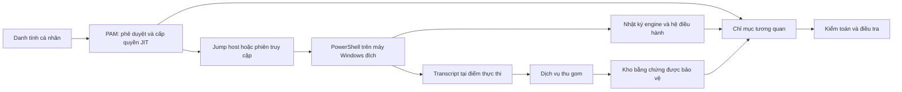

# PowerShell transcription

## 1. Mục tiêu và bối cảnh Windows PAM

Trong Windows PAM, việc cấp quyền quản trị có thời hạn mới trả lời câu hỏi **ai được phép làm gì**. Khi phiên đã kết thúc, tổ chức còn cần xác định người vận hành đã thực hiện thao tác nào, kết quả nhìn thấy ra sao và bằng chứng đang được bảo vệ ở đâu. PowerShell transcription bổ sung một bản ghi văn bản để phục vụ nhu cầu đó.

Ví dụ, kỹ sư được PAM cấp quyền vào máy `APP-WIN-12` trong 20 phút để kiểm tra một dịch vụ. Ticket ghi “chẩn đoán trạng thái dịch vụ”, nhưng chỉ có thời điểm đăng nhập và đăng xuất thì chưa đủ để đánh giá nội dung công việc. Transcript có thể cung cấp ngữ cảnh lệnh và kết quả, sau đó được nối với phiên PAM, danh tính cá nhân và log trên máy đích.

Sau bài học, bạn cần làm được các việc sau:

- Giải thích transcript cung cấp loại bằng chứng nào và những khoảng trống nào vẫn còn.
- Phân biệt ghi phiên chủ động bằng cmdlet với cấu hình ghi phiên qua chính sách.
- Thiết kế nơi lưu, quyền truy cập, thu gom và kiểm tra tính toàn vẹn của transcript.
- Gắn bản ghi với tài khoản quản trị, phiên PAM, ticket và phạm vi JIT/JEA.
- Kiểm thử được trường hợp thiếu output, mất kết nối, không ghi được file và lộ dữ liệu nhạy cảm.

Phạm vi của bài là ghi nhận hoạt động PowerShell trong quản trị Windows. Các ví dụ thực hành chỉ đọc thông tin hệ thống; không thay đổi dịch vụ, tài khoản hay chính sách bảo mật trên máy đang học.

## 2. Transcript là gì?

`Start-Transcript` tạo bản ghi văn bản cho một phần hoặc toàn bộ phiên PowerShell. Các lệnh nhập tương tác và output được host thể hiện là dữ liệu quan trọng của bản ghi. `Stop-Transcript` kết thúc lần ghi đã bắt đầu. Tham số `-IncludeInvocationHeader` bổ sung thông tin thời gian gọi lệnh; `-NoClobber` giúp tránh ghi đè một file đã tồn tại. Đây là các khả năng được mô tả trong [tài liệu Start-Transcript của Microsoft](https://learn.microsoft.com/en-us/powershell/module/microsoft.powershell.host/start-transcript?view=powershell-7.5).

Có thể hình dung transcript là nhật ký văn bản của đường thực thi PowerShell đang được theo dõi. Nó hữu ích khi cần đọc lại diễn biến công việc, nhưng không phải video màn hình, bản sao toàn bộ bộ nhớ tiến trình hay bộ ghi mọi hành động trên Windows.

Một bản ghi thường có phần đầu phiên, nội dung công việc và phần kết thúc. Mẫu dưới đây chỉ minh họa ý nghĩa các trường, không phải định dạng cố định cho mọi phiên bản và host:

```text
PowerShell transcript start
Start time: <thời điểm bắt đầu>
Username: <danh tính của phiên>
RunAs User: <danh tính thực thi nếu có>
Machine: <máy chạy PowerShell>
Host Application: <host và tham số khởi chạy>
Process ID: <PID trong thời gian tồn tại tiến trình>
PSVersion: <phiên bản engine>
...
PAM_META {"pamSessionId":"PAM-LAB-0042","ticketId":"CHG-LAB-0027"}
...
PowerShell transcript end
End time: <thời điểm kết thúc>
```

Không viết bộ phân tích production chỉ bằng cách giả định mọi bản ghi đều có đầy đủ chính xác các dòng trên. Cần kiểm thử định dạng trên từng engine, host, ngôn ngữ và kiểu phiên thực tế. Transcript có thể bị gián đoạn trước khi có phần kết thúc.

### 2.1. Những kết luận có thể và không thể rút ra

Nếu một transcript có output `Status = Running`, bạn có bằng chứng rằng phiên đã ghi nhận một kết quả như vậy tại thời điểm đó. Bạn chưa có bằng chứng độc lập rằng dịch vụ tiếp tục chạy sau phiên hoặc người vận hành không thực hiện hành động qua kênh khác.

Nếu transcript không có một lệnh thay đổi cấu hình, cũng chưa thể kết luận lệnh đó không xảy ra. Cần xem độ bao phủ ghi log, các engine khác, remoting, công cụ native và tình trạng thu gom.

Trong PAM, kết luận điều tra phải dựa trên **nhiều nguồn bằng chứng phù hợp với hành động cần chứng minh**, không dựa riêng vào việc có một file văn bản.

## 3. Vị trí của transcription trong hệ thống bằng chứng

Các nguồn sau trả lời những câu hỏi khác nhau:

| Nguồn dữ liệu | Câu hỏi thường hỗ trợ | Điều cần kiểm tra thêm |
| --- | --- | --- |
| Transcript PowerShell | Phiên đã ghi nhận diễn biến và kết quả văn bản nào? | Độ bao phủ host, output bị thiếu, tính toàn vẹn file |
| Script Block Logging | Engine đã xử lý nội dung script nào? | Chính sách, engine, nơi nhận sự kiện và dữ liệu nhạy cảm |
| Module Logging | Hoạt động pipeline của module được chọn là gì? | Danh sách module và mức độ chi tiết thực tế |
| Nhật ký PAM | Ai yêu cầu, ai phê duyệt, được cấp quyền gì và trong bao lâu? | Liên kết từ danh tính cá nhân đến tài khoản thực thi |
| Nhật ký Windows hoặc ứng dụng đích | Hành động có tạo ra thay đổi hoặc sự kiện tương ứng không? | Chính sách audit của đối tượng và độ trễ thu gom |
| Session recording của PAM | Người vận hành tương tác qua đường truy cập được ghi như thế nào? | Kênh ngoài phiên, khả năng tìm kiếm và quyền xem recording |

Tên “invocation header” của transcript không đồng nghĩa với việc bật Script Block Invocation Logging. Đây là hai cơ chế khác nhau; khi lập baseline phải ghi rõ đang cấu hình thành phần nào.

Một kiến trúc tham khảo cho hệ thống có jump host và máy đích:



Sơ đồ là đề xuất thiết kế, không có nghĩa PowerShell tự kết nối các thành phần này. Cần triển khai riêng việc thu gom, kiểm tra giao nhận và tương quan định danh.

## 4. Ba cách đưa transcription vào vận hành

### 4.1. Bắt đầu chủ động trong một phiên hoặc script

Người vận hành hoặc script gọi `Start-Transcript`, thực hiện công việc rồi gọi `Stop-Transcript`. Cách này phù hợp để học cơ chế và bổ sung khả năng chẩn đoán cho một workflow cụ thể.

Tuy nhiên, thao tác tự nguyện không đủ làm baseline duy nhất cho tài khoản đặc quyền. Người dùng có thể quên bắt đầu, chọn nhầm nơi lưu hoặc mở một phiên khác. File profile cũng chỉ hữu ích trong các đường khởi chạy thực sự nạp profile đó; nó không chứng minh mọi phiên đã được ghi.

### 4.2. Bật qua chính sách quản trị tập trung

Chính sách **Turn on PowerShell Transcription** cung cấp cơ chế cấu hình transcription cho các phiên thuộc phạm vi chính sách. Với PowerShell 7, Microsoft cung cấp Administrative Templates riêng dưới nhánh `PowerShell Core`; có tùy chọn sử dụng giá trị chính sách Windows PowerShell tương ứng. Vì vậy cần kiểm tra engine thực tế thay vì mặc định một GPO bao phủ cả `powershell.exe` và `pwsh.exe`. Tham khảo [Group Policy settings cho PowerShell](https://learn.microsoft.com/en-us/powershell/module/microsoft.powershell.core/about/about_group_policy_settings?view=powershell-7.5).

Một quy trình triển khai nên có các bước:

1. Kiểm kê Windows PowerShell 5.1, PowerShell 7 và host nhúng engine đang được sử dụng.
2. Xác định nhóm máy quản trị, máy đích, tài khoản và endpoint cần ghi.
3. Cấu hình chính sách transcription, invocation header nếu cần và thư mục đầu ra.
4. Áp dụng thử trên nhóm pilot đại diện cho những kiểu phiên khác nhau.
5. Mở phiên mới sau khi chính sách đã có hiệu lực, rồi tạo hoạt động kiểm thử vô hại.
6. Kiểm tra file được sinh và bản sao đã đến kho tập trung.
7. Chỉ mở rộng khi có bằng chứng về độ bao phủ và cảnh báo sự cố ghi log.

Trên Windows PowerShell, giao diện Group Policy thường đặt các thiết lập liên quan trong nhánh `Administrative Templates > Windows Components > Windows PowerShell`. Với PowerShell 7 cần xem template và tùy chọn tương ứng của bản cài đặt. Không dùng ảnh chụp GPO từ một máy làm bằng chứng rằng mọi máy đã nhận cấu hình đúng.

### 4.3. Ghi transcript tại endpoint JEA

JEA có thể cấu hình thư mục transcript trong session configuration bằng `TranscriptDirectory`. Tài liệu Microsoft giải thích transcript của JEA giúp nối người kết nối với danh tính run-as và lệnh thực hiện; điều này đặc biệt hữu ích khi nhiều người sử dụng cùng một danh tính thực thi. Xem [JEA session configurations](https://learn.microsoft.com/en-us/powershell/scripting/security/remoting/jea/session-configurations?view=powershell-7.5).

Ví dụ một đoạn cấu hình minh họa:

```powershell
@{
    SessionType = 'RestrictedRemoteServer'
    TranscriptDirectory = 'C:\ProgramData\PAM\JEA-Transcripts'
    # Các role, danh tính run-as và quyền truy cập được thiết kế riêng.
}
```

Đoạn trên không phải endpoint JEA hoàn chỉnh. Trước khi đăng ký endpoint, cần thiết kế role capability, danh tính thực thi, quyền truy cập và ACL thư mục. Bật transcript không làm một endpoint quyền rộng trở thành endpoint least privilege.

## 5. Thực hành ghi một phiên an toàn

### 5.1. Điều kiện thực hành

Thực hiện trong một phiên PowerShell dành riêng cho bài lab, bằng tài khoản thông thường nếu đủ quyền đọc thông tin. Nếu phiên đang được transcription tự động quản lý, dùng phiên lab hoặc quy trình được quản trị viên quy định; không cố dừng cơ chế ghi phiên của tổ chức.

Thư mục dưới `$env:TEMP` chỉ dùng cho bài học. Nó không đại diện cho kho bằng chứng production vì người dùng có thể sửa hoặc xóa dữ liệu tại đó.

### 5.2. Mẫu script chỉ đọc

Script tạo tên file riêng cho mỗi lần chạy, ghi metadata giả lập, đọc phiên bản engine, tiến trình hiện tại và dịch vụ Windows Event Log. Các biến ticket và session chỉ là mã lab, không phải thông tin được PAM xác thực.

```powershell
$pamLabRoot = Join-Path -Path $env:TEMP -ChildPath 'PamTranscriptLab'
New-Item -Path $pamLabRoot -ItemType Directory -Force -ErrorAction Stop |
    Out-Null

$pamRunId = [guid]::NewGuid().ToString('N')
$pamFileName = 'transcript-{0}-{1}.txt' -f $env:COMPUTERNAME, $pamRunId
$pamTranscriptPath = Join-Path -Path $pamLabRoot -ChildPath $pamFileName
$pamTranscriptStarted = $false

try {
    Start-Transcript -Path $pamTranscriptPath -NoClobber `
        -IncludeInvocationHeader -ErrorAction Stop | Out-Null
    $pamTranscriptStarted = $true

    $pamMetadata = [ordered]@{
        pamSessionId = 'PAM-LAB-0042'
        ticketId = 'CHG-LAB-0027'
        runId = $pamRunId
        startedAtUtc = [DateTimeOffset]::UtcNow.ToString('o')
        actor = [System.Security.Principal.WindowsIdentity]::GetCurrent().Name
        computer = $env:COMPUTERNAME
        processId = $PID
        purpose = 'Read-only validation of PowerShell transcription'
    }

    Write-Host ('PAM_META ' + ($pamMetadata | ConvertTo-Json -Compress))

    & {
        $PSVersionTable | Format-List
        Get-Process -Id $PID -ErrorAction Stop |
            Select-Object Id, ProcessName, StartTime
        Get-Service -Name 'EventLog' -ErrorAction Stop |
            Select-Object Name, Status, DisplayName
    } | Out-Default

    Write-Host 'PAM_LAB_RESULT=READ_ONLY_CHECK_COMPLETED'
}
finally {
    if ($pamTranscriptStarted) {
        Stop-Transcript -ErrorAction Stop | Out-Null
    }
}

Get-Item -LiteralPath $pamTranscriptPath |
    Select-Object FullName, Length, LastWriteTimeUtc
Get-FileHash -LiteralPath $pamTranscriptPath -Algorithm SHA256
```

Các điểm thiết kế cần hiểu:

- Một GUID cho mỗi lần chạy giảm nguy cơ trùng tên giữa các phiên đồng thời.
- `-ErrorAction Stop` làm lỗi khởi tạo transcript trở thành lỗi dừng của đoạn lab, trước khi phần công việc được thực hiện.
- Biến cờ chỉ yêu cầu dừng transcript sau khi lần bắt đầu của script thành công.
- `finally` giúp đóng file khi luồng chạy thoát bình thường hoặc gặp lỗi có thể xử lý; không bảo đảm được chạy khi tiến trình bị kết thúc cưỡng bức hoặc máy mất điện.
- `Out-Default` buộc luồng kết quả của khối công việc đi qua bước hiển thị trước khi đóng transcript. Đây là xử lý cho đường output trong ví dụ, không phải bảo đảm thu được mọi byte của mọi ứng dụng.
- Hash được tính sau khi transcript đã đóng. Hash tính trên file còn đang ghi sẽ không đại diện cho nội dung cuối cùng.

Mẫu này phục vụ quan sát bằng văn bản nên đưa kết quả ra host. Nếu script production còn phải trả object cho chương trình gọi, cần thiết kế riêng đường kết quả có cấu trúc và đường bằng chứng; không thay toàn bộ output bằng `Out-Default` rồi làm hỏng giao diện của script.

### 5.3. Đọc lại và kiểm chứng

Trong cùng phiên lab, sau khi script hoàn tất:

```powershell
Get-Content -LiteralPath $pamTranscriptPath
Select-String -LiteralPath $pamTranscriptPath `
    -Pattern 'PAM_META', 'PAM_LAB_RESULT', 'EventLog'
```

Đối chiếu rằng mã `runId` khớp, metadata xuất hiện, output công việc có trong file và file có phần kết thúc phù hợp. Nếu script gặp lỗi trước khi hoàn thành, không đòi hỏi marker thành công; phải phân loại lần chạy là lỗi hoặc chưa đủ bằng chứng.

Việc tìm thấy một chuỗi chỉ chứng minh chuỗi đó nằm trong file. Nó không chứng minh toàn bộ công việc thành công, tất cả lệnh đã được ghi hoặc nội dung chưa từng bị chỉnh sửa.

## 6. Vì sao output có thể bị thiếu?

PowerShell xử lý object trong pipeline trước khi chuyển chúng thành nội dung hiển thị. Một script có thể phát object nhưng kết thúc transcription trước khi formatter thực sự đưa chúng ra host. Microsoft mô tả tình huống này và cách gọi `Out-Default` trước khi dừng ghi trong [Limitations of PowerShell transcripts](https://learn.microsoft.com/en-us/powershell/scripting/learn/deep-dives/output-missing-from-transcript).

Ví dụ dễ tạo kỳ vọng sai:

```powershell
# Chỉ minh họa vấn đề thứ tự hiển thị, không phải mẫu vận hành.
Start-Transcript -Path $pamTranscriptPath -NoClobber
Get-Process -Id $PID | Select-Object Id, ProcessName
Stop-Transcript
```

Trong một số đường chạy, người học thấy object trên màn hình sau khi script kết thúc và cho rằng transcript cũng chứa nó. Cần mở file để kiểm tra, không suy luận từ những gì vừa thấy trên console.

Các khoảng trống khác phải đưa vào kế hoạch kiểm thử:

| Tình huống | Vì sao cần lưu ý | Hướng kiểm chứng |
| --- | --- | --- |
| Output chuyển thẳng vào file | Nội dung không đi qua đường hiển thị đang quan sát | Kiểm tra artifact riêng và log ứng dụng |
| Tiến trình con hoặc cửa sổ khác | Có thể không thuộc host đang ghi | Kiểm tra phiên mới và telemetry tiến trình |
| Background job hoặc tác vụ bất đồng bộ | Kết quả có thể chỉ được nhận sau khi transcript đóng | Nhận output trong khoảng ghi hoặc lưu kết quả riêng |
| Remoting | Client và server có danh tính, host và phạm vi log khác nhau | Thử từng endpoint và thu thập phía thực thi |
| Host nhúng engine | Hành vi hiển thị và hỗ trợ ghi phiên cần được xác nhận | Kiểm thử chính ứng dụng được triển khai |
| Output rất dài, lỗi, ký tự Unicode | Có thể khó phân tích hoặc bị cắt ở một thành phần downstream | So sánh mẫu đầu cuối và giới hạn collector |
| Tiến trình dừng đột ngột | File có thể chưa kết thúc hoặc chưa được thu gom | Đánh dấu bản ghi chưa hoàn tất và đối chiếu nguồn khác |

Từ các tình huống này có thể suy ra yêu cầu vận hành: chính sách bao phủ phải dựa trên kiểm thử các đường sử dụng, không dựa riêng vào tên sản phẩm hoặc trạng thái “Enabled”.

## 7. Thiết kế lưu trữ cho môi trường đặc quyền

### 7.1. Ghi trực tiếp lên share hay dùng vùng đệm cục bộ?

Hai phương án phổ biến đều có đánh đổi:

| Tiêu chí | Ghi trực tiếp vào share tập trung | Ghi cục bộ rồi thu gom |
| --- | --- | --- |
| Phụ thuộc mạng lúc tạo log | Cao hơn | Có thể tiếp tục khi collector tạm gián đoạn nếu còn dung lượng |
| Thời gian trước khi có bản sao ngoài máy | Có thể ngắn | Phụ thuộc chu kỳ và độ tin cậy thu gom |
| Yêu cầu danh tính ghi | Cần xác thực phù hợp tới share | Cần tài khoản collector và quyền tại hai đầu |
| Nguy cơ tại máy đặc quyền | Vẫn cần đánh giá tài khoản và quá trình ghi | Bản cục bộ có thể bị tác động trước khi chuyển đi |
| Tình huống cần thử | Mất share, lỗi xác thực, sai ACL | Đầy đĩa, collector dừng, file chưa đóng, hàng đợi tăng |

Không có lựa chọn mặc định đúng cho mọi tier quản trị. Một hệ thống có thể ghi cục bộ để giảm phụ thuộc mạng rồi đẩy sớm sang kho được quản lý bằng danh tính riêng. Hệ thống khác có đường mạng quản trị ổn định và yêu cầu giao nhận trực tiếp.

Với remoting, không mặc định danh tính phiên từ xa được phép truy cập một share thứ hai. Cần kiểm chứng đường xác thực và quyền của từng hop; không bật cơ chế delegation rộng chỉ để làm cho transcript ghi được.

### 7.2. Phân chia quyền theo trách nhiệm

Đề xuất phân quyền cần được kiểm thử trên ACL thực tế, kể cả quyền kế thừa và chủ sở hữu file:

| Vai trò | Quyền phục vụ công việc | Quyền cần hạn chế |
| --- | --- | --- |
| Thành phần sinh transcript | Tạo và ghi bản ghi của phiên theo thiết kế | Xem, sửa hoặc xóa bản ghi của các phiên khác |
| Collector | Đọc nguồn cần thu gom và chuyển vào vùng tiếp nhận | Quản trị toàn bộ tài khoản hoặc thay đổi chính sách PAM |
| Thành phần ingest | Tiếp nhận, xác nhận, lập chỉ mục và tạo metadata tin cậy | Sửa âm thầm bản gốc đã được chấp nhận |
| Nhóm điều tra | Đọc bản ghi liên quan đến vụ việc được giao | Truy cập vô hạn mọi transcript hoặc thay đổi retention |
| Quản trị kho | Quản lý hạ tầng lưu trữ theo phân công | Vừa sửa bằng chứng vừa tự phê duyệt không có dấu vết |

Share “chỉ ghi” không tự hình thành bằng cách đặt tên thư mục là `DropBox`. Quyền share, NTFS, quyền xóa trên thư mục cha, `CREATOR OWNER`, quyền thay đổi DACL và quyền sở hữu có thể làm kết quả khác với mong muốn. Phải thử bằng đúng tài khoản vận hành: tạo file, mở file của người khác, sửa file cũ, đổi tên và xóa.

Người có quyền quản trị cao trên máy nguồn vẫn có thể tác động đến cơ chế log cục bộ. Vì vậy việc chuyển bằng chứng ra ngoài máy và bảo vệ mặt quản trị kho có giá trị riêng, dù ACL thư mục nguồn đã được cấu hình.

### 7.3. Hash và bằng chứng giao nhận

Một quy trình gợi ý cho collector:

1. Phân biệt file đang ghi với file đã đóng bằng cơ chế được kiểm thử; không coi “vài giây không đổi kích thước” là bằng chứng tuyệt đối.
2. Thu gom cả bản ghi bị gián đoạn, nhưng gắn trạng thái chưa hoàn tất.
3. Chuyển file qua kênh được bảo vệ và ghi nhận danh tính gửi.
4. Tính hash tại phía tiếp nhận sau khi nhận đủ file, ghi kích thước và thời gian ingest theo UTC.
5. Lưu bản gốc và metadata giao nhận trong kho được kiểm soát truy cập, retention và lịch sử thao tác.
6. Chỉ dọn vùng đệm theo chính sách sau khi đã xác nhận tiếp nhận thành công.

SHA-256 giúp phát hiện hai bản nội dung khác nhau khi đối chiếu với một giá trị tham chiếu đáng tin cậy. Nếu kẻ sửa file cũng sửa được file chứa hash, phép đối chiếu không còn bảo đảm độc lập. Tương tự, hash của dữ liệu đã bị sửa trước khi ingest không thể tái tạo sự thật ban đầu.

Nếu sử dụng chữ ký số, cần xác định ai ký, khóa ký ở đâu và ký vào thời điểm nào. Chữ ký của dịch vụ tiếp nhận xác nhận nội dung mà dịch vụ đã nhận; không tự chứng minh mọi hành động nguồn đều đã được ghi đầy đủ.

## 8. Không biến transcript thành kho bí mật

PAM thường xử lý tài khoản có quyền cao, nên transcript cũng có thể trở thành dữ liệu có độ nhạy cảm cao. Các dòng lệnh, tham số và output có thể chứa credential, token, chuỗi kết nối, dữ liệu khách hàng hoặc thông tin cấu hình nội bộ.

Các quy tắc thiết kế thực tế:

- Không dán mật khẩu hoặc bearer token trực tiếp vào dòng lệnh để “tiện thao tác”.
- Không xuất toàn bộ object credential, cấu hình hay response API chỉ để chẩn đoán một trường.
- Tránh dùng các lệnh dump biến hoặc dump môi trường khi không cần thiết.
- Với workflow lấy secret từ vault, chỉ xuất mã tham chiếu và kết quả thao tác cần thiết; không xuất giá trị secret.
- Cấp quyền tìm kiếm và tải transcript theo vụ việc hoặc phạm vi máy, thay vì cho toàn bộ nhóm vận hành quyền đọc mọi thứ.
- Rà soát cả bản sao gửi sang hệ thống tìm kiếm, email cảnh báo và công cụ hỗ trợ bên ngoài.

`SecureString`, credential object hoặc mã hóa lưu trữ không bảo đảm rằng secret sẽ không xuất hiện ở một bước khác. Nếu script chuyển secret thành plaintext hoặc chương trình đích in secret ra output, bản ghi có thể chứa giá trị đó. Không giả định transcription tự nhận diện và che dữ liệu nhạy cảm.

Nếu phát hiện secret trong transcript, quy trình ứng phó nên gồm: hạn chế truy cập bản ghi liên quan, xác định những nơi đã sao chép dữ liệu, thu hồi hoặc luân chuyển credential bị lộ, và lưu bằng chứng theo quy định xử lý sự cố. Nếu cần bản đã che dữ liệu để chia sẻ, tạo bản dẫn xuất có dấu vết; không âm thầm sửa bản gốc làm mất tính toàn vẹn của chuỗi bằng chứng.

## 9. Nối transcript với danh tính và phiên PAM

### 9.1. Dùng nhiều khóa tương quan

Một tên máy hoặc một tài khoản quản trị dùng chung không đủ phân biệt mọi phiên. PID cũng có thể được tái sử dụng theo thời gian. Có thể lập chỉ mục các trường sau:

| Trường | Nguồn ưu tiên | Vai trò |
| --- | --- | --- |
| `pamSessionId` | PAM hoặc cổng truy cập được quản lý | Nối yêu cầu truy cập với bằng chứng |
| `requesterId` | Hệ thống định danh/PAM | Xác định người chịu trách nhiệm |
| `effectiveAccount` | Máy đích và log xác thực | Tài khoản thực sự dùng để thi hành |
| `targetHost` | Máy đích và kiểm kê tài sản | Xác định đúng đối tượng quản trị |
| `startedAtUtc`, `endedAtUtc` | Nguồn có đồng bộ thời gian | Đối chiếu khoảng hoạt động |
| `engineVersion`, `hostProcessId` | Phiên và telemetry máy đích | Phân biệt đường thực thi |
| `ticketId` | Hệ thống quản lý thay đổi | Đánh giá mục đích và phạm vi được duyệt |
| `ingestId`, `sha256` | Kho bằng chứng | Truy nguyên bản đã tiếp nhận |

Metadata do người dùng tự ghi trong console là dữ liệu do người dùng khai báo. Ví dụ `PAM_META` trong lab không được dùng một mình để chứng minh ticket hợp lệ. Trong production nên đối chiếu hoặc bổ sung metadata qua PAM gateway, collector hoặc hệ thống ingest được bảo vệ.

### 9.2. Kiểm tra cửa sổ JIT và phạm vi hành động

Giả sử quyền JIT có hiệu lực từ 09:00 đến 09:20 UTC. Transcript bắt đầu lúc 09:03 và có thao tác lúc 09:24. Đây là tín hiệu cần điều tra, nhưng không thể kết luận chỉ từ timestamp: cần kiểm tra đồng hồ, cách PAM thu hồi phiên đang mở và quyền thực tế tại thời điểm hành động.

Ngược lại, transcript kết thúc lúc 09:18 không chứng minh quyền đã bị thu hồi lúc đó. Thu hồi quyền là hành động riêng cần bằng chứng từ PAM và hệ thống đích.

Với JEA dùng danh tính run-as, cần giữ được liên kết người kết nối đến phiên endpoint. Tìm kiếm theo riêng tên tài khoản run-as có thể gộp nhiều người vào một nhóm kết quả, khiến việc quy trách nhiệm sai lệch.

## 10. Giám sát sức khỏe của đường ghi log

Một file transcript đã tồn tại không đủ chứng minh pipeline luôn hoạt động. Nên giám sát riêng ba trạng thái:

```text
Được yêu cầu ghi
    -> Đã tạo và đang ghi tại nguồn
        -> Đã tiếp nhận và kiểm chứng tại kho
```

Mỗi lần chuyển trạng thái phải có dấu vết hoặc phép kiểm chứng tương ứng. Ví dụ, PAM biết có 50 phiên PowerShell thuộc phạm vi ghi nhưng kho chỉ nhận 42 bản ghi, hệ thống cần giải thích được 8 trường hợp còn lại: phiên không chạy lệnh, bản ghi đang mở, đường thực thi chưa bao phủ hay lỗi thật sự.

Các chỉ số gợi ý:

- Tỷ lệ phiên thuộc phạm vi có bằng chứng được tiếp nhận, tính theo nhóm engine và endpoint.
- Độ trễ từ lúc đóng file đến lúc ingest thành công, gồm cả các phiên chưa bao giờ đến đích.
- Dung lượng vùng đệm, số file chờ và tuổi của file chờ lâu nhất.
- Số lỗi ghi, lỗi quyền, lỗi xác thực share và lỗi collector.
- Tỷ lệ transcript bị gián đoạn hoặc không phân tích được phần đầu/cuối.
- Thay đổi bất thường về số phiên có log so với mức hoạt động quản trị.

Không đặt một ngưỡng byte tối thiểu để tự kết luận bản ghi đầy đủ. Phiên rất ngắn có thể hợp lệ, còn file rất lớn vẫn có thể thiếu phần quan trọng. Tương tự, cảnh báo bằng từ khóa trong transcript chỉ là tín hiệu; cần gắn với danh tính, phạm vi được duyệt và kết quả trên máy đích.

### 10.1. Ước lượng dung lượng

Có thể bắt đầu bằng công thức:

```text
dung lượng/ngày ≈ số phiên/ngày × kích thước transcript trung bình
dung lượng giữ lại ≈ dung lượng/ngày × số ngày giữ × hệ số dự phòng
```

Ví dụ giả định 1.000 phiên mỗi ngày, trung bình 200 KiB mỗi phiên, thì riêng văn bản thô khoảng 195 MiB mỗi ngày. Giữ 90 ngày tương đương khoảng 17,2 GiB trước khi tính chỉ mục, bản sao và dự phòng. Đây chỉ là bài toán minh họa; các tác vụ in danh sách lớn có thể làm phân bố kích thước lệch mạnh.

Đo dữ liệu pilot theo nhóm công việc, tránh chỉ dùng trung bình. Thời hạn lưu phải do chính sách tổ chức và nhu cầu điều tra quyết định; bài học không mặc định một số ngày là yêu cầu pháp lý.

## 11. Ma trận kiểm thử trước khi mở rộng

Độ bao phủ được chấp nhận phải gắn với kết quả thực tế của từng đường sử dụng:

| Ca kiểm thử | Thao tác vô hại | Kỳ vọng cần chứng minh |
| --- | --- | --- |
| Windows PowerShell tương tác | In một marker riêng và đọc thời gian | Có bản ghi đúng máy, danh tính và marker |
| PowerShell 7 tương tác | Lặp lại trên `pwsh.exe` nếu được triển khai | Chính sách tương ứng thực sự có hiệu lực |
| Script chạy không tương tác | Đọc PID và tên tiến trình | Output cần thiết được ghi trước khi đóng phiên |
| WinRM/remoting | Đọc tên máy ở endpoint thử nghiệm | Có bằng chứng đúng phía thực thi và liên kết client/server |
| JEA | Gọi một lệnh đã được role cho phép | Có dữ liệu nối người kết nối với hành động |
| Mất kết nối tới kho | Tạo một phiên lab được kiểm soát | Cơ chế báo lỗi, hàng đợi và khôi phục hoạt động đúng thiết kế |
| Không ghi được thư mục | Dùng thư mục kiểm thử đã hạn chế quyền | Phát hiện lỗi và không báo nhầm hoàn thành bằng chứng |
| Tiến trình dừng đột ngột | Kết thúc phiên lab theo kịch bản thử nghiệm | Bản ghi được phân loại chưa hoàn tất, không bị bỏ qua |
| Output Unicode và object | In chuỗi tiếng Việt, object và kết quả dài | Nội dung đọc được, phần quan trọng không bị mất |
| Phân quyền kho | Thử bằng các tài khoản có vai trò khác nhau | Người ghi không đọc/sửa tùy ý bằng chứng của người khác |

Thử lỗi chỉ thực hiện trong môi trường kiểm thử theo phạm vi đã được phép. Không làm đầy đĩa hoặc ngắt mạng của hệ thống production để kiểm tra transcription.

Tổ chức cần quyết định trước hành vi khi bằng chứng không thể ghi: chặn phiên quản trị thông thường, cho phép một số tác vụ chẩn đoán giới hạn, hay kích hoạt quy trình khẩn cấp. Đây là quyết định của workflow PAM và vận hành; việc bật transcription không tự tạo ra một cơ chế fail-closed đầu cuối.

## 12. Tình huống thực tế: có transcript nhưng thiếu bằng chứng thay đổi

Một nhóm vận hành xử lý sự cố ứng dụng bằng PowerShell từ jump host. Ticket được duyệt cho việc kiểm tra dịch vụ trên `APP-WIN-12`. Sau phiên, kiểm toán thấy transcript trên jump host có lệnh gọi remoting nhưng không thấy output chi tiết trên máy đích.

Không nên lập tức kết luận người vận hành đã xóa log. Có ít nhất các giả thuyết cần kiểm chứng:

1. Chỉ jump host được cấu hình ghi; endpoint đích chưa nằm trong phạm vi triển khai.
2. Kết quả được trả dưới dạng object nhưng hiển thị sau khi đoạn ghi chủ động đã kết thúc.
3. Collector chưa chuyển file đích do tài khoản dịch vụ thiếu quyền hoặc hàng đợi bị kẹt.
4. Công việc được thực hiện bằng engine khác với engine đã nhận chính sách.
5. Bản ghi bị gián đoạn trước khi hoàn tất, trong khi hệ thống ingest chỉ nhận file có phần kết thúc.

Cách xử lý là giữ nguyên bản đang có, thu thập log PAM và log máy đích, xác định engine/endpoint, rồi kiểm tra đường thu gom. Khi đã tìm nguyên nhân, chạy lại một bài kiểm tra chỉ đọc trên môi trường phù hợp để xác nhận độ bao phủ được khôi phục. Không sửa transcript cũ để làm cho hồ sơ trông đầy đủ.

Ví dụ kết quả điều tra cho thấy chính sách chỉ được áp dụng ở jump host và collector bỏ qua file chưa hoàn tất. Biện pháp khắc phục cần xử lý cả hai: mở rộng baseline tới endpoint phù hợp và thay đổi quy trình tiếp nhận để nhận cả bản ghi gián đoạn với trạng thái rõ ràng. Chỉ tăng thời hạn retention sẽ không sửa được hai khoảng trống này.

## 13. Lỗi thường gặp và cách sửa

| Lỗi | Hệ quả | Cách sửa phù hợp |
| --- | --- | --- |
| Chỉ thêm `Start-Transcript` vào profile | Một số đường khởi chạy không được bao phủ | Dùng baseline quản lý tập trung và kiểm thử host thực tế |
| Cho rằng file văn bản tự chống sửa | Bằng chứng có thể bị thay đổi mà không phát hiện | Đưa ra kho riêng, bảo vệ metadata ingest và kiểm tra toàn vẹn |
| Dùng một tên file cố định cho mọi phiên | Đụng tên, ghi đè hoặc khó phân biệt phiên | Tên riêng, tương quan phiên và kiểm thử chạy đồng thời |
| Bật log trên client rồi coi là đủ | Thiếu ngữ cảnh nơi thực thi đặc quyền | Xác định và kiểm thử log phía máy đích/endpoint |
| Tin mọi mã ticket do người dùng in ra | Gán nhầm hành động vào yêu cầu được duyệt | Đối chiếu metadata từ PAM và hệ thống ticket |
| Cấp đọc transcript cho toàn bộ quản trị viên | Lộ dữ liệu nhạy cảm và mở rộng phạm vi sự cố | Phân quyền theo nhiệm vụ, theo vụ việc, ghi nhận lần truy cập |
| Đóng transcript trước khi xử lý output | Thiếu kết quả cần kiểm toán | Hoàn tất đường hiển thị trong khoảng ghi và kiểm tra file |
| Thấy hash khớp rồi kết luận mọi hành động được ghi | Nhầm toàn vẹn với đầy đủ | Đánh giá riêng độ bao phủ, giao nhận và tính toàn vẹn |
| Xóa file nguồn ngay sau khi gửi | Mất bằng chứng khi phía nhận chưa lưu thành công | Chờ xác nhận tiếp nhận theo giao thức đã kiểm thử |
| Dùng transcript thay cho thu hồi quyền JIT | Quyền vẫn có thể tồn tại sau công việc | Kiểm tra thu hồi quyền và trạng thái phiên bằng nguồn riêng |

## 14. Bài tập áp dụng

### Bài tập 1: kiểm chứng một bản ghi

Chạy mẫu lab trong một phiên được phép, rồi ghi lại mã run, engine, danh tính, kích thước và hash. Mở file để xác định marker, output của `Get-Process`, trạng thái `EventLog` và phần kết thúc. Nếu có khác biệt với dự kiến, giải thích dựa trên đường thực thi thay vì sửa file.

Kết quả đạt yêu cầu là một bản ghi đọc được và bảng đối chiếu giữa thao tác đã chạy với nội dung thực sự có trong file. Không cần cấp quyền quản trị để “làm cho bài lab giống production” khi các lệnh chỉ đọc đã chạy được.

### Bài tập 2: thiết kế pipeline cho ba kiểu phiên

Vẽ đường đi của bằng chứng cho phiên local, phiên remoting và phiên JEA. Với mỗi đường, chỉ rõ nơi PowerShell thực thi, danh tính ghi file, nơi thu gom, metadata tương quan và cách phát hiện không có bản ghi.

Kết quả đạt yêu cầu phải giải thích được một phiên PAM có thể tạo nhiều transcript, cũng như trường hợp một transcript chưa đủ nối về người yêu cầu nếu chỉ dựa vào tài khoản run-as.

### Bài tập 3: xử lý sự cố lộ secret

Giả định một script chẩn đoán đã in một token vào transcript và bản ghi đã đến hệ thống tìm kiếm. Viết các hành động xử lý: giới hạn truy cập, xác định bản sao, thu hồi token, bảo toàn bản gốc và tạo bản chia sẻ đã che dữ liệu nếu cần.

Kết quả đạt yêu cầu phải xử lý credential bị lộ và đường phát tán dữ liệu, đồng thời giữ được lịch sử xử lý bằng chứng. Chỉ xóa một dòng trong file nguồn không giải quyết được tình huống.

## 15. Tự kiểm tra kiến thức

1. Vì sao một transcript có phần kết thúc vẫn chưa chứng minh mọi hành động quản trị đều đã được ghi?
2. Tại sao phải kiểm tra riêng Windows PowerShell và PowerShell 7 khi triển khai policy?
3. Hash do chính người vận hành tạo giúp gì, và chưa giải quyết được điều gì?
4. Khi dùng JEA với tài khoản run-as dùng chung, cần dữ liệu nào để truy nguyên người kết nối?
5. Vì sao output object trên màn hình có thể không nằm trong file transcript?
6. Nếu share tập trung không truy cập được, thành phần nào quyết định cho phép hay chặn phiên?
7. Metadata ticket do script in ra khác gì metadata được hệ thống PAM xác nhận?
8. Làm sao xử lý một bản ghi không có phần kết thúc mà vẫn giữ giá trị điều tra của nó?

Một thiết kế transcription tốt phải trả lời được ba câu hỏi độc lập: **đã bao phủ đúng phiên chưa, bằng chứng đã đến nơi bảo vệ chưa, và nội dung nhận được còn toàn vẹn không**. Trong Windows PAM, kết hợp các câu trả lời đó với danh tính cá nhân, quyền được cấp và sự kiện trên máy đích mới tạo ra hồ sơ đủ hữu ích cho kiểm toán và ứng phó sự cố.
