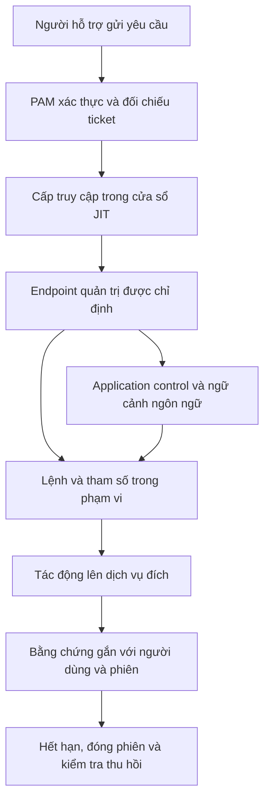

# PowerShell constrained language

## Mục tiêu và bối cảnh Windows PAM

PowerShell là công cụ quản trị cần thiết trên Windows, nhưng một phiên shell đặc quyền có thể thực hiện nhiều việc hơn yêu cầu ban đầu của người vận hành. Trong quản lý truy cập đặc quyền (PAM), cần kiểm soát đồng thời người được truy cập, quyền được cấp, thời gian sử dụng, khả năng thực thi mã và bằng chứng của phiên làm việc.

Bài học này trình bày **Constrained Language Mode (CLM)** trong phạm vi Windows PAM. Tình huống xuyên suốt là đội hỗ trợ được xử lý sự cố dịch vụ ứng dụng trong một cửa sổ được phê duyệt. Họ cần xem trạng thái và thực hiện một số thao tác đã định nghĩa, thay vì nhận một shell quản trị toàn quyền cho mọi mục đích.

Sau bài học, bạn có thể:

- Giải thích CLM hạn chế điều gì và giới hạn nào vẫn cần PAM hoặc hệ điều hành kiểm soát.
- Phân biệt language mode với execution policy, quyền Windows và JEA.
- Phân biệt thử nghiệm CLM trong một phiên với cưỡng chế bằng application control.
- Thiết kế kiểm thử cho phiên tương tác, script được tin cậy và các đường quản trị khác nhau.
- Gắn kết quả kiểm tra với ticket, danh tính, tài sản đích và phiên PAM.

Các lệnh trong bài là ví dụ để thực hành trên máy Windows thử nghiệm. Tên máy, dịch vụ, đường dẫn tổ chức và ticket minh họa không đại diện cho cấu hình có sẵn trên hệ thống của bạn.

## 1. CLM kiểm soát khả năng của ngôn ngữ

Language mode xác định các thành phần ngôn ngữ được phép sử dụng trong một phiên PowerShell. Bốn giá trị là:

| Mode | Ý nghĩa chính |
| --- | --- |
| `FullLanguage` | Sử dụng đầy đủ ngôn ngữ PowerShell. |
| `ConstrainedLanguage` | Giữ nhiều khả năng scripting thông thường, hạn chế sử dụng kiểu đối tượng và các thao tác nhạy cảm. |
| `RestrictedLanguage` | Giới hạn biểu thức và cấu trúc ngôn ngữ, thường gặp khi xử lý dữ liệu cấu hình. |
| `NoLanguage` | Không cho người dùng nhập cấu trúc ngôn ngữ như script block; phiên chủ yếu nhận lời gọi lệnh. |

Trong phiên FullLanguage hoặc ConstrainedLanguage, có thể xem mode bằng:

```powershell
$ExecutionContext.SessionState.LanguageMode
```

Ở NoLanguage, chính biểu thức truy cập thuộc tính này có thể bị từ chối; vì vậy một lệnh kiểm tra không chạy được chưa đủ để kết luận endpoint lỗi. Tham khảo [about_Language_Modes của Microsoft](https://learn.microsoft.com/en-us/powershell/module/microsoft.powershell.core/about/about_language_modes?view=powershell-7.5).

Đừng hiểu tên `RestrictedLanguage` như một lựa chọn tự động phù hợp hơn CLM cho PAM. Quyết định thiết kế phải bắt đầu từ công việc cần ủy quyền và endpoint thực tế, không từ cảm giác mode nào có tên “chặt” hơn.

### Hai câu hỏi phải tách biệt

1. **Tài khoản có được phép thực hiện hành động không?** Đây là vấn đề token, quyền, ACL, vai trò và chính sách truy cập.
2. **Đoạn PowerShell có được sử dụng khả năng ngôn ngữ đó không?** Đây là vấn đề language mode và sự tin cậy của mã.

Một phiên CLM có quyền quản trị vẫn có thể gọi những cmdlet quản trị được môi trường cho phép. CLM không tự xây dựng danh sách “chỉ được quản lý dịch vụ ứng dụng A”.

Ngược lại, FullLanguage không tự cấp quyền quản trị. Một script FullLanguage chạy dưới tài khoản thông thường vẫn chịu các kiểm tra quyền của Windows. Thiết kế PAM cần đánh giá cả hai câu hỏi, thay vì dùng kết quả của câu này để thay thế câu kia.

## 2. Những khả năng bị hạn chế và những việc vẫn làm được

CLM giữ lại biến, điều kiện, vòng lặp, pipeline và nhiều hoạt động quản trị qua cmdlet. Nó thu hẹp việc dùng các kiểu .NET ngoài tập cho phép, gọi phương thức nhạy cảm, tạo kiểu tùy ý và những khả năng có thể mở rộng việc thực thi mã. Tài liệu [PowerShell Team về CLM](https://devblogs.microsoft.com/powershell/powershell-constrained-language-mode/) giải thích mục tiêu này.

Ví dụ, một pipeline xem thông tin dịch vụ không nhất thiết cần lập trình .NET trực tiếp:

```powershell
Get-Service |
    Where-Object Status -eq 'Running' |
    Select-Object -First 5 -Property Name, Status
```

Từ góc độ thiết kế công việc, nên ưu tiên giao diện quản trị đã xác định rõ đầu vào và đầu ra. Nếu yêu cầu chỉ là lấy trạng thái dịch vụ, việc tự biên dịch C# trong phiên hỗ trợ làm tăng đáng kể phạm vi cần đánh giá.

Các hạn chế không đồng nghĩa “mọi cmdlet đều bị chặn” hoặc “không còn gọi được chương trình ngoài”. Khả năng chạy công cụ khác còn phụ thuộc application control và quyền của tài khoản. Một môi trường có CLM nhưng vẫn cho phép quá nhiều công cụ quản trị chưa đáp ứng mục tiêu least privilege.

Ngoài ra, lỗi ngôn ngữ không chứng minh hành động đã được kiểm soát trên mọi đường đi. Nếu yêu cầu nghiệp vụ là ngăn sửa cấu hình ứng dụng, cần kiểm tra cả quyền sửa file, giao diện quản trị ứng dụng và đường truy cập từ xa tương ứng.

## 3. Phân biệt các lớp kiểm soát

| Lớp | Câu hỏi nó giải quyết | Bằng chứng nên có |
| --- | --- | --- |
| Danh tính và MFA | Ai đang yêu cầu truy cập? | Người dùng, phương thức xác thực, thời điểm. |
| PAM và JIT | Có được vào tài sản này trong cửa sổ này không? | Ticket, phê duyệt, thời hạn và phiên. |
| Quyền Windows | Token được phép tác động tài nguyên nào? | Vai trò, nhóm, ACL và phạm vi quyền. |
| JEA | Phiên quản trị được gọi lệnh nào với phạm vi nào? | Endpoint, role capability và kiểm thử. |
| Application control | Những chương trình hoặc tệp mã nào được tin cậy? | Policy đang hiệu lực và quyết định đối với tệp. |
| CLM | Đoạn PowerShell được dùng khả năng ngôn ngữ nào? | Mode trong đúng ngữ cảnh và phép thử hành vi. |
| Logging | Có thể giải thích việc đã xảy ra không? | Sự kiện, transcript phù hợp và liên kết phiên. |

Bảng này là mô hình thiết kế cho tình huống PAM trong bài, không phải mô tả rằng một sản phẩm duy nhất tự cung cấp đầy đủ các lớp.

### Execution policy không thay thế CLM

Execution policy kiểm soát điều kiện nạp cấu hình và chạy script. Nó không phải ranh giới bảo mật để giới hạn khả năng của một tài khoản. Việc áp dụng `AllSigned` cũng không có nghĩa mọi mã đã ký đều phù hợp nghiệp vụ hoặc đã được application control cho phép. Microsoft nêu rõ giới hạn này trong [about_Execution_Policies](https://learn.microsoft.com/en-us/powershell/module/microsoft.powershell.core/about/about_execution_policies?view=powershell-7.5).

Do đó, báo cáo “đã bật execution policy” không trả lời được các câu hỏi nghiệm thu: shell tương tác đang ở mode nào, script nào được tin cậy, hay người vận hành có thể dùng quyền hiện tại để thay đổi tài nguyên ngoài ticket hay không.

### CLM không thay thế JEA

JEA phục vụ ủy quyền quản trị bằng tập lệnh, hàm và lệnh ngoài được cấu hình. Nó có thể cho người dùng thông thường thực hiện một công việc đặc quyền thông qua danh tính thực thi của endpoint. Xem [tổng quan JEA](https://learn.microsoft.com/en-us/powershell/scripting/security/remoting/jea/overview?view=powershell-7.5).

Nếu yêu cầu là “chỉ được khởi động lại dịch vụ ContosoWorker”, việc chỉ bật CLM cho một tài khoản local administrator quá rộng so với yêu cầu. Thiết kế phù hợp hơn là định nghĩa công việc hẹp tại endpoint, kiểm tra tham số, rồi gắn quyền truy cập endpoint với quy trình PAM.

## 4. Thử nghiệm mode và cưỡng chế bằng policy là hai việc khác nhau

Có thể đặt mode cho phiên hiện tại để học cách ngôn ngữ phản ứng:

```powershell
$ExecutionContext.SessionState.LanguageMode = 'ConstrainedLanguage'
```

Đây là phép thử trong phiên. Nó không chứng minh có chính sách cưỡng chế trên máy, và không tạo bảo đảm cho các phiên khác. Tương tự, biến môi trường phục vụ kiểm thử như `__PSLockdownPolicy` không nên được dùng làm cơ chế triển khai bảo mật. Sự phân biệt này được giải thích trong [bài CLM của PowerShell Team](https://devblogs.microsoft.com/powershell/powershell-constrained-language-mode/).

Đối với hệ thống thật, PowerShell tích hợp với application control của Windows. Microsoft hiện ưu tiên App Control for Business, trước đây thường được gọi là WDAC; PowerShell cũng có tích hợp với AppLocker. Dưới policy phù hợp, mã được policy cho phép có thể chạy FullLanguage, còn mã không được tin cậy chịu CLM hoặc bị chặn theo khả năng và lựa chọn policy. Tham khảo [App Control và PowerShell](https://learn.microsoft.com/en-us/powershell/scripting/security/app-control/application-control?view=powershell-7.5) và [hướng dẫn triển khai App Control cho PowerShell](https://learn.microsoft.com/en-us/powershell/scripting/security/app-control/how-to-use-app-control?view=powershell-7.5).

### Mode phải được hiểu trong đúng ngữ cảnh

Một script đã được policy cho phép có thể dùng FullLanguage trong khi shell tương tác vẫn bị giới hạn. Vì thế, hai kết quả mode khác nhau không tự động chứng minh policy bị vô hiệu hóa.

Khi ghi bằng chứng, phải xác định:

- Kết quả được lấy ở shell tương tác hay bên trong script.
- Tệp script nào được chạy, phiên bản nào và vì sao policy tin cậy nó.
- Engine, host, tài khoản và máy nào thực hiện.
- Phép thử là ở chế độ audit hay enforce, với những policy nào đang hoạt động.

Ví dụ: nếu mục tiêu là kiểm tra shell tương tác của người hỗ trợ, không dùng một script đã được tin cậy để in mode rồi coi đó là mode của người dùng.

## 5. Chuẩn bị thực hành trên máy thử nghiệm

Trước khi thử, ghi nhận một hồ sơ nhỏ:

| Thuộc tính | Ví dụ minh họa |
| --- | --- |
| Máy thử nghiệm | `PAM-WIN-LAB01` |
| Tài khoản | Tài khoản thử nghiệm không quản trị |
| Mục tiêu | Quan sát hành vi CLM trong một phiên |
| Loại thử nghiệm | Thử mode thủ công, chưa phải nghiệm thu policy |
| Phiên PAM | Mã phiên nếu lab đi qua cổng PAM |
| Dữ liệu | Không dùng mật khẩu hoặc dữ liệu sản xuất |

Mở một cửa sổ PowerShell **riêng** cho lab. Nếu dùng Windows PowerShell:

```powershell
powershell.exe -NoLogo -NoProfile
```

Nếu máy đã cài PowerShell 7 và đó là engine cần kiểm tra:

```powershell
pwsh.exe -NoLogo -NoProfile
```

Chọn đúng engine đã cài và nằm trong phạm vi thử nghiệm; không cần cài thêm engine chỉ để chạy ví dụ. Hai lệnh trên mở phiên tương tác, vì vậy không dùng chúng bên trong một quy trình tự động không có người điều khiển.

Ở phiên mới, ghi nhận:

```powershell
$PSVersionTable
$PSHOME
$PID
$ExecutionContext.SessionState.LanguageMode
```

`-NoProfile` giúp giảm ảnh hưởng từ profile khi so sánh kết quả. Nó không phải cơ chế vô hiệu hóa application control và cũng không chứng minh phiên đã bị cưỡng chế CLM.

Nếu phiên đã ở ConstrainedLanguage do policy, ghi nhận điều đó và không cố đổi về FullLanguage để chạy lab. Khi ấy, phần thực hành chỉ quan sát hành vi của cấu hình có sẵn.

## 6. Lab: quan sát thao tác được phép và thao tác bị hạn chế

### Bước 1: chuyển mode trong phiên lab nếu đang FullLanguage

```powershell
$ExecutionContext.SessionState.LanguageMode = 'ConstrainedLanguage'
$ExecutionContext.SessionState.LanguageMode
```

Kết quả mong đợi trong phép thử này là `ConstrainedLanguage`.

### Bước 2: chạy một tác vụ đọc thông tin

```powershell
$runningServices = Get-Service |
    Where-Object Status -eq 'Running'

$runningServices |
    Select-Object -First 5 -Property Name, Status
```

Mục đích là kiểm tra một luồng quản trị đơn giản vẫn hoạt động. Không dùng kết quả này để suy ra rằng tất cả module hoặc script nghiệp vụ đều tương thích.

### Bước 3: kiểm tra lời gọi phương thức ngoài kiểu cho phép

```powershell
[System.IO.File]::Exists("$env:WINDIR\win.ini")
```

Trong CLM có thực thi hạn chế, lời gọi phương thức trên kiểu này dự kiến bị từ chối. Ghi lại lỗi thực tế; một định danh thường gặp là `MethodInvocationNotSupportedInConstrainedLanguage`.

Ví dụ chỉ kiểm tra sự tồn tại của một đường dẫn, không sửa nội dung hệ thống. Không đổi sang thao tác đặc quyền nguy hiểm để “chứng minh” CLM.

### Bước 4: kiểm tra biên dịch kiểu tùy ý

```powershell
Add-Type -TypeDefinition @'
public class PamClmDemo
{
    public int Value = 1;
}
'@
```

Trong CLM có thực thi hạn chế, việc tạo kiểu từ mã C# tùy ý dự kiến không được chấp nhận. Phép thử này không có nghĩa mọi cách dùng `Add-Type` đều giống nhau: khả năng nạp assembly đã được phép cần đối chiếu tài liệu và policy cụ thể.

### Bước 5: ghi kết luận đúng phạm vi

Mẫu ghi nhận:

```text
Test type: Manual session demonstration
Host: PAM-WIN-LAB01
Engine: Recorded from PSVersionTable
Interactive mode: ConstrainedLanguage
Read-only service query: Allowed
Non-core method probe: Rejected, actual error attached
Arbitrary type definition: Rejected, actual error attached
Machine-wide enforcement: Not established by this test
```

Đóng phiên lab bằng `exit` khi xong. Không chỉnh profile, policy hệ thống hoặc biến môi trường toàn máy để thực hiện bài thử này. Các ví dụ là kịch bản để người học chạy; chúng không phải tuyên bố rằng máy của bạn đã được kiểm thử.

## 7. Thiết kế đường đi của một phiên PAM

Trong ví dụ hỗ trợ ContosoWorker, có thể thiết kế các bước như sau:



Sơ đồ là một thiết kế minh họa. Cần xác minh sản phẩm PAM cụ thể thực hiện việc cấp và thu hồi theo cơ chế nào.

### Phân vai cho từng kiểm soát

Trong thiết kế này:

- Quy trình phê duyệt quyết định ai có nhu cầu hợp lệ.
- JIT quyết định khi nào người đó được truy cập.
- Endpoint và quyền thực thi quyết định công việc được làm.
- Application control quyết định mã và công cụ được tin cậy.
- CLM thu hẹp khả năng ngôn ngữ của mã không được tin cậy.
- Thu thập bằng chứng giúp giải thích kết quả và điều tra sai lệch.

Hết thời hạn JIT không nên được coi là bằng chứng rằng mọi phiên đang mở đã tự kết thúc. Hãy kiểm thử việc hết hạn với đúng loại phiên, bao gồm cả phiên bị ngắt kết nối rồi kết nối lại, theo cơ chế PAM sử dụng.

## 8. Script được tin cậy là một phần của phạm vi đặc quyền

Cho phép một script dùng FullLanguage là một quyết định tin cậy mã. Nhóm vận hành cần biết mã đến từ đâu, ai duyệt thay đổi và phụ thuộc nào được nạp.

Chữ ký Authenticode giúp kiểm tra người ký và tình trạng chữ ký của một tệp; nó không thay thế việc rà soát chức năng. Có thể đọc thông tin chữ ký của script minh họa bằng:

```powershell
Get-AuthenticodeSignature -LiteralPath 'C:\Program Files\Contoso\PAM\Get-AppStatus.ps1' |
    Select-Object -Property Status, StatusMessage, SignerCertificate
```

Đường dẫn phải được thay bằng tệp thử nghiệm đã được chuẩn bị. Việc có chữ ký hợp lệ không tự chứng minh policy đang cho phép tệp đó. Xem [about_Signing](https://learn.microsoft.com/en-us/powershell/module/microsoft.powershell.core/about/about_signing?view=powershell-7.5).

### Hồ sơ phê duyệt cho một gói quản trị

Một gói được phép trong ví dụ nên có:

| Hạng mục | Câu hỏi đánh giá |
| --- | --- |
| Chủ sở hữu | Đội nào chịu trách nhiệm khi mã lỗi hoặc cần thu hồi? |
| Chức năng | Gói chỉ đọc trạng thái hay có thể sửa cấu hình? |
| Đầu vào | Người dùng có chọn được đường dẫn, máy đích hoặc đoạn mã tùy ý không? |
| Phụ thuộc | Có nạp module, helper hoặc cấu hình từ vị trí người dùng sửa được không? |
| Danh tính thực thi | Mã dùng quyền của người gọi hay một danh tính đặc quyền khác? |
| Tin cậy tệp | Policy nào cho phép gói và dựa trên tiêu chí nào? |
| Thay đổi | Bản phát hành mới có cần cập nhật quyết định tin cậy không? |
| Thu hồi | Có thể dừng sử dụng đúng gói này khi phát hiện rủi ro không? |

Đừng phê duyệt một wrapper có quyền cao chỉ vì tên của nó nghe hẹp. Chẳng hạn, một hàm mang tên “xem trạng thái” nhưng nhận tham số mã lệnh tùy ý không còn là một giao diện chỉ đọc. Đánh giá phải dựa trên toàn bộ đường xử lý đầu vào.

### Phụ thuộc và dot-sourcing

Không nên giả định chỉ cần cho phép script đầu vào là toàn bộ chuỗi phụ thuộc sẽ chạy đúng. App Control đánh giá các thành phần liên quan; module và manifest cũng cần được xem xét. Microsoft khuyến nghị dùng module để chia sẻ chức năng thay vì dựa vào dot-sourcing trong các trường hợp này. Xem [script enforcement của App Control](https://learn.microsoft.com/en-us/windows/security/application-security/application-control/app-control-for-business/design/script-enforcement).

Dot-sourcing đưa định nghĩa vào scope của bên gọi. Khi hai phía có language mode khác nhau, PowerShell có thể từ chối để bảo vệ ranh giới tin cậy. Không sửa lỗi này bằng cách tự động mở rộng sự tin cậy cho mọi helper. Xem [giải thích về dot-source và language mode](https://devblogs.microsoft.com/powershell/powershell-constrained-language-mode-and-the-dot-source-operator/).

Về vận hành, hãy lập danh sách phụ thuộc trước, quyết định thành phần nào thật sự cần khả năng ngôn ngữ đầy đủ, rồi kiểm thử cả gói với đúng policy dự kiến.

## 9. Triển khai theo vòng kiểm chứng

### Vòng 1: xác định phạm vi tài sản và đường truy cập

Lập danh sách những đường cần nghiệm thu, chẳng hạn:

- Shell tại máy đích qua phiên quản trị được PAM cấp.
- PowerShell Remoting đến endpoint đã chỉ định.
- Script tự động được agent hoặc scheduled task gọi.
- Công cụ hỗ trợ mở phiên hoặc tiến trình PowerShell khác.

Chỉ đưa các engine và host thật sự được phép vào danh sách. Một phiên bản không còn được tổ chức hỗ trợ không nên được xem là đường dự phòng mặc định.

### Vòng 2: thử policy trên máy đại diện

Dùng máy thử nghiệm có phiên bản Windows, engine, module và công cụ quản trị tương ứng với nhóm tài sản thật. Ghi nhận các policy đang hoạt động, thay vì chỉ xem tệp policy dự định triển khai.

Không kết luận audit luôn không làm thay đổi hành vi. Cách PowerShell xử lý audit và tương tác giữa nhiều policy phụ thuộc engine cùng cấu hình thực tế. Vì vậy, phải kiểm thử tập policy đang hiệu lực và đối chiếu hướng dẫn theo phiên bản. Tham khảo [hướng dẫn App Control cho PowerShell](https://learn.microsoft.com/en-us/powershell/scripting/security/app-control/how-to-use-app-control?view=powershell-7.5).

### Vòng 3: đánh giá tác động nghiệp vụ

Mỗi lỗi của script phải được phân loại:

1. Lỗi quyền truy cập tài nguyên.
2. Lỗi ngôn ngữ trong CLM.
3. Tệp hoặc phụ thuộc không được policy cho phép.
4. Module không tương thích với engine.
5. Sai endpoint hoặc sai danh tính thực thi.

Cách phân loại này giúp sửa đúng nguyên nhân. Ví dụ, cho thêm quyền administrator không giải quyết đúng một lỗi kiểu dữ liệu bị CLM hạn chế; cho phép một script FullLanguage cũng không tự tạo quyền đọc tài nguyên mà tài khoản không có.

### Vòng 4: enforce và mở rộng có kiểm soát

Trước khi mở rộng, nhóm triển khai cần có kết quả chấp nhận, kịch bản khôi phục được thử và kênh truy cập phục hồi theo quy trình tổ chức. Mọi ngoại lệ phải có người chịu trách nhiệm, phạm vi tài sản và ngày hết hạn.

Một ngoại lệ cho script chuyên biệt nên được theo dõi như một khoản cấp quyền mã. Nếu lý do là “cần xử lý mọi sự cố có thể xảy ra”, phạm vi yêu cầu chưa đủ rõ để đánh giá.

## 10. Ma trận kiểm thử nghiệm thu

Ma trận dưới đây là đề xuất cho tình huống minh họa. Kết quả phải được điền từ phép thử thật.

| Mã | Ngữ cảnh | Phép thử | Tiêu chí đánh giá |
| --- | --- | --- | --- |
| T01 | Shell tương tác qua đường PAM được phép | Ghi engine, tài khoản, mode | Khớp baseline cho đường truy cập đó. |
| T02 | Shell tương tác bị cưỡng chế CLM | Thử phương thức không thuộc kiểu cho phép | Có từ chối phù hợp và ghi được lỗi. |
| T03 | Công việc hỗ trợ hợp lệ | Xem trạng thái dịch vụ đã định nghĩa | Hoàn thành bằng giao diện được cấp. |
| T04 | Endpoint giới hạn công việc | Yêu cầu dịch vụ ngoài phạm vi | Bị từ chối bởi kiểm soát phạm vi, không chỉ hy vọng CLM chặn. |
| T05 | Script đã được policy cho phép | Chạy gói quản trị và phụ thuộc | Đúng chức năng, đúng danh tính, không phát sinh quyền ngoài thiết kế. |
| T06 | Bản script đã thay đổi | Đánh giá lại trust theo loại rule | Quyết định khớp policy; không mặc định mọi thay đổi đều bị chặn. |
| T07 | Host hoặc engine khác được cho phép | Lặp lại phép thử tương ứng | Không có đường quản trị bỏ sót kiểm soát. |
| T08 | Hết hạn truy cập | Thử tiếp tục và tạo lại phiên | Kết quả khớp cơ chế thu hồi đã cam kết. |
| T09 | Sự kiện đã biết trong lab | Tìm bằng chứng tại nơi thu thập | Liên kết được tài sản, thời gian và phiên. |
| T10 | Khôi phục cấu hình | Thực hiện kịch bản đã duyệt trên lab | Khôi phục được dịch vụ quản trị và lưu dấu thay đổi. |

T06 cần đặc biệt cẩn thận: rule theo hash và rule theo signer có cách nhận diện khác nhau. Việc một bản cập nhật vẫn được phép có thể đúng thiết kế. Mục tiêu là kiểm tra đúng quyết định tin cậy mong muốn, không áp đặt một kết quả chung cho mọi loại rule.

Đối với endpoint JEA, cũng cần xem xét nguy cơ từ lệnh có thể tạo runspace mới, chạy mã tùy ý hoặc mở rộng phạm vi endpoint. Đây là yêu cầu thiết kế riêng, không tự được giải quyết bởi CLM. Xem [JEA Security Considerations](https://learn.microsoft.com/en-us/powershell/scripting/security/remoting/jea/security-considerations).

## 11. Bằng chứng và giám sát phiên

Nên thu thập ba nhóm bằng chứng cho một phép thử hoặc phiên vận hành:

1. **Yêu cầu và cấp quyền:** người yêu cầu, ticket, phê duyệt, tài sản và thời hạn.
2. **Ngữ cảnh thực thi:** máy đích, engine, endpoint, danh tính thực thi, mode và policy liên quan.
3. **Kết quả:** thao tác, đầu vào quan trọng, trạng thái thành công hoặc lỗi, mã phiên và vị trí bằng chứng.

Đây là mô hình hồ sơ đề xuất. Không nên đưa mật khẩu, token hoặc dữ liệu bí mật vào phần mô tả lệnh để làm bằng chứng.

### Kiểm tra kênh PowerShell

Có thể liệt kê những kênh PowerShell trên máy bằng lệnh đọc:

```powershell
Get-WinEvent -ListLog '*PowerShell*' |
    Select-Object -Property LogName, IsEnabled, RecordCount
```

Khi Script Block Logging đã được cấu hình, PowerShell 7 trên Windows ghi sự kiện 4104 tại `PowerShellCore/Operational`. Windows PowerShell có kênh riêng, thường là `Microsoft-Windows-PowerShell/Operational`; hãy chọn đúng engine. Tham khảo [logging PowerShell trên Windows](https://learn.microsoft.com/en-us/powershell/module/microsoft.powershell.core/about/about_logging_windows?view=powershell-7.5).

Ví dụ truy vấn trên máy lab dùng PowerShell 7:

```powershell
$since = (Get-Date).AddMinutes(-15)

Get-WinEvent -FilterHashtable @{
    LogName   = 'PowerShellCore/Operational'
    Id        = 4104
    StartTime = $since
} -MaxEvents 20 |
    Select-Object -Property TimeCreated, Id, RecordId, Message
```

Lệnh này không bật logging. Không có kết quả có thể do chưa phát sinh sự kiện, sai kênh, chưa bật cấu hình, hết thời gian lưu hoặc thiếu quyền đọc. Hãy dùng một sự kiện lab đã biết để kiểm tra luồng thu thập thay vì suy ra “không có log nghĩa là không có hoạt động”.

### Diễn giải sự kiện application control

Thông điệp quyết định về một tệp script cần được đối chiếu với hành vi thật của script host. Một sự kiện nói tệp không được cho phép không nhất thiết chứng minh mọi dòng script đã bị ngăn chạy; host có thể áp dụng hạn chế thay cho việc chặn hoàn toàn. Microsoft lưu ý điều này trong [script enforcement với App Control](https://learn.microsoft.com/en-us/windows/security/application-security/application-control/app-control-for-business/design/script-enforcement).

Khi điều tra, nối sự kiện theo thời gian, máy đích, đường dẫn tệp, danh tính và phiên PAM. Một ảnh chụp dòng `ConstrainedLanguage` chỉ mô tả một điểm kiểm tra, chưa đủ chứng minh toàn bộ phiên được giới hạn đúng yêu cầu.

## 12. Tình huống thiết kế: hỗ trợ dịch vụ ContosoWorker

Đội vận hành có nhu cầu sau:

- Xem trạng thái ContosoWorker trên một nhóm máy ứng dụng.
- Được khởi động lại đúng dịch vụ đó khi ticket cho phép.
- Chỉ truy cập trong cửa sổ 20 phút.
- Có bằng chứng ai yêu cầu, ai thực hiện và kết quả ra sao.

### Thiết kế ban đầu

Nhóm cấp local administrator trong 20 phút và bật CLM cho shell. Thiết kế này mới thu hẹp được một phần khả năng ngôn ngữ. Nó chưa thể hiện rõ tại sao người dùng không được tác động các dịch vụ khác bằng quyền administrator đang có.

### Thiết kế được thu hẹp

Trong phương án minh họa được điều chỉnh:

1. Người dùng xác thực bằng danh tính cá nhân tại PAM.
2. Ticket xác định nhóm máy và công việc cụ thể.
3. Người dùng được tiếp cận endpoint đã định nghĩa trong cửa sổ cho phép.
4. Endpoint cung cấp thao tác đọc và thao tác khởi động lại có phạm vi dịch vụ cố định.
5. Danh tính thực thi chỉ có quyền mà công việc yêu cầu.
6. Gói mã phục vụ endpoint được quản lý thay đổi và được policy đánh giá.
7. Shell hoặc mã không được tin cậy chịu hạn chế theo baseline application control.
8. Kết quả thao tác được gắn với người dùng và phiên; hết hạn được kiểm thử riêng.

Không phải mọi tổ chức đều triển khai giống nhau. Giá trị của phương án là có thể chỉ ra kiểm soát chịu trách nhiệm cho từng yêu cầu, thay vì gán tất cả yêu cầu cho CLM.

### Ngoại lệ cần xử lý

Giả sử gói chẩn đoán của nhà cung cấp cần FullLanguage. Nhóm cần đánh giá chức năng của gói, phụ thuộc, phạm vi tài sản và danh tính thực thi. Việc mở FullLanguage cho gói không kéo theo quyền mở shell tự do cho người dùng.

Hồ sơ ngoại lệ phải trả lời được: gói nào được phép, ai sở hữu, ai có thể thay đổi nó, khi nào hết hiệu lực và cách thu hồi. Nếu không xác định được một trong những điểm này, ngoại lệ khó kiểm toán và khó xử lý khi có sự cố.

## 13. Chẩn đoán các sai lệch thường gặp

| Hiện tượng | Điều cần kiểm tra | Cách xử lý phù hợp |
| --- | --- | --- |
| Chỉ phiên được sửa thủ công có CLM | Có application control thực thi hay mới thử trong phiên? | Ghi nhận đúng loại thử nghiệm và kiểm tra policy triển khai. |
| Script tin cậy báo FullLanguage | Mode được lấy trong script hay shell? | Đối chiếu ngữ cảnh và quyết định trust trước khi kết luận. |
| Script có chữ ký vẫn không chạy như mong muốn | Chữ ký, rule cho phép, dependency và engine | Sửa thành phần thiếu hoặc sai, rồi kiểm thử lại gói. |
| Lỗi method invocation | Kiểu và thao tác có nằm ngoài khả năng CLM? | Dùng giao diện quản trị phù hợp hoặc đánh giá nhu cầu tin cậy mã. |
| Lỗi access denied | Token, ACL và tài nguyên đích | Xử lý quyền theo công việc, không coi đây mặc định là lỗi CLM. |
| Lỗi dot-source | Hai thành phần có cùng ngữ cảnh tin cậy không? | Rà soát thiết kế module và phụ thuộc. |
| Không đọc được biến mode ở endpoint hạn chế | Có phải NoLanguage hoặc RestrictedLanguage? | Dùng hồ sơ cấu hình và phép thử phù hợp endpoint. |
| Vẫn sửa được tài nguyên ngoài ticket | Quyền hoặc phạm vi endpoint có quá rộng? | Thu hẹp quyền và giao diện công việc. |
| Không thấy sự kiện ở nơi tập trung | Kênh nguồn, cấu hình, quyền đọc, forwarding và thời gian | Kiểm tra một sự kiện lab từ nguồn tới đích. |
| Cửa sổ JIT hết hạn nhưng phiên còn hoạt động | Cơ chế thu hồi thực tế đối với phiên đó | Điều chỉnh quy trình hoặc cấu hình PAM dựa trên phép thử. |

Nguyên tắc xử lý là sửa lớp kiểm soát gây ra sai lệch. Không dùng một ngoại lệ rộng ở lớp khác để che lỗi, vì khi đó kết quả có thể hết lỗi kỹ thuật nhưng vẫn không đáp ứng yêu cầu truy cập.

## 14. Hồ sơ nghiệm thu đề xuất

Một hồ sơ cho nhóm máy Windows PAM có thể dùng mẫu:

```text
Asset group:
Business operation:
Requesting identity:
Execution identity:
PAM session and ticket:
Allowed endpoint and connection route:
Windows build:
PowerShell engine, version and host:
Active application control policies:
Audit or enforce observations:
Interactive language mode:
Trusted package version and trust basis:
Allowed operation result:
Out-of-scope operation result:
CLM behavior test results:
Logging source and collection evidence:
Expiry and session revocation result:
Exception owner and expiry, if any:
Reviewer and review time:
```

Chỉ đánh dấu đạt khi bằng chứng trả lời được ba vấn đề riêng: người dùng vào đúng phạm vi được duyệt, công việc được giới hạn đúng thiết kế, và các khả năng ngôn ngữ bị hạn chế hoạt động đúng trên đường thực thi cần bảo vệ.

CLM có giá trị trong Windows PAM khi nằm trong một thiết kế có policy cưỡng chế, quản lý mã được tin cậy, quyền tối thiểu và khả năng truy vết. Một dòng hiển thị mode là điểm khởi đầu để kiểm tra thiết kế đó, không phải toàn bộ kết quả nghiệm thu.
