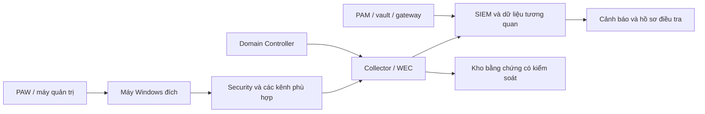

# Windows event audit trong quản lý truy cập đặc quyền

## 1. Mục tiêu và phạm vi

Windows event audit là việc cấu hình Windows tạo, thu thập và phân tích sự kiện để giải thích một hoạt động đã diễn ra trong ngữ cảnh bảo mật nào. Trong Privileged Access Management (PAM), mục tiêu là nối được **người yêu cầu quyền → tài khoản đặc quyền → máy đích → hành động → phê duyệt → bằng chứng**.

Một dòng “đăng nhập thành công” chưa trả lời được người đó có được phép quản trị máy này hay không. Ngược lại, một yêu cầu PAM được duyệt chưa chứng minh phiên trên Windows đã tuân thủ phạm vi được duyệt. Cần kết hợp dấu vết Windows với kiểm kê tài khoản, chính sách least privilege, cửa sổ JIT, giới hạn JEA, nhật ký vault và giám sát phiên.

Sau bài học, người học cần có khả năng:

- Chọn nguồn log và nhóm sự kiện phù hợp cho máy trạm quản trị, Windows Server và Domain Controller.
- Đọc đúng actor, đối tượng bị tác động, kiểu đăng nhập và định danh phiên.
- Cấu hình audit có chủ đích, kiểm tra cấu hình có hiệu lực và xác nhận sự kiện thực sự phát sinh.
- Tương quan sự kiện Windows với phê duyệt PAM mà không đánh đồng tài khoản dùng chung với một con người cụ thể.
- Bảo vệ và kiểm chứng đường đi của bằng chứng, kể cả khi máy nguồn bị mất kết nối hoặc log bị xóa.

Các ví dụ dùng tên giả `CORP\adm.lan`, `APP-WIN-01`, `PAW-01` và mã yêu cầu `PAM-2048`. Những đoạn lệnh cấu hình dành cho phòng lab hoặc quy trình thay đổi đã được phê duyệt. Bài học không yêu cầu bật quyền quản trị miền cho người chỉ cần đọc log.

## 2. Windows audit đóng góp gì cho PAM?

Có ba lớp thông tin cần giữ riêng khi phân tích:

| Lớp thông tin | Ví dụ | Câu hỏi được giải quyết |
| --- | --- | --- |
| Quyết định cấp quyền | PAM duyệt JIT trong 30 phút, mục đích kiểm tra dịch vụ | Ai được phép làm gì, trên máy nào, trong thời gian nào? |
| Hoạt động Windows quan sát được | Đăng nhập, tiến trình mới, thêm thành viên nhóm | Máy đã ghi nhận điều gì và dưới danh tính nào? |
| Kết quả xác minh | Thay đổi cấu hình thực tế, trạng thái nhóm, bằng chứng sau thu hồi | Hoạt động có tạo ra kết quả và còn quyền tồn dư hay không? |

Audit là kiểm soát phát hiện và cung cấp bằng chứng. Nó không tự thay thế việc chặn đăng nhập trực tiếp, vault credential, giới hạn lệnh hoặc kết thúc phiên. Nếu thiết kế JIT chỉ gỡ thành viên nhóm khi hết hạn, cần kiểm tra riêng khả năng phiên hoặc token đã tồn tại tiếp tục được sử dụng; việc thay đổi membership không phải bằng chứng mọi phiên đã kết thúc.

Một hồ sơ điều tra tốt có thể mô tả:

> Người dùng Lan yêu cầu quyền qua PAM, được cấp sử dụng tài khoản quản trị được quản lý, kết nối qua gateway đến APP-WIN-01, thực hiện một tiến trình trong thời gian được duyệt và để lại bằng chứng đối chiếu với yêu cầu PAM-2048.

Nếu chỉ có tài khoản `CORP\shared-admin` trong event, báo cáo phải giữ nguyên giới hạn đó. Muốn quy về Lan cần có ánh xạ đáng tin cậy từ checkout/session của PAM, thời gian, đích kết nối và các bằng chứng liên quan.

## 3. Chọn đúng nơi phát sinh sự kiện

### 3.1. Nguồn log theo vai trò

Không có một máy duy nhất chứa đầy đủ dấu vết của mọi phiên quản trị Windows.

| Nguồn | Giá trị trong PAM | Giới hạn cần nhớ |
| --- | --- | --- |
| Máy đích Windows | Phiên đăng nhập, tiến trình, thay đổi local group và cấu hình trên máy | Không tự biết ai đã phê duyệt yêu cầu PAM |
| Domain Controller | Dấu vết xác thực và thay đổi đối tượng, nhóm thuộc miền theo policy được bật | Không thay thế process audit trên member server |
| PAW hoặc jump host | Ngữ cảnh phía máy quản trị, công cụ được khởi chạy và một số lần dùng credential | IP hoặc tên máy nguồn không tự xác định con người |
| PAM/vault/gateway | Request, approval, checkout, managed account, đích truy cập và session | Có thể không nhìn thấy kết nối đi vòng ngoài hệ thống |
| Collector/SIEM | Tập hợp dữ liệu, chuẩn hóa, cảnh báo, lưu giữ và truy vấn | Không thể khôi phục sự kiện chưa được tạo hoặc đã mất trước khi thu thập |

Các sự kiện thuộc Audit Logon liên quan đến việc tạo phiên đăng nhập trên máy được truy cập; chẳng hạn truy cập tài nguyên qua mạng cần tìm dấu vết trên máy cung cấp tài nguyên. Đây là lý do không thể chỉ thu log ở Domain Controller rồi coi như đã phủ hết hoạt động quản trị máy chủ. [Microsoft: Audit Logon](https://learn.microsoft.com/en-us/windows/security/threat-protection/auditing/audit-logon).

### 3.2. Luồng bằng chứng



Windows Event Forwarding (WEF) chuyển những sự kiện đã được chọn từ máy nguồn đến Windows Event Collector (WEC). Việc định nghĩa subscription không tự bật audit trên máy nguồn. Hãy kiểm tra độc lập ba mắt xích: **có tạo sự kiện, có chuyển sự kiện, có xử lý sự kiện**. [Microsoft: Windows Event Forwarding](https://learn.microsoft.com/en-us/windows/security/operating-system-security/device-management/use-windows-event-forwarding-to-assist-in-intrusion-detection).

## 4. Thiết kế audit policy theo hành vi cần chứng minh

### 4.1. Dùng Advanced Audit Policy

Trong môi trường miền, có thể quản lý qua Group Policy tại nhánh:

```text
Computer Configuration
  Policies
    Windows Settings
      Security Settings
        Advanced Audit Policy Configuration
          Audit Policies
```

Tên nhánh có thể khác cách hiển thị trong trình quản lý chính sách cục bộ. Cần xác định GPO thực sự áp dụng cho OU và vai trò máy, thay vì chỉ nhìn cấu hình được đặt trong một GPO.

Khi dùng subcategory, kiểm tra tùy chọn Security Options:

`Audit: Force audit policy subcategory settings (Windows Vista or later) to override audit policy category settings`.

Điều này giúp tránh việc thiết lập audit theo category cơ bản làm sai lệch thiết kế subcategory. Phân phối policy và kiểm tra effective policy là hai công việc khác nhau. [Microsoft: Command line process auditing](https://learn.microsoft.com/en-us/windows-server/identity/ad-ds/manage/component-updates/command-line-process-auditing).

### 4.2. Ma trận khởi đầu cho lab PAM

Ma trận dưới đây là điểm xuất phát để kiểm thử, không phải cấu hình bắt buộc cho mọi tổ chức. Bổ sung hoặc tinh chỉnh theo vai trò máy, khả năng thu thập, rủi ro và chính sách lưu giữ.

| Subcategory | Mức cần thử nghiệm | Mục đích |
| --- | --- | --- |
| Audit Logon | Success và Failure | Quan sát đăng nhập hợp lệ và thất bại |
| Audit Logoff | Success | Bổ sung dấu vết kết thúc phiên |
| Audit Special Logon | Success | Nhận diện phiên được gán đặc quyền nhạy cảm |
| Audit Process Creation | Success | Quan sát việc tạo tiến trình |
| Audit Security Group Management | Success | Theo dõi thay đổi membership |
| Audit User Account Management | Success; chọn Failure theo nhu cầu | Theo dõi vòng đời và thao tác quản trị tài khoản |
| Audit Audit Policy Change | Success; thử Failure khi có use case | Giám sát thay đổi thiết lập audit |
| Audit Other Object Access Events | Success nếu theo dõi scheduled task | Bổ sung dấu vết tạo và sửa task |
| Audit Security System Extension | Success trên hệ điều hành hỗ trợ sự kiện cần thu | Bổ sung dấu vết cài service |
| Audit File System hoặc Audit Registry | Chọn đối tượng và loại thao tác cụ thể | Chứng minh truy cập đối tượng quan trọng |

Tài liệu Advanced Audit Policy mô tả các category, subcategory và sự kiện tương ứng. Cần đối chiếu với phiên bản Windows, vì không phải mọi sự kiện hoặc field đều hiện diện trên mọi phiên bản. [Microsoft: Advanced Audit Policy Configuration](https://learn.microsoft.com/en-us/windows-server/identity/ad-ds/plan/security-best-practices/advanced-audit-policy-configuration).

Với file và registry, bật audit policy chưa đủ để mọi truy cập trở thành sự kiện. Phải thiết kế System Access Control List (SACL) thích hợp trên đối tượng cần giám sát. DACL trả lời ai được phép truy cập; SACL chỉ định hoạt động cần audit. Không nên audit toàn bộ mọi thao tác trên mọi đối tượng khi chưa đo lưu lượng và xác định giá trị điều tra.

## 5. Nhóm sự kiện cốt lõi

### 5.1. Đăng nhập và sử dụng credential

| Event ID | Ý nghĩa chính | Cách dùng trong PAM |
| --- | --- | --- |
| 4624 | Đăng nhập thành công, tạo ngữ cảnh phiên | Xác định tài khoản, máy đích, kiểu đăng nhập và Logon ID |
| 4625 | Đăng nhập thất bại | Phân tích sai credential, sai điều kiện đăng nhập hoặc chuỗi bất thường |
| 4634 | Một phiên đã đăng xuất | Bổ sung mốc kết thúc quan sát được |
| 4647 | Người dùng khởi tạo đăng xuất | Phân biệt yêu cầu đăng xuất với các dấu vết khác |
| 4648 | Tiến trình thử đăng nhập bằng credential được cung cấp tường minh | Tìm ngữ cảnh dùng tài khoản khác hoặc managed credential |
| 4672 | Phiên mới được gán một số đặc quyền nhạy cảm | Chọn phiên đáng quan tâm để tương quan tiếp |

Với 4625, cần đọc `Status`, `SubStatus`, tài khoản đích, `LogonType` và nguồn kết nối nếu có. Một service chưa nhận credential mới sau rotation có thể tạo nhiều lần thất bại; không thể chỉ đếm event rồi kết luận đang dò mật khẩu. Không xem 4625 là một phiên thành công có thể ghép với 4672. [Microsoft: Event 4625](https://learn.microsoft.com/en-us/windows/security/threat-protection/auditing/event-4625).

4648 thể hiện một **lần thử** dùng credential tường minh, không tự chứng minh phía đích đã chấp nhận đăng nhập. Cần đối chiếu kết quả và nguồn log liên quan. Hoạt động hợp lệ của hệ điều hành hoặc tác vụ nền cũng có thể tạo 4648. [Microsoft: Event 4648](https://learn.microsoft.com/en-us/windows/security/threat-protection/auditing/event-4648).

4672 không phải sự kiện “người dùng vừa làm điều xấu” hoặc “vừa thực thi lệnh quản trị”. SYSTEM thường tạo loại sự kiện này trong hoạt động bình thường. Nó cho biết một phiên có những đặc quyền thuộc phạm vi event, chưa chứng minh từng đặc quyền đã được sử dụng. [Microsoft: Event 4672](https://learn.microsoft.com/en-us/windows/security/threat-protection/auditing/event-4672).

### 5.2. Thực thi và thay đổi trạng thái

| Event ID | Hoạt động | Điểm cần kiểm tra |
| --- | --- | --- |
| 4688 | Tạo tiến trình | Executable, command line nếu được bật, creator và target context |
| 4720, 4722, 4725, 4726 | Tạo, bật, tắt hoặc xóa tài khoản | Actor, tài khoản bị tác động, máy hoặc miền sở hữu |
| 4724 | Thử reset mật khẩu tài khoản | Phân biệt actor với tài khoản nhận thay đổi; kiểm tra kết quả event |
| 4728 / 4729 | Thêm / bỏ thành viên nhóm global | Nhóm và member SID trong miền liên quan |
| 4732 / 4733 | Thêm / bỏ thành viên nhóm local hoặc domain-local | Phạm vi nhóm, máy phát sinh, actor và member |
| 4756 / 4757 | Thêm / bỏ thành viên nhóm universal | Phạm vi miền/rừng theo thiết kế nhóm |
| 4697 | Cài service mới | Tên service, executable và tài khoản chạy service |
| 4698 / 4702 | Tạo / cập nhật scheduled task | Task name, nội dung task, ngữ cảnh thực thi |

Các nhóm sự kiện quản lý tài khoản và nhóm được mô tả trong [Microsoft: Advanced Audit Policy Configuration](https://learn.microsoft.com/en-us/windows-server/identity/ad-ds/plan/security-best-practices/advanced-audit-policy-configuration). Trong triển khai thực tế, inventory phải xác định nhóm nào tạo ra quyền đặc biệt: tên chứa “admin” không phải tiêu chí duy nhất.

Riêng 4732, `SubjectUserSid` là actor yêu cầu thay đổi, `TargetSid` xác định nhóm và `MemberSid` xác định thành viên được thêm. Event này không chỉ xuất hiện trên member server; cần đọc rõ nguồn và scope thay vì mặc định mọi 4732 đều là nhóm Administrators cục bộ. [Microsoft: Event 4732](https://learn.microsoft.com/en-us/windows/security/threat-protection/auditing/event-4732).

4697 thuộc Audit Security System Extension và được tài liệu hóa cho Windows 10/Windows Server 2016 trở lên. Không thiết kế một use case phụ thuộc duy nhất vào event này nếu chưa xác minh phiên bản trong inventory. Actor cài service và tài khoản mà service chạy là hai vai trò khác nhau. [Microsoft: Event 4697](https://learn.microsoft.com/en-us/windows/security/threat-protection/auditing/event-4697).

4698 thuộc Audit Other Object Access Events. Đọc nội dung task giúp hiểu đích thực thi, nhưng việc tạo task chưa chứng minh task đã chạy hoặc hành động bên trong thành công. Cần bổ sung dấu vết thực thi và kết quả phù hợp. [Microsoft: Event 4698](https://learn.microsoft.com/en-us/windows/security/threat-protection/auditing/event-4698).

### 5.3. Tính toàn vẹn của audit

- **4719:** Chính sách audit của máy thay đổi. Cần kiểm tra subcategory bị tác động, actor và yêu cầu thay đổi tương ứng. Event này có thể được ghi ngay cả khi Audit Policy Change không được bật; một filter loại bỏ nó vẫn làm mất khả năng quan sát ở tầng thu thập. [Microsoft: Event 4719](https://learn.microsoft.com/en-us/windows/security/threat-protection/auditing/event-4719).
- **1102:** Windows Security audit log bị xóa. Đây là tín hiệu cần xác minh sớm; không tự kết luận động cơ khi chưa kiểm tra quy trình vận hành và bằng chứng khác. Xóa local log không tự xóa bản sao đã được chuyển ra collector, nhưng sự kiện chưa kịp chuyển vẫn có thể bị mất. [Microsoft: Event 1102](https://learn.microsoft.com/en-us/windows/security/threat-protection/auditing/event-1102).

Theo dõi thêm tình trạng đầy log, dịch vụ ghi log, subscription và độ trễ thu thập theo khả năng nền tảng. Không có event cảnh báo chưa đủ để kết luận đường đi của audit đang hoạt động.

## 6. Đọc một event đúng ngữ nghĩa

### 6.1. Phân biệt Subject và Target

`Subject` thường mô tả chủ thể yêu cầu hoặc thực hiện thao tác; `Target` mô tả đối tượng bị tác động hoặc ngữ cảnh đích theo schema của từng event.

Ví dụ 4732 có thể cho biết:

```text
Computer:          APP-WIN-01.corp.example
SubjectUserName:   adm.lan
SubjectLogonId:    0x72a61
TargetUserName:    Administrators
TargetSid:         S-1-5-32-544
MemberSid:         S-1-5-21-...-1607
```

Kết luận trực tiếp là actor `adm.lan` đã thêm member có SID nêu trên vào nhóm được chỉ định trên nguồn tương ứng. Không được biến `MemberSid` thành actor, hoặc biến `TargetUserName` thành tài khoản đăng nhập.

Ví dụ này là dữ liệu minh họa; dấu `...` trong SID không phải SID hợp lệ để đưa vào cấu hình hay truy vấn sản xuất.

### 6.2. LogonType là ngữ cảnh, không phải phán quyết

Một số giá trị thường gặp trong 4624:

| LogonType | Ngữ cảnh | Ý nghĩa cần xem xét |
| --- | --- | --- |
| 2 | Interactive | Phiên tương tác tại máy |
| 3 | Network | Truy cập qua mạng, không đồng nghĩa RDP |
| 4 | Batch | Ngữ cảnh batch, thường liên quan tác vụ |
| 5 | Service | Ngữ cảnh đăng nhập của service |
| 9 | NewCredentials | Credential khác được dùng cho kết nối đi ra trong ngữ cảnh phù hợp |
| 10 | RemoteInteractive | Phiên tương tác từ xa, thường liên quan RDP |

Không diễn giải logon type 9 là phía máy từ xa đã xác thực thành công. Với logon type 3, cần bổ sung tài nguyên đích, account, thời điểm và các nguồn khác để hiểu hành vi. Thông tin IP có thể thiếu hoặc phản ánh một gateway; không dùng IP làm bằng chứng duy nhất quy về người dùng. [Microsoft: Event 4624](https://learn.microsoft.com/en-us/windows/security/threat-protection/auditing/event-4624).

Một service account xuất hiện ở logon type 2 hoặc 10 thường đáng kiểm tra vì có thể trái thiết kế sử dụng tài khoản. Tuy vậy, detection vẫn cần inventory xác nhận đây là service account và danh sách ngoại lệ có thời hạn.

### 6.3. Đặc quyền, elevation và hành động

Với 4688, cần phân biệt creator subject và target subject khi schema có cả hai. Một tiến trình có thể được tạo dưới ngữ cảnh khác với tiến trình gọi. Đừng ép mọi field `SubjectLogonId` thành “phiên người thực thi” trong mọi tình huống.

Các field như `TokenElevationType`, `MandatoryLabel`, `ParentProcessName` và `CommandLine` phụ thuộc schema, phiên bản và cấu hình. Không suy rằng command line rỗng nghĩa là không có đối số hoặc không có hành động. [Microsoft: Event 4688](https://learn.microsoft.com/en-us/windows/security/threat-protection/auditing/event-4688).

4688 ghi nhận tạo tiến trình, không phải bản ghi đầy đủ mọi API, cmdlet hay thay đổi dữ liệu. Một lệnh PowerShell chạy bên trong tiến trình đang tồn tại có thể không tạo thêm 4688 riêng. Khi cần hiểu sâu, lựa chọn thêm PowerShell logging, EDR, audit đối tượng hoặc nhật ký ứng dụng theo use case và quyền truy cập dữ liệu.

## 7. Khóa tương quan: tránh ghép nhầm phiên

Một mô hình tương quan nên giữ ít nhất:

```text
Định danh nguồn: asset_id + original_computer + source_channel
Định danh event: provider + event_id + version + source_record_id
Thời gian: event_time_utc + ingest_time_utc
Ngữ cảnh phiên: computer + boot_context + logon_id
Đối tượng: actor_sid + target_sid/member_sid theo từng schema
Ngữ cảnh PAM: request_id + managed_account + target_asset + approval_window
```

`boot_context` có thể do hệ thống bổ sung từ dữ liệu khởi động hoặc quản lý tài sản; không giả định mọi Security event có sẵn field này.

Các nguyên tắc thực hành:

1. Trong 4624, `TargetLogonId` mô tả phiên mới. Tìm 4672 có `SubjectLogonId` tương ứng trên **cùng máy** và thời gian hợp lý.
2. Với 4688, đối chiếu creator/target theo version và SID, giữ cả hai ngữ cảnh nếu chúng khác nhau.
3. Không ghép Logon ID trùng nhau giữa APP-WIN-01 và DC-01. Giá trị này không phải mã phiên toàn cục của toàn miền.
4. Không dùng PID làm khóa lâu dài. PID có thể được tái sử dụng; cần máy, khoảng thời gian và chuỗi tạo tiến trình.
5. Không coi `0x0`, chuỗi rỗng, `-` hoặc GUID toàn số 0 là khóa đủ sức tương quan.
6. Giữ dữ liệu gốc khi chuẩn hóa. Cùng một giá trị hex có thể khác chữ hoa, chữ thường hoặc cách biểu diễn; chuẩn hóa phải bảo toàn ý nghĩa.
7. Khi chuyển qua WEC, giữ định danh máy và record gốc trong payload. Metadata bản ghi tại collector có thể khác metadata tại nguồn.

Để gắn với PAM, ưu tiên ánh xạ account SID và asset ID. Nếu PAM chỉ cung cấp tên tài khoản, phải xử lý domain, local account trùng tên và thời điểm đổi tên. Nếu một managed account có nhiều checkout chồng nhau, phải báo mức độ mơ hồ thay vì tự chọn người có thời gian gần nhất.

Đồng bộ thời gian cũng là một phần của bằng chứng. Ví dụ `2026-11-27T03:00:00Z` tương ứng 10:00 tại Việt Nam. Lưu UTC, hiển thị múi giờ rõ ràng và đo chênh lệch đồng hồ; không chỉ nới cửa sổ tương quan để che lỗi đồng bộ.

## 8. Kiểm tra policy và tạo tiến trình có thể audit

### 8.1. Đọc cấu hình đang có hiệu lực

Các lệnh sau là ví dụ kiểm tra trên máy Windows được phép quản trị:

```powershell
auditpol /get /category:* /r
auditpol /list /subcategory:* /v
gpresult /r /scope computer
wevtutil gl Security
w32tm /query /status
```

`auditpol` cho phép truy vấn, thiết lập và sao lưu audit policy. Tên subcategory có thể được bản địa hóa; lấy tên hoặc GUID từ chính máy thay vì sao chép tên tiếng Anh rồi giả định lệnh luôn hoạt động. [Microsoft: auditpol](https://learn.microsoft.com/en-us/windows-server/administration/windows-commands/auditpol).

Nếu lab dùng Windows hiển thị tên subcategory tiếng Anh, có thể thử cấu hình giới hạn:

```powershell
# Thay đổi policy: chỉ chạy trong lab hoặc change được duyệt.
auditpol /set /subcategory:"Logon" /success:enable /failure:enable
auditpol /set /subcategory:"Special Logon" /success:enable
auditpol /set /subcategory:"Process Creation" /success:enable
auditpol /set /subcategory:"Security Group Management" /success:enable
```

Không dùng thiết lập local này để thay thế quản trị GPO ở môi trường miền. Sau policy refresh, kiểm tra lại để biết có bị GPO khác ghi đè hay không. Khi kết thúc lab, đối chiếu và phục hồi đúng thiết lập trước đó bằng quy trình thay đổi, thay vì tắt toàn bộ audit.

### 8.2. Command line của 4688

Bật Audit Process Creation tạo tiền đề thu 4688. Để có command line, còn cần policy:

```text
Computer Configuration
  Policies
    Administrative Templates
      System
        Audit Process Creation
          Include command line in process creation events
```

Đối số được ghi dạng văn bản trong Security log khi tính năng này được bật. Mật khẩu, token hoặc dữ liệu riêng tư đặt trên command line có thể đi vào hệ thống log. Vì vậy, cần đồng thời cải tiến cách truyền secret và hạn chế quyền đọc dữ liệu audit. [Microsoft: Command line process auditing](https://learn.microsoft.com/en-us/windows-server/identity/ad-ds/manage/component-updates/command-line-process-auditing).

Để tạo hành vi kiểm thử đơn giản, mở một tiến trình chỉ đọc thông tin:

```powershell
whoami.exe /user
cmd.exe /c ver
```

Kết quả mong đợi là dấu vết tiến trình mới khi policy thích hợp đã có hiệu lực, không phải một sự kiện cho mọi dòng lệnh bên trong mọi shell. Nếu muốn kiểm thử phiên đặc quyền, dùng tài khoản lab đã được cấp quyền theo thiết kế; không tự thêm tài khoản vào Domain Admins chỉ để tạo event.

## 9. Truy vấn và chuẩn hóa bằng PowerShell

### 9.1. Lọc ngay tại nguồn truy vấn

Hạn chế thời gian và event ID trước khi đưa dữ liệu vào pipeline:

```powershell
$filter = @{
    LogName   = 'Security'
    Id        = @(4624, 4625, 4648, 4672, 4688, 4732, 4719, 1102)
    StartTime = (Get-Date).AddHours(-2)
}

$records = Get-WinEvent -FilterHashtable $filter -ErrorAction Stop
```

`Get-WinEvent` hỗ trợ lọc bằng hashtable, XPath và structured XML. Ví dụ trên đọc local Security log; nó không tự truy vấn mọi máy trong miền. Quyền đọc phải được cấp phù hợp với kênh và mô hình triển khai. [Microsoft: Get-WinEvent](https://learn.microsoft.com/en-us/powershell/module/microsoft.powershell.diagnostics/get-winevent).

Nếu không có bản ghi phù hợp, cần phân biệt tình huống “không có kết quả” với access denied, kênh không tồn tại hoặc truy vấn sai. Không dùng một `catch` rỗng rồi tuyên bố hệ thống không có hành vi bất thường.

### 9.2. Đọc XML theo tên field

Không nên phụ thuộc vào `Properties[5]` hoặc parse chuỗi `Message` đã được dịch. Thứ tự field và văn bản hiển thị có thể thay đổi. Dưới đây là bộ trích xuất minh họa cho những event trong phạm vi truy vấn:

```powershell
function ConvertTo-PamAuditRecord {
    param(
        [Parameter(Mandatory, ValueFromPipeline)]
        [System.Diagnostics.Eventing.Reader.EventRecord] $Record
    )

    process {
        $xml = [xml] $Record.ToXml()
        $fields = @{}

        $eventDataNodes = $xml.SelectNodes(
            "/*[local-name()='Event']" +
            "/*[local-name()='EventData']/*[local-name()='Data']"
        )

        foreach ($node in $eventDataNodes) {
            $fieldName = $node.GetAttribute('Name')
            if (-not [string]::IsNullOrWhiteSpace($fieldName)) {
                $fields[$fieldName] = $node.InnerText
            }
        }

        # 1102 đặt thông tin actor trong UserData/LogFileCleared.
        $userDataNodes = $xml.SelectNodes(
            "/*[local-name()='Event']/*[local-name()='UserData']/*/*"
        )

        foreach ($node in $userDataNodes) {
            if (-not $fields.ContainsKey($node.LocalName)) {
                $fields[$node.LocalName] = $node.InnerText
            }
        }

        $timeUtc = $null
        if ($null -ne $Record.TimeCreated) {
            $timeUtc = $Record.TimeCreated.ToUniversalTime().ToString('o')
        }

        [pscustomobject] @{
            Computer           = $Record.MachineName
            Channel            = $Record.LogName
            Provider           = $Record.ProviderName
            EventId            = $Record.Id
            EventVersion       = $Record.Version
            RecordId           = $Record.RecordId
            TimeUtc            = $timeUtc
            SubjectUserSid     = $fields['SubjectUserSid']
            SubjectUserName    = $fields['SubjectUserName']
            SubjectDomainName  = $fields['SubjectDomainName']
            SubjectLogonId     = $fields['SubjectLogonId']
            TargetUserSid      = $fields['TargetUserSid']
            TargetUserName     = $fields['TargetUserName']
            TargetDomainName   = $fields['TargetDomainName']
            TargetLogonId      = $fields['TargetLogonId']
            TargetSid          = $fields['TargetSid']
            MemberSid          = $fields['MemberSid']
            LogonType          = $fields['LogonType']
            IpAddress          = $fields['IpAddress']
            NewProcessName     = $fields['NewProcessName']
            NewProcessId       = $fields['NewProcessId']
            CreatorProcessId   = $fields['ProcessId']
            ParentProcessName  = $fields['ParentProcessName']
            CommandLine        = $fields['CommandLine']
            RawFields          = $fields
        }
    }
}

$normalized = @($records | ConvertTo-PamAuditRecord)

$normalized |
    Sort-Object TimeUtc |
    Select-Object TimeUtc, Computer, EventId,
        SubjectUserName, TargetUserName,
        SubjectLogonId, TargetLogonId, NewProcessName
```

Đoạn mã chỉ trích xuất field, chưa gán ý nghĩa thống nhất cho mọi event. Ví dụ `TargetUserName` trong event thay đổi nhóm có thể là tên nhóm; không được xuất nó thành field “người đăng nhập” chung cho tất cả event. `CreatorProcessId` chỉ nên được diễn giải theo schema tương ứng, nhất là với 4688.

Cách đọc `UserData` trên xử lý trường hợp 1102 được dùng ở đây, không phải parser tổng quát cho mọi cấu trúc XML nhiều tầng của mọi provider. Trong pipeline sản xuất, cần giữ XML gốc, version parser, metadata ingest và kiểm thử bằng dữ liệu thực tế của từng schema.

### 9.3. Rà một phiên cụ thể

Sau khi tìm được 4624 trên đúng máy, có thể rà các dòng có Logon ID tương ứng:

```powershell
$computerForReview = 'APP-WIN-01.corp.example'
$logonForReview = '0x72a61'

$normalized |
    Where-Object {
        $_.Computer -eq $computerForReview -and (
            $_.SubjectLogonId -eq $logonForReview -or
            $_.TargetLogonId -eq $logonForReview
        )
    } |
    Sort-Object TimeUtc |
    Select-Object TimeUtc, EventId, SubjectUserName,
        TargetUserName, NewProcessName, MemberSid
```

Đây là phép rà bằng tay trong tập dữ liệu hai giờ đã lấy. Nó không tự chứng minh cùng boot context, không tìm các event đã bị loại khỏi filter và không tự ghép PAM request. Cần kiểm tra actor SID và nghĩa của từng field trước khi đưa dòng vào timeline chính thức.

## 10. Thu thập tập trung và kiểm chứng end-to-end

### 10.1. Ví dụ bộ lọc subscription

Một truy vấn XML minh họa cho tập sự kiện khởi đầu:

```xml
<QueryList>
  <Query Id="0" Path="Security">
    <Select Path="Security">
      *[System[
        (EventID=4624 or EventID=4625 or EventID=4648 or
         EventID=4672 or EventID=4688 or EventID=4732 or
         EventID=4733 or EventID=4719 or EventID=1102)
      ]]
    </Select>
  </Query>
</QueryList>
```

Đây là phần chọn event, chưa phải toàn bộ cấu hình subscription hay baseline hoàn chỉnh. Chẳng hạn filter này không chọn 4728, 4756 hoặc 4698; nếu use case cần những hành vi đó, phải bổ sung tương ứng và kiểm thử. Không chỉ chọn provider Security-Auditing mà bỏ qua việc 1102 thuộc provider Windows-Eventlog.

Đối với WEF/WEC, thiết kế thêm phạm vi máy được phép tham gia, xác thực kết nối, quyền đọc kênh và quản trị collector. Không mở rộng quyền đọc toàn bộ máy hoặc cấp Domain Admin chỉ để giải quyết một lỗi subscription.

### 10.2. Chứng minh từng chặng

Với một thao tác kiểm thử đã biết thời điểm và executable:

1. Xác nhận event xuất hiện tại máy nguồn.
2. Tìm bản sao trên collector theo máy nguồn, thời gian và dữ liệu nhận diện event.
3. Xác nhận SIEM giữ được provider, event ID, version và các field phục vụ detection.
4. Đo từ event time đến ingest time; kiểm tra độ trễ của cảnh báo.
5. Đối chiếu kết quả với PAM request và phiên tương ứng.
6. Kiểm tra dữ liệu có thể truy xuất sau thời gian vận hành dự kiến, không chỉ ngay lúc triển khai.

Ngoài việc quan sát event đang đến, nên có bài kiểm thử định kỳ tạo một hành vi vô hại, có định danh hoặc mốc thời gian đã biết. Khi dữ liệu không xuất hiện, hệ thống phải phân biệt máy nhàn rỗi với lỗi nguồn, lỗi forwarding và lỗi ingest.

## 11. Từ sự kiện đến detection có ngữ cảnh

Các detection sau là thiết kế logic. Cần triển khai bằng schema thực tế của SIEM và hiệu chỉnh trên dữ liệu của tổ chức.

### 11.1. Phiên quản trị thiếu phê duyệt phù hợp

```text
Ứng viên:
  4624 trên máy thuộc phạm vi PAM
  và account được inventory phân loại là tài khoản đặc quyền

Làm giàu:
  tìm 4672 cùng máy / phiên khi có
  xác định đường truy cập và account SID
  tìm PAM session hoặc request khớp account + asset + thời gian

Đánh giá:
  nếu feed PAM khỏe và không có quyền sử dụng phù hợp:
    cảnh báo thiếu phê duyệt hoặc khả năng đi vòng
  nếu feed PAM lỗi, trễ hoặc ánh xạ account mơ hồ:
    đánh dấu thiếu bằng chứng, không tự kết luận truy cập trái phép
```

Đường truy cập qua gateway là một phần của thiết kế được duyệt, không chỉ một điều kiện IP đơn giản. Có thể có NAT, nhiều gateway hoặc phiên hỗ trợ khẩn cấp cần xác minh riêng.

### 11.2. Thay đổi nhóm đặc quyền vượt phạm vi

Ứng viên là 4728, 4732 hoặc 4756 tác động đến nhóm được inventory xác định là nhạy cảm. Đối chiếu member SID, actor SID, nhóm đích, thời hạn JIT và mục đích yêu cầu.

Một phiên được phép kiểm tra service không mặc nhiên được phép thêm một service account vào Administrators. Phê duyệt cần khớp hành động, không chỉ khớp tài khoản và cửa sổ thời gian.

Cần phân biệt thay đổi JIT do automation được duyệt với thay đổi thủ công. Khi automation thực hiện thao tác, bổ sung request hoặc job ID từ hệ điều phối; actor Windows có thể là tài khoản máy hoặc service account của hệ thống PAM.

### 11.3. Tài khoản dịch vụ đăng nhập tương tác

Kết hợp 4624 logon type 2 hoặc 10 với phân loại service account. So sánh máy đích, chủ sở hữu, maintenance window và ngoại lệ.

Nếu đây là sự kiện dự kiến trong xử lý khẩn cấp, vẫn lưu bằng chứng và thời hạn ngoại lệ. Tránh allowlist vĩnh viễn chỉ vì từng có một lần sử dụng hợp lệ.

### 11.4. Audit policy bị thay đổi hoặc log bị xóa

Với 4719 hoặc 1102, kiểm tra:

- Actor có được phép thực hiện thao tác và có change record không?
- Thay đổi làm giảm khả năng quan sát ở subcategory nào?
- Trước đó có phiên quản trị, tiến trình hoặc thay đổi quyền đáng chú ý không?
- Collector đã nhận được đến thời điểm nào, còn khoảng trống bằng chứng nào?
- Sau thao tác, audit và forwarding có tiếp tục hoạt động không?

Một cảnh báo có giá trị cần nêu cả mức độ thiếu dữ liệu, thay vì chỉ báo “log bị xóa” rồi ngừng điều tra.

### 11.5. Tiến trình ngoài mục đích phiên

Với 4688, so sánh executable, parent process và đối số phù hợp với mục đích yêu cầu. Phát hiện dựa vào chuỗi command line phải cân nhắc đường dẫn, cách gọi hợp lệ và dữ liệu bị thiếu.

Không dùng tên một binary quen thuộc để tự xác nhận thao tác an toàn. Cũng không tự chặn mọi phiên chỉ vì thấy một công cụ quản trị; cần hành vi, asset, account và phạm vi được duyệt.

## 12. Ví dụ điều tra một phiên vượt thời hạn JIT

Giả sử PAM-2048 cho phép `CORP\adm.lan` kiểm tra dịch vụ trên APP-WIN-01 từ 03:00 đến 03:30 UTC. Đây là timeline giả định phục vụ học tập:

| Thời điểm UTC | Bằng chứng | Diễn giải ban đầu |
| --- | --- | --- |
| 03:00 | PAM duyệt request, ghi managed account và máy đích | Có quyền sử dụng theo phạm vi được duyệt |
| 03:05 | 4624 type 10 trên APP-WIN-01, TargetLogonId 0x72a61 | Có phiên tương tác từ xa |
| 03:05 | 4672 cùng máy, SubjectLogonId 0x72a61 | Phiên có đặc quyền thuộc phạm vi event |
| 03:12 | 4688 tạo công cụ kiểm tra thông tin | Có tiến trình, cần đọc creator/target và đối số |
| 03:30 | PAM báo hết hạn và job gỡ quyền hoàn tất | Mới chứng minh job được báo hoàn tất |
| 03:34 | 4732 cùng máy, SubjectLogonId 0x72a61, thêm member vào Administrators | Có thay đổi membership sau thời hạn cần giải thích |
| 03:36 | Bản sao sự kiện đến SIEM | Có độ trễ ingest phải đưa vào timeline |

Trình tự điều tra:

1. Xác nhận múi giờ, sức khỏe đồng hồ và độ trễ giữa các nguồn.
2. Kiểm tra account SID, máy nguồn và boot context để tránh ghép nhầm Logon ID.
3. Xác nhận dữ liệu PAM có gia hạn hoặc request bổ sung chưa được đồng bộ không.
4. Kiểm tra 4732: actor nào yêu cầu thay đổi, nhóm nào bị thay đổi, member nào được thêm.
5. Đối chiếu bản ghi phiên và tiến trình nếu còn; kiểm tra quy trình thu hồi thực tế.
6. Xác minh membership và trạng thái phiên hiện tại bằng nguồn quản trị được phép.
7. Bảo toàn bằng chứng trước khi thực hiện thao tác khắc phục theo quy trình ứng phó.

Không nên viết ngay “Lan đã cố tình vượt quyền”. Kết luận tạm thời có thể là:

> Máy đích ghi nhận thay đổi membership lúc 03:34 dưới ngữ cảnh phiên liên quan đến tài khoản quản trị đã được dùng trong PAM-2048. Chưa tìm thấy phê duyệt còn hiệu lực trong dữ liệu PAM hiện có. Cần xác minh ánh xạ người dùng và khả năng phiên/token tồn tại sau thu hồi.

Nếu kiểm tra tiếp chứng minh phiên cũ còn hiệu lực sau khi JIT gỡ nhóm, đây là vấn đề của cơ chế thực thi thời hạn. Hành động cải tiến có thể gồm giới hạn thời lượng phiên, kiểm tra chấm dứt kết nối và tái kiểm chứng quyền thực tế, tùy kiến trúc PAM.

## 13. Bảo quản bằng chứng và thiết kế lưu giữ

### 13.1. Quyền đọc, tính toàn vẹn và trách nhiệm

Log có thể chứa tên tài khoản, cấu trúc hạ tầng, đối số tiến trình và dữ liệu nhạy cảm. Áp dụng least privilege cho người đọc và người quản trị log như với những tài nguyên quan trọng khác.

Thiết kế trách nhiệm nên làm rõ người vận hành máy nguồn, người quản trị collector, người xây detection và người quản lý kho bằng chứng. Hạn chế việc cùng một tài khoản quản trị máy đích cũng có quyền sửa hoặc xóa mọi bản sao bằng chứng.

Kho lưu giữ có thể sử dụng cơ chế chống sửa đổi hoặc retention lock phù hợp. Những cơ chế đó bảo vệ dữ liệu đã lưu; chúng không chứng minh máy nguồn chưa bị can thiệp trước khi tạo hoặc chuyển event.

Một hồ sơ bằng chứng cần ghi được:

- Máy, kênh, provider, event ID/version, thời gian nguồn và thời gian thu nhận.
- Cách chọn dữ liệu, khoảng thời gian truy vấn và những filter đã áp dụng.
- Người thu thập, thời điểm thu thập, công cụ và nơi lưu.
- Hash file xuất, lịch sử bàn giao, quyền truy cập và các lần tạo bản sao.
- Khoảng trống dữ liệu, lỗi parser hoặc tình trạng feed có thể ảnh hưởng kết luận.

Hash giúp phát hiện thay đổi so với bản đã tính hash. Nó không tự chứng minh nguồn gốc đáng tin cậy của file hoặc thay thế lịch sử bàn giao.

### 13.2. Ví dụ xuất log mà không xóa nguồn

Ví dụ dưới đây giả định thư mục `C:\PAMAuditLab` đã được tạo với quyền truy cập thích hợp, file đích chưa tồn tại và người thực hiện được phép xuất Security log:

```powershell
wevtutil epl Security C:\PAMAuditLab\Security-last2h.evtx /q:"*[System[TimeCreated[timediff(@SystemTime) <= 7200000]]]" /ow:false
Get-FileHash -LiteralPath 'C:\PAMAuditLab\Security-last2h.evtx' -Algorithm SHA256
```

`epl` là export-log; truy vấn trên chọn cửa sổ tương đối hai giờ tại thời điểm chạy. Không dùng cửa sổ tương đối nếu cần tái lập chính xác cùng một tập dữ liệu ở thời điểm khác: khi đó cần chốt mốc UTC bắt đầu/kết thúc trong hồ sơ và truy vấn. [Microsoft: wevtutil](https://learn.microsoft.com/en-us/windows-server/administration/windows-commands/wevtutil).

Bản xuất đã lọc không mặc nhiên là toàn bộ log hay toàn bộ bằng chứng của vụ việc. Có thể cần kênh khác, máy khác, dữ liệu PAM và bản sao tập trung. Không xóa Security log để kiểm thử 1102 trên máy sản xuất; có thể dùng dữ liệu mẫu hoặc lab được phép thực hiện thao tác đó.

### 13.3. Dung lượng và thời gian chịu mất kết nối

Ước lượng ban đầu:

```text
Dung lượng/ngày ≈ EPS × byte/event trung bình × 86.400
Cửa sổ đệm local ≈ dung lượng khả dụng / tốc độ ghi thực tế
```

Giả sử một máy phát trung bình 20 event/giây và mỗi event được ước lượng 1.500 byte. Lưu lượng tính toán là khoảng 2,592 GB/ngày theo đơn vị thập phân, chưa tính overhead, index, bản sao hay nén. Nếu chỉ có 1 GiB dung lượng local dành cho tập dữ liệu tương đương, phép chia đơn giản cho khoảng 9,94 giờ; lưu lượng tăng đột biến sẽ làm cửa sổ này ngắn hơn.

Đây là giả định phục vụ sizing, không phải benchmark Windows. Đo kích thước EVTX và lưu lượng ingest thực tế cho từng vai trò máy. Khi collector mất kết nối lâu hơn khả năng đệm, cần biết dữ liệu sẽ bị ghi đè, dừng ghi hay được lưu bằng cơ chế nào của cấu hình cụ thể.

Thời gian lưu giữ phải xuất phát từ nhu cầu điều tra, kiểm toán, quyền riêng tư, chính sách nội bộ và ngân sách. Không tự áp một con số ngày cố định cho mọi hệ thống. Khi chọn chế độ không ghi đè hoặc xử lý tình huống log đầy, cần đánh giá cả khả năng mất audit lẫn ảnh hưởng vận hành.

## 14. Bài thực hành: xác nhận một phiên có thể truy vết

### Chuẩn bị

Sử dụng một máy Windows lab có thể quản trị, tài khoản được cấp quyền phù hợp, quyền đọc Security log và khoảng thời gian kiểm thử đã xác định. Nếu có PAM lab, chuẩn bị một request quản trị máy này và managed account được ánh xạ rõ ràng. Nếu chưa có PAM, dùng bản ghi phê duyệt giả lập và ghi rõ giới hạn của mô hình.

### Thực hiện

1. Ghi lại audit policy hiện hành, vai trò máy, múi giờ và cấu hình Security log.
2. Xác nhận các subcategory cần thiết; áp dụng thay đổi lab nếu đang thiếu.
3. Đăng nhập bằng đường truy cập đã được phép và ghi mốc bắt đầu UTC.
4. Chạy `whoami.exe /user` và `cmd.exe /c ver` để tạo các tiến trình đơn giản.
5. Tìm 4624 của phiên; ghi account SID, LogonType và TargetLogonId.
6. Tìm 4672 nếu ngữ cảnh phiên có đặc quyền thuộc phạm vi event; giải thích nếu không có.
7. Tìm 4688 tương ứng với executable vừa chạy, phân biệt creator và target khi có.
8. Nếu command line trống, kiểm tra policy liên quan và schema trước khi đánh giá pipeline lỗi.
9. Nếu có collector/SIEM, tìm bản sao và đo độ trễ theo từng chặng.
10. Kết thúc phiên theo quy trình và đối chiếu dấu vết kết thúc quan sát được.
11. Ghi một timeline cùng những điểm chưa chứng minh được; phục hồi thay đổi lab theo cấu hình ban đầu.

### Điều kiện hoàn thành

Bài thực hành đạt mục tiêu khi người học có thể chỉ ra nguồn của từng bằng chứng, giải thích cách ghép phiên, xác nhận ít nhất một tiến trình được quan sát và nêu rõ giới hạn của kết luận.

Không yêu cầu mọi lab đều có 4672, mọi field đều có giá trị hoặc mọi phiên đều có đủ dấu vết kết thúc. Nếu một điều kiện không thỏa, cần phân tích nguyên nhân thay vì tạo hoặc sửa bằng chứng để làm timeline trông đầy đủ.

Một báo cáo tối thiểu nên trả lời: “Ai được cấp quyền?”, “Windows quan sát được account nào?”, “Trên máy nào?”, “Tiến trình nào đã được tạo?”, “Có bằng chứng phê duyệt và thu hồi tương ứng không?”, “Dữ liệu nào còn thiếu?”.

## 15. Lỗi thường gặp và hướng kiểm tra

| Hiện tượng | Giải thích có thể có | Hướng kiểm tra |
| --- | --- | --- |
| Không thấy 4688 sau thao tác | Policy chưa hiệu lực, đọc sai máy/khoảng thời gian, thao tác không tạo tiến trình mới | Kiểm tra auditpol, tạo executable vô hại, đọc local log trước |
| Có 4688 nhưng CommandLine rỗng | Chưa bật policy command line, khác schema hoặc thiếu field trong parser | Đối chiếu XML gốc và GPO có hiệu lực |
| Local có event nhưng collector không có | Filter, quyền đọc kênh, kết nối hoặc subscription có vấn đề | Kiểm tra từng chặng; không đổi audit policy một cách ngẫu nhiên |
| Collector có event nhưng SIEM thiếu actor | Parser ánh xạ sai field hoặc bỏ UserData | So schema/version; thử dữ liệu 1102 và 4732 riêng |
| Nhiều 4672 từ SYSTEM | Hoạt động bình thường của các phiên hệ thống | Dùng account inventory và ngữ cảnh; tránh cảnh báo từng event |
| 4648 xuất hiện nhưng không có đăng nhập thành công ở đích | Đây là lần thử, đích khác hoặc dữ liệu đích chưa được thu | Tìm kết quả và kiểm tra sức khỏe nguồn trước khi kết luận |
| Thấy cùng Logon ID ở nhiều máy | Logon ID không phải khóa toàn cục | Ghép thêm computer, boot context và thời gian |
| Có JIT hết hạn nhưng còn hành động | Thu hồi chưa tác động mọi phiên/token hoặc có gia hạn chưa đồng bộ | Kiểm tra phiên thực tế, job thu hồi và dữ liệu PAM |
| Không có cảnh báo ngoài giờ | Có thể thiếu dữ liệu, múi giờ sai hoặc rule chưa phủ hành vi | Kiểm thử event nguồn đến cảnh báo bằng tình huống đã biết |
| Không thấy logoff | Mất event, ngắt kết nối, crash hoặc chọn thiếu nhóm event | Không đồng nhất việc thiếu logoff với việc phiên còn sống |
| Audit file/registry không có dữ liệu | Thiếu SACL hoặc không đúng loại thao tác | Kiểm tra cả policy và SACL trên đúng đối tượng |

## 16. Tiêu chí đánh giá một thiết kế Windows audit cho PAM

Một thiết kế có thể vận hành cần chứng minh được những điểm sau:

- Phạm vi tài sản và tài khoản đặc quyền được kiểm kê; máy mới hoặc máy rời phạm vi đều có quy trình cập nhật.
- Audit policy gắn với hành vi cần quan sát và được kiểm tra trên máy thực tế.
- Nguồn Windows và PAM có đủ dữ liệu để ghép phiên, đồng thời thể hiện rõ trường hợp không thể quy về một người.
- Detection phân biệt quyền được gán, lần thử đăng nhập, tiến trình được tạo và kết quả thao tác.
- Pipeline giữ provider, event ID, version, thời gian nguồn và payload cần thiết; mất hoặc trễ dữ liệu có thể được phát hiện.
- Bằng chứng được bảo vệ, có thể truy xuất trong thời gian cần thiết và có hồ sơ bàn giao.
- Quy trình thu hồi JIT được xác nhận bằng trạng thái thực tế; không chỉ dựa vào thông báo “job thành công”.
- Có bài kiểm thử end-to-end định kỳ và người chịu trách nhiệm xử lý khi một mắt xích không đạt.

Giá trị của Windows event audit trong PAM nằm ở khả năng trả lời câu hỏi cụ thể bằng bằng chứng có ngữ cảnh. Một chuỗi sự kiện được đọc đúng giúp đánh giá least privilege, kiểm tra giới hạn phiên đặc quyền, xác minh hoạt động dùng credential và hỗ trợ ứng phó sự cố trên hạ tầng Windows.
